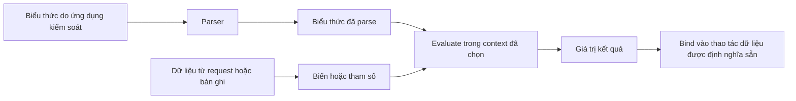

# Phân biệt biểu thức cấu hình tin cậy với giá trị do người dùng nhập

## 1. Ranh giới quan trọng: ai quyết định nội dung biểu thức?

Trong chương **Biểu thức giá trị** của module **SPRING_DATA_COMMONS**, cần phân biệt rõ **mã biểu thức** với **dữ liệu được biểu thức sử dụng**. Biểu thức có thể được đánh giá trên dữ liệu người dùng, nhưng điều đó không có nghĩa người dùng được quyền cung cấp toàn bộ biểu thức để ứng dụng thực thi.

Value Expressions kết hợp Spring Expression Language, thường viết trong `#{...}`, với property placeholder dạng `${...}`. Spring Data yêu cầu nguồn định nghĩa biểu thức phải đáng tin cậy, chẳng hạn giá trị annotation do ứng dụng quản lý. [Spring Data Commons: Value Expressions Fundamentals](https://docs.spring.io/spring-data/commons/reference/value-expressions.html)

Ví dụ, ứng dụng định nghĩa sẵn biểu thức `#{#input}` và truyền chuỗi tiêu đề từ request vào biến `input`. Trong luồng đó, ứng dụng quyết định cú pháp và thao tác; request chỉ cung cấp một giá trị.

Ngược lại, nếu ứng dụng nhận chuỗi từ request rồi gọi `parser.parse(requestText)`, request đã trở thành nguồn mã biểu thức. Ranh giới này không thay đổi chỉ vì chuỗi đã được lưu vào database, đi qua một màn hình quản trị hay có tên thuộc tính chứa từ `config`.

Sau bài này, người học có thể:

- Phân loại nguồn biểu thức và nguồn dữ liệu theo quyền kiểm soát thực tế.
- Nhận diện đường đưa dữ liệu người dùng vào parser, kể cả parse lần hai.
- Dùng biến hoặc bind parameter cho giá trị, đồng thời giới hạn lựa chọn cấu trúc truy vấn.
- Áp dụng các nguyên tắc đó vào repository, projection, phân trang, sắp xếp và phần mở rộng của Spring Data phù hợp với từng store.

## 2. Cùng là String nhưng có vai trò khác nhau

| Chuỗi xuất hiện trong ứng dụng | Vai trò dự kiến | Câu hỏi phải đặt ra |
| --- | --- | --- |
| `#{#input}` viết cố định trong code | Mã biểu thức | Ai được sửa biểu thức này? |
| `${app.region:local}` trong cấu hình triển khai được quản lý | Tham chiếu thuộc tính | Ai được sửa nguồn property và thứ tự ưu tiên của nó? |
| `Bài viết Spring Data` từ ô tìm kiếm | Giá trị tìm kiếm | Giá trị có bị đưa trở lại parser không? |
| `#{2 + 3}` từ ô nhập tiêu đề | Vẫn là tiêu đề nếu chức năng chỉ nhận văn bản | Có lớp nào tự suy ra đây là biểu thức vì có dấu `#{` không? |
| `created` từ tham số sắp xếp | Khóa lựa chọn của API | Khóa này được ánh xạ sang trường nào do server cho phép? |
| Một mẫu do khách hàng nhập và lưu trong bảng cấu hình | Dữ liệu do khách hàng kiểm soát | Ai đã cho phép biến mẫu này thành mã thực thi? |

Tính tin cậy không đến từ việc chuỗi trông có vẻ vô hại. Nó đến từ nguồn tạo, quyền sửa và đường đi của dữ liệu.

Một người có quyền quản trị nội dung của khách hàng không tự động có cùng mức tin cậy với người phát triển hoặc người vận hành được giao quyền cấu hình ứng dụng. Tài liệu Spring Framework phân biệt nguồn biểu thức do những chủ thể chịu trách nhiệm ứng dụng kiểm soát với nguồn từ người dùng cuối hoặc hệ thống bên ngoài. [Spring Framework: Security Considerations](https://docs.spring.io/spring-framework/reference/core/expressions/evaluation.html#expressions-evaluation-context-security-considerations)

## 3. Hiểu cú pháp để không nhầm ranh giới

### 3.1. SpEL, placeholder và chuỗi tổng hợp

| Dạng minh họa | Ý nghĩa |
| --- | --- |
| `#{2 + 3}` | Đánh giá một phép tính SpEL. |
| `#{#input}` | Đọc biến `input` từ evaluation context. |
| `${app.region}` | Giải quyết property từ `Environment` tương ứng. |
| `report-${app.region}` | Ghép literal và placeholder theo cơ chế Value Expression. |

`ValueExpressionParser` nhận chuỗi nguồn và tạo đối tượng biểu thức; API hỗ trợ biểu thức, template cấu hình và cả literal. Vì vậy, việc đầu vào hôm nay là chuỗi thuần không làm một API parse đầu vào tùy ý trở thành thiết kế phù hợp. [API ValueExpressionParser](https://docs.spring.io/spring-data/commons/docs/current/api/org/springframework/data/expression/ValueExpressionParser.html)

### 3.2. Ranh giới parse và evaluate

Hai bước có trách nhiệm khác nhau:

```text
parse:    đọc mã biểu thức và xây dựng cách đánh giá

evaluate: chạy biểu thức đã parse với context và dữ liệu được cung cấp
```

Dữ liệu có thể thay đổi giữa các lần evaluate mà không cần tạo mã biểu thức mới. Đó là cơ sở để giữ biểu thức cố định và đưa đầu vào qua biến.

Đừng quyết định có parse hay không dựa trên việc chuỗi chứa `#{`, `${` hoặc một từ khóa nào đó. Với ô tiêu đề, chuỗi `#{2 + 3}` có thể đơn giản là nội dung người dùng muốn lưu nguyên vẹn.

### 3.3. Placeholder không phải một bước làm sạch dữ liệu

Nếu `${some.key}` lấy được một chuỗi, chưa thể kết luận chuỗi đó an toàn để ghép vào SQL, HTML, tên collection hoặc một biểu thức khác. Ý nghĩa của kết quả còn phụ thuộc nơi nó được sử dụng tiếp theo.

Cũng không suy từ một ví dụ parser sang mọi annotation và mọi vòng đời cấu hình Spring. Một pipeline có thể có nhiều bước resolve hoặc evaluate khác nhau. Khi đánh giá ranh giới, theo dõi toàn bộ đường đi từ property source đến nơi kết quả cuối cùng được dùng.

## 4. Luồng xử lý giữ dữ liệu ở đúng vai trò



Trong luồng này, đầu vào người dùng không trở thành chuỗi nguồn của parser. Các lựa chọn về truy vấn và quyền truy cập vẫn do server quyết định.

Cần đọc sơ đồ theo đúng từng ranh giới. Một giá trị đã an toàn để giữ dưới dạng dữ liệu trong SpEL vẫn phải được bind đúng khi dùng trong truy vấn. Nếu sau đó đưa ra HTML, nó lại đi qua quy tắc xử lý đầu ra của HTML.

## 5. Ví dụ API: một biểu thức cố định, nhiều giá trị đầu vào

Ví dụ sau dùng API Value Expressions có từ Spring Data Commons 3.3. Parser được tạo qua overload nhận cấu hình. Lớp chỉ minh họa việc truyền dữ liệu vào một biểu thức cố định; nếu chức năng chỉ cần trả lại chuỗi đầu vào thì code Java thông thường đã đủ.

```java
package example.values;

import java.util.Objects;
import org.springframework.core.env.Environment;
import org.springframework.data.expression.ValueEvaluationContext;
import org.springframework.data.expression.ValueExpression;
import org.springframework.data.expression.ValueExpressionParser;
import org.springframework.expression.spel.standard.SpelExpressionParser;
import org.springframework.expression.spel.support.SimpleEvaluationContext;

public final class FixedValueExample {

    private static final ValueExpression INPUT_VALUE =
            ValueExpressionParser.create(SpelExpressionParser::new)
                    .parse("#{#input}");

    private final Environment environment;

    public FixedValueExample(Environment environment) {
        this.environment = Objects.requireNonNull(environment);
    }

    public String keepAsData(String input) {
        Objects.requireNonNull(input);

        SimpleEvaluationContext evaluationContext =
                SimpleEvaluationContext.forReadOnlyDataBinding().build();
        evaluationContext.setVariable("input", input);

        ValueEvaluationContext context = ValueEvaluationContext.of(
                environment, evaluationContext);

        return (String) INPUT_VALUE.evaluate(context);
    }
}
```

`ValueEvaluationContext` kết hợp `Environment` với SpEL `EvaluationContext`. Context là nơi cung cấp các tham chiếu khi đánh giá; nó không thay đổi nguồn gốc của chuỗi đã đưa vào parser. [API ValueEvaluationContext](https://docs.spring.io/spring-data/commons/docs/current/api/org/springframework/data/expression/ValueEvaluationContext.html)

Kết quả dự kiến của method trong ví dụ:

| Giá trị `input` | Kết quả |
| --- | --- |
| `Spring Data` | `Spring Data` |
| `#{2 + 3}` | Chuỗi nguyên vẹn `#{2 + 3}`. |
| `${app.region}` | Chuỗi nguyên vẹn `${app.region}`. |
| `O'Reilly` | Chuỗi nguyên vẹn `O'Reilly`. |

Biểu thức đang được đánh giá là `#{#input}`. Kết quả lấy từ biến không được method trên đưa trở lại parser, nên nội dung trông giống biểu thức vẫn là dữ liệu.

Mỗi lần gọi tạo context riêng, tránh ghi đè biến đầu vào của request khác. Đây cũng không phải thao tác cấu hình lại context mà repository của một module đang sử dụng; ví dụ chỉ điều khiển context được tạo trực tiếp trong lớp này.

`ValueExpression.evaluate()` trả về một kết quả và có thể báo lỗi đánh giá. Khi xây dựng abstraction tổng quát hơn, cần quy định kiểu kết quả và cách xử lý null thay vì ép mọi kết quả thành String theo thói quen. [API ValueExpression](https://docs.spring.io/spring-data/commons/docs/current/api/org/springframework/data/expression/ValueExpression.html)

## 6. Những cách vô tình biến dữ liệu thành mã biểu thức

### 6.1. Parse trực tiếp request

Đoạn sau là mẫu cần loại khỏi chức năng chỉ nhận dữ liệu:

```java
// Mẫu không phù hợp cho ô nhập văn bản hoặc điều kiện tìm kiếm thông thường.
ValueExpression expression = parser.parse(requestText);
Object value = expression.evaluate(context);
```

Nếu `requestText` là `#{2 + 3}`, chức năng đã cho người gửi quyết định một phép tính thay vì giữ nguyên văn bản. Ví dụ này dùng phép tính vô hại để chỉ ra thay đổi vai trò, không phải để đo đầy đủ mọi khả năng của context.

### 6.2. Ghép dữ liệu vào template rồi parse

```java
// Dữ liệu vẫn đi vào mã nguồn biểu thức qua phép nối chuỗi.
ValueExpression expression = parser.parse("label-" + userText);
```

Tiền tố cố định không làm phần còn lại thành literal. Với `userText` chứa `#{2 + 3}`, template được tạo ra đã có thêm phần biểu thức do người dùng quyết định.

Tương tự, thêm dấu nháy quanh đầu vào hoặc chỉ escape một số ký tự không thay thế thiết kế truyền dữ liệu bằng biến. Khi thật sự cần literal trong một grammar, quy tắc quoting phải thuộc đúng grammar đó; không nên dùng nó để dựng một API nhận biểu thức ngoài dự kiến.

### 6.3. Parse lần hai kết quả đã đọc

```java
// Một giá trị đã được lấy ra lại bị diễn giải thành mã biểu thức.
String text = (String) configuredExpression.evaluate(context);
Object result = parser.parse(text).evaluate(context);
```

Nếu `text` đến từ field người dùng sửa được, database hoặc nguồn property không được quản lý ở mức cấu hình ứng dụng, bước thứ hai đã mở lại ranh giới thực thi.

Truy vết cả wrapper, converter và tiện ích “resolve thông minh”. Một helper tự đánh giá mọi String có dấu `#{` có thể làm thay đổi ý nghĩa của những field vốn được thiết kế là văn bản thuần.

### 6.4. Tin dữ liệu vì nó đã được lưu

Một tiêu đề đi theo đường sau vẫn là dữ liệu người dùng:

```text
request → validation tiêu đề → database → đọc lại → render tiêu đề
```

Nếu thêm `parse()` trước bước render, nguồn dữ liệu không tự trở thành đáng tin cậy. Đây là lý do phải xét quyền kiểm soát nội dung thay vì chỉ xét vị trí lưu trữ hiện tại.

## 7. Repository: bind giá trị thay vì dựng truy vấn từ đầu vào

### 7.1. Ví dụ riêng cho Spring Data JPA

Giả sử ứng dụng có entity JPA tên `Entry`, có thuộc tính `title` kiểu String. Hai method sau minh họa truy vấn được viết cố định và giá trị được truyền qua tham số:

```java
package example.values;

import java.util.List;
import org.springframework.data.jpa.repository.Query;
import org.springframework.data.repository.Repository;
import org.springframework.data.repository.query.Param;

public interface EntryRepository extends Repository<Entry, Long> {

    @Query("select e from Entry e where e.title = :title")
    List<Entry> findByExactTitle(@Param("title") String title);

    @Query("select e from Entry e where e.title = ?#{[0]}")
    List<Entry> findByExactTitleUsingExpression(String title);
}
```

Method đầu không cần expression. Method sau dùng cú pháp biểu thức tham số của Spring Data JPA để lấy đối số đầu tiên. Dù dùng cách nào, chuỗi tiêu đề vẫn phải giữ vai trò giá trị, không được nối vào mã nguồn truy vấn. Cú pháp và context này là của module JPA, cần đối chiếu khi dùng store khác. [Spring Data JPA: Named Parameters và Templated Queries](https://docs.spring.io/spring-data/jpa/reference/jpa/query-methods.html)

Nếu người dùng nhập `#{2 + 3}`, yêu cầu của chức năng tìm tiêu đề chính xác là tìm chuỗi đó, không phải tìm tiêu đề `5`.

### 7.2. Bind parameter không phải biểu diễn mọi phần của truy vấn

Tên bảng, tên collection, property path và lựa chọn toán tử là các thành phần cấu trúc. Không thiết kế API cho phép người dùng gửi nguyên một đoạn điều kiện rồi kỳ vọng bind parameter sẽ biến đoạn đó thành cấu trúc an toàn.

Với tìm kiếm linh hoạt, server nên chọn cấu trúc từ tập khả năng đã định nghĩa, sau đó bind các giá trị tương ứng. Cách dựng truy vấn cụ thể có thể là derived query, criteria API, specification hoặc repository fragment mà module hỗ trợ.

### 7.3. Tham số LIKE vẫn có ý nghĩa nghiệp vụ riêng

Một giá trị đã được bind có thể chứa `%` hoặc `_` làm thay đổi nghĩa của tìm kiếm `LIKE`. Nếu chức năng yêu cầu tìm các ký tự đó theo nghĩa literal, cần xử lý wildcard theo quy tắc của module và database. Việc escape wildcard khác với ngăn đầu vào trở thành mã SpEL. Spring Data JPA có cơ chế hỗ trợ được mô tả riêng trong tài liệu truy vấn. [JPA: Sanitizing Input Values](https://docs.spring.io/spring-data/jpa/reference/jpa/query-methods.html)

## 8. Phân trang, sắp xếp và các lựa chọn cấu trúc

Đầu vào dạng `sort=created` nên là một khóa API được server hiểu, thay vì một đoạn biểu thức do client viết. Có thể ánh xạ khóa sang property path cho phép và đặt giới hạn kích thước trang.

```java
package example.values;

import java.util.Map;
import org.springframework.data.domain.PageRequest;
import org.springframework.data.domain.Pageable;
import org.springframework.data.domain.Sort;

public final class EntryPaging {

    private static final Map<String, String> SORT_FIELDS = Map.of(
            "title", "title",
            "created", "createdAt"
    );

    private EntryPaging() {
    }

    public static Pageable page(int page, int size, String sortKey) {
        if (page < 0 || size < 1 || size > 100) {
            throw new IllegalArgumentException("Invalid page request");
        }
        if (sortKey == null) {
            throw new IllegalArgumentException("Missing sort key");
        }

        String property = SORT_FIELDS.get(sortKey);
        if (property == null) {
            throw new IllegalArgumentException("Unsupported sort key");
        }

        Sort sort = Sort.by(Sort.Direction.ASC, property)
                .and(Sort.by(Sort.Direction.ASC, "id"));
        return PageRequest.of(page, size, sort);
    }
}
```

Ví dụ giả định domain có `title`, `createdAt` và `id`; module thực tế phải hỗ trợ truy vấn và sắp xếp theo các thuộc tính đó. Thứ tự phụ theo ID giúp xác định thứ tự khi giá trị chính trùng nhau; nó không tự giải quyết biến động dữ liệu giữa các lần đọc trang.

Điểm cần giữ là client lựa chọn giữa `title` và `created`, còn server quyết định property path. Một chuỗi ngoài danh sách không được tự chuyển tiếp sang cơ chế cho phép biểu thức sắp xếp tùy ý.

Danh sách cho phép cũng cần gắn với endpoint và quyền truy cập. Việc một thuộc tính tồn tại trong metadata không có nghĩa mọi người dùng được phép dùng nó để lọc hoặc sắp xếp.

## 9. Projection và metadata không làm mất nguồn gốc dữ liệu

### 9.1. Biểu thức projection được ứng dụng định nghĩa

Ví dụ một open projection ghép nhãn từ dữ liệu domain:

```java
import org.springframework.beans.factory.annotation.Value;

public interface EntryLabel {

    @Value("#{target.title + ' / ' + target.category}")
    String getLabel();
}
```

Giả định target có hai thuộc tính String phù hợp. Biểu thức trong annotation do code quyết định; `title` và `category` là giá trị được đọc. Nếu một title chứa `#{2 + 3}`, việc ghép chuỗi trong biểu thức trên không phải lời yêu cầu parse lại title đó.

Spring Data hỗ trợ SpEL trong open projection, với aggregate gốc được truy cập qua `target`. Nên giữ biểu thức đơn giản và đối chiếu mức hỗ trợ projection của module. [Spring Data Commons: Open Projections](https://docs.spring.io/spring-data/commons/reference/repositories/projections.html#projections.interfaces.open)

Nếu lớp tiếp theo nhận `getLabel()` rồi đưa kết quả vào parser khác, phải đánh giá lại toàn bộ đường xử lý. Việc annotation đầu tiên đáng tin cậy không tự bao phủ một lần diễn giải sau đó.

### 9.2. Metadata ánh xạ và tên tài nguyên

Một module có thể hỗ trợ expression trong annotation ánh xạ, nhưng không phải module nào cũng có cùng khả năng. Chẳng hạn tài liệu Commons phân biệt module có mapping model riêng với module dựa trên mapping model của thư viện nền. Không suy từ ví dụ `@Query` sang việc mọi annotation JPA đều hiểu Value Expressions. [Commons: Scope của Value Expressions](https://docs.spring.io/spring-data/commons/reference/value-expressions.html)

Khi biểu thức chọn tên collection hoặc tài nguyên theo tenant, cần kiểm soát cả giá trị tenant và quyền truy cập tài nguyên đó. Không lấy nguyên tên do client gửi rồi coi kết quả resolve thành một tài nguyên mà client được phép đọc.

## 10. Evaluation context: giảm khả năng tiếp cận, không hợp thức hóa mã ngoài

`StandardEvaluationContext` hỗ trợ phạm vi rộng của SpEL. `SimpleEvaluationContext` giới hạn một số khả năng như tham chiếu kiểu Java, constructor và bean. Tuy nhiên, tài liệu API nói rõ đây không phải bảo đảm an toàn cho biểu thức từ nguồn không đáng tin cậy. [API SimpleEvaluationContext](https://docs.spring.io/spring-framework/docs/current/javadoc-api/org/springframework/expression/spel/support/SimpleEvaluationContext.html)

Khi ứng dụng tự xây dựng context cho biểu thức được kiểm soát, nên chỉ cung cấp các dữ liệu và thao tác cần thiết. Ví dụ, truyền một DTO có giá trị scalar phù hợp thay vì toàn bộ service nghiệp vụ, application context hoặc đối tượng chứa kết nối hạ tầng.

Một property getter cũng có thể thực hiện công việc khác ngoài đọc dữ liệu. Chế độ read-only chủ yếu hạn chế phép gán; nó không chứng minh mọi accessor được gọi đều không có tác dụng phụ. Đối tượng có thể đi tới qua property, biến và hàm cũng cần được xét. [Spring Framework: Object Design](https://docs.spring.io/spring-framework/reference/core/expressions/evaluation.html#expressions-evaluation-context-security-considerations)

Ba điểm áp dụng trực tiếp:

- Giữ định nghĩa biểu thức trong phạm vi quyền sửa cấu hình ứng dụng đã được xác định.
- Tạo dữ liệu context phù hợp với request hiện tại và tránh chia sẻ trạng thái biến có thể thay đổi giữa các request.
- Không coi việc thay context bằng loại hạn chế hơn là lý do để nhận SpEL tùy ý từ người dùng.

Nếu cache biểu thức đã parse, giữ riêng các instance cho những cấu hình context có ý nghĩa bảo mật khác nhau. Tài liệu Spring cảnh báo không tái sử dụng cùng parsed expression từ context nhiều quyền sang context hạn chế hơn và kỳ vọng mọi hạn chế mới luôn được áp dụng. [SimpleEvaluationContext: lifecycle contract](https://docs.spring.io/spring-framework/docs/current/javadoc-api/org/springframework/expression/spel/support/SimpleEvaluationContext.html)

Cache kết quả cũng là quyết định riêng: giá trị phụ thuộc người dùng hoặc tenant không thể được coi như hằng số dùng chung chỉ vì mã biểu thức là cố định.

## 11. Validation giải quyết câu hỏi nào?

| Biện pháp | Câu hỏi được giải quyết | Giới hạn |
| --- | --- | --- |
| Kiểm tra độ dài, kiểu và miền giá trị | Đầu vào có hợp lệ với nghiệp vụ không? | Không biến chuỗi thành nguồn biểu thức đáng tin cậy. |
| Biến trong biểu thức cố định | Dữ liệu có bị ghép vào mã biểu thức không? | Không tự kiểm tra quyền nghiệp vụ của giá trị. |
| Bind parameter truy vấn | Giá trị có giữ vai trò giá trị ở vị trí bind không? | Không thay thế danh sách lựa chọn cho cấu trúc truy vấn. |
| Danh sách field và toán tử cho phép | Client được chọn những cấu trúc nào? | Vẫn cần bind và kiểm tra kiểu từng giá trị. |
| Xử lý wildcard LIKE | Ký tự có nghĩa tìm kiếm hay nghĩa literal? | Khác với xử lý SpEL hoặc HTML. |
| Encoding theo đầu ra | Dữ liệu được biểu diễn đúng trong ngữ cảnh hiển thị nào? | Không thay thế bảo vệ ranh giới parser và truy vấn. |
| Kiểm tra quyền | Người dùng được phép thao tác trên dữ liệu nào? | Một giá trị đã bind đúng vẫn có thể trỏ đến tài nguyên không được phép. |

Không xây dựng bộ lọc bằng cách chỉ cấm một vài từ khóa, dấu ngoặc hoặc tiền tố SpEL. Trong chức năng dữ liệu thông thường, giải pháp căn bản là không đưa dữ liệu đó tới nơi nhận mã biểu thức.

Cũng không xóa tùy tiện dấu nháy và ký tự đặc biệt khỏi mọi ô nhập. Tiêu đề `O'Reilly`, chuỗi `100%` và tài liệu giải thích `${...}` đều có thể là nội dung hợp lệ. Mỗi lớp xử lý cần áp dụng đúng hợp đồng của nó.

## 12. Nếu sản phẩm cần cho người dùng xây dựng bộ lọc

Một yêu cầu như “cho khách hàng lưu điều kiện lọc” không nhất thiết cần cho khách hàng viết SpEL. Có thể định nghĩa một cấu trúc dữ liệu nhỏ:

```json
{
  "field": "status",
  "operator": "EQ",
  "value": "PUBLISHED"
}
```

Server xử lý theo một tập quy tắc rõ ràng:

1. `field` phải là field được endpoint cho phép, không phải mọi property trong entity.
2. `operator` phải thuộc tập toán tử hỗ trợ cho field đó.
3. `value` phải được chuyển thành kiểu domain hợp lệ.
4. Điều kiện được dịch bằng API truy vấn của module và các giá trị được bind đúng.
5. Phạm vi tenant và quyền truy cập được bổ sung từ ngữ cảnh xác thực của server.

Với Query by Example, cũng cần tự chọn những thuộc tính được lấy từ request để xây probe, theo khả năng của module. Không sao chép toàn bộ request vào domain object rồi giả định mọi trường đều được phép ảnh hưởng đến truy vấn.

Nếu tính năng thật sự yêu cầu một ngôn ngữ do người dùng viết, đó là một hợp đồng sản phẩm riêng về grammar, dữ liệu được tiếp cận và giới hạn thực thi. Không mở tính năng đó bằng cách đưa chuỗi vào ValueExpressionParser đang dùng cho cấu hình nội bộ.

## 13. Kiểm chứng ranh giới bằng ví dụ hồi quy

Với lớp `FixedValueExample`, một kiểm thử minh họa có thể khẳng định các chuỗi trông giống expression vẫn được giữ nguyên:

```java
import static org.junit.jupiter.api.Assertions.assertEquals;

import java.util.List;
import org.junit.jupiter.api.Test;
import org.springframework.core.env.StandardEnvironment;

class FixedValueExampleTest {

    @Test
    void keepsUserTextAsData() {
        FixedValueExample example =
                new FixedValueExample(new StandardEnvironment());

        for (String input : List.of(
                "Spring Data",
                "#{2 + 3}",
                "${app.region}",
                "O'Reilly",
                "100%_done")) {
            assertEquals(input, example.keepAsData(input));
        }
    }
}
```

Đây là kiểm thử cho helper cụ thể, không phải bằng chứng cho toàn bộ ứng dụng. Cần kiểm chứng thêm tại những đường tích hợp thực tế:

| Đường xử lý | Kỳ vọng |
| --- | --- |
| Lưu rồi đọc tiêu đề | Chuỗi expression-looking vẫn được giữ như văn bản. |
| Tìm tiêu đề chính xác qua repository | Tìm literal đầu vào, không đánh giá nội dung tiêu đề. |
| Projection tạo nhãn | Chỉ đánh giá annotation cố định, không parse nội dung field lần nữa. |
| Sắp xếp | Chỉ chấp nhận các khóa API đã định nghĩa. |
| Lựa chọn tenant | Client không thay thế được phạm vi tenant do server xác định. |
| Property source của cấu hình | Nguồn và quyền sửa đúng với mức tin cậy đã công bố. |
| Repository fragment | Không có bước ghép đầu vào thành expression hoặc query text ngoài dự kiến. |

Khi kết quả sai, phân biệt lỗi parse của cấu hình, lỗi evaluate do thiếu context, lỗi validation của request và lỗi quyền truy cập. Không sửa lỗi bằng cơ chế fallback tự chuyển mọi String sang biểu thức hoặc âm thầm thay phạm vi truy vấn.

## 14. Những nhận định dễ gây nhầm lẫn

| Nhận định | Cách hiểu cần áp dụng |
| --- | --- |
| “Đã nằm trong database nên đáng tin.” | Nguồn gốc và quyền sửa nội dung vẫn phải được xét. |
| “Chỉ cần chặn `#{` là đủ.” | Tránh thiết kế đưa dữ liệu vào parser, không dựa vào một dấu hiệu cú pháp. |
| “Dùng SimpleEvaluationContext là cho nhập SpEL thoải mái.” | Context hạn chế không phải sandbox cho biểu thức ngoài. |
| “Có bind parameter thì mọi chuỗi truy vấn đều an toàn.” | Bind giá trị khác với cho người dùng điều khiển cấu trúc. |
| “Biểu thức cố định đồng nghĩa dữ liệu được truy cập đều hợp lệ.” | Quyền truy cập và phạm vi tenant vẫn là trách nhiệm riêng. |
| “Một annotation hỗ trợ thì mọi store đều hỗ trợ.” | Kiểm tra đúng module, vị trí annotation và phiên bản. |
| “Kết quả biểu thức là String nên có thể evaluate tiếp.” | Parse lần hai có thể biến dữ liệu không tin cậy thành mã. |

Trong Spring Data Commons, cách áp dụng nhất quán là giữ định nghĩa biểu thức dưới quyền kiểm soát cấu hình ứng dụng, truyền dữ liệu người dùng qua biến hoặc tham số, và chọn cấu trúc truy vấn từ các khả năng mà server chủ động cung cấp. Khi mở rộng repository, projection hoặc metadata, tiếp tục giữ nguyên ranh giới đó qua từng bước xử lý.