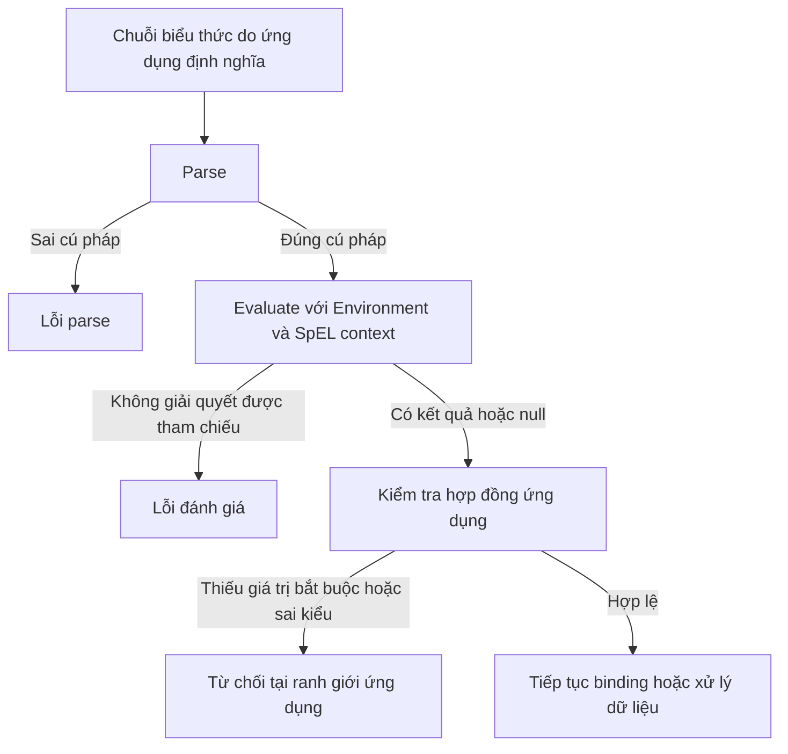

# Kiểm thử expression khi thiếu property, bean hoặc tham số

## 1. Kiểm thử hợp đồng khi ngữ cảnh không đầy đủ

Một biểu thức có thể đúng cú pháp nhưng không đánh giá được trong ngữ cảnh thực tế. Ví dụ, `orders-${lesson.stage}` cần cấu hình, `#{@tenantNames.normalize(#tenantId)}` cần bean và biến, còn `#{#root[0]}` cần root có phần tử ở vị trí đầu tiên.

Trong chương **Biểu thức giá trị** của module **SPRING_DATA_COMMONS**, mục tiêu của bài là viết kiểm thử nhận diện chính xác dữ liệu bị thiếu và kết quả mà ứng dụng phải xử lý. Kiến thức này áp dụng cho hạ tầng biểu thức dùng chung; khi đưa vào repository, mapping hoặc query, vẫn phải kiểm tra đường tích hợp của module lưu trữ đang sử dụng.

Một kiểm thử hữu ích phải chứng minh được cả trường hợp đủ dữ liệu và trường hợp chỉ thiếu một thành phần. Nếu ngay cả cấu hình đầy đủ cũng sai, một assertion “có lỗi” có thể vượt qua vì một nguyên nhân không liên quan đến điều đang kiểm tra.

Ví dụ, muốn kiểm tra thiếu bean thì phải giữ property và tham số hợp lệ. Nếu property cũng thiếu, biểu thức có thể thất bại trước khi thực hiện tra cứu bean, làm tên kiểm thử và nguyên nhân thực tế không khớp nhau.

## 2. Ba giai đoạn cần phân biệt



`ValueExpressionParser.parse(...)` tạo đối tượng biểu thức và có thể báo `ParseException`. Các tham chiếu runtime chưa nhất thiết được giải quyết ở giai đoạn này. [API ValueExpressionParser](https://docs.spring.io/spring-data/commons/docs/current/api/org/springframework/data/expression/ValueExpressionParser.html).

`ValueExpression.evaluate(...)` nhận context, trả `Object` có thể là `null`, và có thể báo `EvaluationException` khi việc đánh giá thất bại. [API ValueExpression](https://docs.spring.io/spring-data/commons/docs/current/api/org/springframework/data/expression/ValueExpression.html).

Vì vậy, “không ném exception” chưa phải kết quả đủ mạnh. Một biểu thức lấy tenant trả `null` có thể đánh giá thành công về mặt kỹ thuật nhưng vẫn vi phạm hợp đồng của ứng dụng.

| Tình huống | Ví dụ | Kỳ vọng cần mô tả |
| --- | --- | --- |
| Sai cú pháp SpEL | `#{1 + }` | Lỗi lúc parse |
| Thiếu property bắt buộc | `${lesson.stage}` | Lỗi lúc evaluate trong cấu hình của bài |
| Thiếu property có mặc định | `${lesson.stage:local}` | Nhận chuỗi `local` |
| Có property nhưng giá trị rỗng | Property bằng `""` | Phân biệt với property không tồn tại |
| Có resolver nhưng không có bean | `#{@tenantNames}` | Lỗi tra cứu khi evaluate |
| Có bean nhưng thiếu resolver | `#{@tenantNames}` | Context chưa cung cấp cơ chế tra bean |
| Không đặt biến có tên | `#{#tenantId}` | Có thể nhận `null`, không mặc định là lỗi |
| Thiếu phần tử của mảng root | `#{#root[0]}` với mảng rỗng | Lỗi truy cập chỉ số khi evaluate |
| Đối số tồn tại nhưng bằng null | `#{#root[0]}` với một phần tử null | Kết quả null, khác với mảng rỗng |

## 3. Thiết kế fixture không phụ thuộc máy chạy

### 3.1. Cô lập Environment

`StandardEnvironment` mặc định có system properties và system environment. Nếu kiểm thử chỉ không thêm `lesson.stage` vào map, khóa đó vẫn có thể đến từ cấu hình tiến trình chạy test. [API StandardEnvironment](https://docs.spring.io/spring-framework/docs/current/javadoc-api/org/springframework/core/env/StandardEnvironment.html).

Trong fixture của bài, hai nguồn mặc định được bỏ khỏi **Environment riêng của kiểm thử**, rồi thêm đúng một `MapPropertySource` chứa dữ liệu đã khai báo. Việc này không sửa system properties toàn cục và giúp “thiếu property” có nghĩa xác định.

Không dùng `System.setProperty(...)` rồi quên khôi phục, vì kiểm thử khác hoặc luồng chạy song song có thể nhìn thấy thay đổi. Nếu mục tiêu là kiểm tra thứ tự property source thực tế của ứng dụng, đó là một tình huống tích hợp riêng và phải được bố trí rõ ràng.

### 3.2. Cô lập bean factory và context

Mỗi fixture tạo một `DefaultListableBeanFactory` mới và một `StandardEvaluationContext` mới. Bean cần cho kiểm thử được đăng ký bằng tên xác định. Test thiếu bean dùng factory rỗng nhưng vẫn có resolver, để phân biệt với test thiếu resolver.

SpEL sử dụng tiền tố `@` cho bean reference khi context đã được cấu hình bean resolver. [Spring Framework: Bean References](https://docs.spring.io/spring-framework/reference/core/expressions/language-ref/bean-references.html).

### 3.3. Cung cấp tham số đúng cách đang được kiểm tra

Bài minh họa hai cách cung cấp dữ liệu: root là `Object[]` để kiểm tra chỉ số, và `setVariable` để kiểm tra tên biến. Đây là fixture thủ công, không phải mô phỏng hoàn chỉnh việc Spring Data bind tham số repository.

SpEL dùng cú pháp `#variableName` và các biến được cung cấp qua evaluation context. `#root` tham chiếu đối tượng gốc của lần đánh giá. [Spring Framework: Variables](https://docs.spring.io/spring-framework/reference/core/expressions/language-ref/variables.html).

## 4. Bộ kiểm thử JUnit mẫu

Ví dụ dùng Java 17, Spring Data Commons có `ValueExpressionParser.create()` từ phiên bản 3.4, Spring Context, Spring Expression và JUnit Jupiter. Chọn các phiên bản Spring tương thích trong dependency management của dự án; không ghép tùy ý từng phiên bản thư viện chỉ để sao chép ví dụ.

Lớp dưới đây là kiểm thử trong bộ nhớ, không kết nối database và không khởi động toàn bộ Spring Boot. Các test dùng `assertThrows` để kiểm tra loại lỗi tại đúng thao tác; JUnit trả lại exception đã bắt nếu cần kiểm tra thêm thuộc tính của nó. [JUnit 5: Assertions và expected exceptions](https://docs.junit.org/5.11.4/user-guide/#writing-tests-assertions).

```java
import static org.junit.jupiter.api.Assertions.assertEquals;
import static org.junit.jupiter.api.Assertions.assertNotNull;
import static org.junit.jupiter.api.Assertions.assertNull;
import static org.junit.jupiter.api.Assertions.assertThrows;

import java.util.Locale;
import java.util.Map;
import org.junit.jupiter.api.Test;
import org.springframework.beans.factory.support.DefaultListableBeanFactory;
import org.springframework.context.expression.BeanFactoryResolver;
import org.springframework.core.env.MapPropertySource;
import org.springframework.core.env.StandardEnvironment;
import org.springframework.data.expression.ValueEvaluationContext;
import org.springframework.data.expression.ValueExpression;
import org.springframework.data.expression.ValueExpressionParser;
import org.springframework.expression.EvaluationException;
import org.springframework.expression.ParseException;
import org.springframework.expression.spel.support.StandardEvaluationContext;

public class MissingExpressionInputsTest {

    private static final String COMPOSITE =
            "${lesson.prefix}-#{@tenantNames.normalize(#root[0])}";

    private final ValueExpressionParser parser = ValueExpressionParser.create();

    private record Fixture(
            StandardEnvironment environment,
            StandardEvaluationContext spel,
            DefaultListableBeanFactory beans) {

        ValueEvaluationContext context() {
            return ValueEvaluationContext.of(environment, spel);
        }
    }

    private static Fixture fixture(Map<String, Object> properties, Object root) {
        var environment = new StandardEnvironment();
        environment.getPropertySources().remove(
                StandardEnvironment.SYSTEM_PROPERTIES_PROPERTY_SOURCE_NAME);
        environment.getPropertySources().remove(
                StandardEnvironment.SYSTEM_ENVIRONMENT_PROPERTY_SOURCE_NAME);
        environment.getPropertySources().addFirst(
                new MapPropertySource("expression-test", properties));

        var beans = new DefaultListableBeanFactory();
        var spel = new StandardEvaluationContext(root);
        spel.setBeanResolver(new BeanFactoryResolver(beans));
        return new Fixture(environment, spel, beans);
    }

    public static final class TenantNames {
        public String normalize(String tenant) {
            if (tenant == null || tenant.isBlank()) {
                throw new IllegalArgumentException("Tenant bắt buộc");
            }
            return tenant.strip().toLowerCase(Locale.ROOT);
        }
    }

    public static final class TenantInput {
        private final String tenantId;

        public TenantInput(String tenantId) {
            this.tenantId = tenantId;
        }

        public String getTenantId() {
            return tenantId;
        }
    }

    private static String requiredTenant(
            ValueExpression expression, ValueEvaluationContext context) {
        Object value = expression.evaluate(context);
        if (!(value instanceof String tenant) || tenant.isBlank()) {
            throw new IllegalArgumentException("Tenant phải là chuỗi không rỗng");
        }
        return tenant;
    }

    @Test
    void completeCompositeUsesPropertyBeanAndArgument() {
        var f = fixture(Map.of("lesson.prefix", "orders"),
                new Object[] {"Tenant-A"});
        f.beans().registerSingleton("tenantNames", new TenantNames());

        Object result = parser.parse(COMPOSITE).evaluate(f.context());

        assertEquals("orders-tenant-a", result);
    }

    @Test
    void missingRequiredPropertyFailsAtEvaluation() {
        var f = fixture(Map.of(), new Object[0]);
        ValueExpression expression = parser.parse("${lesson.stage}");

        EvaluationException error = assertThrows(EvaluationException.class,
                () -> expression.evaluate(f.context()));

        assertNotNull(error.getCause());
    }

    @Test
    void missingOptionalPropertyUsesDeclaredDefault() {
        var f = fixture(Map.of(), new Object[0]);

        Object result = parser.parse("${lesson.stage:local}")
                .evaluate(f.context());

        assertEquals("local", result);
    }

    @Test
    void emptyPropertyIsDifferentFromMissingProperty() {
        var f = fixture(Map.of("lesson.stage", ""), new Object[0]);

        Object result = parser.parse("${lesson.stage:local}")
                .evaluate(f.context());

        assertEquals("", result);
    }

    @Test
    void numericPlaceholderReturnsText() {
        var f = fixture(Map.of(), new Object[0]);

        Object result = parser.parse("${lesson.limit:20}")
                .evaluate(f.context());

        assertEquals("20", result);
    }

    @Test
    void configuredResolverCannotFindMissingBean() {
        var f = fixture(Map.of(), new Object[0]);
        ValueExpression expression = parser.parse("#{@tenantNames}");

        assertThrows(EvaluationException.class,
                () -> expression.evaluate(f.context()));
    }

    @Test
    void registeredBeanStillNeedsAResolverInThisContext() {
        var f = fixture(Map.of(), new Object[0]);
        f.beans().registerSingleton("tenantNames", new TenantNames());
        f.spel().setBeanResolver(null);
        ValueExpression expression = parser.parse("#{@tenantNames}");

        assertThrows(EvaluationException.class,
                () -> expression.evaluate(f.context()));
    }

    @Test
    void unknownNamedVariableCanEvaluateToNull() {
        var f = fixture(Map.of(), new Object[0]);

        Object result = parser.parse("#{#tenantId}").evaluate(f.context());

        assertNull(result);
    }

    @Test
    void suppliedNamedVariableHasExpectedValue() {
        var f = fixture(Map.of(), new Object[0]);
        f.spel().setVariable("tenantId", "tenant-a");

        Object result = parser.parse("#{#tenantId}").evaluate(f.context());

        assertEquals("tenant-a", result);
    }

    @Test
    void missingIndexedArgumentFailsAtEvaluation() {
        var f = fixture(Map.of(), new Object[0]);
        ValueExpression expression = parser.parse("#{#root[0]}");

        assertThrows(EvaluationException.class,
                () -> expression.evaluate(f.context()));
    }

    @Test
    void existingNullArgumentIsNotAnOutOfBoundsArgument() {
        var f = fixture(Map.of(), new Object[] {null});

        Object result = parser.parse("#{#root[0]}").evaluate(f.context());

        assertNull(result);
    }

    @Test
    void propertyTypoOnRootFailsAtEvaluation() {
        var f = fixture(Map.of(), new TenantInput("tenant-a"));
        ValueExpression expression = parser.parse("#{#root.tennatId}");

        assertThrows(EvaluationException.class,
                () -> expression.evaluate(f.context()));
    }

    @Test
    void wrongVariableTypeFailsWhenCallingStringMethod() {
        var f = fixture(Map.of(), new Object[0]);
        f.spel().setVariable("tenantId", 42);
        ValueExpression expression = parser.parse("#{#tenantId.toUpperCase()}");

        assertThrows(EvaluationException.class,
                () -> expression.evaluate(f.context()));
    }

    @Test
    void invalidSyntaxFailsBeforeAnyEvaluation() {
        assertThrows(ParseException.class, () -> parser.parse("#{1 + }"));
    }

    @Test
    void requiredTenantRejectsMissingBlankAndWrongType() {
        ValueExpression expression = parser.parse("#{#tenantId}");
        var f = fixture(Map.of(), new Object[0]);

        assertThrows(IllegalArgumentException.class,
                () -> requiredTenant(expression, f.context()));

        f.spel().setVariable("tenantId", "   ");
        assertThrows(IllegalArgumentException.class,
                () -> requiredTenant(expression, f.context()));

        f.spel().setVariable("tenantId", 42);
        assertThrows(IllegalArgumentException.class,
                () -> requiredTenant(expression, f.context()));

        f.spel().setVariable("tenantId", "tenant-a");
        assertEquals("tenant-a", requiredTenant(expression, f.context()));
    }

    @Test
    void parsedExpressionUsesEachContextsOwnVariable() {
        ValueExpression expression = parser.parse("#{#tenantId}");
        var first = fixture(Map.of(), new Object[0]);
        var second = fixture(Map.of(), new Object[0]);
        var missing = fixture(Map.of(), new Object[0]);
        first.spel().setVariable("tenantId", "tenant-a");
        second.spel().setVariable("tenantId", "tenant-b");

        assertEquals("tenant-a", expression.evaluate(first.context()));
        assertEquals("tenant-b", expression.evaluate(second.context()));
        assertNull(expression.evaluate(missing.context()));
    }

    @Test
    void compositeFailsWhenOnlyPropertyIsMissing() {
        var f = fixture(Map.of(), new Object[] {"tenant-a"});
        f.beans().registerSingleton("tenantNames", new TenantNames());
        ValueExpression expression = parser.parse(COMPOSITE);

        assertThrows(EvaluationException.class,
                () -> expression.evaluate(f.context()));
    }

    @Test
    void compositeFailsWhenOnlyBeanIsMissing() {
        var f = fixture(Map.of("lesson.prefix", "orders"),
                new Object[] {"tenant-a"});
        ValueExpression expression = parser.parse(COMPOSITE);

        assertThrows(EvaluationException.class,
                () -> expression.evaluate(f.context()));
    }

    @Test
    void compositeFailsWhenOnlyArgumentIsMissing() {
        var f = fixture(Map.of("lesson.prefix", "orders"), new Object[0]);
        f.beans().registerSingleton("tenantNames", new TenantNames());
        ValueExpression expression = parser.parse(COMPOSITE);

        assertThrows(EvaluationException.class,
                () -> expression.evaluate(f.context()));
    }
}
```

Các kiểm thử này mô tả kỳ vọng cho fixture và hợp đồng đã chọn. Khi đưa vào dự án, cần chạy trên bộ phiên bản dependency của dự án để xác nhận hành vi thực tế. Không coi nội dung ví dụ là một báo cáo rằng kiểm thử đã được thực thi trong môi trường của người đọc.

## 5. Đọc kết quả kiểm thử thiếu property

### 5.1. Thiếu khóa bắt buộc

Trong `missingRequiredPropertyFailsAtEvaluation`, thao tác parse nằm ngoài lambda của `assertThrows`. Cách bố trí này chứng minh biểu thức đã parse được và lỗi đang được mong đợi ở bước evaluate.

Implementation `PlaceholderExpression` được dẫn dưới đây gọi `Environment.resolveRequiredPlaceholders(...)`; khi gặp `IllegalArgumentException`, nó bọc thành `EvaluationException`. Điều đó giải thích vì sao kiểm thử ở lớp Value Expression bắt `EvaluationException`, thay vì mặc nhiên bắt trực tiếp lỗi từ Environment. [Mã nguồn PlaceholderExpression](https://raw.githubusercontent.com/spring-projects/spring-data-commons/main/src/main/java/org/springframework/data/expression/PlaceholderExpression.java).

Nếu mục tiêu là kiểm tra `Environment.resolveRequiredPlaceholders(...)` trực tiếp, loại exception ở ranh giới kiểm thử có thể khác. Hãy bắt exception của API đang gọi, không lấy một test của tầng dưới làm khuôn cho mọi tầng khác.

### 5.2. Giá trị mặc định có thể che lỗi cấu hình

`${lesson.stage:local}` phù hợp nếu `local` là mặc định đã được ứng dụng chấp nhận. Nó không phù hợp cho mọi property. Ví dụ, tenant hoặc tên kho dữ liệu dùng để phân tách khách hàng thường cần được cung cấp rõ theo chính sách hệ thống.

Kiểm thử cần có hai phía: khi property tồn tại thì dùng giá trị được cấu hình; khi thiếu thì dùng fallback đúng hợp đồng. Nếu chỉ kiểm tra thiếu property nhận fallback, một lỗi khiến ứng dụng luôn bỏ qua cấu hình thật vẫn có thể không bị phát hiện.

### 5.3. Rỗng không đồng nghĩa vắng mặt

Kiểm thử `emptyPropertyIsDifferentFromMissingProperty` xác nhận khóa có giá trị rỗng không tự được thay bằng fallback trong fixture. Nếu sản phẩm yêu cầu rỗng cũng phải bị từ chối hoặc được chuẩn hóa, thêm kiểm tra ở ranh giới ứng dụng.

API `PropertyResolver` phân biệt đọc property, yêu cầu property bắt buộc và giải quyết placeholder. Những thao tác này cần được kiểm thử theo mục đích riêng. [API PropertyResolver](https://docs.spring.io/spring-framework/docs/current/javadoc-api/org/springframework/core/env/PropertyResolver.html).

Ngoài chuỗi rỗng, cân nhắc chuỗi chỉ có khoảng trắng và dữ liệu sai kiểu. Property `lesson.limit=abc` có thể được giải quyết thành chuỗi bình thường nhưng thất bại ở bước chuyển sang số. Đó là lỗi hợp đồng hoặc chuyển đổi kiểu sau khi đã có property, không phải thiếu property.

## 6. Đọc kết quả kiểm thử thiếu bean

Có ít nhất ba tình huống cần tách biệt:

| Tình huống | Trạng thái fixture | Điều kiểm thử chứng minh |
| --- | --- | --- |
| Không có resolver | Bean có trong factory, context không có resolver | Thiếu cơ chế tra cứu trong context |
| Có resolver nhưng thiếu bean | Resolver trỏ vào factory rỗng | Không có bean dưới tên biểu thức yêu cầu |
| Bean có nhưng sai phương thức hoặc chữ ký | Bean được tra ra, phương thức không đáp ứng lời gọi | Lỗi gọi phương thức, không phải thiếu bean |

Không đổi tên test thành “thiếu bean” khi nguyên nhân là thiếu resolver. Phân biệt này hữu ích khi biểu thức chạy được trong ứng dụng nhưng thất bại trong unit test tự tạo context.

Các test mẫu dùng một bean đơn giản không thực hiện I/O. Điều đó giúp lỗi thật tập trung ở cơ chế expression. Nếu bean còn gọi API từ xa, kiểm thử cần tách lỗi tra bean khỏi lỗi dịch vụ phụ thuộc.

Nếu ứng dụng có nhiều application context hoặc nhiều bean factory, việc bean tồn tại ở một container khác chưa chứng minh resolver của biểu thức nhìn thấy nó. Kiểm thử tích hợp nên sử dụng đúng container phục vụ repository hoặc mapper đang được kiểm tra.

## 7. Đọc kết quả kiểm thử thiếu tham số

### 7.1. Biến chưa đặt có thể trả null

`unknownNamedVariableCanEvaluateToNull` ghi nhận trường hợp `#{#tenantId}` trả null trong `StandardEvaluationContext` của bài. Không nên viết một test khẳng định mọi biến thiếu đều ném lỗi.

Nếu tiếp tục gọi `#{#tenantId.toUpperCase()}` trên biến thiếu, lỗi có thể xuất hiện vì lời gọi phương thức trên giá trị null. Hai biểu thức có hợp đồng khác nhau, dù cùng tham chiếu tên `tenantId`.

Fixture thủ công không đủ để phân biệt mọi trường hợp “không cung cấp biến” với “biến được gán null” qua kết quả đánh giá đơn thuần. Nếu ứng dụng cần phân biệt sự hiện diện của tham số với giá trị của nó, hãy giữ thông tin đó ở lớp binding hoặc cấu trúc đầu vào phù hợp.

### 7.2. Mảng rỗng khác mảng có phần tử null

Với root là `Object[]`, thiếu vị trí `[0]` là lỗi chỉ số. Với mảng có một phần tử null, vị trí ấy tồn tại và biểu thức có thể trả null.

Đừng dùng `new Object[] {null}` để giả lập “không có đối số” nếu mục tiêu là kiểm tra thiếu phần tử của mảng. Tương tự, đổi thứ tự đối số trong fixture có thể làm biểu thức lấy nhầm dữ liệu nhưng vẫn đánh giá thành công.

### 7.3. Kiểm tra dữ liệu bắt buộc ở ranh giới ứng dụng

Helper `requiredTenant` của ví dụ kiểm tra cả kiểu và chuỗi không rỗng. Vì đây là hợp đồng do ứng dụng đặt ra, kiểm thử mong `IllegalArgumentException` từ helper khi giá trị không hợp lệ. Nó không giả vờ rằng parser tự kiểm tra quy tắc tenant.

Kiểm tra “chuỗi không rỗng” cũng chưa phải xác thực quyền truy cập tenant. Một chuỗi hợp lệ về hình thức vẫn cần được đối chiếu với danh tính và quyền của người gọi.

Nếu chọn báo lỗi nghiệp vụ bằng exception riêng, kiểm thử loại exception đó và kết quả của lớp gọi bên ngoài. Không nên bắt mọi lỗi expression rồi tự trả tenant mặc định, vì lỗi cấu hình có thể trở thành truy vấn sang phạm vi dữ liệu khác.

## 8. Safe navigation và fallback phải được kiểm thử có chủ đích

SpEL hỗ trợ safe navigation `?.` để một thao tác trên đối tượng null có thể trả null thay vì lỗi; các phần còn lại trong biểu thức ghép vẫn có thể tiếp tục được đánh giá. [Spring Framework: Safe Navigation Operator](https://docs.spring.io/spring-framework/reference/core/expressions/language-ref/operator-safe-navigation.html).

Ví dụ biểu thức sau dành cho tên hiển thị tùy chọn:

```text
#{#displayName?.trim() ?: 'Khách'}
```

Với `displayName` thiếu hoặc bằng null, lời gọi `trim` được bảo vệ. Với chuỗi rỗng sau `trim`, Elvis có thể chọn `Khách`. Trong SpEL, Elvis còn coi chuỗi rỗng là một trường hợp dùng nhánh mặc định. [Spring Framework: The Elvis Operator](https://docs.spring.io/spring-framework/reference/core/expressions/language-ref/operator-elvis.html).

Một bảng kiểm thử phù hợp cho biểu thức này là:

| Đầu vào displayName | Kết quả mong đợi |
| --- | --- |
| Không đặt biến | `Khách` |
| `""` | `Khách` |
| `"   "` | `Khách` |
| `" Lan "` | `Lan` |
| Số nguyên thay cho chuỗi | Báo lỗi theo hợp đồng kiểu của ví dụ |

Không suy ra safe navigation xử lý mọi lỗi. Nó không tạo bean bị thiếu, không cung cấp phần tử mảng chưa tồn tại và không biến một số nguyên thành chuỗi có phương thức `trim`.

Với tenant bắt buộc hoặc cấu hình quyết định đích dữ liệu, fallback có thể che một lỗi cần dừng xử lý. Kiểm thử phải bảo đảm fallback chỉ được sử dụng cho dữ liệu tùy chọn đã xác định.

## 9. Kiểm thử biểu thức ghép bằng cách bỏ từng phụ thuộc

Biểu thức `COMPOSITE` dùng property `lesson.prefix`, bean `tenantNames` và đối số đầu tiên. Bộ test có một trường hợp đầy đủ rồi ba trường hợp chỉ bỏ một phụ thuộc.

Đây là cách kiểm tra có thể giải thích được nguyên nhân: mỗi test giữ hai phụ thuộc còn lại đúng như trường hợp thành công. Không cần gỡ đồng thời tất cả thành phần rồi đoán lỗi nào phải xuất hiện trước.

Khi nhiều phụ thuộc cùng thiếu, thứ tự lỗi đầu tiên có thể phản ánh thứ tự đánh giá của implementation. Chỉ kiểm tra thứ tự đó nếu ứng dụng thực sự có hợp đồng phụ thuộc vào nó. Nếu mục tiêu là phát hiện cấu hình không hợp lệ, kiểm tra từng phụ thuộc riêng thường giúp chẩn đoán rõ hơn.

Cũng nên kiểm tra biểu thức đã parse với nhiều context liên tiếp. Test `parsedExpressionUsesEachContextsOwnVariable` chứng minh dữ liệu của lần trước không được lấy làm kết quả cho context thiếu dữ liệu ở lần sau trong cách sử dụng của ví dụ.

Test này không chứng minh mọi implementation cache hoặc context provider đều an toàn khi chạy đồng thời. Nếu ứng dụng tự cache kết quả, chia sẻ context mutable hoặc giữ tenant trong singleton, cần kiểm thử ở đúng thành phần đó.

## 10. Từ kiểm thử expression đến kiểm thử repository thực tế

Kiểm thử ở trên kiểm tra parser, resolver và context thủ công. Nó chưa kiểm tra cách tên tham số repository được phát hiện, helper được công bố, query được viết lại hay giá trị được bind xuống store.

Spring Data có `QueryMethodValueEvaluationContextAccessor` để tạo provider dựa trên metadata tham số của query method. Điều này cho thấy ngữ cảnh repository còn có phần tích hợp ngoài một `StandardEvaluationContext` tạo thủ công. [API QueryMethodValueEvaluationContextAccessor](https://docs.spring.io/spring-data/commons/docs/current/api/org/springframework/data/repository/query/QueryMethodValueEvaluationContextAccessor.html).

Khi kiểm thử tích hợp, cần dùng đúng module dữ liệu và cú pháp binding mà module hỗ trợ. Không đưa nguyên chuỗi query chứa `:#{...}` hoặc `?#{...}` vào parser thủ công rồi coi đó là kiểm thử repository hoàn chỉnh.

Một bộ tình huống tích hợp có thể gồm:

1. Gọi repository với property và bean đầy đủ; xác nhận dữ liệu hoặc tham số truy vấn đúng hợp đồng.
2. Khởi tạo cấu hình thiếu property bắt buộc; quan sát lỗi xuất hiện lúc bootstrap, lần gọi đầu hay thời điểm khác theo module và cấu hình.
3. Loại bean hoặc extension thực sự được query dùng; xác nhận lỗi có thể truy ngược đến phụ thuộc bị thiếu.
4. Truyền null hoặc giá trị sai vào phương thức repository khi chữ ký cho phép; xác định trách nhiệm của validation, expression và lớp binding.
5. Kiểm tra tên tham số được khai báo và cách build cung cấp metadata tên; không nhầm biến tự đặt trong fixture với tên tham số thực tế.
6. Với reactive repository, bảo đảm publisher được thực thi trong kiểm thử để quan sát lỗi phát sinh khi subscribe; không chỉ kiểm tra việc tạo publisher.

Thiếu một đối số Java khi gọi trực tiếp phương thức có số tham số cố định là lỗi tại thời điểm biên dịch. Vì vậy, tình huống “thiếu phần tử root” ở unit test không có nghĩa Java cho phép gọi repository thiếu đối số. Nó kiểm tra một hợp đồng context hoặc binding có thể được hạ tầng tạo ra.

Không khẳng định mọi lỗi expression đều xảy ra lúc ứng dụng khởi động. Một số giá trị chỉ được đánh giá khi sử dụng; cần kiểm tra ở thời điểm ứng dụng dựa vào giá trị đó.

## 11. Viết assertion đủ mạnh và dễ bảo trì

### 11.1. Kiểm tra đúng thao tác gây lỗi

Tách parse khỏi evaluate trong test lỗi dữ liệu runtime. Với test cú pháp, chỉ gọi parse trong lambda. Cách bố trí này tránh để test vượt qua vì một lỗi khác giai đoạn.

Tránh `assertThrows(Exception.class, ...)`: quá nhiều lỗi không liên quan cũng thỏa assertion. Dùng loại lỗi của ranh giới đang kiểm thử, rồi bổ sung assertion về cause hoặc mã lỗi khi thông tin đó thuộc hợp đồng cần giữ.

### 11.2. Không phụ thuộc nguyên văn thông báo nội bộ

Thông báo của SpEL có thể thay đổi giữa phiên bản. Một test so sánh toàn bộ stack trace hoặc toàn bộ message dễ vỡ mà không phản ánh thay đổi hành vi sản phẩm.

Nếu cần kiểm tra thông điệp, ưu tiên exception nghiệp vụ do ứng dụng quản lý hoặc một thành phần ổn định đã được quyết định. Với test hạ tầng, loại lỗi, cause phù hợp và dữ liệu ngữ cảnh kiểm soát được thường có ý nghĩa hơn.

### 11.3. Chứng minh cả giá trị và ý nghĩa

Với placeholder có giá trị số, kiểm tra đúng kiểu nhận được. Với tên đích dữ liệu, kiểm tra đầy đủ chuỗi kết quả. Với dữ liệu tùy chọn, kiểm tra fallback đúng trường hợp. Với dữ liệu bắt buộc, kiểm tra luồng xử lý dừng trước khi gọi thành phần phụ thuộc.

Ví dụ, nếu ứng dụng yêu cầu tenant trước khi truy vấn, kiểm thử lớp dịch vụ nên chứng minh repository không được gọi khi tenant thiếu. Một assertion chỉ nhìn vào exception của expression chưa chứng minh quy tắc này.

## 12. Bài tập thực hành

1. Đặt bộ kiểm thử vào một dự án demo có dependency tương thích và chạy các trường hợp trong bộ nhớ bằng cơ chế test hiện có của dự án.
2. Bổ sung test chứng minh property đã cấu hình ghi đè fallback, và test property chỉ có khoảng trắng bị lớp kiểm tra của ứng dụng xử lý đúng.
3. Đăng ký bean dưới tên khác để phân biệt tên bean sai với phương thức bean sai.
4. Bổ sung đối chứng đọc đúng `#root.tenantId` trước test lỗi chính tả, rồi giải thích vì sao root property khác biến `#tenantId`.
5. Chuyển displayName qua bảng đầu vào của phần safe navigation; kiểm tra fallback và dữ liệu sai kiểu.
6. Tạo một lớp gọi `requiredTenant` trước thao tác repository và chứng minh thao tác dữ liệu không chạy khi tenant thiếu.
7. Chọn một query thực tế của module đang dùng, sau đó viết kiểm thử tích hợp cho property, bean hoặc tên tham số mà query đó phụ thuộc.

Khi đọc một test thất bại, cần chỉ ra được biểu thức đang dùng nguồn dữ liệu nào, nguồn nào bị bỏ có chủ đích, lỗi xảy ra ở parse hay evaluate, và kết quả null có được hợp đồng ứng dụng chấp nhận hay không. Đó là cơ sở để kiểm thử expression phát hiện được lỗi cấu hình và binding có ý nghĩa.
