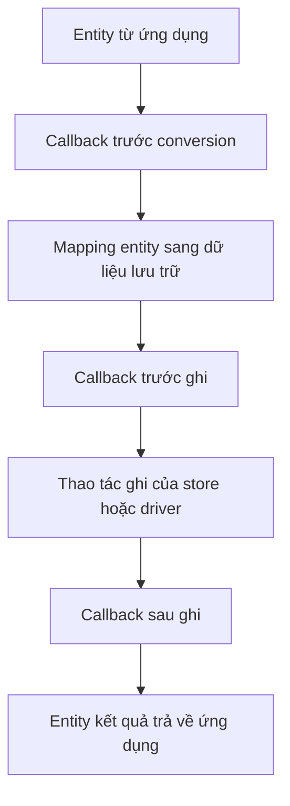

# EntityCallback và các điểm can thiệp vào vòng đời entity

## 1. Vì sao cần can thiệp vào vòng đời entity?

Trong chương **Vòng đời và callback** của **SPRING_DATA_COMMONS**, `EntityCallback` giúp tổ chức các thao tác gắn với quá trình mapping và lưu/đọc entity tại những điểm mà module Spring Data hỗ trợ.

Ví dụ, một sản phẩm có mã SKU do người dùng nhập. Ứng dụng quy định mã lưu trữ phải bỏ khoảng trắng đầu/cuối và viết hoa. Nếu logic chuẩn hóa bị lặp trong từng service trước mỗi lần save, một đường ghi mới có thể quên thực hiện quy tắc đó.

Một callback trước khi chuyển entity sang biểu diễn lưu trữ có thể thực hiện phép chuẩn hóa tại điểm phù hợp. Tuy nhiên, callback chỉ bảo đảm hành vi trên những đường thực sự gọi nó. Nó không tự bao phủ mọi thao tác cập nhật, bulk operation hoặc truy cập trực tiếp driver.

Bài này giúp bạn xác định:

- Vai trò của SPI `EntityCallback` trong Commons và callback cụ thể của module store.
- Nên thay đổi entity trước hay sau bước mapping.
- Vì sao phải sử dụng entity được callback trả về.
- Thứ tự thực thi, lỗi, transaction và khác biệt giữa đồng bộ với reactive.
- Cách phối hợp callback với auditing, lifecycle events và các quy tắc nghiệp vụ.

## 2. `EntityCallback` là SPI nền tảng, không phải một hook save hoàn chỉnh

Interface nằm trong package:

```java
import org.springframework.data.mapping.callback.EntityCallback;
```

`EntityCallback<T>` là marker interface cho nhóm callback liên quan đến entity. Bản thân nó không khai báo một phương thức chung như `beforeSave(T)` để mọi store cùng gọi.

Module store định nghĩa các interface con với chữ ký phù hợp. Các interface này mô tả rõ giai đoạn, kiểu entity, kiểu kết quả và metadata bổ sung, chẳng hạn collection, bảng hoặc biểu diễn dữ liệu đã mapping.

```text
Commons
  EntityCallback<T>
       |
       +-- Callback cụ thể do module store định nghĩa
              |
              +-- Implementation của ứng dụng
```

Chỉ viết một lớp `implements EntityCallback<Product>` chưa tạo ra một điểm được gọi tự động khi repository lưu sản phẩm. Cần triển khai đúng interface callback của module và đăng ký vào hạ tầng mà module đó sử dụng.

### 2.1. Tách ba trách nhiệm

| Thành phần | Trách nhiệm |
| --- | --- |
| `EntityCallback<T>` trong Commons | Định danh abstraction callback và kiểu entity liên quan |
| Interface callback của store | Xác định thời điểm gọi và hợp đồng phương thức |
| Mapping/template/repository infrastructure | Gọi callback tại điểm được module hỗ trợ |
| Callback của ứng dụng | Thực hiện logic hẹp, trả về kết quả theo hợp đồng |

Commons có hạ tầng điều phối như `EntityCallbacks` và `ReactiveEntityCallbacks`. Việc chúng được tích hợp vào save/load như thế nào thuộc về module, cấu hình và đường thao tác cụ thể.

Một interface callback tự định nghĩa cũng cần một nơi chủ động gọi nó. Marker interface không khiến framework tự tìm ra vị trí vòng đời thích hợp cho một hook mới.

### 2.2. Không đồng nhất với callback của JPA provider

Spring Data JPA thường dựa vào vòng đời entity do JPA provider quản lý, với các cơ chế như `@PrePersist`, `@PreUpdate`, `@PostLoad` hoặc entity listener của JPA.

Không lấy một callback MongoDB hoặc relational mapping rồi mặc định nó được provider JPA gọi. Cùng sử dụng repository abstraction không có nghĩa các module sử dụng cùng pipeline persistence.

## 3. Nhìn vòng đời theo ranh giới mapping

Một đường ghi có hỗ trợ các giai đoạn tương ứng có thể được hình dung như sau:



Sơ đồ không phải hợp đồng chung cho mọi store hoặc mọi phương thức CRUD. Nó giúp phân biệt hai thời điểm dễ nhầm: trước khi tạo biểu diễn lưu trữ và sau khi biểu diễn đó đã tồn tại.

Một đường đọc có thể gồm:

```text
Dữ liệu từ store
    -> mapping/materialize thành entity
    -> callback sau conversion nếu đường đọc hỗ trợ
    -> entity trả về ứng dụng
```

Nếu module có lifecycle events ở mức dữ liệu thô, vị trí của chúng phải được xét riêng. Không tự suy ra rằng mỗi mũi tên đều có một `EntityCallback` tương ứng.

### 3.1. Các giai đoạn tiêu biểu trong MongoDB

Bảng sau minh họa bằng các callback của **Spring Data MongoDB**, không phải danh sách bắt buộc cho mọi module:

| Callback đồng bộ | Điểm can thiệp | Hướng sử dụng |
| --- | --- | --- |
| `BeforeConvertCallback<T>` | Trước khi entity được chuyển sang biểu diễn ghi | Chuẩn hóa hoặc bổ sung giá trị domain cần mapping |
| `BeforeSaveCallback<T>` | Sau conversion, trước thao tác ghi | Điều chỉnh biểu diễn `Document` hoặc metadata lưu trữ theo hợp đồng |
| `AfterSaveCallback<T>` | Sau bước ghi tại vị trí module gọi callback | Xử lý entity kết quả; không mặc định đã commit transaction |
| `AfterConvertCallback<T>` | Sau khi dữ liệu đọc được chuyển thành entity | Điều chỉnh entity trả về theo nhu cầu phù hợp |

Các callbacks này có thể nhận metadata như tên collection và `Document`. Những module khác có thể truyền kiểu metadata khác hoặc cung cấp tập giai đoạn khác.

### 3.2. Điểm can thiệp phải khớp thứ bạn muốn thay đổi

Nếu cần lưu `sku` đã chuẩn hóa, thay đổi entity trước conversion là lựa chọn tự nhiên. Mapper sau đó nhìn thấy giá trị mới và tạo dữ liệu lưu trữ tương ứng.

Nếu đã ở giai đoạn trước save mà `Document` đã được tạo, việc chỉ trả một entity khác có `sku` mới không bảo đảm document tự được mapping lại. Cần hiểu hợp đồng của callback và sửa đúng biểu diễn mà bước ghi sắp sử dụng.

Tương tự, thay đổi entity trong callback sau save không tự tạo thêm một lần ghi. Entity trả về có thể khác dữ liệu đã được lưu nếu logic bị đặt sai giai đoạn.

## 4. Ví dụ: chuẩn hóa SKU trước conversion trong MongoDB

Ví dụ sau dùng API của **Spring Data MongoDB đồng bộ**. Nó yêu cầu module tương ứng và cấu hình template/repository nhận diện callback beans.

### 4.1. Mô hình bất biến

```java
import org.springframework.data.annotation.Id;
import org.springframework.data.mongodb.core.mapping.Document;

@Document("products")
public record Product(
        @Id String id,
        String sku,
        String displayName) {

    public Product withSku(String newSku) {
        return new Product(id, newSku, displayName);
    }
}
```

Ví dụ dùng record nên cần phiên bản Java phù hợp. Hàm `withSku` tạo object mới và giữ nguyên các thành phần còn lại.

Với một model có thêm version, trạng thái hoặc metadata khác, hàm copy cũng phải bảo toàn đúng những giá trị đó. Một lỗi thường gặp là tạo lại entity nhưng vô tình làm mất ID hoặc giá trị phục vụ optimistic locking.

### 4.2. Callback có kiểu entity cụ thể

```java
import java.util.Locale;

import org.springframework.core.Ordered;
import org.springframework.data.mongodb.core.mapping.event.BeforeConvertCallback;
import org.springframework.stereotype.Component;

@Component
public final class NormalizeProductSkuCallback
        implements BeforeConvertCallback<Product>, Ordered {

    @Override
    public Product onBeforeConvert(Product entity, String collection) {
        String sku = entity.sku();

        if (sku == null || sku.isBlank()) {
            throw new IllegalArgumentException("Product SKU is required");
        }

        String normalized = sku.strip().toUpperCase(Locale.ROOT);

        return normalized.equals(sku)
                ? entity
                : entity.withSku(normalized);
    }

    @Override
    public int getOrder() {
        return 200;
    }
}
```

Quy tắc viết hoa toàn bộ SKU là quy ước nghiệp vụ được chọn cho ví dụ. `Locale.ROOT` làm phép chuyển hoa không phụ thuộc locale mặc định của máy chạy.

`BeforeConvertCallback<Product>` thể hiện rõ callback dành cho `Product`. Khai báo generic cụ thể cũng giúp hạ tầng xác định phạm vi entity của callback; một implementation không thể hiện rõ kiểu có thể làm việc lọc/định tuyến kém rõ ràng hơn.

`@Component` đăng ký callback trong mô hình component scanning của ví dụ. Có thể dùng cấu hình bean tường minh thay thế, nhưng cần tránh vô tình đăng ký hai instance thực hiện cùng logic.

### 4.3. Kết quả mong muốn

Đoạn minh họa lời gọi:

```java
Product input = new Product("p-001", " ab-42 ", "Keyboard");
Product saved = mongoTemplate.save(input);
```

Với đường save đi qua callback đã cấu hình, kết quả mong đợi:

```text
input.sku() = " ab-42 "
saved.sku() = "AB-42"
Giá trị sku được mapping để lưu = "AB-42"
```

`input` là record bất biến nên không bị thay đổi. Callback trả về một instance khác để các bước kế tiếp sử dụng.

Đây là kết quả dự kiến của ví dụ, không phải báo cáo một lần chạy trên database. Khi triển khai, cần kiểm chứng cả object trả về lẫn dữ liệu lưu thực tế.

## 5. Vì sao kết quả callback phải được nối tiếp trong pipeline?

Một callback thay đổi giá trị có thể trả lại cùng instance hoặc một instance thay thế. Hạ tầng cần tiếp tục bằng kết quả đó để hỗ trợ mô hình bất biến.

Với nhiều callback cùng giai đoạn:

```text
entity ban đầu
    -> callback A
    -> entity do A trả về
    -> callback B
    -> entity do B trả về
    -> bước mapping hoặc ghi kế tiếp
```

Điều này khác với việc phát một thông báo cho nhiều listener rồi bỏ qua giá trị trả về.

### 5.1. Không trả null để diễn đạt “bỏ qua”

Với callback có hợp đồng trả entity, hãy trả entity hợp lệ. Không dùng null như một cách ngầm định để hủy save; hạ tầng có thể từ chối kết quả hoặc phát sinh lỗi ở bước kế tiếp.

Nếu dữ liệu không hợp lệ, cần từ chối bằng cơ chế lỗi phù hợp với API đồng bộ hoặc reactive. Nếu quy trình nghiệp vụ quyết định không lưu, quyết định đó nên được thể hiện rõ ở tầng điều phối thay vì dựa vào null ngoài hợp đồng.

### 5.2. Cập nhật reference ở phía gọi

Với lời gọi save có trả entity, phía ứng dụng nên sử dụng kết quả trả về khi cần ID, version hoặc các thay đổi được mapping/callback thực hiện.

Không mặc định đối tượng đầu vào đã chứa mọi giá trị mới, đặc biệt khi entity bất biến. Đây cũng là lý do một test chỉ kiểm tra object đầu vào có thể bỏ sót hành vi thực tế.

## 6. Callback trước save và biểu diễn dữ liệu đã mapping

Giả sử cần thêm một trường kỹ thuật vào BSON document mà không đưa nó vào domain record. Một ví dụ riêng cho MongoDB:

```java
import org.bson.Document;

import org.springframework.data.mongodb.core.mapping.event.BeforeSaveCallback;
import org.springframework.stereotype.Component;

@Component
public final class ProductStorageMetadataCallback
        implements BeforeSaveCallback<Product> {

    @Override
    public Product onBeforeSave(
            Product entity,
            Document document,
            String collection) {

        document.put("storageFormat", "product-v1");
        return entity;
    }
}
```

Ở giai đoạn này, `document` là biểu diễn sắp được lưu theo hợp đồng của callback. Việc thêm `storageFormat` tác động trực tiếp đến biểu diễn đó.

Trường `storageFormat` trong ví dụ không phải thuộc tính của record `Product`. Do đó, đừng suy ra entity trả về tự có một accessor mới hoặc derived query tự có một persistent property cùng tên. Nếu ứng dụng cần làm việc với trường đó qua domain metadata, nên mô hình hóa nó phù hợp.

### 6.1. Tránh entity và document không nhất quán

Xét một lỗi thiết kế:

```text
BeforeSave nhận:
  entity.sku = AB-42
  document.sku = AB-42

Callback chỉ trả entity mới có sku = XY-99
Callback giữ nguyên document.sku = AB-42
```

Nếu đường ghi sử dụng document đã tạo, dữ liệu được lưu có thể vẫn là `AB-42`, còn kết quả phía Java lại mang `XY-99`.

Đối với thuộc tính domain cần persist, ưu tiên thay đổi trước conversion. Nếu phải sửa ở giai đoạn sau mapping, phải giữ nhất quán giữa những giá trị liên quan theo hợp đồng của module, không giả định framework tự mapping lại.

### 6.2. Phân biệt với property converter

Một converter mô tả cách biến một giá trị từ kiểu hoặc biểu diễn này sang kiểu/biểu diễn khác. Callback mô tả hành vi tại một giai đoạn vòng đời.

| Nhu cầu | Điểm mở rộng nên xem xét |
| --- | --- |
| Đổi value object thành kiểu lưu trữ | Custom conversion của module |
| Một thuộc tính có biểu diễn riêng | Property conversion nếu module hỗ trợ |
| Chuẩn hóa nhiều thuộc tính trước mapping | Callback trước conversion hoặc quy tắc domain phù hợp |
| Thêm metadata vào dữ liệu đã mapping | Callback phù hợp của store |
| Quyết định nghiệp vụ nhiều aggregate | Service/use case điều phối |

Không dùng callback chỉ để lặp lại cơ chế converter đã giải quyết đúng bài toán. Ngược lại, converter của một property cũng không thay thế thao tác cần biết toàn bộ entity.

## 7. Thứ tự callback và quan hệ với auditing

Khi nhiều callback cùng áp dụng, thứ tự có thể quyết định kết quả. Hạ tầng callback hỗ trợ cơ chế ordering; cách rõ ràng trong ví dụ là triển khai `Ordered`.

Giá trị order nhỏ hơn được ưu tiên trước giá trị lớn hơn trong thứ tự sắp xếp tương ứng. Tuy nhiên, order chỉ có ý nghĩa trong phạm vi các callback được điều phối tại cùng điểm thích hợp.

```text
BeforeConvert A, order 100
BeforeConvert B, order 200
    -> A chạy trước B
```

Một `BeforeSave` có order nhỏ hơn không vì thế chạy trước `BeforeConvert`. Hai callback thuộc hai giai đoạn khác nhau; cấu trúc pipeline vẫn quyết định vị trí của từng giai đoạn.

### 7.1. Không dựa vào thứ tự đăng ký ngẫu nhiên

Nếu một callback mặc định SKU còn callback khác chuẩn hóa SKU, hãy xác định rõ thứ tự và kết quả mong đợi. Không dựa vào tên class, thứ tự file hoặc thứ tự bean tình cờ xuất hiện.

Nếu hai callback có cùng mức ưu tiên, tránh để tính đúng đắn của nghiệp vụ phụ thuộc một thứ tự không được quy định rõ. Có thể tách lại trách nhiệm hoặc gộp một chuỗi biến đổi có quan hệ chặt vào một implementation dễ kiểm chứng.

### 7.2. Auditing là một phần cần phối hợp

Các module có thể tích hợp auditing thông qua callback hoặc cơ chế vòng đời tương ứng. Các giá trị như người tạo, thời điểm tạo, người sửa và thời điểm sửa được điền theo cấu hình auditing của module.

Khi callback tùy chỉnh tác động đến cùng metadata, cần kiểm tra:

- Callback auditing thực tế nằm ở giai đoạn nào.
- Thứ tự của auditing so với callback ứng dụng.
- Entity mới được tạo lại có giữ các giá trị auditing hay không.
- Nguồn auditor và thời gian có đúng phạm vi đồng bộ/reactive không.

Không suy ra con số `200` trong ví dụ tự bảo đảm chạy trước hay sau mọi callback auditing của tất cả module. Nó chỉ là thứ tự do ví dụ khai báo; tương quan thực tế cần đối chiếu cấu hình/module đang dùng.

### 7.3. Tránh thay đổi ID hoặc version như một phép chuẩn hóa thông thường

ID, trạng thái entity mới và version có thể ảnh hưởng cách hạ tầng chọn thao tác ghi hoặc kiểm tra cạnh tranh. Một số quyết định đã được thực hiện trước điểm callback mà ứng dụng đang xử lý.

Không dùng việc đổi ID trong một callback để ngầm chuyển một thao tác insert thành update hoặc ngược lại. Không tự tăng hay đặt lại field optimistic locking nếu module đang quản lý nó. Các trường này cần được xử lý theo hợp đồng persistence cụ thể.

## 8. Callback khác lifecycle event ở điểm nào?

Spring Data có thể cung cấp cả callback và lifecycle events. Hai cơ chế có thể xuất hiện ở cùng một module nhưng phục vụ các hợp đồng khác nhau.

| Khía cạnh | Entity callback | Lifecycle event/listener |
| --- | --- | --- |
| Cách nối kết quả | Entity trả về có thể trở thành đầu vào bước sau | Thường quan sát/xử lý event, không có hợp đồng trả entity thay thế tương tự |
| Phù hợp với entity bất biến | Có thể trả một instance mới | Thay entity bằng return value không phải hợp đồng listener thông thường |
| Thực thi | Đồng bộ hoặc reactive theo callback API | Phụ thuộc publisher/multicaster và listener |
| Ordering | Theo cơ chế điều phối callback | Theo cơ chế event và cấu hình liên quan |
| Vị trí vòng đời | Do module gọi tại điểm cụ thể | Do module phát event tại điểm cụ thể |

Trong pipeline MongoDB có hỗ trợ cả hai, các mapping events tương ứng được phát trước lời gọi entity callbacks tại giai đoạn liên quan. Nếu listener được cấu hình chạy bất đồng bộ, thời điểm listener hoàn tất còn phụ thuộc cơ chế thực thi đó.

Không đặt hai nửa của cùng một phép chuẩn hóa vào event listener và callback rồi dựa vào việc listener luôn hoàn tất trước. Với một chuỗi biến đổi entity cần kết quả nối tiếp rõ ràng, callback phù hợp hơn.

Event cũng không tự đồng nghĩa “sau commit”. Cần phân biệt event mapping của store với cơ chế sự kiện gắn với transaction ở tầng ứng dụng.

## 9. Callback sau save chưa có nghĩa transaction đã commit

`AfterSaveCallback` nói về vị trí sau bước ghi trong pipeline của module. Nó không phải một bảo đảm chung rằng transaction bên ngoài đã commit và dữ liệu đã vượt qua mọi ranh giới độ bền mà ứng dụng yêu cầu.

Ví dụ:

```text
Bắt đầu transaction
    -> save entity
    -> callback sau save
    -> thực hiện bước nghiệp vụ tiếp theo
    -> lỗi
    -> rollback transaction
```

Callback có thể đã chạy trước khi thao tác bị rollback. Nếu callback gửi thông báo ra hệ thống khác, hệ thống đó có thể nhìn thấy một thay đổi cuối cùng không được commit.

Với tác động chỉ nên xảy ra sau commit, sử dụng cơ chế phối hợp transaction phù hợp. Nếu cần ghi nhận việc phải phát một thông điệp cùng với dữ liệu nghiệp vụ, có thể xem xét outbox theo thiết kế hệ thống; cần triển khai và kiểm chứng riêng, không chỉ đổi tên callback.

### 9.1. Lỗi trước và sau ghi có hệ quả khác nhau

| Thời điểm lỗi | Điều cần hiểu |
| --- | --- |
| Callback trước bước ghi | Đường thao tác có thể bị dừng trước khi ghi bản ghi đó |
| Driver/store từ chối ghi | Callback sau save của nhánh thành công không mặc định được thực hiện |
| Callback sau ghi phát sinh lỗi | Ứng dụng có thể nhận lỗi trong khi bước ghi đã diễn ra |
| Lỗi trong transaction đang bao quanh | Kết quả cuối còn phụ thuộc rollback và cấu hình transaction |

Không có transaction phù hợp thì một exception ở callback sau save không tự đảo ngược thao tác ghi đã thành công. Khi xử lý lỗi hoặc retry, phải kiểm tra trạng thái thực tế và tính lặp an toàn.

### 9.2. Callback không có bảo đảm thực thi đúng một lần

Retry, thao tác save lặp hoặc cách chia batch có thể làm cùng logic được gọi nhiều lần. Một phép chuẩn hóa như bỏ khoảng trắng và viết hoa có tính lặp ổn định:

```text
normalize(normalize(sku)) = normalize(sku)
```

Ngược lại, cộng một bộ đếm hoặc phát một thông báo mỗi lần callback chạy có thể tạo kết quả lặp. Những tác động đó cần cơ chế kiểm soát riêng nếu bài toán thực sự yêu cầu.

## 10. Callback reactive là một hợp đồng riêng

Hạ tầng đồng bộ và reactive có các interface callback khác nhau. Không mặc định callback đồng bộ sẽ được dùng trong đường reactive, hoặc callback reactive sẽ được dùng trong template đồng bộ.

Ví dụ riêng cho MongoDB reactive:

```java
import java.util.Locale;

import reactor.core.publisher.Mono;

import org.springframework.data.mongodb.core.mapping.event.ReactiveBeforeConvertCallback;
import org.springframework.stereotype.Component;

@Component
public final class ReactiveNormalizeProductSkuCallback
        implements ReactiveBeforeConvertCallback<Product> {

    @Override
    public Mono<Product> onBeforeConvert(Product entity, String collection) {
        return Mono.fromSupplier(() -> {
            String sku = entity.sku();

            if (sku == null || sku.isBlank()) {
                throw new IllegalArgumentException("Product SKU is required");
            }

            String normalized = sku.strip().toUpperCase(Locale.ROOT);

            return normalized.equals(sku)
                    ? entity
                    : entity.withSku(normalized);
        });
    }
}
```

Đây là phương án minh họa cho pipeline reactive. Cần chọn callback đúng API đang dùng; không đăng ký cả hai chỉ để kỳ vọng mọi đường tự phối hợp giống nhau.

### 10.1. Trả publisher để hạ tầng nối vào chuỗi

Callback reactive trả một publisher chứa entity kết quả. Hạ tầng có thể nối kết quả đó vào các bước mapping và ghi tiếp theo.

Không gọi `subscribe()` riêng trong callback để thực hiện một phép thay đổi rồi trả entity ngay lập tức. Cách đó tách công việc khỏi chuỗi đang điều phối: bước ghi có thể chạy trước khi công việc hoàn tất, lỗi không còn truyền đúng và ngữ cảnh transaction có thể bị tách rời.

Nếu cần một thao tác reactive bổ sung, hãy compose nó vào publisher trả về theo hợp đồng của module.

### 10.2. Entity rỗng và lỗi không phải cùng một ý nghĩa

Đừng dùng publisher rỗng như một quy ước ngầm để hủy ghi nếu callback yêu cầu một entity kết quả. Hành vi khi không có giá trị phải theo hợp đồng được module hỗ trợ.

Với dữ liệu không hợp lệ, hãy trả lỗi trong chuỗi reactive hoặc để phép tính được trì hoãn phát lỗi như ví dụ. Không nuốt lỗi rồi tiếp tục ghi một entity chưa được chuẩn hóa.

### 10.3. Ngữ cảnh và blocking

Một callback reactive có thể chạy khác thread so với nơi tạo request. Nếu cần auditor hoặc tenant, sử dụng nguồn ngữ cảnh phù hợp với pipeline reactive thay vì mặc định `ThreadLocal` luôn có dữ liệu đúng.

Không gọi một thao tác blocking kéo dài trong callback reactive. Việc lấy thêm dữ liệu cần được thiết kế theo cơ chế thực thi và transaction phù hợp; chuẩn hóa SKU trong ví dụ chỉ là tính toán cục bộ.

## 11. Những thao tác không được suy ra từ một lần save thành công

Điểm can thiệp vòng đời thuộc về một đường xử lý cụ thể. Repository, template và driver có nhiều kiểu thao tác khác nhau.

| Đường thao tác | Câu hỏi cần kiểm tra |
| --- | --- |
| Save một entity | Giai đoạn nào được gọi và entity kết quả được dùng ra sao? |
| Lưu nhiều entity | Module xử lý từng entity, batch và lỗi thế nào? |
| Update theo điều kiện | Có materialize entity và chạy callback tương ứng không? |
| Bulk operation | Có bỏ qua pipeline entity thông thường không? |
| Driver trực tiếp | Có đi qua hạ tầng Spring Data mapping không? |
| Delete | Module cung cấp event/callback gì cho đường xóa đó? |
| Projection hoặc đọc một phần | Có tạo entity thuộc kiểu callback đang nhắm đến không? |

Không tự đặt tên một `BeforeDeleteCallback` chung rồi kỳ vọng mọi module có hỗ trợ. Tập callback phải được xác định từ module thực tế.

Với MongoDB, một update dựa trên query không cần tải toàn bộ entity thường không đi qua chuỗi save một entity như ví dụ. Nếu quy tắc SKU phải được giữ trên mọi đường, cần thiết kế cả API cập nhật, validation và ràng buộc dữ liệu phù hợp.

### Callback không thay thế hoàn toàn invariant và constraint

Một quy tắc quan trọng có thể cần được thể hiện ở nhiều lớp với trách nhiệm rõ ràng:

- Domain model hoặc use case từ chối trạng thái không hợp lệ.
- Callback chuẩn bị dữ liệu ở đường mapping được hỗ trợ.
- Store constraint hoặc index bảo vệ ràng buộc mà store có thể thực thi, chẳng hạn uniqueness.

Kiểm tra SKU không rỗng trong callback không tự bảo đảm SKU duy nhất giữa hai thao tác ghi đồng thời. Ràng buộc uniqueness cần thiết kế riêng theo store và phạm vi tenant nếu có.

## 12. Kiểm chứng callback ở mức nào?

Các kịch bản dưới đây là hướng dẫn triển khai. Chúng không phải kết quả kiểm thử đã chạy trong bài học.

### 12.1. Kiểm tra logic cục bộ

Với `NormalizeProductSkuCallback`, xác nhận:

| Đầu vào | Kết quả mong đợi |
| --- | --- |
| SKU `" ab-42 "` | SKU mới `"AB-42"` |
| SKU đã là `"AB-42"` | Giá trị được giữ nguyên |
| SKU null hoặc chuỗi trắng | Lỗi theo hợp đồng |
| Entity bất biến | Object đầu vào giữ nguyên; kết quả có dữ liệu chuẩn hóa |
| Chuẩn hóa hai lần | Cùng giá trị như chuẩn hóa một lần |
| Entity có ID và tên | Các giá trị đó được bảo toàn |

Bài kiểm tra logic này không xác nhận component scanning, dispatcher hoặc pipeline mapping của store.

### 12.2. Kiểm tra tích hợp trên đúng module

Một kịch bản tích hợp hữu ích:

1. Đăng ký callback đúng cách và lưu một sản phẩm có SKU chưa chuẩn hóa.
2. Kiểm tra entity mà save trả về.
3. Đọc biểu diễn lưu trữ để xác nhận `sku` đã chuẩn hóa thật.
4. Nếu có callback trước save thêm `storageFormat`, kiểm tra trường đó trên document.
5. Đọc lại sản phẩm và kiểm tra các giá trị domain cần giữ.

Việc chỉ kiểm tra `saved.sku()` có thể bỏ sót lỗi entity/document không nhất quán ở giai đoạn sau conversion.

### 12.3. Kiểm tra thứ tự và phạm vi

Nếu nhiều callbacks cùng tác động, xác nhận callback sau nhận entity do callback trước trả về. Thử một entity ngoài phạm vi `Product` để xác nhận logic không bị áp dụng ngoài ý định.

Kiểm tra đúng các đường ghi ứng dụng sử dụng. Nếu có update theo query hoặc bulk operation, hãy xác nhận chúng có thực thi quy tắc hay cần một cơ chế riêng.

### 12.4. Kiểm tra transaction và reactive khi thực sự sử dụng

Với transaction, thử trường hợp lỗi sau save và quan sát dữ liệu cuối cùng cùng tác động bên ngoài. Với reactive, bảo đảm callback được nối vào publisher, lỗi được truyền và context cần thiết được giữ qua các điểm chuyển luồng.

Không mở rộng test chỉ để lặp lại cấu trúc implementation. Ưu tiên các hành vi có thể sai dù phương thức callback riêng lẻ đã trả kết quả đúng.

## 13. Các lỗi thường gặp

| Hiện tượng | Nguyên nhân cần kiểm tra | Cách khoanh vùng |
| --- | --- | --- |
| Callback không được gọi | Sai module/interface, bean chưa đăng ký hoặc đường thao tác bỏ qua callback | Xác định template và phương thức thực tế |
| Entity trả về thay đổi nhưng dữ liệu lưu không đổi | Sửa entity sau khi biểu diễn ghi đã được tạo | Kiểm tra giai đoạn callback và dữ liệu ghi |
| Record đầu vào không thay đổi | Callback trả instance mới | Dùng kết quả save và kiểm tra pipeline nối kết quả |
| ID/version hoặc auditing bị mất | Hàm copy tạo lại entity không bảo toàn metadata | Kiểm tra mọi thành phần được copy |
| Kết quả phụ thuộc thứ tự bean tình cờ | Các callback có quan hệ nhưng không định nghĩa ordering | Đặt thứ tự rõ hoặc tổ chức lại phép biến đổi |
| Update theo query không có chuẩn hóa | Đường update không chạy save callback như kỳ vọng | Thiết kế quy tắc cho đường update đó |
| Ghi đã thành công nhưng phương thức trả lỗi | Lỗi xuất hiện sau bước ghi hoặc transaction có hợp đồng khác | Kiểm tra thời điểm lỗi và trạng thái commit |
| Thông báo bị phát nhiều lần | Callback được gọi lại hoặc retry | Tách và kiểm soát tác động có yêu cầu chống lặp |
| Reactive save chạy trước công việc trong callback | Callback tự subscribe thay vì compose | Trả chuỗi publisher chứa công việc cần chờ |
| Auditing ghi đè giá trị tùy chỉnh | Cùng tác động một field nhưng chưa rõ giai đoạn/thứ tự | Đối chiếu callback auditing và cấu hình module |

Không nên chữa lỗi callback không chạy bằng cách tự gọi nó thêm ở nhiều nơi mà chưa hiểu pipeline. Cách đó có thể làm một đường khác xử lý hai lần và che khuất nguyên nhân đăng ký sai.

## 14. Tự kiểm tra mức hiểu

**Chỉ triển khai `EntityCallback<Product>` có đủ để nhận sự kiện save không?**

Chưa. Đây là marker SPI; cần interface callback cụ thể và điểm gọi của module hoặc hạ tầng do ứng dụng cấu hình.

**Muốn thay đổi một thuộc tính domain để nó được mapping vào dữ liệu ghi, nên ưu tiên giai đoạn nào?**

Giai đoạn trước conversion khi module cung cấp hook tương ứng. Mapper sau đó sử dụng entity đã được thay đổi.

**Vì sao callback cần trả về entity?**

Để hạ tầng nối entity kết quả vào bước sau và hỗ trợ object bất biến, thay vì chỉ dựa vào mutation tại chỗ.

**Một callback sau save có bảo đảm transaction đã commit không?**

Không. Nó mô tả vị trí trong pipeline; commit của transaction bên ngoài có thể xảy ra sau đó.

**Order nhỏ hơn có làm `BeforeSave` chạy trước `BeforeConvert` không?**

Không. Thứ tự giai đoạn do pipeline quyết định; ordering sắp xếp các callback trong phạm vi điều phối tương ứng.

**Vì sao chuẩn hóa SKU trong callback chưa đủ để bảo vệ mọi update?**

Vì các đường update/bulk/driver có thể không đi qua callback đó. Cần xác định và bảo vệ các đường ghi ứng dụng thực sự sử dụng.

**Trong callback reactive, vì sao không tự gọi `subscribe()`?**

Vì nó tách công việc khỏi chuỗi đang điều phối, làm sai quan hệ chờ kết quả, truyền lỗi và ngữ cảnh. Công việc cần được compose vào publisher trả về.

## 15. Nguyên tắc áp dụng

Dùng entity callback cho một phép xử lý hẹp, đúng giai đoạn và đúng module. Đặt phép thay đổi domain trước conversion khi cần mapper nhìn thấy giá trị mới; đặt thao tác với biểu diễn lưu trữ ở điểm mà module cung cấp biểu diễn đó.

Luôn bảo toàn metadata cần thiết khi tạo entity thay thế, xác định thứ tự nếu callbacks có quan hệ và kiểm tra dữ liệu lưu thực tế. Với auditing, reactive hoặc transaction, đánh giá thêm hợp đồng ngữ cảnh và thời điểm thực thi tương ứng.

Một tích hợp đúng cần thống nhất **điểm gọi của module, entity kết quả, biểu diễn dữ liệu và ranh giới thao tác/transaction**. Callback giúp tổ chức vòng đời, còn tính đầy đủ của quy tắc ứng dụng phụ thuộc toàn bộ các đường truy cập dữ liệu đã được thiết kế.