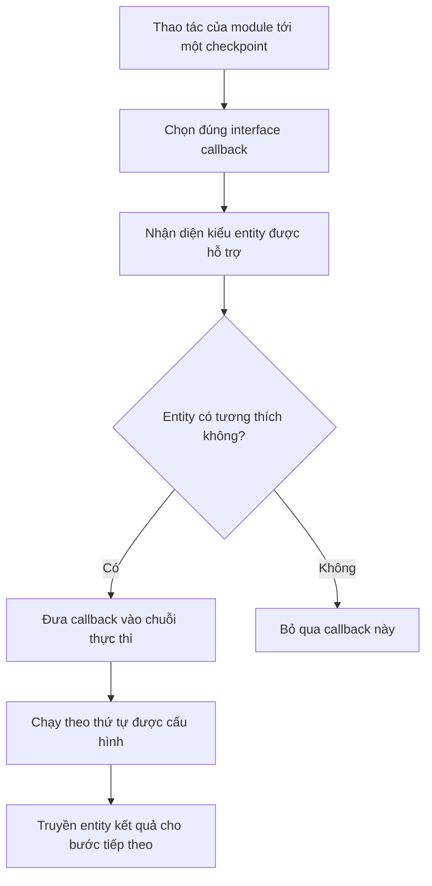

# Kiểu generic xác định loại entity được xử lý

## 1. Generic là một phần của hợp đồng callback

Trong chương **Vòng đời và callback** của module **SPRING_DATA_COMMONS**, tham số generic của callback cho biết callback xử lý loại đối tượng domain nào. Ví dụ:

```java
final class CustomerNameCallback implements BeforeConvertCallback<Customer> {
    // ...
}
```

`Customer` ở đây là loại entity, không phải kiểu ID và cũng không phải tên repository. Khi hạ tầng xác định được thông tin generic này, nó có thể lọc callback theo các đối tượng domain tương thích. API `EntityCallback<T>` mô tả cơ chế domain type binding theo tính gán được, tức assignability. [API EntityCallback](https://docs.spring.io/spring-data/commons/docs/current/api/org/springframework/data/mapping/callback/EntityCallback.html)

Trong bài, ví dụ chính dùng callback **đồng bộ của Spring Data JDBC** để có một chữ ký cụ thể. Commons cung cấp abstraction dùng chung; từng module cung cấp callback ở những điểm vòng đời mà nó hỗ trợ.

Sau bài này, người học có thể:

- Đọc khai báo generic để xác định phạm vi entity của một callback.
- Chọn giữa kiểu domain cụ thể, interface chung và phạm vi rộng như `Object`.
- Giải thích vì sao kiểu generic trong code nguồn cần được hạ tầng nhận diện khi chạy.
- Kiểm chứng việc chọn callback qua dispatcher, thay vì chỉ gọi trực tiếp method callback.
- Phân biệt lọc theo loại entity với đăng ký bean, thứ tự chạy và khả năng của từng store.

## 2. Có nhiều điều kiện để callback thực sự chạy

Khai báo `<Customer>` không tự tạo ra một điểm gọi persistence. Một callback muốn được dùng trong ứng dụng còn cần thỏa các điều kiện liên quan:

| Điều kiện | Câu hỏi cần trả lời |
| --- | --- |
| Đúng loại callback | Luồng hiện tại gọi `BeforeConvertCallback`, `BeforeSaveCallback` hay một loại khác? |
| Đúng module | Interface được import thuộc JDBC, R2DBC, MongoDB hay module nào? |
| Đã đăng ký | Instance callback có nằm trong context hoặc dispatcher mà luồng này sử dụng không? |
| Kiểu domain tương thích | Generic đã được nhận diện có chấp nhận entity hiện tại không? |
| Đúng mô hình thực thi | Đây là API đồng bộ hay reactive? |
| Đường thao tác có hỗ trợ | Thao tác đang chạy có đi qua checkpoint callback của module không? |

Có thể hình dung quá trình lựa chọn theo sơ đồ sau. Đây là mô hình giải thích các điều kiện, không phải cam kết về thứ tự tối ưu hóa nội bộ của mọi implementation.



Ví dụ, một bean `BeforeConvertCallback<Customer>` không trở thành callback trước xóa chỉ vì đối tượng bị xóa cũng là Customer. Generic trả lời câu hỏi **xử lý đối tượng nào**; interface callback trả lời câu hỏi **tham gia loại checkpoint nào**.

## 3. Phạm vi kiểu được chọn theo tính tương thích

Giả sử mô hình domain có quan hệ:

```text
HasDisplayName
├── Customer
└── Supplier

Product
```

`Customer` và `Supplier` triển khai `HasDisplayName`; `Product` không triển khai interface này.

| Generic của callback | Customer | Supplier | Product |
| --- | --- | --- | --- |
| `BeforeConvertCallback<Customer>` | Phù hợp | Không phù hợp | Không phù hợp |
| `BeforeConvertCallback<Supplier>` | Không phù hợp | Phù hợp | Không phù hợp |
| `BeforeConvertCallback<HasDisplayName>` | Phù hợp | Phù hợp | Không phù hợp |
| `BeforeConvertCallback<Object>` | Phù hợp | Phù hợp | Phù hợp |

Bảng giả định các callback được nhận diện kiểu đúng, đã đăng ký trong cùng luồng và cùng checkpoint. Việc phù hợp ở bảng chưa chứng minh thao tác database thực tế sẽ gọi checkpoint đó.

### 3.1. Interface chung là một quyết định domain

Một interface như `HasDisplayName` có thể thể hiện khả năng chung mà callback thật sự cần: đọc tên hiển thị để kiểm tra. Callback không phải biết mọi thuộc tính riêng của Customer hoặc Supplier.

Đừng gắn interface chỉ để vô tình kéo một entity vào quy tắc không thuộc về nó. Khi thêm `implements HasDisplayName` cho một root mới, phạm vi callback chung cũng có thể mở rộng. Thay đổi quan hệ kiểu cần được xem như thay đổi hành vi persistence liên quan.

### 3.2. Kiểu cha có thể bao phủ kiểu con

Nếu một domain class có lớp con, callback cho kiểu cha có thể tương thích với đối tượng của lớp con. Không thiết kế theo giả định bộ lọc chỉ so sánh `entity.getClass() == DeclaredType.class`.

Điều này cũng làm tăng trách nhiệm của code trả kết quả: callback cho kiểu cha không nên dựng lại một instance kiểu cha rồi làm mất trạng thái riêng của kiểu con. Với dữ liệu immutable, cần giữ hợp đồng của loại domain thực tế đang được lưu.

### 3.3. Đây không phải phép gán giữa các kiểu generic Java

Việc dispatcher cho callback `HasDisplayName` nhận Customer không có nghĩa biến `BeforeConvertCallback<Customer>` có thể được gán tùy ý sang `BeforeConvertCallback<HasDisplayName>`. Một bên là lựa chọn callback theo entity tương thích; bên kia là quy tắc kiểu của Java đối với interface generic.

## 4. Ví dụ domain cho Spring Data JDBC

Các kiểu public bên dưới đặt trong các file Java tương ứng, cùng package `example.callbacks`. Ví dụ dùng record nên cần Java 17 trở lên trong dự án minh họa.

Interface domain chung:

```java
package example.callbacks;

public interface HasDisplayName {
    String displayName();
}
```

Aggregate Customer:

```java
package example.callbacks;

import org.springframework.data.annotation.Id;
import org.springframework.data.relational.core.mapping.Table;

@Table("customer")
public record Customer(@Id Long id, String displayName)
        implements HasDisplayName {
}
```

Aggregate Supplier:

```java
package example.callbacks;

import org.springframework.data.annotation.Id;
import org.springframework.data.relational.core.mapping.Table;

@Table("supplier")
public record Supplier(@Id Long id, String displayName)
        implements HasDisplayName {
}
```

Aggregate Product:

```java
package example.callbacks;

import org.springframework.data.annotation.Id;
import org.springframework.data.relational.core.mapping.Table;

@Table("product")
public record Product(@Id Long id, String sku) {
}
```

Quy tắc giả định của ví dụ là:

- Customer được loại bỏ khoảng trắng ở hai đầu tên trước khi chuyển thành dữ liệu ghi.
- Mọi aggregate triển khai HasDisplayName phải có tên hiển thị không trắng.
- Product dùng SKU và không tham gia quy tắc tên hiển thị này.

Các annotation mapping cho biết bối cảnh lưu trữ; phạm vi callback vẫn được khai báo bằng generic, không suy ra từ tên bảng.

## 5. Callback cho riêng một entity

```java
package example.callbacks;

import org.springframework.core.annotation.Order;
import org.springframework.data.relational.core.mapping.event.BeforeConvertCallback;
import org.springframework.stereotype.Component;

@Component
@Order(50)
public final class CustomerNameCallback
        implements BeforeConvertCallback<Customer> {

    @Override
    public Customer onBeforeConvert(Customer aggregate) {
        String name = aggregate.displayName();
        if (name == null) {
            return aggregate;
        }
        return new Customer(aggregate.id(), name.strip());
    }
}
```

Import `org.springframework.data.relational.core.mapping.event.BeforeConvertCallback` là phần quan trọng của ví dụ. Với JDBC, method nhận aggregate root và trả về cùng instance hoặc instance đã điều chỉnh trước bước chuyển đổi thành database change. [JDBC API BeforeConvertCallback](https://docs.spring.io/spring-data/jdbc/docs/current/api/org/springframework/data/relational/core/mapping/event/BeforeConvertCallback.html)

Đối tượng immutable không được sửa tại chỗ. Callback trả Customer mới và giữ ID của Customer cũ. Lớp dịch vụ cũng nên sử dụng kết quả trả về từ thao tác persistence theo hợp đồng của repository, thay vì giả định instance đầu vào đã bị cập nhật.

Generic cụ thể giúp implementation không phải chứa nhánh `if (aggregate instanceof Customer)`. Code có thể tập trung vào quy tắc của Customer, còn việc chọn kiểu thuộc trách nhiệm dispatcher khi thông tin kiểu được cung cấp đúng.

Trong ví dụ này, null được giữ lại để callback kiểm tra dữ liệu phía sau đưa ra lỗi có ý nghĩa. Đây là lựa chọn của chuỗi xử lý minh họa, không phải quy tắc bắt buộc cho mọi domain.

## 6. Callback cho một nhóm entity qua interface

```java
package example.callbacks;

import org.springframework.core.annotation.Order;
import org.springframework.data.relational.core.mapping.event.BeforeConvertCallback;
import org.springframework.stereotype.Component;

@Component
@Order(100)
public final class RequiredDisplayNameCallback
        implements BeforeConvertCallback<HasDisplayName> {

    @Override
    public HasDisplayName onBeforeConvert(HasDisplayName aggregate) {
        String name = aggregate.displayName();
        if (name == null || name.isBlank()) {
            throw new IllegalArgumentException("Display name is required");
        }
        return aggregate;
    }
}
```

Callback này nhận Customer và Supplier theo mô hình đã định nghĩa. Nó trả lại đúng đối tượng nhận vào, nên không làm mất kiểu cụ thể của aggregate.

Đối với Customer có tên `"  Lan  "`, luồng mong muốn là:

```text
Customer("  Lan  ")
    → CustomerNameCallback
Customer("Lan")
    → RequiredDisplayNameCallback
Customer("Lan")
    → bước chuyển đổi và lưu của JDBC
```

Đối với Supplier, chỉ callback chung phù hợp trong hai callback trên. Đối với Product, cả hai callback đều không phù hợp về domain type.

### 6.1. Thứ tự và generic giải quyết hai việc khác nhau

`@Order(50)` và `@Order(100)` làm rõ thứ tự mong muốn giữa các callback phù hợp. Giá trị order nhỏ hơn có độ ưu tiên cao hơn; những callback có cùng order không nên được dùng để biểu đạt một quan hệ phụ thuộc bắt buộc. [Spring API Ordered](https://docs.spring.io/spring-framework/docs/current/javadoc-api/org/springframework/core/Ordered.html)

Generic không khiến callback Customer tự động chạy trước callback interface chung. Không dựa vào trực giác rằng “kiểu cụ thể hơn luôn được ưu tiên hơn”. Nếu quy tắc cần thứ tự, hãy cấu hình thứ tự rõ ràng.

Khi callback trả instance mới, các bước sau cần nhận instance kết quả đó. Không thiết kế một callback đổi sang loại domain không liên quan và kỳ vọng dispatcher tự xây lại một chuỗi hoàn toàn khác theo loại mới.

## 7. Vì sao type erasure không có nghĩa mọi thông tin generic đều biến mất?

Java sử dụng type erasure: tham số kiểu được thay bằng bound hoặc Object trong những thành phần bytecode tương ứng, và compiler có thể thêm cast hoặc bridge method. Không có một lớp runtime riêng cho mỗi cách viết `GenericCallback<Customer>` hoặc `GenericCallback<Supplier>`. [Oracle: Type Erasure](https://docs.oracle.com/javase/tutorial/java/generics/erasure.html)

Tuy nhiên, khai báo một lớp cụ thể có thể cung cấp generic type signature để framework phân tích. Cần phân biệt:

```java
final class CustomerNameCallback
        implements BeforeConvertCallback<Customer> {
    // ...
}
```

với một lớp chỉ giữ biến kiểu chưa được ràng buộc:

```java
class GenericCallback<T> implements BeforeConvertCallback<T> {

    @Override
    public T onBeforeConvert(T entity) {
        return entity;
    }
}
```

Biểu thức `new GenericCallback<Customer>()` không tự tạo ra một class runtime tên GenericCallbackOfCustomer. Không nên giả định một biến được khai báo với `<Customer>` đã đủ cho mọi cơ chế đăng ký nhận diện domain type từ instance.

### 7.1. Đóng biến kiểu trong lớp con cụ thể

Có thể giữ lớp nền generic để tái sử dụng cấu trúc, rồi đóng kiểu ở lớp con:

```java
package example.callbacks;

import org.springframework.data.relational.core.mapping.event.BeforeConvertCallback;

abstract class TypedBeforeConvert<T> implements BeforeConvertCallback<T> {
}

final class SupplierBeforeConvert extends TypedBeforeConvert<Supplier> {

    @Override
    public Supplier onBeforeConvert(Supplier entity) {
        return entity;
    }
}
```

Ở đây chuỗi kế thừa biểu đạt rõ `T = Supplier`. Khi dùng thêm proxy, factory hoặc wrapper, cần kiểm chứng metadata mà đường đăng ký thực tế nhìn thấy, thay vì chỉ nhìn biến cục bộ tại nơi tạo object.

### 7.2. Dùng ResolvableType để quan sát khai báo

Một đoạn chẩn đoán cho lớp cụ thể:

```java
import org.springframework.core.ResolvableType;
import org.springframework.data.mapping.callback.EntityCallback;

Class<?> domainType = ResolvableType.forClass(CustomerNameCallback.class)
        .as(EntityCallback.class)
        .resolveGeneric(0);

System.out.println(domainType == Customer.class); // true
```

`ResolvableType` cho phép đi qua supertype, interface và tham số generic. Đoạn trên minh họa khả năng đọc metadata khai báo; nó không thay thế một kiểm thử dispatcher của ứng dụng sau khi đã đăng ký bean và áp dụng các wrapper thực tế. [Spring API ResolvableType](https://docs.spring.io/spring-framework/docs/current/javadoc-api/org/springframework/core/ResolvableType.html)

Nếu việc resolve không cho ra domain type cụ thể như mong đợi, hãy xem lại nơi còn type variable chưa đóng, raw type hoặc lớp trung gian đã làm mất thông tin cần thiết.

## 8. Lambda, raw type và Object

### 8.1. Lambda có kiểu ở compile time nhưng hạn chế metadata runtime

Lambda là cú pháp hợp lệ vì BeforeConvertCallback là functional interface:

```java
BeforeConvertCallback<Customer> callback =
        customer -> new Customer(customer.id(), customer.displayName().strip());
```

Tuy nhiên, tài liệu Commons lưu ý callback triển khai bằng lambda không phơi bày thông tin kiểu để lọc như class hoặc enum; việc phải xét callback với entity không phù hợp có thể ảnh hưởng throughput. Khi cần lọc theo domain type rõ ràng, dùng lớp triển khai cụ thể. [Commons: Registering Entity Callbacks](https://docs.spring.io/spring-data/commons/reference/entity-callbacks.html#entity-callbacks.registering)

Không khắc phục bằng cách dựa vào ClassCastException như một điều kiện nghiệp vụ. Một callback đã được chọn và chạy thật sự vẫn có thể ném lỗi do bug; việc nuốt mọi ClassCastException sẽ che mất lỗi đó.

### 8.2. Raw type làm mất hợp đồng kiểu

```java
// Thiếu generic domain type cụ thể.
class RawCallback implements BeforeConvertCallback {

    @Override
    public Object onBeforeConvert(Object entity) {
        return entity;
    }
}
```

Khai báo này không nói được “chỉ xử lý Customer”. Nếu phần thân ép entity sang Customer, người đọc phải tự kiểm tra một giả định mà hợp đồng kiểu không còn biểu đạt.

Đừng dùng raw type để làm compiler bỏ qua lỗi không khớp loại entity. Chọn đúng tham số generic và giữ kiểm tra kiểu ở điểm khai báo.

### 8.3. Object là phạm vi rộng có chủ đích

`BeforeConvertCallback<Object>` khác raw type về cách viết hợp đồng, nhưng vẫn bao phủ mọi đối tượng tương thích với Object ở checkpoint tương ứng. Nó phù hợp khi quy tắc thực sự chung và phần thân xử lý được toàn bộ phạm vi đó.

Nếu implementation chứa một danh sách dài các nhánh theo Customer, Supplier, Product, cân nhắc chia thành callback theo domain hoặc dùng abstraction chung có ý nghĩa. Phạm vi hẹp giúp thay đổi một loại entity ít kéo theo hành vi không liên quan.

## 9. Đăng ký callback và giữ thông tin kiểu

Trong ví dụ chính, hai callback đã có `@Component`. Ứng dụng cần scan đúng package và dùng infrastructure JDBC có quyền truy cập các bean đó.

Một cách đăng ký khác là khai báo bean trả về instance của lớp cụ thể:

```java
import org.springframework.context.annotation.Bean;
import org.springframework.context.annotation.Configuration;

@Configuration
class CallbackConfiguration {

    @Bean
    CustomerNameCallback customerNameCallback() {
        return new CustomerNameCallback();
    }
}
```

Khi chọn cách `@Bean` này cho ví dụ, bỏ đăng ký component tương ứng để tránh tạo hai bean cùng chức năng. Không đưa cả hai cấu hình vào rồi mặc định rằng callback chỉ chạy một lần.

Tên bean như `customerCallback` không phải bộ lọc domain type. Một class trả về `CustomerNameCallback` vẫn cần khai báo generic đúng; ngược lại, một bean có tên chung vẫn có thể được lọc đúng nếu metadata kiểu và đường đăng ký phù hợp.

Khi tự tạo dispatcher, API `EntityCallbacks` cũng cho phép thêm callback bằng instance; các method đăng ký sử dụng việc nhận diện generic để xác định loại được hỗ trợ. [API EntityCallbacks](https://docs.spring.io/spring-data/commons/docs/current/api/org/springframework/data/mapping/callback/EntityCallbacks.html)

## 10. Kiểm thử selection qua dispatcher

Gọi trực tiếp `callback.onBeforeConvert(customer)` chỉ kiểm tra phần thân method. Nó không chứng minh hạ tầng sẽ bỏ qua callback đó khi gặp Product.

Ví dụ JUnit Jupiter dưới đây dùng các domain type ở phần trước. Probe có state chỉ để quan sát trong test; callback nghiệp vụ dạng singleton cần được thiết kế phù hợp với việc có nhiều thao tác đồng thời.

```java
package example.callbacks;

import static org.junit.jupiter.api.Assertions.assertEquals;
import static org.junit.jupiter.api.Assertions.assertNotSame;
import static org.junit.jupiter.api.Assertions.assertSame;

import org.junit.jupiter.api.Test;
import org.springframework.core.annotation.Order;
import org.springframework.data.mapping.callback.EntityCallbacks;
import org.springframework.data.relational.core.mapping.event.BeforeConvertCallback;

class CallbackTypeSelectionTest {

    @Order(100)
    static final class CustomerProbe implements BeforeConvertCallback<Customer> {

        int calls;
        Customer lastSeen;

        @Override
        public Customer onBeforeConvert(Customer entity) {
            calls++;
            lastSeen = entity;
            return entity;
        }
    }

    static final class NamedProbe implements BeforeConvertCallback<HasDisplayName> {

        int calls;

        @Override
        public HasDisplayName onBeforeConvert(HasDisplayName entity) {
            calls++;
            return entity;
        }
    }

    @Test
    void selectsCallbacksByAssignableDomainType() {
        CustomerProbe customerProbe = new CustomerProbe();
        NamedProbe namedProbe = new NamedProbe();
        EntityCallbacks callbacks = EntityCallbacks.create(
                customerProbe, namedProbe);

        Customer customer = new Customer(1L, "Lan");
        Supplier supplier = new Supplier(2L, "Acme");
        Product product = new Product(3L, "SKU-003");

        assertSame(customer,
                callbacks.callback(BeforeConvertCallback.class, customer));
        assertSame(supplier,
                callbacks.callback(BeforeConvertCallback.class, supplier));
        assertSame(product,
                callbacks.callback(BeforeConvertCallback.class, product));

        assertEquals(1, customerProbe.calls);
        assertEquals(2, namedProbe.calls);
    }

    @Test
    void passesTheReturnedInstanceToTheNextCallback() {
        CustomerProbe probe = new CustomerProbe();
        EntityCallbacks callbacks = EntityCallbacks.create(
                probe, new CustomerNameCallback());
        Customer original = new Customer(1L, "  Lan  ");

        Customer result = callbacks.callback(
                BeforeConvertCallback.class, original);

        assertNotSame(original, result);
        assertEquals("  Lan  ", original.displayName());
        assertEquals("Lan", result.displayName());
        assertEquals(original.id(), result.id());
        assertSame(result, probe.lastSeen);
        assertEquals(1, probe.calls);
    }
}
```

Test đầu có cả trường hợp dương và trường hợp bị bỏ qua: CustomerProbe chỉ được gọi cho Customer, NamedProbe được gọi cho Customer và Supplier, còn Product đi qua mà không bị các probe thay đổi.

Test thứ hai đăng ký probe trước callback chuẩn hóa trong danh sách đầu vào, nhưng dùng order để biểu đạt thứ tự thực thi. Nó kiểm tra instance mới thật sự tới callback sau, đồng thời ID được giữ lại.

Các ví dụ kiểm thử trong bài là mã minh họa. Trong dự án thực tế, bổ sung kiểm thử tích hợp để xác nhận context, module, repository và thao tác storage đang dùng thật sự đi qua checkpoint này. Một dispatcher tạo thủ công không tự kiểm tra component scanning hay cấu hình template của ứng dụng.

## 11. Cùng tên callback nhưng khác module và mô hình thực thi

Không chọn import chỉ dựa vào tên ngắn `BeforeConvertCallback`.

| Bối cảnh | Điều cần xem |
| --- | --- |
| Spring Data JDBC trong ví dụ | Interface Relational nhận aggregate và trả entity trực tiếp. |
| Spring Data R2DBC | Callback before-convert có thêm thông tin bảng và trả Publisher theo API reactive. |
| Một document store | Chữ ký có thể có collection hoặc cấu trúc dữ liệu đặc thù. |
| Module có cơ chế mapping riêng từ thư viện nền | Kiểm tra lifecycle API thực tế; không tự suy ra mọi callback Commons đều được áp dụng. |

Ví dụ R2DBC mô tả callback `onBeforeConvert(T entity, SqlIdentifier table)`, gắn với chuyển đổi sang OutboundRow. Không sao chép nguyên method một tham số của JDBC vào callback R2DBC. [R2DBC: EntityCallbacks](https://docs.spring.io/spring-data/relational/reference/r2dbc/entity-callbacks.html)

Generic vẫn diễn đạt domain type, nhưng chữ ký callback và thời điểm thực thi do module quyết định. API `ReactiveEntityCallbacks` trả Mono và việc gọi các callback phù hợp diễn ra khi subscribe. [API ReactiveEntityCallbacks](https://docs.spring.io/spring-data/commons/docs/current/api/org/springframework/data/mapping/callback/ReactiveEntityCallbacks.html)

Một callback đồng bộ không tự trở thành reactive vì entity type giống nhau. Tài liệu Commons tách hai nhóm callback theo API thực thi. [Commons: Entity Callbacks](https://docs.spring.io/spring-data/commons/reference/entity-callbacks.html)

## 12. Generic không xác định phạm vi thao tác database

### 12.1. Aggregate root và thành phần lồng nhau

Trong Spring Data JDBC, lifecycle callback áp dụng cho aggregate root. Nếu Customer chứa nhiều Address, khai báo callback `<Address>` không tự bảo đảm nó chạy cho từng Address khi lưu Customer. Khi cần xử lý thành phần bên trong, đặt logic tại đúng callback của aggregate chứa nó hoặc cơ chế module hỗ trợ. [JDBC: Lifecycle Events](https://docs.spring.io/spring-data/relational/reference/jdbc/events.html)

Đây là hai điều kiện riêng: kiểu Address có thể được khai báo đúng, nhưng đường lưu hiện tại chưa từng đưa Address vào dispatcher như một root độc lập.

### 12.2. Kiểu ID, danh sách và projection

| Nhầm lẫn | Cách xác định đúng |
| --- | --- |
| Repository dùng ID UUID nên callback cần `<UUID>` | Generic callback là kiểu entity, ví dụ Customer; ID là khái niệm khác. |
| Gọi `saveAll` nên callback cần `<List<Customer>>` | Xem đơn vị entity mà checkpoint nhận; không suy từ kiểu container ở API gọi. |
| Query trả DTO nên callback entity chắc chắn nhận DTO | Projection/materialization có đường xử lý riêng, phải kiểm tra module. |
| Callback `<Customer>` thuộc riêng CustomerRepository | Callback không được gắn phạm vi theo tên repository bằng generic đó. |
| Hai bảng đều có display_name nên callback chung tự nhận cả hai | Quan hệ kiểu và đăng ký quyết định selection, không phải tên cột giống nhau. |

### 12.3. Truy vấn tùy biến và đường ghi trực tiếp

Repository fragment, bulk update, SQL viết tay hoặc API driver có thể đi theo những đường khác luồng lưu aggregate thông thường. Không dùng việc có bean `<Customer>` làm bằng chứng rằng mọi câu lệnh sửa bảng Customer đều thực thi quy tắc trong callback.

Khi quy tắc là invariant bắt buộc, cần xác định rõ nơi bảo đảm nó cho mọi đường ghi được phép. Callback có thể là một phần triển khai, nhưng mức bao phủ phải được kiểm chứng theo các thao tác thực tế.

## 13. Kết nối với auditing và callback dùng chung

Auditing của các module có thể sử dụng chính hạ tầng callback. Nếu viết thêm callback cho cùng entity hoặc interface chung, cần kiểm tra sự tương tác giữa các bước: callback nào chuẩn hóa trước, callback nào kiểm tra dữ liệu và callback nào điền metadata.

Generic cụ thể giúp giới hạn phạm vi, nhưng không tự giải quyết xung đột khi hai callback cùng sửa một thuộc tính. Quy tắc thứ tự và trách nhiệm của từng callback cần được thể hiện rõ.

Ví dụ, callback chuẩn hóa tên Customer không nên vô tình đặt lại ID, version hoặc thông tin auditing khi dựng bản sao immutable. Những giá trị không thuộc trách nhiệm thay đổi của nó cần được giữ đúng trong constructor hoặc phương thức tạo bản sao.

Khi một entity mới bắt đầu triển khai interface chung, kiểm tra thêm callback auditing hoặc validation theo interface đó. Một thay đổi nhỏ trong khai báo class có thể làm entity tham gia nhiều bước persistence hơn trước.

## 14. Chẩn đoán khi callback chạy sai phạm vi

| Hiện tượng | Điểm cần kiểm tra |
| --- | --- |
| Callback không chạy cho Customer | Đúng import, bean đăng ký, checkpoint và API đồng bộ/reactive hay chưa? |
| Chạy cho nhiều loại hơn dự kiến | Generic có phải Object, kiểu cha quá rộng hoặc raw type không? |
| Lambda khó lọc theo loại entity | Chuyển sang lớp cụ thể có generic rõ và kiểm tra qua dispatcher. |
| Lớp nền generic không cho ra loại cụ thể | Type variable đã được đóng tại class triển khai chưa? |
| ClassCastException khi gặp entity khác | Có raw type, ép kiểu thủ công hoặc wrapper làm sai hợp đồng không? |
| Callback chung không nhận entity mới | Entity có thật sự triển khai interface chung và đi qua checkpoint không? |
| Dữ liệu immutable đã sửa nhưng bước sau nhận giá trị cũ | Có trả và sử dụng đúng instance kết quả trong chuỗi không? |
| Callback cùng chức năng chạy hai lần | Có tạo hai bean từ component scanning và cấu hình thủ công không? |
| Test gọi trực tiếp đạt nhưng ứng dụng không chạy callback | Bổ sung test discovery và luồng repository/template thực tế. |
| Callback cho entity con không chạy khi lưu root | Kiểm tra phạm vi aggregate root của module. |

Lựa chọn dễ đọc là khai báo callback bằng một lớp có domain type cụ thể, hoặc một interface domain hẹp khi có quy tắc thật sự chung. Sau đó kiểm chứng cả selection lẫn đường tích hợp. Trong Spring Data Commons, generic giúp hạ tầng biết callback dành cho loại entity nào; module, đăng ký và checkpoint quyết định callback đó có tham gia thao tác đang chạy hay không.