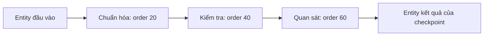
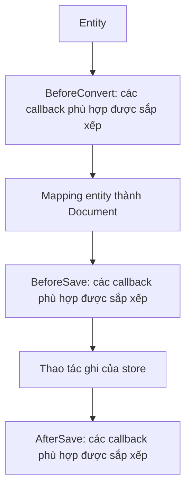

# Ordered, @Order và thứ tự callback

## 1. Vì sao callback đúng chức năng vẫn có thể chạy sai?

Giả sử đơn hàng nhận mã khách hàng `" cus-000123 "`. Một callback chuẩn hóa mã thành `"CUS-000123"`, callback khác kiểm tra mã theo mẫu bắt buộc. Cả hai đều đúng khi xét riêng, nhưng nếu kiểm tra chạy trước chuẩn hóa, dữ liệu có thể bị từ chối ngoài ý muốn.

Trong chương **Vòng đời và callback** của module **SPRING_DATA_COMMONS**, bài này giải thích cách sử dụng `Ordered` và `@Order` để diễn đạt thứ tự xử lý. Mục tiêu là hiểu chuỗi callback dùng chung của Spring Data, đồng thời giữ đúng giới hạn của checkpoint và module lưu trữ thực sự gọi callback.

Thứ tự cần được mô tả bằng quan hệ rõ ràng: chuẩn hóa trước kiểm tra; kiểm tra trước bước quan sát dữ liệu đã hợp lệ. Chỉ nhìn vào một danh sách số mà không biết mỗi bước cần dữ liệu ở trạng thái nào sẽ khiến cấu hình khó bảo trì.

| Callback | Đầu vào mong đợi | Kết quả của bước |
| --- | --- | --- |
| Chuẩn hóa | Mã khách hàng có thể còn khoảng trắng, chữ thường | Mã có biểu diễn chuẩn |
| Kiểm tra | Mã đã được chuẩn hóa | Entity hợp lệ hoặc lỗi rõ ràng |
| Quan sát | Entity đã qua các bước trước | Tiếp tục với kết quả hiện hành |

Nếu các bước không có quan hệ phụ thuộc, có thể không cần áp đặt thứ tự riêng giữa chúng. Nếu một bước phụ thuộc đầu ra của bước khác, cần thể hiện quan hệ đó bằng cấu hình và kiểm chứng hành vi.

## 2. Hiểu chuỗi callback trước khi chọn order

### 2.1. Callback sau nhận kết quả của callback trước

`EntityCallback<T>` gắn với domain type qua generic. Nhiều callback phù hợp được gọi tuần tự và kết quả của callback trước trở thành đầu vào của callback sau. Có thể khai báo thứ tự bằng `Ordered` hoặc `@Order`. [API EntityCallback](https://docs.spring.io/spring-data/commons/docs/current/api/org/springframework/data/mapping/callback/EntityCallback.html).



Với đối tượng bất biến, callback chuẩn hóa có thể trả về một instance mới. Callback kiểm tra phải nhìn thấy instance ấy. Phía gọi cũng phải tiếp tục dùng kết quả cuối cùng, thay vì bỏ qua nó và dùng lại đối tượng ban đầu.

### 2.2. Chọn tập callback rồi mới sắp xếp

Không phải mọi callback trong ứng dụng cùng tham gia một danh sách. Hạ tầng còn xét loại callback và kiểu entity phù hợp. Một callback cho `Customer` không mặc nhiên chạy cho `PurchaseOrder`; một callback sau lưu không cùng checkpoint với callback trước chuyển đổi.

Implementation khám phá callback của Commons lọc các callback phù hợp rồi sử dụng `AnnotationAwareOrderComparator` để sắp xếp danh sách. Đây là chi tiết giúp hiểu cơ chế, không phải API nội bộ mà mã ứng dụng cần gọi trực tiếp. [Mã nguồn EntityCallbackDiscoverer](https://raw.githubusercontent.com/spring-projects/spring-data-commons/main/src/main/java/org/springframework/data/mapping/callback/EntityCallbackDiscoverer.java).

Trước khi sửa một giá trị order, cần xác định callback có thực sự được đăng ký, được chọn cho domain type và được gọi ở checkpoint đang quan sát hay không.

## 3. Quy tắc giá trị order

### 3.1. Số nhỏ có độ ưu tiên cao hơn

Trong nhóm callback thông thường sử dụng `Ordered` hoặc `@Order`, số order nhỏ được xử lý trước số lớn. Giá trị âm hợp lệ; `0` không phải một ranh giới đặc biệt để chuyển sang cơ chế khác.

`Ordered.HIGHEST_PRECEDENCE` tương ứng `Integer.MIN_VALUE`, còn `Ordered.LOWEST_PRECEDENCE` tương ứng `Integer.MAX_VALUE`. Các callback có cùng order không có thứ tự tương đối được bảo đảm. [API Ordered](https://docs.spring.io/spring-framework/docs/current/javadoc-api/org/springframework/core/Ordered.html).

| Giá trị | Cách hiểu trong một nhóm order thông thường |
| --- | --- |
| `-100` | Chạy trước `0` |
| `0` | Chạy trước `20` |
| `20` | Chạy trước `40` |
| `40` | Chạy trước `60` |
| `LOWEST_PRECEDENCE` | Độ ưu tiên thấp nhất trong cơ chế so sánh tương ứng |

Không tính `HIGHEST_PRECEDENCE - 1` hoặc `LOWEST_PRECEDENCE + 1`: đây là các biên của số nguyên và phép tính có thể tràn. Thông thường một nhóm số nhỏ, có khoảng trống giữa các bước, đã đủ diễn đạt quan hệ ứng dụng.

### 3.2. Callback không khai báo order

Đối tượng không cung cấp order được comparator xem như có `LOWEST_PRECEDENCE`. Với nhiều đối tượng cùng mức đó, không dựa vào thứ tự tên bean, tên lớp hoặc thứ tự khai báo trong mã nguồn để xây dựng nghiệp vụ. [API OrderComparator](https://docs.spring.io/spring-framework/docs/current/javadoc-api/org/springframework/core/OrderComparator.html).

Nếu hai callback đều dùng order `40` và một callback cần kết quả của callback kia, cấu hình chưa diễn đạt đủ yêu cầu. Việc chúng tình cờ chạy theo thứ tự mong muốn trên máy hiện tại không tạo thành một hợp đồng đáng dựa vào.

### 3.3. Ngoại lệ cần nhận biết: PriorityOrdered

`PriorityOrdered` được comparator xếp ưu tiên hơn nhóm `Ordered` thông thường. Nếu ứng dụng đưa loại này vào chuỗi, không thể chỉ gom mọi con số thành một danh sách tăng dần rồi bỏ qua nhóm ưu tiên.

Các ví dụ trong bài không sử dụng `PriorityOrdered`. Với callback nghiệp vụ thông thường, hãy bắt đầu bằng `Ordered` hoặc `@Order` và kiểm tra các callback hạ tầng cùng checkpoint trước khi mở rộng cơ chế ưu tiên.

## 4. Ordered: thứ tự là một đặc điểm của instance

Một callback có thể triển khai `org.springframework.core.Ordered` và trả giá trị từ `getOrder()`:

```java
@Override
public int getOrder() {
    return 20;
}
```

Cách này phù hợp khi thứ tự cần được xác định từ cấu hình đã truyền vào constructor, hoặc khi muốn thể hiện hợp đồng ngay trên lớp callback.

Dù order có thể được tính theo instance, không nên đổi giá trị theo entity, theo request hoặc theo mỗi lần gọi `getOrder()`. Một hàm so sánh cần giá trị nhất quán trong quá trình sắp xếp; thứ tự callback không phải công cụ chọn nhánh nghiệp vụ cho từng bản ghi.

Nếu cần hành vi khác theo collection, tenant hoặc loại đơn hàng, xử lý điều kiện đó trong callback hay trong một thành phần điều phối rõ ràng. Giữ order ổn định cho cấu hình đang chạy.

## 5. @Order: metadata thứ tự trên lớp callback

Ví dụ một lớp callback có thể khai báo:

```java
@Order(40)
public final class ValidateCustomerCodeCallback {
    // Triển khai interface callback phù hợp của module đang dùng.
}
```

Đoạn này chỉ minh họa vị trí annotation; ví dụ đầy đủ có interface và phương thức thực tế nằm ở phần tiếp theo.

`@Order` cung cấp cùng ý nghĩa giá trị số với `Ordered`; giá trị mặc định của annotation là `LOWEST_PRECEDENCE`. Annotation không quyết định thứ tự khởi tạo singleton trong Spring container. [API Order](https://docs.spring.io/spring-framework/docs/current/javadoc-api/org/springframework/core/annotation/Order.html).

Với entity callback, đặt annotation trên lớp triển khai cụ thể giúp metadata đi cùng đối tượng callback. Không nhầm `@Order` trên phương thức callback với annotation trên lớp: dispatcher sắp xếp các đối tượng callback, không sắp xếp những phương thức tùy ý trong một lớp.

`@Order` trên phương thức `@Bean` có vai trò trong một số cơ chế sắp xếp của Spring, chẳng hạn collection injection. Không suy ra mọi đường khám phá entity callback đều sử dụng metadata factory method theo cùng cách. Khi cần hợp đồng rõ cho callback, dùng `Ordered` trên instance hoặc `@Order` trên lớp và kiểm tra đường đăng ký thực tế của phiên bản đang dùng.

### Nếu lớp có cả Ordered và @Order

`AnnotationAwareOrderComparator` ưu tiên giá trị của instance triển khai `Ordered` hơn giá trị annotation tĩnh. [API AnnotationAwareOrderComparator](https://docs.spring.io/spring-framework/docs/current/javadoc-api/org/springframework/core/annotation/AnnotationAwareOrderComparator.html).

Ví dụ, lớp có `@Order(5)` nhưng `getOrder()` trả `40` sẽ được so sánh theo `40` trong cơ chế đó. Không nên cố ý duy trì hai con số mâu thuẫn; người bảo trì dễ đọc annotation rồi kết luận sai.

## 6. Ví dụ đầy đủ với BeforeConvertCallback của MongoDB

### 6.1. Phạm vi của ví dụ

Commons cung cấp hạ tầng entity callbacks, còn interface checkpoint cụ thể thuộc module dữ liệu. Ví dụ dưới đây sử dụng `BeforeConvertCallback<T>` của Spring Data MongoDB, có phương thức `onBeforeConvert(T entity, String collection)`. [API BeforeConvertCallback](https://docs.spring.io/spring-data/mongodb/docs/current/api/org/springframework/data/mongodb/core/mapping/event/BeforeConvertCallback.html).

Chương trình dùng Java 17 và Spring Data MongoDB cùng các dependency Spring tương thích. Nó gọi dispatcher trong bộ nhớ để quan sát thứ tự; không mở kết nối MongoDB và chưa kiểm tra thao tác lưu thật.

```java
import java.util.Locale;
import org.springframework.core.Ordered;
import org.springframework.core.annotation.Order;
import org.springframework.data.mapping.callback.EntityCallbacks;
import org.springframework.data.mongodb.core.mapping.event.BeforeConvertCallback;

public class CallbackOrderDemo {

    public record PurchaseOrder(String id, String customerCode) {
    }

    public static final class CallbackOrders {
        public static final int NORMALIZE = 20;
        public static final int VALIDATE = 40;
        public static final int OBSERVE = 60;

        private CallbackOrders() {
        }
    }

    public static final class NormalizeCustomerCodeCallback
            implements BeforeConvertCallback<PurchaseOrder>, Ordered {

        @Override
        public PurchaseOrder onBeforeConvert(
                PurchaseOrder entity, String collection) {
            System.out.println("20 normalize");

            if (entity.customerCode() == null) {
                throw new IllegalArgumentException("Mã khách hàng bắt buộc");
            }

            String normalized = entity.customerCode()
                    .strip()
                    .toUpperCase(Locale.ROOT);

            return new PurchaseOrder(entity.id(), normalized);
        }

        @Override
        public int getOrder() {
            return CallbackOrders.NORMALIZE;
        }
    }

    @Order(CallbackOrders.VALIDATE)
    public static final class ValidateCustomerCodeCallback
            implements BeforeConvertCallback<PurchaseOrder> {

        @Override
        public PurchaseOrder onBeforeConvert(
                PurchaseOrder entity, String collection) {
            System.out.println("40 validate");

            if (entity.customerCode() == null
                    || !entity.customerCode().matches("CUS-[0-9]{6}")) {
                throw new IllegalArgumentException("Mã khách hàng không hợp lệ");
            }

            return entity;
        }
    }

    @Order(CallbackOrders.OBSERVE)
    public static final class ObserveCustomerCodeCallback
            implements BeforeConvertCallback<PurchaseOrder> {

        @Override
        public PurchaseOrder onBeforeConvert(
                PurchaseOrder entity, String collection) {
            System.out.println("60 observe: " + entity.customerCode());
            return entity;
        }
    }

    public static void main(String[] args) {
        EntityCallbacks callbacks = EntityCallbacks.create(
                new ObserveCustomerCodeCallback(),
                new ValidateCustomerCodeCallback(),
                new NormalizeCustomerCodeCallback());

        PurchaseOrder original = new PurchaseOrder("order-1", " cus-000123 ");

        PurchaseOrder result = callbacks.callback(
                BeforeConvertCallback.class, original, "orders");

        System.out.println("original: [" + original.customerCode() + "]");
        System.out.println("result: [" + result.customerCode() + "]");
    }
}
```

Kết quả kỳ vọng khi chạy ví dụ:

```text
20 normalize
40 validate
60 observe: CUS-000123
original: [ cus-000123 ]
result: [CUS-000123]
```

Các callback được đưa vào dispatcher theo thứ tự ngược với thứ tự xử lý mong muốn. Thứ tự order, thay vì vị trí của đối số trong lời gọi đăng ký, diễn đạt quan hệ cần thực hiện.

### 6.2. Vì sao ví dụ này cần kết quả trả về?

`NormalizeCustomerCodeCallback` tạo một record mới. Validator nhận record mới và quan sát mã đã được chuẩn hóa. `original` vẫn giữ chuỗi đầu vào; `result` là đối tượng phải được dùng tiếp.

`EntityCallbacks` cung cấp API tạo dispatcher, đăng ký callback và gọi các callback phù hợp với entity cùng những đối số bổ sung của checkpoint. [API EntityCallbacks](https://docs.spring.io/spring-data/commons/docs/current/api/org/springframework/data/mapping/callback/EntityCallbacks.html).

Không thay lời gọi dispatcher bằng việc gọi trực tiếp validator rồi normalizer và mong `@Order` tự đảo các lời gọi Java. Annotation chỉ được áp dụng bởi thành phần có sử dụng cơ chế sắp xếp.

### 6.3. Một thử nghiệm sai thứ tự có ý nghĩa

Nếu đặt validator ở `10`, nó sẽ kiểm tra chuỗi chưa chuẩn hóa và từ chối đầu vào của ví dụ. Đây không phải lỗi của `@Order`: cấu hình đã yêu cầu validator chạy trước normalizer.

Để quan sát đầy đủ, thử thêm đầu vào `"CUS-ABC"`. Dù thứ tự đúng, validator vẫn phải báo lỗi vì chuẩn hóa không biến dữ liệu sai cấu trúc thành dữ liệu hợp lệ. Order không thay thế kiểm tra nghiệp vụ.

## 7. Đăng ký callback trong ứng dụng Spring

Với ứng dụng MongoDB đã có template và application context đúng cấu hình, có thể đăng ký các lớp callback trên bằng `@Bean`. Đặt lớp cấu hình sau cùng package với ví dụ, hoặc dùng import phù hợp khi tách package.

```java
import org.springframework.context.annotation.Bean;
import org.springframework.context.annotation.Configuration;

@Configuration(proxyBeanMethods = false)
public class PurchaseOrderCallbackConfiguration {

    @Bean
    CallbackOrderDemo.NormalizeCustomerCodeCallback normalizeCustomerCode() {
        return new CallbackOrderDemo.NormalizeCustomerCodeCallback();
    }

    @Bean
    CallbackOrderDemo.ValidateCustomerCodeCallback validateCustomerCode() {
        return new CallbackOrderDemo.ValidateCustomerCodeCallback();
    }

    @Bean
    CallbackOrderDemo.ObserveCustomerCodeCallback observeCustomerCode() {
        return new CallbackOrderDemo.ObserveCustomerCodeCallback();
    }
}
```

Một cách khác là đánh dấu các lớp triển khai bằng `@Component` và bảo đảm package được quét. Chọn một cách đăng ký phù hợp, tránh vô tình tạo nhiều instance cho cùng một chức năng bằng cả component scan và factory method.

Hạ tầng store có thể lấy các entity callback bean từ application context; phần tích hợp và checkpoint cụ thể do module thực hiện. [Spring Data Commons: Entity Callbacks](https://docs.spring.io/spring-data/commons/reference/entity-callbacks.html).

Ví dụ `PurchaseOrder` phía trên phục vụ quan sát dispatcher. Khi dùng làm domain lưu MongoDB, cần bổ sung cấu hình mapping, tên collection và chính sách ID theo ứng dụng. Đăng ký callback không tự tạo các cấu hình ấy.

Với callback cần order rõ ràng và lọc domain type dễ hiểu, lớp triển khai cụ thể thường thuận tiện hơn lambda. Một lambda có thể không mang metadata annotation trên một lớp do bạn khai báo, nên đừng xem nó là sự thay thế tương đương cho lớp có `@Order`.

## 8. Order không thay đổi checkpoint của vòng đời

### 8.1. Sắp xếp bên trong một giai đoạn

Xét luồng lưu MongoDB giản lược:



Sơ đồ bỏ qua event và các bước nội bộ để tập trung vào checkpoint. Một `BeforeSaveCallback` có order `-1000` vẫn thuộc giai đoạn sau khi mapping thành document; nó không chuyển sang trước `BeforeConvertCallback` có order `1000`.

Vì thế, câu hỏi đầu tiên là “cần thay đổi dữ liệu ở checkpoint nào?”, sau đó mới là “các callback trong checkpoint ấy chạy theo thứ tự nào?”.

### 8.2. Sửa entity sau mapping có thể không sửa dữ liệu được lưu

Trong MongoDB, `BeforeSaveCallback` nhận cả entity lẫn `Document`; checkpoint này diễn ra sau chuyển đổi. Thay đổi persistent property trên entity tại đây không tự làm document đã tạo được chuyển đổi lại. API hướng dẫn dùng `BeforeConvertCallback` khi cần thay entity trước chuyển đổi. [API BeforeSaveCallback](https://docs.spring.io/spring-data/mongodb/docs/current/api/org/springframework/data/mongodb/core/mapping/event/BeforeSaveCallback.html).

Đây là lý do ví dụ chuẩn hóa mã khách hàng dùng `BeforeConvertCallback`. Chọn một số order rất nhỏ cho callback sai checkpoint không sửa được vấn đề về thời điểm mapping.

### 8.3. Tên giống nhau giữa các store chưa phải cùng hợp đồng

Interface, đối số bổ sung và các thao tác thực sự phát sinh callback có thể khác giữa MongoDB, JDBC, R2DBC và các module khác. Không lấy chữ ký MongoDB nhận `String collection` rồi áp vào callback của store khác.

Đối với JPA, cần kiểm tra cơ chế callback và listener của JPA provider cùng phần tích hợp Spring Data JPA. Không suy ra một entity listener JPA được sắp xếp bởi dispatcher Commons chỉ vì ứng dụng có dependency Spring Data Commons.

## 9. Phối hợp với auditing và callback hạ tầng

Ứng dụng có thể có nhiều callback ngoài những lớp do nhóm phát triển tự viết. Auditing, validation hoặc thành phần do module đăng ký cũng cần được xét khi thiết kế chuỗi.

Ví dụ, `AuditingEntityCallback` của Spring Data MongoDB là một `BeforeConvertCallback` triển khai `Ordered`; tài liệu API được dẫn ghi giá trị mặc định là `100`. [API AuditingEntityCallback](https://docs.spring.io/spring-data/mongodb/docs/current/api/org/springframework/data/mongodb/core/mapping/event/AuditingEntityCallback.html).

Nếu auditing đang bật và order thực tế vẫn là `100`, một callback thông thường ở `50` chạy trước nó, còn callback ở `150` chạy sau nó trong cùng nhóm ưu tiên và checkpoint. Đây là ví dụ có điều kiện của MongoDB, không phải hằng số auditing chung cho mọi module.

Một yêu cầu như “kiểm tra trường ngày cập nhật đã được auditing điền” cần xác nhận cả ba điểm: auditing đã được bật, callback kiểm tra cùng checkpoint thích hợp, và order thực tế đặt nó sau auditing.

Ngược lại, nếu callback sau auditing tạo một entity mới nhưng quên sao chép các trường audit, dữ liệu audit có thể bị mất. Đổi order không cứu được một phép sao chép làm thiếu trường. Với đối tượng bất biến, mỗi bước phải bảo toàn toàn bộ trạng thái không thuộc trách nhiệm thay đổi của nó.

Bảng hằng order của ứng dụng nên ghi lý do của quan hệ với callback hạ tầng, đồng thời được đối chiếu khi nâng cấp module hoặc thay cấu hình. Không lấp đầy mọi khoảng số bằng các callback không có quan hệ nghiệp vụ rõ ràng.

## 10. Luồng reactive: thứ tự nằm trong chuỗi Publisher

Callback đồng bộ và reactive thuộc các API tương ứng. Một synchronous template sử dụng các callback đồng bộ; một reactive implementation sử dụng callback reactive. Đặt `@Order` lên một callback đồng bộ không làm nó tự tham gia pipeline reactive.

`ReactiveBeforeConvertCallback` của MongoDB trả `Publisher<T>` phát ra entity cần tiếp tục xử lý. [API ReactiveBeforeConvertCallback](https://docs.spring.io/spring-data/mongodb/docs/current/api/org/springframework/data/mongodb/core/mapping/event/ReactiveBeforeConvertCallback.html).

Ví dụ chỉ minh họa một callback reactive chuẩn hóa cùng domain của chương trình trước:

```java
import java.util.Locale;
import org.springframework.core.Ordered;
import org.springframework.data.mongodb.core.mapping.event.ReactiveBeforeConvertCallback;
import reactor.core.publisher.Mono;

public final class ReactiveNormalizeCustomerCodeCallback
        implements ReactiveBeforeConvertCallback<CallbackOrderDemo.PurchaseOrder>,
                   Ordered {

    @Override
    public Mono<CallbackOrderDemo.PurchaseOrder> onBeforeConvert(
            CallbackOrderDemo.PurchaseOrder entity, String collection) {
        return Mono.fromSupplier(() -> {
            if (entity.customerCode() == null) {
                throw new IllegalArgumentException("Mã khách hàng bắt buộc");
            }

            String code = entity.customerCode().strip().toUpperCase(Locale.ROOT);
            return new CallbackOrderDemo.PurchaseOrder(entity.id(), code);
        });
    }

    @Override
    public int getOrder() {
        return CallbackOrderDemo.CallbackOrders.NORMALIZE;
    }
}
```

Để có cùng luồng chuẩn hóa rồi kiểm tra, cần thêm validator reactive với order tương ứng; validator đồng bộ trong ví dụ trước không tự lấp chỗ đó.

`ReactiveEntityCallbacks.callback(...)` trả `Mono` và gọi các callback phù hợp khi subscribe. [API ReactiveEntityCallbacks](https://docs.spring.io/spring-data/commons/docs/current/api/org/springframework/data/mapping/callback/ReactiveEntityCallbacks.html).

Không gọi `subscribe()` bên trong callback để khởi chạy một tác vụ tách khỏi publisher trả về. Khi làm như vậy, order của callback không bảo đảm tác vụ riêng ấy hoàn tất trước callback tiếp theo. Hãy nối công việc cần thiết vào publisher được trả về.

Cũng không dùng `block()` để ép luồng reactive thành đồng bộ chỉ nhằm giữ thứ tự. Cần kiểm tra tín hiệu kết quả, lỗi và việc hoàn thành trong chính pipeline. Một publisher không phát entity không thể được xem là cách tương đương với “giữ nguyên entity”.

## 11. Những điều order không bảo đảm

| Điều dễ suy diễn | Hợp đồng cần hiểu đúng |
| --- | --- |
| Order nhỏ làm bean được khởi tạo sớm | Thứ tự khởi tạo phụ thuộc quan hệ dependency và cơ chế container |
| Hai callback cùng order sẽ theo tên lớp | Không có bảo đảm thứ tự tương đối để dựa vào nghiệp vụ |
| Order nhỏ chuyển callback sang checkpoint sớm hơn | Checkpoint do loại callback và luồng store quyết định |
| AfterSave đồng nghĩa transaction đã commit | Cần xét transaction boundary và cơ chế sau commit riêng |
| Callback xử lý mọi lệnh update hoặc bulk | Cần kiểm tra thao tác nào của module thực sự phát sinh callback |
| Order của callback sắp xếp cả application event | Event listener và entity callback là các cơ chế riêng |
| Gọi trực tiếp hai method vẫn được @Order điều khiển | Mã gọi Java trực tiếp chạy theo thứ tự lời gọi đã viết |
| Callback sau luôn nhận instance ban đầu | Chuỗi truyền kết quả trả về của callback trước |

Một callback sau lưu không nên được xem là bảo đảm có thể gửi một thông báo bên ngoài duy nhất và chắc chắn dữ liệu đã commit. Nếu cần gắn hành động bên ngoài với giao dịch hoặc chống trùng lặp, thiết kế cơ chế tương ứng ở cấp ứng dụng; chỉ một con số order không cung cấp những bảo đảm đó.

Tương tự, thứ tự callback trên một entity không tạo thứ tự toàn cục giữa mọi entity trong `saveAll`, các request đồng thời hoặc các subscription khác nhau. Nếu yêu cầu nghiệp vụ cần tuần tự hóa nhiều thao tác, cần một thiết kế điều phối riêng.

## 12. Khi callback lỗi, trả null hoặc chạy lại

Khi một entity callback ném lỗi, chuỗi xử lý dừng tại callback đó và lỗi được truyền về phía gọi theo cơ chế callback. [API EntityCallback về xử lý lỗi](https://docs.spring.io/spring-data/commons/docs/current/api/org/springframework/data/mapping/callback/EntityCallback.html).

Với ví dụ, nếu validator từ chối mã khách hàng, observer phía sau không phải là nơi để tiếp tục xử lý bản ghi lỗi như thể nó hợp lệ. Nếu cần ghi nhận lỗi, thực hiện ở lớp có trách nhiệm xử lý thất bại.

Callback đồng bộ phải trả entity phù hợp; không trả null để biểu diễn “không thay đổi”. Hãy trả chính entity đầu vào nếu bước đó không có chỉnh sửa.

Order cũng không tạo rollback cho mọi tác dụng phụ trong bộ nhớ hoặc bên ngoài. Nếu callback trước đã thay một đối tượng mutable hoặc gửi yêu cầu tới dịch vụ khác, một callback sau ném lỗi không tự hoàn tác các việc ấy.

Trong môi trường có retry, cùng một bước có thể được thực hiện lại. Các phép chuẩn hóa nên có tính ổn định khi áp dụng nhiều lần; việc cấp số hoặc thực hiện tác dụng phụ cần chính sách phù hợp. Đặt một callback ở đầu danh sách không biến nó thành thao tác chỉ chạy một lần.

## 13. Quan sát và kiểm chứng thứ tự có ý nghĩa

Một kiểm chứng tốt cần nhìn thấy cả thứ tự gọi và trạng thái entity đi qua các bước. Với ví dụ của bài, giá trị `CUS-000123` tại observer và kết quả cuối cùng chứng minh được nhiều hơn việc chỉ in tên lớp.

Có thể thực hiện theo ba mức:

1. Gọi trực tiếp từng callback với dữ liệu phù hợp để xác định trách nhiệm của từng bước.
2. Dùng `EntityCallbacks` trong bộ nhớ, cố ý đăng ký theo thứ tự ngược và kiểm tra chuỗi cùng entity kết quả.
3. Tích hợp với repository hoặc template của store, lưu rồi đọc lại để xác nhận checkpoint, callback hạ tầng và dữ liệu thực tế.

Mức hai không chứng minh template đã tìm thấy các bean trong application context. Mức ba cần dùng đúng thao tác persistence của ứng dụng; không thay bằng một lệnh update khác rồi mặc nhiên đòi cùng callback.

Nếu bổ sung kiểm thử tự động, nên tập trung vào các tình huống có ý nghĩa: đầu vào cần chuẩn hóa, đầu vào vẫn sai sau chuẩn hóa, callback sau thấy entity mới, lỗi chặn các bước tiếp theo, và hai callback có quan hệ phụ thuộc được gán order khác nhau.

Không viết assertion buộc hai callback cùng order phải giữ một thứ tự tình cờ. Nếu chúng thực sự cần thứ tự, sửa hợp đồng order trước; nếu chúng độc lập, kiểm tra kết quả mà không gắn nghiệp vụ vào thứ tự phụ.

Khi callback không chạy, kiểm tra việc đăng ký bean, generic domain type, API đồng bộ/reactive, checkpoint và thao tác store trước khi đổi order. Một callback không thuộc tập được chọn không thể được kích hoạt bằng cách giảm giá trị order.

## 14. Bài tập thực hành

1. Chạy chương trình trong bộ nhớ với thứ tự đăng ký đã đảo ngược; giải thích vì sao kết quả vẫn theo `20 -> 40 -> 60`.
2. Đổi validator sang order `10`, quan sát đầu vào có khoảng trắng bị xử lý ra sao rồi khôi phục quan hệ đúng.
3. Cho normalizer và validator cùng order, nhận diện vì sao cấu hình đó không còn diễn đạt được phụ thuộc cần thiết.
4. Thêm cả `@Order` và `Ordered` với hai giá trị khác nhau vào một lớp trong demo; xác định giá trị được comparator dùng và sau đó giữ một nguồn khai báo rõ ràng.
5. Bổ sung một thuộc tính audit vào record và bảo toàn nó khi tạo instance mới. Khi bật auditing của store, kiểm tra thời điểm trường này được điền so với callback của ứng dụng.
6. Chuyển luồng chuẩn hóa và kiểm tra sang reactive callbacks, giữ việc xử lý trong publisher được trả về và quan sát kết quả khi subscribe.
7. Trong ứng dụng đã có MongoDB, đăng ký callback bằng một cách duy nhất, lưu entity rồi đọc lại mã khách hàng để xác nhận thay đổi đi qua đúng checkpoint.

Khi giải thích một chuỗi callback, cần nêu được domain type, checkpoint, API đồng bộ hay reactive, giá trị order và trạng thái entity sau mỗi bước. Đó là thông tin giúp dùng `Ordered` và `@Order` đúng vai trò trong hạ tầng Spring Data.
