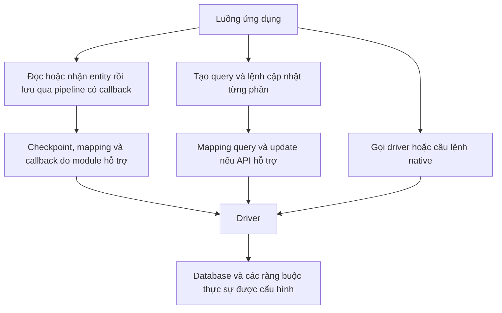

# Giới hạn khi ghi trực tiếp, cập nhật hàng loạt hoặc dùng driver

## 1. Callback chỉ bảo vệ những đường ghi thực sự đi qua nó

Giả sử ứng dụng chuẩn hóa tên hiển thị bằng một `BeforeConvertCallback`: `" Lan "` trở thành `"Lan"`. Cùng ứng dụng đó có một tác vụ cập nhật hàng loạt dùng lệnh `$set`. Nếu tác vụ không đưa từng entity qua checkpoint tương ứng, callback chuẩn hóa không tự chạy trên mỗi bản ghi bị thay đổi trong database.

Bài học thuộc chương **Vòng đời và callback** của module **SPRING_DATA_COMMONS**. Mục tiêu là nhận diện giới hạn của abstraction callback dùng chung, hiểu ảnh hưởng đến auditing, metadata, chuyển đổi và quy tắc nghiệp vụ, rồi chọn cách ghi phù hợp với khả năng từng store.

Một callback đã đăng ký không phải trigger ở database. Nó được thành phần Spring Data gọi tại checkpoint cụ thể của một đường xử lý cụ thể. Một ứng dụng khác, một lệnh SQL trực tiếp hoặc driver native có thể thay đổi dữ liệu mà không gọi thành phần ấy.

Vì thế, câu hỏi cần đặt ra là: **thao tác này có entity đầu vào, có đi qua mapper và checkpoint callback tương ứng, hay chỉ gửi một lệnh thay đổi dữ liệu xuống store?**

## 2. Phân biệt ba lớp trách nhiệm



Ba lớp không có cùng phạm vi:

| Lớp | Ví dụ trách nhiệm | Điều không tự được suy ra |
| --- | --- | --- |
| Ứng dụng và domain | Chuẩn hóa, quyền truy cập, chuyển trạng thái | Mọi đường ghi đều gọi cùng một service |
| Spring Data | Mapping, callback, auditing tại checkpoint được hỗ trợ | Mọi API ghi đều đi qua cùng chuỗi callback |
| Database | Unique index, constraint, schema validation hoặc trigger nếu có | Database hiểu mọi invariant nằm trong Java |

Commons cung cấp cơ chế callback; các module xác định interface checkpoint, đối số và điểm gọi trong luồng xử lý. Callback đồng bộ và reactive cũng thuộc các đường tích hợp tương ứng. [Spring Data Commons: Entity Callbacks](https://docs.spring.io/spring-data/commons/reference/entity-callbacks.html).

Nếu yêu cầu phải có hiệu lực với mọi writer, cần xác định cách bảo đảm yêu cầu đó ở từng lớp. Chỉ đặt quy tắc trong callback không chứng minh writer bên ngoài ứng dụng đã bị ràng buộc.

## 3. Không đánh đồng mọi cách ghi

Bảng dưới dùng MongoDB làm ví dụ chính. Các dòng mô tả đường API cần kiểm tra, không phải hợp đồng chung cho mọi store hoặc mọi phiên bản.

| Đường ghi | Đầu vào chính | Cách hiểu về callback |
| --- | --- | --- |
| Repository `save(entity)` | Entity | Đi theo luồng lưu của module; callback cần được đăng ký đúng |
| Template `insert(entity)` hoặc `save(entity)` | Entity | Có thể là đường chuẩn có callback; gọi template không tự đồng nghĩa bỏ qua callback |
| Repository `saveAll(entities)` | Tập entity | Cần xem implementation của module; không đồng nhất với native bulk update |
| Template `updateFirst` hoặc `updateMulti` bằng `Query` và `Update` | Điều kiện và lệnh cập nhật | Không nạp từng entity đích để chạy callback lưu trên từng bản ghi |
| `BulkOperations.insert(entity)` | Entity hoặc tập entity | Phải xem khả năng callback của loại thao tác và phiên bản cụ thể |
| `BulkOperations.updateOne/updateMulti` | Query và update definition | Không phải vòng đọc, sửa rồi lưu từng entity |
| Driver `MongoCollection.updateMany` | BSON filter và BSON update | Không tự gọi dispatcher entity callback của Spring Data |
| Script hoặc công cụ quản trị database | Câu lệnh của store | Ngoài pipeline Java, trừ khi có cơ chế phối hợp được thiết kế riêng |

MongoDB mô tả lifecycle hooks quanh các thao tác entity như insert và save của template. Do đó, không nên dùng một quy tắc đơn giản như “repository có callback, template không có”. [Spring Data MongoDB: Lifecycle Events](https://docs.spring.io/spring-data/mongodb/reference/mongodb/lifecycle-events.html).

Ngược lại, một method nằm trong repository vẫn có thể thực hiện modifying query trực tiếp. Tên lớp hoặc interface phía gọi không đủ để kết luận; cần nhìn thao tác thực sự được thực thi.

## 4. Ví dụ: quy tắc chuẩn hóa bị bỏ qua bởi lệnh cập nhật

### 4.1. Domain và một chính sách dùng chung

Các ví dụ dùng Java 17 và Spring Data MongoDB với dependency Spring tương thích. Mỗi kiểu `public` được đặt ở tệp Java riêng khi thực hành.

```java
import java.time.Instant;
import org.springframework.data.annotation.Id;
import org.springframework.data.annotation.LastModifiedBy;
import org.springframework.data.annotation.LastModifiedDate;
import org.springframework.data.annotation.Version;
import org.springframework.data.mongodb.core.mapping.Document;

@Document("profiles")
public record MemberProfile(
        @Id String id,
        String tenantId,
        String displayName,
        String status,
        @LastModifiedDate Instant modifiedAt,
        @LastModifiedBy String modifiedBy,
        @Version Long version) {
}
```

Auditing annotations chỉ có tác dụng theo hạ tầng auditing đã được bật và cấu hình phù hợp. Chúng không tự biến trường tương ứng thành dữ liệu do database luôn cập nhật.

```java
public final class DisplayNamePolicy {

    private DisplayNamePolicy() {
    }

    public static String normalize(String raw) {
        if (raw == null) {
            throw new IllegalArgumentException("Tên hiển thị bắt buộc");
        }

        String normalized = raw.strip();
        if (normalized.isEmpty() || normalized.length() > 100) {
            throw new IllegalArgumentException("Tên hiển thị không hợp lệ");
        }
        return normalized;
    }
}
```

Giới hạn độ dài ở đây là chính sách minh họa của ứng dụng, tính theo `String.length()`. Nếu sản phẩm định nghĩa độ dài theo ký tự hiển thị hoặc quy tắc Unicode khác, cần một hợp đồng cụ thể hơn.

### 4.2. Callback cho đường lưu entity

```java
import org.springframework.data.mongodb.core.mapping.event.BeforeConvertCallback;
import org.springframework.stereotype.Component;

@Component
public final class NormalizeProfileCallback
        implements BeforeConvertCallback<MemberProfile> {

    @Override
    public MemberProfile onBeforeConvert(
            MemberProfile entity, String collection) {
        return new MemberProfile(
                entity.id(),
                entity.tenantId(),
                DisplayNamePolicy.normalize(entity.displayName()),
                entity.status(),
                entity.modifiedAt(),
                entity.modifiedBy(),
                entity.version());
    }
}
```

Khi đường lưu entity thực sự gọi callback này, kết quả mới được dùng cho bước tiếp theo. Callback giữ lại tenant, trạng thái, audit và version thay vì vô tình làm mất chúng khi tạo record mới.

### 4.3. Một lệnh update không có entity đích trong bộ nhớ

```java
import static org.springframework.data.mongodb.core.query.Criteria.where;
import org.springframework.data.mongodb.core.query.Query;
import org.springframework.data.mongodb.core.query.Update;

var query = Query.query(where("tenantId").is("tenant-a")
        .and("id").is("profile-1"));
var update = new Update().set("displayName", " Lan ");

template.updateFirst(query, update, MemberProfile.class);
```

Đoạn này giả định `template` là `MongoOperations` đã cấu hình. Nó gửi điều kiện và phép gán, không đọc `MemberProfile` để đưa qua normalizer cho mỗi bản ghi phù hợp. Không có cơ sở để kỳ vọng `" Lan "` tự trở thành `"Lan"` chỉ vì bean callback tồn tại.

Việc truyền `MemberProfile.class` vẫn có ý nghĩa cho metadata mapping, chẳng hạn property `id` và tên collection. **Còn mapping không đồng nghĩa còn toàn bộ callback lưu entity.**

## 5. Viết command cập nhật có hợp đồng tường minh

Khi chọn update từng phần để tránh đọc rồi ghi toàn bộ entity, đưa những trách nhiệm cần thiết vào command. Ví dụ sau chủ động thực hiện chuẩn hóa, điều kiện tenant, trạng thái, audit và kiểm tra version cho một bản ghi.

```java
import static org.springframework.data.mongodb.core.query.Criteria.where;

import java.time.Clock;
import java.time.Instant;
import java.util.Objects;
import com.mongodb.client.result.UpdateResult;
import org.springframework.data.mongodb.core.MongoOperations;
import org.springframework.data.mongodb.core.query.Query;
import org.springframework.data.mongodb.core.query.Update;

public final class ProfileWriteService {
    private final MongoOperations template;
    private final Clock clock;

    public ProfileWriteService(MongoOperations template, Clock clock) {
        this.template = Objects.requireNonNull(template);
        this.clock = Objects.requireNonNull(clock);
    }

    public void renameActiveProfile(
            String id,
            String tenantId,
            long expectedVersion,
            String rawDisplayName,
            String actor) {
        requireText(id, "id");
        requireText(tenantId, "tenantId");
        requireText(actor, "actor");
        if (expectedVersion < 0) {
            throw new IllegalArgumentException("Version không hợp lệ");
        }

        String name = DisplayNamePolicy.normalize(rawDisplayName);
        Instant now = clock.instant();

        Query query = Query.query(where("id").is(id)
                .and("tenantId").is(tenantId)
                .and("status").is("ACTIVE")
                .and("version").is(expectedVersion));

        Update update = new Update()
                .set("displayName", name)
                .set("modifiedAt", now)
                .set("modifiedBy", actor)
                .inc("version", 1L);

        UpdateResult result = template.updateFirst(
                query, update, MemberProfile.class);

        if (!result.wasAcknowledged()) {
            throw new IllegalStateException("Cần write concern có xác nhận");
        }
        if (result.getMatchedCount() != 1) {
            throw new IllegalStateException(
                    "Không có hồ sơ phù hợp tenant, trạng thái và version");
        }
    }

    public UpdateResult archiveActiveProfiles(String tenantId, String actor) {
        requireText(tenantId, "tenantId");
        requireText(actor, "actor");

        Query query = Query.query(where("tenantId").is(tenantId)
                .and("status").is("ACTIVE"));

        Update update = new Update()
                .set("status", "ARCHIVED")
                .set("modifiedAt", clock.instant())
                .set("modifiedBy", actor)
                .inc("version", 1L);

        UpdateResult result = template.updateMulti(
                query, update, MemberProfile.class);
        if (!result.wasAcknowledged()) {
            throw new IllegalStateException("Cần write concern có xác nhận");
        }
        return result;
    }

    private static void requireText(String value, String label) {
        if (value == null || value.isBlank()) {
            throw new IllegalArgumentException(label + " bắt buộc");
        }
    }
}
```

`tenantId` và `actor` ở đây phải đến từ lớp ứng dụng đã xác minh danh tính và quyền thực hiện thao tác. Kiểm tra không rỗng không phải kiểm tra quyền. Command không cho phép người dùng tự nhận một tenant bất kỳ chỉ bằng cách điền tham số.

Tên property được dùng cùng domain type để template áp dụng mapping phù hợp. Với API chỉ nhận collection name và không có domain metadata, các hỗ trợ về tên field, kiểu ID hoặc version có thể khác. [API MongoOperations](https://docs.spring.io/spring-data/mongodb/docs/current/api/org/springframework/data/mongodb/core/MongoOperations.html).

Đây là command được thiết kế riêng, không phải cách gọi thủ công normalizer, auditing callback rồi giả lập toàn bộ pipeline `save`. Chính sách thuần `DisplayNamePolicy` được tái sử dụng bởi cả callback lẫn command để giảm khả năng hai đường ghi chuẩn hóa khác nhau.

## 6. Version tăng không đồng nghĩa có optimistic locking đầy đủ

Một số typed update của MongoTemplate có thể tự tăng property `@Version` khi update chưa khai báo nó. Hỗ trợ đó thuộc API update và metadata của module, không chứng minh callback đã chạy. [Spring Data MongoDB: Updating Documents](https://docs.spring.io/spring-data/mongodb/reference/mongodb/template-crud-operations.html).

Cần phân biệt hai hợp đồng:

| Hành vi | Điều nó bảo đảm |
| --- | --- |
| Tăng version sau update | Bản ghi có số version mới |
| Đưa expected version vào điều kiện, kiểm tra số bản ghi khớp | Có cơ sở phát hiện lệnh dựa trên phiên bản không còn phù hợp |

`renameActiveProfile` thực hiện cả predicate version và phép tăng version. Nếu không khớp, phương thức từ chối thay vì báo thành công. Tuy nhiên, số bản ghi khớp bằng không có thể do không tồn tại ID, sai tenant, trạng thái không hợp lệ hoặc version đã thay đổi. Ví dụ không cố phân biệt các nguyên nhân ấy bằng một lần ghi.

Ngược lại, `archiveActiveProfiles` cố ý chọn mọi hồ sơ ACTIVE của tenant tại thời điểm xử lý. Nó tăng version nhưng không so sánh với một tập expected version của từng hồ sơ. Không gọi đây là kiểm tra optimistic locking riêng cho từng entity mà người dùng đã đọc trước đó.

Nếu yêu cầu nghiệp vụ cần expected version khác nhau cho từng bản ghi, phải thiết kế các lệnh điều kiện tương ứng và cách đối chiếu kết quả. Chỉ thêm `.inc("version", 1)` vào một update hàng loạt chưa đủ.

## 7. Bulk insert, bulk replace và bulk update không cùng một đường

### 7.1. Không dùng quy tắc “mọi bulk đều bỏ callback”

Trong implementation `DefaultBulkOperations` trên nhánh mã nguồn được dẫn, insert và replace có entity nguồn, gọi before-convert rồi tạo write model; các insert/replace còn có đường gọi callback quanh save. Update bằng query và update definition tạo update model theo một đường khác, không nạp entity đích. [Mã nguồn DefaultBulkOperations](https://raw.githubusercontent.com/spring-projects/spring-data-mongodb/main/spring-data-mongodb/src/main/java/org/springframework/data/mongodb/core/DefaultBulkOperations.java).

Đây là bằng chứng về implementation cụ thể, không phải cam kết rằng mọi bản Spring Data MongoDB đang được triển khai có cùng hành vi. Khi dự án chưa nêu phiên bản, cần kiểm tra đúng phiên bản và loại thao tác thay vì gắn một kết luận chung vào từ “bulk”.

Ví dụ một batch trộn nhiều loại thao tác:

```java
import org.springframework.data.mongodb.core.BulkOperations;

var bulk = template.bulkOps(BulkOperations.BulkMode.ORDERED, MemberProfile.class);
bulk.insert(newProfile);
bulk.updateMulti(activeProfilesQuery, archiveUpdate);
var result = bulk.execute();
```

Các biến `newProfile`, `activeProfilesQuery`, `archiveUpdate` phải được chuẩn bị theo hợp đồng ứng dụng. Việc insert trong cùng batch có thể có entity callback không làm updateMulti tự có một entity callback cho từng bản ghi đích.

### 7.2. Kết quả và version của bulk cũng cần hợp đồng riêng

API `BulkOperations` lưu ý các thao tác cần kết quả riêng từng operation, chẳng hạn optimistic locking qua `@Version`, không được hỗ trợ theo cùng cơ chế lưu entity thông thường. [API BulkOperations](https://docs.spring.io/spring-data/mongodb/docs/current/api/org/springframework/data/mongodb/core/BulkOperations.html).

Nếu tự thêm version predicate vào các update model, vẫn phải giải quyết cách phát hiện operation nào không khớp. Một tổng số matched records không tự chỉ ra ID nào thất bại trong một batch nhiều lệnh.

Bulk mode `ORDERED` nói đến chế độ thực thi các operation trong batch, không phải transaction bao trùm và cũng không phải `@Order` của callback. Một lô lỗi giữa chừng cần được đối chiếu với phần kết quả đã thực hiện, thay vì mặc nhiên coi tất cả thành công hoặc tất cả bị hoàn tác.

## 8. Driver native: không có pipeline entity của Spring Data tự động

MongoDB Java driver nhận filter và update document trên `MongoCollection`; `updateOne` và `updateMany` thực hiện thay đổi trên các document phù hợp. [MongoDB Java Driver: Update Documents](https://www.mongodb.com/docs/drivers/java/sync/current/crud/update-documents/).

Ví dụ sau là một đoạn thao tác driver, giả định:

- `profiles` là `MongoCollection<Document>` đã được cung cấp.
- Schema lưu `_id` dưới dạng String, `version` là số, các field dùng đúng tên bên dưới.
- `id`, `tenantId`, `actor`, `expectedVersion` đã được kiểm tra; `rawDisplayName` là đầu vào cần chuẩn hóa và `now` là `Instant` của command.

```java
import static com.mongodb.client.model.Filters.and;
import static com.mongodb.client.model.Filters.eq;
import static com.mongodb.client.model.Updates.combine;
import static com.mongodb.client.model.Updates.inc;
import static com.mongodb.client.model.Updates.set;

import java.util.Date;
import com.mongodb.client.result.UpdateResult;

UpdateResult result = profiles.updateOne(
        and(eq("_id", id),
                eq("tenantId", tenantId),
                eq("status", "ACTIVE"),
                eq("version", expectedVersion)),
        combine(
                set("displayName", DisplayNamePolicy.normalize(rawDisplayName)),
                set("modifiedAt", Date.from(now)),
                set("modifiedBy", actor),
                inc("version", 1L)));

if (!result.wasAcknowledged() || result.getMatchedCount() != 1) {
    throw new IllegalStateException("Lệnh driver không xác nhận được cập nhật");
}
```

Đoạn này tự chuẩn hóa và tự ghi metadata; không có hành vi ấy chỉ vì domain Java có annotation. `Date.from(now)` được dùng để biểu diễn thời điểm thành BSON date theo schema ví dụ, thay vì giả định driver raw document sử dụng mọi converter của Spring Data.

Khi gọi raw driver, `@Field` alias, custom conversions, cách biểu diễn ID và enum của Spring Data không tự áp dụng cho BSON bạn tạo bằng tay. Driver có codec riêng; codec có được cấu hình để làm một việc cụ thể hay không là một hợp đồng khác.

Một lệnh driver lấy collection qua template vẫn là lệnh driver ở điểm thực thi. Được cấp collection từ một bean Spring không tự làm mỗi `updateOne` đi qua normalizer, auditing hoặc dispatcher callback của mapper.

## 9. Auditing, validation và sự kiện cần được xem xét riêng

### 9.1. Auditing fields không tự được điền ở mọi update

`@LastModifiedDate` và `@LastModifiedBy` mô tả metadata phục vụ hạ tầng auditing tương ứng. Khi đường ghi không gọi thành phần auditing đó, lệnh update phải ghi các field cần thiết hoặc dùng một cơ chế khác đã được ứng dụng thiết kế.

Cần thống nhất nguồn thời gian và nguồn actor giữa các đường ghi. Dùng `Clock` giúp kiểm thử thời điểm; actor cần phản ánh người dùng hoặc tác vụ hệ thống thực sự thực hiện command.

Với upsert, nhánh tạo mới còn cần dữ liệu tạo và các giá trị bắt buộc của entity mới. Metadata chỉ dành cho update chưa chắc đủ cho bản ghi được insert. Nếu dùng `$setOnInsert`, phải thiết kế rõ trường nào chỉ gán khi tạo, trường nào thay ở mỗi lần cập nhật và ràng buộc chống tạo trùng.

### 9.2. Không chạy validator của entity không có nghĩa bỏ mọi ràng buộc

Lệnh trực tiếp không tự gọi Bean Validation hay validator nằm trong callback nếu API không tích hợp chúng. Ngược lại, unique index, constraint hoặc schema validation thực sự cấu hình ở database vẫn là những cơ chế độc lập.

Ví dụ, chuẩn hóa tên hiển thị là quy tắc Java của bài. Database chỉ biết từ chối dạng dữ liệu nào nếu có cấu hình tương ứng; nó không đọc `DisplayNamePolicy` để suy ra giới hạn.

Nếu invariant phụ thuộc trạng thái hiện tại, một phép kiểm tra Java trước khi ghi có thể bị cạnh tranh cập nhật. Cần đưa điều kiện phù hợp vào lệnh, hoặc dùng cách đọc, khóa, version và transaction mà store hỗ trợ.

### 9.3. Callback, domain event và change stream khác nhau

Một database bị thay đổi không tự làm Spring Data phát domain event của aggregate trong bộ nhớ. Việc một callback có chạy cũng không đồng nghĩa mọi cơ chế sự kiện khác đã được gọi.

Nếu ứng dụng cập nhật projection, xóa cache hoặc gửi thông báo thông qua đường lưu entity, hãy kiểm tra tác vụ bulk và driver có thực hiện trách nhiệm tương ứng hay không. Change stream hoặc CDC có thể là một thiết kế riêng, nhưng không phải bản sao tự động của callback Java.

Một callback sau ghi cũng chưa chứng minh transaction đã commit. Nếu cần liên kết hành động ngoài database với giao dịch, chọn cơ chế sau commit hoặc mô hình lưu sự kiện phù hợp với yêu cầu ứng dụng.

## 10. Cập nhật nhiều bản ghi không tự nguyên tử cho cả tập

MongoDB bảo đảm atomicity ở mức một document cho phép ghi tương ứng; cập nhật nhiều document không tự thành một thao tác nguyên tử cho toàn bộ tập. Tài liệu cũng khuyến nghị đưa giá trị hiện tại mong đợi vào filter để kiểm soát cạnh tranh cập nhật. [MongoDB: Atomicity and Transactions](https://www.mongodb.com/docs/manual/core/write-operations-atomicity/).

Với `archiveActiveProfiles`, mỗi bản ghi được chọn phải còn trạng thái ACTIVE theo filter khi thao tác áp dụng. Điều này giúp giới hạn phép chuyển trạng thái, nhưng không tạo một snapshot cố định chứa mọi hồ sơ tại đầu job.

Nếu lỗi xảy ra hoặc mất kết nối, không suy ra mọi bản ghi chưa thay đổi. Cần đối chiếu kết quả, lỗi của API và trạng thái thực tế trước khi quyết định retry.

Một command `$set status=ARCHIVED` có filter `status=ACTIVE` thường dễ thiết kế chạy lại hơn một command tăng bộ đếm mà không có điều kiện chống thực hiện lặp. Tuy vậy, vẫn phải kiểm tra ý nghĩa audit, version và tập bản ghi mới xuất hiện giữa các lần chạy.

Nếu nghiệp vụ yêu cầu toàn bộ nhóm cùng thành công hoặc cùng thất bại, cần thiết kế transaction phù hợp với store và giới hạn triển khai. Bulk, callback order và tên method `saveAll` không tự cung cấp cùng một bảo đảm transaction.

## 11. Giới hạn tương tự ở JDBC và JPA, với cơ chế riêng

### 11.1. Spring Data JDBC modifying query

Tài liệu JDBC nêu rằng modifying query được thực thi trực tiếp với database, không gọi events hoặc callbacks; audit fields cần được cập nhật trong query nếu muốn thay đổi chúng. [Spring Data JDBC: Modifying Queries](https://docs.spring.io/spring-data/relational/reference/jdbc/query-methods.html).

Điều này cho thấy ngay cả method được khai báo trong repository cũng có thể có hợp đồng khác với lưu aggregate. Câu SQL trực tiếp cần tự chứa điều kiện tenant, trạng thái, version và metadata theo yêu cầu ứng dụng.

### 11.2. JPA bulk operation và entity lifecycle

JPA có lifecycle do persistence provider quản lý; không đồng nhất nó với interface `EntityCallback` của Commons. Tài liệu Spring Data JPA phân biệt derived delete tải các entity rồi xóa từng entity với JPQL bulk delete thực hiện trực tiếp, không gọi lifecycle callback trên từng instance theo cách đó. [Spring Data JPA: Derived Delete Queries](https://docs.spring.io/spring-data/jpa/reference/jpa/query-methods.html).

Khi dùng modifying query, còn phải xử lý trạng thái trong persistence context. Entity đã được nạp có thể không phản ánh ngay dữ liệu vừa đổi trực tiếp. Đánh giá chính sách flush, clear hoặc refresh theo luồng thực tế; không thêm clear tùy tiện nếu còn thay đổi chưa được flush.

JDBC `@Modifying`, JPA `@Modifying` và thao tác update của MongoDB là các API thuộc module riêng. Không chuyển nguyên annotation, interface callback hoặc cơ chế transaction từ module này sang module khác chỉ vì tất cả đều thuộc Spring Data.

## 12. Chọn nơi đặt quy tắc theo yêu cầu của đường ghi

| Yêu cầu | Cách bố trí có thể phù hợp |
| --- | --- |
| Chuẩn hóa một giá trị đầu vào | Chính sách thuần dùng chung cho callback và command |
| Kiểm tra trạng thái trước chuyển đổi nghiệp vụ | Domain/application service và điều kiện ghi phù hợp |
| Tên hoặc khóa phải duy nhất giữa mọi writer | Ràng buộc hoặc unique index ở database, kết hợp chính sách tạo dữ liệu |
| Có audit ở đường entity save | Auditing infrastructure của module được bật và kiểm chứng |
| Có audit ở bulk update hoặc driver | Command hoặc cơ chế dữ liệu ghi metadata một cách tường minh |
| Xung đột ghi của một entity | Cơ chế optimistic locking hoặc compare-and-set theo API đang dùng |
| Cập nhật hàng triệu bản ghi | Job chia phần và command có thể kiểm soát kết quả, retry, tiến độ |
| Phát sự kiện gắn với dữ liệu đã commit | Thiết kế giao dịch và cơ chế sự kiện tương ứng |

Không cần bắt mọi tác vụ lớn phải tải toàn bộ entity chỉ để chạy callback. Nếu quy tắc có thể được diễn đạt đúng bằng lệnh dữ liệu có điều kiện và command rõ ràng, đó có thể là lựa chọn phù hợp hơn.

Ngược lại, nếu quyết định cần logic domain phức tạp trên từng aggregate, đường đọc, thay đổi rồi lưu với kiểm soát cạnh tranh có thể phù hợp hơn update trực tiếp. Cần cân đối chi phí đọc, memory, số lệnh và độ khó giữ invariant.

Tăng `@Order` hoặc tự gọi một callback riêng lẻ trước raw write không tạo lại toàn bộ pipeline. Nó có thể bỏ sót callback khác, đối số checkpoint, entity trả về, mapping, auditing và phần xử lý sau ghi.

## 13. Kiểm chứng bằng trạng thái dữ liệu và đường thực thi

Một kiểm thử chỉ xác nhận “callback không được gọi” chưa đủ để chứng minh command trực tiếp đúng. Cần chứng minh những trách nhiệm cần giữ đã được thực hiện bằng cách khác.

| Tình huống kiểm chứng | Điều cần quan sát |
| --- | --- |
| Lưu entity qua repository/template có callback | Giá trị chuẩn hóa, entity trả về, audit và version theo cấu hình |
| Update trực tiếp chưa áp chính sách | Xác nhận không tự chuẩn hóa nhờ callback lưu entity |
| Command `renameActiveProfile` | Tên được chuẩn hóa, tenant và version được kiểm tra, metadata được ghi |
| Tenant hoặc version không khớp | Không sửa bản ghi ngoài điều kiện; kết quả được xử lý là không thành công |
| Update hàng loạt | Chỉ tập được phép thay đổi, số matched/modified phù hợp với dữ liệu |
| Bulk insert so với bulk update | Theo dõi callback và trạng thái riêng cho từng loại operation, đúng phiên bản |
| Raw driver | BSON thực tế, tên field, kiểu ID, thời gian, version và audit |
| Lỗi giữa job hoặc retry | Xác định phần đã ghi, khả năng chạy lại và trách nhiệm sự kiện/cache |

Luôn đọc lại dữ liệu sau thao tác trong kiểm thử tích hợp. Kết quả `modifiedCount` không mô tả toàn bộ ý nghĩa dữ liệu; một callback có được gọi không cũng chưa chứng minh trường lưu xuống đúng schema.

Với code reactive, publisher cần được thực thi trong kiểm thử để quan sát kết quả và lỗi. Một test chỉ tạo publisher chưa chứng minh thao tác đã chạy.

Đối với job chia trang, tránh thiết kế offset khiến bản ghi bị bỏ sót khi cập nhật làm chúng rời khỏi tập lọc. Có thể dùng mốc khóa ổn định hoặc chiến lược chọn batch khác phù hợp với store, đồng thời ghi nhận tiến độ theo hợp đồng job.

## 14. Thực hành

1. Tạo dữ liệu demo có tên chứa khoảng trắng, hai tenant, hai trạng thái và version xác định.
2. So sánh lưu entity có callback với update trực tiếp bằng `$set`; đọc lại giá trị native và giải thích khác biệt.
3. Áp dụng command chuẩn hóa tường minh, thử cả version đúng và version cũ, xác nhận dữ liệu ngoài tenant không bị sửa.
4. Chạy archive theo tenant trong môi trường demo; đối chiếu matched count, modified count, audit và version từng nhóm dữ liệu.
5. Với đúng phiên bản module đang dùng, so sánh callback của bulk insert entity và bulk update definition thay vì suy từ một thao tác sang thao tác khác.
6. Thực hiện một cập nhật driver trên cùng schema, chủ động dùng đúng field và kiểu dữ liệu, rồi kiểm tra rằng yêu cầu audit và chuẩn hóa đã được command giữ lại.
7. Thiết kế cách xử lý chạy lại job, lỗi một phần và các trách nhiệm cache hoặc sự kiện mà đường ghi nhanh không tự thực hiện.

Khi chọn đường ghi, cần nêu được API cụ thể, phần pipeline còn được sử dụng, phần trách nhiệm phải thực hiện tường minh và cách kiểm chứng dữ liệu sau ghi. Đó là cơ sở để dùng lifecycle callback đúng phạm vi mà vẫn khai thác được cập nhật hàng loạt và driver native khi cần.
