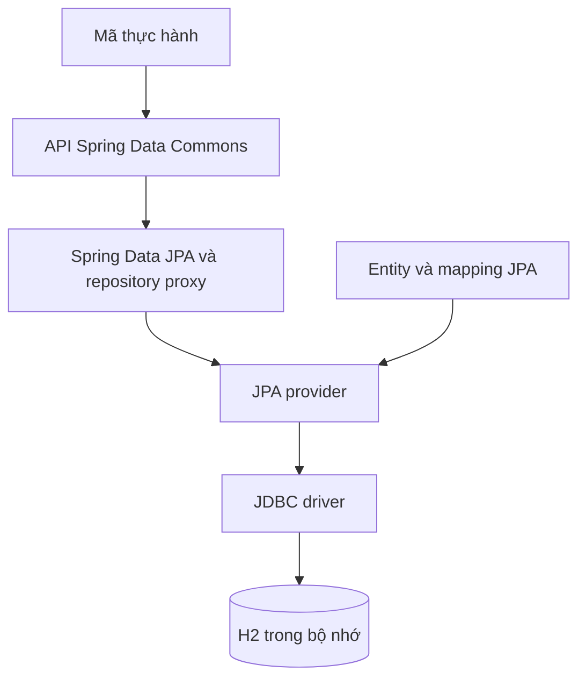

# Chọn một store hỗ trợ để thực thi ví dụ API dùng chung

Một interface như `CrudRepository<Task, Long>` mô tả hợp đồng truy cập dữ liệu, nhưng chưa trả lời dữ liệu nằm ở đâu và ai thực thi hợp đồng đó. Spring Data Commons cung cấp nhiều abstraction dùng chung cho repository, CRUD, truy vấn, phân trang, sắp xếp, projection, metadata và auditing. Để chạy một ví dụ thật, ta cần một module Spring Data dành cho kho dữ liệu cụ thể cùng môi trường lưu trữ phù hợp.

Bài thực hành này thuộc chương **Khởi tạo thực hành** của Spring Data Commons (`SPRING_DATA_COMMONS`). Ta sẽ chọn **Spring Data JPA và H2 trong bộ nhớ** để thực thi một nhóm API dùng chung. Lựa chọn này giúp bắt đầu với Java, một tiến trình ứng dụng và một cơ sở dữ liệu không cần dịch vụ chạy riêng. Nó không biến JPA thành triển khai duy nhất của Commons, cũng không biến hành vi của H2 thành hành vi chung của mọi database.

Kết quả cần đạt là một ứng dụng nhỏ có thể lưu, đọc, sửa, xóa công việc học tập; tìm theo trạng thái; phân trang và sắp xếp bằng các kiểu của Commons. Những phần cần cấu hình riêng như mapping JPA vẫn được giữ rõ để sau này có thể phân biệt kiến thức dùng chung với kiến thức của store.

## 1. Phân biệt API dùng chung, module store và cơ sở dữ liệu

Ba tầng sau thường bị gọi gộp là “Spring Data”, nhưng có trách nhiệm khác nhau:

| Tầng | Ví dụ trong bài | Trách nhiệm |
| --- | --- | --- |
| Abstraction và hạ tầng dùng chung | `CrudRepository`, `PagingAndSortingRepository`, `Pageable`, `Page`, `Sort` | Mô tả hợp đồng và hỗ trợ hạ tầng repository. |
| Module dành cho store | Spring Data JPA | Kết nối mô hình repository với cơ chế persistence của JPA. |
| Công nghệ và môi trường lưu trữ | JPA provider, JDBC driver và H2 | Thực hiện việc tương tác với cơ sở dữ liệu và lưu trạng thái. |



Sơ đồ là cách nhìn chức năng để hiểu đường thực thi, không mô tả toàn bộ lớp nội bộ của framework. Spring Boot có thể hỗ trợ cấu hình nhiều phần trong đường này khi dependency và điều kiện cấu hình phù hợp.

Hai kết luận quan trọng:

- Thêm `spring-data-commons` không tự tạo một database hoặc một repository lưu trữ được dữ liệu.
- Thêm JDBC driver H2 cũng không tự cung cấp triển khai Spring Data repository. Driver giúp kết nối database; module store cung cấp mô hình truy cập phù hợp.

Một lỗi khởi động vì thiếu entity mapping không phải bằng chứng `CrudRepository` không hoạt động. Đó có thể là một thành phần khác của đường thực thi chưa được cung cấp đúng.

## 2. Chọn store theo mục tiêu thực hành

### 2.1. Những câu hỏi nên trả lời trước

Trước khi thêm dependency, xác định:

1. Ví dụ dùng API đồng bộ hay reactive?
2. Có cần một database hoặc dịch vụ bên ngoài đang chạy không?
3. Dữ liệu ví dụ phù hợp với mô hình quan hệ hay document?
4. Những khả năng nào cần được thực thi ngay: CRUD, derived query, phân trang, projection hay auditing?
5. Cần học abstraction trước hay cần kiểm chứng hành vi đặc thù của một công nghệ?

Trong bài này, mục tiêu là chạy API đồng bộ và quan sát kết quả nhanh. Ta chưa cần một cụm dữ liệu, một HTTP API hoặc một mô hình quan hệ phức tạp.

### 2.2. So sánh một số hướng khởi tạo

| Hướng | Môi trường tối thiểu thường cần | Điểm cần phân biệt |
| --- | --- | --- |
| Spring Data JPA + H2 | Ứng dụng Java, JPA provider và H2 | Cần entity mapping JPA; thích hợp cho ví dụ quan hệ đồng bộ. |
| Spring Data JDBC + H2 | Ứng dụng Java, JDBC driver và schema phù hợp | Mapping và vòng đời aggregate khác JPA; không dùng cấu hình Hibernate để sinh schema. |
| Spring Data MongoDB | Ứng dụng Java và một MongoDB có thể kết nối | Mapping document, cấu hình kết nối và khả năng truy vấn theo module MongoDB. |
| Spring Data R2DBC + driver phù hợp | Ứng dụng reactive và kết nối R2DBC | Dùng hợp đồng reactive và driver tương ứng; không thay bằng JDBC driver thông thường. |

Đây là các lựa chọn môi trường, không phải bảng khẳng định mọi module hỗ trợ cùng tập truy vấn. Với mỗi khả năng cụ thể, cần xem mức hỗ trợ của module và phiên bản đang dùng.

### 2.3. Vì sao bài này chọn JPA và H2?

- Starter JPA của Boot tập hợp các dependency cần thiết cho hướng JPA thông dụng.
- H2 chạy trong bộ nhớ, giúp người học bắt đầu mà chưa cần cài một server dữ liệu riêng.
- Có thể dùng các interface Commons ngay trong repository của module JPA.
- Mô hình chỉ gồm một entity đơn giản nên kết quả CRUD và truy vấn dễ quan sát.

Đổi lại, bài thực hành dùng mapping JPA và có hành vi persistence của JPA. Những điều như persistence context, dirty checking, lazy loading hoặc SQL do provider sinh không phải cam kết chung cho mọi module Spring Data.

H2 cũng không thay thế việc kiểm thử trên database đích khi ứng dụng phụ thuộc cú pháp SQL, kiểu dữ liệu, chỉ mục hoặc giao dịch cụ thể của database đó.

## 3. Chốt phạm vi API sẽ kiểm chứng

Ta tạo các công việc học tập, mỗi công việc có:

```text
LearningTask
├── id: Long, định danh do database cấp
├── title: String, tiêu đề
└── status: TaskStatus, TODO hoặc DONE
```

Đường thực hành sử dụng:

| Nhu cầu | API dùng chung |
| --- | --- |
| Lưu và cập nhật công việc | `CrudRepository.save` |
| Đọc theo định danh | `CrudRepository.findById` và `Optional` |
| Kiểm tra tồn tại, đếm và xóa | `existsById`, `count`, `deleteById` |
| Tìm theo thuộc tính | Derived query `findByStatus` |
| Mô tả yêu cầu trang | `Pageable`, `PageRequest` |
| Nhận nội dung và tổng số phần tử | `Page` |
| Mô tả thứ tự | `Sort` và `PagingAndSortingRepository` |

Repository sẽ kế thừa các interface Commons, thay vì cần dùng ngay interface mở rộng riêng `JpaRepository`. Spring Data JPA vẫn là module thực thi ở phía dưới. Cách chọn interface không làm biến mất module store.

Projection, Query by Example và auditing sẽ được đặt vào bản đồ mở rộng ở cuối bài. Chưa cần đưa mọi khả năng vào lần khởi tạo đầu tiên để chứng minh môi trường đã hoạt động.

## 4. Chuẩn bị dự án thực hành

### 4.1. Chọn bộ phiên bản phù hợp

Cần một JDK và công cụ Maven được bản Spring Boot đã chọn hỗ trợ. Mẫu sau sử dụng các import `jakarta.persistence`, vì vậy chọn dòng Boot/JPA dùng Jakarta Persistence tương ứng; không chép nguyên mapping này vào một dự án cũ đang dùng `javax.persistence`.

Trong POM mẫu có hai giá trị bắt buộc phải thay:

| Giá trị thay thế | Thay bằng |
| --- | --- |
| `BOOT_VERSION_DA_XAC_NHAN` | Phiên bản Boot ổn định được chọn cho dự án và môi trường học. |
| `JAVA_VERSION_DA_XAC_NHAN` | Mức Java phù hợp với bản Boot, JPA provider và JDK thực tế. |

Đây là các ký hiệu hướng dẫn, không phải version hợp lệ để Maven tải về. Không gắn thêm version riêng cho Commons hoặc JPA trong mẫu Boot này; dùng tập dependency được Boot quản lý.

### 4.2. Cấu trúc ví dụ

Tạo một dự án thực hành độc lập với cấu trúc:

```text
commons-store-lab/
├── pom.xml
└── src/main/
    ├── java/com/example/commonslab/
    │   ├── CommonsStoreLabApplication.java
    │   ├── TaskStatus.java
    │   ├── LearningTask.java
    │   ├── LearningTaskRepository.java
    │   └── LabScenario.java
    └── resources/
        └── application-commons-lab.yml
```

Đây là cấu trúc người học tạo cho ứng dụng ví dụ. Các đoạn mã trong bài thuộc những file tương ứng của dự án đó.

Đặt lớp ứng dụng ở package `com.example.commonslab`, cùng package hoặc phía trên các entity và repository. Điều này giúp cơ chế quét mặc định của Boot tìm đúng thành phần mà không cần thêm cấu hình quét riêng ở bước đầu.

### 4.3. Dependency Maven

```xml
<project xmlns="http://maven.apache.org/POM/4.0.0"
         xmlns:xsi="http://www.w3.org/2001/XMLSchema-instance"
         xsi:schemaLocation="http://maven.apache.org/POM/4.0.0 https://maven.apache.org/xsd/maven-4.0.0.xsd">
    <modelVersion>4.0.0</modelVersion>

    <parent>
        <groupId>org.springframework.boot</groupId>
        <artifactId>spring-boot-starter-parent</artifactId>
        <version>BOOT_VERSION_DA_XAC_NHAN</version>
        <relativePath/>
    </parent>

    <groupId>com.example</groupId>
    <artifactId>commons-store-lab</artifactId>
    <version>1.0.0-SNAPSHOT</version>

    <properties>
        <java.version>JAVA_VERSION_DA_XAC_NHAN</java.version>
    </properties>

    <dependencies>
        <dependency>
            <groupId>org.springframework.boot</groupId>
            <artifactId>spring-boot-starter-data-jpa</artifactId>
        </dependency>
        <dependency>
            <groupId>com.h2database</groupId>
            <artifactId>h2</artifactId>
            <scope>runtime</scope>
        </dependency>
    </dependencies>

    <build>
        <plugins>
            <plugin>
                <groupId>org.springframework.boot</groupId>
                <artifactId>spring-boot-maven-plugin</artifactId>
            </plugin>
        </plugins>
    </build>
</project>
```

Hai dependency có vai trò khác nhau:

- Starter JPA đưa vào đường thực thi Spring Data JPA và các dependency liên quan, trong đó Commons được sử dụng qua đồ thị phụ thuộc.
- H2 cung cấp database và JDBC driver cho môi trường này. Đặt ở runtime vì mã Java ví dụ không import lớp H2 trực tiếp.

Ví dụ không cần web starter vì chạy bằng `CommandLineRunner`, không cung cấp endpoint HTTP. Việc ứng dụng không mở cổng web trong trường hợp này là bình thường.

## 5. Cấu hình database thực hành bằng profile riêng

Nội dung `application-commons-lab.yml`:

```yaml
spring:
  datasource:
    url: jdbc:h2:mem:commonslab;DB_CLOSE_DELAY=-1;DB_CLOSE_ON_EXIT=FALSE
    driver-class-name: org.h2.Driver
    username: sa
    password: ""
  jpa:
    hibernate:
      ddl-auto: create-drop
```

Cấu hình này chỉ được chọn khi profile `commons-lab` có hiệu lực.

- `mem:commonslab` chỉ database H2 trong bộ nhớ của tiến trình thực hành, không phải file dữ liệu bền vững.
- `DB_CLOSE_DELAY=-1` giữ database trong bộ nhớ khi kết nối cuối đóng trong vòng đời JVM; nó không làm dữ liệu tồn tại qua lần chạy JVM tiếp theo.
- `create-drop` yêu cầu Hibernate tạo schema cho lần chạy và dọn schema khi đóng bình thường. Bài dùng nó để mỗi lần thực hành bắt đầu với dữ liệu mới.

Đây là cấu hình dành cho database thực hành có thể tạo lại. Khi chuyển sang database chứa dữ liệu cần giữ, phải chọn chính sách quản lý schema phù hợp thay vì mang nguyên `create-drop` sang đó.

`ddl-auto` ở đây thuộc đường JPA/Hibernate. Nếu thay bằng Spring Data JDBC, không được chờ cấu hình này tự tạo bảng; cần chuẩn bị schema bằng cơ chế phù hợp với dự án JDBC.

## 6. Viết mô hình tối thiểu

### 6.1. Lớp ứng dụng

`CommonsStoreLabApplication.java`:

```java
package com.example.commonslab;

import org.springframework.boot.SpringApplication;
import org.springframework.boot.autoconfigure.SpringBootApplication;

@SpringBootApplication
public class CommonsStoreLabApplication {

    public static void main(String[] args) {
        SpringApplication.run(CommonsStoreLabApplication.class, args);
    }
}
```

### 6.2. Trạng thái công việc

`TaskStatus.java`:

```java
package com.example.commonslab;

public enum TaskStatus {
    TODO,
    DONE
}
```

### 6.3. Entity và mapping JPA

`LearningTask.java`:

```java
package com.example.commonslab;

import java.util.Objects;
import jakarta.persistence.Column;
import jakarta.persistence.Entity;
import jakarta.persistence.EnumType;
import jakarta.persistence.Enumerated;
import jakarta.persistence.GeneratedValue;
import jakarta.persistence.GenerationType;
import jakarta.persistence.Id;
import jakarta.persistence.Table;

@Entity
@Table(name = "learning_tasks")
public class LearningTask {

    @Id
    @GeneratedValue(strategy = GenerationType.IDENTITY)
    private Long id;

    @Column(nullable = false)
    private String title;

    @Enumerated(EnumType.STRING)
    @Column(nullable = false)
    private TaskStatus status;

    protected LearningTask() {
    }

    public LearningTask(String title, TaskStatus status) {
        if (title == null || title.isBlank()) {
            throw new IllegalArgumentException("Tiêu đề không được rỗng");
        }
        this.title = title.strip();
        this.status = Objects.requireNonNull(status, "status");
    }

    public Long getId() {
        return id;
    }

    public String getTitle() {
        return title;
    }

    public TaskStatus getStatus() {
        return status;
    }

    public void markDone() {
        status = TaskStatus.DONE;
    }
}
```

Những chi tiết này là quyết định của mô hình và mapping đã chọn:

| Chi tiết | Ý nghĩa |
| --- | --- |
| `Long id` | Kiểu ID của repository phải phù hợp; đối tượng mới có thể có ID `null`. |
| `jakarta.persistence.Id` | Annotation ID của JPA, không phải annotation ID dùng chung của một số module khác. |
| `@GeneratedValue` | Yêu cầu cơ chế cấp ID theo mapping JPA đã chọn. |
| Constructor không tham số | Phục vụ cách khởi tạo entity của JPA. |
| `EnumType.STRING` | Lưu tên trạng thái theo mapping enum thay vì phụ thuộc thứ tự hằng enum. |
| `markDone()` | Hành vi miền đơn giản, tách khỏi thao tác ghi dữ liệu. |

Không tự gán ID cho dữ liệu mẫu. Sau khi lưu, lấy ID qua đối tượng mà `save` trả về. Điều này cũng tránh phụ thuộc giả định ID luôn bắt đầu từ một giá trị cố định.

## 7. Khai báo repository bằng interface Commons

`LearningTaskRepository.java`:

```java
package com.example.commonslab;

import java.util.List;
import org.springframework.data.domain.Page;
import org.springframework.data.domain.Pageable;
import org.springframework.data.repository.CrudRepository;
import org.springframework.data.repository.PagingAndSortingRepository;

public interface LearningTaskRepository
        extends CrudRepository<LearningTask, Long>,
                PagingAndSortingRepository<LearningTask, Long> {

    List<LearningTask> findByStatus(TaskStatus status);

    Page<LearningTask> findByStatus(TaskStatus status, Pageable pageable);
}
```

Có bốn điểm cần nhận ra:

1. Interface xác định kiểu miền `LearningTask` và kiểu ID `Long`.
2. `CrudRepository` mở các thao tác CRUD cần cho ví dụ.
3. `PagingAndSortingRepository` mở các thao tác phân trang, sắp xếp tương ứng. Khai báo rõ cả hai hợp đồng giúp không dựa vào giả định interface phân trang luôn bao gồm CRUD ở mọi dòng phiên bản.
4. Hai query method được suy ra từ thuộc tính Java `status`, không từ tên bảng `learning_tasks`.

Không cần tự viết lớp `LearningTaskRepositoryImpl` cho những phương thức này. Hạ tầng repository của module JPA tạo proxy và kết nối phương thức với triển khai tương ứng.

Không thêm `@Repository` vào interface để chữa thiếu dependency, thiếu entity hoặc sai phạm vi quét. Những nguyên nhân đó phải được giải quyết đúng ở tầng cấu hình của chúng.

## 8. Chạy một kịch bản có kết quả quan sát được

`LabScenario.java`:

```java
package com.example.commonslab;

import java.util.List;
import org.springframework.boot.CommandLineRunner;
import org.springframework.context.annotation.Bean;
import org.springframework.context.annotation.Configuration;
import org.springframework.context.annotation.Profile;
import org.springframework.data.domain.Page;
import org.springframework.data.domain.PageRequest;
import org.springframework.data.domain.Sort;

@Configuration(proxyBeanMethods = false)
@Profile("commons-lab")
public class LabScenario {

    @Bean
    CommandLineRunner runCommonsScenario(LearningTaskRepository tasks) {
        return args -> {
            LearningTask first = tasks.save(
                new LearningTask("Hiểu Repository", TaskStatus.TODO)
            );
            tasks.save(
                new LearningTask("Thực hành phân trang", TaskStatus.TODO)
            );
            tasks.save(
                new LearningTask("Đọc mapping JPA", TaskStatus.DONE)
            );

            expect(first.getId() != null, "save phải trả về ID đã được cấp");
            expect(tasks.count() == 3, "Cần có ba công việc ban đầu");

            LearningTask loaded = tasks.findById(first.getId())
                .orElseThrow(() -> new IllegalStateException("Không đọc lại được ID"));
            expect(loaded.getStatus() == TaskStatus.TODO, "Trạng thái ban đầu sai");

            loaded.markDone();
            LearningTask updated = tasks.save(loaded);
            LearningTask reloaded = tasks.findById(updated.getId())
                .orElseThrow(() -> new IllegalStateException("Mất công việc sau sửa"));
            expect(reloaded.getStatus() == TaskStatus.DONE, "Sửa chưa được lưu");

            List<LearningTask> remainingTodo = tasks.findByStatus(TaskStatus.TODO);
            expect(remainingTodo.size() == 1, "Derived query phải tìm một TODO");

            Page<LearningTask> donePage = tasks.findByStatus(
                TaskStatus.DONE,
                PageRequest.of(0, 1, Sort.by("id").ascending())
            );
            expect(donePage.getNumber() == 0, "Chỉ số trang bắt đầu từ không");
            expect(donePage.getContent().size() == 1, "Trang đầu lấy một phần tử");
            expect(donePage.getTotalElements() == 2, "Cần có hai công việc DONE");
            expect(donePage.hasNext(), "Vẫn còn một trang tiếp theo");

            System.out.println("Danh sách theo ID tăng dần:");
            tasks.findAll(Sort.by("id").ascending()).forEach(task ->
                System.out.printf(
                    "%s | %s | %s%n",
                    task.getId(), task.getTitle(), task.getStatus()
                )
            );

            tasks.deleteById(updated.getId());
            expect(!tasks.existsById(updated.getId()), "Xóa chưa có hiệu lực");
            expect(tasks.count() == 2, "Sau xóa phải còn hai công việc");

            System.out.println("COMMONS_STORE_LAB: PASS");
        };
    }

    private static void expect(boolean condition, String message) {
        if (!condition) {
            throw new IllegalStateException(message);
        }
    }
}
```

Đây là một kịch bản thực hành với kiểm tra trực tiếp các kết quả mong đợi. Nó giả định schema mới, không có tiến trình khác cùng ghi vào database và chỉ có bộ dữ liệu được tạo trong runner này. Vì thế, các phép đếm cố định có ý nghĩa với môi trường mẫu, không phải kiểm tra dùng nguyên trạng cho database có sẵn dữ liệu khác.

Profile trên lớp cấu hình làm cho kịch bản chỉ chạy khi bật `commons-lab`. Việc tạo repository vẫn phụ thuộc cấu hình store và quét thành phần, không phụ thuộc riêng vào runner.

### 8.1. Vì sao gọi `save` sau khi sửa?

Đoạn runner không đặt toàn bộ ca sử dụng trong một giao dịch bao ngoài. Nó không dựa vào giả định entity lấy ra sẽ luôn còn được quản lý đến cuối luồng. Sau `markDone`, mã gọi `save` rõ ràng và đọc lại để quan sát trạng thái trong store.

JPA có cơ chế theo dõi thay đổi trong persistence context khi entity còn được quản lý. Đó là chi tiết cần học riêng khi thiết kế giao dịch JPA. Không suy rộng cơ chế ấy sang mọi module thực thi `CrudRepository`.

Kịch bản cũng dùng giá trị trả về của `save`, vì hợp đồng không yêu cầu mọi triển khai luôn giữ đúng cùng instance truyền vào.

### 8.2. Vì sao sắp xếp theo ID?

Các hàng trong database không có thứ tự mặc định được bảo đảm chỉ vì chúng được thêm lần lượt. Ví dụ yêu cầu `Sort.by("id").ascending()` để kết quả phân trang có thứ tự rõ ràng với bộ dữ liệu này.

`id` là tên thuộc tính Java của entity. Với những kiểu dữ liệu hoặc thuộc tính khác, khả năng sắp xếp cần được hỗ trợ bởi module và database.

Không kiểm tra rằng `findByStatus` trả `List` không có sort phải có thứ tự cố định. Truy vấn đó chỉ được dùng để kiểm tra điều kiện lọc và số phần tử.

## 9. Khởi chạy và đọc kết quả

Sau khi thay các giá trị phiên bản, tạo đủ các file ví dụ và chuẩn bị JDK/Maven phù hợp, người học có thể chạy từ thư mục dự án thực hành:

```shell
mvn spring-boot:run "-Dspring-boot.run.profiles=commons-lab"
```

Nếu dùng Maven Wrapper, thay lệnh Maven bằng wrapper tương ứng của môi trường. Lệnh trên là hướng dẫn chạy ứng dụng mẫu; kết quả thành công phải được quan sát ở chính lần chạy của người học.

Kết quả mong đợi:

1. Boot khởi tạo được JPA và datasource H2.
2. Repository được tạo, mapping entity hợp lệ và schema được chuẩn bị.
3. Runner hoàn thành các phép đọc, ghi và truy vấn.
4. Console có danh sách ba công việc trước bước xóa và dòng `COMMONS_STORE_LAB: PASS`.
5. Sau bước xóa, phép đếm trong runner xác nhận còn hai công việc.

Luồng trạng thái dữ liệu:

| Thời điểm | TODO | DONE | Tổng |
| --- | ---: | ---: | ---: |
| Sau tạo dữ liệu | 2 | 1 | 3 |
| Sau hoàn thành công việc đầu | 1 | 2 | 3 |
| Sau xóa công việc đầu | 1 | 1 | 2 |

Các giá trị ID cụ thể có thể khác; điều cần quan sát là ID không rỗng, tìm lại được đúng đối tượng và thứ tự được yêu cầu rõ ràng.

Dòng PASS chỉ xác nhận kịch bản mẫu đã hoàn thành trong store được cấu hình. Nó chưa chứng minh mọi tính năng Spring Data đều được hỗ trợ, không thay kiểm thử ứng dụng thật và không xác nhận tính tương đương với database khác.

## 10. Mở rộng có chọn lọc sang các khả năng Commons khác

Sau khi đường CRUD cơ bản hoạt động, có thể mở rộng từng khả năng để thấy abstraction chung được một module cụ thể thực thi như thế nào.

| Khả năng | Hướng mở rộng trong môi trường JPA | Điều không nên suy ra |
| --- | --- | --- |
| Projection | Thêm hình dạng kết quả chỉ đọc gồm ID và tiêu đề, rồi truy vấn theo khả năng module hỗ trợ. | Projection không tự trở thành aggregate hoặc bảo đảm mọi truy vấn chỉ lấy đúng số cột mong muốn. |
| Query by Example | Bổ sung `QueryByExampleExecutor<LearningTask>` và tạo `Example` cùng `ExampleMatcher` phù hợp. | Đối tượng mẫu không diễn đạt mọi điều kiện truy vấn phức tạp; thuộc tính có giá trị ngoài ý muốn có thể trở thành điều kiện lọc. |
| Auditing | Bật hạ tầng auditing của JPA và cấu hình thông tin thời gian hoặc người thao tác cần thiết. | Chỉ thêm một annotation Commons chưa chắc đã kích hoạt đủ auditing. |
| Metadata | Quan sát ID, thuộc tính và chữ ký repository mà hạ tầng cần để tạo truy vấn và mapping. | Metadata dùng chung không có nghĩa mọi module đọc cùng một bộ annotation. |
| Repository fragment | Ghép thêm hành vi tùy biến khi truy vấn khai báo không diễn đạt phù hợp. | Mã triển khai tùy biến không tự có tính di động giữa các store. |

Ví dụ projection đơn giản về mặt hợp đồng:

```java
package com.example.commonslab;

public interface TaskTitleView {
    Long getId();
    String getTitle();
}
```

Nếu triển khai bài mở rộng này trong dự án thực hành, thêm phương thức sau vào `LearningTaskRepository`:

```java
List<TaskTitleView> findProjectedByStatus(TaskStatus status);
```

`Projected` nằm trong phần mô tả của tên truy vấn; điều kiện vẫn bắt đầu ở `ByStatus`. Kiểu trả về mô tả hình dạng đọc. Đường truy vấn và khả năng tối ưu thực tế thuộc module JPA đang sử dụng.

Với Query by Example, cần đọc kỹ matcher trước khi chạy. Nếu probe có cả `title` và `status`, mặc định lọc theo nhiều thuộc tính có thể tạo kết quả rỗng dù ý định chỉ tìm theo trạng thái. Việc ignore thuộc tính phải được đặt có chủ đích.

Với auditing có người tạo hoặc sửa, cần nguồn cung cấp danh tính thao tác phù hợp, chẳng hạn một hiện thực `AuditorAware`. Ví dụ đang chạy bằng dòng lệnh không tự có người dùng đăng nhập như một ứng dụng web đã cấu hình bảo mật.

## 11. Nếu chuyển sang một store khác

Để đổi từ JPA/H2 sang MongoDB hoặc một lựa chọn khác, hãy chia việc chuyển đổi thành các nhóm rõ ràng.

### 11.1. Phần có thể giữ về mặt ý tưởng

- Các ca sử dụng lưu, tìm theo ID, lọc trạng thái, phân trang và sắp xếp.
- Ý nghĩa nghiệp vụ của tiêu đề, trạng thái và hành vi hoàn thành công việc.
- Các abstraction phù hợp như `Pageable`, `Sort` hoặc hình dạng projection nếu module mới hỗ trợ.
- Những kiểm tra kết quả không phụ thuộc cơ chế persistence cụ thể.

### 11.2. Phần phải xem lại

| Phần | Câu hỏi khi đổi store |
| --- | --- |
| Dependency | Đã chọn module store và driver đúng chưa? Có còn dependency của store cũ làm việc nhận diện repository mơ hồ không? |
| Kết nối | Database mới cần URL, thông tin xác thực hoặc dịch vụ chạy riêng nào? |
| Mapping | Annotation, tên lưu trữ, constructor, ID và converter có phù hợp không? |
| Repository | Từ khóa derived query, kiểu trả về và executor mở rộng có được hỗ trợ không? |
| Dữ liệu và truy vấn | Cách so sánh chuỗi, null, sắp xếp hoặc kiểu thời gian có thay đổi không? |
| Giao dịch | Thao tác đơn lẻ và nhiều bước có mức nguyên tử, kiểm soát đồng thời nào? |
| Vòng đời môi trường | Dữ liệu có còn tự tạo mới, tự mất khi dừng tiến trình như H2 trong bài không? |

Không giữ nguyên `jakarta.persistence.Entity`, `GeneratedValue` và cấu hình Hibernate rồi chờ module MongoDB diễn giải chúng theo cách JPA. Không mặc định `Long` với ID tự tăng vẫn là lựa chọn phù hợp cho store mới.

Nếu muốn chuyển sang reactive, cần xem lại cả hợp đồng repository và cách điều phối mã. Một `List` trả về đồng bộ không trở thành luồng không chặn chỉ vì được bọc trong một publisher ở bên ngoài.

## 12. Chẩn đoán lỗi theo tầng

| Dấu hiệu | Điểm cần kiểm tra đầu tiên |
| --- | --- |
| Maven không resolve được version | Đã thay giá trị phiên bản và dùng tập dependency được quản lý phù hợp chưa? |
| Không có bean repository | Module store, phạm vi quét package và điều kiện cấu hình repository. |
| `Not a managed type` hoặc thông báo tương tự của JPA | Entity có mapping JPA đúng, import đúng và nằm trong phạm vi quét không? |
| Không tạo được datasource | Dependency driver, URL và profile thực sự có hiệu lực. |
| Không có bảng `learning_tasks` | Cấu hình schema JPA/Hibernate có áp dụng với datasource đang chạy không? |
| Không tìm được property khi tạo query | Tên phương thức có khớp thuộc tính Java `status` và entity đúng không? |
| Ứng dụng chạy nhưng không có dòng PASS | Profile `commons-lab`, bean runner và lỗi xuất hiện trước khi runner hoàn tất. |
| Phép đếm khác dữ liệu mẫu | Schema có mới không, có runner hoặc luồng ghi dữ liệu khác không? |
| `NoSuchMethodError` từ thư viện | Đồ thị dependency có bị ghim lệch Commons, module store hoặc nền tảng không? |

Đọc nguyên nhân gốc trong chuỗi lỗi thay vì chỉ nhìn dòng “application failed”. Ví dụ thiếu bảng và thiếu repository bean là hai sự cố khác nhau; thêm ngẫu nhiên annotation vào repository không sửa được cả hai.

Chỉ thay một nhóm cấu hình có căn cứ rồi quan sát lại. Nếu thay đồng thời store, kiểu ID, version và mapping, ta sẽ khó biết thay đổi nào tạo ra hoặc sửa được lỗi.

## 13. Bài tập củng cố lựa chọn store

### Bài 1: bỏ module store

Nếu chỉ giữ `spring-data-commons` và H2, điều gì còn thiếu để chạy repository trong ví dụ?

**Gợi ý:** Commons cung cấp hợp đồng, H2 cung cấp database/driver. Đường triển khai repository dành cho store, cấu hình persistence và mapping tương ứng vẫn cần được cung cấp.

### Bài 2: giữ API nhưng đổi Spring Data JDBC

Có thể chỉ thay starter rồi giữ nguyên `ddl-auto: create-drop` để tạo bảng không?

**Gợi ý:** Không dựa vào cấu hình Hibernate cho đường JDBC. Cần xem lại mapping, schema và vòng đời aggregate theo module JDBC, đồng thời xác minh các phương thức truy vấn đang dùng.

### Bài 3: dữ liệu biến mất sau khi dừng

Sau khi khởi chạy lại, công việc trước đó không còn. Đây có phải lỗi của `save` không?

**Gợi ý:** H2 trong bộ nhớ và chính sách schema của bài chủ đích tạo môi trường mới. Độ bền dữ liệu phụ thuộc cấu hình lưu trữ, không chỉ hợp đồng `save`.

### Bài 4: muốn dùng MongoDB để học document

Có nên chọn JPA/H2 chỉ vì ví dụ này ngắn hơn không?

**Gợi ý:** Nếu mục tiêu chính là mapping document hoặc hành vi MongoDB, chọn module MongoDB và môi trường MongoDB phù hợp. JPA/H2 phù hợp với mục tiêu khởi động API đồng bộ của bài, không phải mọi mục tiêu học tập.

### Bài 5: muốn thực hành auditing

Môi trường CRUD đã chạy có đủ để khẳng định auditing sẽ hoạt động không?

**Gợi ý:** Chưa. Cần bật hạ tầng auditing của module, mapping các thuộc tính liên quan và cung cấp dữ liệu người thao tác nếu dùng trường người tạo hoặc người sửa.

Một môi trường thực hành có ích khi người học chỉ ra được **API nào dùng chung, module nào thực thi, mapping nào thuộc store và kết quả nào đã quan sát được**. Với JPA và H2, ta có đường chạy cụ thể để bắt đầu; khi thay công nghệ, tiếp tục đối chiếu từng khả năng thay vì giả định mọi phần đều được mang sang nguyên dạng.
