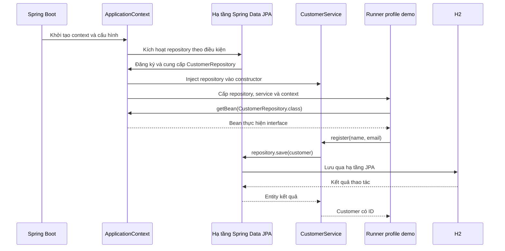

# Khai báo repository đầu tiên và lấy bean từ Spring

Một repository Spring Data bắt đầu bằng một interface mô tả các thao tác với một domain type. Để sử dụng interface đó trong ứng dụng, bạn cần một repository bean do hạ tầng Spring Data tạo và do Spring quản lý.

Trong bài thực hành thuộc module `SPRING_DATA_COMMONS`, bạn sẽ khai báo `CustomerRepository`, nhận bean qua constructor injection, rồi lấy lại bean bằng `ApplicationContext.getBean(...)` để quan sát cách Spring cung cấp đối tượng. Ví dụ dùng Spring Data JPA và H2 để có một đường đọc/ghi dữ liệu cụ thể.

Sau bài này, bạn có thể:

- Gắn đúng domain type và kiểu ID vào repository interface.
- Tổ chức package để ứng dụng nhận diện entity, repository và service.
- Nhận repository bean từ Spring thay vì tự tìm một lớp implementation để khởi tạo.
- Phân biệt lỗi không có bean với lỗi mapping, cấu hình database hoặc thực thi truy vấn.
- Viết một kiểm tra tích hợp nhỏ cho cả wiring bean và thao tác CRUD.

## 1. Phạm vi của ví dụ và điều kiện bắt đầu

Commons cung cấp `Repository`, `CrudRepository` cùng nhiều abstraction dùng chung. Phần truy cập JPA thực tế do Spring Data JPA tích hợp với `EntityManager` và JPA provider thực hiện. H2 là database trong bộ nhớ cho lượt thực hành.

| Thành phần | Vai trò trong ví dụ |
| --- | --- |
| Spring Data Commons | Cung cấp hợp đồng `CrudRepository<Customer, Long>` |
| Spring Data JPA | Tạo repository theo JPA và cung cấp triển khai truy cập entity |
| Spring Boot | Khởi tạo application context và hỗ trợ auto-configuration |
| H2 | Lưu dữ liệu thực hành trong bộ nhớ |
| Spring Framework | Quản lý bean và giải quyết dependency injection |

Chuẩn bị một dự án Spring Boot với Java và build tool phù hợp với phiên bản Boot đã chọn. Ví dụ sử dụng namespace `jakarta.persistence`; không trộn các annotation này với một dự án đang dùng nền tảng JPA cũ dựa trên `javax.persistence`.

Với Maven và dependency management của Boot đã được thiết lập, các dependency cần cho bài là:

```xml
<dependencies>
    <dependency>
        <groupId>org.springframework.boot</groupId>
        <artifactId>spring-boot-starter-data-jpa</artifactId>
    </dependency>

    <dependency>
        <groupId>com.h2database</groupId>
        <artifactId>h2</artifactId>
        <scope>runtime</scope>
    </dependency>

    <dependency>
        <groupId>org.springframework.boot</groupId>
        <artifactId>spring-boot-starter-test</artifactId>
        <scope>test</scope>
    </dependency>
</dependencies>
```

Đây là phần dependencies của một dự án Boot, không phải toàn bộ `pom.xml`. Parent hoặc BOM phải quản lý phiên bản trước khi bạn bỏ các thẻ version như trên.

Starter JPA đưa module Spring Data JPA và các thành phần liên quan vào dự án; Commons được đưa vào qua quan hệ phụ thuộc. Chỉ thêm `spring-data-commons` để import được `CrudRepository` chưa đủ tạo một repository JPA hoạt động.

Spring Boot hỗ trợ auto-configuration cho database nhúng như H2 khi có dependency và các điều kiện phù hợp. Trong bài, ta khai báo URL rõ ràng để dễ theo dõi database đang dùng. [Spring Boot — SQL Databases](https://docs.spring.io/spring-boot/reference/data/sql.html)

## 2. Tổ chức package để Spring tìm đúng thành phần

Sử dụng cấu trúc sau trong dự án mẫu:

```text
src/main/java/com/example/repositorydemo/
├── RepositoryDemoApplication.java
├── customer/
│   ├── Customer.java
│   ├── CustomerRepository.java
│   └── CustomerService.java
└── config/
    └── RepositoryDemoConfig.java

src/main/resources/
└── application.properties

src/test/java/com/example/repositorydemo/
└── CustomerRepositoryContextTest.java
```

Lớp application nằm ở `com.example.repositorydemo`, phía trên các package con. Với cấu hình Boot thông thường trong ví dụ, cách tổ chức này giúp việc tìm component, entity và repository nhất quán.

Không đặt lớp application vào một package con không bao phủ các thành phần còn lại. Cũng tránh default package, tức lớp Java không có khai báo `package`. Tài liệu Boot khuyến nghị đặt lớp application trong root package của ứng dụng. [Spring Boot — Structuring Your Code](https://docs.spring.io/spring-boot/reference/using/structuring-your-code.html)

Lớp khởi động:

```java
package com.example.repositorydemo;

import org.springframework.boot.SpringApplication;
import org.springframework.boot.autoconfigure.SpringBootApplication;

@SpringBootApplication
public class RepositoryDemoApplication {

    public static void main(String[] args) {
        SpringApplication.run(RepositoryDemoApplication.class, args);
    }
}
```

`SpringApplication.run(...)` tạo và khởi động application context. Trong context đó, Spring quản lý các bean và hạ tầng Spring Data đăng ký repository phù hợp.

Repository không được tạo chỉ vì JVM nhìn thấy interface trên classpath. Cấu hình repository, phạm vi tìm kiếm và các tài nguyên lưu trữ phải cùng đáp ứng yêu cầu.

## 3. Tạo domain type có định danh rõ ràng

Trong `Customer.java`:

```java
package com.example.repositorydemo.customer;

import jakarta.persistence.Column;
import jakarta.persistence.Entity;
import jakarta.persistence.GeneratedValue;
import jakarta.persistence.GenerationType;
import jakarta.persistence.Id;
import jakarta.persistence.Table;

@Entity
@Table(name = "customers")
public class Customer {

    @Id
    @GeneratedValue(strategy = GenerationType.IDENTITY)
    private Long id;

    @Column(nullable = false)
    private String name;

    @Column(nullable = false, unique = true)
    private String email;

    protected Customer() {
    }

    public Customer(String name, String email) {
        this.name = name;
        this.email = email;
    }

    public Long getId() {
        return id;
    }

    public String getName() {
        return name;
    }

    public String getEmail() {
        return email;
    }
}
```

Các lựa chọn cần hiểu:

- `@Entity` đánh dấu kiểu được JPA quản lý.
- `@Id` xác định thuộc tính định danh.
- `Long` là kiểu ID sẽ dùng trong repository.
- Constructor không tham số `protected` phục vụ JPA.
- Đặt mapping trên field cho phép JPA truy cập field; ví dụ không cần thêm setter chỉ để persistence hoạt động.
- Tên bảng `customers` được khai báo để phân biệt tên entity Java với tên bảng.
- Ràng buộc email duy nhất giúp mô hình thực hành có một quy tắc dữ liệu cụ thể.

Đây là mapping JPA, không phải mẫu annotation bắt buộc cho mọi kho dữ liệu. Với MongoDB hoặc module khác, cách khai báo domain và metadata có thể khác.

Trong bài chưa cần quan hệ giữa entity, auditing hay projection. Tập trung vào một domain type đơn giản giúp quan sát việc tạo và lấy bean rõ hơn.

## 4. Khai báo repository đầu tiên

Trong `CustomerRepository.java`:

```java
package com.example.repositorydemo.customer;

import org.springframework.data.repository.CrudRepository;

public interface CustomerRepository
        extends CrudRepository<Customer, Long> {
}
```

Hai tham số generic có ý nghĩa:

| Khai báo | Ý nghĩa |
| --- | --- |
| `Customer` | Domain type được repository quản lý |
| `Long` | Kiểu ID của domain type |
| `CrudRepository` | Hợp đồng các thao tác tạo, đọc, cập nhật và xóa |

Một số method được kế thừa:

```java
<S extends Customer> S save(S entity);

java.util.Optional<Customer> findById(Long id);

boolean existsById(Long id);

Iterable<Customer> findAll();

long count();

void deleteById(Long id);
```

Đoạn trên minh họa các chữ ký sau khi thay generic bằng kiểu của bài; không cần chép lại chúng vào `CustomerRepository`.

`Repository` là hợp đồng nền, còn `CrudRepository` cung cấp các method CRUD. Chỉ mở rộng `Repository<Customer, Long>` chưa tự làm cho mã nguồn gọi được toàn bộ method CRUD. [Spring Data Commons — Defining Repository Interfaces](https://docs.spring.io/spring-data/commons/reference/repositories/definition.html)

### 4.1. Có cần thêm annotation `@Repository` không?

Với repository interface được hạ tầng Spring Data phát hiện theo cấu hình phù hợp, bạn không cần thêm `@Repository` chỉ để tạo bean như trong ví dụ này.

Điều quan trọng là interface thuộc phạm vi repository scanning và có module hỗ trợ. Đặt `@Repository` lên một interface bất kỳ không làm Spring tự biết cách triển khai mọi method của interface đó.

### 4.2. Có cần viết `CustomerRepositoryImpl` không?

Chưa cần cho các method CRUD đã được module hỗ trợ. Spring Data dùng factory để tạo đối tượng thực hiện hợp đồng repository và tổ chức phần thực thi phía sau.

Trong JPA, triển khai cơ sở thường gặp là `SimpleJpaRepository`. Đối tượng ứng dụng nhận thường là proxy thực hiện interface `CustomerRepository`. Không nên giả định framework phải tạo một file `CustomerRepositoryImpl.java` trong source tree để bạn có thể gọi `new`.

Custom fragment có triển khai riêng là một cơ chế mở rộng cho nhu cầu khác; không cần đưa nó vào bài repository đầu tiên.

## 5. Cấu hình database thực hành

Trong `application.properties`:

```properties
spring.application.name=repository-demo
spring.main.web-application-type=none

spring.datasource.url=jdbc:h2:mem:repository-demo
spring.datasource.username=sa
spring.datasource.password=

spring.jpa.hibernate.ddl-auto=create-drop
spring.jpa.show-sql=true
```

Ứng dụng chạy ở chế độ không có web server. Mục tiêu là khởi động context và thử repository, nên chưa cần controller hoặc endpoint HTTP.

`create-drop` chủ động tạo và xóa schema phục vụ bài trên H2 trong bộ nhớ. Cấu hình này dành cho dữ liệu thực hành có thể bỏ đi sau lượt chạy, không phải lựa chọn giữ dữ liệu lâu dài.

`show-sql` giúp nhìn thao tác do provider tạo ra. SQL, tên cột và cách hiển thị có thể thay đổi theo provider, phiên bản và naming strategy; không dùng một dòng log SQL cố định làm hợp đồng của Commons.

Không cần tự khai báo `DataSource` và `EntityManagerFactory` trong ví dụ Boot này khi auto-configuration đáp ứng đầy đủ điều kiện. Nếu ứng dụng có cấu hình tùy biến hoặc nhiều nguồn dữ liệu, cách thiết lập sẽ khác.

## 6. Nhận repository bằng constructor injection

Trong `CustomerService.java`:

```java
package com.example.repositorydemo.customer;

import org.springframework.stereotype.Service;
import org.springframework.transaction.annotation.Transactional;

@Service
public class CustomerService {

    private final CustomerRepository customers;

    public CustomerService(CustomerRepository customers) {
        this.customers = customers;
    }

    @Transactional
    public Customer register(String name, String email) {
        return customers.save(new Customer(name, email));
    }

    @Transactional(readOnly = true)
    public Customer getRequired(Long id) {
        return customers.findById(id)
                .orElseThrow(() ->
                        new IllegalArgumentException(
                                "Không tìm thấy customer với ID " + id));
    }
}
```

Luồng cấp dependency là:

1. Spring nhận diện `CustomerService` là một component.
2. Constructor yêu cầu một bean có kiểu `CustomerRepository`.
3. Hạ tầng repository cung cấp bean thực hiện interface đó.
4. Spring truyền bean vào constructor và quản lý service đã được khởi tạo.

Trong cấu hình thông thường, một constructor duy nhất không cần thêm `@Autowired`. Dependency được giữ trong field `final`, thể hiện service cần repository để hoạt động.

Constructor injection làm dependency bắt buộc hiện rõ trong thiết kế lớp và giúp khởi tạo đối tượng ở trạng thái đầy đủ. Tài liệu Spring Framework khuyến nghị cách này cho dependency bắt buộc. [Spring Framework — Dependency Injection](https://docs.spring.io/spring-framework/reference/7.0/core/beans/dependencies/factory-collaborators.html)

Hai annotation `@Transactional` trong service xác định ranh giới cho thao tác nghiệp vụ. Trong ví dụ, các method được gọi từ một bean khác qua service do Spring quản lý. Nếu tự khởi tạo service hoặc gọi nội bộ theo cách không đi qua proxy, không được mặc định rằng advice giao dịch vẫn được áp dụng như ở đây.

### Điều dễ nhầm khi dùng `new`

Một biểu thức như sau không thể khởi tạo repository interface:

```java
// Không hợp lệ: CustomerRepository là interface.
// CustomerRepository customers = new CustomerRepository();
```

Bạn có thể tự tạo `new Customer(...)` vì entity là một đối tượng dữ liệu. Còn repository bean phải được lấy từ hạ tầng đã cấu hình.

Tự gọi `new CustomerService(repository)` có thể hữu ích trong unit test với một test double. Đối tượng service đó không tự trở thành bean và không tự có transaction proxy của Spring.

## 7. Lấy lại bean bằng `ApplicationContext.getBean(...)`

Constructor injection là cách dùng repository trong service. Để quan sát trực tiếp container, ta thêm một runner có profile riêng.

Trong `RepositoryDemoConfig.java`:

```java
package com.example.repositorydemo.config;

import com.example.repositorydemo.customer.Customer;
import com.example.repositorydemo.customer.CustomerRepository;
import com.example.repositorydemo.customer.CustomerService;

import org.springframework.boot.ApplicationRunner;
import org.springframework.context.ApplicationContext;
import org.springframework.context.annotation.Bean;
import org.springframework.context.annotation.Configuration;
import org.springframework.context.annotation.Profile;

@Configuration(proxyBeanMethods = false)
@Profile("demo")
public class RepositoryDemoConfig {

    @Bean
    ApplicationRunner repositoryDemo(
            CustomerRepository customers,
            CustomerService customerService,
            ApplicationContext context) {

        return args -> {
            CustomerRepository fromContext =
                    context.getBean(CustomerRepository.class);

            System.out.println(
                    "Đúng kiểu repository: "
                            + CustomerRepository.class.isInstance(fromContext));

            System.out.println(
                    "Cùng bean singleton: " + (customers == fromContext));

            Customer saved = customerService.register(
                    "An Nguyen", "an@example.com");

            Customer loaded = customerService.getRequired(saved.getId());

            System.out.println(
                    "Tìm lại theo ID: "
                            + saved.getId().equals(loaded.getId()));

            System.out.println("Email: " + loaded.getEmail());
        };
    }
}
```

Runner thực hiện hai việc tách biệt:

- Đối chiếu bean Spring truyền vào tham số `@Bean` với bean được tra cứu theo kiểu.
- Gọi service để lưu và đọc lại dữ liệu qua repository.

`context.getBean(CustomerRepository.class)` yêu cầu container tìm một bean phù hợp với kiểu đó. Bạn nhận đối tượng thực hiện hợp đồng, không phải đối tượng `Class` hay một tên lớp để tự khởi tạo.

Trong ví dụ có một repository bean singleton tương ứng, hai tham chiếu được đối chiếu là cùng một bean. Đây là kiểm tra theo cấu hình cụ thể của bài; không suy rộng thành mọi bean trong Spring đều có singleton scope.

`ApplicationContext` kế thừa khả năng tra cứu bean của `BeanFactory`. Khi không có bean phù hợp hoặc có nhiều ứng viên không phân giải được, thao tác tra cứu theo kiểu có thể thất bại. [Spring Framework — BeanFactory API](https://docs.spring.io/spring-framework/docs/current/javadoc-api/org/springframework/beans/factory/BeanFactory.html)

### 7.1. Vì sao dùng profile `demo`?

Profile này giúp đoạn seed dữ liệu và in kết quả chỉ chạy khi bạn chủ động kích hoạt demo. Khi chạy kiểm tra tích hợp ở phần sau, ta dùng profile `test` để không chạy lại runner.

Khi khởi chạy lớp application từ IDE, thêm program argument:

```text
--spring.profiles.active=demo
```

Đây là đối số cho ứng dụng, không phải một khai báo annotation Java hay một tên bean.

Nếu không kích hoạt profile `demo`, ứng dụng vẫn có thể khởi tạo repository và service nhưng runner của bài không được đăng ký. Không thấy các dòng in của runner trong trường hợp đó không chứng minh repository bean bị thiếu.

### 7.2. Đầu ra kỳ vọng

Bỏ qua các log hạ tầng và SQL, các dòng do runner in ra có dạng:

```text
Đúng kiểu repository: true
Cùng bean singleton: true
Tìm lại theo ID: true
Email: an@example.com
```

Đây là đầu ra kỳ vọng từ mã minh họa, không phải log đã đo của một dự án cụ thể. Bài không cố định ID phải là `1`, cũng không cố định tên lớp proxy.

Nếu muốn xem tên lớp runtime để học thêm, có thể in `fromContext.getClass().getName()`. Tên lớp này là chi tiết triển khai, không nên xuất hiện trong logic nghiệp vụ hoặc assertion bắt buộc.

### 7.3. Vì sao không dùng `getBean` khắp service?

Nếu mỗi service tự giữ `ApplicationContext` rồi tìm repository khi cần, dependency của service khó nhìn thấy từ constructor và việc kiểm tra độc lập trở nên phức tạp hơn.

Dùng `getBean` ở đây để học cơ chế container. Trong luồng nghiệp vụ thông thường của bài, service nhận `CustomerRepository` qua constructor và gọi hợp đồng đó trực tiếp.

Không tạo một application context thứ hai chỉ để lấy repository. Context mới cần có cấu hình và tài nguyên riêng; nó không tự chia sẻ mọi bean với context do `SpringApplication.run(...)` tạo ra.

## 8. Điều gì diễn ra từ lúc khởi động đến lần gọi đầu tiên?



Sơ đồ thể hiện trách nhiệm khái quát; không phải thứ tự chi tiết của mọi callback khởi tạo hoặc mọi interceptor.

Cần phân biệt ba mốc:

| Mốc | Điều đã chứng minh | Điều chưa được chứng minh chỉ từ mốc đó |
| --- | --- | --- |
| Java biên dịch được | Interface và các kiểu cần thiết có trên compile classpath | Repository bean đã được tạo |
| Lấy được bean từ context | Wiring và đăng ký repository đã đáp ứng yêu cầu lúc đó | Mọi thao tác database đều sẽ thành công |
| Lưu và đọc lại thành công | Đường truy cập được thực hiện cho dữ liệu thử | Tất cả query, ràng buộc và tình huống đồng thời đều đúng |

Một ứng dụng có thể lấy được bean nhưng chỉ gặp lỗi kết nối khi thực thi thao tác. Tùy chế độ bootstrap, một số lỗi tạo repository cũng có thể được quan sát muộn hơn lúc khởi động.

## 9. Nếu không dùng cơ chế scan mặc định của Boot

Với cấu hình Spring Data JPA chủ động, annotation kích hoạt repository là `@EnableJpaRepositories`. Có thể chỉ rõ phạm vi bằng class đại diện:

```java
@EnableJpaRepositories(basePackageClasses = CustomerRepository.class)
```

Đây là một mảnh cấu hình dành cho tình huống cần kiểm soát phạm vi; không cần thêm nó vào ví dụ mặc định chỉ vì repository là interface.

Annotation này điều khiển repository scanning. Việc entity được nhận diện và việc `EntityManagerFactory`, transaction manager được cung cấp vẫn cần cấu hình tương ứng. Mở rộng component scan cho service không tự đồng nghĩa đã mở rộng đúng mọi phạm vi của entity và repository.

Commons mô tả việc tạo repository theo module; ví dụ JPA dùng annotation và tài nguyên JPA, module khác cần cấu hình phù hợp với công nghệ đó. [Spring Data Commons — Creating Repository Instances](https://docs.spring.io/spring-data/commons/reference/repositories/create-instances.html)

Với bài đầu tiên, giữ lớp application ở root package và đặt các thành phần bên dưới là cách đơn giản để tránh phải tùy biến nhiều phạm vi cùng lúc.

## 10. Kiểm tra tích hợp: bean có tồn tại và thực hiện được CRUD

Một kiểm tra phù hợp cần xác nhận cả việc lấy bean lẫn đường truy cập dữ liệu. Chỉ assertion rằng field không `null` chưa kiểm tra được mapping và thao tác lưu/đọc.

Trong `CustomerRepositoryContextTest.java`:

```java
package com.example.repositorydemo;

import com.example.repositorydemo.customer.Customer;
import com.example.repositorydemo.customer.CustomerRepository;

import jakarta.persistence.EntityManager;
import jakarta.persistence.PersistenceContext;

import org.junit.jupiter.api.Test;
import org.springframework.beans.factory.annotation.Autowired;
import org.springframework.boot.test.context.SpringBootTest;
import org.springframework.context.ApplicationContext;
import org.springframework.test.context.ActiveProfiles;
import org.springframework.transaction.annotation.Transactional;

import static org.assertj.core.api.Assertions.assertThat;

@SpringBootTest(properties = {
        "spring.datasource.url=jdbc:h2:mem:repository-bean-test"
})
@ActiveProfiles("test")
@Transactional
class CustomerRepositoryContextTest {

    @Autowired
    private ApplicationContext context;

    @Autowired
    private CustomerRepository customers;

    @PersistenceContext
    private EntityManager entityManager;

    @Test
    void getsRepositoryBeanAndReadsPersistedCustomer() {
        CustomerRepository fromContext =
                context.getBean(CustomerRepository.class);

        assertThat(fromContext).isSameAs(customers);

        Customer saved = customers.save(
                new Customer("Test User", "bean-test@example.com"));

        Long savedId = saved.getId();
        assertThat(savedId).isNotNull();

        entityManager.flush();
        entityManager.clear();

        Customer loaded = customers.findById(savedId).orElseThrow();

        assertThat(loaded.getId()).isEqualTo(savedId);
        assertThat(loaded.getEmail()).isEqualTo("bean-test@example.com");
    }
}
```

Ý nghĩa của các lựa chọn:

- `@SpringBootTest` khởi tạo context theo ứng dụng để kiểm tra wiring thực tế.
- Profile `test` giúp runner có profile `demo` không tham gia trong cấu hình test của bài.
- URL riêng đặt database kiểm tra khác tên với database demo.
- `@Transactional` của Spring đặt test trong giao dịch do hạ tầng kiểm tra quản lý.
- `flush` gửi các thay đổi đang chờ xuống database; `clear` làm lần đọc sau không chỉ lấy lại entity đã nằm trong persistence context.
- Không assertion tên lớp proxy hoặc giả định ID bắt đầu từ một số cụ thể.

Hai lệnh trên `EntityManager` là chi tiết JPA để tăng ý nghĩa của kiểm tra đọc lại. Chúng không phải method bắt buộc của hợp đồng repository trong Commons.

Với Spring TestContext và cấu hình transaction manager phù hợp, giao dịch của test có `@Transactional` mặc định được rollback sau test. Điều này không có nghĩa mọi công việc chạy ở thread khác hoặc một giao dịch độc lập đều tự rollback theo cùng cách. [Spring Framework — Transaction Management in Tests](https://docs.spring.io/spring-framework/reference/testing/testcontext-framework/tx.html)

Đoạn test là mã để đưa vào dự án thực hành. Khi test chạy thành công trong môi trường đó, bạn có bằng chứng cho wiring và một đường CRUD cụ thể; không suy ra mọi chức năng repository đã được kiểm tra.

## 11. Các lỗi thường gặp và điểm bắt đầu chẩn đoán

| Biểu hiện | Nguyên nhân cần kiểm tra | Hướng xử lý |
| --- | --- | --- |
| Không import được `CrudRepository` | Thiếu dependency trên compile classpath | Kiểm tra starter/module và scope của dependency |
| Không có bean `CustomerRepository` | Repository ngoài phạm vi scan hoặc thiếu module | Kiểm tra package, kích hoạt repository và điều kiện cấu hình |
| `UnsatisfiedDependencyException` khi tạo service | Dependency repository không giải quyết được | Đọc nguyên nhân gốc thay vì chỉ tên lỗi ở service |
| `Not a managed type` | JPA chưa nhận diện `Customer` là entity | Kiểm tra `@Entity`, namespace và entity scanning |
| Lỗi không có datasource phù hợp | H2 chưa có ở runtime hoặc cấu hình bị thay | Kiểm tra dependency runtime và URL kết nối |
| Context khởi động nhưng không có dòng in demo | Profile `demo` chưa được kích hoạt | Kiểm tra active profiles và đối số khởi chạy |
| Nhiều bean cùng khớp kiểu yêu cầu | Có cấu hình hoặc bean tùy biến tạo nhiều ứng viên | Xác định các bean, rồi phân giải bằng thiết kế hoặc qualifier phù hợp |
| Lỗi ràng buộc email duy nhất | Đã có dữ liệu cùng email trong database đang dùng | Kiểm tra dữ liệu và vòng đời database của bài |
| `@Transactional` không có hiệu lực như dự kiến | Đối tượng tự tạo hoặc lời gọi không qua proxy cần thiết | Theo dõi nguồn gốc service và ranh giới lời gọi |

Không sửa mọi lỗi bằng cách thêm `@Component` hoặc `@Repository`. Repository scanning, component scanning, entity mapping và datasource là các trách nhiệm liên quan nhưng khác nhau.

Khi đọc stack trace, đi đến nguyên nhân gốc. Lỗi service không được tạo có thể chỉ là hệ quả của entity mapping hoặc kết nối database thất bại trước đó.

## 12. Bài tập củng cố

### Bài tập 1: bỏ runner demo

Khởi động ứng dụng mà không kích hoạt profile `demo`. Dự đoán thành phần nào vẫn được đăng ký và vì sao không có các dòng in từ runner.

**Gợi ý:** profile đặt trên lớp config của runner, không đặt trên repository hoặc service.

### Bài tập 2: đổi vị trí repository

Trong dự án thử nghiệm, chuyển repository ra ngoài root package. Mô tả riêng yêu cầu scan repository, scan service và nhận diện entity trước khi lựa chọn cấu hình bổ sung.

**Gợi ý:** một annotation mở rộng component scan không phải lời giải tự động cho mọi phạm vi.

### Bài tập 3: phân biệt bean và đối tượng tự tạo

So sánh service được inject từ context với service được tạo bằng `new CustomerService(repository)` trong một unit test.

**Gợi ý:** cả hai đều có thể gọi method Java, nhưng chỉ đối tượng đi qua hạ tầng phù hợp mới nhận các hành vi do Spring proxy cung cấp.

### Bài tập 4: giải thích generic

Nếu đổi ID của entity sang `String` mà vẫn giữ repository là `CrudRepository<Customer, Long>`, hãy chỉ ra thông tin nào đang mâu thuẫn và cần sửa ở đâu.

**Gợi ý:** generic là một phần của hợp đồng repository, không phải phần trang trí để trình biên dịch bỏ qua.

Kết quả cần đạt của bài là một interface đúng hợp đồng, một bean được Spring cung cấp, một service nhận dependency rõ ràng và một đường lưu/đọc hoạt động trong cấu hình đã chọn. Từ nền tảng này, bạn có thể bổ sung query method, phân trang, projection hoặc auditing theo khả năng của module lưu trữ.
