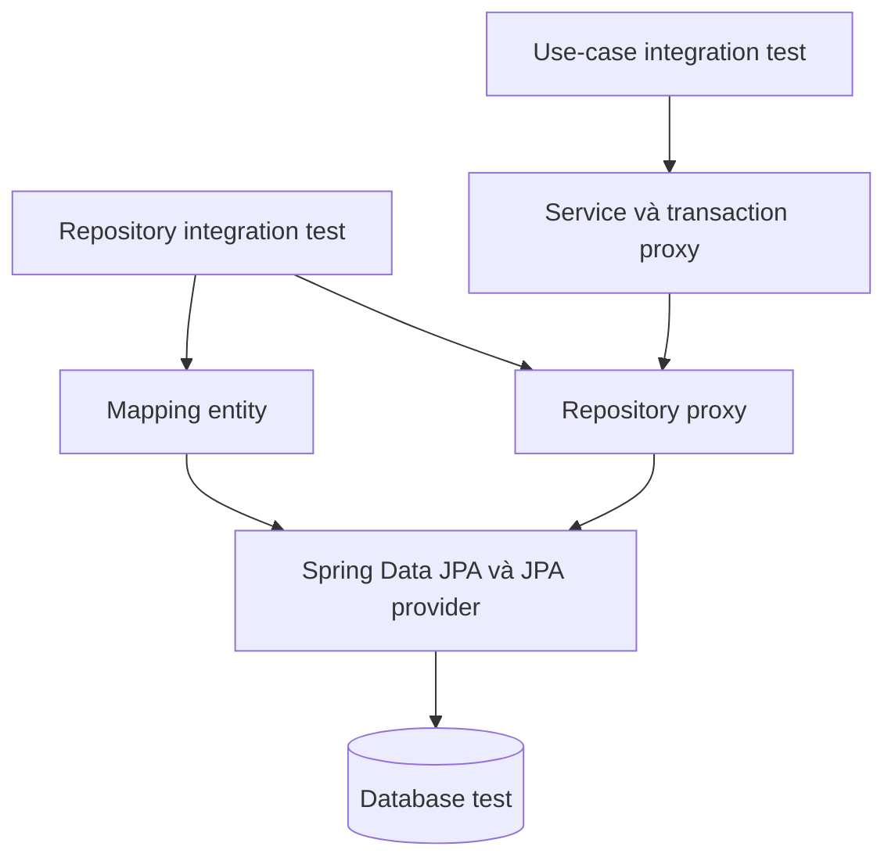

# Tổ chức project mẫu và kiểm thử tích hợp

Một project thực hành Spring Data Commons cần làm rõ hai điều: mã nào đang học các abstraction dùng chung, và thành phần nào giúp các abstraction đó thực sự truy cập dữ liệu. Nếu chỉ viết interface repository rồi mock mọi lời gọi, ta chưa biết derived query có hợp lệ, mapping có ghi được dữ liệu hoặc phân trang có hoạt động với store đã chọn hay không.

Trong chương **Khởi tạo thực hành** của Spring Data Commons (`SPRING_DATA_COMMONS`), bài này tổ chức một project mẫu nhỏ và xây dựng kiểm thử tích hợp theo hai phạm vi: **repository với store thật trong môi trường test**, và **ca sử dụng qua service cùng ranh giới giao dịch**. Ví dụ chọn Spring Data JPA với H2 để có đường chạy cụ thể; các interface repository và kiểu truy vấn vẫn ưu tiên abstraction của Commons.

Mục tiêu không phải tạo một bộ khung nhiều tầng cho mọi ứng dụng. Ta cần đủ cấu trúc để thêm dần CRUD, derived query, phân trang, sắp xếp, projection, Query by Example và auditing mà vẫn biết một phép kiểm tra chứng minh điều gì.

## 1. Xác định phạm vi của từng kiểu kiểm thử

| Phạm vi | Thành phần tham gia | Chứng minh được điều gì? |
| --- | --- | --- |
| Unit test cho hành vi miền | Đối tượng Java, không cần Spring hoặc database | Quy tắc và chuyển trạng thái của đối tượng với các đầu vào cụ thể. |
| Kiểm thử tích hợp repository | Repository proxy, mapping, hạ tầng truy vấn và database test | Chữ ký repository có thực thi đúng với module store và dữ liệu kiểm tra hay không. |
| Kiểm thử tích hợp ca sử dụng | Spring context, service, repository và database test | Wiring, ranh giới giao dịch và kết quả phối hợp qua nhiều thao tác. |
| Kiểm thử với database đích | Những thành phần liên quan và đúng loại database cần triển khai | Những hành vi phụ thuộc database như kiểu dữ liệu, SQL hoặc transaction. |

Mock `LearningTaskRepository` có thể hữu ích trong unit test của một bộ điều phối. Nhưng một mock trả sẵn hai đối tượng không chứng minh rằng Spring Data phân tích được `findByStatus`, sinh đúng truy vấn hoặc ghi enum đúng cách.

Ngược lại, một kiểm thử repository thành công cũng chưa chứng minh ca sử dụng đã đặt đúng giao dịch. Cần chọn phạm vi kiểm tra theo hành vi có thể hỏng.



## 2. Tổ chức project theo một tính năng nhỏ

Ta dùng tính năng quản lý công việc học tập. Cấu trúc ví dụ:

```text
commons-testing-lab/
├── pom.xml
├── src/main/java/com/example/commonslab/
│   ├── CommonsLabApplication.java
│   └── task/
│       ├── TaskStatus.java
│       ├── LearningTask.java
│       ├── LearningTaskRepository.java
│       └── TaskService.java
├── src/test/java/com/example/commonslab/task/
│   ├── LearningTaskRepositoryTest.java
│   └── TaskFlowTest.java
└── src/test/resources/
    └── application-test.yml
```

Các đường dẫn trong cây là file của ứng dụng minh họa mà người học tạo. Project này tập trung chạy kiểm thử; cấu hình database bên ngoài phạm vi test có thể được bổ sung khi cần chạy ứng dụng như một dịch vụ.

Vai trò từng phần:

- `CommonsLabApplication` nằm ở package gốc để Boot nhận diện cấu hình ứng dụng và quét các thành phần bên dưới.
- `task` chứa mô hình, repository và service của cùng một tính năng, giúp đọc một luồng dữ liệu mà không đi qua nhiều thư mục không cần thiết.
- Test dùng cùng package tính năng để dễ tìm mã tương ứng, nhưng nằm ở source set test.
- Cấu hình test nằm trong `src/test/resources`, không được coi là cấu hình database mặc định cho ứng dụng triển khai.

Entity trong mẫu mang annotation JPA. Đây là lựa chọn đơn giản cho bài thực hành, không phải một mô hình miền độc lập hoàn toàn với persistence. Nếu về sau tách domain model và persistence model, cần thêm mapping giữa hai mô hình có chủ đích; không cần tạo sự tách biệt đó chỉ để tăng số lớp trong bài đầu.

Không tạo một base repository tùy biến chỉ để bọc lại từng phương thức `save` hoặc `findById`. Bắt đầu với hợp đồng đã có, rồi thêm fragment hoặc abstraction riêng khi có hành vi thật cần dùng chung.

## 3. Chuẩn bị dependency và môi trường test

### 3.1. Phạm vi phiên bản của mã minh họa

Ví dụ Java và các import test bên dưới dùng **Spring Boot 3.x, Jakarta Persistence, JUnit Jupiter và AssertJ**. Chọn một phiên bản Boot 3.x cụ thể được dự án chấp nhận và JDK đáp ứng yêu cầu của phiên bản đó. Mã Java chỉ dùng các tính năng có trong Java 17.

`BOOT_3_VERSION_DA_XAC_NHAN` trong POM là giá trị thay thế, không phải version artifact có thật. Khi dùng một major Boot khác, cần đối chiếu lại module dependency và package annotation test thay vì chỉ đổi chuỗi version rồi giả định mọi import giữ nguyên.

### 3.2. POM cho project kiểm thử

```xml
<project xmlns="http://maven.apache.org/POM/4.0.0"
         xmlns:xsi="http://www.w3.org/2001/XMLSchema-instance"
         xsi:schemaLocation="http://maven.apache.org/POM/4.0.0 https://maven.apache.org/xsd/maven-4.0.0.xsd">
    <modelVersion>4.0.0</modelVersion>

    <parent>
        <groupId>org.springframework.boot</groupId>
        <artifactId>spring-boot-starter-parent</artifactId>
        <version>BOOT_3_VERSION_DA_XAC_NHAN</version>
        <relativePath/>
    </parent>

    <groupId>com.example</groupId>
    <artifactId>commons-testing-lab</artifactId>
    <version>1.0.0-SNAPSHOT</version>

    <properties>
        <java.version>17</java.version>
    </properties>

    <dependencies>
        <dependency>
            <groupId>org.springframework.boot</groupId>
            <artifactId>spring-boot-starter-data-jpa</artifactId>
        </dependency>
        <dependency>
            <groupId>com.h2database</groupId>
            <artifactId>h2</artifactId>
            <scope>test</scope>
        </dependency>
        <dependency>
            <groupId>org.springframework.boot</groupId>
            <artifactId>spring-boot-starter-test</artifactId>
            <scope>test</scope>
        </dependency>
    </dependencies>
</project>
```

Boot parent quản lý tập dependency, nên mẫu không ghim version riêng cho Commons, JPA, H2 hoặc các thư viện test đã được quản lý.

H2 có scope `test` vì ở đây nó chỉ phục vụ kiểm thử. Chạy ứng dụng ngoài test cần driver và cấu hình dữ liệu thích hợp cho môi trường chạy đó. Việc test khởi động được không chứng minh cấu hình triển khai đã đầy đủ.

Không cần web starter hoặc server HTTP để kiểm tra repository và service trong ví dụ này. Cũng không cần plugin đóng gói ứng dụng Boot chỉ để chạy lifecycle `test` của Maven.

### 3.3. Cấu hình test riêng

`application-test.yml`:

```yaml
spring:
  datasource:
    generate-unique-name: true
  jpa:
    hibernate:
      ddl-auto: create-drop
    open-in-view: false
```

Không khai báo URL database bên ngoài trong profile này. Với H2 có trên test classpath và không có cấu hình datasource khác ghi đè, Boot có thể cấu hình database nhúng cho full-context test.

`generate-unique-name` giúp datasource nhúng do Boot tự cấu hình không mặc định dùng chung một tên cố định giữa những context khác nhau. Nó không tạo database mới cho mỗi test method, không thay cơ chế cô lập dữ liệu và không vô hiệu hóa một URL đã được chỉ định từ nơi khác.

`create-drop` phục vụ schema test có thể tạo lại. Profile test phải thực sự kết nối đúng môi trường thử nghiệm trước khi áp dụng chính sách này. Không dùng database chứa dữ liệu cần giữ làm nơi chạy bộ mẫu.

Với `@DataJpaTest`, cơ chế thay datasource phục vụ test có thể tạo một database nhúng riêng. Vì vậy, cần phân biệt datasource được auto-configure trong full-context test với datasource được test slice thay thế. Cả hai đều là môi trường test, nhưng không mặc định chúng là cùng một database.

## 4. Mã ứng dụng tối thiểu

### 4.1. Lớp cấu hình gốc

`CommonsLabApplication.java`:

```java
package com.example.commonslab;

import org.springframework.boot.SpringApplication;
import org.springframework.boot.autoconfigure.SpringBootApplication;

@SpringBootApplication
public class CommonsLabApplication {

    public static void main(String[] args) {
        SpringApplication.run(CommonsLabApplication.class, args);
    }
}
```

Đặt test trong package con `com.example.commonslab.task` giúp Boot tìm cấu hình gốc theo quy ước. Nếu cấu trúc package thay đổi, phải kiểm tra lại phạm vi quét thay vì thêm nhiều annotation quét chồng lên nhau.

### 4.2. Trạng thái và entity

`TaskStatus.java`:

```java
package com.example.commonslab.task;

public enum TaskStatus {
    TODO,
    DONE
}
```

`LearningTask.java`:

```java
package com.example.commonslab.task;

import java.util.Objects;
import jakarta.persistence.Column;
import jakarta.persistence.Entity;
import jakarta.persistence.EnumType;
import jakarta.persistence.Enumerated;
import jakarta.persistence.GeneratedValue;
import jakarta.persistence.GenerationType;
import jakarta.persistence.Id;
import jakarta.persistence.Table;

@Entity
@Table(name = "learning_tasks")
public class LearningTask {

    @Id
    @GeneratedValue(strategy = GenerationType.IDENTITY)
    private Long id;

    @Column(nullable = false)
    private String title;

    @Enumerated(EnumType.STRING)
    @Column(nullable = false)
    private TaskStatus status;

    protected LearningTask() {
    }

    public LearningTask(String title, TaskStatus status) {
        if (title == null || title.isBlank()) {
            throw new IllegalArgumentException("Tiêu đề không được rỗng");
        }
        this.title = title.strip();
        this.status = Objects.requireNonNull(status, "status");
    }

    public Long getId() {
        return id;
    }

    public String getTitle() {
        return title;
    }

    public TaskStatus getStatus() {
        return status;
    }

    public void markDone() {
        status = TaskStatus.DONE;
    }
}
```

Định danh dùng `Long` để biểu diễn được trạng thái chưa cấp ID. Annotation `Id` ở đây thuộc `jakarta.persistence`, phù hợp đường JPA; nó không thay thế annotation định danh của mọi store khác.

### 4.3. Repository dùng các hợp đồng Commons

`LearningTaskRepository.java`:

```java
package com.example.commonslab.task;

import org.springframework.data.domain.Page;
import org.springframework.data.domain.Pageable;
import org.springframework.data.repository.CrudRepository;
import org.springframework.data.repository.PagingAndSortingRepository;
import org.springframework.data.repository.query.QueryByExampleExecutor;

public interface LearningTaskRepository
        extends CrudRepository<LearningTask, Long>,
                PagingAndSortingRepository<LearningTask, Long>,
                QueryByExampleExecutor<LearningTask> {

    Page<LearningTask> findByStatus(TaskStatus status, Pageable pageable);
}
```

Ba interface dùng chung mở các nhóm khả năng cần kiểm tra: CRUD, phân trang/sắp xếp và Query by Example. Module JPA thực thi những hợp đồng tương ứng. Không suy ra một module khác sẽ hỗ trợ mọi executor chỉ vì interface đó có trong dependency Commons.

Tên `findByStatus` dựa trên thuộc tính Java `status`. Kiểu `Page` biểu diễn kết quả có metadata tổng số; việc thực thi có thể cần truy vấn đếm tùy trường hợp và module.

### 4.4. Service với một ranh giới giao dịch có ý nghĩa

`TaskService.java`:

```java
package com.example.commonslab.task;

import java.util.List;
import org.springframework.stereotype.Service;
import org.springframework.transaction.annotation.Transactional;

@Service
public class TaskService {

    private final LearningTaskRepository tasks;

    public TaskService(LearningTaskRepository tasks) {
        this.tasks = tasks;
    }

    @Transactional
    public Long create(String title) {
        return tasks.save(new LearningTask(title, TaskStatus.TODO)).getId();
    }

    @Transactional
    public void completeAll(List<Long> ids) {
        for (Long id : ids) {
            LearningTask task = tasks.findById(id)
                .orElseThrow(() -> new IllegalArgumentException(
                    "Không tìm thấy công việc: " + id
                ));
            task.markDone();
            tasks.save(task);
        }
    }
}
```

Yêu cầu của `completeAll` là hoàn thành cả nhóm trong một giao dịch của ca sử dụng. Nếu một ID không tồn tại, `IllegalArgumentException` phải làm các thay đổi trước đó trong cùng lời gọi bị rollback theo chính sách mặc định của giao dịch Spring đang dùng.

Mẫu gọi `save` rõ ràng sau khi thay đổi. Trong JPA, entity đang được quản lý còn có cơ chế dirty checking; khả năng ấy thuộc persistence context của JPA, không phải hành vi giống nhau ở mọi store.

Giao dịch ở đây được áp dụng khi gọi service qua bean do Spring quản lý. Tự khởi tạo bằng `new TaskService(...)` hoặc thay đổi đường gọi theo cách bỏ qua proxy có thể làm mất ranh giới giao dịch dự định.

## 5. Kiểm thử repository bằng test slice

`@DataJpaTest` tải phạm vi cấu hình tập trung vào JPA, entity và repository; nó không có mục tiêu tải mọi service của ứng dụng. Các test trong phạm vi này thường chạy trong giao dịch test và được rollback sau mỗi method theo hành vi mặc định của annotation.

Ta dùng repository thật, database nhúng thật và `EntityManager` thật của context test. Không mock repository đang cần kiểm tra.

`LearningTaskRepositoryTest.java`:

```java
package com.example.commonslab.task;

import static org.assertj.core.api.Assertions.assertThat;

import java.util.List;
import jakarta.persistence.EntityManager;
import jakarta.persistence.PersistenceContext;
import org.junit.jupiter.api.Test;
import org.springframework.beans.factory.annotation.Autowired;
import org.springframework.boot.test.autoconfigure.orm.jpa.DataJpaTest;
import org.springframework.data.domain.Example;
import org.springframework.data.domain.ExampleMatcher;
import org.springframework.data.domain.Page;
import org.springframework.data.domain.PageRequest;
import org.springframework.data.domain.Sort;
import org.springframework.test.context.ActiveProfiles;

@DataJpaTest
@ActiveProfiles("test")
class LearningTaskRepositoryTest {

    @Autowired
    private LearningTaskRepository tasks;

    @PersistenceContext
    private EntityManager entityManager;

    @Test
    void storesMappedStateAndReadsItAgain() {
        LearningTask saved = tasks.save(
            new LearningTask("Học Commons", TaskStatus.TODO)
        );

        entityManager.flush();
        Long id = saved.getId();
        entityManager.clear();

        LearningTask found = tasks.findById(id).orElseThrow();

        assertThat(id).isNotNull();
        assertThat(found.getId()).isEqualTo(id);
        assertThat(found.getTitle()).isEqualTo("Học Commons");
        assertThat(found.getStatus()).isEqualTo(TaskStatus.TODO);
    }

    @Test
    void filtersAndPagesWithAnExplicitOrder() {
        tasks.saveAll(List.of(
            new LearningTask("01 - Repository", TaskStatus.DONE),
            new LearningTask("02 - Derived query", TaskStatus.DONE),
            new LearningTask("03 - Paging", TaskStatus.DONE),
            new LearningTask("04 - Auditing", TaskStatus.TODO)
        ));
        entityManager.flush();
        entityManager.clear();

        Sort order = Sort.by("title").ascending()
            .and(Sort.by("id").ascending());
        Page<LearningTask> first = tasks.findByStatus(
            TaskStatus.DONE,
            PageRequest.of(0, 2, order)
        );

        assertThat(first.getContent())
            .extracting(LearningTask::getTitle)
            .containsExactly("01 - Repository", "02 - Derived query");
        assertThat(first.getTotalElements()).isEqualTo(3);
        assertThat(first.getTotalPages()).isEqualTo(2);
        assertThat(first.hasNext()).isTrue();

        Page<LearningTask> second = tasks.findByStatus(
            TaskStatus.DONE,
            first.nextPageable()
        );
        assertThat(second.getContent())
            .extracting(LearningTask::getTitle)
            .containsExactly("03 - Paging");
        assertThat(second.hasNext()).isFalse();
    }

    @Test
    void queryByExampleIgnoresUnwantedProbeProperties() {
        tasks.saveAll(List.of(
            new LearningTask("01 - Commons", TaskStatus.DONE),
            new LearningTask("02 - Mapping", TaskStatus.DONE),
            new LearningTask("03 - Transactions", TaskStatus.TODO)
        ));
        entityManager.flush();
        entityManager.clear();

        LearningTask probe = new LearningTask(
            "Không dùng tiêu đề này để lọc",
            TaskStatus.DONE
        );
        ExampleMatcher matcher = ExampleMatcher.matching()
            .withIgnorePaths("id", "title");
        Example<LearningTask> example = Example.of(probe, matcher);

        assertThat(tasks.findAll(example, Sort.by("title").ascending()))
            .extracting(LearningTask::getTitle)
            .containsExactly("01 - Commons", "02 - Mapping");
    }

    @Test
    void deletionIsVisibleAfterFlushingAndClearing() {
        LearningTask saved = tasks.save(
            new LearningTask("Công việc sẽ xóa", TaskStatus.TODO)
        );
        entityManager.flush();
        Long id = saved.getId();
        entityManager.clear();

        tasks.deleteById(id);
        entityManager.flush();
        entityManager.clear();

        assertThat(tasks.findById(id)).isEmpty();
    }
}
```

Các test tự tạo fixture cần thiết. Chúng không phụ thuộc một runner tự thêm dữ liệu khi ứng dụng khởi động, không giả định ID bắt đầu từ `1` và không yêu cầu test trước phải chạy thành công.

### 5.1. Vì sao `flush` rồi `clear`?

Trong JPA, trạng thái entity có thể đang nằm trong persistence context. Một lần đọc theo ID có thể lấy lại đối tượng đang được quản lý thay vì buộc nạp lại trạng thái từ database.

- `flush()` yêu cầu đồng bộ thay đổi đang chờ với database trong giao dịch hiện tại, giúp lỗi SQL hoặc ràng buộc có cơ hội xuất hiện ngay ở điểm test cần quan sát.
- `clear()` loại các entity đang được quản lý khỏi persistence context, để lần đọc tiếp theo không chỉ dựa vào chính instance đã sửa trong bộ nhớ.

Phải flush trước khi clear nếu muốn giữ các thay đổi đang chờ. Clear không thay thế flush.

Hai thao tác này không phải commit và không bảo đảm vô hiệu hóa mọi dạng cache có thể được cấu hình. Bộ ví dụ không bật cache cấp hai tùy biến. Đây là cách giảm việc test vô tình chỉ kiểm tra trạng thái trong bộ nhớ, không phải kỹ thuật chung cho mọi module Spring Data.

### 5.2. Vì sao không khẳng định số câu SQL?

Test trang kiểm tra nội dung, thứ tự và metadata tổng số. Nó không khẳng định mỗi `Page` luôn chạy đúng hai câu truy vấn. Triển khai có thể cần truy vấn đếm hoặc tối ưu nó trong những trường hợp cụ thể.

Nếu hiệu năng và số truy vấn là yêu cầu của ứng dụng, cần một phép kiểm tra riêng với công cụ quan sát phù hợp và dữ liệu đại diện. Không trộn giả định về SQL nội bộ vào test hợp đồng mà không có lý do.

### 5.3. Probe trong Query by Example có ý nghĩa gì?

Constructor của mô hình yêu cầu tiêu đề hợp lệ, nên probe vẫn có một `title`. Matcher chủ đích bỏ qua `id` và `title`, chỉ để trạng thái tham gia điều kiện trong ví dụ này.

Nếu quên ignore `title`, probe có thể lọc thêm một tiêu đề không tồn tại và trả về rỗng. Test này kiểm tra một rủi ro sử dụng API thực tế, không chỉ xác nhận một phương thức được gọi.

## 6. Kiểm thử ca sử dụng với full context

Repository slice không tự tải `TaskService`. Để kiểm tra service thật và transaction proxy, dùng `@SpringBootTest`.

Điểm quan trọng: **không đặt `@Transactional` lên test rollback của ca sử dụng bên dưới**. Ta muốn lời gọi service tự mở và kết thúc giao dịch của nó, thay vì được một giao dịch test bao ngoài che phủ.

`TaskFlowTest.java`:

```java
package com.example.commonslab.task;

import static org.assertj.core.api.Assertions.assertThat;
import static org.assertj.core.api.Assertions.assertThatThrownBy;

import java.util.List;
import org.junit.jupiter.api.AfterEach;
import org.junit.jupiter.api.Test;
import org.springframework.beans.factory.annotation.Autowired;
import org.springframework.boot.test.context.SpringBootTest;
import org.springframework.test.context.ActiveProfiles;

@SpringBootTest(webEnvironment = SpringBootTest.WebEnvironment.NONE)
@ActiveProfiles("test")
class TaskFlowTest {

    @Autowired
    private TaskService service;

    @Autowired
    private LearningTaskRepository tasks;

    @AfterEach
    void removeTestData() {
        tasks.deleteAll();
    }

    @Test
    void completesAStoredTaskThroughTheService() {
        Long id = service.create("Hoàn thành bài Commons");

        service.completeAll(List.of(id));

        LearningTask found = tasks.findById(id).orElseThrow();
        assertThat(found.getStatus()).isEqualTo(TaskStatus.DONE);
    }

    @Test
    void rollsBackEarlierChangesWhenALaterTaskIsMissing() {
        Long firstId = service.create("Công việc đầu");
        Long removedId = service.create("Công việc đã bị xóa");
        tasks.deleteById(removedId);

        assertThatThrownBy(() ->
            service.completeAll(List.of(firstId, removedId))
        ).isInstanceOf(IllegalArgumentException.class);

        LearningTask first = tasks.findById(firstId).orElseThrow();
        assertThat(first.getStatus()).isEqualTo(TaskStatus.TODO);
    }
}
```

### 6.1. Test rollback phát hiện được lỗi nào?

Trong ca thất bại:

1. Hai lời gọi `create` đã kết thúc giao dịch riêng, nên có dữ liệu nền trước thao tác cần kiểm tra.
2. Một công việc bị xóa để tạo ra ID chắc chắn không tồn tại, không cần đoán một ID tùy ý.
3. `completeAll` sửa công việc đầu rồi gặp ID thiếu.
4. Ngoại lệ làm giao dịch của cả nhóm rollback.
5. Lần đọc qua repository sau khi service trả lỗi phải thấy công việc đầu vẫn là `TODO`.

Nếu bỏ ranh giới giao dịch ở service, các lời gọi repository riêng lẻ có thể kết thúc giao dịch riêng của chúng; thay đổi của công việc đầu có thể đã được lưu trước lỗi ở công việc sau. Test sẽ phát hiện trạng thái `DONE` không mong muốn.

Nếu đặt giao dịch test bao ngoài, test có thể vô tình cung cấp ranh giới mà mã service đang thiếu. Vì vậy, kiểm tra này chủ đích không dùng `@Transactional` trên test.

### 6.2. Vì sao phải dọn dữ liệu riêng?

Full-context test này không có giao dịch test tự rollback bao ngoài. Các thao tác thành công đã commit, nên `@AfterEach` dọn dữ liệu bằng repository trên database test dùng riêng cho bộ mẫu.

Việc dùng `deleteAll` ở đây dựa trên giả định không có dữ liệu cần giữ và không có test khác đang thao tác đồng thời trên cùng database. Khi chạy song song hoặc khi có nhiều bộ dữ liệu dùng chung, cần tách database/schema hoặc thiết kế cleanup theo fixture tương ứng.

Không thêm `@DirtiesContext` cho mọi method chỉ để xóa dữ liệu. Annotation đó phục vụ việc đánh dấu context cần tạo lại, không phải cách dọn dữ liệu mặc định cho mọi bài test.

## 7. Chạy bộ kiểm thử và đọc kết quả

Sau khi tạo đủ các file minh họa, thay version Boot và chọn JDK phù hợp, người học có thể chạy từ thư mục project:

```shell
mvn test
```

Hoặc chạy một lớp khi đang điều tra một phạm vi lỗi:

```shell
mvn "-Dtest=LearningTaskRepositoryTest" test
```

Dùng Maven Wrapper nếu project cung cấp wrapper. Đây là lệnh hướng dẫn cho dự án minh họa, không phải bằng chứng rằng code đã được chạy trong một môi trường cụ thể.

Mẫu có bốn test repository và hai test ca sử dụng. Một lần chạy thành công cần thể hiện không có failure hoặc error ở các test đã được phát hiện. Chỉ thấy Spring context khởi động được chưa đủ để kết luận các test đã được chạy đúng.

Tên lớp kết thúc bằng `Test` phù hợp với quy ước phát hiện test thông thường của Maven Surefire trong cấu hình này. Nếu đổi sang hậu tố `IT` và tách integration test sang Maven Failsafe, phải cấu hình lifecycle tương ứng; không giả định `mvn test` tự chạy mọi lớp có tên tùy ý.

Khi báo cáo kết quả kiểm tra, nên ghi đủ:

| Thông tin | Vì sao cần? |
| --- | --- |
| Phạm vi chạy | Toàn bộ test hay chỉ một lớp/method. |
| Module store | JPA, JDBC, MongoDB hoặc lựa chọn khác. |
| Database thực tế | H2 nhúng hay database đích; version/configuration khi có ảnh hưởng. |
| Profile và cấu hình test | Tránh hiểu nhầm test đã chạy với một môi trường khác. |
| Kết quả test | Số test được phát hiện, failure/error và trường hợp bị bỏ qua. |

Không gọi H2 là database giả chỉ vì nó nằm trong bộ nhớ. Các thao tác ở đây đi qua engine database thật, nhưng engine đó khác database đích có thể dùng khi triển khai.

## 8. Khi cần kiểm thử với database đích

H2 giúp vòng lặp học tập ngắn. Nó không bảo đảm tương đương với PostgreSQL, MySQL hoặc một store khác về:

- Cú pháp SQL, tên hoặc kiểu cột và hàm được sử dụng.
- Cách so sánh chuỗi, phân biệt chữ hoa/thường và giá trị null.
- Khóa, isolation, ràng buộc hoặc thời điểm lỗi xuất hiện.
- Index, chiến lược truy vấn và hiệu năng với dữ liệu lớn.

Khi tính đúng đắn phụ thuộc những yếu tố này, thêm một bộ test dùng đúng loại database, chẳng hạn một instance dành riêng cho test hoặc container do công cụ kiểm thử quản lý.

Với JPA slice trên database ngoài, cần kiểm soát việc test tự thay datasource. Một cấu hình thường cần xem xét là:

```java
@AutoConfigureTestDatabase(
    replace = AutoConfigureTestDatabase.Replace.NONE
)
```

Trong bố cục Boot của ví dụ, annotation nằm ở package `org.springframework.boot.test.autoconfigure.jdbc`. Cấu hình này chỉ ngăn cơ chế thay database của test; nó không tự khởi tạo server, không cấp URL hoặc credential và không bảo đảm profile đã trỏ đúng môi trường.

Nếu dùng Testcontainers hoặc cơ chế tương tự, tổ chức rõ vòng đời database, cách đưa thông tin kết nối vào Spring và cách chuẩn bị schema. Không sao chép một phiên bản driver/container bất kỳ rồi coi đó là database đích của mọi dự án.

Chính sách schema cũng cần thống nhất: bộ test học mapping có thể dùng schema do Hibernate tạo, còn bộ test migration phải kiểm tra migration mà ứng dụng thật sẽ sử dụng. Chạy thành công trên schema tự sinh không tự chứng minh migration đã đúng.

## 9. Mở rộng bộ test theo khả năng Commons thực sự dùng

Không cần thêm tất cả tính năng vào lần đầu. Khi mở rộng ứng dụng, bổ sung test tại nơi rủi ro mới xuất hiện.

| Khả năng | Tình huống tích hợp đáng kiểm tra | Lưu ý về phạm vi |
| --- | --- | --- |
| CRUD | Đọc lại trạng thái sau ghi, xóa và trường hợp không tồn tại. | Không chỉ kiểm tra object đã thay đổi trong bộ nhớ. |
| Derived query | Điều kiện kết hợp, đường dẫn thuộc tính, dữ liệu không khớp. | Từ khóa và kiểu trả về phải phù hợp module. |
| Phân trang và sắp xếp | Trang đầu/cuối, tổng số hoặc cờ còn trang, thứ tự rõ ràng. | `Page` và `Slice` có metadata khác nhau. |
| Projection | Những thuộc tính cần hiển thị được dựng đúng từ truy vấn. | Không mặc định projection là entity có thể dùng để ghi. |
| Query by Example | Null, thuộc tính bị ignore, matcher chuỗi và phạm vi điều kiện. | Probe có dữ liệu ngoài ý định có thể làm lọc sai. |
| Auditing | Thời điểm/người tạo khi insert, thời điểm/người sửa khi update. | Cần bật auditing đúng module và cung cấp nguồn auditor nếu dùng. |
| Mapping metadata | ID, converter, enum, tên lưu trữ và khởi tạo đối tượng. | Annotation và cơ chế mapping phụ thuộc store. |
| Repository fragment | Hành vi tùy biến đi qua đúng triển khai và đúng giao dịch. | Không thay kiểm tra bằng việc xác nhận mock đã được gọi. |

Với auditing, nên điều khiển nguồn thời gian hoặc auditor trong test khi cần kết quả xác định. Không dùng khoảng chờ tùy ý rồi so sánh timestamp như thể tốc độ máy và độ phân giải database luôn giống nhau.

Với phân trang, không chỉ kiểm tra `content.size()` nếu yêu cầu còn bao gồm tổng số hoặc thứ tự. Một truy vấn thiếu điều kiện lọc vẫn có thể trả đúng kích thước trang.

Với projection hoặc QBE, test phải chạy qua module thực thi. Chỉ tạo một DTO thủ công hoặc một `ExampleMatcher` rồi kiểm tra getter chưa xác nhận truy vấn đã dùng chúng đúng.

## 10. Giữ test độc lập và dễ chẩn đoán

### 10.1. Fixture thuộc về từng test

Mỗi test nên tạo đúng dữ liệu cần cho điều kiện đang kiểm tra. Không dùng một bộ seed lớn cho mọi test rồi phụ thuộc vào những con số khó giải thích.

Mẫu phân trang tạo ba `DONE` và một `TODO` để chứng minh cả lọc lẫn chia trang. Tiêu đề có tiền tố số giúp kỳ vọng thứ tự rõ ràng trong môi trường mẫu; ID là thuộc tính phân định bổ sung.

### 10.2. Không dùng thứ tự test để xây kịch bản

Một test tạo dữ liệu, test sau sửa, test cuối xóa sẽ làm cả bộ phụ thuộc thứ tự chạy. Khi chạy riêng hoặc song song, nó dễ thất bại vì lý do không thuộc hành vi cần kiểm tra.

Nếu cần kiểm tra một luồng nhiều bước, đặt các bước trong cùng một test với fixture tự tạo, như `rollsBackEarlierChangesWhenALaterTaskIsMissing`.

### 10.3. Context cache và dữ liệu là hai vấn đề khác nhau

Spring có thể tái sử dụng test context phù hợp để giảm thời gian khởi động. Không nên giả định mỗi method luôn có một context hoặc database mới.

Rollback trong repository slice và cleanup trong full-context test là những lựa chọn cô lập dữ liệu. Chúng không dựa vào việc context luôn bị tạo lại.

Nếu bật thực thi song song, cần thiết kế lại cách chia sẻ database và fixture. Bộ mẫu giả định các test không chạy đồng thời trên cùng một database theo cách gây tranh chấp cleanup.

### 10.4. Đọc lỗi theo tầng

| Dấu hiệu | Hướng điều tra |
| --- | --- |
| Không tìm được cấu hình Boot | Vị trí lớp cấu hình gốc và package của test. |
| Repository slice không có service bean | Phạm vi slice; dùng full context khi thực sự cần service. |
| Không tạo được datasource | Test dependency, profile và cấu hình kết nối đang có hiệu lực. |
| `Not a managed type` | Mapping JPA, import annotation và phạm vi quét entity. |
| Lỗi thuộc tính khi tạo query | Chữ ký derived query so với mô hình Java. |
| Test ghi thành công nhưng lỗi chỉ xuất hiện sau đó | Thời điểm flush, commit và ràng buộc database. |
| Test rollback vượt qua dù service thiếu giao dịch | Có giao dịch test bao ngoài đang che phạm vi service không? |
| Test chạy riêng thành công, chạy cùng bộ thất bại | Dữ liệu chia sẻ, thứ tự test, profile hoặc tài nguyên dùng chung. |
| Không có test nào được chạy | Naming, test engine, source set và cấu hình lifecycle. |

Không sửa thiếu bảng bằng cách mock repository. Làm vậy thay phạm vi kiểm tra và có thể khiến lỗi thật không còn được quan sát.

## 11. Bài tập áp dụng

### Bài 1: thêm projection

Tạo một interface chỉ đọc gồm ID và tiêu đề, thêm query method trả projection cho các công việc `DONE`. Viết test tạo cả `TODO` và `DONE`, rồi kiểm tra đúng nội dung projection.

**Điểm cần suy nghĩ:** kết quả projection có chứng minh mọi thuộc tính entity đã được tải hay không? Có cần điều đó cho yêu cầu hiển thị không?

### Bài 2: mở rộng test phân trang

Thêm trường hợp không có phần tử khớp và trường hợp tổng số đúng bằng kích thước trang. Giữ thứ tự rõ ràng và kiểm tra metadata mà giao diện thực sự dùng.

**Điểm cần suy nghĩ:** nếu đổi kiểu trả về sang `Slice`, những assertion nào không còn thuộc hợp đồng kết quả?

### Bài 3: tìm một cấu hình test có thể che lỗi

Trong một bản sao thực hành, thử xem xét ảnh hưởng của việc bỏ `@Transactional` ở `completeAll`, rồi so sánh test ca sử dụng có và không có giao dịch test bao ngoài.

**Điểm cần suy nghĩ:** ai đang cung cấp tính nguyên tử mà ca sử dụng yêu cầu? Assertion nào phát hiện việc công việc đầu đã bị lưu dù lời gọi thất bại?

### Bài 4: chuyển một bộ test sang store khác

Chọn một module hỗ trợ những hợp đồng cần dùng. Giữ lại ý nghĩa fixture và kỳ vọng nghiệp vụ, nhưng thay mapping, cấu hình test và cách quản lý môi trường tương ứng.

**Điểm cần suy nghĩ:** `EntityManager.flush/clear` và `@DataJpaTest` thuộc JPA, nên không thể mang nguyên dạng sang MongoDB hoặc JDBC. Những abstraction Commons nào thật sự còn phù hợp?

Một project mẫu được tổ chức tốt cho phép nhìn từ ca sử dụng đến repository, mapping và database, rồi quay lại một assertion có ý nghĩa. Kiểm thử tích hợp hữu ích khi nó kiểm tra được ranh giới có thể hỏng: truy vấn được thực thi, trạng thái được lưu hoặc giao dịch được rollback, với phạm vi và giới hạn của store đã chọn được nêu rõ.
