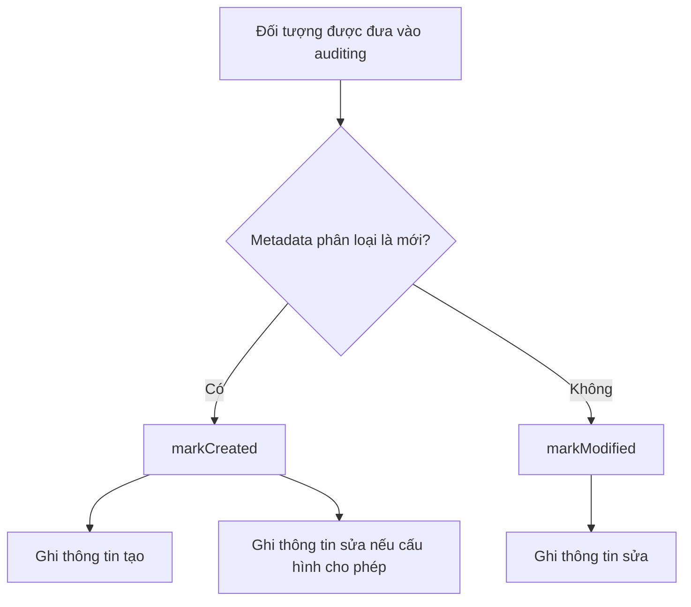

# Liên hệ giữa isNew, ID, version và thông tin tạo mới

Trong Spring Data, một đối tượng có ID chưa chắc đã được lưu, và một đối tượng vừa được khởi tạo bằng `new` chưa chắc sẽ được repository xem là mới. Sự khác biệt này đặc biệt quan trọng với auditing: thời điểm tạo và người tạo cần được ghi theo nhánh tạo mới phù hợp, trong khi thời điểm sửa và người sửa thuộc về các lần thay đổi tiếp theo.

Bài học thuộc phần **Auditing** của **Spring Data Commons**, tập trung vào các abstraction dùng chung cho repository, metadata và kiểm toán dữ liệu. Mục tiêu là hiểu cách trạng thái mới được xác định, vì sao ID hoặc version có thể thay đổi kết quả đó, và cách áp dụng mà vẫn tôn trọng khả năng của từng module lưu trữ. Những nội dung như phân trang, derived queries hoặc projection thuộc các abstraction khác; chúng không tự quyết định một thực thể là mới hay đã tồn tại.

## 1. Bốn khái niệm cần tách rõ

Giả sử ứng dụng quản lý ghi chú. Một ghi chú có thể chứa các thuộc tính:

```text
id              = mã nhận diện ghi chú
version         = phiên bản phục vụ optimistic locking
createdAt       = thời điểm tạo
createdBy       = người tạo
lastModifiedAt  = thời điểm sửa gần nhất
lastModifiedBy  = người sửa gần nhất
```

Các thuộc tính này trả lời những câu hỏi khác nhau:

| Thành phần | Câu hỏi mà nó trả lời | Điều không thể tự suy ra |
|---|---|---|
| ID | Đối tượng được nhận diện bằng khóa nào? | Bản ghi chắc chắn đã tồn tại trong kho dữ liệu |
| Version | Phiên bản nào đang được dùng để kiểm tra cập nhật đồng thời? | Đây là thời điểm tạo hoặc số lần `save()` chính xác |
| `isNew` | Theo chiến lược đang áp dụng, đối tượng có được xem là mới không? | Một truy vấn kiểm tra tồn tại đã được thực hiện |
| Thông tin auditing | Ai tạo, ai sửa, và vào lúc nào? | Chiến lược xác định mới đã được cấu hình đúng |

`isNew` là **kết quả phân loại trạng thái**. Nó có thể đến từ metadata của thực thể, cách kiểm tra ID/version, hoặc phương thức `Persistable.isNew()`. Không có một cờ mới chung được repository tự đồng bộ hoàn hảo cho mọi loại kho dữ liệu.

Hai ví dụ làm rõ sự khác biệt:

- Ứng dụng cấp UUID ngay khi nhận yêu cầu tạo. ID đã khác `null`, nhưng chưa có dữ liệu được lưu.
- Ứng dụng nhận yêu cầu sửa rồi dựng một đối tượng mới bằng constructor. Đối tượng Java vừa được cấp phát, nhưng nó đại diện cho một bản ghi đã tồn tại.

Vì vậy, “mới trong bộ nhớ”, “được Spring Data phân loại là mới” và “chưa tồn tại trong cơ sở dữ liệu” là ba nhận định có thể khác nhau.

## 2. isNew mặc định liên hệ với ID và version thế nào?

### 2.1. Khi không có version phù hợp

Với chiến lược kiểm tra ID thông thường:

- ID kiểu tham chiếu có giá trị `null`: được xem là mới.
- ID kiểu tham chiếu khác `null`: được xem là không mới.
- ID số kiểu nguyên thủy có giá trị `0`: có thể đóng vai trò giá trị chưa được gán trong chiến lược metadata mặc định của Commons.

Điểm dễ nhầm là `Long` và `long` không có cùng ý nghĩa:

```java
Long referenceId = null; // Có thể biểu diễn rõ trạng thái chưa được gán.
Long zeroId = 0L;        // Vẫn là một ID tham chiếu khác null.
long primitiveId = 0L;  // Không thể null; 0 có thể được dùng làm giá trị ban đầu.
```

Không nên dùng chuỗi rỗng, UUID toàn số không hoặc một ID giả để biểu diễn “chưa lưu”, trừ khi có chiến lược riêng quy định như vậy. Kiểm tra mặc định không hiểu ý nghĩa nghiệp vụ của các giá trị này.

### 2.2. Khi có version được nhận diện

Chiến lược metadata mặc định của Commons có thể ưu tiên thuộc tính version trước ID. Khi version là kiểu tham chiếu, `null` biểu diễn trạng thái mới; một giá trị khác `null`, kể cả `0`, biểu diễn trạng thái không mới theo chiến lược này.

Ví dụ:

```text
id = "NOTE-101", version = null  → có thể được xem là mới dù đã có ID
id = "NOTE-101", version = 0     → không mới khi version là Long
id = "NOTE-101", version = 3     → không mới khi version là Long
```

Đây là lý do version dạng `Long` hữu ích với ID do ứng dụng cấp: ID cung cấp danh tính ngay từ đầu, còn version vẫn có thể để `null` cho tới lần lưu đầu tiên.

Bảng sau mô tả **chiến lược metadata mặc định của Commons**, không phải cam kết cho tất cả repository:

| Metadata được nhận diện | Giá trị trong đối tượng | Kết quả phân loại |
|---|---|---|
| Không có version, ID kiểu `String` | `null` | Mới |
| Không có version, ID kiểu `String` | `"NOTE-101"` | Không mới |
| Không có version, ID kiểu `Long` | `0L` | Không mới vì ID khác `null` |
| Không có version, ID kiểu `long` | `0L` | Mới |
| Có version kiểu `Long` | `null`, ID đã được gán | Mới |
| Có version kiểu `Long` | `0L`, ID đã được gán | Không mới |
| Có version kiểu `long` | `0L` | Mới theo chiến lược metadata này |
| Có version kiểu `long` | Giá trị khác `0` | Không mới theo chiến lược metadata này |

Một trạng thái như `id = null` nhưng version kiểu `Long` đã khác `null` thường là dấu hiệu dữ liệu đầu vào không nhất quán. Khi version được ưu tiên, không nên trông chờ ID rỗng sẽ tự ghi đè kết luận từ version.

### 2.3. Repository của từng module có thể áp dụng quy tắc khác

Cần phân biệt `PersistentEntity.isNew(...)` của hạ tầng mapping với `EntityInformation.isNew(...)` mà một repository sử dụng. Chúng phục vụ các lớp khác nhau và không bắt buộc luôn có cùng cách triển khai.

Một ví dụ quan trọng là **Spring Data JPA**:

- Version dạng tham chiếu có thể được dùng để xác định trạng thái mới bằng cách kiểm tra `null`.
- Version dạng nguyên thủy không phù hợp cho cách kiểm tra này trong JPA vì `0` có thể là phiên bản đầu tiên hợp lệ.
- Với trường hợp đó, chiến lược mặc định của repository JPA quay về kiểm tra ID.

Do đó, không được lấy dòng `long version = 0` trong bảng Commons rồi kết luận rằng mọi repository JPA sẽ gọi `persist`. Khi phân tích một lỗi, phải xác định đang xét chiến lược mapping, chiến lược repository, hay callback auditing.

### 2.4. Persistable cho phép miền nghiệp vụ cung cấp câu trả lời

Nếu thực thể triển khai `Persistable<ID>`, Spring Data có thể ủy quyền việc phân loại cho `isNew()` của chính thực thể. Khi đó, ID đã có giá trị không nhất thiết làm đối tượng bị xem là cũ.

Điều này hữu ích cho ID cấp trước, nhưng kéo theo một trách nhiệm: ứng dụng hoặc callback của module phải chuyển trạng thái đúng sau khi lưu và khi đọc dữ liệu trở lại. Một `isNew()` trả về `true` mãi mãi sẽ làm sai toàn bộ các nhánh phụ thuộc vào kết quả đó.

## 3. Từ trạng thái mới đến thông tin tạo mới

### 3.1. Hai nhóm annotation có mục đích khác nhau

Các annotation auditing dùng chung gồm:

```java
@CreatedDate
@CreatedBy
@LastModifiedDate
@LastModifiedBy
```

Chúng đánh dấu đích ghi metadata kiểm toán, không thay thế ID và version:

- `@CreatedDate` không tự biến thuộc tính thành dấu hiệu xác định mới.
- `@CreatedBy` không cung cấp khóa nhận diện.
- `@LastModifiedDate` không phải khóa optimistic locking.
- `@Version` không cung cấp thông tin người thực hiện thao tác.

Không nên triển khai `isNew()` bằng `createdAt == null`. Nếu một bản ghi cũ thiếu thời điểm tạo, hoặc dữ liệu đầu vào bỏ qua thuộc tính này, cách kiểm tra đó sẽ phân loại sai thao tác sửa thành tạo mới.

### 3.2. Nhánh auditing có nhận biết isNew

Trong Commons, `IsNewAwareAuditingHandler` có thể dùng metadata của thực thể để chọn nhánh khi gọi `markAudited(...)`:



Ở nhánh tạo, hạ tầng có thể gán người tạo và thời điểm tạo. Theo cấu hình mặc định của auditing handler, thông tin sửa cũng có thể được gán trong lần tạo; hành vi này liên quan tới tùy chọn `modifyOnCreation`.

Ở nhánh sửa, thông tin tạo không được tự điền lại để khắc phục một dữ liệu đầu vào thiếu trường. Auditing handler cũng không tự truy vấn bản ghi cũ để tìm lại người tạo hoặc thời điểm tạo.

Ngày giờ được cung cấp bởi hạ tầng thời gian, chẳng hạn `DateTimeProvider`. Người thực hiện được cung cấp bởi `AuditorAware<T>` hoặc cơ chế phản ứng tương ứng khi module sử dụng auditing reactive. Một ứng dụng có thể ghi được ngày giờ nhưng chưa ghi được người thực hiện nếu nguồn auditor không cung cấp giá trị.

### 3.3. Không phải mọi module đều chọn nhánh auditing bằng isNew

`AuditingHandler.markCreated(...)` và `markModified(...)` là hai thao tác riêng. Bản thân hai lời gọi này không cần phân loại lại đối tượng để quyết định đang tạo hay sửa; bên tích hợp lựa chọn phương thức thích hợp.

Với JPA, `AuditingEntityListener` gắn việc điền metadata với các sự kiện vòng đời như `@PrePersist` và `@PreUpdate`. Vì vậy:

- Quyết định của repository về `persist` hoặc `merge` là một lớp.
- Sự kiện vòng đời do JPA phát ra là một lớp.
- Lời gọi ghi metadata auditing theo sự kiện đó là một lớp nữa.

`merge` có thể dẫn tới việc tạo một thực thể mới khi trạng thái phù hợp; nó không đồng nghĩa tuyệt đối với câu SQL `UPDATE`. Tương tự, lựa chọn nhánh lưu không thay thế kiểm tra khóa chính hay quy tắc tồn tại của kho dữ liệu.

Vì vậy, câu “ID khác `null` nên `@CreatedDate` luôn không chạy” là kết luận quá rộng. Nó có thể giải thích một luồng auditing dựa trên trạng thái mới, nhưng không đủ để mô tả mọi luồng JPA.

## 4. Ví dụ: ID được cấp trước, version để null

Xét ghi chú được ứng dụng cấp UUID ngay khi tạo. Ví dụ dưới đây sử dụng annotation mapping của Spring Data, phù hợp làm điểm xuất phát cho module hỗ trợ các annotation này và version nullable.

```java
import java.time.Instant;
import java.util.UUID;

import org.springframework.data.annotation.CreatedBy;
import org.springframework.data.annotation.CreatedDate;
import org.springframework.data.annotation.Id;
import org.springframework.data.annotation.LastModifiedBy;
import org.springframework.data.annotation.LastModifiedDate;
import org.springframework.data.annotation.Version;

public class AuditMemo {

    @Id
    private String id;

    @Version
    private Long version;

    private String title;

    @CreatedDate
    private Instant createdAt;

    @CreatedBy
    private String createdBy;

    @LastModifiedDate
    private Instant lastModifiedAt;

    @LastModifiedBy
    private String lastModifiedBy;

    protected AuditMemo() {
        // Constructor phục vụ module mapping khi cần.
    }

    public static AuditMemo draft(String title) {
        AuditMemo memo = new AuditMemo();
        memo.id = UUID.randomUUID().toString();
        memo.title = title;
        // version và các trường auditing giữ nguyên null.
        return memo;
    }

    public void rename(String title) {
        this.title = title;
    }

    public String getId() {
        return id;
    }

    public Long getVersion() {
        return version;
    }

    public String getTitle() {
        return title;
    }

    public Instant getCreatedAt() {
        return createdAt;
    }

    public String getCreatedBy() {
        return createdBy;
    }

    public Instant getLastModifiedAt() {
        return lastModifiedAt;
    }

    public String getLastModifiedBy() {
        return lastModifiedBy;
    }
}
```

Repository dùng abstraction CRUD chung:

```java
import org.springframework.data.repository.CrudRepository;

public interface AuditMemoRepository
        extends CrudRepository<AuditMemo, String> {
}
```

Mẫu thao tác dưới đây là phần thân xử lý nghiệp vụ sau khi repository và auditing đã được cấu hình:

```java
AuditMemo draft = AuditMemo.draft("Học Spring Data auditing");
AuditMemo saved = repository.save(draft);

AuditMemo existing = repository.findById(saved.getId())
        .orElseThrow(() -> new IllegalArgumentException("Không tìm thấy ghi chú"));

existing.rename("Phân biệt ID, version và isNew");
AuditMemo updated = repository.save(existing);
```

Các điểm quan trọng trong ví dụ:

1. Ở lần đầu, ID đã có nhưng version vẫn `null`. Nếu module sử dụng chiến lược version phù hợp, đối tượng được phân loại là mới.
2. Sau khi lưu thành công, module có thể gán version ban đầu. Giá trị bắt đầu cụ thể thuộc về module; không nên mặc định mọi kho dữ liệu đều bắt đầu từ `0` hay đều bắt đầu từ `1`.
3. Khi sửa, ứng dụng dùng thực thể được đọc lại với ID, version và thông tin tạo đã có. Nó không dựng một bản sao thiếu metadata chỉ từ ID và tiêu đề.
4. Luôn dùng giá trị trả về của `save()`. Với cơ chế sao chép, immutable entity hoặc JPA `merge`, thực thể phản ánh kết quả lưu có thể là một instance khác.

Ví dụ chưa bao gồm cấu hình kích hoạt auditing, nguồn auditor hay mapping đặc thù của một kho dữ liệu. Chỉ đặt các annotation không tự bật auditing. Với JPA, phải dùng mapping JPA như `jakarta.persistence.Id`, `jakarta.persistence.Version`, khai báo entity và tích hợp listener tương ứng; không sao chép nguyên annotation mapping ở trên rồi kỳ vọng JPA tự nhận diện đầy đủ.

Ngoài việc giúp xác định trạng thái mới, `@Version` còn đặt ra yêu cầu optimistic locking nếu module hỗ trợ. Không thêm version chỉ để làm mất lỗi auditing mà bỏ qua tác động tới cập nhật đồng thời và dữ liệu hiện có.

## 5. Ví dụ: ID cấp trước nhưng không có version

Một thực thể có ID do hệ thống bên ngoài cung cấp có thể chưa có version:

```text
id        = "IMPORT-2026-001"
version   = không có thuộc tính
createdAt = null
```

Nếu chiến lược chỉ kiểm tra ID tham chiếu, đối tượng được phân loại là không mới. Trong luồng auditing dựa trên `isNew`, kết quả có thể là:

```text
markModified(...)
createdAt      vẫn null
lastModifiedAt được gán
```

Điều này không chứng minh rằng cơ sở dữ liệu đã có bản ghi. Nó chỉ phản ánh quy tắc đang dùng để phân loại đối tượng.

Các hướng xử lý có thể phù hợp gồm:

- Dùng ID được kho dữ liệu sinh nếu mô hình cho phép.
- Dùng version nullable nếu module hỗ trợ và cần optimistic locking.
- Triển khai `Persistable` để mô hình cung cấp trạng thái mới rõ ràng.
- Dùng API tạo hoặc lưu đặc thù của module khi nghiệp vụ cần thể hiện rõ thao tác đó.

Không có một lựa chọn chung cho tất cả kho dữ liệu. Chẳng hạn, một API insert tường minh có thể thể hiện đúng ý định tạo mới, nhưng cần xác minh auditing callback có được thực thi trong API đó hay không.

## 6. Dùng Persistable và quản lý vòng đời cờ mới

Khung minh họa sau cho thấy một thực thể có thể giữ ID cấp trước và vẫn tự khai báo là mới:

```java
import org.springframework.data.annotation.Id;
import org.springframework.data.annotation.Transient;
import org.springframework.data.domain.Persistable;

public class AssignedKeyRecord implements Persistable<String> {

    @Id
    private final String id;

    @Transient
    private boolean newRecord = true;

    public AssignedKeyRecord(String id) {
        this.id = id;
    }

    @Override
    public String getId() {
        return id;
    }

    @Override
    @Transient
    public boolean isNew() {
        return newRecord;
    }

    public void markNotNew() {
        this.newRecord = false;
    }
}
```

Đây là **khung biểu diễn trạng thái**, chưa phải tích hợp persistence hoàn chỉnh. Module thực tế còn cần mapping, cách dựng lại đối tượng và callback phù hợp. Annotation `@Transient` ở đây thuộc Spring Data; JPA cần cấu hình mapping và `jakarta.persistence.Transient` phù hợp với cách truy cập field/property của entity.

Cờ `newRecord` cần tuân thủ vòng đời:

```text
Tạo đối tượng mới trong nghiệp vụ
    newRecord = true

Lưu thành công theo vòng đời của module
    newRecord = false trên đối tượng sẽ được dùng tiếp

Đọc một bản ghi đã tồn tại từ kho dữ liệu
    newRecord = false
```

Việc đánh dấu cờ là transient chỉ ngăn nó được lưu như dữ liệu miền. Nó không tự chuyển cờ sang `false` khi đọc. Nếu constructor hoặc field initializer luôn đặt `true`, một đối tượng vừa được materialize từ dữ liệu cũ vẫn có thể bị nhận nhầm là mới, trừ khi callback hoặc quá trình dựng đối tượng điều chỉnh lại.

Với JPA, mẫu triển khai thường dùng callback `@PostLoad` và `@PostPersist` để đổi cờ. Những callback đó thuộc JPA và không phải cơ chế chung cho JDBC, MongoDB hoặc các module khác. Callback sau persistence cũng không đồng nghĩa giao dịch đã commit; nếu giao dịch rollback, không nên mặc nhiên tái sử dụng instance với cờ đã đổi như thể dữ liệu chắc chắn tồn tại.

Một triển khai đúng phải trả lời được các câu hỏi sau:

| Tình huống | Trạng thái cần có |
|---|---|
| Người dùng tạo mới một aggregate | `isNew()` là `true` |
| Aggregate đã được đọc từ kho dữ liệu | `isNew()` là `false` |
| Lưu trả về instance khác | Instance được dùng tiếp có trạng thái đúng |
| Lần lưu thất bại hoặc giao dịch rollback | Không giả định đối tượng đã tồn tại bền vững |
| Đối tượng được dựng lại từ DTO cập nhật | Không tự coi là mới chỉ vì dùng constructor mới |

Không triển khai `isNew()` bằng cách luôn gọi `existsById()` từ trong entity. Cách đó làm mô hình phụ thuộc repository, thêm truy vấn và vẫn không loại bỏ khoảng thời gian tranh chấp giữa kiểm tra tồn tại với thao tác ghi. Ràng buộc khóa chính và cơ chế đồng thời của kho dữ liệu vẫn cần thiết.

## 7. Dòng thời gian đúng của thông tin tạo mới

Giả sử module hỗ trợ đầy đủ auditing và optimistic locking, nguồn auditor cung cấp được người dùng hiện tại:

| Thời điểm | Trạng thái nghiệp vụ | Trạng thái metadata kỳ vọng |
|---|---|---|
| T0 | Tạo ghi chú, chưa lưu | Có thể đã có ID; version nullable vẫn `null`; thời điểm tạo có thể chưa được điền |
| T1 | Thực thi nhánh tạo có auditing | `createdAt`, `createdBy` được gán; thông tin sửa có thể cùng được gán |
| T2 | Lưu thành công | ID/version phản ánh kết quả mà module trả về |
| T3 | Đọc và đổi tiêu đề | ID, version và metadata tạo được giữ từ thực thể đã đọc |
| T4 | Thực thi nhánh sửa có auditing | Thông tin sửa thay đổi; thông tin tạo được bảo toàn |

Nếu bật hành vi ghi thông tin sửa trong lần tạo, `createdAt` và `lastModifiedAt` bằng nhau ở T1 là hợp lý. Nếu tắt hành vi đó, thông tin sửa có thể còn rỗng sau lần tạo. Không dùng sự bằng nhau hoặc sự rỗng này làm quy tắc xác định `isNew()`.

Thời điểm auditing được gán cũng không tự đồng nghĩa thời điểm commit. Callback có thể đã chạy nhưng giao dịch sau đó thất bại. Khi cần thời điểm commit, nhật ký sự kiện bất biến hoặc thời gian do máy chủ dữ liệu quyết định, cần thiết kế cơ chế đáp ứng đúng yêu cầu đó.

## 8. Giữ thông tin tạo khi cập nhật từ request

Một lỗi thường gặp là nhận request chỉ có ID và dữ liệu mới rồi dựng thực thể hoàn toàn mới:

```java
// Mã giả: nguy cơ làm mất version và thông tin tạo.
AuditMemo entity = mapRequestToNewEntity(request);
repository.save(entity);
```

Nếu request không có `createdAt`, `createdBy` và version, thực thể tạo ra cũng có thể thiếu các trường này. Hệ quả phụ thuộc mapping và module:

- Version `null` có thể làm một yêu cầu cập nhật bị phân loại thành tạo mới.
- ID đã có nhưng version bị bỏ qua có thể làm luồng lưu đi vào nhánh không mong muốn.
- Nhánh sửa không tự đọc lại thông tin tạo để khôi phục các giá trị bị thiếu.
- Một cơ chế ghi toàn bộ tài liệu có thể ghi đè trường tạo bằng giá trị rỗng.

Cách rõ ràng cho nghiệp vụ sửa là tải thực thể hiện có, cập nhật những thuộc tính người dùng được phép thay đổi và lưu theo cơ chế đồng thời đã chọn:

```java
AuditMemo entity = repository.findById(request.id())
        .orElseThrow(() -> new IllegalArgumentException("Không tìm thấy ghi chú"));

entity.rename(request.title());
AuditMemo saved = repository.save(entity);
```

Đoạn mã giả định ứng dụng đã có DTO `request` với các accessor tương ứng. Nó bảo toàn metadata trên thực thể được đọc; ranh giới giao dịch và xử lý xung đột vẫn cần phù hợp với module. Nếu API cho phép chỉnh sửa từ dữ liệu được đọc trước đó trên client, phải thiết kế kiểm tra version từ client để phát hiện yêu cầu đã cũ, thay vì chỉ tải version mới nhất rồi bỏ qua xung đột nghiệp vụ.

Trong JPA, có thể khai báo cột tạo là `updatable = false` khi mapping phù hợp để hạn chế ghi đè ở SQL update do ORM sinh. Tuy nhiên, tùy chọn này không khôi phục trường `null` trên đối tượng Java và không bảo vệ trước mọi câu lệnh SQL trực tiếp. Nó là một lớp bảo vệ bổ sung, không thay thế quy trình cập nhật đúng.

## 9. Các kiểu sai lệch và cách lần ra nguyên nhân

| Hiện tượng | Nguyên nhân cần kiểm tra | Hướng xử lý |
|---|---|---|
| Bản ghi mới có `lastModifiedAt` nhưng thiếu `createdAt` | Luồng dựa trên `isNew` đã chọn nhánh sửa do ID được cấp trước | Kiểm tra version nullable, `Persistable` hoặc API tạo phù hợp |
| Sửa dữ liệu nhưng phát sinh yêu cầu insert hoặc lỗi trùng khóa | Version bị mất, hoặc `isNew()` vẫn trả về `true` | Giữ metadata khi cập nhật; sửa vòng đời cờ mới |
| Đọc lại rồi lưu vẫn bị xem là mới | Cờ transient được khởi tạo lại nhưng chưa được đổi sau khi đọc | Bổ sung tích hợp callback/materialization của module |
| Thời điểm tạo bị thay đổi qua các lần lưu | Đối tượng liên tục vào nhánh tạo, hoặc mã ứng dụng gán lại trường tạo | Kiểm tra chiến lược trạng thái và nơi ghi trường tạo |
| Có ngày giờ nhưng thiếu người tạo | Nguồn auditor không trả về giá trị, hoặc kiểu auditor không khớp | Kiểm tra `AuditorAware` và context thực thi |
| Có ID, version hợp lệ nhưng tất cả trường audit vẫn rỗng | Auditing chưa được bật hoặc đường ghi bỏ qua callback | Kiểm tra cấu hình và đúng API persistence đang dùng |
| Hai người cập nhật, một người gặp lỗi version | Optimistic locking phát hiện dữ liệu cũ | Xử lý xung đột; không xóa version để ép lưu |
| Dùng JPA, ID cấp trước nhưng vẫn có thời điểm tạo | JPA phát sinh sự kiện tạo trong quá trình persistence | Phân tích listener và vòng đời; không suy luận chỉ từ ID |

Để chẩn đoán có hệ thống, ghi nhận metadata ngay trước thao tác lưu và quan sát kết quả trả về:

```text
Trước lưu:
    ID là gì và thuộc kiểu nào?
    Version có được nhận diện không, là kiểu wrapper hay primitive?
    Thực thể có triển khai Persistable không?
    Giá trị isNew đến từ chiến lược nào?
    Thông tin tạo/sửa đang có giá trị gì?

Trong luồng lưu:
    Repository/module chọn thao tác nào?
    Auditing đi qua handler/callback/listener nào?

Sau lưu:
    Instance trả về có ID/version/auditing nào?
    Giao dịch đã thành công chưa?
```

Không cần suy đoán bằng một câu `save()` riêng lẻ. Điểm quyết định là trạng thái của đối tượng và cách module tích hợp metadata với vòng đời ghi dữ liệu.

## 10. Ranh giới giữa Commons và từng loại kho dữ liệu

Spring Data Commons cung cấp các hợp đồng và metadata chung như `Persistable`, `PersistentEntity`, `EntityInformation`, các annotation auditing và hạ tầng handler. Module cụ thể quyết định cách nối các thành phần đó với thao tác lưu.

| Lớp | Trách nhiệm chính | Điều cần xác định khi áp dụng |
|---|---|---|
| Domain | Khóa, version, thuộc tính kiểm toán, có thể có `Persistable` | Trạng thái nào đại diện cho tạo mới và cập nhật? |
| Metadata Commons | Nhận diện thuộc tính và cung cấp thông tin trạng thái | Annotation nào được nhận diện trong mapping thực tế? |
| Repository | Thực hiện hợp đồng CRUD theo module | `save` dùng chiến lược mới/cũ nào? |
| Auditing integration | Gắn việc điền metadata vào vòng đời | Nhánh được chọn bằng `isNew` hay sự kiện riêng? |
| Kho dữ liệu | Lưu trữ, ràng buộc và kiểm soát đồng thời | Insert/update/upsert, khóa trùng và version được thực thi ra sao? |

Khi chuyển một mô hình từ JPA sang một module khác, không chỉ đổi interface repository. Cần xem lại annotation ID/version, cách materialize thực thể, thời điểm callback chạy, khả năng hỗ trợ optimistic locking và cách cập nhật bảo toàn metadata tạo.

Một custom repository hoặc một truy vấn cập nhật trực tiếp cũng không tự thừa hưởng toàn bộ auditing của `save`. Nếu thao tác đi thẳng tới query engine hoặc driver và bỏ qua vòng đời thực thể, phải xác định nơi gán thông tin sửa và nơi kiểm tra version cho chính đường ghi đó. Trường auditing có trên class không bảo đảm mọi loại thao tác đều kích hoạt nó.

## 11. Bài tập tự kiểm tra

### Tình huống 1: Có ID nhưng version chưa được gán

Một thực thể dùng ID `String`, version `Long`, ID đã có giá trị và version là `null`. Không triển khai `Persistable`.

**Phân tích:** Khi dùng chiến lược mặc định ưu tiên version dạng tham chiếu, thực thể được xem là mới. Việc có ID cấp trước không phủ định kết quả này. Kết quả lưu cụ thể và callback auditing còn phụ thuộc module.

### Tình huống 2: Có ID, không có version, thời điểm tạo bị rỗng

Một thực thể có ID được hệ thống import cấp trước. Handler nhận biết mới/cũ đã gọi `markModified`, sau đó bản ghi được ghi mà thiếu thời điểm tạo.

**Phân tích:** Đây là tình huống cần sửa cách biểu diễn trạng thái mới hoặc chọn API ghi phù hợp. Tự thêm `createdAt = now()` vào mọi lần `save()` sẽ làm sai lịch sử tạo và không giải quyết nguyên nhân phân loại.

### Tình huống 3: Cập nhật nhưng mapper làm mất version

Một bản ghi đang có version `5`. Request cập nhật được map thành instance có cùng ID nhưng version `null`.

**Phân tích:** Với chiến lược ưu tiên version nullable, instance có thể bị xem là mới. Cần bảo toàn hoặc kiểm tra version theo thiết kế cập nhật, đồng thời giữ thông tin tạo. Không đặt cứng version thành `0` để che lỗi mapping.

### Tình huống 4: Persistable luôn trả về true

Lần lưu đầu thành công. Một lần đọc sau đó khởi tạo lại cờ mới thành `true`, rồi ứng dụng tiếp tục gọi `save()`.

**Phân tích:** Cờ transient chưa được tích hợp đúng với quá trình đọc. Cần sửa vòng đời cờ ở module thực tế. Đổi mỗi lần tạo constructor không đủ để phân biệt đối tượng mới và đối tượng được materialize.

### Tình huống 5: Thời điểm tạo không đổi nhưng cập nhật đồng thời vẫn mất dữ liệu

Ứng dụng bảo toàn `createdAt` và cập nhật đúng `lastModifiedAt`, nhưng không có cơ chế kiểm tra version khi hai người cùng sửa.

**Phân tích:** Auditing chỉ ghi metadata ai/khi nào. Nó không thay thế optimistic locking, ràng buộc dữ liệu hay thiết kế xử lý xung đột.

## 12. Những nguyên tắc cần giữ khi triển khai

1. Xác định `isNew` bằng chiến lược phù hợp với mô hình và module; không dùng ngày tạo làm dấu hiệu thay thế.
2. Phân biệt ID được cấp trước với bằng chứng bản ghi đã tồn tại.
3. Hiểu rõ version wrapper khác primitive, và không giả định các module có cùng cách sử dụng version để xác định mới.
4. Nếu dùng `Persistable`, quản lý trạng thái khi tạo, sau persistence, khi đọc và khi lưu thất bại.
5. Để auditing ghi đúng nhánh, đồng thời bảo toàn thông tin tạo trong luồng cập nhật.
6. Dùng kết quả trả về của `save()` và xử lý version theo khả năng của kho dữ liệu.
7. Xác định các đường ghi bỏ qua callback, đặc biệt bulk update, query trực tiếp và driver API.

Mối liên hệ cần nắm là: **ID xác định danh tính, version hỗ trợ trạng thái và kiểm soát đồng thời, `isNew` phân loại theo chiến lược, còn auditing ghi thông tin tạo/sửa theo vòng đời mà module cung cấp.** Khi các phần này được nối đúng, một đối tượng có ID cấp trước vẫn có thể được tạo đúng một lần, và các lần sửa sau giữ nguyên lịch sử tạo.