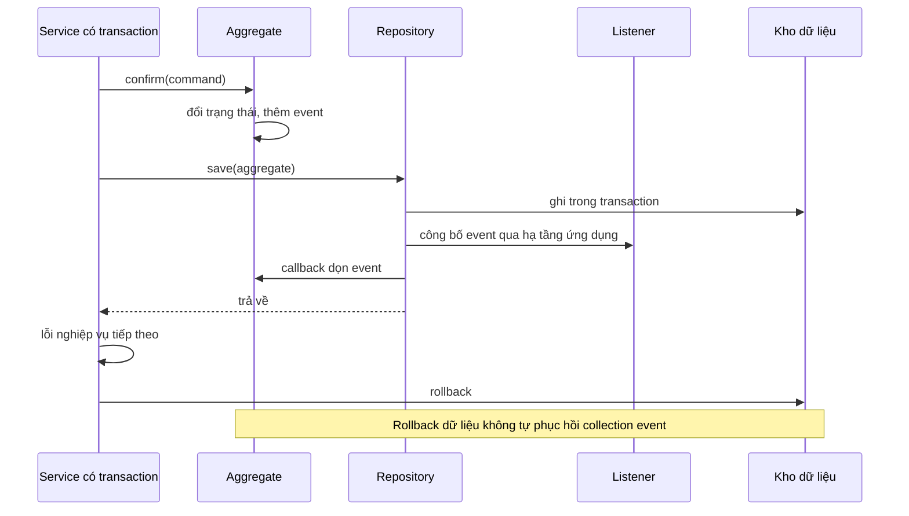
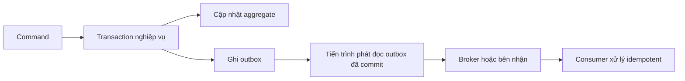

# Sự kiện lặp, rollback và giới hạn độ tin cậy của bộ nhớ ứng dụng

Một aggregate có thể ghi nhận sự kiện miền khi trạng thái nghiệp vụ thay đổi, rồi nhờ repository của Spring Data công bố các sự kiện đó. Cơ chế này giúp tách hành vi của aggregate khỏi các phản ứng như ghi lịch sử hoặc gửi thông báo. Tuy nhiên, danh sách sự kiện trong một đối tượng Java vẫn chỉ là dữ liệu trong bộ nhớ: nó có thể bị công bố lại, bị xóa trước khi giao dịch hoàn tất hoặc mất khi tiến trình dừng.

Trong phạm vi **Spring Data Commons**, bài học này giải thích mối liên hệ giữa aggregate event, repository, transaction và độ tin cậy. Các hợp đồng như `@DomainEvents`, `@AfterDomainEventPublication` và `AbstractAggregateRoot` cung cấp khả năng tích hợp dùng chung; chúng không tự tạo hàng đợi bền vững, giao dịch phân tán hoặc cam kết xử lý đúng một lần. Cách lưu aggregate và hỗ trợ transaction vẫn phụ thuộc module và kho dữ liệu cụ thể.

## 1. Phân biệt các mốc thường bị gọi chung là “đã gửi event”

Xét nghiệp vụ xác nhận đơn hàng. Sau khi trạng thái chuyển từ `DRAFT` sang `CONFIRMED`, aggregate ghi nhận một `OrderConfirmed`.

Có ít nhất sáu mốc khác nhau:

| Mốc | Điều vừa xảy ra | Điều chưa thể kết luận |
|---|---|---|
| Ghi nhận trong aggregate | Event được thêm vào collection của đối tượng Java | Event đã được lưu hoặc công bố |
| Gọi repository | Luồng lưu đi qua một phương thức có tích hợp event | Giao dịch đã commit |
| Công bố tới application event publisher | Event được chuyển cho hạ tầng sự kiện trong ứng dụng | Mọi tác dụng phụ đã hoàn thành |
| Callback xóa event được gọi | Collection sự kiện chờ của aggregate được dọn | Giao dịch thành công hoặc consumer đã nhận |
| Giao dịch commit | Các thay đổi thuộc giao dịch đã bền vững theo kho dữ liệu | Broker hoặc dịch vụ bên ngoài đã xử lý |
| Consumer hoàn tất | Một bên nhận đã thực hiện tác dụng phụ cụ thể | Mọi bên nhận đều hoàn tất, hoặc sẽ không có lần nhận lại |

Nếu dùng một biến `published = true` để đại diện cho tất cả các mốc trên, mô hình rất dễ che mất những khoảng lỗi quan trọng.

## 2. Spring Data Commons cung cấp những gì?

### 2.1. Collection sự kiện trên aggregate

Một aggregate có thể công bố collection sự kiện thông qua phương thức đánh dấu `@DomainEvents`. Phương thức có `@AfterDomainEventPublication` cho phép dọn collection sau khi hạ tầng công bố sự kiện.

`AbstractAggregateRoot<A>` cung cấp sẵn mẫu triển khai cho việc đăng ký và dọn sự kiện. Ví dụ domain sau chỉ minh họa hành vi và event; mapping ID, constructor phục vụ persistence và các yêu cầu của từng module cần được bổ sung riêng.

```java
import java.time.Instant;
import java.util.UUID;

import org.springframework.data.domain.AbstractAggregateRoot;

record ConfirmOrder(UUID commandId, UUID eventId) {
}

record OrderConfirmed(
        UUID eventId,
        String orderId,
        UUID commandId,
        Instant occurredAt) {
}

public final class Order extends AbstractAggregateRoot<Order> {

    private final String id;
    private String status = "DRAFT";

    public Order(String id) {
        this.id = id;
    }

    public void confirm(ConfirmOrder command, Instant now) {
        if (!"DRAFT".equals(status)) {
            throw new IllegalStateException("Đơn hàng không ở trạng thái nháp");
        }

        status = "CONFIRMED";
        registerEvent(new OrderConfirmed(
                command.eventId(),
                id,
                command.commandId(),
                now));
    }
}
```

Sau `confirm(...)`, event mới nằm trong bộ nhớ của instance `Order`. Việc gọi `registerEvent(...)` không tự ghi event vào cơ sở dữ liệu, không tự gọi broker và không tự commit đơn hàng.

Các định danh có vai trò khác nhau:

- `orderId` xác định aggregate.
- `commandId` xác định yêu cầu nghiệp vụ để hỗ trợ chống thực thi lại cùng yêu cầu.
- `eventId` xác định một sự kiện cụ thể để hỗ trợ chống xử lý lại cùng sự kiện.
- `occurredAt` ghi thời điểm nghiệp vụ mà ứng dụng lựa chọn; không thay thế các định danh chống trùng.

Ví dụ nhận `eventId` từ command để làm rõ ranh giới định danh. Trong hệ thống thực tế, ứng dụng có thể cấp và lưu quan hệ command–event ở nơi khác. Một command tạo nhiều event cần các `eventId` riêng, ổn định theo thiết kế; không dùng một ID chung cho tất cả event của command đó.

### 2.2. Công bố gắn với đường gọi repository

Các phương thức repository được Spring Data tích hợp có thể lấy sự kiện từ aggregate rồi công bố chúng sau phần thực thi thao tác repository. Cần dùng đúng phương thức, module và đối tượng aggregate mà cơ chế đó hỗ trợ.

Không nên suy ra rằng mọi thay đổi trạng thái đều tự phát sự kiện:

- Gọi một phương thức domain trong bộ nhớ chưa đủ để kích hoạt công bố qua repository.
- Dirty checking, truy vấn cập nhật trực tiếp hoặc thao tác driver có thể không đi qua đường công bố này.
- Một thao tác chỉ nhận ID như `deleteById(...)` không cung cấp sẵn aggregate instance để đọc collection sự kiện; không được mặc định rằng nó có hành vi giống thao tác nhận aggregate.

Khi có một transaction ở service bao ngoài repository, thao tác repository có thể đã trả về trong khi transaction vẫn chưa commit. Thứ tự công bố và transaction phải được hiểu từ đường gọi thực tế, không từ tên `save()`.

### 2.3. Dọn collection không phải xác nhận giao nhận

Với mẫu `AbstractAggregateRoot`, callback sau công bố dọn các sự kiện đã đăng ký. Mục đích chính là tránh giữ nguyên cùng danh sách trên instance cho các lần lưu tiếp theo.

Callback này không phải là:

- Xác nhận broker đã lưu thông điệp.
- Xác nhận listener bất đồng bộ đã chạy xong.
- Xác nhận giao dịch đã commit.
- Dấu checkpoint bền vững để phục hồi sau restart.

Nếu có listener xử lý sau commit, lời gọi công bố ban đầu có thể chỉ làm công việc đăng ký xử lý cho giai đoạn transaction tương ứng. Collection trên aggregate có thể đã được dọn trước khi listener đó thực sự chạy.

## 3. Vì sao sự kiện có thể xuất hiện lặp?

### 3.1. Listener đã tạo tác dụng phụ nhưng sau đó phát sinh lỗi

Giả sử event được công bố tới các listener đồng bộ. Một đường thực thi có thể là:

```text
1. Listener gửi email xác nhận thành công.
2. Listener khác ném exception.
3. Lời gọi công bố kết thúc bằng lỗi.
4. Giao dịch ngoài rollback nếu lỗi làm giao dịch phải rollback.
5. Ứng dụng retry command.
6. Email xác nhận được gửi lần nữa.
```

Email ở bước 1 không thuộc giao dịch của cơ sở dữ liệu nên rollback không thu hồi được nó. Nếu lỗi làm luồng công bố dừng trước callback dọn collection, các event đang chờ cũng có thể còn trên instance và bị công bố lại khi instance được dùng lại.

Không cần giả định thứ tự listener cụ thể để thấy rủi ro: chỉ cần một tác dụng phụ đã xảy ra trước một lỗi về sau. Nếu nghiệp vụ phụ thuộc thứ tự listener, phải thiết kế và cấu hình thứ tự rõ ràng; thứ tự vẫn không biến các tác dụng phụ độc lập thành một giao dịch chung.

### 3.2. Retry tái tạo event

Khi một transaction thất bại, retry thường đọc lại aggregate rồi thực thi lại hành vi nghiệp vụ. Hành vi đó có thể tạo lại cùng một sự kiện về mặt nghiệp vụ.

Có hai dạng trùng cần phân biệt:

| Dạng trùng | Ví dụ | Cơ chế kiểm soát |
|---|---|---|
| Cùng định danh sự kiện được giao lại | `eventId = E1` xuất hiện hai lần | Consumer deduplication/inbox theo `eventId` |
| Cùng ý định nghiệp vụ tạo ra event có ID khác | Retry command C1 tạo E1 rồi E2 | Command idempotency và quy tắc tạo event ổn định |

Một consumer chỉ chống trùng bằng `eventId` sẽ không biết E1 và E2 thực chất xuất phát từ cùng một yêu cầu nếu producer tạo ID mới cho mỗi lần retry. Ngược lại, gán cùng một ID cho hai sự kiện thực sự khác nhau có thể làm consumer bỏ mất công việc hợp lệ.

Định danh phải gắn với ý nghĩa nghiệp vụ và được giữ bền vững ở ranh giới cần retry, không chỉ đặt trong một biến cục bộ của lần gọi hiện tại. Nếu cùng `eventId` được gửi lại, nội dung của nó cũng phải nhất quán; không tái sử dụng ID cũ cho một payload có ý nghĩa mới.

### 3.3. Command được gửi lại ngoài ý muốn

Trình duyệt timeout, gateway retry hoặc người dùng nhấn lại có thể tạo một lần thực thi mới dù lần trước đã commit. Kiểm tra trạng thái `CONFIRMED` trong domain giúp bảo vệ quy tắc trạng thái, nhưng chưa phải chính sách trả lại kết quả của một command đã xử lý.

Một thiết kế idempotent thường cần lưu `commandId`, kết quả tương ứng hoặc thông tin đủ để nhận ra yêu cầu cũ trong cùng ranh giới nhất quán với thay đổi nghiệp vụ. Khi nhận lại cùng command, ứng dụng trả kết quả đã có hoặc xử lý theo quy ước, thay vì tạo một nghiệp vụ mới.

### 3.4. Gửi ra broker có khoảng không chắc chắn

Một publisher có thể đã gửi thành công nhưng chưa nhận được phản hồi do mất kết nối. Nếu gửi lại, broker hoặc consumer có thể nhìn thấy thông điệp lần hai. Trạng thái “không nhận được phản hồi” không chứng minh lần gửi đầu đã thất bại.

Ngay cả khi broker hỗ trợ một số cơ chế chống trùng, cần xác định rõ phạm vi bảo đảm đó. Nó không tự bao phủ command ở producer, cập nhật cơ sở dữ liệu của consumer và lời gọi tới một dịch vụ bên ngoài.

## 4. Rollback không hoàn tác bộ nhớ Java

Đây là điểm trung tâm khi kết hợp transaction với aggregate event. Transaction manager có thể rollback các thay đổi thuộc tài nguyên giao dịch, nhưng không tự quay ngược mọi field hay collection trong đối tượng Java.

Với transaction bao ngoài service, có thể xuất hiện dòng thời gian:



Sơ đồ minh họa một trường hợp có tích hợp công bố trước khi transaction ngoài kết thúc; nó không mô tả mọi cấu hình repository hay transaction.

Sau rollback, một instance đang được giữ có thể mang trạng thái:

```text
Trong kho dữ liệu: đơn hàng vẫn DRAFT.
Trong bộ nhớ:      đơn hàng đã CONFIRMED.
Collection event:  đã rỗng do callback dọn trước đó.
```

Nếu ứng dụng retry bằng chính instance này:

- Domain có thể từ chối vì trạng thái trong bộ nhớ đã là `CONFIRMED`.
- Hoặc ứng dụng có thể lưu lại trạng thái mà không tạo lại event cần thiết.
- Hoặc một cờ chống phát lại trong bộ nhớ có thể che mất việc lần trước chưa commit.

Trường hợp lỗi xảy ra trước khi dọn collection lại có rủi ro ngược: event vẫn còn và được công bố lại. Không thể chỉ nhìn collection hiện tại để suy ra trạng thái giao dịch trước đó.

Cách tổ chức an toàn hơn cho retry là bắt đầu một đơn vị công việc mới, dùng transaction/persistence context phù hợp, đọc lại trạng thái bền vững rồi thực thi lại command theo quy tắc idempotency. Đặc biệt với JPA, không tiếp tục dùng persistence context đã thất bại như thể rollback đã khôi phục sạch trạng thái entity. Việc làm mới đối tượng cũng không thay thế chống trùng cho tác dụng phụ đã xảy ra bên ngoài.

## 5. Listener đồng bộ và listener sau commit bảo đảm điều gì?

### 5.1. Listener đồng bộ thông thường

Trong cấu hình Spring thông thường, application event listener được gọi đồng bộ trừ khi ứng dụng cấu hình cơ chế thực thi khác. Ví dụ sau cho thấy một tác dụng phụ có thể chạy trước khi transaction bao ngoài commit:

```java
import org.springframework.context.event.EventListener;

public class ConfirmationListener {

    private final NotificationGateway gateway;

    public ConfirmationListener(NotificationGateway gateway) {
        this.gateway = gateway;
    }

    @EventListener
    public void on(OrderConfirmed event) {
        gateway.sendConfirmation(event.orderId(), event.eventId());
    }
}
```

`NotificationGateway` ở đây là abstraction của ứng dụng. Một lời gọi mạng thành công không tự tham gia transaction lưu đơn hàng. Nếu transaction sau đó rollback, thông báo vẫn có thể đã ra ngoài.

Nếu listener chỉ ghi vào một tài nguyên dữ liệu tham gia đúng transaction hiện tại, thay đổi đó có thể rollback cùng aggregate. Điều kiện là cùng ranh giới transaction thích hợp và cấu hình tài nguyên thực tế, không đơn giản là listener có annotation hoặc được gọi cùng thread.

### 5.2. TransactionalEventListener sau commit

Có thể hoãn phản ứng tới khi transaction commit thành công:

```java
import org.springframework.transaction.event.TransactionPhase;
import org.springframework.transaction.event.TransactionalEventListener;

public class AfterCommitConfirmationListener {

    private final NotificationGateway gateway;

    public AfterCommitConfirmationListener(NotificationGateway gateway) {
        this.gateway = gateway;
    }

    @TransactionalEventListener(phase = TransactionPhase.AFTER_COMMIT)
    public void on(OrderConfirmed event) {
        gateway.sendConfirmation(event.orderId(), event.eventId());
    }
}
```

Ví dụ này là lựa chọn thay thế listener trước đó. Không đăng ký cả hai cùng gửi một thông báo rồi cho rằng hệ thống sẽ tự loại trùng.

Xử lý sau commit giải quyết một vấn đề cụ thể: tránh chạy tác dụng phụ này cho transaction đã rollback. Nó vẫn còn khoảng lỗi:

```text
1. Transaction commit thành công.
2. Tiến trình dừng trước khi listener gửi thông báo.
3. Aggregate đã được lưu, nhưng không có công việc bền vững để tự gửi lại.
```

Một số điểm cần nhớ:

- Với cấu hình mặc định không bật `fallbackExecution`, event công bố ngoài transaction đang hoạt động không được xử lý như một transaction event bình thường.
- `AFTER_COMMIT` không tự làm listener bất đồng bộ; nó chọn giai đoạn xử lý.
- Thêm `@Async` tạo thêm ranh giới thực thi và yêu cầu quản lý lỗi/context, không tự tạo lưu trữ bền vững.
- Lỗi xảy ra sau commit không làm phần dữ liệu đã commit quay lại trạng thái chưa commit. Cách lỗi được ghi nhận hoặc truyền ra ngoài còn phụ thuộc cơ chế thực thi.
- Nếu listener sau commit cần ghi dữ liệu, phải thiết kế transaction ghi riêng phù hợp. Các tài nguyên còn hiện diện sau commit không có nghĩa lệnh ghi mới sẽ được commit trong transaction cũ. Khi dùng `REQUIRES_NEW`, cần đi qua cơ chế proxy transaction hợp lệ.

Các ví dụ trên mô tả luồng imperative. Với reactive transaction hoặc cơ chế truyền context khác, phải áp dụng mô hình mà module và hạ tầng transaction thực sự hỗ trợ, không mặc định rằng thread hiện tại luôn chứa đầy đủ context.

## 6. Ma trận lỗi: trùng hoặc mất xảy ra ở đâu?

Giả sử một service có transaction bao ngoài và event chỉ được giữ trong bộ nhớ cho tới lúc công bố:

| Thời điểm lỗi | Dữ liệu aggregate | Event/tác dụng phụ có thể ở trạng thái nào? | Nguy cơ chính |
|---|---|---|---|
| Trước khi gọi repository | Chưa được lưu bởi đường gọi này | Chỉ nằm trong instance | Mất khi instance hoặc tiến trình bị loại bỏ |
| Trong công bố, sau một listener đã chạy | Có thể còn trong transaction | Một số tác dụng phụ đã xảy ra; event có thể chưa được dọn | Trùng khi retry, tác dụng phụ cho dữ liệu rollback |
| Sau dọn event nhưng trước commit | Chưa bền vững | Collection rỗng; callback sau commit có thể mới được đăng ký | Rollback không tự khôi phục event |
| Sau commit, trước listener sau commit | Đã bền vững | Công việc chỉ còn trong tiến trình | Mất công việc nếu tiến trình dừng |
| Đã gửi ra ngoài, chưa ghi nhận kết quả gửi | Có thể đã bền vững | Bên nhận có thể đã nhận | Gửi lại tạo trùng |
| Consumer đã làm tác dụng phụ, chưa ghi nhận đã xử lý | Không thay đổi kết luận về producer | Một lần xử lý đã xảy ra | Xử lý lại nếu thông điệp được giao lại |

Bảng này cho thấy vì sao cơ chế event trong bộ nhớ không cung cấp cam kết giao nhận ít nhất một lần một cách bền vững, càng không tự cung cấp cam kết xử lý đúng một lần từ đầu đến cuối. Có nhánh mất và có nhánh trùng; việc gọi đó là “event” không loại bỏ hai khả năng này.

## 7. Giới hạn của cách chống trùng chỉ bằng bộ nhớ

Một cách triển khai dễ viết là lưu các event đã thấy trong `Set<UUID>`:

```java
if (seenEventIds.add(event.eventId())) {
    handle(event);
}
```

Đoạn mã này chỉ minh họa một ý tưởng cục bộ, không phải giải pháp tin cậy cho công việc quan trọng.

### 7.1. Restart làm mất lịch sử

Sau restart hoặc redeploy, `seenEventIds` rỗng. Một event cũ được giao lại sẽ được xử lý như chưa từng xuất hiện.

### 7.2. Các instance không chia sẻ cùng Set

Với hai replica, event có thể tới replica A rồi tới replica B. Mỗi replica có một lịch sử cục bộ khác nhau. Kể cả dùng collection thread-safe, nó cũng chỉ xử lý cạnh tranh trong cùng tiến trình.

### 7.3. Đánh dấu trước hoặc sau đều có khoảng lỗi

Đánh dấu trước `handle(...)` có thể làm một lần xử lý thất bại bị xem là đã xong. Đánh dấu sau `handle(...)` có thể tạo tác dụng phụ lần hai nếu tiến trình dừng ngay sau tác dụng phụ nhưng trước dấu đánh dấu.

Chỉ thay thứ tự hai dòng không tạo được tính nguyên tử giữa hai việc vốn không cùng một giao dịch.

### 7.4. Giới hạn kích thước làm thay đổi phạm vi chống trùng

Một Set không giới hạn có thể tăng mãi. Cache có TTL hoặc giới hạn kích thước sẽ quên event cũ. Nếu chọn cache, phải chấp nhận và mô tả cửa sổ chống trùng tương ứng; không gọi đó là lịch sử xử lý đầy đủ.

Bộ nhớ cục bộ vẫn phù hợp cho tối ưu hiệu năng, phản ứng có thể mất mà không gây sai nghiệp vụ, hoặc tránh công việc lặp trong một khoảng hẹp. Nó không nên là bằng chứng duy nhất rằng một công việc bắt buộc đã hoàn tất.

## 8. Transactional outbox: lưu ý định phát cùng dữ liệu nghiệp vụ

Nếu yêu cầu là “đơn hàng đã commit thì cuối cùng phải có một công việc phát event có thể phục hồi”, cần lưu ý định đó bền vững. Mẫu transactional outbox ghi thay đổi nghiệp vụ và bản ghi event trong **cùng một transaction của tài nguyên phù hợp**.

Một mô hình tối thiểu:

```text
orders
    id
    status
    version

outbox
    event_id          khóa duy nhất
    aggregate_id
    event_type
    payload
    occurred_at
    delivery_status
```

Luồng xử lý có thể là:



Trong đó, cập nhật aggregate và ghi outbox phải cùng thành công hoặc cùng rollback. Mã giả:

```text
BEGIN TRANSACTION

    Kiểm tra commandId và trạng thái nghiệp vụ.
    Cập nhật đơn hàng.
    Ghi outbox với eventId ổn định.
    Ghi kết quả command nếu thiết kế cần chống thực thi lại.

COMMIT
```

Có thể ghi outbox trực tiếp ở application service hoặc thông qua một listener đồng bộ tham gia đúng transaction ngoài. Nếu chọn listener, phải chứng minh đường công bố đó chạy trong transaction cần thiết và lỗi ghi outbox làm transaction thất bại theo chính sách mong muốn.

Không ghi outbox lần đầu ở listener `AFTER_COMMIT` rồi cho rằng vẫn có tính nguyên tử với aggregate. Khi aggregate đã commit, tiến trình có thể dừng trước lần ghi outbox sau đó; khoảng mất cần giải quyết vẫn còn.

Với kho dữ liệu khác, outbox có thể là collection, mục dữ liệu nhúng hoặc cấu trúc khác phù hợp. Không giả định mọi module hỗ trợ transaction nhiều bảng/tài liệu như cơ sở dữ liệu quan hệ. Cần chọn ranh giới nguyên tử mà kho dữ liệu thực sự có và đặt aggregate cùng ý định phát trong ranh giới đó.

### Outbox không xóa hoàn toàn sự kiện lặp

Một tiến trình phát thường làm các bước:

```text
1. Nhận quyền xử lý một bản ghi outbox.
2. Gửi event.
3. Ghi nhận đã gửi theo chính sách xác nhận.
```

Nếu tiến trình dừng sau bước 2 nhưng trước bước 3, một lần chạy khác có thể gửi lại. Đánh dấu đã gửi trước bước 2 lại có thể làm mất event khi gửi thất bại. Vì vậy, thiết kế thường chấp nhận giao lại và yêu cầu consumer idempotent.

Outbox cần thêm cơ chế retry, quan sát lỗi kéo dài, điều phối nhiều publisher và quản lý lưu trữ. Lock hoặc lease giúp phân chia công việc nhưng không tự loại bỏ mọi trường hợp gửi lại, đặc biệt khi lease hết hạn trong lúc một worker vẫn đang gửi.

## 9. Inbox và xử lý idempotent ở bên nhận

Đối với tác dụng phụ nằm trong cơ sở dữ liệu của consumer, có thể dùng inbox hoặc bảng sự kiện đã xử lý:

```text
processed_events
    consumer_name
    event_id
    processed_at

UNIQUE (consumer_name, event_id)
```

`consumer_name` giúp phân biệt những bên xử lý độc lập. Hai consumer khác nhau có thể đều cần xử lý cùng event; không nên dùng một dấu đã xử lý toàn cục rồi vô tình chặn consumer còn lại.

Mã giả cho một đơn vị công việc:

```text
BEGIN TRANSACTION

    Thử ghi (consumer_name, event_id) bằng thao tác có ràng buộc duy nhất.
    Nếu đã tồn tại:
        kết thúc như một lần giao lại đã biết.

    Áp dụng thay đổi nghiệp vụ trong cùng transaction.

COMMIT
```

Điểm cốt lõi là dấu xử lý và thay đổi nghiệp vụ được commit cùng nhau:

- Nếu transaction rollback, dấu xử lý cũng rollback và event có thể được thử lại.
- Nếu transaction commit, lần giao lại được nhận diện bằng khóa duy nhất.
- Hai luồng xử lý cạnh tranh phải được phân xử bởi ràng buộc hoặc thao tác nguyên tử của kho dữ liệu, không chỉ bằng `SELECT` rồi `INSERT` riêng lẻ.

Cách diễn đạt trên là mã giả; cú pháp insert-if-absent và cách xử lý vi phạm unique phụ thuộc hệ quản trị. Không bắt mọi lỗi SQL rồi coi là “đã xử lý”. Cũng không tiếp tục ghi trên một transaction đã bị đánh dấu rollback-only do xử lý exception sai cách.

Nếu tác dụng phụ là gửi email hoặc gọi cổng thanh toán, nó thường không cùng transaction với inbox trong cơ sở dữ liệu. Khi đó cần thêm khả năng idempotency của bên nhận, một công việc gửi bền vững tiếp theo hoặc quy trình đối soát phù hợp. Một dòng inbox không tự làm lời gọi mạng có tính nguyên tử.

Đối với thanh toán, ví dụ, cần gắn yêu cầu với một khóa idempotency mà cổng thanh toán thực sự hỗ trợ và giữ cùng khóa qua các lần retry theo hợp đồng đó. Không nên suy luận rằng mọi API đều xử lý một header hoặc khóa bất kỳ theo cùng cách.

## 10. Chọn mức bảo đảm theo yêu cầu thực tế

Không phải phản ứng nào cũng cần outbox và inbox. Điều cần làm là khớp cơ chế với hậu quả nếu mất hoặc lặp.

| Nhu cầu | Cơ chế có thể phù hợp | Giới hạn phải chấp nhận hoặc xử lý |
|---|---|---|
| Cập nhật chỉ số phụ trợ có thể tính lại | Listener trong tiến trình | Có thể mất khi tiến trình dừng |
| Tránh gửi phản ứng cho transaction rollback, chấp nhận khả năng mất sau commit | Listener sau commit | Không có hàng đợi bền vững mặc định |
| Cập nhật thêm dữ liệu cùng transaction | Listener đồng bộ hoặc logic service trong đúng transaction | Phải bảo đảm tài nguyên thực sự tham gia transaction |
| Công việc sau commit bắt buộc phục hồi được | Outbox hoặc cơ chế công việc bền vững tương đương | Publisher có thể gửi lại; cần retry và giám sát |
| Consumer cập nhật dữ liệu đúng một lần theo event trong phạm vi cơ sở dữ liệu của nó | Inbox kết hợp transaction và unique key | Chỉ bao phủ tác dụng phụ nằm trong ranh giới đó |
| Tác dụng phụ ra hệ thống bên ngoài | Khóa idempotency, trạng thái công việc và đối soát phù hợp | Phụ thuộc hợp đồng của hệ thống bên ngoài |

Thêm một broker không tự giải quyết việc ghi đồng thời aggregate và thông điệp. Thêm một bảng chống trùng không tự giải quyết việc gọi API bên ngoài. Mỗi bảo đảm cần gắn với một ranh giới cụ thể: tài nguyên nào, giao dịch nào, định danh nào và khoảng lỗi nào được bao phủ.

## 11. Các tình huống nên mô phỏng khi đánh giá thiết kế

Những tình huống dưới đây là bài tập thiết kế để xác định mức bảo đảm, không phải giả định rằng cơ chế Commons đã xử lý sẵn.

### Tình huống 1: Rollback sau khi repository đã trả về

Một service có transaction thực hiện `save(order)`, sau đó ném lỗi. Trước lỗi, collection event đã được dọn.

**Cần dự đoán:** dữ liệu trong transaction rollback; collection Java không tự được phục hồi. Retry bằng instance cũ có thể thiếu event hoặc sai trạng thái. Retry bằng đơn vị công việc mới cần tái tạo quyết định nghiệp vụ từ trạng thái bền vững.

### Tình huống 2: Listener gửi thành công rồi listener khác lỗi

Một listener gửi thông báo thành công. Một listener chạy sau đó lỗi, làm luồng công bố thất bại và transaction ngoài rollback theo chính sách.

**Cần dự đoán:** thông báo đầu không tự thu hồi; retry có thể gửi lại. Việc callback dọn collection đã chạy hay chưa phụ thuộc điểm lỗi. Consumer hoặc gateway phải có chính sách chống trùng nếu tác dụng phụ không được phép lặp.

### Tình huống 3: Dừng tiến trình ngay sau commit

Transaction lưu aggregate đã commit. Listener sau commit chưa kịp xử lý khi tiến trình dừng.

**Cần dự đoán:** event chỉ nằm trong bộ nhớ không tự xuất hiện lại sau restart. Nếu có outbox được ghi trong transaction trước đó, công việc chưa gửi có cơ sở bền vững để tiếp tục.

### Tình huống 4: Publisher dừng sau khi gửi nhưng trước khi đánh dấu

Broker đã nhận E1 nhưng bản ghi outbox chưa được đánh dấu đã gửi.

**Cần dự đoán:** lần chạy sau có thể gửi lại E1. Consumer cần nhận diện E1 hoặc có tác dụng phụ idempotent. Không tạo E2 chỉ vì đang retry việc giao E1.

### Tình huống 5: Hai replica nhận cùng event

Hai replica consumer cùng nhận một `eventId`. Mỗi replica có một Set riêng trong bộ nhớ.

**Cần dự đoán:** cả hai Set đều có thể chấp nhận event. Muốn bảo vệ một thay đổi bền vững chung phải dùng ràng buộc/transaction phù hợp ở nơi lưu dữ liệu, hoặc cơ chế tương đương đáp ứng cùng yêu cầu.

### Tình huống 6: Cùng command được gửi lại sau timeout

Lần đầu đã commit nhưng client không nhận được phản hồi. Client gửi lại cùng yêu cầu.

**Cần dự đoán:** đây là vấn đề command idempotency, không chỉ là giao event lặp. Cần xác định cùng `commandId` trả lại kết quả nào và có được phép tạo thêm event mới hay không.

## 12. Các câu hỏi cần trả lời trước khi dựa vào aggregate event

1. Event được công bố ở đường repository nào, và transaction có còn hoạt động tại đó không?
2. Callback dọn collection chạy trước hay sau mốc bền vững mà nghiệp vụ cần?
3. Nếu transaction rollback, lần retry có dùng lại một instance đã bị thay đổi không?
4. Tác dụng phụ nào có thể rollback cùng dữ liệu, tác dụng phụ nào đã ra ngoài?
5. Tiến trình dừng sau commit thì công việc còn nằm ở đâu để phục hồi?
6. Cùng command hoặc cùng event được nhận lại sẽ được nhận diện bằng định danh nào?
7. Hai replica cạnh tranh được phân xử bằng cơ chế nguyên tử nào?
8. Dấu đã xử lý và tác dụng phụ có nằm trong cùng một transaction không?
9. Đường ghi trực tiếp, bulk operation hoặc module lưu trữ đang dùng có bỏ qua cơ chế công bố không?
10. Hệ thống quan sát và xử lý công việc retry thất bại kéo dài như thế nào?

Aggregate event của Spring Data Commons là công cụ kết nối hành vi domain với phản ứng trong ứng dụng. Độ tin cậy xuất hiện khi định danh, transaction, lưu trữ công việc và chính sách retry được thiết kế nhất quán. Collection trong aggregate và callback dọn event chỉ đảm nhiệm một phần của vòng đời đó; chúng không thay thế cơ chế phục hồi và chống trùng ở những ranh giới có thể xảy ra lỗi.