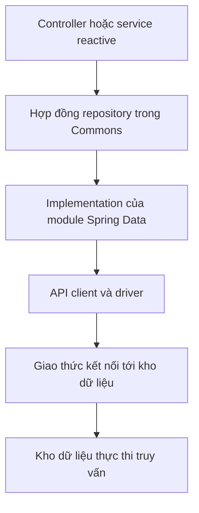

# Tách hợp đồng reactive khỏi khả năng I/O không chặn của driver

Một phương thức trả về `Mono<Order>` cho biết cách bên gọi nhận kết quả. Nó chưa đủ để kết luận rằng lúc truy vấn cơ sở dữ liệu, ứng dụng không giữ một thread chờ I/O. Tương tự, đổi `List<Order>` thành `Flux<Order>` không tự thay đổi cách driver mở kết nối, gửi câu lệnh hoặc đọc dữ liệu.

Trong phần **Repository reactive** của **Spring Data Commons**, cần phân biệt ba tầng: hợp đồng repository, cách thực thi pipeline và khả năng I/O của module/driver thực tế. Phân biệt đúng giúp lựa chọn repository, mở rộng truy vấn và tích hợp các abstraction chung mà không gán cho mọi kho dữ liệu những khả năng giống nhau.

## 1. Hợp đồng reactive mô tả điều gì?

Spring Data Commons cung cấp các abstraction repository reactive. Ví dụ, `ReactiveCrudRepository<T, ID>` mô tả các thao tác CRUD bằng kiểu reactive của Reactor:

```java
import reactor.core.publisher.Flux;
import reactor.core.publisher.Mono;

import org.springframework.data.repository.reactive.ReactiveCrudRepository;

public interface OrderRepository
        extends ReactiveCrudRepository<Order, String> {

    Flux<Order> findByStatus(String status);
}
```

Ở đây, `Order` là domain type đã được mapping theo module cụ thể. Derived query `findByStatus` chỉ hoạt động khi module đó hỗ trợ việc phân tích và thực thi truy vấn tương ứng.

Các kiểu trả về thể hiện quy ước về luồng kết quả:

| Kiểu | Ý nghĩa về số phần tử | Không tự khẳng định |
|---|---|---|
| `Mono<T>` | Không có hoặc có một phần tử, hoặc kết thúc bằng lỗi | Công việc bên trong dùng I/O không chặn |
| `Flux<T>` | Không có, có một hoặc nhiều phần tử, hoặc kết thúc bằng lỗi | Driver đọc từng hàng mà không buffer |
| `Publisher<T>` | Hợp đồng phát tín hiệu theo Reactive Streams | Cơ chế triển khai là event loop hay thread chờ |

Repository reactive cho phép bên gọi ghép thao tác bằng `map`, `flatMap`, `switchIfEmpty` hoặc các toán tử khác. Nó giúp biểu diễn tín hiệu dữ liệu, lỗi, kết thúc và hủy theo một mô hình chung.

Tuy nhiên, interface trong Commons không phải driver cơ sở dữ liệu. Module persistence phải cung cấp phần triển khai repository và kết nối nó với hạ tầng truy cập dữ liệu phù hợp. Không thể chỉ đổi một repository JPA thành `ReactiveCrudRepository` rồi mặc định Spring Data JPA sẽ tạo implementation reactive tương ứng.

## 2. Ba câu hỏi độc lập cần trả lời

Khi gặp một API trả về `Mono` hoặc `Flux`, hãy đặt ba câu hỏi:

1. **Hợp đồng:** kết quả được biểu diễn và kết hợp theo giao thức nào?
2. **Thực thi:** công việc chạy khi nào, trên thread nào, và ở đâu có thao tác chặn?
3. **Tài nguyên:** module, driver, connection pool và đường I/O có thực sự hỗ trợ không chặn không?

Ví dụ sau đặt một lời gọi chặn vào vỏ reactive:

```java
Mono<Order> result = Mono.fromCallable(() -> legacyGateway.load(id));
```

Giả sử `legacyGateway.load(id)` gọi JDBC đồng bộ. Khi callable được thực thi, thread chạy nó vẫn chờ truy vấn hoàn tất. Publisher có tính trì hoãn thực thi, nhưng I/O bên trong vẫn chặn.

Ngược lại, một repository R2DBC với driver phù hợp có thể nhận kết quả I/O qua cơ chế bất đồng bộ, không giữ một thread riêng chỉ để chờ mỗi thao tác socket. Dù vậy, một hàm mapping tùy biến trong pipeline vẫn có thể gọi API chặn và làm hỏng đặc tính của toàn bộ đường xử lý.

Một ứng dụng có thể có hợp đồng reactive ở mọi chữ ký nhưng vẫn chứa I/O chặn ở nhiều tầng. Muốn kết luận về đường xử lý, phải xét các tầng cùng nhau.

## 3. Blocking, asynchronous và non-blocking không đồng nghĩa

### 3.1. I/O chặn

Trong mô hình chặn, lời gọi chưa trả về cho tới khi có kết quả hoặc lỗi. Thread gọi bị chiếm dụng trong thời gian chờ thao tác.

JDBC và đường truy cập JPA thông thường có mô hình thực thi đồng bộ như vậy. Việc hệ quản trị cơ sở dữ liệu xử lý câu lệnh ở một máy khác không khiến lời gọi phía ứng dụng tự trở thành không chặn.

### 3.2. Bất đồng bộ bằng cách chuyển sang worker

Có thể chuyển một tác vụ chặn sang executor rồi trả ngay một đối tượng đại diện kết quả. Bên gọi không phải chờ tại chỗ, nhưng worker vẫn bị chiếm dụng trong lúc I/O diễn ra.

Ví dụ tương đương về ý tưởng:

```text
Thread nhận request:
    giao công việc sang worker
    tiếp tục phục vụ việc khác

Worker:
    gọi JDBC
    chờ JDBC trả về
    chuyển kết quả cho pipeline
```

Đây là cách tích hợp hữu ích, nhưng số tác vụ có thể chờ đồng thời vẫn liên hệ với số worker, connection pool và dung lượng hàng đợi.

### 3.3. I/O không chặn

Một đường I/O không chặn phù hợp không yêu cầu giữ một thread chỉ để đợi từng thao tác mạng hoàn thành. Hạ tầng được thông báo khi có tiến triển và tiếp tục xử lý phần công việc sẵn sàng.

Điều đó không có nghĩa:

- Không dùng thread nào.
- Không cần connection pool.
- Cơ sở dữ liệu xử lý truy vấn nhanh hơn về mặt thuật toán.
- Không có hàng đợi hoặc giới hạn tài nguyên.
- Mọi công việc CPU trong pipeline được tự động chia đều.

Một truy vấn không có index vẫn có thể chậm dù driver không chặn. Một phép tính CPU nặng chạy trên event loop vẫn có thể làm chậm nhiều request khác.

## 4. Vai trò của Commons, module và driver



Mỗi tầng có một trách nhiệm riêng:

| Tầng | Trách nhiệm chính | Cần kiểm tra điều gì? |
|---|---|---|
| Commons | Interface repository, metadata và các hợp đồng dùng chung | Kiểu trả về và khả năng kết hợp thao tác |
| Module Spring Data | Mapping, query derivation, persistence và tích hợp repository | Có implementation reactive cho loại kho này không? |
| Driver/client | Gửi lệnh, nhận kết quả, quản lý I/O theo API của nó | Đường truy cập sử dụng có không chặn không? |
| Connection pool | Giới hạn và cấp phát kết nối | Hết kết nối thì chờ, timeout và tạo áp lực ngược ra sao? |
| Kho dữ liệu | Thực thi câu lệnh, khóa, giao dịch và lưu trữ | Truy vấn tốn tài nguyên gì, có bị khóa hay không? |

Ví dụ về cách đọc kiến trúc:

- **Spring Data JPA + JDBC:** đường persistence thông thường là imperative và chặn.
- **Spring Data JDBC + JDBC driver:** đổi sang abstraction mapping khác không tự biến JDBC thành I/O không chặn.
- **Spring Data R2DBC + R2DBC driver phù hợp:** cung cấp đường truy cập relational reactive; cần cấu hình đúng driver, pool và transaction tương ứng.
- **Repository reactive của một document store:** cần dùng đúng phần tích hợp reactive và client phù hợp của module; cùng một kho dữ liệu có thể có cả API imperative lẫn reactive.

Không phải cứ cơ sở dữ liệu quan hệ là bắt buộc truy cập chặn, và không phải cứ kho dữ liệu phi quan hệ là mặc nhiên không chặn. Khả năng nằm ở đường client/driver được sử dụng, bên cạnh hỗ trợ của module.

Các khả năng khác cũng không tự đồng nhất giữa hai API: derived query, projection, auditing, transaction, phân trang và kiểu cập nhật phải được đối chiếu với module cụ thể. Commons cung cấp abstraction chung chứ không buộc mọi implementation hỗ trợ cùng một tập hành vi.

## 5. Ba cách bọc một API chặn và ý nghĩa của từng cách

Giả sử `legacyGateway.load(id)` là lời gọi chặn, trả về `Order`.

### 5.1. Mono.just không trì hoãn lời gọi đối số

```java
Mono<Order> order = Mono.just(legacyGateway.load(id));
```

Java phải đánh giá `legacyGateway.load(id)` trước khi gọi `Mono.just(...)`. Vì vậy:

1. Lời gọi chặn xảy ra ngay trên thread hiện tại.
2. Kết quả mới được đưa vào `Mono`.
3. Nếu lời gọi ném exception, lỗi có thể xảy ra trước khi tạo publisher như người viết mong muốn.

Gắn `subscribeOn(...)` sau đoạn này không thể quay ngược thời gian để di chuyển lời gọi đã thực thi.

Nếu nguồn trả về `null`, `Mono.just(...)` cũng không phải cách biểu diễn hợp lệ cho phần tử đó. Trường hợp không có dữ liệu cần được chuyển thành tín hiệu rỗng hoặc lỗi theo hợp đồng của ứng dụng.

### 5.2. fromCallable trì hoãn thực thi nhưng không tự chuyển thread

```java
Mono<Order> order = Mono.fromCallable(() -> legacyGateway.load(id));
```

Lời gọi được đặt trong callable, nên không chạy ngay khi lắp pipeline. Khi subscription dẫn tới thực thi callable, nó vẫn có thể chạy trên thread đang xử lý subscription nếu không có ranh giới scheduler thích hợp.

Nếu thread đó là event loop phục vụ nhiều kết nối, JDBC có thể giữ thread này trong khi chờ, làm chậm cả những request khác. Lười thực thi và không chặn là hai thuộc tính khác nhau.

### 5.3. fromCallable kết hợp boundedElastic là một cầu nối

```java
import reactor.core.publisher.Mono;
import reactor.core.scheduler.Schedulers;

Mono<OrderDto> loadLegacyOrder(String id) {
    return Mono.fromCallable(() -> legacyService.loadOrderDto(id))
            .subscribeOn(Schedulers.boundedElastic());
}
```

Ở đây, `legacyService.loadOrderDto(id)` đại diện cho một đơn vị công việc imperative. Scheduler dành cho tác vụ có thể chặn giúp cách ly lời gọi khỏi event loop trong luồng thông thường.

Cần hiểu đúng mức bảo đảm:

- Thread worker vẫn có thể bị chặn trong lúc chờ driver.
- Scheduler có giới hạn tài nguyên; tải vượt khả năng phải chờ hoặc bị từ chối theo cấu hình.
- Connection pool vẫn có giới hạn riêng.
- Timeout hoặc cancellation ở pipeline không bảo đảm lời gọi JDBC đang chạy sẽ dừng ngay.
- Nếu callable trả về `null`, `Mono.fromCallable` hoàn thành rỗng; cần xử lý trạng thái không tìm thấy theo hợp đồng mong muốn.

Nếu dùng JPA, nên thực hiện truy cập và chuyển sang DTO trong ranh giới imperative/transaction thích hợp. Không trả một entity chưa nạp đủ thuộc tính rồi để lazy loading âm thầm gọi JDBC trên event loop ở bước sau.

Cầu nối này phù hợp khi di chuyển hệ thống từng phần hoặc khi một thư viện chỉ có API đồng bộ. Nó không biến driver cũ thành driver không chặn.

## 6. subscribeOn và publishOn không sửa được mọi đường chặn

`subscribeOn` tác động tới nơi subscription và phần công việc nguồn liên quan được thực thi. `publishOn` chuyển phần xử lý tín hiệu phía sau ranh giới của nó sang scheduler khác.

Ví dụ sau vẫn để lời gọi chặn ở phía trước ranh giới chuyển xử lý tín hiệu:

```java
Mono.defer(() -> Mono.just(legacyGateway.load(id)))
        .publishOn(Schedulers.boundedElastic())
        .map(this::toDto);
```

Trong ví dụ này, supplier của `defer` được gọi khi subscribe ở phía trước `publishOn`. Lời gọi chặn thực hiện để tạo publisher bên trong trước khi tín hiệu kết quả được chuyển sang scheduler khác. Với nguồn blocking, mẫu `fromCallable(...).subscribeOn(...)` thể hiện rõ chủ đích cách ly công việc chặn; không nên dựa vào tên một toán tử chuyển scheduler mà bỏ qua vị trí thực thi của nguồn.

Ngược lại, gắn `subscribeOn` vào một driver đã có I/O bất đồng bộ không có nghĩa toàn bộ thread xử lý mạng bên trong driver sẽ được chuyển sang scheduler đó. Driver có cơ chế thực thi và event loop riêng; scheduler của Reactor không tự viết lại cơ chế I/O của driver.

Khi cần quyết định scheduler, hãy xác định chính xác đoạn công việc:

| Đoạn công việc | Cách suy nghĩ phù hợp |
|---|---|
| Lời gọi thư viện chặn | Cách ly trong ranh giới worker có giới hạn |
| Mapping nhỏ, không I/O | Có thể xử lý trực tiếp trong pipeline |
| Tính toán CPU nặng | Cần ngân sách CPU và scheduler phù hợp; không giữ event loop lâu |
| Driver reactive thực thụ | Giữ pipeline hợp thành; tránh thêm ranh giới scheduler không cần thiết |

Không cần chuyển mọi toán tử sang thread khác. Mỗi lần chuyển có chi phí và không tự mang lại khả năng chịu tải tốt hơn.

## 7. Một pipeline repository reactive hợp thành

Giả sử `OrderRepository` được một module reactive hợp lệ cung cấp implementation, và `Order.confirmed()` chỉ thực hiện quy tắc domain trong bộ nhớ rồi trả về trạng thái mới:

```java
import reactor.core.publisher.Mono;

Mono<Order> confirm(String id) {
    return repository.findById(id)
            .switchIfEmpty(Mono.error(
                    new IllegalArgumentException("Không tìm thấy đơn hàng")))
            .map(Order::confirmed)
            .flatMap(repository::save);
}
```

Đường xử lý giữ publisher từ repository xuyên suốt tới bên gọi. Không có lời gọi `block()` để biến kết quả thành giá trị đồng bộ giữa pipeline.

Tuy nhiên, chữ ký đúng chưa đủ. Nếu `Order.confirmed()` gọi một SDK đồng bộ qua mạng, pipeline vẫn có đoạn chặn trong `map`. Nếu `save` là một custom repository fragment dùng JDBC bên trong, cần đánh giá fragment đó riêng.

Một service thường nên trả publisher để tầng sở hữu vòng đời request hoặc công việc thực hiện subscription. Gọi `subscribe()` thủ công trong service rồi trả kết quả thành công ngay có thể tách việc ghi dữ liệu khỏi luồng xử lý lỗi, cancellation và transaction của bên gọi.

Cũng không mặc định mọi publisher luôn là cold hoặc mọi lần subscribe đều có cùng hành vi. Với các publisher truy cập dữ liệu dạng cold thường gặp, subscription mới có thể thực hiện thao tác mới. Việc gọi `block()` để đọc tạm rồi để framework subscribe lần nữa có thể dẫn tới hai lần truy vấn hoặc hai lần ghi, tùy publisher.

## 8. Backpressure không phải chứng chỉ I/O không chặn

Reactive Streams cho phép bên nhận yêu cầu số phần tử thông qua demand. Cơ chế đó điều phối việc phát phần tử, nhưng không chứng minh driver không chặn.

Một adapter có thể:

1. Chạy một truy vấn JDBC chặn.
2. Đọc toàn bộ kết quả vào `List`.
3. Phát các phần tử từ List theo demand.

Ở tầng cuối, số phần tử phát có thể được điều tiết. Tuy nhiên, truy vấn đã chặn và toàn bộ dữ liệu có thể đã nằm trong bộ nhớ trước đó.

Ví dụ cần đọc cẩn thận:

```java
Flux<Order> orders = Flux.fromIterable(legacyRepository.findAll());
```

Lời gọi `findAll()` vẫn được đánh giá trước khi `Flux.fromIterable` nhận collection. Kể cả trì hoãn bằng `defer`, driver chặn vẫn không thay đổi bản chất.

### 8.1. Demand phía ứng dụng khác với việc đọc từ kho dữ liệu

Với driver reactive, cần xem khả năng thực tế về cursor, batch, fetch, buffer và giao thức. Không phải mọi `request(n)` đều được ánh xạ thành “cơ sở dữ liệu chỉ thực hiện đúng n hàng công việc”.

Ví dụ:

```java
repository.findByStatus("CONFIRMED")
        .limitRate(64);
```

`limitRate(64)` điều chỉnh yêu cầu giữa các đoạn publisher. Nó không tự thêm `LIMIT 64` vào truy vấn, không thay thế phân trang và không bảo đảm driver chỉ giữ đúng 64 bản ghi trong bộ nhớ.

### 8.2. collectList thay đổi hồ sơ sử dụng bộ nhớ

```java
Mono<java.util.List<Order>> all = repository.findAll().collectList();
```

Pipeline có thể vẫn dùng I/O không chặn, nhưng `collectList()` cần tích lũy các phần tử trước khi phát List cuối. Với tập dữ liệu lớn, vấn đề bộ nhớ vẫn tồn tại.

Nếu nghiệp vụ cần xử lý theo luồng, nên giữ dạng `Flux` tới nơi tiêu thụ phù hợp. Nếu cần một tập hữu hạn, hãy giới hạn bằng điều kiện truy vấn, phân trang hoặc cơ chế đọc từng phần mà module hỗ trợ. Không suy ra rằng một publisher nhiều phần tử luôn đồng nghĩa streaming có bộ nhớ cố định.

## 9. Không chặn vẫn cần kiểm soát đồng thời và connection pool

Driver reactive không làm số kết nối trở thành vô hạn. Khi pool hết kết nối, request có thể chờ theo cơ chế của pool, timeout hoặc thất bại. Việc chờ không giữ thread vẫn tiêu thụ bộ nhớ, giữ trạng thái công việc và ảnh hưởng độ trễ.

Ví dụ với một tập ID hữu hạn:

```java
Flux<Order> loadOrders(java.util.List<String> ids) {
    return Flux.fromIterable(ids)
            .flatMap(repository::findById, 8);
}
```

Tham số `8` giới hạn số inner publisher được subscribe đồng thời theo toán tử này. Nó không phải giới hạn toàn cục của ứng dụng và không bảo đảm tổng số kết nối luôn bằng hoặc nhỏ hơn 8 khi còn nhiều request khác.

Cũng cần nhớ:

- `flatMap` không bảo toàn thứ tự kết quả như một phép xử lý tuần tự.
- Một inner publisher không nhất thiết tương ứng chính xác một kết nối trong mọi implementation.
- Buffer/prefetch ở các tầng khác vẫn ảnh hưởng tài nguyên.
- Tăng concurrency vượt khả năng kho dữ liệu có thể tăng hàng đợi và độ trễ thay vì tăng throughput.

Nếu cần giữ thứ tự hoặc chỉ thực hiện một thao tác tại một thời điểm, phải chọn toán tử phù hợp với yêu cầu đó. Đừng dùng `parallel()` hoặc tăng worker chỉ vì phương thức trả về `Flux`.

## 10. Transaction cũng phải khớp mô hình thực thi

Trong đường imperative thông thường, tài nguyên transaction thường được gắn với thread. Trong đường reactive, transaction cần được truyền theo context của chuỗi thực thi thay vì giả định mọi công việc nằm trên một thread.

Với hạ tầng reactive transaction phù hợp, có thể áp dụng `TransactionalOperator`:

```java
import org.springframework.transaction.reactive.TransactionalOperator;

Mono<Order> confirmInTransaction(
        String id,
        TransactionalOperator transaction) {

    Mono<Order> work = repository.findById(id)
            .switchIfEmpty(Mono.error(
                    new IllegalArgumentException("Không tìm thấy đơn hàng")))
            .map(Order::confirmed)
            .flatMap(repository::save);

    return transaction.transactional(work);
}
```

Ví dụ giả định repository tham gia đúng reactive transaction manager và tài nguyên mà operator quản lý. Việc bọc publisher không tạo transaction chung cho bất kỳ driver hoặc kho dữ liệu nào được gọi bên trong.

Những suy luận cần tránh:

- Bao một lời gọi JDBC bằng `Mono` không làm nó tự tham gia reactive transaction.
- Đặt một transaction imperative ở phương thức tạo publisher không chứng minh transaction đó còn hoạt động khi publisher chạy sau này.
- Chuyển công việc sang scheduler khác không tự chuyển các tài nguyên gắn với thread sang đó.
- Một reactive transaction không mặc nhiên bao phủ nhiều cơ sở dữ liệu hoặc một lời gọi HTTP.

Nếu phải dùng cầu nối blocking, hãy giữ toàn bộ đơn vị công việc blocking và transaction imperative của nó trong ranh giới được thiết kế rõ, chẳng hạn gọi một service transactional qua proxy ngay bên trong callable. Không chia một persistence context imperative qua nhiều bước reactive chạy trên các thread bất kỳ.

## 11. Timeout, cancellation và retry cần được hiểu ở đúng tầng

### Timeout

Một toán tử timeout có thể ngừng chờ kết quả và phát lỗi xuống pipeline. Điều đó không đủ để kết luận rằng câu lệnh phía máy chủ đã dừng. Có thể cần query timeout hoặc cơ chế hủy mà driver và kho dữ liệu hỗ trợ.

### Cancellation

Cancellation là tín hiệu yêu cầu không tiếp tục cung cấp dữ liệu. Driver có thể giải phóng tài nguyên hoặc gửi yêu cầu hủy theo khả năng của nó. Việc xử lý không phải lúc nào cũng tức thời, và một tác dụng phụ phía máy chủ có thể đã xảy ra.

Đối với lời gọi blocking đã được chuyển sang worker, không nên giả định hủy subscription sẽ ngắt an toàn thao tác đang chạy. API đồng bộ và driver phải thực sự hỗ trợ cách dừng tương ứng.

### Retry

Retry thường kéo theo subscription lại. Nếu publisher thực hiện thao tác ghi, subscription lại có thể thực hiện ghi lần nữa. Đặc tính không chặn không cung cấp idempotency hoặc bảo đảm chỉ ghi đúng một lần.

Vì vậy, thiết kế retry cần xét loại lỗi, transaction, khóa nghiệp vụ và khả năng chống thực thi lặp. Một timeout ở phía ứng dụng không chứng minh thao tác trước đó chưa commit.

## 12. Cách đánh giá một đường truy cập dữ liệu

Có thể bắt đầu bằng việc lập bản đồ ngắn cho luồng xử lý:

```text
Request
    → xác thực và lấy context
    → service
    → repository hoặc custom fragment
    → client/driver
    → connection pool
    → kho dữ liệu
    → mapping và xử lý kết quả
    → response
```

Với mỗi đoạn, xác định:

1. API là imperative, asynchronous hay reactive?
2. Công việc có gọi mạng, file, khóa đồng bộ hoặc thao tác chặn nào không?
3. Công việc chạy trên event loop, worker hay executor riêng?
4. Ai giới hạn số tác vụ đang chờ và tài nguyên được giữ?
5. Khi lỗi, hủy hoặc timeout, ai giải phóng tài nguyên?

Khi đánh giá bằng quan sát runtime, không chỉ nhìn tên thread hoặc chữ ký phương thức. Một worker đang chờ I/O và một event loop đang xử lý kết quả có thể cùng xuất hiện trong ứng dụng hybrid. Cần nối quan sát đó với đúng lời gọi và driver.

Các tín hiệu có ích gồm:

| Tín hiệu | Điều có thể nhận ra |
|---|---|
| Thread dump hoặc profiler | Đường gọi có giữ thread trong API chặn hay không |
| Độ trễ event loop | Công việc chặn hoặc CPU nặng có ảnh hưởng xử lý chung không |
| Số kết nối đang dùng và số yêu cầu chờ pool | Nút thắt có nằm ở tài nguyên kết nối không |
| Hàng đợi scheduler và số tác vụ chờ | Cầu nối blocking có đang quá tải không |
| Bộ nhớ và số phần tử tích lũy | Có đọc quá nhiều hoặc buffer quá lớn không |
| Throughput, độ trễ đuôi và lỗi dưới tải đại diện | Thiết kế có đáp ứng mục tiêu thực tế không |

Một benchmark tải thấp trả lời nhanh chưa chứng minh đường I/O không chặn. Ngược lại, một đường không chặn có thể chậm do truy vấn, khóa hoặc tài nguyên máy chủ. Cần đánh giá cơ chế thực thi và hiệu quả vận hành như hai khía cạnh liên quan nhưng không đồng nhất.

## 13. Các lỗi thiết kế thường gặp

| Nhận định hoặc cách làm | Vấn đề | Cách xử lý |
|---|---|---|
| “Trả về Mono nên chắc chắn không chặn” | Kiểu trả về không xác định cơ chế I/O | Kiểm tra implementation và driver |
| Dùng `Mono.just(blockingCall())` | Lời gọi chạy trước khi publisher được tạo | Dùng nguồn trì hoãn và ranh giới scheduler nếu cần cầu nối |
| Chỉ dùng `fromCallable` trên event loop | Đã trì hoãn nhưng chưa cách ly công việc chặn | Đưa công việc chặn sang worker có giới hạn |
| Dùng `boundedElastic` rồi gọi đó là driver reactive | Worker vẫn phải chờ I/O | Mô tả đúng đây là cầu nối blocking |
| Đổi repository JPA sang interface reactive | Module không tự có implementation phù hợp | Chọn stack hỗ trợ hoặc giữ adapter rõ ràng |
| Thêm `block()` trong service WebFlux | Giữ thread và cắt tính hợp thành | Trả publisher và dùng toán tử kết hợp |
| Gọi `subscribe()` rồi trả thành công ngay | Tách kết quả, lỗi và transaction khỏi request | Để tầng sở hữu vòng đời subscribe |
| Dùng `collectList()` với dữ liệu không giới hạn | Tăng bộ nhớ dù I/O có thể không chặn | Giới hạn truy vấn hoặc xử lý theo luồng |
| Tăng concurrency theo ý muốn | Pool và kho dữ liệu vẫn có giới hạn | Chọn ngân sách đồng thời và đo dưới tải |
| Nghĩ timeout đồng nghĩa truy vấn chưa ghi | Kết quả ghi có thể đã xảy ra | Thiết kế timeout, retry và idempotency theo từng tầng |

## 14. Bài tập tự kiểm tra

### Tình huống 1: Repository trả Mono nhưng bên trong gọi JPA

Một custom repository fragment dùng `Mono.fromCallable(() -> jpaRepository.findById(id))` và không cấu hình scheduler.

**Phân tích:** API đã biểu diễn kết quả bằng publisher và trì hoãn lời gọi. JPA vẫn là đường blocking; nếu callable chạy trên event loop thì event loop vẫn bị giữ. Cần cách ly đơn vị công việc imperative hoặc chuyển sang đường persistence thực sự hỗ trợ reactive theo yêu cầu.

### Tình huống 2: Đã dùng driver không chặn nhưng gọi SDK đồng bộ trong map

Repository R2DBC trả `Mono<Order>`, sau đó `map` gọi một SDK vận chuyển đồng bộ qua mạng.

**Phân tích:** Phần truy vấn có thể không chặn, nhưng pipeline có đoạn I/O chặn ở SDK. Cần dùng API không chặn tương ứng hoặc đặt cầu nối có giới hạn cho đoạn đó; không gán đặc tính của driver cơ sở dữ liệu cho mọi dependency.

### Tình huống 3: Flux phát theo demand sau khi đã đọc toàn bộ List

Một adapter thực hiện `findAll()` bằng JDBC rồi mới chuyển List sang Flux.

**Phân tích:** Việc phát phần tử có thể theo demand, nhưng truy vấn vẫn chặn và bộ nhớ đã được cấp cho toàn bộ kết quả. Backpressure ở cuối không thay đổi quá khứ thực thi ở nguồn.

### Tình huống 4: Reactive pool hết kết nối

Ứng dụng có driver không chặn, nhưng nhiều request phải chờ lấy connection và độ trễ tăng mạnh.

**Phân tích:** I/O không chặn không loại bỏ giới hạn pool. Cần đánh giá thời gian giữ connection, transaction dài, concurrency, timeout và năng lực kho dữ liệu. Tăng số thread không tự tạo thêm năng lực truy vấn.

### Tình huống 5: Timeout sau một thao tác ghi

Client không nhận được kết quả trước timeout nên ứng dụng retry publisher ghi dữ liệu.

**Phân tích:** Lần ghi trước có thể chưa chạy, đang chạy hoặc đã commit. Kiểu reactive không giải quyết sự không chắc chắn đó. Cần khóa định danh yêu cầu, quy tắc idempotency và cách đối soát phù hợp.

Khi lựa chọn repository reactive, hãy giữ hai kết luận riêng: **hợp đồng reactive cho phép hợp thành luồng tín hiệu; I/O không chặn phụ thuộc implementation của module, driver và toàn bộ đường xử lý.** Scheduler có thể cách ly một điểm chặn, còn backpressure có thể điều tiết luồng phần tử; mỗi cơ chế giải quyết một vấn đề cụ thể và cần được sử dụng đúng phạm vi.