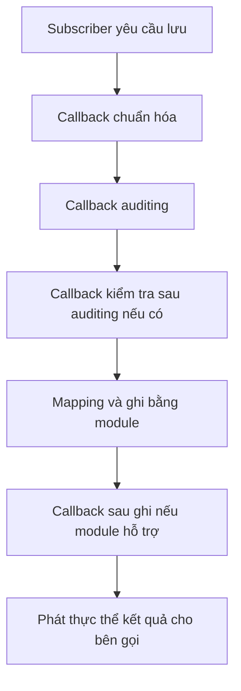

# Kết hợp callback và auditing reactive

Một thao tác lưu reactive thường cần nhiều bước: chuẩn hóa dữ liệu, xác định người thực hiện, điền thời điểm tạo hoặc sửa, chuyển thực thể sang định dạng của kho dữ liệu rồi ghi. Nếu các bước này được viết như những lời gọi rời rạc, ứng dụng dễ lưu trước khi lấy được auditor, bỏ qua lỗi callback hoặc đánh mất thực thể mới được tạo trong quá trình xử lý immutable entity.

Trong phần **Repository reactive** của **Spring Data Commons**, callback và auditing nên được hiểu như những bước hợp thành trong publisher của thao tác persistence. Commons cung cấp metadata, các hợp đồng callback và hạ tầng auditing dùng chung; module cụ thể quyết định callback nào tồn tại, được gọi ở giai đoạn nào và nối với driver ra sao.

Bài học dùng **Spring Data R2DBC** làm ví dụ xuyên suốt. Các nguyên tắc về composition và auditor có thể áp dụng rộng hơn, nhưng tên callback, tham số, cấu hình kích hoạt và thứ tự tích hợp phải theo đúng module đang dùng.

## 1. Callback và auditing giải quyết những việc gì?

| Thành phần | Trách nhiệm | Ví dụ |
|---|---|---|
| Entity callback | Can thiệp vào một giai đoạn vòng đời persistence | Chuẩn hóa tiêu đề trước khi chuyển sang dữ liệu lưu |
| Auditing | Điền metadata người/thời điểm tạo hoặc sửa | `createdBy`, `createdAt`, `lastModifiedBy`, `lastModifiedAt` |
| Repository reactive | Biểu diễn thao tác và kết quả bằng publisher | `Mono<Note> save(Note note)` |
| Module persistence | Chọn điểm gọi callback và thực hiện mapping/I/O | R2DBC chuyển thực thể sang dữ liệu hàng |
| Transaction | Điều phối tính nguyên tử trên tài nguyên hỗ trợ | Rollback thao tác ghi khi luồng thực thi thất bại |

Auditing có thể được module triển khai bằng một entity callback. Vì vậy, callback tùy biến và auditing không phải hai thế giới tách rời: chúng có thể cùng xuất hiện trong một chuỗi xử lý trước khi ghi.

Cũng cần phân biệt entity callback với application event hoặc aggregate event. Một listener nhận sự kiện ứng dụng không tự có hợp đồng “trả lại thực thể đã biến đổi để persistence dùng tiếp”. `@DomainEvents` của aggregate cũng không phải annotation kích hoạt auditing.

## 2. Luồng reactive phải giữ cả dữ liệu lẫn tín hiệu lỗi

Một mô hình đơn giản cho thao tác lưu:



Đây là sơ đồ khái niệm. Trong triển khai thực tế, module còn có các giai đoạn chuyển đổi, callback trước ghi hoặc callback sau đọc. Những giai đoạn đó không thể hoán đổi tùy ý chỉ bằng một số thứ tự.

Ba yêu cầu quan trọng:

1. Mỗi callback phải trả lại thực thể cần dùng cho bước tiếp theo.
2. Nếu một bước cần kết quả bất đồng bộ, publisher đó phải nằm trong chuỗi persistence.
3. Nếu một bước thất bại, lỗi phải được truyền về publisher của thao tác lưu theo chính sách mong muốn.

Đối với immutable entity, callback có thể tạo một instance mới. Nếu hạ tầng hoặc mã ứng dụng tiếp tục dùng instance đầu vào, các trường đã được bổ sung trên instance mới sẽ bị bỏ qua.

## 3. Annotation dùng chung không thay thế cấu hình module

Các annotation auditing thường dùng thuộc Spring Data Commons:

```java
@CreatedDate
@CreatedBy
@LastModifiedDate
@LastModifiedBy
```

Chúng xác định thuộc tính cần được điền. Để có hành vi thực tế, còn cần:

- Module có tích hợp auditing cho đường persistence đang gọi.
- Cấu hình bật auditing phù hợp với API reactive.
- Nguồn auditor nếu cần ghi người thực hiện.
- Kiểu dữ liệu và mapping phù hợp với kho dữ liệu.
- Cách xác định thực thể mới/cũ đúng với mô hình.

`AuditorAware<T>` và `ReactiveAuditorAware<T>` là hai hợp đồng khác nhau. Không nên lấy một provider imperative, gọi `block()` để sử dụng provider reactive hoặc chuyển đổi qua lại tùy tiện. Phải chọn hợp đồng mà phần tích hợp auditing đang dùng hỗ trợ.

Tương tự, callback của API imperative không mặc nhiên chạy trong API reactive. Với R2DBC, callback đã thuộc mô hình reactive dù tên interface có thể không chứa tiền tố `Reactive`; không suy luận chỉ từ tên class.

## 4. Mô hình ví dụ: ghi chú có metadata kiểm toán

Ví dụ dưới đây dùng record để làm rõ việc thực thể có thể được thay bằng instance mới. Nó giả định một phiên bản Spring Data R2DBC hỗ trợ mapping record và một schema tương ứng đã tồn tại.

```java
import java.time.Instant;

import org.springframework.data.annotation.CreatedBy;
import org.springframework.data.annotation.CreatedDate;
import org.springframework.data.annotation.Id;
import org.springframework.data.annotation.LastModifiedBy;
import org.springframework.data.annotation.LastModifiedDate;
import org.springframework.data.annotation.Version;
import org.springframework.data.relational.core.mapping.Table;

@Table("notes")
public record Note(
        @Id Long id,
        @Version Long version,
        String title,
        @CreatedDate Instant createdAt,
        @CreatedBy String createdBy,
        @LastModifiedDate Instant lastModifiedAt,
        @LastModifiedBy String lastModifiedBy) {

    public static Note draft(String title) {
        return new Note(null, null, title, null, null, null, null);
    }

    public Note withTitle(String newTitle) {
        return new Note(
                id,
                version,
                newTitle,
                createdAt,
                createdBy,
                lastModifiedAt,
                lastModifiedBy);
    }
}
```

Repository dùng hợp đồng CRUD reactive:

```java
import org.springframework.data.repository.reactive.ReactiveCrudRepository;

public interface NoteRepository
        extends ReactiveCrudRepository<Note, Long> {
}
```

Các cột, kiểu thời gian và chiến lược sinh ID cần khớp schema thực tế. Ví dụ chỉ trình bày phần domain, repository và các thành phần tích hợp liên quan tới bài học, không phải toàn bộ ứng dụng R2DBC.

Để sửa tiêu đề, `withTitle(...)` giữ nguyên ID, version và thông tin tạo. Nó không dựng một thực thể thiếu metadata từ một request chỉ chứa ID và tiêu đề mới.

## 5. Lấy auditor từ Reactor Context tại thời điểm thực thi

### 5.1. Vì sao không chỉ dùng ThreadLocal?

Một pipeline reactive có thể tiếp tục trên thread khác. Nguồn người dùng hiện tại chỉ dựa vào `ThreadLocal` có thể không còn giá trị đúng tại thời điểm auditing chạy.

Ngoài ra, việc lấy người dùng khi tạo publisher có thể quá sớm. Cùng một publisher có thể được tạo trước khi context phù hợp được gắn vào subscription.

`ReactiveAuditorAware<T>` cho phép trả về `Mono<T>`. Khi auditor nằm trong Reactor Context, nên đọc nó bằng `deferContextual` để việc truy xuất diễn ra theo context của subscription.

### 5.2. Cấu hình minh họa với chính sách bắt buộc có auditor

```java
import org.springframework.context.annotation.Bean;
import org.springframework.context.annotation.Configuration;
import org.springframework.data.domain.ReactiveAuditorAware;
import org.springframework.data.r2dbc.config.EnableR2dbcAuditing;

import reactor.core.publisher.Mono;

@Configuration
@EnableR2dbcAuditing(auditorAwareRef = "reactiveAuditorAware")
public class AuditConfiguration {

    public static final String AUDITOR_KEY = "application.audit.actor";

    @Bean
    ReactiveAuditorAware<String> reactiveAuditorAware() {
        return () -> Mono.deferContextual(context ->
                Mono.justOrEmpty(context.<String>getOrEmpty(AUDITOR_KEY))
                        .filter(actor -> !actor.isBlank())
                        .switchIfEmpty(Mono.error(
                                new IllegalStateException("Thiếu auditor hợp lệ"))));
    }
}
```

Ở đây, lỗi khi thiếu auditor là **chính sách của ứng dụng trong ví dụ**, không phải yêu cầu mặc định của Commons. Hợp đồng `ReactiveAuditorAware` cho phép không có auditor bằng một publisher rỗng; trong trường hợp đó, không nên kỳ vọng trường người tạo/người sửa sẽ tự được điền đầy đủ.

Nếu nghiệp vụ cho phép tác vụ hệ thống, hãy gắn một auditor hệ thống đã được xác định rõ. Không tự đổi mọi trường hợp thiếu danh tính thành `SYSTEM`, vì như vậy có thể che một lỗi truyền context hoặc xác thực.

Trong ứng dụng dùng Spring Security reactive, nguồn auditor cũng có thể được xây dựng từ reactive security context. Danh tính phải đến từ nguồn được tin cậy; một header tùy ý hoặc trường `createdBy` trong request không tự trở thành auditor hợp lệ.

### 5.3. Gắn context vào chuỗi chứa thao tác lưu

Giả sử `verifiedActor` đã được xác thực ở ranh giới ứng dụng:

```java
import reactor.core.publisher.Mono;

Mono<Note> createNote(String title, String verifiedActor) {
    return repository.save(Note.draft(title))
            .contextWrite(context ->
                    context.put(AuditConfiguration.AUDITOR_KEY, verifiedActor));
}
```

`contextWrite` làm context khả dụng cho phần chuỗi phía upstream trong subscription tương ứng. Callback auditing nằm trong thao tác `save` có thể đọc được giá trị đó khi nó được thực thi qua chuỗi này.

Cần kiểm tra actor không `null` và hợp lệ trước khi đưa vào context. Reactor Context không phải Map dùng chung toàn ứng dụng, cũng không tự lấy giá trị từ một biến tĩnh hoặc ThreadLocal bất kỳ.

Các ranh giới như `subscribe()` thủ công, chuyển sang một tác vụ ngoài chuỗi hoặc tự quản lý callback của thư viện khác có thể làm mất đường truyền context mong muốn. Không cache kết quả lấy auditor trên một publisher dùng chung cho nhiều người dùng: dữ liệu danh tính phải gắn với đúng subscription và đơn vị công việc.

## 6. Viết callback chuẩn hóa đúng kiểu reactive của R2DBC

Với R2DBC, một callback trước chuyển đổi có thể triển khai `BeforeConvertCallback<T>` và trả `Publisher<T>`. Trong ví dụ, phương thức dùng kiểu cụ thể hơn là `Mono<Note>`.

```java
import org.springframework.core.Ordered;
import org.springframework.data.r2dbc.mapping.event.BeforeConvertCallback;
import org.springframework.data.relational.core.sql.SqlIdentifier;
import org.springframework.stereotype.Component;

import reactor.core.publisher.Mono;

@Component
public class NormalizeNoteCallback
        implements BeforeConvertCallback<Note>, Ordered {

    @Override
    public int getOrder() {
        return 50;
    }

    @Override
    public Mono<Note> onBeforeConvert(Note note, SqlIdentifier table) {
        return Mono.defer(() -> {
            if (note.title() == null || note.title().isBlank()) {
                return Mono.error(new IllegalArgumentException(
                        "Tiêu đề không được rỗng"));
            }

            return Mono.just(note.withTitle(note.title().strip()));
        });
    }
}
```

Callback này:

- Chỉ làm công việc nhẹ trong bộ nhớ.
- Trả lại instance chứa tiêu đề chuẩn hóa.
- Giữ nguyên ID, version và metadata auditing đang có.
- Truyền lỗi qua publisher thay vì tự subscribe một tác vụ kiểm tra.

`Mono.defer` giúp phần xử lý trong lambda diễn ra khi publisher của callback được subscribe. Nó không cần thiết cho mọi phép biến đổi thuần túy, nhưng làm rõ thời điểm thực thi trong ví dụ.

Các callback phải là bean được hạ tầng của module phát hiện hoặc được đăng ký theo cách module hỗ trợ. Chỉ viết một class triển khai interface rồi không đăng ký không bảo đảm nó sẽ được gọi.

## 7. Thứ tự callback và auditing

Thứ tự có hai chiều khác nhau:

1. **Thứ tự giai đoạn:** trước convert, trước save, sau save hoặc sau convert.
2. **Thứ tự trong cùng một loại callback:** callback nào chạy trước callback nào tại giai đoạn đó.

`Ordered` hoặc `@Order` điều khiển thứ tự thích hợp trong chuỗi callback; giá trị nhỏ hơn có mức ưu tiên cao hơn. Một số thứ tự không thể làm callback sau save chạy trước callback trước convert.

Trong tích hợp R2DBC thông thường, auditing được gắn bằng `ReactiveAuditingEntityCallback` ở giai đoạn trước convert, với order `100`. Callback chuẩn hóa ở trên dùng `50` để chạy trước nó. Đây là chi tiết của phần tích hợp R2DBC, không phải một con số chung áp dụng cho mọi module Spring Data.

Một chuỗi chủ đích có thể là:

| Giai đoạn | Order minh họa | Công việc |
|---|---|---|
| Before convert | 50 | Chuẩn hóa tiêu đề, không đổi trạng thái mới/cũ |
| Before convert | 100 | Auditing của R2DBC lấy auditor và điền metadata |
| Before convert | 200 | Kiểm tra invariant cần có metadata auditing, nếu ứng dụng đăng ký thêm |
| Mapping và ghi | Theo vòng đời module | Chuyển dữ liệu và thực hiện persistence |

Nếu cần kiểm tra `createdBy` đã có sau auditing, callback kiểm tra phải đứng sau auditing trong đúng giai đoạn thích hợp. Nếu nó chạy trước, dữ liệu mới chưa được điền auditor có thể bị từ chối nhầm.

Khi hai callback có cùng order, không nên dựa vào thứ tự phát hiện bean như một quy tắc nghiệp vụ. Hãy đặt thứ tự rõ ràng nếu kết quả của callback này là đầu vào bắt buộc cho callback khác.

Đặc biệt, một callback chạy sau auditing không nên vô tình tạo lại entity từ vài field nghiệp vụ rồi bỏ các trường audit. Với immutable entity, đây là cách làm mất metadata dù auditing đã chạy đúng.

## 8. Auditing cần kết quả isNew nhất quán

Hạ tầng auditing reactive có nhận biết trạng thái mới/cũ cần chọn nhánh tạo hay sửa theo metadata/chiến lược mà module dùng. Việc lấy auditor bất đồng bộ không thay đổi ý nghĩa của ID, version hoặc `Persistable.isNew()`.

Trong ví dụ `Note`:

```text
Bản nháp:
    id      = null
    version = null

Thực thể đã đọc để sửa:
    id      = ID đang tồn tại
    version = version đang có
```

Tùy chiến lược và module, version nullable có thể được ưu tiên khi xác định trạng thái mới. Vì vậy, một callback trước auditing làm mất version hoặc một mapper dựng lại entity sai có thể khiến thao tác sửa bị xem là tạo.

Những nguyên tắc cần giữ:

- Không dùng `createdAt == null` như định nghĩa mặc định của `isNew`.
- Không đổi ID/version chỉ để ép callback auditing đi vào nhánh mong muốn.
- Nếu dùng `Persistable`, quản lý đúng trạng thái khi tạo, khi đọc và sau persistence.
- Khi cập nhật, giữ metadata tạo và version từ thực thể hiện có hoặc từ quy trình cập nhật đã thiết kế rõ.

Ở nhánh tạo, auditing có thể điền cả thông tin tạo và thông tin sửa theo cấu hình. Ở nhánh sửa, thông tin tạo được giữ lại; auditing không tự truy vấn dữ liệu cũ để khôi phục `createdBy` hoặc `createdAt` bị mapper làm mất.

Do đó, yêu cầu cập nhật nên được xử lý bằng cách đọc thực thể rồi thay đổi các field được phép:

```java
Mono<Note> renameNote(Long id, String newTitle, String verifiedActor) {
    return repository.findById(id)
            .switchIfEmpty(Mono.error(
                    new IllegalArgumentException("Không tìm thấy ghi chú")))
            .map(note -> note.withTitle(newTitle))
            .flatMap(repository::save)
            .contextWrite(context ->
                    context.put(AuditConfiguration.AUDITOR_KEY, verifiedActor));
}
```

Đây là phần xử lý persistence của ví dụ; ranh giới transaction và chính sách version từ client vẫn cần đáp ứng yêu cầu đồng thời của ứng dụng. `@Version` không chỉ là dấu hiệu mới/cũ mà còn phục vụ optimistic locking khi module hỗ trợ.

## 9. Lấy auditor reactive không có nghĩa mọi việc trong callback đều không chặn

Một callback có thể trả `Mono` nhưng vẫn gọi một API chặn trước đó:

```java
// Mẫu cần tránh nếu loadPolicy là lời gọi chặn.
Policy policy = legacyClient.loadPolicy(note.id());
return Mono.just(applyPolicy(note, policy));
```

Lời gọi đã xảy ra trước khi `Mono.just` được tạo. Một cách sai khác là gọi `block()` bên trong callback để chờ reactive auditor hoặc một dịch vụ reactive khác.

Nếu cần một bước bất đồng bộ, ghép publisher của nó vào publisher callback:

```java
return policyClient.loadPolicy(note.id())
        .map(policy -> applyPolicy(note, policy));
```

Đoạn này giả định `policyClient.loadPolicy` thực sự trả publisher phù hợp và `applyPolicy` chỉ biến đổi dữ liệu trong bộ nhớ. Nếu policy không tồn tại, cần quy định rõ callback phải thất bại hay dùng một mặc định hợp lệ; không vô tình để toàn bộ bước xử lý kết thúc rỗng.

Nếu chỉ có client đồng bộ, có thể dùng một cầu nối có giới hạn:

```java
return Mono.fromCallable(() -> legacyClient.loadPolicy(note.id()))
        .subscribeOn(reactor.core.scheduler.Schedulers.boundedElastic())
        .map(policy -> applyPolicy(note, policy));
```

Worker vẫn có thể chờ I/O; đây là cách cách ly điểm chặn, không biến driver hoặc SDK thành không chặn. Callback persistence cũng không phải nơi lý tưởng cho mọi lời gọi mạng: nó có thể kéo dài thời gian giữ transaction/kết nối và bị chạy lại khi thao tác được retry.

Ưu tiên chuẩn bị dữ liệu cần thiết ở application service khi phù hợp, giữ callback nhỏ, rõ và gắn với trách nhiệm persistence.

## 10. Những lỗi composition cần tránh

### 10.1. Subscribe thủ công rồi trả entity ngay

Mã giả sau không đưa việc lấy auditor vào chuỗi persistence:

```java
// Sai về cấu trúc: thao tác bên trong có vòng đời tách rời.
auditorProvider.getCurrentAuditor()
        .subscribe(actor -> assignAuditorSomewhere(actor));

return Mono.just(note);
```

Thao tác lưu có thể tiếp tục trước khi có actor. Lỗi trong subscription riêng không tự trở thành lỗi của `save`, và context/transaction cũng có thể không còn như người viết mong muốn.

### 10.2. Bỏ publisher của bước biến đổi

```java
// Mã giả: gọi một phương thức trả publisher rồi bỏ kết quả.
normalizeAsynchronously(note);
return Mono.just(note);
```

Publisher có thể chưa được subscribe nên không thực hiện công việc. Cần trả nó hoặc kết hợp bằng `map`/`flatMap` tùy kiểu kết quả.

### 10.3. Dùng thenReturn với instance cũ

```java
// Có thể bỏ mất instance mới mà normalize trả về.
return normalize(note).thenReturn(note);
```

Nếu `normalize(note)` phát một `Note` mới, `thenReturn(note)` bỏ kết quả đó và trả lại instance đầu vào. Callback cần giữ đúng thực thể kết quả, thường bằng cách trả `normalize(note)` hoặc biến đổi tiếp instance nó phát.

`thenReturn` vẫn phù hợp khi bước trước chỉ thực hiện tác vụ không thay đổi đối tượng kết quả. Vấn đề là dùng nó khi bước trước có nghĩa vụ tạo entity mới cần được giữ.

### 10.4. Nuốt lỗi kiểm toán

```java
// Có thể làm mất chính sách bắt buộc có auditor.
return resolveAuditorAndApply(note)
        .onErrorReturn(note);
```

Nếu auditor bắt buộc, fallback này biến lỗi danh tính thành một lần lưu thiếu metadata. Chỉ fallback khi nghiệp vụ có quy tắc rõ và kết quả fallback vẫn hợp lệ.

### 10.5. Trả Mono.empty như tín hiệu “đã xử lý xong”

Callback biến đổi entity cần cung cấp entity cho bước tiếp theo. Không dùng publisher rỗng như một dấu hoàn thành thay cho entity hợp lệ, cũng không dùng nó như cách từ chối âm thầm mà không xác định hành vi của module.

Nếu dữ liệu bị từ chối, `Mono.error(...)` thường thể hiện ý định rõ hơn. Nếu xử lý thành công, trả lại đúng instance cần ghi.

## 11. Thời gian auditing và nguồn auditor là hai phần riêng

`ReactiveAuditorAware<T>` cung cấp người thực hiện, không cung cấp thời gian tạo hoặc sửa. Hạ tầng auditing có nguồn thời gian riêng, chẳng hạn `DateTimeProvider` của Commons.

Dù auditing là reactive, hợp đồng `DateTimeProvider` thông thường vẫn cung cấp giá trị thời gian theo API của nó, không tự đổi thành một `Mono<Instant>`. Việc đọc đồng hồ cục bộ là công việc ngắn, không cần một lời gọi mạng chỉ để điền timestamp.

Khi cần thời gian có thể kiểm soát trong thiết kế, có thể đưa `Clock` vào provider theo cấu hình module. Cần phân biệt:

- Thời điểm callback gán metadata.
- Thời điểm câu lệnh được thực thi.
- Thời điểm transaction commit.

Một giá trị `createdAt` do callback gán không phải chứng nhận rằng transaction đã commit vào chính thời điểm đó. Nếu cần thời gian do máy chủ dữ liệu quyết định hoặc nhật ký kiểm toán bất biến, phải thiết kế cơ chế phù hợp và tránh để hai nguồn cùng ghi đè một field mà không có quy tắc.

## 12. Transaction, lỗi và rollback

Khi thao tác lưu nằm trong reactive transaction phù hợp, một lỗi được truyền từ callback trước ghi có thể làm thao tác thất bại và transaction rollback theo chính sách. Publisher lỗi phải nằm trong chuỗi mà transaction quản lý.

Ví dụ cấu trúc với `TransactionalOperator`:

```java
import org.springframework.transaction.reactive.TransactionalOperator;

Mono<Note> createInTransaction(
        String title,
        String verifiedActor,
        TransactionalOperator transaction) {

    Mono<Note> save = repository.save(Note.draft(title));

    return transaction.transactional(save)
            .contextWrite(context ->
                    context.put(AuditConfiguration.AUDITOR_KEY, verifiedActor));
}
```

Operator phải sử dụng transaction manager và tài nguyên tương thích với repository. Nó không tự bao phủ một client HTTP hoặc một repository imperative khác gọi bên trong callback.

Các giới hạn quan trọng:

- Callback sau ghi không mặc nhiên có nghĩa là sau commit.
- Rollback cơ sở dữ liệu không hoàn tác một email đã gửi hoặc lời gọi API đã thành công.
- Với mutable entity, các field audit đã được gán trong bộ nhớ không tự trở lại giá trị cũ sau rollback.
- Với immutable entity, không được xem instance có timestamp là bằng chứng đã lưu bền vững.
- Retry có thể chạy lại callback, lấy auditor và gán thời gian lần nữa.

Không đặt tác dụng phụ bên ngoài không chịu được lặp vào callback chỉ vì nó có tên “sau lưu”. Nếu công việc sau commit bắt buộc phải phục hồi được, cần cơ chế bền vững như outbox phù hợp với kho dữ liệu; auditing metadata không thay thế cơ chế giao nhận công việc đó.

## 13. Dùng kết quả save và xác định đường ghi nào có callback

Với record `Note`, kết quả thực tế có thể chứa ID, version và metadata khác với bản nháp:

```java
Mono<Note> result = repository.save(Note.draft("  Ghi chú mới  "))
        .contextWrite(context ->
                context.put(AuditConfiguration.AUDITOR_KEY, "user-42"));
```

Sau khi luồng được subscribe và lưu thành công, bên gọi phải dùng entity do `result` phát. Không giữ bản nháp rồi suy ra callback không chạy vì bản nháp vẫn có các field `null`.

Ngoài repository, một số API template của module cũng có tích hợp callback. Tuy nhiên, không thể suy rộng sang tất cả đường ghi:

| Đường ghi | Câu hỏi cần xác định |
|---|---|
| `repository.save(entity)` | Module có cấu hình auditing/callback đúng chưa? |
| Custom repository fragment | Nó có đi qua template hoặc API tích hợp callback không? |
| Truy vấn cập nhật trực tiếp | Có entity instance để auditing xử lý hay chỉ có câu lệnh? |
| Bulk operation | Module có gọi callback cho từng entity ở API đó không? |
| Driver hoặc SQL trực tiếp | Ai chịu trách nhiệm gán metadata và kiểm tra version? |

Đối với derived query, projection, phân trang hoặc sắp xếp, các abstraction chung giúp truy vấn và trình bày dữ liệu nhưng không tự bổ sung auditing cho một đường ghi bỏ qua vòng đời entity.

Không giả định một projection đọc có thể đem lưu như aggregate đầy đủ. Nếu projection thiếu version hoặc thông tin tạo, việc chuyển nó thành entity cập nhật cần quy tắc rõ để tránh mất metadata.

## 14. Chẩn đoán theo đúng vị trí trong chuỗi

| Hiện tượng | Nguyên nhân cần xem xét | Hướng xử lý |
|---|---|---|
| Ngày giờ có nhưng người tạo rỗng | Provider không có auditor hoặc không được chọn đúng | Kiểm tra cấu hình `ReactiveAuditorAware` và chính sách empty |
| Provider luôn báo thiếu actor | Context không nằm trên chuỗi subscribe thực tế | Gắn context quanh publisher chứa persistence, tránh subscribe rời |
| Trường audit có lúc thuộc người dùng khác | Cache hoặc trạng thái dùng chung sai phạm vi | Giữ auditor theo subscription/đơn vị công việc |
| Callback chuẩn hóa chạy nhưng auditing không chạy | Auditing chưa bật hoặc đường ghi khác cơ chế hỗ trợ | Kiểm tra cấu hình module và API đang dùng |
| Validation nói thiếu `createdBy` ở entity mới | Validation chạy trước auditing | Điều chỉnh thứ tự trong cùng giai đoạn thích hợp |
| Audit đã được gán rồi lại mất | Callback sau tạo instance mới thiếu field | Bảo toàn metadata khi copy immutable entity |
| Bản nháp không có ID hoặc timestamp sau lưu | Đang quan sát instance đầu vào | Dùng instance mà publisher `save` phát |
| Event loop chậm khi callback chạy | Có `block()`, API đồng bộ hoặc công việc CPU nặng | Tách công việc và chọn ranh giới thực thi phù hợp |
| Cập nhật bị xem thành tạo | Mapper/callback làm mất version hoặc sai `isNew` | Giữ metadata trạng thái và sửa chiến lược nhận biết mới |
| Callback sau lưu đã gửi thông báo nhưng giao dịch rollback | Nhầm sau ghi với sau commit | Tách tác dụng phụ theo yêu cầu transaction và độ tin cậy |

Khi ghi log để chẩn đoán, có thể quan sát ID, version, tên callback và trạng thái có/không có auditor. Không cần ghi token xác thực hoặc toàn bộ payload để xác định thứ tự callback. Việc quan sát cũng phải giữ publisher nguyên vẹn; không subscribe thêm chỉ để in một giá trị.

## 15. Bài tập tự kiểm tra

### Tình huống 1: Ghi chú mới có auditor trong Context

Một bản nháp có ID/version rỗng, tiêu đề chứa khoảng trắng ở hai đầu và actor hợp lệ đã được gắn vào chuỗi lưu.

**Phân tích:** callback chuẩn hóa trả lại instance có tiêu đề đã strip; auditing xử lý instance đó và điền metadata theo nhánh tạo; persistence dùng kết quả của chuỗi. Bên gọi lấy entity từ publisher trả về để thấy ID/version/auditing sau lưu.

### Tình huống 2: Không có actor trong một tác vụ nền

Tác vụ nền gọi repository nhưng không gắn actor. Nó dùng cấu hình provider bắt buộc có auditor ở trên.

**Phân tích:** publisher phát lỗi thiếu auditor, thay vì âm thầm lưu metadata rỗng. Nếu đây là tác vụ hệ thống hợp lệ, cần gắn danh tính hệ thống theo quy tắc đã thiết kế; không bỏ chính sách bằng cách nuốt mọi lỗi.

### Tình huống 3: Callback trả instance cũ sau bước auditing

Một callback sau auditing chỉ copy ID và title để tạo entity mới.

**Phân tích:** instance mới làm mất các trường đã được auditing điền. Cần copy đầy đủ field cần bảo toàn hoặc chỉ thay đổi đúng thuộc tính thuộc trách nhiệm callback.

### Tình huống 4: Provider được subscribe riêng

Callback gọi `getCurrentAuditor().subscribe(...)` rồi trả `Mono.just(entity)` ngay.

**Phân tích:** có hai vòng đời thực thi. Persistence không chờ lấy actor và không nhận lỗi theo chuỗi mong muốn. Cần ghép publisher thay vì tự subscribe bên trong callback.

### Tình huống 5: SQL update không đi qua entity

Một custom fragment chạy câu SQL cập nhật tiêu đề trực tiếp và ứng dụng mong `@LastModifiedBy` tự thay đổi.

**Phân tích:** annotation trên domain không đủ để chứng minh callback được gọi. Phải xác định API đó có hỗ trợ auditing không; nếu bỏ qua entity lifecycle thì đường cập nhật cần tự thực hiện chính sách metadata/version hoặc chuyển sang API tích hợp phù hợp.

Khi kết hợp callback và auditing reactive, hãy giữ **đúng entity, đúng auditor, đúng thứ tự và cùng một chuỗi thực thi**. Tính reactive giúp hợp thành các bước, còn tính chính xác của metadata phụ thuộc vào mapping, nhận biết trạng thái mới/cũ, context và điểm tích hợp mà module lưu trữ thực sự cung cấp.