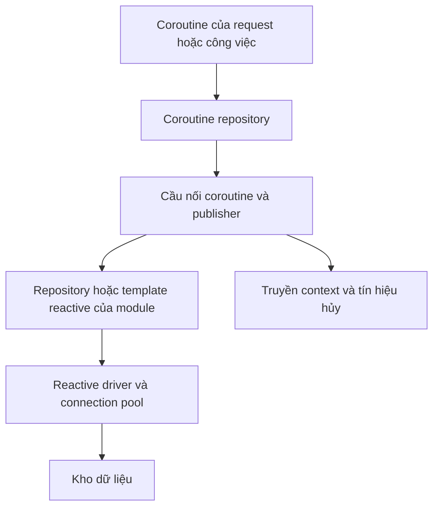

# Ngữ cảnh coroutine, hủy tác vụ và tích hợp với reactive store

Một lời gọi repository dạng `suspend` có thể trông giống mã tuần tự, nhưng bên dưới vẫn có subscription, context, tài nguyên kết nối và tín hiệu hủy. Nếu bỏ qua các lớp đó, ứng dụng có thể mất auditor, chạy công việc ngoài transaction hoặc hiểu nhầm rằng timeout đã làm một thao tác ghi chưa từng xảy ra.

Trong phần **Kotlin và coroutine** của **Spring Data Commons**, bài học này nối ba vấn đề: ngữ cảnh thực thi của coroutine, cancellation theo vòng đời công việc và cách coroutine repository tích hợp với module lưu trữ reactive. Commons cung cấp hợp đồng dùng chung; việc truy cập không chặn, quản lý connection và transaction còn phụ thuộc module cùng driver cụ thể.

## 1. Coroutine repository là một hợp đồng tích hợp

Ví dụ dùng Spring Data R2DBC làm module persistence minh họa:

```kotlin
import kotlinx.coroutines.flow.Flow
import org.springframework.data.annotation.Id
import org.springframework.data.annotation.Version
import org.springframework.data.relational.core.mapping.Table
import org.springframework.data.repository.kotlin.CoroutineCrudRepository

@Table("notes")
data class Note(
    @field:Id val id: Long? = null,
    @field:Version val version: Long? = null,
    val title: String,
    val archived: Boolean = false
)

interface NoteRepository : CoroutineCrudRepository<Note, Long> {
    fun findAllByArchived(archived: Boolean): Flow<Note>
}
```

Ví dụ giả định schema, mapping và phần triển khai repository của module đã được cấu hình phù hợp. `CoroutineCrudRepository` cho phép các thao tác đơn giá trị dùng hàm suspend và các thao tác nhiều phần tử dùng `Flow` theo hợp đồng tương ứng.

Một service có thể viết:

```kotlin
suspend fun requireNote(repository: NoteRepository, id: Long): Note =
    repository.findById(id)
        ?: throw IllegalArgumentException("Không tìm thấy ghi chú $id")
```

Điều này không có nghĩa `CoroutineCrudRepository` tự cung cấp driver hoặc rằng mọi module Spring Data đều hỗ trợ cùng một bộ tính năng coroutine. Derived query, projection, sorting, auditing và transaction cần được đối chiếu với module đang dùng.

Các thành phần runtime liên quan thường gồm Kotlin reflection theo yêu cầu Spring Data, thư viện coroutine và phần tích hợp coroutine với Reactive Streams/Reactor. Cần dùng bộ dependency tương thích với ứng dụng, thay vì chỉ thêm từ khóa `suspend` rồi kỳ vọng một repository imperative tự chuyển thành reactive.

## 2. Suspend không đồng nghĩa chuyển thread hoặc I/O không chặn

Một hàm suspend có thể tạm dừng coroutine mà không giữ thread chỉ để đợi một kết quả bất đồng bộ. Nhưng chính từ khóa `suspend` không chuyển mọi đoạn mã bên trong thành không chặn.

Ví dụ:

```kotlin
suspend fun loadLegacy(id: Long): LegacyDto =
    legacyJdbcService.loadDto(id)
```

Nếu `loadDto` gọi JDBC đồng bộ, thread đang chạy vẫn có thể bị giữ trong thời gian chờ. Mã này chưa có một điểm chuyển đổi I/O không chặn chỉ vì hàm ngoài là suspend.

Với module reactive thực sự, coroutine repository có thể chờ kết quả từ publisher của hạ tầng lưu trữ. Thread được dùng khi có công việc sẵn sàng, thay vì một thread riêng phải chờ mỗi truy vấn mạng.

Tách ba câu hỏi:

| Câu hỏi | Thành phần liên quan |
|---|---|
| API có thể được gọi bằng coroutine không? | Hợp đồng suspend/Flow và adapter |
| Công việc chạy trong context nào? | `CoroutineContext`, dispatcher và cầu nối Reactor |
| I/O có không chặn không? | Module persistence, client/driver và đường gọi thực tế |

Một câu trả lời đúng ở cột đầu không tự bảo đảm hai cột còn lại.

## 3. CoroutineContext chứa những gì?

`CoroutineContext` là tập các phần tử mô tả ngữ cảnh của coroutine. Những phần tử thường gặp gồm:

| Phần tử | Vai trò |
|---|---|
| `Job` | Quan hệ cha–con, trạng thái hoạt động và cancellation |
| Dispatcher | Chính sách thực thi hoặc tiếp tục công việc trên thread |
| `CoroutineName` | Đặt tên phục vụ quan sát và chẩn đoán |
| Phần tử context tùy biến | Dữ liệu/ngữ nghĩa bổ sung theo thiết kế |
| `ReactorContext` khi có tích hợp | Mang Reactor Context qua ranh giới coroutine–Reactor |

Dispatcher không phải danh tính người dùng, và Job không phải transaction. Chúng có thể cùng tồn tại trong một context nhưng có trách nhiệm khác nhau.

Một coroutine có thể tạm dừng trên thread A rồi tiếp tục trên thread B. Bởi vậy, không được mặc định rằng một `ThreadLocal` tùy ý sẽ tự có giá trị đúng sau mọi lần suspend/resume.

Các cơ chế truyền context có thể hỗ trợ một số ThreadLocal được đăng ký rõ ràng. Điều đó không cho phép sao chép tùy tiện toàn bộ trạng thái transaction imperative sang nhiều thread rồi xem là một giao dịch coroutine hợp lệ.

## 4. Cầu nối với Reactor và reactive store

Một đường truy cập dữ liệu có thể được mô tả như sau:



Khi cần tích hợp trực tiếp một API Reactor thay vì coroutine repository, có thể dùng các extension phù hợp:

```kotlin
import kotlinx.coroutines.reactor.awaitSingle
import kotlinx.coroutines.reactor.awaitSingleOrNull

suspend fun loadRequired(id: Long): Note =
    reactiveRepository.findById(id).awaitSingle()

suspend fun loadOptional(id: Long): Note? =
    reactiveRepository.findById(id).awaitSingleOrNull()
```

Ví dụ giả định `reactiveRepository.findById(id)` trả `Mono<Note>`:

- `awaitSingle()` yêu cầu một phần tử; nguồn hoàn tất rỗng dẫn tới lỗi thay vì tạo một entity giả.
- `awaitSingleOrNull()` biểu diễn nguồn hoàn tất rỗng bằng null.
- Khi coroutine đang chờ bị hủy, cầu nối hỗ trợ cancellation sẽ hủy subscription tương ứng.

Không cần gọi `block()` để lấy giá trị từ `Mono` bên trong một hàm suspend. `block()` giữ thread và tạo ranh giới chờ không phù hợp với cách hợp thành coroutine/reactive thông thường.

Cũng không cần tự `subscribe()` rồi tự cất kết quả vào biến bên ngoài. Cách đó tách vòng đời publisher khỏi coroutine đang đợi, khiến lỗi, context và cancellation khó được truyền đúng.

## 5. Reactor Context không phải một Map toàn cục

Reactive transaction, security context hoặc auditing có thể dựa vào Reactor Context. Khi module và cầu nối hỗ trợ, phần context này được mang qua coroutine bằng `ReactorContext`.

Có thể quan sát phần context hiện tại:

```kotlin
import kotlinx.coroutines.currentCoroutineContext
import kotlinx.coroutines.reactor.ReactorContext

suspend fun currentActorOrNull(): String? {
    val reactorContext = currentCoroutineContext()[ReactorContext]?.context
    return reactorContext?.getOrEmpty<String>("application.audit.actor")
        ?.orElse(null)
}
```

Hàm này chỉ đọc một khóa minh họa của ứng dụng. Nó không tự xác thực người dùng và không tự tạo context nếu request chưa có nó.

### 5.1. Bổ sung một actor mà vẫn giữ context đã có

Trong một ứng dụng cần cầu nối rõ ràng, có thể dùng helper sau:

```kotlin
import kotlinx.coroutines.currentCoroutineContext
import kotlinx.coroutines.withContext
import kotlinx.coroutines.reactor.ReactorContext
import kotlinx.coroutines.reactor.asCoroutineContext
import reactor.util.context.Context

private const val ACTOR_KEY = "application.audit.actor"

suspend fun <T> withVerifiedActor(
    actor: String,
    block: suspend () -> T
): T {
    require(actor.isNotBlank()) { "Actor không được rỗng" }

    val existing = currentCoroutineContext()[ReactorContext]?.context
        ?: Context.empty()

    return withContext(existing.put(ACTOR_KEY, actor).asCoroutineContext()) {
        block()
    }
}
```

`actor` phải đến từ nguồn đã xác thực hoặc danh tính hệ thống được ứng dụng quy định. Không lấy một giá trị tùy ý từ request rồi coi nó là bằng chứng danh tính.

Helper bổ sung khóa vào Reactor Context hiện có, thay vì thay toàn bộ context bằng một Map chỉ chứa actor. Khi dùng `withContext` với phần tử Reactor Context này, Job và dispatcher hiện tại vẫn được kế thừa theo phép kết hợp context thông thường.

Không nên tự tạo lại Reactor Context trống rồi ghi đè context đang chứa transaction/security metadata. Cũng không cần thêm helper nếu framework đã cung cấp đúng danh tính và cơ chế truyền context theo cấu hình của ứng dụng.

### 5.2. Nguồn auditor reactive có thể đọc cùng khóa

Một provider minh họa:

```kotlin
import org.springframework.data.domain.ReactiveAuditorAware
import reactor.core.publisher.Mono

fun auditorAware(): ReactiveAuditorAware<String> =
    ReactiveAuditorAware {
        Mono.deferContextual { context ->
            Mono.justOrEmpty(context.getOrEmpty<String>(ACTOR_KEY))
        }
    }
```

Để provider tham gia persistence, nó còn phải được đăng ký thành bean và được cấu hình auditing reactive của module chọn sử dụng. Ví dụ trả publisher rỗng khi thiếu actor; nếu actor bắt buộc, ứng dụng cần chính sách lỗi hoặc danh tính hệ thống rõ ràng.

`deferContextual` đọc context tại subscription. Một giá trị được chụp quá sớm hoặc cache dùng chung có thể gắn sai auditor cho các request khác nhau.

## 6. Phạm vi context phải bao phủ lúc công việc thực sự chạy

Với hàm suspend đơn giá trị, có thể bao lời gọi thực thi:

```kotlin
suspend fun createNote(
    repository: NoteRepository,
    title: String,
    verifiedActor: String
): Note = withVerifiedActor(verifiedActor) {
    repository.save(Note(title = title))
}
```

Nếu trả về một `Flow`, cần chú ý thời điểm collect. Mẫu sau không đủ để kết luận truy vấn sẽ được collect trong context vừa đặt:

```kotlin
suspend fun prepareNotes(
    repository: NoteRepository,
    verifiedActor: String
): kotlinx.coroutines.flow.Flow<Note> =
    withVerifiedActor(verifiedActor) {
        repository.findAllByArchived(false)
    }
```

Đối với flow truy vấn cold thường gặp, đoạn trên chủ yếu tạo hoặc trả flow. Lúc caller collect sau đó, phạm vi `withVerifiedActor` đã kết thúc. Việc một API cụ thể có chụp context khi tạo hay không không nên bị suy đoán từ tên hàm.

Nếu mục tiêu là xử lý flow trong context đó, hãy bao cả collection:

```kotlin
import kotlinx.coroutines.flow.collect

suspend fun processNotes(
    repository: NoteRepository,
    verifiedActor: String
) {
    withVerifiedActor(verifiedActor) {
        repository.findAllByArchived(false).collect { note ->
            processOne(note)
        }
    }
}
```

`processOne` là hàm nghiệp vụ của ứng dụng, cần giữ cùng quy tắc về cancellation và các ranh giới I/O. Nếu muốn trả flow cho tầng khác, hãy thiết kế rõ context được cung cấp hoặc kế thừa ở thời điểm collection, thay vì gắn vào một phạm vi đã kết thúc.

## 7. Structured concurrency giữ vòng đời công việc nhất quán

Coroutine repository nên được gọi từ scope thuộc request hoặc một công việc do ứng dụng quản lý. Structured concurrency nối công việc con với Job của công việc cha.

Ví dụ hai phép đọc độc lập ngoài một transaction dùng chung:

```kotlin
import kotlinx.coroutines.async
import kotlinx.coroutines.coroutineScope

suspend fun loadPair(
    repository: NoteRepository,
    firstId: Long,
    secondId: Long
): Pair<Note?, Note?> = coroutineScope {
    val first = async { repository.findById(firstId) }
    val second = async { repository.findById(secondId) }

    first.await() to second.await()
}
```

Trong scope thông thường này, lỗi của một công việc con có thể làm scope thất bại và hủy công việc con còn lại. Khi request cha bị hủy, các công việc con thuộc scope cũng được yêu cầu hủy.

Tính đồng thời có chi phí: hai truy vấn có thể cần tài nguyên riêng từ pool và không tự có chung một snapshot dữ liệu. Không dùng mẫu này để suy ra rằng chạy song song luôn nhanh hơn hoặc luôn giữ tính nhất quán mong muốn.

Cần tránh khởi chạy bằng `GlobalScope.launch` chỉ để thao tác lưu “tiếp tục ở nền”. Công việc bị tách khỏi vòng đời request và có thể không còn context/transaction mong muốn. Nếu nghiệp vụ thực sự cần công việc nền, hãy giao cho một scope được quản lý với chính sách lỗi, dừng ứng dụng và độ bền phù hợp.

Một scope trong bộ nhớ cũng không phải hàng đợi bền vững. Công việc bắt buộc phải tiếp tục sau restart cần cơ chế lưu và phục hồi riêng.

## 8. Cancellation là yêu cầu hợp tác, không phải quay ngược thời gian

Khi Job bị hủy, coroutine thường nhận `CancellationException` tại các điểm suspend có hỗ trợ hủy. Một vòng tính toán dài chỉ chạy CPU cần kiểm tra trạng thái hoạt động hoặc nhường thực thi phù hợp để phản ứng kịp.

Ở đường truy cập reactive, tín hiệu hủy có thể truyền như sau:

```text
Request hoặc Job cha bị hủy
    → coroutine đang chờ bị hủy
    → adapter hủy subscription
    → module/driver xử lý hủy và giải phóng tài nguyên theo khả năng
    → kho dữ liệu có thể nhận yêu cầu hủy tương ứng
```

Các bước cuối không có cùng mức bảo đảm trên mọi driver và giao thức. Không được suy luận rằng subscription đã bị cancel thì câu lệnh chắc chắn chưa được gửi hoặc chưa tạo tác dụng phụ.

| Nhận định | Giải thích |
|---|---|
| Coroutine đã dừng chờ | Bên gọi không tiếp tục đợi theo luồng cũ |
| Subscription đã nhận cancel | Nguồn được yêu cầu dừng cung cấp dữ liệu |
| Connection được giải phóng | Hạ tầng đã xử lý vòng đời tài nguyên theo trạng thái của nó |
| Câu lệnh máy chủ đã dừng | Cần khả năng và xác nhận tương ứng của driver/kho dữ liệu |
| Transaction chưa commit | Không thể kết luận chỉ từ cancellation phía caller |

Cancellation giúp kiểm soát vòng đời và tài nguyên. Nó không phải cơ chế hoàn tác mọi tác dụng phụ đã xảy ra.

## 9. Không nuốt CancellationException

Một khối bắt lỗi quá rộng có thể biến hủy tác vụ thành thành công giả:

```kotlin
// Mẫu cần tránh.
try {
    repository.save(note)
} catch (error: Exception) {
    return note
}
```

Trong coroutine, `CancellationException` cũng có thể bị khối đó bắt. Nếu trả fallback, tầng ngoài có thể hiểu rằng nghiệp vụ đã hoàn tất trong khi Job đã bị hủy.

Khi cần ánh xạ lỗi, giữ cancellation đi qua:

```kotlin
import kotlinx.coroutines.CancellationException

suspend fun saveNote(repository: NoteRepository, note: Note): Note =
    try {
        repository.save(note)
    } catch (cancelled: CancellationException) {
        throw cancelled
    } catch (failure: Exception) {
        throw IllegalStateException("Không thể lưu ghi chú", failure)
    }
```

Đây là ví dụ ánh xạ lỗi tối giản. Ứng dụng thực tế nên phân biệt các lỗi có ý nghĩa như xung đột version hoặc lỗi ràng buộc thay vì bọc tất cả theo cùng một chính sách.

Các helper bắt lỗi như `runCatching` cũng cần được dùng cẩn thận nếu bao lời gọi suspend: không tự xem mọi thất bại là lý do để retry hoặc trả giá trị mặc định. Việc cancellation đã được yêu cầu cần được bảo toàn.

## 10. Timeout không chứng minh thao tác ghi thất bại

Có thể giới hạn thời gian chờ ở mức coroutine:

```kotlin
import kotlinx.coroutines.withTimeout

suspend fun saveWithTimeout(
    repository: NoteRepository,
    note: Note
): Note = withTimeout(800L) {
    repository.save(note)
}
```

`800L` chỉ là con số minh họa bằng mili giây, không phải cấu hình khuyến nghị cho mọi hệ thống. Hết thời gian tạo cancellation cho khối công việc, nhưng trạng thái phía kho dữ liệu có thể thuộc nhiều trường hợp:

```text
A. Chưa gửi câu lệnh.
B. Đã gửi và đang thực thi.
C. Đã thực thi nhưng transaction chưa commit.
D. Đã commit nhưng phản hồi chưa tới caller.
```

Đối với ghi dữ liệu, trường hợp D khiến retry mù có nguy cơ thực hiện nghiệp vụ lần hai. Cần xét khóa yêu cầu, idempotency, unique constraint hoặc cơ chế đối soát phù hợp.

Timeout coroutine, timeout lấy connection và timeout truy vấn phía driver là các tầng khác nhau. Chúng có thể phối hợp, nhưng không thay thế lẫn nhau và không cùng chứng minh một kết quả giao dịch.

## 11. Reactive transaction cần đúng manager và context

Với Spring hỗ trợ coroutine cùng reactive transaction, `TransactionalOperator.executeAndAwait` có thể bao một đơn vị công việc suspend:

```kotlin
import org.springframework.transaction.reactive.TransactionalOperator
import org.springframework.transaction.reactive.executeAndAwait

suspend fun renameInTransaction(
    repository: NoteRepository,
    transaction: TransactionalOperator,
    id: Long,
    newTitle: String
): Note = transaction.executeAndAwait {
    val existing = repository.findById(id)
        ?: throw IllegalArgumentException("Không tìm thấy ghi chú $id")

    repository.save(existing.copy(title = newTitle))
}
```

Ví dụ giả định operator dùng reactive transaction manager phù hợp với tài nguyên của repository. Các thao tác cần tham gia giao dịch phải được thực thi trong khối và đường context đó.

Điểm cần phân biệt:

- Reactive transaction dựa vào hạ tầng context của chuỗi thực thi, không thể chỉ suy ra từ tên thread.
- Transaction imperative gắn tài nguyên theo thread không tự trở thành transaction reactive khi hàm ngoài có `suspend`.
- Một operator không tự tạo giao dịch phân tán cho nhiều kho dữ liệu hoặc lời gọi HTTP.
- Gọi `launch` tách scope hoặc tự `subscribe()` có thể làm công việc không còn thuộc đơn vị công việc đang chờ.

Với reactive transaction đang hoạt động, cancellation được hạ tầng xử lý theo ngữ nghĩa transaction và dọn tài nguyên tương ứng; thiết kế phải tính tới rollback khi luồng bị hủy trước khi hoàn tất. Tuy nhiên, cancellation đến sau commit không đảo ngược được dữ liệu đã commit.

Nếu dùng annotation transaction trên hàm suspend, vẫn phải có hỗ trợ coroutine đúng phiên bản, chọn đúng transaction manager và đi qua cơ chế proxy hợp lệ. Không dùng annotation như bằng chứng duy nhất rằng mọi thao tác bên trong đã cùng transaction.

### Không mặc định chạy song song trên một connection transaction

Một transaction reactive có thể gắn nhiều thao tác với cùng connection. Không nên tự đưa các câu lệnh của một đơn vị ghi vào nhiều `async` rồi cho rằng driver hỗ trợ thực thi đồng thời trên connection đó.

Thực hiện tuần tự thường giúp mô tả rõ phụ thuộc và phạm vi rollback. Chỉ tăng đồng thời khi driver, transaction semantics và nghiệp vụ thật sự cho phép. Optimistic locking bằng version vẫn cần được xử lý riêng khi có nhiều đơn vị công việc cạnh tranh.

## 12. Flow: collection, áp lực ngược và vòng đời tài nguyên

Một `Flow<Note>` truy vấn thường được thực thi khi collect. Với flow cold, collect lần nữa có thể chạy truy vấn lần nữa; không coi flow như một List đã có sẵn dữ liệu.

```kotlin
val notes = repository.findAllByArchived(false)

notes.collect { firstPass(it) }
notes.collect { secondPass(it) }
```

Hai lần collection có thể đọc hai trạng thái dữ liệu khác nhau và tạo hai lần sử dụng tài nguyên. Nếu cần snapshot để dùng nhiều lần, phải chủ động chọn cách lưu kết quả với giới hạn kích thước và yêu cầu nhất quán phù hợp.

### 12.1. toList tích lũy kết quả

```kotlin
import kotlinx.coroutines.flow.toList

val allNotes = repository.findAllByArchived(false).toList()
```

Dù đường I/O không chặn, `toList()` vẫn tích lũy dữ liệu trong bộ nhớ. Với tập lớn, cần giới hạn truy vấn, phân trang theo khả năng module hoặc xử lý từng phần tử.

### 12.2. buffer và flowOn không làm tài nguyên vô hạn

`buffer` có thể cho phép producer và consumer tiến triển với một khoảng đệm. `flowOn` điều chỉnh context của phần upstream theo ngữ nghĩa Flow. Chúng có thể thay đổi cách thực thi và mức dữ liệu đang chờ, nhưng không tự tăng dung lượng pool hoặc biến driver chặn thành không chặn.

Một collector chậm có thể làm thời gian giữ cursor/connection dài hơn, tùy cách module và driver đọc dữ liệu. Backpressure phía ứng dụng cũng không bảo đảm mỗi yêu cầu phần tử được ánh xạ thành đúng một đơn vị công việc ở máy chủ.

### 12.3. Kết thúc sớm cần xét phạm vi transaction

Các toán tử như `take` hoặc `first` có thể ngừng tiêu thụ upstream sớm. Khi có transaction bao quanh, vị trí đặt toán tử và cơ chế chuyển đổi ảnh hưởng cách luồng hoàn tất hoặc bị hủy.

Không dùng việc “chỉ lấy một phần flow” làm cách điều khiển hoàn tất một transaction ghi. Đơn vị ghi nên có kết quả hoàn tất rõ ràng mà caller chờ đến cùng.

Nếu trả Flow ra ngoài một phạm vi transaction đã kết thúc trước lúc collect, không thể mặc định các phần tử sau đó vẫn được đọc trong transaction ấy. Với Spring có extension phù hợp, có thể gắn `TransactionalOperator` vào Flow bằng API `transactional` để ranh giới thực thi bám theo collection; vẫn cần hiểu thời gian transaction tồn tại và cách consumer kết thúc luồng.

## 13. Dọn tài nguyên khi coroutine bị hủy

`try/finally` vẫn là công cụ quan trọng cho tài nguyên mà ứng dụng tự sở hữu. Tuy nhiên, thao tác suspend trong cleanup có thể gặp context đã bị hủy.

Một đoạn cleanup ngắn, bắt buộc, đôi khi cần phạm vi `NonCancellable` được giới hạn rõ. Không dùng `NonCancellable` bao toàn bộ truy vấn hoặc cả nghiệp vụ để ép công việc chạy tiếp sau khi request đã bị hủy.

Với connection, cursor hoặc tài nguyên do template/repository quản lý, nên để hạ tầng quản lý vòng đời theo API của nó. Không tự đóng connection đang thuộc transaction chỉ vì một coroutine con kết thúc.

Cần xác định ai sở hữu từng tài nguyên:

| Tài nguyên | Chủ thể cần quản lý |
|---|---|
| Job của request | Framework hoặc scope sở hữu request |
| Công việc con có cấu trúc | Scope cha và các coroutine con |
| Connection thuộc transaction | Transaction manager và hạ tầng persistence |
| Stream/tài nguyên tự mở ngoài framework | Mã ứng dụng mở tài nguyên đó |
| Công việc nền phải sống qua restart | Cơ chế lưu công việc bền vững, không chỉ coroutine scope |

Dọn tài nguyên thành công không đồng nghĩa tác dụng phụ nghiệp vụ đã được hoàn tác. Hai việc phải được quan sát và xử lý riêng.

## 14. Tích hợp với thư viện blocking khi cần thiết

Nếu một dependency chỉ có API chặn, có thể cách ly nó ở ranh giới rõ ràng:

```kotlin
import kotlinx.coroutines.Dispatchers
import kotlinx.coroutines.withContext

suspend fun loadLegacyDto(id: Long): LegacyDto =
    withContext(Dispatchers.IO) {
        legacyTransactionalService.loadDto(id)
    }
```

Ví dụ giả định service imperative thực hiện toàn bộ đơn vị truy cập dữ liệu và chuyển sang DTO trong transaction của nó khi cần. Không chuyển entity có lazy loading ra ngoài rồi vô tình kích hoạt JDBC ở một bước khác.

Điểm giới hạn:

- Thread thực thi blocking call vẫn phải chờ I/O.
- Việc chuyển dispatcher không tự làm tài nguyên transaction theo thread được truyền từ nơi khác sang.
- Cancellation không bảo đảm mọi API blocking đang chạy sẽ dừng ngay.
- Vẫn cần ngân sách đồng thời, pool và timeout phù hợp.

Nếu gọi một service imperative qua proxy transactional ngay trong khối blocking, transaction của service đó là một ranh giới riêng được thiết kế rõ. Không coi nó là một phần của reactive transaction chỉ vì hai lời gọi xuất hiện trong cùng hàm suspend.

`runBlocking` có thể phù hợp ở một ranh giới imperative được chủ động thiết kế, nhưng không nên đặt vào giữa request coroutine/reactive để đợi repository. Nó giữ thread và làm mất lợi ích của cách chờ suspend.

## 15. Những dấu hiệu cần chẩn đoán

| Hiện tượng | Nguyên nhân cần xem xét | Hướng xử lý |
|---|---|---|
| Mất auditor sau bước suspend | Dựa vào ThreadLocal hoặc context không được bridge | Dùng nguồn context được hỗ trợ và giữ phạm vi thực thi đúng |
| Đã gắn actor nhưng Flow không đọc được | Context chỉ bao lúc tạo flow, không bao collection | Thiết kế context tại thời điểm collect |
| Request bị hủy nhưng công việc nền vẫn ghi | Scope bị tách hoặc có subscription riêng | Giữ structured concurrency hoặc thiết kế job nền rõ ràng |
| Timeout nhưng dữ liệu đã xuất hiện | Ghi đã commit trước khi cancellation có hiệu lực | Đối soát và dùng chính sách idempotency cho retry |
| Giao dịch không bao phủ thao tác | Sai manager, mất context hoặc thực thi ngoài khối | Kiểm tra ranh giới transaction thật sự |
| Pool cạn khi collect chậm | Giữ tài nguyên lâu hoặc concurrency quá cao | Giới hạn truy vấn, đồng thời và thời gian xử lý |
| Lỗi cancellation bị đổi thành kết quả bình thường | Catch quá rộng hoặc fallback không phù hợp | Truyền lại `CancellationException` |
| Nhiều truy vấn hơn dự kiến | Flow cold bị collect lại hoặc publisher được subscribe thêm | Chọn rõ vòng đời kết quả và điểm thực thi |
| Có suspend nhưng event loop vẫn bị giữ | API blocking hoặc CPU nặng nằm trong đường gọi | Cách ly điểm chặn hoặc dùng API phù hợp |

Khi quan sát runtime, nên kết hợp Job/scope, context cần thiết, trạng thái pool, thời gian truy vấn và kết quả transaction. Một tên thread hoặc một log “đã cancel” không đủ để kết luận toàn bộ vòng đời persistence.

## 16. Bài tập tự kiểm tra

### Tình huống 1: Request bị hủy lúc đang await Mono

Coroutine đang chờ `awaitSingleOrNull()`, sau đó Job cha bị hủy.

**Phân tích:** cầu nối có hỗ trợ cancellation hủy subscription và coroutine không tiếp tục như một lần đọc thành công. Việc câu lệnh phía máy chủ có dừng ngay hay không còn phụ thuộc driver/giao thức và thời điểm thực thi.

### Tình huống 2: Hết timeout ngay sau khi dữ liệu commit

Caller nhận lỗi timeout nhưng thao tác ghi đã commit trước khi phản hồi tới nó.

**Phân tích:** timeout mô tả việc chờ ở caller, không chứng minh dữ liệu chưa được ghi. Retry phải xét khả năng thực thi lặp và dùng khóa nghiệp vụ/idempotency phù hợp.

### Tình huống 3: Flow được tạo trong context có actor rồi trả ra ngoài

Hàm kết thúc phạm vi `withVerifiedActor` và caller collect flow sau đó.

**Phân tích:** không thể dựa vào phạm vi đã kết thúc để bảo đảm context lúc collection. Cần bao collection hoặc thiết kế cách truyền context rõ ràng tại điểm thực thi.

### Tình huống 4: Hai async cùng ghi trong một reactive transaction

Hai coroutine con sử dụng cùng transaction nhưng ứng dụng chưa kiểm tra khả năng chạy song song trên connection của driver.

**Phân tích:** structured concurrency giữ quan hệ vòng đời, nhưng không tự làm connection hỗ trợ thực thi đồng thời. Cần tuần tự hóa hoặc thiết kế mô hình transaction/tài nguyên phù hợp.

### Tình huống 5: Bắt Exception rồi trả entity cũ

Một hàm save bắt mọi Exception, kể cả cancellation, rồi trả lại entity đầu vào.

**Phân tích:** caller có thể nhận thành công giả trong khi công việc đã bị hủy hoặc dữ liệu chưa lưu. Phải giữ cancellation đi qua và ánh xạ lỗi persistence theo chính sách rõ ràng.

### Tình huống 6: Đưa JDBC vào Dispatchers.IO

Ứng dụng dùng `withContext(Dispatchers.IO)` cho một truy vấn JDBC và gọi đó là reactive store.

**Phân tích:** công việc blocking đã được cách ly khỏi context thực thi trước đó, nhưng driver vẫn chặn và có transaction/pool riêng. Đây là cầu nối tới dependency imperative, không phải sự thay đổi bản chất I/O.

Coroutine giúp mô tả thao tác dữ liệu bằng mã dễ theo dõi, còn độ chính xác của luồng phụ thuộc vào context, scope, cancellation và transaction được nối đúng. Khi tích hợp reactive store, hãy giữ công việc trong vòng đời có cấu trúc, truyền context qua cầu nối được hỗ trợ và phân biệt việc ngừng chờ với trạng thái bền vững của dữ liệu.