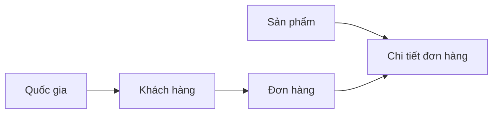

# Quản lý thứ tự dữ liệu liên quan theo yêu cầu store

## 1. Vấn đề cần giải quyết

Trong chương **Khởi tạo dữ liệu** của **SPRING_DATA_COMMONS**, thứ tự khởi tạo cần được xác định từ quan hệ giữa các dữ liệu và khả năng của store đang sử dụng. Một lời gọi repository giúp ứng dụng truy cập dữ liệu qua abstraction chung; nó không làm cho các store có cùng quy tắc về khóa ngoại, tham chiếu, cascade hay transaction.

Giả sử ứng dụng bán hàng có dữ liệu khởi tạo:

- Quốc gia `VN`.
- Khách hàng `customer-001`, thuộc quốc gia `VN`.
- Đơn hàng `order-001`, thuộc khách hàng `customer-001`.

Nếu một store yêu cầu đối tượng được tham chiếu phải tồn tại trước, kế hoạch phù hợp là:

```text
Quốc gia → Khách hàng → Đơn hàng
```

Đưa đơn hàng vào trước có thể gây lỗi ràng buộc hoặc tạo tham chiếu chưa có đích, tùy store. Ngược lại, nếu khách hàng và đơn hàng được nhúng trong cùng một tài liệu hoặc thuộc cùng aggregate được lưu một lần, bài toán có thể không còn là ba lần ghi độc lập.

Mục tiêu của bài là biết cách:

1. Chuyển quan hệ dữ liệu thành kế hoạch khởi tạo có thứ tự.
2. Phân biệt quan hệ giữa aggregate với dữ liệu được lưu cùng aggregate.
3. Điều phối repository mà vẫn tôn trọng khả năng của từng store.
4. Xử lý chạy lại, vòng phụ thuộc, lỗi giữa chừng và thao tác bất đồng bộ.

## 2. Bắt đầu bằng đơn vị lưu và quy tắc tham chiếu

Trước khi sắp xếp fixture, hãy trả lời ba câu hỏi:

- **Đơn vị nào được lưu độc lập?** Một aggregate gồm nhiều đối tượng có thể được lưu qua repository của aggregate root.
- **Tham chiếu có bắt buộc tồn tại khi ghi không?** Điều kiện này có thể do store, mapping hoặc nghiệp vụ áp đặt.
- **Một lần ghi thực sự hoàn tất khi nào?** Lời gọi repository trả về, flush và transaction commit có thể là các mốc khác nhau.

Không thể suy ra cả ba câu trả lời chỉ từ việc repository kế thừa `CrudRepository`.

| Cách tổ chức dữ liệu | Điều cần xác định | Hệ quả với khởi tạo |
| --- | --- | --- |
| Các bản ghi quan hệ có khóa ngoại | Chiều khóa ngoại, khả năng null, ràng buộc duy nhất, thời điểm kiểm tra | Thường tạo bản ghi được tham chiếu trước bản ghi phụ thuộc |
| Entity trong cùng mô hình JPA | Phía sở hữu quan hệ, cascade được cấu hình, persistence context | Đồng bộ quan hệ theo mapping; thứ tự SQL còn do provider quyết định |
| Aggregate lưu bằng Spring Data JDBC | Aggregate root, thành phần thuộc aggregate, tham chiếu sang aggregate khác | Lưu qua root phù hợp; tách thứ tự giữa các aggregate độc lập |
| Document nhúng dữ liệu con | Dữ liệu con thuộc cùng document hay là document riêng | Dữ liệu nhúng không cần một repository riêng chỉ để tạo thứ tự |
| Document tham chiếu document khác | Kiểu tham chiếu, cơ chế phân giải, chính sách kiểm tra đích | Có thể phải tạo đích trước hoặc tự kiểm tra vì store không áp khóa ngoại |
| Dữ liệu đồ thị | Quy tắc mapping node, relationship và cách lưu của module | Xác định thao tác tạo endpoint và relationship theo module cụ thể |

Bảng này là các điểm cần kiểm tra, không phải cam kết rằng mọi store thuộc cùng nhóm có hành vi giống nhau. Cascade của một module cũng không phải cơ chế phổ quát để tự tìm và khởi tạo toàn bộ dữ liệu liên quan.

### Tham chiếu tồn tại và dữ liệu sẵn sàng để đọc

Một đối tượng có thể đã được ghi vào nguồn dữ liệu chính nhưng chưa xuất hiện trong chỉ mục tìm kiếm hoặc read model cập nhật bất đồng bộ. Nếu giai đoạn sau cần truy vấn qua những thành phần đó, điều kiện chuyển giai đoạn phải bao gồm mức sẵn sàng cần thiết.

Không dùng một khoảng `sleep` cố định để thay thế điều kiện này. Nên kiểm tra trạng thái hoặc chờ tín hiệu có giới hạn thời gian, đồng thời dừng khi vượt thời hạn.

## 3. Mô hình hóa thứ tự bằng đồ thị phụ thuộc

Quy ước một cạnh `A → B` nghĩa là **A phải sẵn sàng trước khi bắt đầu tạo B**.



Ở đây, chi tiết đơn hàng cần cả đơn hàng và sản phẩm. Một kế hoạch hợp lệ là:

| Giai đoạn | Dữ liệu | Điều kiện bắt đầu |
| --- | --- | --- |
| 1 | Quốc gia, sản phẩm | Schema, mapping và kết nối đã sẵn sàng |
| 2 | Khách hàng | Quốc gia tương ứng đã tồn tại |
| 3 | Đơn hàng | Khách hàng tương ứng đã tồn tại |
| 4 | Chi tiết đơn hàng | Đơn hàng và sản phẩm tương ứng đã tồn tại |

Quốc gia và sản phẩm không phụ thuộc nhau trong ví dụ này. Chúng có thể nằm cùng một giai đoạn, nhưng chỉ nên chạy song song khi transaction, kết nối và store cho phép. Một thứ tự tuần tự ổn định thường dễ kiểm tra hơn đối với fixture nhỏ.

### Cách lập kế hoạch

Có thể áp dụng sắp xếp topo cho một đồ thị không có chu trình:

```text
1. Thu thập các nhóm dữ liệu và dependency bắt buộc.
2. Chọn các nhóm chưa xử lý và không còn dependency chưa hoàn tất.
3. Sắp các nhóm được chọn theo một khóa ổn định nếu cần kết quả lặp lại.
4. Thực thi, xác nhận hoàn tất và loại các dependency đã được đáp ứng.
5. Lặp lại đến khi hết nhóm.
6. Nếu vẫn còn nhóm nhưng không chọn được nhóm nào: báo vòng phụ thuộc.
```

Đối với fixture nhỏ, có thể khai báo trực tiếp các giai đoạn thay vì xây một framework sắp xếp động. Điều quan trọng là dependency được diễn đạt rõ và mọi giai đoạn đều có điều kiện hoàn tất.

Thứ tự tên file hoặc thứ tự do hệ thống file trả về không thể thay thế đồ thị này. Tiền tố như `01-`, `02-` có thể giúp người đọc, nhưng chương trình vẫn phải đọc và thực thi theo kế hoạch tường minh.

## 4. Phân biệt các loại thứ tự trong ứng dụng Spring

Các cơ chế sắp xếp ở những tầng khác nhau giải quyết những việc khác nhau.

| Loại thứ tự | Ví dụ | Điều nó không tự bảo đảm |
| --- | --- | --- |
| Khởi tạo bean | Khai báo dependency giữa các bean | Không tự lập kế hoạch phụ thuộc giữa các bản ghi |
| Chạy tác vụ khởi động | Sắp thứ tự các runner có hỗ trợ ordering | Không bảo đảm một tác vụ con chạy bất đồng bộ đã hoàn tất |
| Gọi repository | Gọi lưu quốc gia rồi lưu khách hàng | Không quy định thứ tự SQL hoặc thời điểm commit cho mọi store |
| Đồng bộ với store | Flush hoặc thao tác tương đương của module | Không đồng nghĩa transaction đã commit |
| Hiển thị qua read model | Chờ chỉ mục hoặc projection cập nhật | Không được bảo đảm chỉ nhờ lệnh ghi thành công |

`@DependsOn` mô tả dependency khởi tạo bean; nó không phải công cụ xác định quan hệ giữa khách hàng và đơn hàng. Tương tự, `@Order` chỉ có tác dụng khi cơ chế đang sử dụng thực sự đọc thông tin ordering đó.

Một bộ điều phối gọi lần lượt các giai đoạn thường thể hiện dependency dữ liệu rõ hơn nhiều runner rời rạc. Dù chọn cách nào, tác vụ khởi tạo phải được đặt sau bước chuẩn bị schema, collection hoặc cấu trúc cần thiết của store, theo cơ chế khởi động của ứng dụng.

## 5. Thiết kế fixture để phân giải quan hệ rõ ràng

Fixture nên sử dụng khóa ổn định để mô tả quan hệ, thay vì dự đoán ID tự sinh của store.

```json
{
  "countries": [
    { "code": "VN", "name": "Việt Nam" }
  ],
  "customers": [
    { "key": "customer-001", "name": "Nguyễn An", "countryCode": "VN" }
  ],
  "orders": [
    { "key": "order-001", "customerKey": "customer-001" }
  ]
}
```

Đây là định dạng fixture cho bộ điều phối minh họa trong bài, không phải định dạng có thể mặc định đưa thẳng vào repository populator.

Bộ điều phối phân giải:

```text
countryCode "VN"             → ID quốc gia thực tế
customerKey "customer-001"   → ID khách hàng thực tế
```

Các ID thực tế có thể được store sinh ra. Khi dùng repository, phải lấy entity hoặc kết quả được trả về từ thao tác lưu để sử dụng ID, thay vì giả định đối tượng đầu vào luôn được cập nhật tại chỗ.

### Kiểm tra trước khi ghi

Với một fixture khép kín, trong đó mọi dữ liệu được tham chiếu đều phải có mặt trong fixture, kiểm tra tối thiểu gồm:

- Không trùng khóa quốc gia, khóa khách hàng hoặc khóa đơn hàng.
- Mỗi `countryCode` của khách hàng đều tồn tại trong danh sách quốc gia.
- Mỗi `customerKey` của đơn hàng đều tồn tại trong danh sách khách hàng.
- Giá trị bắt buộc hợp lệ và không có vòng phụ thuộc không được xử lý.

Nếu cho phép tham chiếu đến dữ liệu đã có trong store, cần thay quy tắc khép kín bằng bước phân giải kết hợp fixture và store. Không nên âm thầm coi một đích bị thiếu là dữ liệu có thể bỏ qua.

Việc kiểm tra trước giúp phát hiện nhiều lỗi sớm. Nó không loại bỏ nhu cầu về ràng buộc ở store, vì dữ liệu có thể thay đổi giữa lúc kiểm tra và lúc ghi.

## 6. Minh họa bộ điều phối độc lập với mapping của store

Ví dụ dưới đây dùng Java 17 và một cổng `SeedStore`. Cổng này là mã ứng dụng tự định nghĩa, **không phải API của Spring Data Commons**. Adapter triển khai cổng bằng repository của module đang sử dụng.

Cách tách này giữ cho kế hoạch phụ thuộc giống nhau, trong khi adapter quyết định cách biểu diễn quan hệ bằng ID, entity reference hoặc cơ chế phù hợp khác. Ví dụ giả định ID đã được quy về `String`; ứng dụng thực tế có thể dùng kiểu ID riêng.

```java
import java.util.HashMap;
import java.util.List;
import java.util.Map;
import java.util.Optional;

public final class SeedCoordinator {

    public record CountrySeed(String code, String name) {}
    public record CustomerSeed(String key, String name, String countryCode) {}
    public record OrderSeed(String key, String customerKey) {}

    public record CustomerState(String id, String countryId) {}
    public record OrderState(String id, String customerId) {}

    public interface SeedStore {
        Optional<String> findCountryIdByCode(String code);
        String insertCountry(CountrySeed seed);

        Optional<CustomerState> findCustomerByKey(String key);
        CustomerState insertCustomer(CustomerSeed seed, String countryId);

        Optional<OrderState> findOrderByKey(String key);
        OrderState insertOrder(OrderSeed seed, String customerId);
    }

    private final SeedStore store;

    public SeedCoordinator(SeedStore store) {
        this.store = store;
    }

    // Tiền điều kiện: fixture đã qua kiểm tra cấu trúc và dependency.
    public void seed(
            List<CountrySeed> countries,
            List<CustomerSeed> customers,
            List<OrderSeed> orders) {

        Map<String, String> countryIds = new HashMap<>();
        Map<String, String> customerIds = new HashMap<>();

        // Giai đoạn 1: tạo hoặc nhận diện quốc gia đã có.
        for (CountrySeed country : countries) {
            String id = store.findCountryIdByCode(country.code())
                    .orElseGet(() -> store.insertCountry(country));
            countryIds.put(country.code(), id);
        }

        // Giai đoạn 2: phân giải quốc gia trước khi tạo khách hàng.
        for (CustomerSeed customer : customers) {
            String countryId = requireId(
                    countryIds, customer.countryCode(), "countryCode");

            CustomerState state = store.findCustomerByKey(customer.key())
                    .orElseGet(() -> store.insertCustomer(customer, countryId));

            if (!countryId.equals(state.countryId())) {
                throw new IllegalStateException(
                        "Khách hàng có quốc gia khác fixture: " + customer.key());
            }
            customerIds.put(customer.key(), state.id());
        }

        // Giai đoạn 3: phân giải khách hàng trước khi tạo đơn hàng.
        for (OrderSeed order : orders) {
            String customerId = requireId(
                    customerIds, order.customerKey(), "customerKey");

            OrderState state = store.findOrderByKey(order.key())
                    .orElseGet(() -> store.insertOrder(order, customerId));

            if (!customerId.equals(state.customerId())) {
                throw new IllegalStateException(
                        "Đơn hàng có khách hàng khác fixture: " + order.key());
            }
        }
    }

    private static String requireId(
            Map<String, String> ids, String key, String field) {
        String id = ids.get(key);
        if (id == null) {
            throw new IllegalArgumentException(
                    "Không phân giải được " + field + ": " + key);
        }
        return id;
    }
}
```

### Hợp đồng mà adapter cần đáp ứng

- `find...` tìm theo khóa ổn định của fixture và trả đúng ID đang có trong store.
- `insert...` tạo dữ liệu thiếu, biểu diễn quan hệ theo mapping của store và trả kết quả đã lưu.
- Nếu quan hệ không được phép thay đổi, adapter hoặc bộ điều phối phải phát hiện xung đột thay vì tự gán lại.
- Các lỗi của store phải được truyền ra để bộ điều phối dừng giai đoạn phụ thuộc.

Ví dụ chủ động giữ nguyên dữ liệu đã tồn tại và chỉ kiểm tra những quan hệ được minh họa. Nó không đồng bộ mọi thuộc tính như tên quốc gia hay tên khách hàng. Nếu fixture phải cập nhật các thuộc tính đó, cần định nghĩa chính sách cập nhật riêng để tránh ghi đè dữ liệu người dùng đã sửa.

Các phương thức `find...ByKey` ở cổng không có nghĩa Spring Data tự cung cấp sẵn những truy vấn đó. Adapter có thể khai báo derived query, truy vấn tường minh hoặc dùng khóa chính phù hợp, theo khả năng của module. `CrudRepository` cung cấp những thao tác nền như tìm theo ID và lưu; mô hình quan hệ vẫn do domain cùng mapping của store quyết định.

### Tránh giả định về `saveAll`

Không dựa vào `saveAll` như một bộ sắp xếp dependency giữa các aggregate. Lời gọi này không phải cam kết chung rằng Spring Data sẽ phân tích mọi quan hệ rồi tự tạo cha trước con.

Nếu một giai đoạn dùng `saveAll`, hãy chuẩn bị các tham chiếu cần thiết trước và xử lý kết quả lưu theo hợp đồng của module. Với API trả về nhiều entity, cũng không nên ghép kết quả với fixture chỉ bằng vị trí phần tử nếu hợp đồng không bảo đảm thứ tự; dùng khóa định danh rõ ràng để đối chiếu.

## 7. Repository populator không thay thế kế hoạch phụ thuộc

Spring Data Commons có hạ tầng repository population để đưa dữ liệu từ tài nguyên đầu vào vào repository. Hạ tầng này hữu ích cho dữ liệu mẫu, nhưng không nên mặc định coi nó là công cụ giải dependency của toàn bộ mô hình nghiệp vụ.

Khi chọn dùng populator, cần xác định riêng:

1. Dữ liệu được chuyển thành kiểu domain nào và repository nào tiếp nhận kiểu đó.
2. Danh sách tài nguyên và thứ tự xử lý có được cấu hình, hỗ trợ rõ ràng không.
3. Tham chiếu trong dữ liệu đầu vào được phân giải bằng cơ chế nào.
4. Mapping có hỗ trợ cách biểu diễn quan hệ đang dùng không.
5. Khi nào quá trình chạy, transaction nào bao quanh nó và lỗi được truyền ra sao.

Việc một trường chứa chuỗi `"customer-001"` không tự biến chuỗi đó thành entity khách hàng đã được quản lý. Việc chuyển đổi có thể cần ID đã biết, custom conversion hoặc bộ điều phối phân giải khóa như ví dụ trên.

Nếu đầu vào gồm nhiều loại dữ liệu có dependency phức tạp, có thể chia fixture thành các giai đoạn rõ ràng và dùng tác vụ điều phối riêng. Không dựa vào wildcard tài nguyên, thứ tự khai báo ngẫu nhiên hoặc thời điểm khởi tạo bean để suy ra tính đúng đắn của quan hệ.

## 8. Chọn ranh giới transaction theo store

### Một transaction bao quanh toàn bộ kế hoạch

Nếu store và cấu hình hỗ trợ, có thể chạy các giai đoạn trong một transaction để cùng commit hoặc rollback. Với Spring transaction theo proxy, phương thức transactional cần được gọi qua bean/proxy phù hợp; tự gọi nội bộ một phương thức được gắn annotation không tự tạo ra ranh giới transaction mới theo cơ chế proxy thông thường.

Trong cùng transaction, dữ liệu được ghi trước có thể được dùng để tạo quan hệ tiếp theo theo quy tắc của store. Không cần commit riêng từng quốc gia chỉ để tạo khách hàng nếu store cho phép toàn bộ chuỗi ghi nằm trong cùng transaction.

Với JPA, cần nhớ:

- Lời gọi `save` không cam kết SQL tương ứng được gửi ngay lập tức.
- Provider quyết định các chi tiết flush và thứ tự SQL theo mapping, trạng thái entity và cấu hình.
- Lỗi ràng buộc có thể chỉ xuất hiện ở flush hoặc commit.
- Flush thành công chưa có nghĩa transaction đã commit thành công.

Chỉ bổ sung flush tường minh khi có lý do cụ thể từ store hoặc bước xử lý tiếp theo. Flush mọi bản ghi không phải cách chung để sửa dependency hoặc mapping sai.

### Nhiều transaction hoặc nhiều store

Nếu các giai đoạn commit độc lập, việc tạo quốc gia thành công rồi tạo khách hàng thất bại có thể để lại dữ liệu một phần. Trường hợp nhiều store cũng không tự có transaction nguyên tử chỉ vì các adapter dùng Spring Data.

Khi đó cần thiết kế:

- Khóa ổn định để chạy lại và nhận diện dữ liệu đã tạo.
- Trạng thái tiến độ đủ chính xác để biết giai đoạn nào đã hoàn tất.
- Cách phục hồi hoặc bù trừ cho những phần đã ghi.
- Điều kiện cho phép ứng dụng phục vụ khi fixture chưa hoàn chỉnh.

Nếu ghi checkpoint riêng, phải tính cả tình huống dữ liệu đã commit nhưng checkpoint chưa được ghi. Checkpoint hỗ trợ phục hồi; nó không thay thế tính an toàn khi chạy lại.

## 9. Chạy lại an toàn và xử lý nhiều tiến trình

Một fixture thường được chạy lại trong môi trường phát triển, kiểm thử hoặc sau khi tác vụ khởi tạo bị gián đoạn. Kết quả mong muốn là tránh sinh thêm dữ liệu trùng và không làm thay đổi quan hệ ngoài chính sách đã định.

Với ví dụ trong bài, chính sách là:

| Tình trạng | Hành vi |
| --- | --- |
| Chưa có khóa fixture | Tạo dữ liệu và ghi nhận ID thực tế |
| Đã có khóa, quan hệ khớp | Dùng lại đối tượng hiện có |
| Đã có khóa, quan hệ khác | Báo lỗi có khóa fixture để xử lý |
| Thiếu dữ liệu được tham chiếu | Dừng trước khi tạo đối tượng phụ thuộc |

Chuỗi thao tác `find` rồi `insert` trong ví dụ **không tự an toàn khi nhiều tiến trình chạy đồng thời**. Hai tiến trình có thể cùng quan sát thấy dữ liệu chưa tồn tại.

Ứng dụng cần bổ sung cơ chế phù hợp, chẳng hạn:

- Bảo đảm chỉ một tác vụ khởi tạo được chạy tại một thời điểm.
- Thiết lập ràng buộc duy nhất trên khóa fixture khi store hỗ trợ.
- Dùng cơ chế tạo có điều kiện hoặc upsert nếu store cung cấp và chính sách cập nhật cho phép.
- Xử lý xung đột duy nhất bằng quy trình đọc lại hoặc retry theo quy tắc transaction của store.

Không nên bắt lỗi ràng buộc rồi tiếp tục dùng một transaction đã bị đánh dấu rollback. Cách phục hồi phải phù hợp với transaction và driver đang sử dụng.

## 10. Khi đồ thị có vòng phụ thuộc

Ví dụ hai phòng ban tham chiếu lẫn nhau, hoặc hai đối tượng bắt buộc cùng có tham chiếu đến nhau:

```text
A → B → A
```

Không tồn tại thứ tự topo cho vòng này. Đổi tên file hoặc đảo hai lời gọi repository sẽ không giải quyết được.

Có thể cân nhắc những phương án sau theo điều kiện thực tế:

| Phương án | Khi có thể áp dụng |
| --- | --- |
| Gom về cùng aggregate hoặc đơn vị lưu | Mô hình nghiệp vụ và store thực sự hỗ trợ ghi cùng đơn vị |
| Khởi tạo hai lượt | Cho phép tạo đối tượng chưa có quan hệ, rồi cập nhật liên kết sau |
| Cấp ID trước | Store cho phép xác định trước ID; vẫn phải xử lý quy tắc kiểm tra tham chiếu |
| Trì hoãn kiểm tra ràng buộc | Store hỗ trợ loại ràng buộc đó và được cấu hình phù hợp |
| Điều chỉnh mô hình | Dependency hiện tại không phản ánh đúng nhu cầu nghiệp vụ |

Cấp ID trước chỉ giải quyết việc biết định danh. Nó không khiến một khóa ngoại bắt buộc lập tức chấp nhận tham chiếu đến bản ghi chưa tồn tại.

Khởi tạo hai lượt cũng chỉ hợp lệ khi trạng thái trung gian được cho phép hoặc được bao trong ranh giới có khả năng giữ tính nhất quán theo yêu cầu. Không mặc định tắt kiểm tra ràng buộc để nạp fixture, vì cách đó có thể để lại dữ liệu sai mà tác vụ vẫn báo thành công.

## 11. Giữ thứ tự trong luồng reactive

Trong tác vụ reactive, thứ tự viết các câu lệnh Java không đủ để chứng minh thứ tự hoàn tất thao tác ghi.

Ví dụ sau tạo ba subscription độc lập và không diễn đạt dependency:

```java
seedCountries().subscribe();
seedCustomers().subscribe();
seedOrders().subscribe();
```

Nếu các phương thức trả về `Mono<Void>`, có thể ghép thành một pipeline:

```java
Mono<Void> seed = Mono.defer(this::seedCountries)
        .then(Mono.defer(this::seedCustomers))
        .then(Mono.defer(this::seedOrders));

// Trả Mono này cho thành phần gọi để nó quản lý việc thực thi và lỗi.
return seed;
```

Các giai đoạn sau chỉ được bắt đầu khi giai đoạn trước hoàn tất thành công. `defer` giữ việc tạo tác vụ của từng giai đoạn đến lúc được subscribe tương ứng. Mỗi helper phải thực sự trả về tín hiệu hoàn tất của toàn bộ việc ghi trong giai đoạn đó.

Nếu cần lưu tuần tự từng phần tử trong một giai đoạn, có thể dùng `concatMap`:

```java
return Flux.fromIterable(customers)
        .concatMap(this::saveCustomer)
        .then();
```

`flatMap` có thể thực hiện đồng thời nhiều tác vụ; chỉ dùng khi các phần tử độc lập và việc chạy đồng thời được chấp nhận. `flatMapSequential` giữ thứ tự phát kết quả nhưng vẫn có thể chạy các publisher bên trong đồng thời, nên không thay thế yêu cầu tuần tự của dependency ghi.

Pipeline có thứ tự không tự tạo transaction. Nếu cần transaction reactive, phải có store, transaction manager và cách áp dụng transaction tương ứng. Thành phần gọi cũng phải chờ tín hiệu hoàn tất trước khi công bố khởi tạo đã xong.

## 12. Xác nhận kết quả và chẩn đoán lỗi

Thành công không chỉ là các phương thức `save` không ném lỗi ngay tại thời điểm gọi. Sau khi thao tác ghi và transaction cần thiết đã hoàn tất, nên xác nhận các bất biến quan trọng:

- Mọi khóa fixture bắt buộc đều tồn tại đúng theo chính sách duy nhất.
- Mỗi khách hàng tham chiếu đúng quốc gia.
- Mỗi đơn hàng tham chiếu đúng khách hàng.
- Không có bản ghi phụ thuộc bị mồ côi theo quy tắc nghiệp vụ.
- Chạy lại fixture không làm tăng số lượng đối tượng cùng khóa.

Chỉ đếm số bản ghi là chưa đủ: hai đơn hàng có thể tồn tại nhưng liên kết nhầm khách hàng.

| Biểu hiện | Nguyên nhân cần kiểm tra | Hướng xử lý |
| --- | --- | --- |
| Lỗi khóa ngoại khi nạp đơn hàng | Thiếu khách hàng, sai ID, mapping hoặc thời điểm kiểm tra | Kiểm tra giai đoạn khách hàng và ID dùng để liên kết |
| Không lỗi nhưng tham chiếu không tìm được đích | Store không kiểm tra toàn vẹn tham chiếu | Thêm bước phân giải và xác nhận bất biến |
| Có đủ bản ghi nhưng quan hệ sai | Ghép ID theo vị trí hoặc đoán ID tự sinh | Ánh xạ theo khóa ổn định và kết quả lưu |
| Chạy lại xuất hiện dữ liệu trùng | Không có chính sách nhận diện hoặc thiếu ràng buộc đồng thời | Bổ sung khóa ổn định và cơ chế bảo vệ ở store |
| Một phần dữ liệu tồn tại sau lỗi | Các giai đoạn commit riêng hoặc nhiều store | Phục hồi theo checkpoint và chính sách chạy lại |
| Tác vụ reactive báo xong quá sớm | Subscription độc lập hoặc bỏ tín hiệu hoàn tất | Ghép và chờ một pipeline biểu diễn toàn bộ dependency |
| Lỗi chỉ xuất hiện khi commit | Ràng buộc được kiểm tra muộn | Đánh giá thành công sau khi transaction kết thúc |

Log phục vụ chẩn đoán nên chứa tên giai đoạn, khóa fixture đang xử lý và dependency bị thiếu. Nếu lỗi là `order-001` không phân giải được `customer-001`, thông báo cần thể hiện cả hai khóa để người vận hành truy được nguồn lỗi.

## 13. Bài tập áp dụng

Cho fixture gồm quốc gia, khách hàng, sản phẩm, đơn hàng và chi tiết đơn hàng:

1. Vẽ đồ thị với quy ước cạnh từ dữ liệu tiên quyết sang dữ liệu phụ thuộc.
2. Chọn store cụ thể, ghi rõ đơn vị aggregate, kiểu tham chiếu và khả năng transaction.
3. Lập các giai đoạn khởi tạo và xác định thời điểm mỗi giai đoạn được coi là hoàn tất.
4. Thử thiếu một sản phẩm được chi tiết đơn hàng tham chiếu; kiểm tra tác vụ dừng và báo đúng khóa.
5. Chạy fixture hai lần; kiểm tra cả số lượng lẫn quan hệ không đổi ngoài chính sách cập nhật.
6. Mô phỏng lỗi sau khi tạo khách hàng; xác định dữ liệu còn lại và cách chạy lại trong cấu hình transaction đã chọn.
7. Nếu dùng reactive, chứng minh rằng đơn hàng không bắt đầu trước khi giai đoạn khách hàng hoàn tất.

Kết quả cần giải thích được vì sao thứ tự đã chọn đúng với store và mapping cụ thể. Repository là abstraction truy cập dữ liệu dùng chung; kế hoạch khởi tạo phải kết hợp dependency nghiệp vụ, ranh giới aggregate và các bảo đảm thực sự của store.
