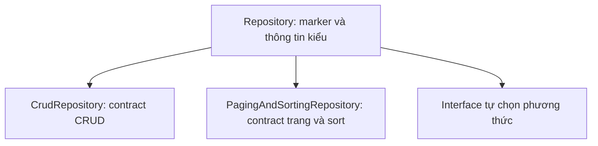
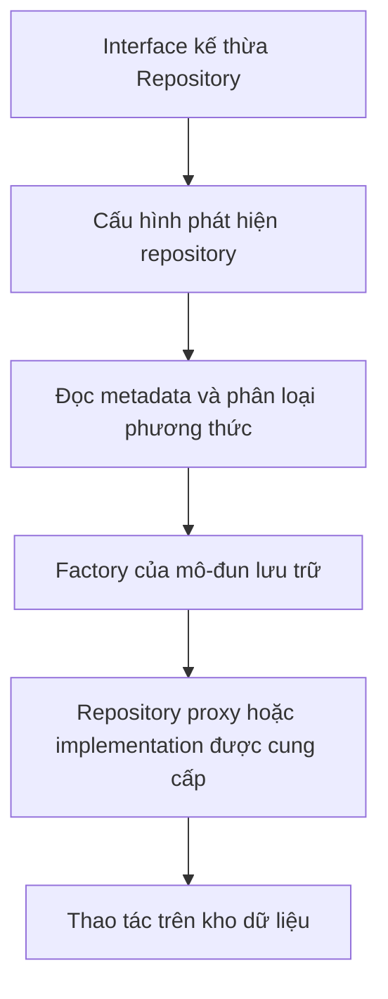

# Repository<T, ID> và vai trò marker interface

`Repository<T, ID>` là interface gốc của mô hình repository trong Spring Data Commons. Nó giúp hạ tầng nhận diện một repository cùng kiểu đối tượng miền và kiểu định danh mà repository đó quản lý.

Điểm quan trọng nhất: **`Repository` không khai báo phương thức CRUD nào**. Kế thừa nó không làm interface của bạn tự có `save`, `findById` hoặc `deleteById`. Những khả năng đó chỉ xuất hiện trong contract khi bạn chọn kế thừa interface khác hoặc khai báo những phương thức phù hợp.

Bài học thuộc chương **Giao diện repository** của mô-đun **SPRING_DATA_COMMONS**. Chúng ta tập trung vào ý nghĩa của marker interface, cách generic cung cấp metadata và cách xây một contract repository có phạm vi rõ ràng.

## 1. Hình dạng tối thiểu của Repository

Bỏ qua các annotation kỹ thuật, có thể hình dung khai báo của interface như sau:

```java
public interface Repository<T, ID> {
}
```

Phần thân không có phương thức. Hai tham số kiểu biểu thị:

| Tham số | Ý nghĩa | Ví dụ |
| --- | --- | --- |
| `T` | Kiểu đối tượng miền mà repository quản lý | `Product`, `Order`, `Customer` |
| `ID` | Kiểu định danh của đối tượng miền | `Long`, `UUID`, `String` |

Ví dụ:

```java
import org.springframework.data.repository.Repository;

public interface ProductRepository
        extends Repository<Product, Long> {
}
```

Khai báo trên diễn đạt rằng:

- Đây là một interface tham gia mô hình repository của Spring Data.
- Kiểu miền được quản lý là `Product`.
- Kiểu định danh được khai báo là `Long`.
- Interface chưa công bố bất kỳ thao tác dữ liệu nào.

Nó không diễn đạt sản phẩm nằm trong bảng nào, cách tạo kết nối, chiến lược sinh ID hoặc những truy vấn nào được phép thực hiện.

## 2. Marker interface đánh dấu điều gì?

Marker interface là interface không khai báo phương thức, dùng sự hiện diện trong hệ phân cấp kiểu để biểu đạt một đặc điểm mà mã hoặc hạ tầng có thể nhận diện.

Với Spring Data, `Repository` đánh dấu một interface là ứng viên repository theo cơ chế nhận diện tương ứng. Hai generic còn cung cấp thông tin kiểu để hạ tầng xác định phạm vi quản lý.

So sánh:

```java
public interface ProductGateway {
}
```

và:

```java
import org.springframework.data.repository.Repository;

public interface ProductRepository
        extends Repository<Product, Long> {
}
```

Cả hai đều là Java interface. Nhưng chỉ interface thứ hai thể hiện quy ước marker repository đang xét. Một interface thông thường tên là `ProductGateway` hoặc kết thúc bằng chữ `Repository` không tự trở thành repository Spring Data chỉ nhờ tên gọi.

Tuy nhiên, marker mới là một phần của điều kiện tích hợp. Interface còn phải được phát hiện trong phạm vi cấu hình phù hợp và được mô-đun lưu trữ quản lý.

> Marker cho hạ tầng biết interface thuộc mô hình nào. Nó không tự cung cấp mọi hành vi của mô hình đó.

## 3. Generic giúp mô tả contract và cung cấp metadata

### 3.1. T biểu thị đối tượng miền được quản lý

Trong:

```java
Repository<Product, Long>
```

`Product` là kiểu miền được repository quản lý. Những truy vấn derived query thông thường được phân tích dựa trên các thuộc tính của kiểu miền và thông tin mapping liên quan.

Không nên thay `Product` bằng `Object` chỉ để dùng một repository cho mọi dữ liệu. Cách làm đó làm mất thông tin kiểu cần thiết và không tạo ra một engine lưu trữ tổng quát.

Kiểu miền cũng không phải tên bảng hoặc tên collection. Việc ánh xạ nó vào kho dữ liệu thuộc trách nhiệm của mô-đun và cấu hình mapping.

### 3.2. ID biểu thị kiểu định danh trong contract

Khi một phương thức nhận ID được khai báo theo contract này, bên gọi làm việc với kiểu ID đã chọn.

Ví dụ, nếu interface công bố:

```java
Optional<Product> findById(Long id);
```

thì truyền một `String` không phù hợp chữ ký Java đó.

Tuy vậy, generic không tự chứng minh mapping đúng. Nếu bạn khai báo `Long` ở repository nhưng định danh thực tế của đối tượng lại được mapping với một kiểu khác, trình biên dịch không nhất thiết phát hiện được sự mâu thuẫn chỉ từ khai báo generic.

Cần giữ nhất quán giữa:

1. Kiểu miền của repository.
2. Kiểu ID trong generic.
3. Thuộc tính hoặc cấu trúc định danh được mapping.
4. Các chữ ký phương thức mà ứng dụng công bố.

### 3.3. Metadata vẫn có thể được suy ra qua interface trung gian

Java có type erasure, nhưng điều đó không có nghĩa framework không thể đọc thông tin generic trong khai báo hệ phân cấp kiểu.

Ví dụ:

```java
import org.springframework.data.repository.NoRepositoryBean;
import org.springframework.data.repository.Repository;

@NoRepositoryBean
public interface BaseRepository<T, ID>
        extends Repository<T, ID> {
}
```

```java
public interface ProductRepository
        extends BaseRepository<Product, Long> {
}
```

Hạ tầng có thể phân giải kiểu miền và ID từ các khai báo generic của interface cụ thể. Nó không cần đợi một đối tượng `Product` được truyền vào để đoán repository quản lý kiểu nào.

Ngược lại, dùng raw type như `extends Repository` làm mất thông tin generic cần thiết và không phải cách hợp lý để xây repository đa năng.

## 4. Vì sao interface rỗng vẫn có ích?

Một interface rỗng có thể hữu ích ở ba khía cạnh.

### 4.1. Tạo điểm bắt đầu thống nhất

Các interface có nhiều khả năng hơn trong Spring Data xây trên mô hình repository chung. Nhờ vậy, các mô-đun có một cách nhận diện và mô tả repository thống nhất.



Sơ đồ thể hiện một phần quan hệ interface để học khái niệm, không phải toàn bộ hệ phân cấp Spring Data. Ở các dòng API hiện đại, không nên mặc định contract phân trang tự bao gồm contract CRUD.

### 4.2. Cho phép lựa chọn phạm vi phương thức

Nếu chỉ cần đọc dữ liệu, bạn có thể chọn công bố phương thức đọc mà không nhận toàn bộ tập phương thức từ `CrudRepository`.

Điều này giúp contract của thành phần thể hiện đúng nhu cầu, chẳng hạn không có `deleteAll` nếu bên sử dụng không cần quyền gọi thao tác đó.

Interface hẹp không thay thế kiểm tra quyền hoặc quy tắc nghiệp vụ, nhưng nó giúp giới hạn những thao tác hiện diện trên kiểu mà bên gọi được cung cấp.

### 4.3. Tạo nền cho metadata và mở rộng hạ tầng

Repository factory và các thành phần metadata cần biết interface nào được quản lý, kiểu miền nào liên quan và các phương thức phải được xử lý ra sao.

Marker là một điểm vào của quy ước đó. Những phần thực thi CRUD, phân tích truy vấn, projection hay tích hợp auditing vẫn cần các thành phần tương ứng; chúng không nằm sẵn trong phần thân rỗng của interface.

## 5. Kế thừa Repository không có nghĩa là kế thừa CRUD

Xét interface:

```java
import org.springframework.data.repository.Repository;

public interface ProductRepository
        extends Repository<Product, Long> {
}
```

Nếu một biến có kiểu `ProductRepository`, các lời gọi sau chưa có trong contract:

```java
// Các lời gọi này không biên dịch với interface rỗng ở trên:
//
// productRepository.findById(1L);
// productRepository.save(product);
// productRepository.deleteById(1L);
```

Lý do là hệ phân cấp interface chưa khai báo những phương thức đó.

Ngay cả khi hạ tầng lưu trữ có một implementation cơ sở với nhiều phương thức, mã Java của bên gọi vẫn bị ràng buộc bởi kiểu được công bố. Không nên dựa vào ép kiểu để truy cập các khả năng ngoài contract của repository.

Có hai hướng phổ biến để bổ sung thao tác:

| Hướng | Khi phù hợp |
| --- | --- |
| Kế thừa một interface như `CrudRepository` | Bên sử dụng thực sự cần nhóm thao tác chuẩn đó |
| Chọn khai báo một số chữ ký phù hợp trên interface kế thừa `Repository` | Muốn công bố contract nhỏ hơn |

Ví dụ chọn một nhóm đầy đủ:

```java
import org.springframework.data.repository.CrudRepository;

public interface ProductCrudRepository
        extends CrudRepository<Product, Long> {
}
```

Đây là một contract khác với interface rỗng ban đầu. Các phương thức CRUD hiện diện vì được kế thừa từ `CrudRepository`.

## 6. Ví dụ mô hình dùng cho repository chọn lọc

Để ví dụ cụ thể, phần sau chọn Spring Data JPA làm mô-đun thực thi. `Product` có mapping Jakarta Persistence như sau:

```java
package example.repository.domain;

import jakarta.persistence.Entity;
import jakarta.persistence.GeneratedValue;
import jakarta.persistence.Id;
import jakarta.persistence.Table;

@Entity
@Table(name = "products")
public class Product {

    @Id
    @GeneratedValue
    private Long id;

    private String name;

    private boolean active;

    protected Product() {
    }

    public Product(String name, boolean active) {
        this.name = name;
        this.active = active;
    }

    public Long getId() {
        return id;
    }

    public String getName() {
        return name;
    }

    public boolean isActive() {
        return active;
    }
}
```

Ví dụ tập trung vào contract repository; mô hình chưa trình bày đầy đủ các quy tắc xác thực nghiệp vụ.

Các annotation trên thuộc JPA. Chúng được dùng vì đã chọn JPA làm môi trường minh họa, không phải vì Commons yêu cầu mọi kiểu miền phải có `@Entity`.

Để repository được tạo và thực thi, ứng dụng cần mô-đun JPA, JPA provider, cấu hình dữ liệu và phạm vi phát hiện entity/repository phù hợp. Chỉ thêm Commons không đáp ứng các điều kiện đó.

## 7. Chọn lọc phương thức trên Repository

Một contract chỉ đọc có thể là:

```java
package example.repository.data;

import java.util.List;
import java.util.Optional;

import example.repository.domain.Product;

import org.springframework.data.repository.Repository;

public interface ProductLookupRepository
        extends Repository<Product, Long> {

    Optional<Product> findById(Long id);

    List<Product> findByActiveTrue();
}
```

Hai phương thức có đường thực thi khác nhau:

| Phương thức | Ý nghĩa trong môi trường JPA phù hợp |
| --- | --- |
| `findById(Long id)` | Chữ ký đọc theo định danh tương ứng với contract repository cơ sở |
| `findByActiveTrue()` | Truy vấn được tạo từ điều kiện trên thuộc tính `active` |

`findById` không tự xuất hiện từ marker. Nó có mặt vì interface đã khai báo chữ ký.

`findByActiveTrue` không trở thành truy vấn chỉ vì là một phương thức Java. Tên, kiểu trả về và mô-đun thực thi phải phù hợp với cơ chế truy vấn được hỗ trợ.

Nếu cần lưu sản phẩm nhưng vẫn không muốn công bố toàn bộ CRUD, có thể xây một contract khác:

```java
package example.repository.data;

import java.util.Optional;

import example.repository.domain.Product;

import org.springframework.data.repository.Repository;

public interface ProductWriteRepository
        extends Repository<Product, Long> {

    Optional<Product> findById(Long id);

    <S extends Product> S save(S entity);
}
```

Chữ ký `save` được chọn theo contract CRUD tương ứng. Phương thức trả về kiểu phù hợp với đối tượng được lưu; bên gọi nên sử dụng kết quả khi cần trạng thái do quá trình lưu cung cấp.

Không suy ra rằng mọi tên phương thức tùy ý đều được nối vào implementation CRUD. Đổi `save` thành `persistProduct` rồi giữ nguyên tham số không đủ để hệ thống tự coi đó là cùng một thao tác.

Ngoài ra, `List<Product>` có thể trả nhiều dữ liệu. Khi nhu cầu đọc tăng, nên thiết kế giới hạn hoặc phân trang phù hợp thay vì coi “chỉ đọc” là đương nhiên có chi phí thấp.

## 8. Một phương thức repository có thể được xử lý theo những cách nào?

Marker không yêu cầu mọi phương thức phải là derived query.

| Loại phương thức | Cách có implementation |
| --- | --- |
| Chữ ký tương ứng thao tác cơ sở được hỗ trợ | Hạ tầng định tuyến tới implementation cơ sở |
| Phương thức truy vấn theo tên | Mô-đun phân tích và tạo truy vấn theo khả năng của nó |
| Phương thức có khai báo truy vấn phù hợp | Cơ chế truy vấn của mô-đun xử lý |
| Default method | Phần thân phương thức Java cung cấp logic |
| Phương thức thuộc fragment tùy chỉnh | Implementation fragment cung cấp hành vi |

Ví dụ, có thể bổ sung một default method cho interface chỉ đọc:

```java
public default Product requireById(Long id) {
    return findById(id)
        .orElseThrow(() ->
            new IllegalArgumentException("Không tìm thấy sản phẩm")
        );
}
```

Đoạn mã trên nằm bên trong `ProductLookupRepository`, nơi đã có `findById`. Nó kết hợp một thao tác đã được công bố với cách xử lý trường hợp không tìm thấy.

Hạ tầng không cần diễn giải tên `requireById` thành một truy vấn mới vì default method đã có phần thân để thực thi.

Ngược lại, nếu chỉ khai báo:

```java
void approveAllProducts();
```

mà không có implementation, fragment hoặc cơ chế truy vấn hợp lệ, marker không thể tự suy ra thuật toán “duyệt toàn bộ sản phẩm”. Tùy cơ chế xử lý và thời điểm khởi tạo, ứng dụng có thể gặp lỗi khi phương thức được phân tích hoặc sử dụng.

## 9. @NoRepositoryBean cho interface cơ sở dùng chung

Giả sử nhiều repository cần công bố một phương thức tìm theo định danh. Có thể tạo interface trung gian:

```java
package example.repository.data;

import java.util.Optional;

import org.springframework.data.repository.NoRepositoryBean;
import org.springframework.data.repository.Repository;

@NoRepositoryBean
public interface ReadOnlyRepository<T, ID>
        extends Repository<T, ID> {

    Optional<T> findById(ID id);
}
```

Interface cụ thể:

```java
package example.repository.data;

import example.repository.domain.Product;

public interface ProductReadOnlyRepository
        extends ReadOnlyRepository<Product, Long> {
}
```

Phân biệt vai trò của hai interface:

| Interface | Mục đích |
| --- | --- |
| `ReadOnlyRepository<T, ID>` | Contract dùng chung, chưa cố định kiểu miền |
| `ProductReadOnlyRepository` | Repository cụ thể cho `Product` và `Long` |

`@NoRepositoryBean` yêu cầu hạ tầng không tạo repository bean trực tiếp cho interface cơ sở đó. Interface cụ thể vẫn cần được phát hiện và cấu hình theo mô-đun lưu trữ.

Đây không phải annotation “cấm ghi” ở cơ sở dữ liệu. Tên `ReadOnlyRepository` và việc chỉ công bố `findById` thể hiện contract đọc; chúng không tự thiết lập tài khoản dữ liệu chỉ đọc hoặc chính sách giao dịch cho mọi đường truy cập khác.

Không đặt `@NoRepositoryBean` lên interface cụ thể nếu bạn muốn hạ tầng tạo bean cho chính interface đó.

## 10. Repository và @Repository là hai khái niệm khác nhau

Tên giống nhau dễ khiến người học nhầm lẫn:

| Đặc điểm | `Repository<T, ID>` | `@Repository` |
| --- | --- | --- |
| Loại | Java interface | Annotation stereotype của Spring |
| Package | `org.springframework.data.repository` | `org.springframework.stereotype` |
| Có generic kiểu miền và ID | Có | Không |
| Vai trò chính | Đánh dấu và mô tả contract repository Spring Data | Đánh dấu thành phần truy cập dữ liệu theo mô hình component Spring |
| Tự cung cấp phần thân cho interface tùy ý | Không | Không |

Ví dụ class truy cập dữ liệu tự viết có thể mang `@Repository` và được đăng ký bằng component scanning phù hợp. Annotation cũng liên quan đến cơ chế dịch exception persistence khi có hạ tầng tương ứng.

Với interface Spring Data được cấu hình đúng, thông thường không cần thêm `@Repository` để hạ tầng repository tạo bean.

Ngược lại, gắn `@Repository` lên một interface bất kỳ không làm component scanning thông thường tự sinh implementation cho các phương thức của interface đó.

Bạn cần xác định mình đang dùng cơ chế đăng ký repository Spring Data hay đang đăng ký một class implementation do ứng dụng tự viết.

## 11. @RepositoryDefinition là một cách mô tả contract khác

Trong trường hợp không muốn interface kế thừa `Repository`, Spring Data có annotation `@RepositoryDefinition` để khai báo kiểu miền và ID:

```java
package example.repository.data;

import java.util.Optional;

import example.repository.domain.Product;

import org.springframework.data.repository.RepositoryDefinition;

@RepositoryDefinition(
    domainClass = Product.class,
    idClass = Long.class
)
public interface ProductLookupContract {

    Optional<Product> findById(Long id);
}
```

Đây là phương án thay thế về cách mô tả repository. Nó vẫn cần:

- Được cơ chế repository của mô-đun phù hợp phát hiện.
- Có mapping và cấu hình lưu trữ hợp lệ.
- Khai báo những phương thức có đường thực thi được hỗ trợ.

Không cần sử dụng đồng thời cả annotation này và marker interface chỉ để lặp lại cùng một thông tin.

Cũng cần phân biệt `@RepositoryDefinition` với `@Repository`: annotation thứ nhất mô tả contract repository cho Spring Data, còn annotation thứ hai là stereotype của Spring Framework.

## 12. Từ marker đến repository bean có thể thực thi

Có thể hình dung quá trình theo các trách nhiệm sau:



Đây là mô hình trách nhiệm để hiểu quá trình, không phải cam kết mọi bước xảy ra đúng một lần hoặc tại cùng một thời điểm trong mọi cấu hình.

Commons cung cấp các abstraction và hạ tầng dùng chung. Mô-đun như Spring Data JPA hoặc Spring Data MongoDB đưa vào phần tích hợp để thực thi trên công nghệ cụ thể.

Từ đó có thể phân biệt ba mức:

1. **Java biên dịch được:** interface và kiểu được tham chiếu có trên compile classpath.
2. **Repository được đăng ký:** interface được nhận diện, gắn với mô-đun phù hợp và tạo bean.
3. **Thao tác thực thi đúng:** truy vấn, mapping, kết nối, dữ liệu và các điều kiện cần thiết đều phù hợp.

Marker chủ yếu tham gia mô tả và nhận diện contract. Nó không tự chứng minh cả ba mức đều thành công.

### Khi có nhiều mô-đun repository

`Repository` và `CrudRepository` là các contract chung. Chỉ kế thừa chúng có thể chưa đủ để xác định interface thuộc mô-đun nào trong một ứng dụng có nhiều mô-đun Spring Data.

Ứng dụng có thể cần dùng interface đặc trưng của mô-đun, mapping phù hợp hoặc cấu hình phạm vi package rõ ràng. Nếu một kiểu miền được gắn nhiều loại mapping, việc phân định càng cần được xem xét cẩn thận.

Đây là giới hạn có chủ đích của marker chung: nó mô tả vai trò repository mà không tự chọn thay ứng dụng một công nghệ lưu trữ.

## 13. Marker không cam kết những điều gì?

| Điều cần quyết định | Vì sao không suy ra được từ marker |
| --- | --- |
| Tập phương thức CRUD | Interface gốc không khai báo các phương thức đó |
| Loại kho dữ liệu | Marker dùng chung cho nhiều mô-đun |
| Cách sinh và mapping ID | Phụ thuộc mô hình và công nghệ lưu trữ |
| Phạm vi giao dịch | Phụ thuộc cấu hình và implementation thực tế |
| Quyền truy cập dữ liệu | Generic không mang đầy đủ chính sách người dùng hoặc tenant |
| Quy tắc nghiệp vụ | Marker không biết điều kiện hủy đơn hay đổi trạng thái |
| Hiệu năng truy vấn | Không mô tả chỉ mục, kế hoạch thực thi hoặc kích thước dữ liệu |
| Khả năng projection, QBE hoặc auditing đang hoạt động | Cần contract và tích hợp tương ứng, cùng khả năng của mô-đun |

Ví dụ, có `Repository<Order, Long>` không đủ để kết luận một đơn đã giao được phép xóa. Có `Repository<Customer, UUID>` cũng không đủ để cho phép người dùng đọc bất kỳ khách hàng nào bằng ID.

Giữ rõ giới hạn này giúp bạn sử dụng abstraction chung mà không gán cho nó các bảo đảm mà nó không cung cấp.

## 14. Bài tập nhận diện contract

Xét ba khai báo độc lập:

```java
interface A extends Repository<Product, Long> {
}
```

```java
interface B extends Repository<Product, Long> {
    Optional<Product> findById(Long id);
}
```

```java
interface C extends CrudRepository<Product, Long> {
}
```

Giả sử các kiểu đã được import đúng và môi trường lưu trữ đã được cấu hình phù hợp.

### Câu hỏi 1: Interface nào công bố findById?

- `A` không công bố.
- `B` công bố trực tiếp.
- `C` nhận phương thức qua contract CRUD được kế thừa.

### Câu hỏi 2: Interface nào công bố save?

Trong ba khai báo trên, `C` công bố qua `CrudRepository`. `A` và `B` không có phương thức `save` trong contract.

### Câu hỏi 3: A có vô nghĩa vì chưa có phương thức không?

Không. Nó vẫn mô tả kiểu repository và thông tin miền/ID, nhưng chưa cung cấp thao tác dữ liệu cho bên sử dụng. Trong một ứng dụng thực tế, cần xác định lý do giữ contract rỗng hoặc bổ sung phương thức phù hợp.

### Câu hỏi 4: Chỉ cần Commons là B và C truy cập được dữ liệu?

Không. Commons cung cấp các kiểu và hạ tầng chung; repository thực thi vẫn cần mô-đun và cấu hình tương ứng.

### Câu hỏi 5: Nếu chỉ cần tìm một sản phẩm theo ID, lựa chọn nào thể hiện contract hẹp nhất trong ba khai báo?

`B` diễn đạt đúng một thao tác tìm theo ID. `C` phù hợp hơn khi bên sử dụng thực sự cần nhóm CRUD đầy đủ. `A` chưa đáp ứng nhu cầu gọi phương thức tìm.

## 15. Điểm cần ghi nhớ

`Repository<T, ID>` là marker interface có thông tin generic về kiểu miền và định danh. Nó tạo điểm bắt đầu chung cho mô hình repository của Spring Data Commons, đồng thời cho phép ứng dụng chọn phạm vi phương thức thay vì mặc định nhận toàn bộ CRUD.

Hãy phân biệt **đánh dấu repository**, **công bố phương thức** và **cung cấp implementation**. Marker phục vụ vai trò đầu tiên; hệ phân cấp hoặc khai báo interface quyết định vai trò thứ hai; mô-đun lưu trữ và hạ tầng được cấu hình phù hợp thực hiện vai trò thứ ba.
