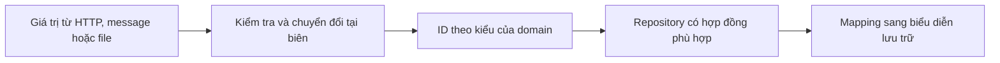

# Chọn kiểu miền và kiểu ID chính xác

Khai báo `CrudRepository<Customer, Long>` thiết lập hai phần của hợp đồng: repository quản lý đối tượng `Customer` và nhận định danh có kiểu `Long`. Đây là thông tin để trình biên dịch kiểm tra lời gọi và để hạ tầng Spring Data xác định metadata của repository.

Trong module `SPRING_DATA_COMMONS`, cặp kiểu này còn là nền tảng cho CRUD, derived query, phân trang, projection, Query by Example và các phần mở rộng repository. Nếu chọn sai ngay từ đầu, mã nguồn có thể làm việc với nhầm đối tượng, nhận sai kiểu định danh hoặc thất bại khi đi đến module lưu trữ.

Bài tập trung vào cách chọn `T` và `ID` theo mô hình Java cùng mapping thực tế. Ví dụ JPA dùng `jakarta.persistence`; ví dụ MongoDB được tách riêng vì quy ước ánh xạ của các module khác nhau.

## 1. Hiểu hai tham số kiểu của repository

Hợp đồng nền của Spring Data có dạng:

```java
Repository<T, ID>
```

Trong đó:

- `T` là domain type do repository quản lý.
- `ID` là kiểu Java biểu diễn định danh của domain type đó.

`CrudRepository<T, ID>` bổ sung các thao tác CRUD. Một phần hợp đồng có dạng:

```java
<S extends T> S save(S entity);

java.util.Optional<T> findById(ID id);

boolean existsById(ID id);

void deleteById(ID id);

Iterable<T> findAll();
```

Khi thay bằng `CrudRepository<Customer, Long>`, `findById` nhận `Long` và trả `Optional<Customer>`. Một projection hoặc một giá trị tìm kiếm khác không tự thay thế cặp kiểu này.

Commons dùng `Repository` để ghi nhận domain type và kiểu định danh. Module lưu trữ sử dụng thông tin đó cùng metadata mapping để cung cấp hành vi phù hợp. [Spring Data Commons — Core concepts](https://docs.spring.io/spring-data/commons/reference/repositories/core-concepts.html)

### Ví dụ đọc đúng hợp đồng

```java
import org.springframework.data.repository.CrudRepository;

public interface CustomerRepository
        extends CrudRepository<Customer, Long> {
}
```

| Thành phần | Thông tin đã khai báo |
| --- | --- |
| `Customer` | Đối tượng được quản lý |
| `Long` | Kiểu tham số của các thao tác theo định danh |
| `CrudRepository` | Tập thao tác CRUD muốn công bố |

Generic không thay thế cấu hình lưu trữ. Khai báo trên chưa tự đánh dấu `Customer` là entity JPA, chưa tạo collection MongoDB và chưa quyết định cách sinh ID.

## 2. Chọn domain type: đối tượng nào thực sự được quản lý?

Hãy bắt đầu bằng câu hỏi: “Repository này chịu trách nhiệm đọc và lưu đối tượng miền nào?”

Ví dụ ứng dụng có:

- `Customer`: mô hình được lưu theo mapping của module.
- `CreateCustomerRequest`: dữ liệu đầu vào từ API.
- `CustomerResponse`: biểu diễn trả về cho client.
- `CustomerSummary`: projection cho một màn hình danh sách.
- `CustomerService`: thành phần điều phối nghiệp vụ.

Với repository quản lý khách hàng, `T` thường là `Customer`. Các kiểu còn lại có vai trò khác trong ứng dụng.

```java
// Hợp đồng quản lý Customer.
public interface CustomerRepository
        extends CrudRepository<Customer, Long> {
}
```

Không chọn `CustomerResponse` làm `T` chỉ vì một endpoint trả kiểu đó. Trong trường hợp response không phải persistent domain type được module quản lý, repository đó không có mapping thích hợp để thực hiện CRUD.

### 2.1. Kiểu kết quả của query có thể khác domain type

Một repository vẫn có thể trả projection:

```java
public interface CustomerSummary {

    String getEmail();
}
```

```java
import java.util.List;
import org.springframework.data.repository.CrudRepository;

public interface CustomerRepository
        extends CrudRepository<Customer, Long> {

    List<CustomerSummary> findByEmailStartingWith(String prefix);
}
```

Ví dụ giả định `Customer` có thuộc tính `email` và module lưu trữ hỗ trợ dạng projection, derived query này. `CustomerSummary` mô tả kết quả của một method; domain type của repository vẫn là `Customer`.

Điều tương tự áp dụng khi một query trả DTO, `Page<CustomerSummary>` hoặc một giá trị tổng hợp. Không thay `T` theo từng kiểu kết quả.

### 2.2. Aggregate và ranh giới repository

Trong thiết kế theo aggregate, repository thường gắn với aggregate root. Chọn domain type vì nó đại diện đơn vị dữ liệu và hành vi mà ứng dụng muốn quản lý, thay vì chỉ vì tìm thấy một bảng có tên tương ứng.

Một số module áp dụng ngữ nghĩa aggregate chặt hơn các module khác. Không suy ra mọi entity có quan hệ trong JPA đều bắt buộc phải có repository riêng, cũng không suy ra mọi module đều quản lý quan hệ giống JPA.

### 2.3. Kế thừa không loại bỏ yêu cầu mapping

Chữ ký `<S extends T> S save(S entity)` cho phép subtype theo hợp đồng Java. Để lưu một subtype cụ thể, module và mapping vẫn phải hỗ trợ subtype đó.

Ví dụ, việc một lớp kế thừa `Customer` không tự làm cho lớp đó trở thành entity JPA hợp lệ. Một DTO có vài field giống `Customer` cũng không trở thành subtype hoặc domain type tương ứng.

## 3. Chọn ID theo thuộc tính định danh được mapping

Xét một domain JPA đơn giản. Mỗi kiểu public trong các ví dụ đặt ở một file riêng.

```java
import jakarta.persistence.Column;
import jakarta.persistence.Entity;
import jakarta.persistence.GeneratedValue;
import jakarta.persistence.GenerationType;
import jakarta.persistence.Id;
import jakarta.persistence.Table;

@Entity
@Table(name = "customers")
public class Customer {

    @Id
    @GeneratedValue(strategy = GenerationType.IDENTITY)
    private Long customerId;

    @Column(nullable = false, unique = true)
    private String email;

    protected Customer() {
    }

    public Customer(String email) {
        this.email = email;
    }

    public Long getCustomerId() {
        return customerId;
    }

    public String getEmail() {
        return email;
    }
}
```

Định danh là thuộc tính `customerId` có kiểu `Long`. Repository tương ứng là:

```java
public interface CustomerRepository
        extends org.springframework.data.repository.CrudRepository
                <Customer, Long> {
}
```

Cách gọi phù hợp:

```java
customers.findById(42L);

// Với hợp đồng CustomerRepository ở trên:
// customers.findById("42"); // Sai kiểu: String không phải Long.
// customers.findById(42);   // Sai kiểu: int không tự thành Long ở lời gọi này.
```

`42L` là literal `long` có thể được boxing thành `Long`. Điều đó khác với việc truyền literal `int` hoặc chuỗi ký tự.

### 3.1. Không chọn ID theo tên bảng hoặc kiểu cột

Kiểu SQL của khóa chính là thông tin của tầng lưu trữ. `ID` trong repository là kiểu Java của định danh theo mapping.

Ví dụ:

| Định danh trong mô hình Java | Kiểu repository cần đối chiếu |
| --- | --- |
| `Long customerId` | `Long` |
| `UUID id` | `UUID` |
| `String code` được đánh dấu là ID | `String` |
| `OrderLineId id` là embedded ID | `OrderLineId` |

Một cột UUID được lưu bằng ký tự hoặc binary không tự biến ID của repository thành `String` hay `byte[]`. Converter và mapping quyết định biểu diễn vật lý; hợp đồng Java vẫn cần nhất quán.

### 3.2. Wrapper và primitive

Java không cho dùng primitive làm tham số generic:

```java
// Không hợp lệ trong Java:
// CrudRepository<Customer, long>
```

Nếu một mô hình có định danh primitive `long`, tham số generic tương ứng dùng `Long`. Với các ID sinh sau khi lưu, wrapper thường giúp biểu diễn rõ trạng thái chưa có giá trị bằng `null`.

Tuy nhiên, việc entity mới hay đã tồn tại không chỉ được suy ra từ lựa chọn wrapper. Cơ chế xác định trạng thái mới còn phụ thuộc module và cấu hình, được bàn ở phần 8.

### 3.3. Một thuộc tính unique chưa tự trở thành ID

Trong `Customer`, email có ràng buộc unique nhưng định danh JPA vẫn là `customerId`. Tìm theo email nên được diễn tả bằng method phù hợp:

```java
java.util.Optional<Customer> findByEmail(String email);
```

Không đổi repository thành `CrudRepository<Customer, String>` chỉ vì màn hình đang tìm khách hàng bằng email. Định danh kỹ thuật và khóa tìm kiếm nghiệp vụ có thể cùng tồn tại.

Nếu mô hình chủ động chọn một business key làm ID, mapping phải thể hiện lựa chọn đó và thiết kế cần xét tính ổn định của giá trị. Ràng buộc unique đơn thuần không thực hiện thay đổi này.

## 4. `findById` tìm định danh, không phụ thuộc tên field là `id`

Trong ví dụ `Customer`, method kế thừa `findById(Long)` tìm theo `customerId` vì đó là thuộc tính định danh.

Không cần đổi tên field thành `id` chỉ để method CRUD hoạt động.

Những method dành riêng như `findById` của hợp đồng cơ sở hướng đến identifier property. Nếu domain còn có một thuộc tính thông thường cũng tên `id`, phải tránh nhầm nó với định danh thực tế. Khi cần derived query cho thuộc tính đó, có thể dùng tên mô tả rõ hơn như `findCustomerById` theo mô hình cụ thể. [Spring Data Commons — Reserved Method Names](https://docs.spring.io/spring-data/commons/reference/repositories/query-methods-details.html#repositories.query-methods.query-creation.reserved-methods)

Ví dụ đọc hợp đồng theo metadata:

```text
Customer.customerId: Long, được mapping là định danh
Customer.email: String, khóa tìm kiếm có ràng buộc unique

findById(Long)       -> định danh customerId
findByEmail(String)  -> thuộc tính email
```

Tên method không phải lý do để đổi `ID` sang kiểu của một field khác.

## 5. Phân biệt ID trong domain với ID ở biên ứng dụng

Một HTTP path như `/customers/42` chứa biểu diễn dạng văn bản. Điều đó không có nghĩa repository phải nhận `String`.

Luồng xử lý hợp lý là:



Ví dụ trong một method đã có biến `rawId` và repository:

```java
Long customerId = Long.valueOf(rawId);
java.util.Optional<Customer> customer =
        customers.findById(customerId);
```

Chuỗi không hợp lệ cần được xử lý theo hợp đồng của tầng tiếp nhận. Lỗi định dạng đầu vào khác với việc ID hợp lệ nhưng không tìm thấy dữ liệu.

Không sửa repository thành kiểu rộng hơn chỉ để tránh chuyển đổi ở biên.

### 5.1. Trường hợp UUID

Giả sử một entity `Note` có định danh Java là `java.util.UUID`:

```java
// Phần mapping ID bên trong entity Note.
@jakarta.persistence.Id
private java.util.UUID id;
```

Repository chọn:

```java
import java.util.UUID;
import org.springframework.data.repository.CrudRepository;

public interface NoteRepository extends CrudRepository<Note, UUID> {
}
```

Ở biên ứng dụng:

```java
java.util.UUID noteId = java.util.UUID.fromString(rawNoteId);
java.util.Optional<Note> note = notes.findById(noteId);
```

Đoạn mapping trên chỉ minh họa kiểu ID. Việc UUID được ứng dụng gán hay provider sinh ra là một quyết định riêng; cần cấu hình phù hợp với nền tảng đang sử dụng.

Việc một UUID có thể in thành chuỗi không làm cho `CrudRepository<Note, String>` trở thành hợp đồng tương đương.

### 5.2. Phân biệt ID của hai loại đối tượng

Nếu cả `Customer` và `Order` đều dùng `Long`, Java vẫn cho truyền một giá trị `Long` lấy từ order vào `CustomerRepository.findById`. Generic phân biệt kiểu Java, chưa phân biệt nguồn gốc nghiệp vụ của mọi giá trị.

Ứng dụng có thể dùng value object ở API service:

```java
import java.util.Objects;

public record CustomerId(Long value) {

    public CustomerId {
        Objects.requireNonNull(value, "value");
    }
}
```

Một service nhận `CustomerId` rồi truyền `id.value()` cho repository có ID `Long`. Cách này bổ sung sự phân biệt ở tầng nghiệp vụ mà vẫn giữ hợp đồng repository theo mapping hiện có.

Muốn repository nhận trực tiếp `CustomerId`, phải có mapping định danh hỗ trợ kiểu đó. Chỉ đổi generic không tự tạo converter hoặc embedded mapping; đặc biệt không mặc định mọi JPA provider đều chấp nhận một value object tùy ý làm `@Id`.

## 6. ID ghép: chọn kiểu đại diện toàn bộ khóa

Giả sử mỗi dòng đơn hàng được xác định bởi hai giá trị:

- `orderId`: mã đơn hàng.
- `lineNumber`: số thứ tự dòng trong đơn.

Một `Long` đơn lẻ không biểu diễn đủ định danh này. Với JPA, có thể dùng `@EmbeddedId` hoặc `@IdClass` theo mapping đã chọn.

### 6.1. Ví dụ dùng `@EmbeddedId`

Lớp khóa:

```java
import java.io.Serializable;
import java.util.Objects;

import jakarta.persistence.Column;
import jakarta.persistence.Embeddable;

@Embeddable
public class OrderLineId implements Serializable {

    private static final long serialVersionUID = 1L;

    @Column(name = "order_id")
    private Long orderId;

    @Column(name = "line_no")
    private Integer lineNumber;

    public OrderLineId() {
    }

    public OrderLineId(Long orderId, Integer lineNumber) {
        this.orderId = Objects.requireNonNull(orderId, "orderId");
        this.lineNumber =
                Objects.requireNonNull(lineNumber, "lineNumber");
    }

    public Long getOrderId() {
        return orderId;
    }

    public Integer getLineNumber() {
        return lineNumber;
    }

    @Override
    public boolean equals(Object other) {
        if (this == other) {
            return true;
        }
        if (!(other instanceof OrderLineId)) {
            return false;
        }
        OrderLineId that = (OrderLineId) other;
        return Objects.equals(orderId, that.orderId)
                && Objects.equals(lineNumber, that.lineNumber);
    }

    @Override
    public int hashCode() {
        return Objects.hash(orderId, lineNumber);
    }
}
```

Entity chứa toàn bộ khóa:

```java
import jakarta.persistence.EmbeddedId;
import jakarta.persistence.Entity;
import jakarta.persistence.Table;

@Entity
@Table(name = "order_lines")
public class OrderLine {

    @EmbeddedId
    private OrderLineId id;

    private String sku;

    protected OrderLine() {
    }

    public OrderLine(OrderLineId id, String sku) {
        this.id = id;
        this.sku = sku;
    }

    public OrderLineId getId() {
        return id;
    }

    public String getSku() {
        return sku;
    }
}
```

Repository:

```java
import org.springframework.data.repository.CrudRepository;

public interface OrderLineRepository
        extends CrudRepository<OrderLine, OrderLineId> {
}
```

Tìm theo khóa đầy đủ:

```java
OrderLineId key = new OrderLineId(1001L, 2);
java.util.Optional<OrderLine> line = orderLines.findById(key);
```

Không dùng `CrudRepository<OrderLine, Long>` chỉ vì thành phần đầu tiên của khóa là `Long`. Cũng không dùng một chuỗi ghép như `"1001:2"` làm `ID` nếu mapping đang khai báo `OrderLineId`.

Hai đối tượng `new OrderLineId(1001L, 2)` phải có cùng ngữ nghĩa giá trị. Các method `equals` và `hashCode` cần xét đầy đủ thành phần khóa.

Ví dụ lớp khóa dùng cách khai báo tương thích với yêu cầu Jakarta Persistence 3.1: lớp public, constructor public không tham số, `Serializable` và equality/hash code theo giá trị khóa. Không thay đổi khóa của một entity đã được gán định danh trong persistence context. [Jakarta Persistence 3.1 — Primary Keys and Entity Identity](https://jakarta.ee/specifications/persistence/3.1/jakarta-persistence-spec-3.1.html)

### 6.2. Nếu dùng `@IdClass`

Với `@IdClass(OrderLineKey.class)` và các thuộc tính khóa tương ứng trên entity, generic ID là `OrderLineKey`. Nó vẫn đại diện toàn bộ khóa, dù entity không có một field duy nhất mang kiểu `OrderLineKey`.

Với các thành phần khóa scalar thông thường, tên và kiểu của chúng trong ID class cần khớp mapping trên entity. Quan hệ và derived identity có quy tắc riêng; không áp dụng một quy tắc sao chép field đơn giản cho mọi mô hình.

Quyết định `@EmbeddedId` hay `@IdClass` thuộc mapping JPA. Hợp đồng repository phải đi theo mapping đã lựa chọn.

## 7. ID kế thừa và repository cơ sở

### 7.1. ID có thể được khai báo ở superclass

Một entity có thể kế thừa thuộc tính định danh từ một `@MappedSuperclass` hoặc một hệ phân cấp entity được mapping hợp lệ.

Khi đọc domain type, đừng kết luận “không thấy `@Id` trong file lớp con thì lớp này không có ID”. Cần kiểm tra metadata thực tế, bao gồm superclass và cách truy cập field/property.

Nếu `Invoice` kế thừa định danh `Long`, repository vẫn cần hợp đồng tương ứng:

```java
public interface InvoiceRepository
        extends org.springframework.data.repository.CrudRepository
                <Invoice, Long> {
}
```

Repository không tự đổi domain type thành superclass chỉ vì superclass chứa thuộc tính ID.

### 7.2. Không cố định `Long` cho mọi repository

Một base interface tái sử dụng nên giữ cả hai tham số khi các domain có thể dùng nhiều loại ID:

```java
import org.springframework.data.repository.CrudRepository;
import org.springframework.data.repository.NoRepositoryBean;

@NoRepositoryBean
public interface BaseRepository<T, ID>
        extends CrudRepository<T, ID> {
}
```

Các repository cụ thể chốt kiểu:

```java
public interface CustomerRepository
        extends BaseRepository<Customer, Long> {
}
```

```java
public interface NoteRepository
        extends BaseRepository<Note, java.util.UUID> {
}
```

Đây là các cách khai báo thay thế cho repository tương ứng ở phần trước; không tạo hai interface cùng tên trong một package.

`@NoRepositoryBean` đánh dấu interface trung gian mà hạ tầng không nên tạo bean trực tiếp. Repository cụ thể cần chốt được domain type và kiểu ID qua cây kế thừa. [Spring Data Commons — Defining Repository Interfaces](https://docs.spring.io/spring-data/commons/reference/repositories/definition.html)

Nếu một hệ thống chủ động quy định mọi entity đều dùng `Long`, base repository cố định ID có thể diễn tả quy ước đó. Khi xuất hiện domain dùng `UUID` hoặc khóa ghép, cần thay đổi thiết kế thay vì ép giá trị về `Long`.

## 8. Kiểu ID và chiến lược xác định entity mới là hai vấn đề

Sau khi chọn `ID`, vẫn cần biết giá trị đó được tạo lúc nào và module quyết định thao tác lưu ra sao.

| Câu hỏi | Ví dụ câu trả lời |
| --- | --- |
| ID có kiểu gì? | `Long`, `UUID`, `String` hoặc một lớp khóa |
| Ai gán giá trị? | Database, provider hoặc ứng dụng |
| Gán vào thời điểm nào? | Trước lời gọi lưu hoặc trong quá trình lưu |
| Entity được coi là mới bằng cách nào? | Theo metadata và chiến lược của module |
| Lưu được thực hiện ra sao? | Theo triển khai của kho dữ liệu |

Với JPA, cách mặc định xác định mới xét thuộc tính version phù hợp, rồi xét ID khi không có version đó. Nếu entity thực hiện `Persistable`, Spring Data JPA có thể ủy quyền quyết định cho `isNew()`. [Spring Data JPA — Persisting Entities](https://docs.spring.io/spring-data/jpa/reference/jpa/entity-persistence.html)

Ví dụ một entity có UUID do ứng dụng gán trước khi lưu sẽ có ID khác `null` từ đầu. Điều này chưa chứng minh entity đã tồn tại trong database. Cần thiết kế cách nhận diện mới thích hợp, thay vì đổi generic ID sang một kiểu khác.

Tương tự, khóa ghép thường đã được gán đầy đủ trước lời gọi `save`. Không dùng việc “có đủ khóa” làm bằng chứng duy nhất rằng bản ghi đã tồn tại.

Khi làm việc với `Persistable<ID>`, kiểu ID trả về từ `getId()` cần nhất quán với domain và repository. Interface này không tự thay đổi kiểu primary key hoặc tự sinh giá trị cho bạn.

Không áp dụng nguyên xi ngữ nghĩa `persist`, `merge` hay persistence context của JPA cho mọi module chỉ vì chúng cùng dùng `CrudRepository`.

## 9. Khác biệt giữa JPA và MongoDB khi nhận diện ID

### 9.1. Chú ý import của annotation

Hai annotation có cùng tên ngắn nhưng thuộc hệ mapping khác nhau:

| Ngữ cảnh ví dụ | Annotation định danh |
| --- | --- |
| Entity JPA | `jakarta.persistence.Id` |
| Document theo Spring Data MongoDB | `org.springframework.data.annotation.Id` hoặc cấu hình MongoDB tương ứng |

Không chọn annotation chỉ vì IDE đưa nó lên đầu danh sách gợi ý. Module đang sử dụng phải nhận diện đúng metadata.

### 9.2. Kiểu Java có thể khác biểu diễn BSON

Ví dụ một domain MongoDB có:

```java
import org.springframework.data.annotation.Id;
import org.springframework.data.mongodb.core.mapping.Document;

@Document("tickets")
public class Ticket {

    @Id
    private String id;

    private String title;

    public Ticket() {
    }

    public Ticket(String id, String title) {
        this.id = id;
        this.title = title;
    }

    public String getId() {
        return id;
    }

    public String getTitle() {
        return title;
    }
}
```

Repository theo mô hình Java đó:

```java
import org.springframework.data.repository.CrudRepository;

public interface TicketRepository
        extends CrudRepository<Ticket, String> {
}
```

Với quy tắc mapping mặc định phù hợp, một `String` dùng làm ID có thể được chuyển sang BSON `ObjectId` khi giá trị chuyển đổi được; các lựa chọn như `@MongoId` còn điều khiển cách chuyển đổi. Vì thế, cần đọc cả kiểu Java lẫn cấu hình mapping, thay vì nhìn dữ liệu MongoDB rồi tự đổi generic sang `ObjectId`. [Spring Data MongoDB — Object Mapping](https://docs.spring.io/spring-data/mongodb/reference/mongodb/mapping/mapping.html#mapping-usage.id-handling)

Nếu thuộc tính ID của domain thực sự có kiểu `org.bson.types.ObjectId`, repository chọn `ObjectId` tương ứng. ID Java `String` và ID Java `ObjectId` là hai hợp đồng khác nhau, dù một converter có thể liên hệ chúng.

Khi dữ liệu được ghi bởi nhiều ứng dụng, cần xét cả biểu diễn thực tế đã lưu. Việc các giá trị có cùng chuỗi hiển thị chưa bảo đảm chúng có cùng kiểu BSON hoặc cùng ngữ nghĩa truy vấn.

## 10. Những cách làm mất an toàn kiểu

### 10.1. Dùng raw type

```java
// Ví dụ cần tránh:
org.springframework.data.repository.CrudRepository raw = customers;
raw.findById("khong-phai-long");
```

Raw type làm mất thông tin `Customer` và `Long` tại điểm sử dụng. Trình biên dịch có thể chỉ cảnh báo, còn vấn đề bị đẩy đến lúc chạy.

Giữ kiểu cụ thể:

```java
CustomerRepository typed = customers;
typed.findById(42L);
```

Không dùng raw type để “hỗ trợ mọi loại ID” trong một service generic.

### 10.2. Dùng `Object` hoặc `Serializable` làm ID chung

`Object` nhận được nhiều giá trị nhưng không diễn tả hợp đồng ID thực tế. `Serializable` cũng chỉ mô tả một khả năng của đối tượng, không bảo đảm nó là định danh đúng của `Customer`.

Một service thật sự generic cần truyền tiếp tham số `ID` trong thiết kế, hoặc dùng một adapter có chuyển đổi và kiểm tra rõ ràng. Không bỏ thông tin kiểu chỉ để làm chữ ký method ngắn hơn.

### 10.3. Khai báo sai nhưng vẫn qua biên dịch

Ví dụ sau có thể qua bước biên dịch Java:

```java
// Customer vẫn có ID mapping là Long.
public interface WrongCustomerRepository
        extends org.springframework.data.repository.CrudRepository
                <Customer, String> {
}
```

Java không tự đọc annotation JPA để chứng minh generic `String` mâu thuẫn với field `Long`. Hạ tầng repository và module lưu trữ xử lý metadata ở các bước khác.

Lỗi có thể xuất hiện khi tạo repository, chuyển đổi tham số hoặc thực thi một thao tác, tùy module và cấu hình. Không dùng một lần khởi động thành công làm bằng chứng mọi cặp generic đều đúng.

### 10.4. Ép kiểu thay cho sửa hợp đồng

Ép một `String` thành `Object` rồi truyền qua raw repository không chuyển nó thành một `Long` đúng nghĩa. Nếu đầu vào có biểu diễn khác, hãy chuyển đổi có chủ đích trước khi gọi repository.

Tương tự, ép generic của một repository không làm thay đổi domain type mà factory đã dùng để tạo bean. Cần sửa khai báo và mapping theo thiết kế mong muốn.

## 11. Quy trình xác nhận một cặp `<T, ID>`

Trước khi thêm nhiều query method, hãy trả lời lần lượt:

1. **Domain type là gì?** Xác định đối tượng thật sự được module quản lý, cùng ranh giới aggregate nếu áp dụng.
2. **Module nào nhận mapping?** JPA, MongoDB hoặc module khác; kiểm tra đúng annotation và cấu hình.
3. **Định danh nằm ở đâu?** Field, getter, superclass, embedded ID hoặc ID class.
4. **Kiểu Java đầy đủ là gì?** Phân biệt `Long` với `Integer`, `UUID` với `String` và lớp khóa với một thành phần khóa.
5. **Cây kế thừa generic chốt ra kiểu nào?** Kiểm tra cả base repository.
6. **Đầu vào ngoài ứng dụng được chuyển thế nào?** Xác định điểm parse hoặc adapter trước lời gọi repository.
7. **ID được tạo và nhận diện mới thế nào?** Kiểm tra chiến lược theo module.
8. **Có thể lưu rồi đọc lại bằng đúng ID không?** Xác nhận trong một dự án thực hành đã có hạ tầng phù hợp.

Bảng đối chiếu nhanh:

| Mô hình đã mapping | Cặp kiểu repository |
| --- | --- |
| `Customer` có `@Id Long customerId` | `<Customer, Long>` |
| `Note` có `@Id UUID id` | `<Note, UUID>` |
| `Ticket` có ID Java `String` | `<Ticket, String>` |
| `Ticket` có ID Java `ObjectId` | `<Ticket, ObjectId>` |
| `OrderLine` có `@EmbeddedId OrderLineId id` | `<OrderLine, OrderLineId>` |
| `OrderLine` dùng `@IdClass(OrderLineKey.class)` | `<OrderLine, OrderLineKey>` |

Trong bài thực hành, nên kiểm tra một lần lưu và một lần đọc lại với chính ID được dùng sau lưu. Không cố định ID sinh tự động phải bằng `1` và không dùng tên lớp proxy để kiểm tra kiểu miền.

Với khóa ghép, đối chiếu thêm equality/hash code của hai khóa có cùng giá trị. Với UUID hoặc đầu vào số, tách riêng lỗi parse đầu vào với kết quả không tìm thấy.

## 12. Tình huống tự luyện

### Tình huống A: URL là chuỗi, entity dùng `Long`

`Customer` có định danh `Long`, endpoint nhận đường dẫn `/customers/123`. Một lập trình viên đề xuất đổi repository sang `String` để truyền nguyên đoạn URL.

**Lựa chọn phù hợp:** giữ `<Customer, Long>` và chuyển đầu vào sang `Long` tại biên ứng dụng. Kiểu biểu diễn trên HTTP không quyết định generic repository.

### Tình huống B: email unique

`Customer` có khóa chính `Long customerId` và email unique. Màn hình đăng nhập tìm theo email.

**Lựa chọn phù hợp:** giữ ID `Long`, bổ sung query method theo email. Không thay đổi định danh chỉ vì một use case dùng khóa tìm kiếm khác.

### Tình huống C: projection có ít field hơn

Một query trả `CustomerSummary` chỉ chứa email. Nhóm phát triển muốn đổi repository thành `CrudRepository<CustomerSummary, Long>`.

**Lựa chọn phù hợp:** domain type vẫn là `Customer`; projection nằm ở chữ ký query method. Chỉ chọn `CustomerSummary` làm domain khi chính nó thật sự là một kiểu được mapping và quản lý theo thiết kế khác.

### Tình huống D: khóa có hai thành phần

`OrderLine` dùng `OrderLineId(orderId, lineNumber)` nhưng repository đang nhận `Long`.

**Lựa chọn phù hợp:** dùng `OrderLineId` làm ID và truyền toàn bộ khóa cho thao tác theo định danh. Tìm mọi dòng của một đơn hàng là một truy vấn khác với tìm một dòng bằng khóa đầy đủ.

### Tình huống E: UUID đã có giá trị trước lưu

Một entity mới được gán UUID trong ứng dụng. Nhóm phát triển suy ra nó phải được coi là entity cũ vì ID khác `null`.

**Lựa chọn phù hợp:** tách kiểu ID khỏi chiến lược nhận diện mới. Đối chiếu version, `Persistable` hoặc cơ chế module hỗ trợ thay vì đổi kiểu generic.

Cặp `<Domain, ID>` chính xác nối hợp đồng Java với metadata lưu trữ. Khi cặp này nhất quán, các thao tác CRUD và những abstraction tiếp theo của Commons có một nền tảng rõ ràng để hoạt động theo khả năng của từng kho dữ liệu.
