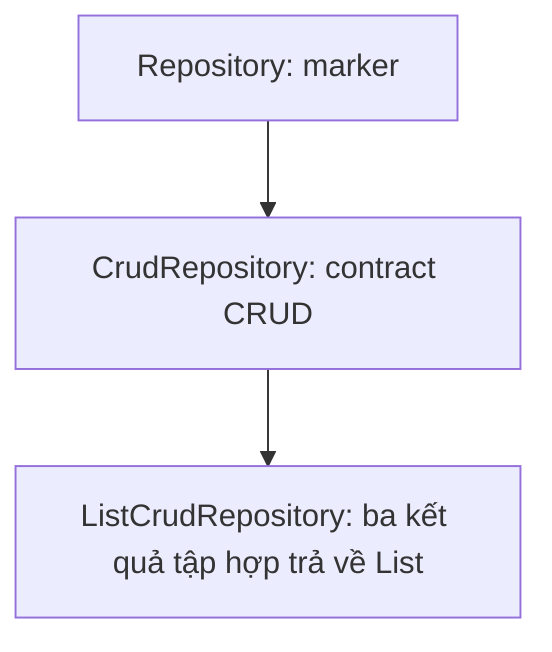

# CrudRepository và ListCrudRepository

`CrudRepository<T, ID>` cung cấp contract cho những thao tác dữ liệu phổ biến: tạo hoặc lưu thay đổi, tìm theo định danh, kiểm tra tồn tại, đếm và xóa. `ListCrudRepository<T, ID>` mở rộng contract đó để một số phương thức trả về `List` thay cho `Iterable`.

Sự khác biệt này làm mã gọi thuận tiện hơn, nhưng không thay đổi bản chất kho dữ liệu. Chọn `ListCrudRepository` không tự làm truy vấn có thứ tự, không bật phân trang và không biến thao tác nhiều phần tử thành một câu lệnh batch.

Bài học thuộc chương **Giao diện repository** của mô-đun **SPRING_DATA_COMMONS**. Chúng ta tìm hiểu cách đọc hai interface, chọn contract phù hợp và sử dụng đúng kết quả của các phương thức CRUD.

## 1. Quan hệ giữa ba interface

`Repository<T, ID>` là marker interface gốc và không khai báo phương thức CRUD. `CrudRepository` bổ sung các thao tác dữ liệu. `ListCrudRepository` kế thừa chúng và thu hẹp kiểu trả về của ba phương thức.



Trong các khai báo này:

- `T` là kiểu đối tượng miền được quản lý.
- `ID` là kiểu định danh của đối tượng đó.
- Với phương thức lưu, `S extends T` giữ thông tin kiểu của đối tượng đầu vào trong kiểu trả về.

`ListCrudRepository` có từ Spring Data Commons 3.0. Các ví dụ sử dụng contract của dòng API này trở lên; dự án cần một bộ phiên bản Spring Data tương thích có chứa interface đó.

Commons định nghĩa contract. Để thực thi CRUD, vẫn cần mô-đun lưu trữ như Spring Data JPA hoặc Spring Data MongoDB và cấu hình phù hợp.

## 2. Các phương thức của CrudRepository

Có thể đọc contract theo từng nhóm:

| Nhóm | Chữ ký tiêu biểu | Ý nghĩa |
| --- | --- | --- |
| Lưu một đối tượng | `<S extends T> S save(S entity)` | Lưu đối tượng và trả về kết quả sau khi lưu |
| Lưu nhiều đối tượng | `<S extends T> Iterable<S> saveAll(Iterable<S> entities)` | Lưu các đối tượng đầu vào |
| Đọc theo ID | `Optional<T> findById(ID id)` | Tìm một đối tượng theo định danh |
| Kiểm tra tồn tại | `boolean existsById(ID id)` | Kiểm tra có đối tượng tương ứng hay không |
| Đọc toàn bộ | `Iterable<T> findAll()` | Đọc các đối tượng thuộc phạm vi repository |
| Đọc theo nhiều ID | `Iterable<T> findAllById(Iterable<ID> ids)` | Đọc những đối tượng có định danh được yêu cầu |
| Đếm | `long count()` | Đếm số đối tượng theo phạm vi thực thi |
| Xóa theo ID | `void deleteById(ID id)` | Xóa đối tượng tương ứng định danh |
| Xóa một đối tượng | `void delete(T entity)` | Xóa đối tượng được cung cấp |
| Xóa theo nhiều ID | `void deleteAllById(Iterable<? extends ID> ids)` | Xóa theo tập định danh |
| Xóa nhiều đối tượng | `void deleteAll(Iterable<? extends T> entities)` | Xóa các đối tượng được cung cấp |
| Xóa toàn bộ | `void deleteAll()` | Xóa toàn bộ đối tượng thuộc phạm vi thao tác repository |

Đây là contract chung, không phải mô tả số câu SQL, thời điểm flush hoặc chi tiết API driver.

Những tham số mà contract yêu cầu không null phải được cung cấp hợp lệ. Chẳng hạn, không dùng `findById(null)` để biểu thị “chưa chọn đối tượng”; hãy xử lý trường hợp đó ở bên gọi.

Với đầu vào nhiều phần tử, không truyền một tập chứa phần tử null rồi kỳ vọng repository tự bỏ qua.

## 3. Chính xác ListCrudRepository thay đổi điều gì?

Dạng rút gọn của interface là:

```java
import java.util.List;

import org.springframework.data.repository.CrudRepository;

public interface ListCrudRepository<T, ID>
        extends CrudRepository<T, ID> {

    @Override
    <S extends T> List<S> saveAll(Iterable<S> entities);

    @Override
    List<T> findAll();

    @Override
    List<T> findAllById(Iterable<ID> ids);
}
```

Đây là minh họa contract, không phải interface cần tự tạo trong dự án. Khi sử dụng, import `org.springframework.data.repository.ListCrudRepository`.

Chỉ ba phương thức trên đổi kiểu trả về:

| Phương thức | CrudRepository | ListCrudRepository |
| --- | --- | --- |
| `saveAll(...)` | `Iterable<S>` | `List<S>` |
| `findAll()` | `Iterable<T>` | `List<T>` |
| `findAllById(...)` | `Iterable<T>` | `List<T>` |

Các phương thức như `save`, `findById`, `count` và `deleteById` được kế thừa mà không có sự thay đổi kiểu trả về này.

Đầu vào của `saveAll` và `findAllById` vẫn là `Iterable`. Không cần chuyển mọi đầu vào thành `List` chỉ vì chọn `ListCrudRepository`.

Java cho phép thu hẹp kiểu trả về tương thích khi override. Vì `List<T>` cũng là một `Iterable<T>`, contract mới vẫn tương thích với khả năng duyệt phần tử mà contract cha cung cấp.

## 4. Mô hình và repository dùng trong ví dụ

Phần minh họa chọn Spring Data JPA với mapping Jakarta Persistence. Ví dụ entity tối thiểu:

```java
package example.crud.domain;

import jakarta.persistence.Entity;
import jakarta.persistence.GeneratedValue;
import jakarta.persistence.Id;
import jakarta.persistence.Table;

@Entity
@Table(name = "products")
public class Product {

    @Id
    @GeneratedValue
    private Long id;

    private String name;

    protected Product() {
    }

    public Product(String name) {
        rename(name);
    }

    public void rename(String name) {
        if (name == null || name.isBlank()) {
            throw new IllegalArgumentException(
                "Tên sản phẩm không được rỗng"
            );
        }

        this.name = name.trim();
    }

    public Long getId() {
        return id;
    }

    public String getName() {
        return name;
    }
}
```

Hai repository phục vụ so sánh:

```java
package example.crud.data;

import example.crud.domain.Product;

import org.springframework.data.repository.CrudRepository;

public interface ProductCrudRepository
        extends CrudRepository<Product, Long> {
}
```

```java
package example.crud.data;

import example.crud.domain.Product;

import org.springframework.data.repository.ListCrudRepository;

public interface ProductListRepository
        extends ListCrudRepository<Product, Long> {
}
```

Ứng dụng thường chỉ cần chọn một contract phù hợp cho cùng nhu cầu. Không cần tạo cả hai repository chỉ để được phép gọi CRUD.

Để các ví dụ thực thi, ứng dụng cần mapping, kết nối và cơ chế đăng ký repository của JPA. Các annotation entity phía trên là lựa chọn của môi trường JPA, không phải yêu cầu chung của Commons đối với mọi loại kho dữ liệu.

Những đoạn gọi tiếp theo nằm trong phương thức của một thành phần đã được cung cấp repository tương ứng.

## 5. Đọc dữ liệu: Iterable và List khác nhau ở contract của bên gọi

### 5.1. Với CrudRepository, hãy dựa vào khả năng Iterable cam kết

```java
Iterable<Product> products = productCrudRepository.findAll();

for (Product product : products) {
    System.out.println(product.getName());
}
```

`Iterable` cho phép duyệt. Nó không tự cung cấp `get(index)`, `size()` hoặc `stream()` trong interface của nó.

Không nên ép kiểu kết quả thành `List` chỉ vì một implementation hiện tại tình cờ trả về danh sách. Nếu bên gọi cần một danh sách, có thể chuyển đổi rõ ràng:

```java
import java.util.ArrayList;
import java.util.List;

List<Product> result = new ArrayList<>();

productCrudRepository.findAll().forEach(result::add);
```

Việc chuyển đổi có chi phí cấp phát và không tạo ra giới hạn dữ liệu.

### 5.2. Với ListCrudRepository, List là một phần của contract

```java
import java.util.List;

List<Product> products = productListRepository.findAll();

int numberOfProducts = products.size();

if (!products.isEmpty()) {
    Product first = products.get(0);
    System.out.println(first.getName());
}
```

`List` giúp thao tác với kết quả thuận tiện hơn, nhưng cần phân biệt:

- Có phần tử ở vị trí đầu không có nghĩa đó là sản phẩm mới nhất.
- Có `size()` không có nghĩa việc lấy toàn bộ dữ liệu là rẻ.
- Kiểu trả về `List` không cam kết đó là `ArrayList`, danh sách có thể sửa hoặc danh sách an toàn cho truy cập đồng thời.

Nếu cần sửa cấu trúc danh sách ở phía ứng dụng, có thể tạo bản sao phù hợp thay vì mặc định implementation cho phép thêm/xóa phần tử.

### 5.3. Kiểu biến quyết định những gì trình biên dịch nhìn thấy

```java
import org.springframework.data.repository.CrudRepository;

CrudRepository<Product, Long> repository = productListRepository;

Iterable<Product> products = repository.findAll();
```

Đối tượng repository hỗ trợ contract `ListCrudRepository`, nhưng biến đang được khai báo là `CrudRepository`. Bên gọi nhận kiểu trả về theo chữ ký của contract mà nó đang dùng.

Điều này hữu ích khi một thành phần chỉ cần abstraction tổng quát. Nếu cần cam kết kết quả là `List`, hãy công bố đúng contract thay vì dựa vào ép kiểu.

## 6. save: sử dụng kết quả và hiểu đúng ý nghĩa “lưu”

Ví dụ tạo sản phẩm:

```java
Product saved = productListRepository.save(
    new Product("Bàn phím cơ")
);

Long productId = saved.getId();
```

Bên gọi sử dụng đối tượng trả về để lấy định danh sau khi lưu. Không nên giả định mọi mô-đun luôn cập nhật chính đối tượng đầu vào theo cùng một cách.

Ở JPA, việc lưu có thể liên quan đến `persist` hoặc `merge`, tùy cách nhận diện trạng thái mới của entity. Kết quả của `merge` có thể là một instance khác với đối tượng được truyền vào.

### 6.1. Không suy ra insert hay update chỉ từ tên save

`save` là contract lưu, không phải một lệnh SQL có ngữ nghĩa cố định trong mọi kho dữ liệu.

Việc xác định đối tượng mới có thể liên quan đến ID, thuộc tính phiên bản hoặc chiến lược nhận diện khác của mô-đun. “ID khác null thì chắc chắn update” không phải quy tắc phổ quát.

Cũng không nên gán một ID bất kỳ vào đối tượng rồi kỳ vọng mọi mô-đun sẽ thực hiện cùng một kiểu upsert.

### 6.2. Ví dụ thay đổi dữ liệu đã đọc

```java
Product product = productListRepository.findById(productId)
    .orElseThrow(() ->
        new IllegalArgumentException("Không tìm thấy sản phẩm")
    );

product.rename("Bàn phím cơ bản mới");

Product saved = productListRepository.save(product);
```

Hành vi `rename` giữ quy tắc tên không rỗng. Repository thực hiện phần lưu trữ.

Trong JPA, thay đổi một entity đang được quản lý trong giao dịch có thể được phát hiện qua dirty checking mà không cần gọi `save` để kích hoạt từng thay đổi. Ví dụ vẫn gọi `save` để thể hiện contract repository; không nên suy ra mọi kho dữ liệu có cơ chế theo dõi entity như JPA.

Khi nghiệp vụ cần thao tác đọc–kiểm tra–ghi trong một giao dịch, phải đặt ranh giới giao dịch phù hợp. Hai lời gọi repository tách rời không tự chứng minh toàn bộ use case là nguyên tử.

## 7. saveAll: nhiều đầu vào, không phải cam kết batch

Với `ListCrudRepository`:

```java
import java.util.List;

List<Product> savedProducts = productListRepository.saveAll(
    List.of(
        new Product("Chuột không dây"),
        new Product("Đế laptop")
    )
);

for (Product saved : savedProducts) {
    System.out.println(saved.getId());
}
```

Kiểu trả về là `List<Product>`, nên bên gọi không cần tự chuyển từ `Iterable`.

Contract của `saveAll` yêu cầu kết quả có cùng số phần tử với đầu vào. Tuy nhiên, không nên dựa vào vị trí để gán thêm những giả định về cách thực thi mà contract không cam kết.

Đặc biệt:

- `saveAll` không đồng nghĩa với một câu SQL duy nhất.
- `ListCrudRepository` không tự bật JDBC batching.
- Số lần trao đổi với kho dữ liệu còn phụ thuộc mô-đun, chiến lược ID và cấu hình.
- Kết quả trả về nên được dùng khi cần ID hoặc trạng thái sau lưu.
- Khả năng rollback toàn bộ nhóm phụ thuộc ranh giới giao dịch và khả năng của công nghệ lưu trữ.

Tên “lưu tất cả” mô tả tập đầu vào mà thao tác xử lý. Nó không tự xác định cơ chế batch hoặc bảo đảm giao dịch xuyên mọi loại kho dữ liệu.

## 8. findAllById: thiếu ID và thứ tự kết quả

Giả sử `firstId` và `secondId` là hai ID lấy từ kết quả lưu thực tế:

```java
List<Product> found = productListRepository.findAllById(
    List.of(secondId, firstId)
);
```

Không được mặc định:

```text
found.get(0) luôn có ID bằng secondId
```

Contract không bảo đảm kết quả theo đúng thứ tự ID đầu vào.

Nếu một ID không tồn tại, phương thức không tạo một phần tử null hoặc một `Optional.empty()` giữ chỗ cho ID đó. Kết quả chỉ chứa các đối tượng tìm được; số phần tử có thể nhỏ hơn số ID được yêu cầu.

Nếu cần kết quả theo thứ tự yêu cầu, ứng dụng phải thực hiện bước sắp lại một cách rõ ràng. Ví dụ:

```java
import java.util.List;
import java.util.Map;
import java.util.Objects;
import java.util.function.Function;
import java.util.stream.Collectors;

List<Long> requestedIds = List.of(secondId, firstId);

Map<Long, Product> byId = productListRepository
    .findAllById(requestedIds)
    .stream()
    .collect(Collectors.toMap(
        Product::getId,
        Function.identity(),
        (left, right) -> left
    ));

List<Product> ordered = requestedIds.stream()
    .map(byId::get)
    .filter(Objects::nonNull)
    .toList();
```

Đoạn mã dùng `Stream.toList()`, có trên Java 16 trở lên. Nó chủ động giữ thứ tự ID và bỏ qua ID không tìm được.

Nếu nghiệp vụ yêu cầu báo lỗi khi thiếu bất kỳ ID nào, hãy kiểm tra và trả lỗi thay vì dùng chính sách bỏ qua của ví dụ. Nếu đầu vào có ID lặp, cũng cần xác định ứng dụng muốn giữ hay loại phần lặp; không nên suy ra chính sách đó chỉ từ kiểu `List`.

## 9. findById, existsById và count

### 9.1. Optional biểu thị khả năng không có kết quả

```java
import java.util.Optional;

Optional<Product> product = productListRepository.findById(
    productId
);
```

Không có sản phẩm tương ứng được biểu diễn bằng `Optional.empty()`. Bên gọi cần quyết định cách xử lý:

- Trả kết quả không tìm thấy cho use case đọc.
- Chuyển thành exception phù hợp.
- Dùng một nhánh hành vi khác nếu nghiệp vụ cho phép.

Không gọi `get()` chỉ vì vừa thực hiện truy vấn. Kiểu `Optional` đã thể hiện khả năng thiếu dữ liệu.

Phương thức cơ sở `findById` tìm theo định danh được mapping của đối tượng, không chỉ dựa vào suy đoán rằng phải có một field Java mang tên đúng là `id`.

### 9.2. Kiểm tra tồn tại không khóa trạng thái tương lai

```java
boolean exists = productListRepository.existsById(productId);
```

Kết quả đúng tại thời điểm quan sát không bảo đảm đối tượng vẫn tồn tại khi thao tác tiếp theo chạy. Một tiến trình khác có thể xóa hoặc cập nhật dữ liệu ở giữa.

Do đó, mẫu “`existsById` trả true rồi thực hiện hành động bất kỳ” không thay thế xử lý xung đột hoặc thiết kế giao dịch.

### 9.3. count không phải phép đếm theo mọi điều kiện nghiệp vụ

`count()` là phương thức cơ sở không nhận điều kiện lọc. Nếu cần số sản phẩm đang bán trong một danh mục, phải dùng một truy vấn đếm phù hợp, chẳng hạn derived query được mô-đun hỗ trợ.

Chi phí đếm phụ thuộc cách thực thi và kho dữ liệu. Không mặc định đó là một thao tác đọc một biến đếm có sẵn trong bộ nhớ.

## 10. Đọc đúng các phương thức xóa

### 10.1. Xóa theo ID và xóa theo entity là hai contract đầu vào

```java
productListRepository.deleteById(productId);
```

hoặc:

```java
Product product = productListRepository.findById(productId)
    .orElseThrow(() ->
        new IllegalArgumentException("Không tìm thấy sản phẩm")
    );

productListRepository.delete(product);
```

Với contract API hiện đại, `deleteById` mô tả trường hợp không tìm thấy đối tượng là bỏ qua. Điều đó không đồng nghĩa mọi lỗi xóa đều bị bỏ qua: ràng buộc dữ liệu, xung đột phiên bản hoặc lỗi kết nối vẫn có thể làm thao tác thất bại.

Không nên chuyển kết quả “không tìm thấy” thành một bảo đảm rằng “người dùng có quyền xóa”. Kiểm tra quyền và quy tắc nghiệp vụ là những trách nhiệm khác.

### 10.2. Các phương thức nhiều phần tử cần được phân biệt

| Lời gọi | Phạm vi đối tượng được yêu cầu xóa |
| --- | --- |
| `deleteAllById(ids)` | Những đối tượng tương ứng các ID được cung cấp |
| `deleteAll(entities)` | Những đối tượng được cung cấp |
| `deleteAll()` | Toàn bộ đối tượng thuộc phạm vi thao tác của repository |

`deleteAll()` không có nghĩa “xóa tất cả các bảng trong cơ sở dữ liệu”. Tuy vậy, mapping quan hệ, cascade và ràng buộc có thể ảnh hưởng hành vi thực tế khi xóa các đối tượng được quản lý.

Những tên phương thức này cũng không cam kết một bulk query duy nhất. Các phương thức chuyên biệt theo mô-đun, chẳng hạn một API batch của JPA, cần được đọc theo contract riêng; chúng không tự xuất hiện chỉ vì chọn `ListCrudRepository`.

### 10.3. Lifecycle và optimistic locking vẫn có thể tham gia

Các mô-đun có thể cần đọc dữ liệu hoặc xử lý vòng đời khi cập nhật/xóa. Một thao tác có thể thất bại do kiểm tra phiên bản nếu công nghệ và mapping hỗ trợ optimistic locking.

Không nên suy ra “đã có ID thì xóa chỉ tốn một lệnh và không cần quan tâm phiên bản”. Chi tiết này cần được xác minh theo mô-đun đang dùng.

## 11. List không đồng nghĩa với sort hoặc paging

Cả `CrudRepository` và `ListCrudRepository` không tự cung cấp toàn bộ API phân trang/sắp xếp chỉ từ tên CRUD của chúng.

Nếu muốn vừa có kết quả CRUD dạng `List`, vừa có contract sắp xếp và phân trang, có thể kết hợp:

```java
package example.crud.data;

import example.crud.domain.Product;

import org.springframework.data.repository.ListCrudRepository;
import org.springframework.data.repository.ListPagingAndSortingRepository;

public interface ProductRepository
        extends ListCrudRepository<Product, Long>,
                ListPagingAndSortingRepository<Product, Long> {
}
```

Trong mô-đun hỗ trợ phù hợp:

```java
import org.springframework.data.domain.Page;
import org.springframework.data.domain.PageRequest;
import org.springframework.data.domain.Sort;

List<Product> ordered = productRepository.findAll(
    Sort.by("name").ascending()
        .and(Sort.by("id").ascending())
);

Page<Product> page = productRepository.findAll(
    PageRequest.of(
        0,
        20,
        Sort.by("id").ascending()
    )
);
```

Đoạn gọi giả định đã import `java.util.List` và kiểu `Product`.

Phân biệt ba kết quả:

| Lời gọi | Kiểu kết quả | Điều được diễn đạt |
| --- | --- | --- |
| `findAll()` | `List<Product>` | Danh sách không có yêu cầu sort hoặc trang từ tham số |
| `findAll(Sort)` | `List<Product>` | Danh sách theo yêu cầu sắp xếp |
| `findAll(Pageable)` | `Page<Product>` | Kết quả có contract phân trang |

`ListPagingAndSortingRepository` không phải interface cha tự có của `ListCrudRepository`; chúng được kết hợp có chủ đích trong ví dụ.

Một danh sách quá lớn vẫn có thể tốn nhiều bộ nhớ. Đổi kiểu từ `Iterable` sang `List` không phải giải pháp cho bài toán giới hạn tập kết quả.

Ngược lại, `Iterable` cũng không cam kết dữ liệu được đọc lười, được stream từ cơ sở dữ liệu hoặc không nằm sẵn trong bộ nhớ.

## 12. Giao dịch và thay đổi danh sách kết quả

### 12.1. Giao dịch thuộc cấu hình và implementation

Những implementation như repository JPA có thể cung cấp cấu hình giao dịch cho các thao tác cơ sở. Tuy nhiên, Commons không định nghĩa một transaction manager dùng chung cho mọi kho dữ liệu.

Nếu một use case cần tải sản phẩm, kiểm tra điều kiện, đổi tên và lưu kết quả trong một ranh giới giao dịch, hãy tổ chức ranh giới đó ở thành phần điều phối phù hợp.

`@Transactional` thuộc hạ tầng giao dịch của Spring. Nó cần cấu hình và cơ chế áp dụng tương ứng; sự hiện diện của interface CRUD không tự bảo đảm mọi bước nghiệp vụ đã nằm trong cùng một giao dịch.

### 12.2. Sửa cấu trúc List không phải gọi repository

Giả sử đã tạo một bản sao danh sách có thể sửa:

```java
import java.util.ArrayList;

List<Product> local = new ArrayList<>(
    productListRepository.findAll()
);

if (!local.isEmpty()) {
    local.remove(0);
}
```

`remove(0)` ở đây xóa phần tử khỏi danh sách `local`. Nó không tương đương với `delete` hoặc `deleteById` trên repository.

Cũng cần phân biệt sửa danh sách với sửa đối tượng bên trong danh sách. Trong JPA, thay đổi field của một entity đang được quản lý có thể được dirty checking theo dõi trong giao dịch; đó là cơ chế persistence context, không phải hành vi “List tự lưu”.

Hiểu sự khác nhau này giúp tránh suy luận sai từ API collection sang thao tác kho dữ liệu.

## 13. Chọn interface theo nhu cầu thực tế

| Nhu cầu | Lựa chọn có thể phù hợp |
| --- | --- |
| Cần tập thao tác CRUD và chỉ cần duyệt kết quả | `CrudRepository` |
| Cần CRUD và muốn ba phương thức tập hợp cam kết trả `List` | `ListCrudRepository` |
| Chỉ muốn công bố một vài thao tác đọc hoặc ghi | Interface chọn lọc trên `Repository` |
| Cần CRUD cùng paging/sorting | Kết hợp các contract tương ứng hoặc dùng interface theo mô-đun phù hợp |
| Cần một khả năng đặc trưng của JPA hoặc kho khác | Interface hoặc cơ chế mở rộng của mô-đun đó |

Không cần nâng lên một interface theo mô-đun chỉ để lấy `List` nếu `ListCrudRepository` đã đáp ứng nhu cầu.

Cũng không cần công bố mọi phương thức CRUD nếu nghiệp vụ không cho phép chúng. Ví dụ, một thành phần xem lịch sử đơn hàng có thể chỉ cần đọc, dù công nghệ lưu trữ có khả năng xóa.

Các abstraction khác như projection, QBE hoặc auditing không tự được bật chỉ vì chuyển từ `CrudRepository` sang `ListCrudRepository`. Chúng có contract và yêu cầu tích hợp riêng.

## 14. Tình huống tự kiểm tra

### Tình huống A: muốn gọi size trên kết quả

Một service có biến kiểu `CrudRepository<Product, Long>` và gọi `findAll().size()`.

**Nhận xét:** kiểu trả về được công bố là `Iterable`, nên không có `size()` trong contract đó. Service cần chuyển đổi có chủ đích hoặc được cung cấp contract trả `List` nếu đó là nhu cầu đã lựa chọn.

### Tình huống B: muốn giữ thứ tự ID đầu vào

Client yêu cầu ba ID theo một thứ tự cụ thể. Lập trình viên đổi repository sang `ListCrudRepository` rồi dựa vào vị trí của `findAllById`.

**Nhận xét:** `List` có thứ tự phần tử, nhưng contract truy vấn không bảo đảm đó là thứ tự của danh sách ID đầu vào. Cần sắp lại và quyết định cách xử lý ID thiếu/lặp.

### Tình huống C: muốn lưu nhanh hơn

Nhóm kỳ vọng `ListCrudRepository.saveAll` dùng một câu SQL vì nó nhận nhiều phần tử.

**Nhận xét:** thay đổi kiểu trả về không làm xuất hiện bảo đảm batch. Cần xem mô-đun, cấu hình, chiến lược ID và cách thực thi cụ thể.

### Tình huống D: muốn trang đầu 20 sản phẩm

Nhóm chọn `ListCrudRepository` rồi gọi `findAll()`, sau đó lấy 20 phần tử đầu trong bộ nhớ.

**Nhận xét:** cách đó có thể đã tải toàn bộ kết quả trước khi cắt danh sách. Khi cần phân trang ở nguồn dữ liệu, hãy dùng contract và truy vấn phân trang được mô-đun hỗ trợ, cùng thứ tự rõ ràng.

## 15. Điểm cần ghi nhớ

`CrudRepository` cung cấp contract CRUD dùng chung. `ListCrudRepository` kế thừa contract đó và làm ba kết quả tập hợp của `saveAll`, `findAll`, `findAllById` có kiểu `List`.

Chọn interface dựa trên khả năng mà bên gọi thực sự cần. Luôn tách **kiểu dữ liệu trả về** khỏi **thứ tự truy vấn, batching, giao dịch và ngữ nghĩa lưu trữ**; những yếu tố sau cần được xét theo contract cụ thể, mô-đun thực thi và yêu cầu nghiệp vụ.
