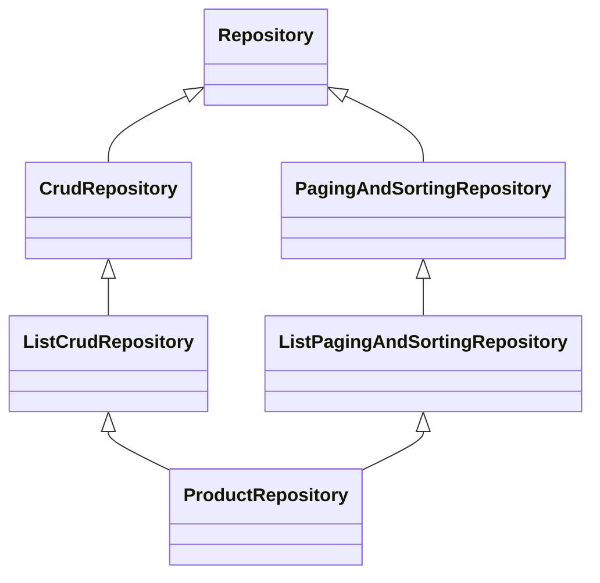

# Kết hợp CRUD với sorting sau thay đổi hệ phân cấp từ Spring Data 3.0

Từ Spring Data 3.0, `PagingAndSortingRepository` không còn kế thừa `CrudRepository`. Một repository chỉ mở rộng interface sorting sẽ không tự có `save`, `findById`, `deleteById` hoặc `findAll()` không tham số.

Để dùng đồng thời CRUD và sorting/paging trong các interface Commons, hãy kết hợp rõ các hợp đồng cần thiết. Nếu muốn những kết quả nhiều phần tử thông thường có kiểu `List`, có thể kết hợp `ListCrudRepository` với `ListPagingAndSortingRepository`.

Bài thuộc chương **Giao diện repository** của module `SPRING_DATA_COMMONS`. Mục tiêu là đọc đúng hệ phân cấp, chọn interface theo nhu cầu và chuyển mã cũ sang cấu trúc từ 3.0 mà vẫn giữ đúng domain type, kiểu ID và kiểu kết quả.

## 1. Điều gì đã thay đổi?

### 1.1. Trước Spring Data 3.0

Trong hệ phân cấp trước 3.0, nhánh sorting đồng bộ đi qua CRUD:

```text
Repository<T, ID>
└── CrudRepository<T, ID>
    └── PagingAndSortingRepository<T, ID>
```

Do đó, một interface như sau có thể sử dụng cả CRUD lẫn paging/sorting nhờ kế thừa:

```java
public interface ProductRepository
        extends PagingAndSortingRepository<Product, Long> {
}
```

Khai báo này trong mã cũ có thể đã được dùng cho cả `save(product)` và `findAll(pageable)`.

### 1.2. Từ Spring Data 3.0

CRUD và paging/sorting trở thành hai nhánh riêng:

```text
Repository<T, ID>
├── CrudRepository<T, ID>
│   └── ListCrudRepository<T, ID>
└── PagingAndSortingRepository<T, ID>
    └── ListPagingAndSortingRepository<T, ID>
```

Có thể thấy trực tiếp khác biệt trong mã nguồn: ở 2.7.0, `PagingAndSortingRepository` mở rộng `CrudRepository`; ở 3.0.0, nó mở rộng `Repository`. [Mã nguồn 2.7.0](https://github.com/spring-projects/spring-data-commons/blob/2.7.0/src/main/java/org/springframework/data/repository/PagingAndSortingRepository.java), [Mã nguồn 3.0.0](https://github.com/spring-projects/spring-data-commons/blob/3.0.0/src/main/java/org/springframework/data/repository/PagingAndSortingRepository.java)

Việc thêm `Sort` hoặc `Pageable` vào lời gọi không bổ sung CRUD vào hệ phân cấp. Muốn công bố cả hai nhóm method, repository phải kế thừa hoặc khai báo các hợp đồng phù hợp.

Tài liệu Commons cũng nêu thay đổi này cho các nhánh sorting tương ứng của reactive, RxJava và coroutine. [Spring Data Commons — Defining Repository Interfaces](https://docs.spring.io/spring-data/commons/reference/repositories/definition.html)

### 1.3. Sơ đồ đọc nhanh

Trong sơ đồ sau, mũi tên kế thừa hướng về interface cha; các tham số generic được lược bỏ để dễ nhìn.



`ProductRepository` cuối sơ đồ kết hợp hai nhánh. Nó không cần hai domain type khác nhau hoặc hai bean riêng để thực hiện hai nhóm thao tác.

## 2. Mỗi interface công bố những method nào?

Bảng dưới xét các method được kế thừa, trước khi ứng dụng tự khai báo thêm query method.

| Method | Chỉ `CrudRepository` | Chỉ `PagingAndSortingRepository` | Kết hợp cả hai |
| --- | --- | --- | --- |
| `save(entity)` | Có | Không | Có |
| `findById(id)` | Có | Không | Có |
| `existsById(id)` | Có | Không | Có |
| `deleteById(id)` | Có | Không | Có |
| `count()` | Có | Không | Có |
| `findAll()` | Có, trả `Iterable<T>` | Không | Có |
| `findAll(Sort)` | Không | Có, trả `Iterable<T>` | Có |
| `findAll(Pageable)` | Không | Có, trả `Page<T>` | Có |

Hai method chính của `PagingAndSortingRepository` là:

```java
Iterable<T> findAll(org.springframework.data.domain.Sort sort);

org.springframework.data.domain.Page<T> findAll(
        org.springframework.data.domain.Pageable pageable);
```

Điểm cần nhớ là `findAll()` và `findAll(Sort)` là hai overload khác nhau. Có method nhận `Sort` không tự tạo ra method không tham số.

Một repository có thể tự khai báo các query method nhận `Sort` hoặc `Pageable` theo hỗ trợ của module. Vì vậy, bảng không có nghĩa mọi query phân trang đều bắt buộc phải mở rộng `PagingAndSortingRepository`; bảng mô tả những method cơ sở được kế thừa.

## 3. Cách kết hợp cơ bản: CRUD và paging/sorting

Với Spring Data Commons từ 3.0, khai báo rõ hai interface:

```java
import org.springframework.data.repository.CrudRepository;
import org.springframework.data.repository.PagingAndSortingRepository;

public interface ProductRepository
        extends CrudRepository<Product, Long>,
                PagingAndSortingRepository<Product, Long> {
}
```

Các lời gọi sau đều có trong hợp đồng:

```java
Product saved = products.save(product);

java.util.Optional<Product> found =
        products.findById(saved.getId());

Iterable<Product> all = products.findAll();

Iterable<Product> sorted = products.findAll(
        org.springframework.data.domain.Sort.by("name", "id"));

org.springframework.data.domain.Page<Product> firstPage =
        products.findAll(
                org.springframework.data.domain.PageRequest.of(0, 20));
```

Ví dụ giả định `products` là bean `ProductRepository`, `product` là domain object hợp lệ và module lưu trữ đã được cấu hình. `Product` có các thuộc tính `id` và `name` theo mô hình ở phần 5.

Hai nhánh phải cùng chốt `Product` và `Long`. Không kết hợp một nhánh quản lý `Product` với nhánh khác quản lý một domain type hoặc kiểu ID khác trong cùng interface.

Khai báo nhiều interface là cách ghép hợp đồng. Nó không yêu cầu bạn tự viết lại thân `save` hay tự triển khai `findAll(Sort)` nếu module đã cung cấp các thao tác đó.

### Khi nào chọn cách này?

Phù hợp khi mã nguồn muốn giữ các kiểu trả về dựa trên `Iterable` của hợp đồng CRUD/sorting truyền thống, đồng thời bổ sung rõ khả năng đã được tách ra.

Nếu mã gọi thường xuyên cần `List`, có thể chọn các biến thể ở phần tiếp theo thay vì ép kiểu kết quả.

## 4. Kết hợp hai biến thể trả `List`

Từ 3.0, `ListCrudRepository` cung cấp biến thể CRUD trả `List` ở những method nhiều phần tử tương ứng. Interface này vẫn mở rộng `CrudRepository`. [ListCrudRepository API](https://docs.spring.io/spring-data/commons/docs/current/api/org/springframework/data/repository/ListCrudRepository.html)

`ListPagingAndSortingRepository` mở rộng `PagingAndSortingRepository` và thu hẹp kiểu kết quả của `findAll(Sort)` thành `List<T>`. [ListPagingAndSortingRepository API](https://docs.spring.io/spring-data/commons/docs/current/api/org/springframework/data/repository/ListPagingAndSortingRepository.html)

Kết hợp:

```java
import org.springframework.data.repository.ListCrudRepository;
import org.springframework.data.repository.ListPagingAndSortingRepository;

public interface ProductRepository
        extends ListCrudRepository<Product, Long>,
                ListPagingAndSortingRepository<Product, Long> {
}
```

Các khai báo `ProductRepository` trong bài là những phương án thay thế. Trong một package, chỉ dùng một khai báo tương ứng với phương án đã chọn.

### 4.1. Kiểu kết quả sau khi kết hợp

| Method | Kiểu kết quả |
| --- | --- |
| `save(product)` | Kiểu entity theo chữ ký generic của `save` |
| `findById(id)` | `Optional<Product>` |
| `findAll()` | `List<Product>` |
| `findAllById(ids)` | `List<Product>` |
| `saveAll(entities)` | `List<S>` với `S extends Product` |
| `findAll(sort)` | `List<Product>` |
| `findAll(pageable)` | `Page<Product>` |

Ví dụ:

```java
import java.util.List;

import org.springframework.data.domain.Page;
import org.springframework.data.domain.PageRequest;
import org.springframework.data.domain.Sort;

List<Product> all = products.findAll();

List<Product> sorted = products.findAll(
        Sort.by("name").ascending()
                .and(Sort.by("id").ascending()));

Page<Product> page = products.findAll(
        PageRequest.of(0, 20, Sort.by("id")));

List<Product> content = page.getContent();
```

`findAll(Pageable)` vẫn trả `Page`. Nếu chỉ cần danh sách nội dung của trang, lấy `getContent()` từ kết quả; không đổi kiểu trả về method kế thừa thành `List` một cách tùy ý.

### 4.2. `List` không đồng nghĩa với đã sorting

`ListCrudRepository.findAll()` trả một danh sách, nhưng chữ ký đó không chỉ định thứ tự theo thuộc tính nào.

Muốn một thứ tự cụ thể, hãy dùng method nhận `Sort` hoặc `Pageable` chứa sort. Không dựa vào thứ tự quan sát được trong một lần chạy database.

`ListCrudRepository` cũng không tự bổ sung method `findAll(Sort)`. Khả năng đó đến từ nhánh sorting đã kết hợp.

### 4.3. Có thể kết hợp chéo, nhưng cần đọc đúng kết quả

| Khai báo kết hợp | `findAll()` | `findAll(Sort)` |
| --- | --- | --- |
| `CrudRepository` + `PagingAndSortingRepository` | `Iterable<T>` | `Iterable<T>` |
| `ListCrudRepository` + `PagingAndSortingRepository` | `List<T>` | `Iterable<T>` |
| `CrudRepository` + `ListPagingAndSortingRepository` | `Iterable<T>` | `List<T>` |
| `ListCrudRepository` + `ListPagingAndSortingRepository` | `List<T>` | `List<T>` |

Mỗi nhánh điều khiển nhóm chữ ký của nó. Nếu mục tiêu là nhận `List` ở cả hai overload tương ứng, chọn cả hai biến thể `List` sẽ dễ đọc hơn.

Không cần viết thêm `CrudRepository` khi đã mở rộng `ListCrudRepository` chỉ để lấy lại CRUD, vì quan hệ kế thừa đó vẫn tồn tại.

## 5. Ví dụ thực hành với domain và service

Để có ví dụ cụ thể, phần này dùng một entity JPA. Các interface Commons không bắt buộc mọi kho dữ liệu dùng annotation JPA; phần triển khai cần được điều chỉnh theo module.

Giả định dự án đã có Spring Data Commons từ 3.0, Spring Data JPA tương thích, repository scanning, datasource và transaction manager. Không cần tự ép riêng một version Commons nếu nền tảng đã quản lý tập phiên bản.

### 5.1. Domain `Product`

```java
import java.math.BigDecimal;

import jakarta.persistence.Entity;
import jakarta.persistence.GeneratedValue;
import jakarta.persistence.GenerationType;
import jakarta.persistence.Id;
import jakarta.persistence.Table;

@Entity
@Table(name = "products")
public class Product {

    @Id
    @GeneratedValue(strategy = GenerationType.IDENTITY)
    private Long id;

    private String name;
    private BigDecimal price;
    private boolean active;

    protected Product() {
    }

    public Product(String name, BigDecimal price, boolean active) {
        this.name = name;
        this.price = price;
        this.active = active;
    }

    public Long getId() {
        return id;
    }

    public String getName() {
        return name;
    }

    public BigDecimal getPrice() {
        return price;
    }

    public boolean isActive() {
        return active;
    }
}
```

Trong ví dụ, repository chọn `<Product, Long>`. Các tên `name`, `price` và `id` trong sort là thuộc tính của mô hình Java; không lấy tên cột SQL tùy ý thay vào.

### 5.2. Repository cho bài thực hành

```java
import org.springframework.data.repository.ListCrudRepository;
import org.springframework.data.repository.ListPagingAndSortingRepository;

public interface ProductRepository
        extends ListCrudRepository<Product, Long>,
                ListPagingAndSortingRepository<Product, Long> {
}
```

Hợp đồng này công bố cả khả năng ghi, đọc theo ID, đọc toàn bộ, sorting và paging.

### 5.3. Service dùng cả hai nhóm thao tác

```java
import java.math.BigDecimal;
import java.util.List;

import org.springframework.data.domain.Page;
import org.springframework.data.domain.PageRequest;
import org.springframework.data.domain.Sort;
import org.springframework.stereotype.Service;
import org.springframework.transaction.annotation.Transactional;

@Service
public class ProductService {

    private final ProductRepository products;

    public ProductService(ProductRepository products) {
        this.products = products;
    }

    @Transactional
    public Product create(String name, BigDecimal price) {
        return products.save(new Product(name, price, true));
    }

    @Transactional(readOnly = true)
    public List<Product> listByName() {
        Sort sort = Sort.by("name").ascending()
                .and(Sort.by("id").ascending());

        return products.findAll(sort);
    }

    @Transactional(readOnly = true)
    public Page<Product> pageByPrice(int pageNumber, int pageSize) {
        if (pageNumber < 0) {
            throw new IllegalArgumentException(
                    "pageNumber phải lớn hơn hoặc bằng 0");
        }
        if (pageSize < 1 || pageSize > 100) {
            throw new IllegalArgumentException(
                    "pageSize phải nằm trong khoảng 1 đến 100");
        }

        Sort sort = Sort.by("price").ascending()
                .and(Sort.by("id").ascending());

        return products.findAll(
                PageRequest.of(pageNumber, pageSize, sort));
    }
}
```

Giới hạn page size trong ví dụ là quy tắc của service, không phải một mức cố định của Commons. `PageRequest` đánh số trang từ 0, nên `pageNumber = 0` là trang đầu tiên.

Tiêu chí `id` được thêm để xác định thứ tự khi nhiều sản phẩm có cùng name hoặc price. Dù có thứ tự rõ ràng, phân trang theo offset vẫn có thể dịch chuyển khi dữ liệu thay đổi giữa các lượt đọc.

`listByName()` trả toàn bộ dữ liệu theo hợp đồng `findAll(Sort)`. Sorting không tự đặt giới hạn số hàng. Với màn hình danh sách lớn, method phân trang phù hợp hơn với yêu cầu chỉ lấy một phần kết quả.

Các annotation giao dịch ở đây thuộc tích hợp Spring/JPA của ví dụ. Chúng không phải hệ quả tự động của việc viết thêm một interface sorting.

## 6. Hiểu đúng `Sort`, `Pageable` và overload

### 6.1. Sorting toàn bộ kết quả

```java
Sort sort = Sort.by("price").descending()
        .and(Sort.by("id").ascending());

List<Product> result = products.findAll(sort);
```

Lời gọi diễn đạt thứ tự trên tập kết quả của method. Module lưu trữ chuyển yêu cầu này thành cơ chế tương ứng; trong JPA, provider và database tham gia thực thi.

Nó không có nghĩa ứng dụng phải tải toàn bộ rồi tự gọi `List.sort(...)`. Cũng không có nghĩa mọi biểu thức hoặc đường dẫn thuộc tính đều được mọi module hỗ trợ.

### 6.2. Paging đã có thể chứa sorting

```java
PageRequest request = PageRequest.of(
        0,
        20,
        Sort.by("name").ascending()
                .and(Sort.by("id").ascending()));

Page<Product> result = products.findAll(request);
```

`Pageable` chứa thông tin trang, kích thước và sort. Với overload cơ sở này, không cần tạo một lời gọi `findAll(pageable, sort)`; method đó không được hai interface trong ví dụ cung cấp.

`Page` có nội dung trang và metadata tổng. Việc tạo metadata có thể cần count query; không mặc định một lời gọi repository chỉ phát sinh một truy vấn database. Một số trường hợp có thể suy ra tổng từ kết quả và bỏ qua count.

### 6.3. Không truyền `null` để diễn đạt “không sorting”

Dùng giá trị biểu đạt ý định:

```java
List<Product> withoutRequestedOrder =
        products.findAll(Sort.unsorted());

Page<Product> withoutPaging =
        products.findAll(
                org.springframework.data.domain.Pageable.unpaged());
```

`Sort.unsorted()` nghĩa là không yêu cầu thứ tự cụ thể. Nó không bảo đảm kết quả luôn giữ nguyên thứ tự qua các lần gọi.

`Pageable.unpaged()` không giới hạn theo trang. Cần phân biệt nó với yêu cầu lấy trang đầu tiên có kích thước nhỏ.

Một lời gọi `findAll(null)` còn có thể mơ hồ ngay ở biên dịch vì `Sort` và `Pageable` là hai kiểu tham số khác nhau cho các overload.

### 6.4. Không ép `Iterable` thành `List` dựa trên một lần chạy

Nếu hợp đồng chỉ trả `Iterable<Product>`, mã gọi không nên ép trực tiếp thành `List<Product>` vì từng quan sát thấy implementation trả list.

Chọn biến thể `List` khi đó là hợp đồng mong muốn, hoặc chuyển đổi kết quả có chủ đích. Kiểu trả về được khai báo mới là cơ sở để viết mã ổn định.

## 7. Kiểu tham chiếu tại service cũng phải phản ánh nhu cầu

Một bean có thể thực hiện đầy đủ `ProductRepository`, nhưng mã Java chỉ nhìn thấy các method qua kiểu tĩnh của biến.

Ví dụ:

```java
org.springframework.data.repository
        .PagingAndSortingRepository<Product, Long> browseView = products;

browseView.findAll(Sort.by("id"));

// Không có trong kiểu browseView từ Spring Data 3.0:
// browseView.save(product);
```

Lỗi `save` trong trường hợp này không được sửa chỉ bằng việc repository cụ thể đã kết hợp CRUD. Biến `browseView` vẫn có kiểu chỉ công bố nhánh sorting.

Nếu service thực sự cần ghi và đọc có sorting, constructor nên nhận hợp đồng kết hợp phù hợp, chẳng hạn `ProductRepository`.

Nếu service chỉ cần duyệt dữ liệu, kiểu hẹp có thể là một lựa chọn thiết kế. Không cần ép kiểu ngược lại chỉ để gọi thêm method ngoài vai trò đã chọn.

Tương tự, một biến có kiểu `CrudRepository<Product, Long>` không nhìn thấy `findAll(Sort)` chỉ vì bean thực tế còn thực hiện interface sorting.

## 8. Tạo base repository để tái sử dụng cách kết hợp

Khi nhiều domain cùng cần CRUD và paging/sorting, có thể tạo interface trung gian:

```java
import org.springframework.data.repository.ListCrudRepository;
import org.springframework.data.repository.ListPagingAndSortingRepository;
import org.springframework.data.repository.NoRepositoryBean;

@NoRepositoryBean
public interface CrudAndSortingRepository<T, ID>
        extends ListCrudRepository<T, ID>,
                ListPagingAndSortingRepository<T, ID> {
}
```

Repository cụ thể chốt kiểu:

```java
public interface ProductRepository
        extends CrudAndSortingRepository<Product, Long> {
}
```

`@NoRepositoryBean` đặt trên interface trung gian để hạ tầng không cố tạo repository cho các tham số generic chưa được chốt ở đó. Không cần viết một lớp implementation riêng chỉ vì đã tạo base interface.

Giữ `ID` như một tham số nếu hệ thống có domain dùng `Long`, `UUID` hoặc khóa ghép. Chỉ cố định `Long` ở base repository khi đó thực sự là một quy ước của toàn bộ nhóm domain.

Một base interface công bố đầy đủ CRUD cũng công bố các thao tác ghi và xóa cho repository con. Nếu một nhóm repository chỉ cần đọc theo những truy vấn cụ thể, hãy cân nhắc hợp đồng hẹp hơn thay vì mở rộng toàn bộ chỉ để có một method phân trang.

## 9. Interface chuyên biệt như `JpaRepository` đã kết hợp sẵn

Ứng dụng JPA có thể dùng:

```java
import org.springframework.data.jpa.repository.JpaRepository;

public interface ProductRepository
        extends JpaRepository<Product, Long> {
}
```

Trong hệ phân cấp JPA từ mốc 3.0, `JpaRepository` đã kết hợp các nhánh `ListCrudRepository` và `ListPagingAndSortingRepository`, đồng thời cung cấp các khả năng khác của JPA. Vì vậy, không cần thêm lại hai interface đó chỉ để có CRUD cùng sorting. [Mã nguồn JpaRepository 3.0.0](https://github.com/spring-projects/spring-data-jpa/blob/3.0.0/spring-data-jpa/src/main/java/org/springframework/data/jpa/repository/JpaRepository.java)

Lựa chọn phụ thuộc vào hợp đồng muốn công bố:

| Nhu cầu | Hướng khai báo |
| --- | --- |
| CRUD cơ bản theo Commons | `CrudRepository` hoặc `ListCrudRepository` |
| Chỉ các method cơ sở paging/sorting | Nhánh `PagingAndSortingRepository` phù hợp |
| CRUD và paging/sorting theo Commons | Kết hợp hai nhánh |
| Dùng các khả năng JPA cùng CRUD/paging/sorting | `JpaRepository` |
| Chỉ một vài query nghiệp vụ | Hợp đồng hẹp với các method cần thiết |

Không đổi sang `JpaRepository` nếu ứng dụng đang sử dụng một kho dữ liệu khác chỉ để giải quyết lỗi thiếu `save`. Khi đó, hãy chọn các interface và module đúng công nghệ.

Việc kết hợp interface Commons cũng chưa tự xác định repository thuộc JPA, MongoDB hay module nào. Khi có nhiều module Spring Data, cấu hình scan, domain mapping và dấu hiệu nhận diện module vẫn cần rõ ràng.

## 10. Query có `Pageable` không đồng nghĩa phải dùng toàn bộ nhánh sorting

Giả sử một tính năng chỉ muốn tìm sản phẩm đang hoạt động theo trang. Có thể công bố một hợp đồng hẹp:

```java
import org.springframework.data.domain.Page;
import org.springframework.data.domain.Pageable;
import org.springframework.data.repository.Repository;

public interface ProductBrowseRepository
        extends Repository<Product, Long> {

    Page<Product> findByActiveTrue(Pageable pageable);
}
```

Ví dụ giả định module hỗ trợ derived query và kết quả phân trang này. Thuộc tính `active` có trong `Product` ở phần thực hành.

Method nhận `Pageable` vì chính chữ ký query yêu cầu nó, không phải vì repository đã kế thừa `findAll(Pageable)`. Hợp đồng này không tự công bố `save` hoặc `findAll(Sort)`.

Cần phân biệt hai câu hỏi:

- Muốn kế thừa các method cơ sở CRUD/paging/sorting nào?
- Muốn tự khai báo những query method có tham số và kết quả nào?

Sự tách nhánh từ 3.0 liên quan trực tiếp đến câu hỏi thứ nhất. Nó không loại bỏ khả năng các query method nhận tham số đặc biệt theo cơ chế của module.

Không công bố một method ghi giúp thể hiện vai trò của API repository. Quyền truy cập dữ liệu của ứng dụng vẫn cần được thiết kế ở các tầng phù hợp.

## 11. Với reactive và các mô hình khác

Nguyên tắc kết hợp rõ cũng áp dụng cho các cặp tương ứng:

| Mô hình | Nhánh CRUD | Nhánh sorting |
| --- | --- | --- |
| Reactor | `ReactiveCrudRepository` | `ReactiveSortingRepository` |
| RxJava 3 | `RxJava3CrudRepository` | `RxJava3SortingRepository` |
| Kotlin coroutine | `CoroutineCrudRepository` | `CoroutineSortingRepository` |

Ví dụ base interface Reactor:

```java
import org.springframework.data.repository.NoRepositoryBean;
import org.springframework.data.repository.reactive.ReactiveCrudRepository;
import org.springframework.data.repository.reactive.ReactiveSortingRepository;

@NoRepositoryBean
public interface ReactiveCrudAndSortingRepository<T, ID>
        extends ReactiveCrudRepository<T, ID>,
                ReactiveSortingRepository<T, ID> {
}
```

Repository cụ thể phải chốt domain, ID và sử dụng module reactive tương ứng. Đổi tên interface của repository JPA không tự biến đường truy cập thành reactive.

`ReactiveSortingRepository` cung cấp `Flux<T> findAll(Sort)`. Nó không cung cấp một overload cơ sở `findAll(Pageable)` trả `Page<T>` như nhánh đồng bộ. Thiết kế phân trang reactive phải xét query và khả năng của module cụ thể. [ReactiveSortingRepository API](https://docs.spring.io/spring-data/commons/docs/current/api/org/springframework/data/repository/reactive/ReactiveSortingRepository.html)

Không kết hợp nhánh CRUD đồng bộ với nhánh sorting reactive chỉ để gom đủ tên method. Cần một mô hình thực thi và các kiểu kết quả nhất quán.

## 12. Chuyển mã cũ sang cấu trúc từ 3.0

### Bước 1: xác định hợp đồng đang được dùng

Đọc khai báo repository và các base interface. Tìm cả kiểu mà service, helper hoặc cấu hình injection sử dụng.

Một repository con có thể đã được sửa, trong khi một base interface hoặc tham số service vẫn chỉ mang kiểu nhánh sorting.

### Bước 2: liệt kê nhu cầu thực tế

| Mã gọi cần gì? | Khả năng cần công bố |
| --- | --- |
| `save`, `deleteById` | CRUD |
| `findById` | CRUD hoặc method đọc theo ID được công bố riêng |
| `findAll()` | CRUD |
| `findAll(Sort)` | Sorting |
| `findAll(Pageable)` | Paging/sorting đồng bộ |
| `findByActiveTrue(Pageable)` | Query method được khai báo và module hỗ trợ |

Nếu mã cũ sử dụng cả hai nhóm, kết hợp cả hai nhánh là cách sửa trực tiếp.

### Bước 3: chọn kiểu kết quả mong muốn

Giữ `CrudRepository` + `PagingAndSortingRepository` nếu muốn tiếp tục hợp đồng `Iterable`. Chọn các biến thể `List` nếu muốn công bố kiểu danh sách tương ứng.

Không coi việc chuyển sang `List` là một tối ưu hóa truy vấn tự động. Nó thay đổi kiểu kết quả công bố, chưa tự thay đổi yêu cầu lọc, sorting hoặc giới hạn dữ liệu.

### Bước 4: sửa các kiểu tham chiếu có liên quan

Kiểm tra constructor, field và tham số method ở tầng gọi. Một biến chỉ có kiểu `PagingAndSortingRepository` vẫn không thấy CRUD.

Không thêm cast hoặc raw type để che lỗi method thiếu; điều chỉnh hợp đồng theo vai trò thực tế.

### Bước 5: xác nhận trong dự án thực hành

Các điểm cần kiểm tra khi áp dụng vào một dự án đã cấu hình:

- Mã gọi CRUD và sorting biên dịch qua đúng kiểu repository.
- Repository bean được tạo bởi module lưu trữ dự kiến.
- Một thao tác lưu và đọc theo ID hoạt động với domain/ID đã chọn.
- Kết quả sorting khớp các thuộc tính được yêu cầu.
- Kết quả trang có đúng nội dung, kích thước và metadata theo dữ liệu thử.
- Dữ liệu có giá trị sort trùng nhau được xét với tiêu chí phụ thích hợp.

Đây là hướng kiểm tra khi người học áp dụng bài, không phải báo cáo rằng các ví dụ đã được chạy trên một dự án cụ thể.

## 13. Các nhầm lẫn thường gặp

| Nhận định hoặc lỗi | Cách hiểu đúng |
| --- | --- |
| “Có PagingAndSortingRepository thì luôn có save” | Từ 3.0 phải có thêm hợp đồng CRUD phù hợp |
| “ListPagingAndSortingRepository đã bao gồm ListCrudRepository” | Hai nhánh này riêng nhau |
| “Có ListCrudRepository thì findAll(Sort) dùng được” | Cần nhánh sorting hoặc một method phù hợp được công bố riêng |
| “findAll() và findAll(Sort) cùng một hợp đồng” | Đây là hai overload; mỗi nhánh công bố nhóm method của nó |
| “Biến service có kiểu sorting vẫn gọi được save vì bean đủ khả năng” | Trình biên dịch kiểm tra theo kiểu tĩnh của biến |
| “Pageable đã có sort nhưng phải truyền thêm Sort cho findAll” | Overload cơ sở chỉ nhận Pageable đã chứa sort |
| “Trả List nghĩa là đã có thứ tự” | Cần yêu cầu sort cụ thể nếu muốn một thứ tự xác định |
| “Sorting nghĩa là chỉ lấy một trang” | Sorting không tự giới hạn số phần tử |
| “Đổi sang JpaRepository là cách sửa cho mọi kho dữ liệu” | Interface chuyên biệt phải phù hợp module lưu trữ |
| “Kết hợp interface tự kích hoạt auditing hoặc projection” | Các khả năng đó còn cần hợp đồng, mapping và tích hợp riêng |

Nếu gặp lỗi kiểu `Pageable` hoặc `Sort` không khớp tham số, kiểm tra import có thuộc `org.springframework.data.domain` không. Những lớp có tên giống nhau ở thư viện khác không thay thế các abstraction của Commons.

## 14. Bài tập củng cố

### Tình huống A: mất `save` sau nâng cấp

Một repository chỉ mở rộng `PagingAndSortingRepository<Product, Long>`. Mã service gọi cả `save` và `findAll(PageRequest.of(0, 20))`.

**Cách sửa:** bổ sung nhánh CRUD phù hợp hoặc dùng interface chuyên biệt đã kết hợp đủ. Nếu service đang nhận kiểu sorting thuần, cần điều chỉnh kiểu đó theo nhu cầu ghi.

### Tình huống B: muốn cả hai overload trả `List`

Nhóm phát triển muốn `findAll()` và `findAll(Sort)` đều trả `List<Product>`.

**Cách chọn:** kết hợp `ListCrudRepository` với `ListPagingAndSortingRepository`. `findAll(Pageable)` vẫn trả `Page<Product>`.

### Tình huống C: repository chỉ đọc một query

Một màn hình chỉ cần `findByActiveTrue(Pageable)`, không cần ghi hay đọc toàn bộ dữ liệu.

**Cách chọn:** công bố query method cần thiết trong hợp đồng hẹp, với module hỗ trợ. Không bắt buộc mở rộng toàn bộ CRUD để dùng tham số Pageable trong query này.

### Tình huống D: reactive sorting cần lưu dữ liệu

Một repository reactive chỉ mở rộng `ReactiveSortingRepository` nhưng mã gọi cần `save`.

**Cách chọn:** kết hợp `ReactiveCrudRepository` cùng mô hình reactive và đúng module. Không đưa `CrudRepository` đồng bộ vào để lấy method lưu.

Khi chọn interface từ Spring Data 3.0, hãy đọc riêng từng nhánh khả năng, kiểu kết quả và kiểu tham chiếu ở tầng gọi. Khai báo đúng phần CRUD cùng phần sorting/paging giúp repository công bố rõ những thao tác mà ứng dụng thực sự cần.
