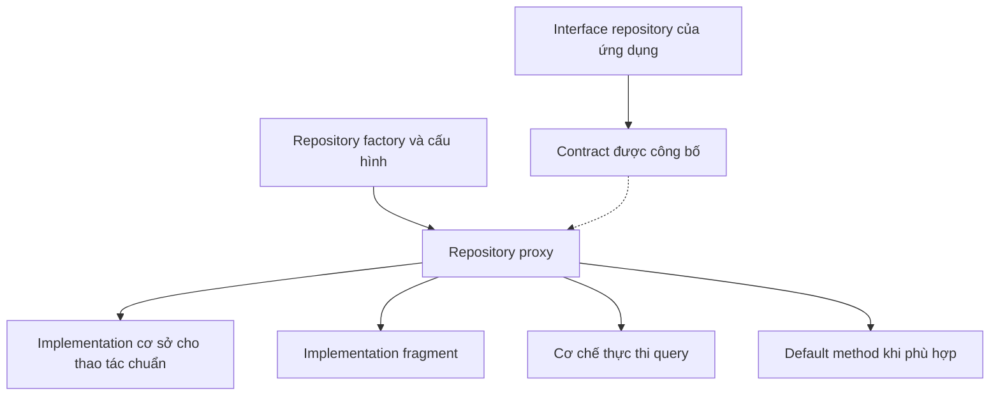

# Phân biệt mở rộng hợp đồng repository với kế thừa lớp triển khai

Trong Spring Data, câu lệnh `extends` xuất hiện ở cả interface repository lẫn lớp triển khai tùy chỉnh. Tuy nhiên, hai tình huống này có ý nghĩa khác nhau: **kế thừa interface mở rộng contract mà bên gọi nhìn thấy; kế thừa class mở rộng hoặc thay đổi mã thực thi của class đó**.

Nếu không phân biệt hai việc, bạn dễ thêm một phương thức vào interface rồi kỳ vọng hệ thống tự hiểu hành vi, hoặc tạo một class kế thừa implementation có sẵn nhưng class ấy không được repository factory sử dụng.

Bài học thuộc chương **Giao diện repository** của mô-đun **SPRING_DATA_COMMONS**. Chúng ta tìm hiểu cách chọn giữa interface cơ sở, default method, repository fragment và lớp triển khai cơ sở tùy chỉnh, đồng thời giữ rõ phần dùng chung với phần phụ thuộc mô-đun lưu trữ.

## 1. Contract và implementation trả lời hai câu hỏi khác nhau

Contract trả lời: **bên sử dụng được phép gọi những gì và kỳ vọng kết quả nào?**

Implementation trả lời: **mỗi lời gọi được thực hiện bằng mã và công nghệ nào?**

Ví dụ:

```java
import java.util.Optional;

import org.springframework.data.repository.Repository;

public interface ProductRepository
        extends Repository<Product, Long> {

    Optional<Product> findById(Long id);
}
```

Interface công bố một thao tác tìm sản phẩm theo định danh. Nó không có phần thân thực thi truy vấn.

Trong môi trường Spring Data được cấu hình phù hợp, repository factory và hạ tầng liên quan cung cấp đối tượng thực thi contract. Tùy phương thức, lời gọi có thể được xử lý bởi implementation cơ sở, cơ chế truy vấn hoặc một fragment.

Không nên hiểu rằng mọi phương thức của interface đều tự được sinh bằng cùng một cơ chế.

| Khía cạnh | Mở rộng contract bằng interface | Kế thừa implementation bằng class |
| --- | --- | --- |
| Mục tiêu chính | Công bố hoặc kết hợp các khả năng | Tái sử dụng và tùy chỉnh mã thực thi |
| Cú pháp thường gặp | `interface A extends B` | `class A extends B` |
| Có tự nhận phần thân của abstract method không? | Không | Có thể kế thừa phương thức đã có implementation |
| Có thể có phần thân riêng? | Có, qua default method phù hợp | Có, qua phương thức của class |
| Tự được Spring Data sử dụng chỉ nhờ khai báo Java? | Không; cần hạ tầng nhận diện repository | Không; cần cách đăng ký hoặc cấu hình sử dụng class |

## 2. Kế thừa interface không có nghĩa kế thừa một class ngầm

Xét repository:

```java
import org.springframework.data.repository.ListCrudRepository;

public interface ProductRepository
        extends ListCrudRepository<Product, Long> {
}
```

Quan hệ Java ở đây là giữa hai interface. `ProductRepository` nhận các chữ ký CRUD từ `ListCrudRepository`.

Nó không khai báo rằng một class của ứng dụng kế thừa `SimpleJpaRepository`. Thậm chí contract trên chưa chọn JPA; `ListCrudRepository` thuộc Commons và có thể được dùng trong những mô-đun hỗ trợ phù hợp.

Ở JPA, hạ tầng thường cung cấp một proxy repository và sử dụng implementation cơ sở cùng các thành phần khác để xử lý lời gọi. Không nên hình dung proxy đơn giản là một class do bạn viết kế thừa mọi implementation cần thiết.



Sơ đồ phân biệt các đường xử lý về mặt trách nhiệm. Nó không mô tả thứ tự ưu tiên đầy đủ của mọi interceptor hoặc mọi phiên bản.

Từ đây cần giữ ba câu hỏi riêng:

1. Phương thức có trong contract không?
2. Ai cung cấp implementation?
3. Hạ tầng đã nối phương thức với implementation đó chưa?

Một phương thức có thể vượt qua bước một nhưng thất bại ở bước hai hoặc ba.

## 3. Thêm chữ ký phương thức chỉ là bước mở rộng contract

Giả sử bạn viết:

```java
import org.springframework.data.repository.ListCrudRepository;

public interface ProductRepository
        extends ListCrudRepository<Product, Long> {

    void approveAllProducts();
}
```

Trình biên dịch Java chấp nhận việc interface khai báo một abstract method. Nhưng điều đó không làm Spring Data biết “duyệt toàn bộ sản phẩm” nghĩa là gì.

Để phương thức hoạt động, phải có một đường thực thi hợp lệ:

- Một query method có tên hoặc khai báo truy vấn được mô-đun hỗ trợ.
- Một default method có phần thân.
- Một implementation fragment tương ứng.
- Một implementation cơ sở tùy chỉnh được cấu hình thích hợp.

Nếu không có đường thực thi đó, phương thức có thể bị xử lý như một ứng viên query và phát sinh lỗi khi hạ tầng phân tích hoặc khởi tạo theo cấu hình.

Tương tự, đặt tên phương thức là `saveSpecial` không khiến nó tự được nối với `save` có sẵn. Muốn thay đổi hành vi, cần thiết kế contract và implementation cụ thể.

### Không nhầm với phương thức CRUD chọn lọc

Khai báo chữ ký như `findById` hoặc `save` theo contract cơ sở được hỗ trợ là một trường hợp khác. Hạ tầng có thể định tuyến các chữ ký tương ứng tới implementation cơ sở.

Điều đó không phải giấy phép để mọi tên phương thức bất kỳ đều có implementation tự động.

## 4. Interface cơ sở dùng chung và @NoRepositoryBean

Khi nhiều repository cần một tập khả năng giống nhau, có thể tạo interface trung gian:

```java
package example.extension.data;

import org.springframework.data.repository.ListCrudRepository;
import org.springframework.data.repository.NoRepositoryBean;

@NoRepositoryBean
public interface ApplicationRepository<T, ID>
        extends ListCrudRepository<T, ID> {
}
```

Repository cụ thể:

```java
package example.extension.data;

import example.extension.domain.Product;

public interface ProductRepository
        extends ApplicationRepository<Product, Long> {
}
```

Thiết kế này tái sử dụng contract và tổ chức hệ phân cấp kiểu. `@NoRepositoryBean` yêu cầu hạ tầng bỏ qua việc tạo repository bean trực tiếp cho interface cơ sở.

Nó không có các tác dụng sau:

- Sinh phần thân cho phương thức mới.
- Chọn implementation class tùy chỉnh.
- Tạo transaction manager.
- Tự xác định một kho dữ liệu cho mọi interface con.
- Biến một interface generic thành repository có thể lưu mọi loại đối tượng.

Nếu bổ sung một abstract method vào `ApplicationRepository`, mọi repository cụ thể kế thừa nó cần có đường thực thi phù hợp cho phương thức đó.

## 5. Default method: thêm logic dựa trên contract đã có

Nếu hành vi mới chỉ kết hợp các phương thức công khai đã có, default method có thể đủ.

Ví dụ một contract đọc:

```java
package example.extension.data;

import java.util.Optional;

import org.springframework.data.repository.NoRepositoryBean;
import org.springframework.data.repository.Repository;

@NoRepositoryBean
public interface RequiredReadRepository<T, ID>
        extends Repository<T, ID> {

    Optional<T> findById(ID id);

    default T getRequired(ID id) {
        return findById(id)
            .orElseThrow(() ->
                new IllegalArgumentException(
                    "Không tìm thấy đối tượng theo định danh"
                )
            );
    }
}
```

Repository cụ thể:

```java
public interface ProductReadRepository
        extends RequiredReadRepository<Product, Long> {
}
```

`getRequired` đã có phần thân Java. Logic của nó gọi `findById`, vốn phải được mô-đun lưu trữ thực thi phù hợp.

Ưu điểm:

- Không cần tạo một implementation fragment chỉ để chuyển `Optional.empty()` thành exception.
- Không cần biết `EntityManager` hoặc client của kho dữ liệu.
- Contract và logic kết hợp đơn giản có thể tái sử dụng giữa các repository phù hợp.

Giới hạn:

- Default method không phải nơi tự nhiên để giữ các dependency được inject vào một class.
- Không tự thiết lập một giao dịch cho toàn bộ chuỗi hành động.
- Không nên chứa toàn bộ điều phối nghiệp vụ hoặc giao tiếp nhiều dịch vụ.
- Loại exception vẫn là một lựa chọn của contract, không mặc định phù hợp mọi use case.

Với trường hợp chỉ cần logic kết hợp như trên, kế thừa một implementation JPA sẽ tạo thêm sự phụ thuộc công nghệ mà ví dụ chưa cần.

## 6. Repository fragment: bổ sung implementation bằng composition

Khi hành vi mới cần truy vấn tùy chỉnh hoặc dependency riêng, có thể định nghĩa một fragment.

Phần này chọn Spring Data JPA làm môi trường thực thi. Giả sử `Product` là entity được mapping với các thuộc tính:

| Thuộc tính | Ý nghĩa |
| --- | --- |
| `id` | Định danh kiểu `Long` |
| `name` | Tên sản phẩm |
| `category` | Mã danh mục |
| `active` | Trạng thái đang bán |

Entity có tên JPQL mặc định là `Product`. Ứng dụng đã có JPA provider, kết nối dữ liệu và cấu hình phát hiện entity/repository. Các đoạn mã tập trung vào cấu trúc mở rộng, không thay thế cấu hình ứng dụng đó.

### 6.1. Định nghĩa contract fragment

```java
package example.extension.data;

import java.util.List;

import example.extension.domain.Product;

public interface ProductQueries {

    List<Product> findActiveInCategory(String category);
}
```

Đây là contract của một khả năng cụ thể. Interface fragment không cần kế thừa `Repository` để trở thành một phần hành vi được ghép vào repository.

### 6.2. Cung cấp implementation fragment

```java
package example.extension.data;

import java.util.List;

import example.extension.domain.Product;

import jakarta.persistence.EntityManager;
import jakarta.persistence.PersistenceContext;

import org.springframework.transaction.annotation.Transactional;

public class ProductQueriesImpl implements ProductQueries {

    @PersistenceContext
    private EntityManager entityManager;

    @Override
    @Transactional(readOnly = true)
    public List<Product> findActiveInCategory(String category) {
        return entityManager.createQuery(
            """
            select p
            from Product p
            where p.active = true
              and p.category = :category
            order by p.name asc, p.id asc
            """,
            Product.class
        )
        .setParameter("category", category)
        .getResultList();
    }
}
```

Ví dụ dùng Java text block, phù hợp với Java 17 và môi trường Jakarta Persistence đang minh họa.

Implementation thực thi truy vấn qua `EntityManager`. Nó **implements** contract `ProductQueries`; nó không cần kế thừa `SimpleJpaRepository`.

`@Transactional` thuộc hạ tầng giao dịch của Spring. Annotation có hiệu lực khi ứng dụng có cấu hình và cơ chế áp dụng phù hợp. Thuộc tính `readOnly` không nên được hiểu như một cơ chế phân quyền cấm mọi lệnh ghi trên cơ sở dữ liệu.

### 6.3. Ghép fragment vào repository

```java
package example.extension.data;

import example.extension.domain.Product;

import org.springframework.data.repository.ListCrudRepository;

public interface ProductRepository
        extends ListCrudRepository<Product, Long>,
                ProductQueries {
}
```

Bên gọi nhìn thấy cả CRUD và `findActiveInCategory`. Hạ tầng ghép implementation fragment với những thành phần khác của repository.

Theo quy ước mặc định, implementation fragment dùng tên interface fragment cộng hậu tố `Impl`: `ProductQueries` đi với `ProductQueriesImpl`. Phạm vi package và cấu hình dò implementation phải phù hợp; hậu tố cũng có thể được tùy chỉnh.

Điểm cần chú ý là implementation gắn với **fragment interface**, không phải cứ đặt một class tên gần giống repository là mọi hành vi tự được nối.

### 6.4. Vì sao đây là composition?

Repository tổng hợp nhiều khả năng:

```text
ProductRepository
  contract CRUD
  + contract ProductQueries

Repository runtime
  implementation CRUD của mô-đun
  + ProductQueriesImpl
  + cơ chế proxy và truy vấn liên quan
```

Các implementation phối hợp để thực hiện contract chung. Bạn không tạo một cây class kế thừa để mỗi class lần lượt bổ sung một kiểu truy vấn.

Cách tổ chức này phù hợp khi một khả năng chỉ dành cho một nhóm repository, hoặc khi cần nhiều khả năng độc lập có thể kết hợp.

## 7. Kế thừa lớp triển khai: thay đổi implementation cơ sở

Có những nhu cầu cần tác động vào implementation cơ sở của một nhóm repository. Với JPA, có thể xây một class kế thừa `SimpleJpaRepository` và cấu hình repository factory sử dụng class đó.

Đây là hướng **phụ thuộc JPA**, khác với việc chỉ mở rộng interface Commons.

Ví dụ tiếp theo là một phương án riêng để học cơ chế lớp cơ sở. Với riêng hành vi `getRequired`, default method ở phần trước thường đã đủ; không cần triển khai cả hai phương án cùng lúc.

### 7.1. Công bố phương thức trong contract

```java
package example.extension.data;

import org.springframework.data.repository.ListCrudRepository;
import org.springframework.data.repository.NoRepositoryBean;

@NoRepositoryBean
public interface RequiredRepository<T, ID>
        extends ListCrudRepository<T, ID> {

    T getRequired(ID id);
}
```

Ở đây `getRequired` là abstract method, nên phải có implementation. `@NoRepositoryBean` chỉ ngăn tạo bean cho interface generic cơ sở.

### 7.2. Viết implementation cơ sở theo JPA

```java
package example.extension.infrastructure;

import example.extension.data.RequiredRepository;

import jakarta.persistence.EntityManager;

import org.springframework.data.jpa.repository.support.JpaEntityInformation;
import org.springframework.data.jpa.repository.support.SimpleJpaRepository;
import org.springframework.transaction.annotation.Transactional;

public class RequiredJpaRepository<T, ID>
        extends SimpleJpaRepository<T, ID>
        implements RequiredRepository<T, ID> {

    public RequiredJpaRepository(
            JpaEntityInformation<T, ?> entityInformation,
            EntityManager entityManager) {
        super(entityInformation, entityManager);
    }

    @Override
    @Transactional(readOnly = true)
    public T getRequired(ID id) {
        return findById(id)
            .orElseThrow(() ->
                new IllegalArgumentException(
                    "Không tìm thấy đối tượng theo định danh"
                )
            );
    }
}
```

Quan hệ Java trong class này có hai phần:

- `extends SimpleJpaRepository`: nhận mã triển khai cơ sở của JPA và có thể tùy chỉnh theo cơ chế kế thừa class.
- `implements RequiredRepository`: cam kết cung cấp contract ứng dụng đã công bố.

Constructor nhận metadata entity và `EntityManager` theo cơ chế factory của môi trường JPA. Không tự thay nó bằng một constructor không tham số chỉ vì muốn tạo bean dễ hơn.

Class không cần được đăng ký như một component thông thường cho từng kiểu miền. Factory sẽ tạo các instance phù hợp khi được cấu hình sử dụng lớp cơ sở này.

### 7.3. Tạo repository cụ thể

```java
package example.extension.data;

import example.extension.domain.Product;

public interface ProductRequiredRepository
        extends RequiredRepository<Product, Long> {
}
```

Đến đây mới có contract và class implementation. Còn cần cấu hình nối chúng.

### 7.4. Cấu hình repository factory

```java
package example.extension.config;

import example.extension.infrastructure.RequiredJpaRepository;

import org.springframework.context.annotation.Configuration;
import org.springframework.data.jpa.repository.config.EnableJpaRepositories;

@Configuration
@EnableJpaRepositories(
    basePackages = "example.extension.data",
    repositoryBaseClass = RequiredJpaRepository.class
)
public class RepositoryConfiguration {
}
```

Cấu hình này giả định ứng dụng đã cung cấp hạ tầng JPA và phát hiện entity phù hợp. Nó yêu cầu các repository trong phạm vi cấu hình sử dụng lớp cơ sở đã chọn.

Điểm quyết định là `repositoryBaseClass`, không phải việc class có tên chứa chữ `Repository`.

Nếu chỉ viết `RequiredJpaRepository` mà không cấu hình factory sử dụng nó, repository vẫn có thể được tạo bằng implementation cơ sở khác. Phương thức mới trong contract khi đó chưa chắc có đường thực thi mong muốn.

### 7.5. Lớp cơ sở có phạm vi ảnh hưởng lớn hơn fragment

Khi áp dụng lớp cơ sở cho một vùng repository, thay đổi của nó có thể ảnh hưởng nhiều repository trong vùng đó.

Vì vậy, cần xác định:

- Những repository nào thuộc phạm vi cấu hình.
- Những phương thức nào thật sự được override.
- Chữ ký generic có tương ứng contract hay không.
- Cấu hình giao dịch cần giữ hoặc bổ sung.
- Hành vi vòng đời và mapping của mô-đun.
- Sự tương thích khi thay đổi phiên bản mô-đun.

Cơ chế tương ứng ở một kho dữ liệu khác có thể dùng class cơ sở và constructor khác. Không tái sử dụng `RequiredJpaRepository` cho MongoDB chỉ vì cả hai có contract Commons.

## 8. Không thể dùng extends tùy ý giữa interface và class

Các quan hệ Java hợp lệ cần được giữ rõ:

```java
// Interface mở rộng interface.
public interface ProductRepository
        extends ListCrudRepository<Product, Long> {
}
```

```java
// Class kế thừa class và triển khai interface.
public class RequiredJpaRepository<T, ID>
        extends SimpleJpaRepository<T, ID>
        implements RequiredRepository<T, ID> {
    // Constructor và phương thức như phần trước.
}
```

Đoạn thứ hai chỉ nhắc lại hình dạng quan hệ, không phải một class hoàn chỉnh để sao chép thay cho ví dụ đầy đủ.

Những ý tưởng sau không hợp lệ về quan hệ Java:

```text
interface ... extends SimpleJpaRepository<...>
class ... extends CrudRepository<...>
```

Interface không kế thừa class theo cách đó. Class triển khai interface bằng `implements`, không dùng `extends` như khi kế thừa class.

Một class tự `implements CrudRepository` có thể tồn tại nếu cung cấp đầy đủ các phương thức cần thiết. Nhưng nó là implementation mà bạn phải xây dựng và đăng ký phù hợp; khai báo `implements` không khiến Spring Data tự viết phần thân các phương thức còn thiếu.

## 9. Chọn cơ chế theo phạm vi thay đổi

| Nhu cầu | Cơ chế có thể phù hợp | Implementation đến từ đâu? |
| --- | --- | --- |
| Gom các chữ ký chung, không thêm hành vi mới | Interface cơ sở với `@NoRepositoryBean` | Các đường thực thi đã được hỗ trợ |
| Thêm logic ngắn dựa trên phương thức hiện có | Default method | Phần thân trong interface |
| Thêm truy vấn hoặc thao tác tùy chỉnh cho một số repository | Fragment | Class triển khai fragment |
| Thay đổi implementation cơ sở của một nhóm repository | Lớp cơ sở tùy chỉnh và cấu hình factory | Class theo mô-đun, thường kế thừa implementation cơ sở |
| Chỉ cần một derived query đơn giản | Query method được hỗ trợ | Cơ chế truy vấn của mô-đun |
| Điều phối quy tắc nghiệp vụ và nhiều dependency | Application service hoặc thành phần nghiệp vụ phù hợp | Mã điều phối của ứng dụng |

Không cần kế thừa class cơ sở chỉ để có một tên phương thức thuận tiện hơn. Ngược lại, một default method chỉ gọi các API hiện có sẽ không đáp ứng mọi nhu cầu tích hợp cần `EntityManager`, template hoặc client riêng.

Fragment thường giúp chia khả năng theo từng nhóm. Lớp cơ sở phù hợp hơn khi nhu cầu thật sự gắn với hạ tầng chung của tập repository được cấu hình.

## 10. Trùng chữ ký và đường thực thi cần được hiểu rõ

Việc công bố một phương thức không tự nói lên nó sẽ được thực thi ở đâu khi có nhiều thành phần cùng cung cấp chữ ký.

Ví dụ, một fragment có thể cung cấp implementation cho một phương thức trùng với contract cơ sở. Trong cơ chế composition của Spring Data, fragment tùy chỉnh có thể được ưu tiên so với implementation cơ sở.

Nếu nhiều fragment công bố cùng phương thức, thứ tự và cấu hình composition cần được xem xét. Không nên tạo xung đột rồi dựa vào thứ tự dò class ngẫu nhiên.

Những nguyên tắc thực hành hữu ích:

- Giữ tên và contract fragment rõ ràng.
- Dùng `@Override` khi chủ đích triển khai hoặc override một chữ ký.
- Không cho rằng một overload khác tham số sẽ thay thế phương thức mà bên gọi đang sử dụng.
- Khi tùy chỉnh một phương thức cơ sở, xác định những lời gọi nào thật sự đi qua nó.
- Không mặc định mọi thao tác ghi đều đi qua `save`; truy vấn cập nhật hoặc API khác có thể có đường thực thi riêng.

Do đó, override `save` không tự tạo ra một cơ chế kiểm soát toàn bộ đường ghi dữ liệu của ứng dụng.

### Tránh gọi vòng qua chính repository đang được mở rộng

Một fragment không nên gọi lại chính phương thức tùy chỉnh qua repository tổng hợp rồi mong đợi lời gọi tự chuyển sang một implementation khác. Điều đó có thể dẫn đến lặp hoặc phụ thuộc vòng.

Trong ví dụ JPA, fragment dùng `EntityManager` để thực thi truy vấn. Những thiết kế khác có thể dùng dependency hạ tầng phù hợp, với đường gọi rõ ràng.

## 11. Giữ đúng ranh giới giữa abstraction chung và mô-đun cụ thể

`Repository`, các contract CRUD và cách tổ chức extension thuộc nền tảng chung của Spring Data. Nhưng những class và API sau trong ví dụ là lựa chọn theo công nghệ:

| Thành phần | Phạm vi |
| --- | --- |
| `ListCrudRepository`, `@NoRepositoryBean` | Spring Data Commons |
| `SimpleJpaRepository`, `JpaEntityInformation` | Spring Data JPA |
| `EntityManager`, JPQL | Jakarta Persistence và môi trường JPA |
| `@EnableJpaRepositories` | Cấu hình repository của Spring Data JPA |
| `@Transactional` | Hạ tầng giao dịch của Spring |
| `ProductQueries`, `RequiredRepository` | Contract do ứng dụng định nghĩa |

Tách bạch này giúp đánh giá khả năng tái sử dụng:

- Một interface chung có thể tái sử dụng nếu ý nghĩa và contract phù hợp.
- Một default method không gắn công nghệ có thể dùng lại ở nhiều môi trường đáp ứng các phương thức nó gọi.
- Một fragment dùng JPQL không tự chạy trên mô-đun MongoDB.
- Một lớp kế thừa `SimpleJpaRepository` phụ thuộc hạ tầng JPA.
- Projection, QBE hoặc auditing vẫn cần cơ chế tương ứng; không tự được hoàn thiện chỉ bằng việc thêm một interface cơ sở.

Khi cần dùng nhiều kho dữ liệu, hãy chia sẻ phần contract thật sự chung và để implementation theo từng công nghệ đáp ứng contract đó. Không hứa rằng kế thừa cùng interface sẽ làm mọi hành vi lưu trữ giống nhau.

## 12. Những nhầm lẫn thường gặp

| Nhầm lẫn | Cách hiểu đúng |
| --- | --- |
| “Thêm abstract method là đã mở rộng xong.” | Mới công bố contract; còn cần đường thực thi hợp lệ |
| “`@NoRepositoryBean` tạo implementation cho interface con.” | Annotation chỉ loại interface cơ sở khỏi việc tạo repository bean trực tiếp |
| “Repository interface kế thừa `SimpleJpaRepository`.” | Interface mở rộng interface; class cơ sở JPA tham gia ở implementation runtime |
| “Tạo class kế thừa base là factory tự dùng.” | Cần cấu hình hoặc cơ chế đăng ký phù hợp |
| “Fragment phải kế thừa class repository cơ sở.” | Fragment có thể triển khai contract riêng bằng composition |
| “Tên class bất kỳ có hậu tố Impl đều được tìm thấy.” | Cần đúng quy ước fragment, phạm vi dò và cấu hình liên quan |
| “Default method luôn nằm trong giao dịch mong muốn.” | Cần xét ranh giới giao dịch và cách áp dụng thực tế |
| “Override một phương thức là kiểm soát mọi thao tác dữ liệu.” | Các đường gọi khác có thể không đi qua phương thức đó |
| “Implementation cơ sở của JPA dùng chung cho mọi store.” | Lớp, constructor và hạ tầng phụ thuộc mô-đun cụ thể |

## 13. Tình huống thực hành lựa chọn

### Tình huống A: nhiều repository cần getRequired

Nhu cầu chỉ là gọi `findById` và ném exception khi thiếu dữ liệu.

**Hướng phù hợp:** interface cơ sở có default method có thể đáp ứng mà không cần phụ thuộc implementation JPA. Chọn loại exception có ý nghĩa với contract.

### Tình huống B: repository sản phẩm có một truy vấn tùy chỉnh

Truy vấn cần `EntityManager` và chỉ phục vụ nhóm repository sản phẩm.

**Hướng phù hợp:** fragment với contract và implementation riêng. Repository cụ thể ghép fragment vào contract hiện có.

### Tình huống C: cần tùy chỉnh implementation cơ sở của cả vùng repository JPA

Nhu cầu thật sự gắn với cơ chế lưu trữ chung và không chỉ là một helper gọi API có sẵn.

**Hướng phù hợp:** xem xét lớp cơ sở tùy chỉnh, constructor theo factory và cấu hình `repositoryBaseClass`. Đánh giá phạm vi ảnh hưởng trước khi áp dụng rộng.

### Tình huống D: thêm cancelOrder vào repository

Hành vi cần kiểm tra quyền, trạng thái đơn, gọi một dịch vụ khác và lưu kết quả.

**Hướng phù hợp:** giữ điều phối ở use case hoặc thành phần nghiệp vụ thích hợp. Repository có thể cung cấp thao tác dữ liệu cần thiết, nhưng việc ghép interface không tự giải quyết toàn bộ hành động nghiệp vụ.

## 14. Điểm cần ghi nhớ

Mở rộng hợp đồng repository và kế thừa lớp triển khai là hai công cụ khác nhau. Interface quyết định những gì bên gọi có thể sử dụng; class, default method, query engine hoặc fragment cung cấp phần thực thi.

Chọn cơ chế theo phạm vi thay đổi: interface cơ sở để tổ chức contract, default method để kết hợp logic đơn giản, fragment để ghép khả năng tùy chỉnh và lớp cơ sở theo mô-đun khi cần can thiệp implementation chung. Với mọi phương án, hãy xác định đủ **contract, implementation và cấu hình nối chúng** trước khi coi khả năng mở rộng đã hoạt động.
