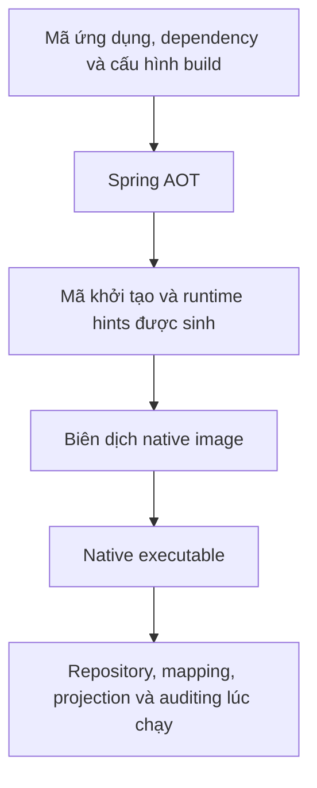

# Managed types, reflection hint và các yêu cầu khi dùng native image

## 1. Mục tiêu và phạm vi

Spring Data Commons cung cấp các abstraction dùng chung cho họ Spring Data: Repository, CRUD, derived queries, phân trang, sắp xếp, projection, mapping và auditing. Khi ứng dụng chạy dưới dạng native image, các abstraction này vẫn cần thông tin về domain model, repository và những thao tác động sẽ xảy ra lúc chạy.

Bài học này giải thích ba vấn đề liên quan nhưng khác nhau:

- **Managed types**: những kiểu mà hạ tầng mapping của data store cần biết và xử lý.
- **Runtime hints**, trong đó có reflection hints: thông tin bổ sung cho quá trình AOT và xây dựng native image về các khả năng động cần được giữ lại.
- **Điều kiện triển khai native**: dependency, cấu hình, model và đường thực thi phải phù hợp với khả năng AOT của phiên bản và data store đang dùng.

Spring Data Commons không phải một data store và không tự cung cấp toàn bộ khả năng native cho mọi implementation. Spring Data JPA, MongoDB, JDBC hay các module khác còn có mapping, driver, converter và yêu cầu riêng. Vì vậy, cần tách phần nguyên lý dùng chung khỏi cấu hình đặc thù của từng module.

Sau bài học, bạn cần trả lời được:

1. Vì sao một class đã có trong mã nguồn vẫn có thể gặp lỗi reflection ở native image?
2. Vì sao đăng ký managed type chưa đồng nghĩa với đăng ký đủ runtime hints?
3. Khi nào nên dựa vào AOT của framework và khi nào cần bổ sung hints cho mã ứng dụng?
4. Làm thế nào để xác minh một luồng repository, projection hoặc auditing thực sự hoạt động trong native executable?

## 2. Từ JVM đến AOT và native image

### 2.1. Những gì một ứng dụng JVM thường làm lúc khởi động

Một ứng dụng Spring Data trên JVM có thể thực hiện nhiều công việc động:

- Tìm repository interface và phân tích generic domain type, ID type.
- Đọc annotation, constructor, field, property và kiểu trả về của phương thức.
- Dựng mapping metadata cho aggregate và các kiểu liên quan.
- Tạo repository proxy hoặc projection proxy.
- Gọi constructor, getter, setter hay truy cập field thông qua reflection.
- Tải cấu hình hoặc tài nguyên từ classpath.

Trên JVM, class có trên classpath thường có thể được nạp và kiểm tra lúc chạy. Điều đó không có nghĩa mọi lớp đều tự trở thành managed type; hạ tầng vẫn phải được cấu hình hoặc khám phá chúng theo quy tắc của data store.

### 2.2. Ràng buộc closed world

Native image xây dựng chương trình từ tập mã, dependency, tài nguyên và metadata được xác định trong quá trình build. Trình biên dịch phân tích các đường gọi để xác định thành phần nào có thể được sử dụng.

Một lời gọi trực tiếp như:

```java
Customer customer = new Customer("C-101", "Lan");
```

thể hiện khá rõ constructor cần dùng. Một lời gọi thông qua tên class lấy từ cấu hình thì khó xác định hơn:

```java
Class<?> rowType = Class.forName(configuredClassName);
Object row = rowType
        .getDeclaredConstructor(String.class, String.class)
        .newInstance(externalId, displayName);
```

Với đoạn thứ hai, cần xem xét cả việc kiểu có được giữ lại hay không, constructor có metadata để tra cứu hay không và việc gọi constructor qua reflection có được hỗ trợ hay không. Trình biên dịch có thể suy ra một số mẫu reflection, nhưng không nên giả định nó suy ra được mọi giá trị đến từ cấu hình.

**Có class trong dependency không bảo đảm mọi thành viên của class đều sẵn sàng cho reflection.**

Closed world cũng không có nghĩa mọi hành vi đều phải cố định. Dữ liệu truy vấn, giá trị phân trang, thứ tự sắp xếp hay người dùng hiện tại vẫn có thể thay đổi lúc chạy. Phần cần được biết đủ sớm là các kiểu và cơ chế động cần thiết để xử lý những dữ liệu đó.

### 2.3. Spring AOT và biên dịch native là hai công đoạn

Spring AOT xử lý mô hình ứng dụng trước lúc chạy để sinh mã và metadata hỗ trợ khởi tạo, tạo bean và giữ lại những khả năng động cần thiết. Sau đó, công cụ xây dựng native image phân tích ứng dụng cùng các đầu ra này để tạo executable.



AOT không có nghĩa toàn bộ ứng dụng hết dùng reflection hay proxy. Một phần công việc được chuyển sang build time; phần động còn cần thiết phải có thông tin phù hợp.

## 3. Managed types: tập kiểu mà mapping cần biết

### 3.1. Hiểu đúng khái niệm

Trong ngữ cảnh Spring Data, managed types là những kiểu được đưa vào phạm vi xử lý của hạ tầng mapping. Spring Data Commons có abstraction `ManagedTypes` để biểu diễn tập kiểu này; cách thu thập, bổ sung và tiêu thụ tập kiểu phụ thuộc module cụ thể.

Ví dụ một ứng dụng quản lý khách hàng có:

```java
package com.example.customers;

import org.springframework.data.annotation.Id;
import org.springframework.data.annotation.PersistenceCreator;

public class Customer {

    @Id
    private final String id;

    private final String displayName;

    @PersistenceCreator
    public Customer(String id, String displayName) {
        this.id = id;
        this.displayName = displayName;
    }

    public String getId() {
        return id;
    }

    public String getDisplayName() {
        return displayName;
    }
}
```

Đây là ví dụ minh họa mapping bằng annotation của Spring Data Commons. Việc lưu class này vào database còn cần module, mapping annotation hoặc cấu hình tương ứng với data store. Đặc biệt, không dùng ví dụ này để kết luận rằng entity JPA chỉ cần `org.springframework.data.annotation.Id`.

Khi `Customer` thuộc phạm vi mapping, hạ tầng có thể cần biết:

- Property nào là ID.
- Constructor nào dùng để tạo instance từ dữ liệu đọc được.
- Cách gắn tham số constructor với property.
- Những kiểu nằm trong property hoặc cấu trúc lồng nhau.
- Converter hoặc metadata nào tham gia quá trình đọc và ghi.

Trong native image, việc xác định trước các kiểu liên quan giúp AOT chuẩn bị thông tin cần thiết. Nó cũng làm rõ loại domain nào thực sự nằm trong mô hình ứng dụng.

### 3.2. Managed type không phải trạng thái managed của JPA

Hai cách dùng từ “managed” dễ gây nhầm:

| Khái niệm | Câu hỏi mà nó trả lời |
|---|---|
| Managed types của hạ tầng mapping | Những class nào thuộc phạm vi mapping cần xử lý? |
| Entity instance ở trạng thái managed trong JPA | Object cụ thể nào đang được persistence context theo dõi? |

Một class thuộc tập kiểu mapping không có nghĩa mọi instance của class đó đều đang gắn với persistence context. Ngược lại, việc một object đã được JPA quản lý lúc chạy không thay thế nhu cầu chuẩn bị metadata native cho class của nó.

### 3.3. Những kiểu nào cần được xem xét?

Không nên chỉ kiểm tra aggregate root rồi dừng lại. Tùy mô hình và module, những nhóm sau có thể tham gia đường mapping:

- Aggregate root và entity liên quan.
- Value object hoặc kiểu được nhúng.
- Kiểu con được dùng trong mô hình đa hình.
- Domain type của repository không nằm trong phạm vi scan dự kiến.
- Kiểu đầu vào hoặc đầu ra của custom converter.
- DTO hoặc projection được tạo trong các luồng truy vấn.

Danh sách này là **phạm vi cần rà soát**, không phải hướng dẫn đưa mọi kiểu vào managed types. Một DTO phục vụ import hoặc HTTP có thể cần reflection hints nhưng không nên được đăng ký như persistent entity. Một value object được converter xử lý như giá trị đơn cũng có thể có cách xử lý khác với entity được mapping đầy đủ.

Đặt đúng câu hỏi: “Ai xử lý kiểu này, và bằng cơ chế nào?” Nếu mapping context xử lý thì kiểm tra tập kiểu mapping. Nếu một thư viện gọi constructor bằng reflection thì kiểm tra metadata cho reflection. Nếu serializer xử lý thì kiểm tra integration của serializer.

### 3.4. Nguy cơ từ việc khám phá kiểu quá muộn

Một thiết kế chỉ phát hiện thêm domain type khi gặp dữ liệu đầu tiên có thể chạy được trên JVM nhưng gây khó khăn cho AOT. Ví dụ:

1. Repository cho aggregate root đã được phát hiện.
2. Một subtype chỉ xuất hiện trong dữ liệu của một tenant.
3. Ứng dụng chọn subtype bằng tên class nhận từ cấu hình.
4. Luồng native thông thường chưa bao giờ đụng tới subtype này.

Để hỗ trợ mô hình đó, tập subtype phải được xác định và cấu hình theo cơ chế mà module hỗ trợ trước khi build. Nếu thiết kế cho phép nạp một class hoàn toàn mới sau khi executable đã được tạo, đó là thay đổi kiến trúc; bổ sung một reflection hint cho bản build cũ không thể đưa mã mới vào executable.

## 4. Runtime hints: mô tả khả năng động cần giữ lại

### 4.1. Reflection hint chỉ là một phần

Runtime hints của Spring có thể mô tả nhiều nhu cầu:

| Nhóm | Ví dụ nhu cầu |
|---|---|
| Reflection | Tra cứu hoặc gọi constructor, method; truy cập field |
| JDK proxy | Tạo proxy với một tổ hợp interface cụ thể |
| Resource | Đọc file cấu hình hoặc mẫu dữ liệu từ classpath |
| Serialization | Dùng Java serialization cho một kiểu, nếu luồng thực sự cần |

Serialization hints ở đây liên quan Java serialization; không đồng nhất với mọi nhu cầu chuyển object thành JSON. JSON còn phụ thuộc thư viện, model và cơ chế AOT của thư viện đó.

Một derived query có kiểu trả về rõ ràng, một interface projection và một DTO được thư viện ngoài dựng bằng reflection có thể đi qua những cơ chế khác nhau. Không nên gom mọi lỗi native vào nhóm “thiếu reflection”.

### 4.2. Đăng ký kiểu, tra cứu thành viên và gọi thành viên

Các mức hỗ trợ reflection không tương đương nhau:

- Biết rằng một kiểu tồn tại.
- Có thể tra cứu metadata của constructor hoặc method.
- Có thể gọi constructor hoặc method đó.
- Có thể đọc hoặc ghi field cần thiết.

Nếu mã gọi `getDeclaredConstructor(...).newInstance(...)`, chỉ giữ tên class hoặc metadata để tìm constructor có thể chưa đủ. Cần quyền sử dụng constructor cho reflection theo API hints và công cụ native tương ứng.

Tương tự, constructor hoạt động không bảo đảm một field private cũng có thể được ghi bằng reflection. Phải xét đúng đường thực thi mà mapping engine hoặc thư viện sử dụng.

Ưu tiên khai báo đủ và cụ thể. Đăng ký tất cả constructor, method và field của toàn bộ package làm phạm vi reflection lớn hơn nhu cầu thực tế, có thể tăng kích thước image và che khuất nguyên nhân thiếu metadata.

## 5. Managed types và hints bổ sung cho nhau

Hai nhóm thông tin giải quyết hai bài toán khác nhau:

| Nội dung | Managed types | Runtime hints |
|---|---|---|
| Vai trò chính | Xác định phạm vi kiểu để mapping xử lý | Giữ lại khả năng động cần dùng trong native image |
| Liên quan đến | Domain model và mapping context | Reflection, proxy, resource và các cơ chế native khác |
| Tự biến class thành entity? | Còn phụ thuộc mapping của data store | Không |
| Tự bảo đảm mọi reflection của thư viện ngoài? | Không | Chỉ hỗ trợ phần được khai báo và công cụ hiểu |
| Có thể được framework xử lý tự động? | Có, tùy module và cấu hình | Có, tùy integration và phiên bản |

Ví dụ, `Customer` đã được đưa vào mapping context và module đã đóng góp metadata cần thiết để materialize object. Điều đó không chứng minh một thư viện báo cáo bên ngoài cũng gọi được mọi getter trên mọi DTO.

Ngược lại, đăng ký reflection cho `Customer` không làm repository scan nhìn thấy repository interface, không tạo converter và không bổ sung entity vào cấu hình của một persistence provider.

Trình tự suy nghĩ hữu ích là:

1. Kiểu có thuộc phạm vi xử lý của đúng thành phần hay chưa?
2. Thành phần đó có integration AOT cho trường hợp đang dùng không?
3. Còn thao tác động nào do ứng dụng hoặc thư viện ngoài tự thực hiện?
4. Những thao tác còn lại cần loại hint nào?

## 6. Ví dụ bổ sung hints cho phần mở rộng của ứng dụng

### 6.1. Tình huống

Ứng dụng có một bộ import cũ. Bộ import chọn class từ một danh sách tên đã cho phép, rồi gọi constructor nhận hai `String` bằng reflection. Kiểu dữ liệu đích là:

```java
package com.example.customers.importing;

public record CustomerImportRow(
        String externalId,
        String displayName) {
}
```

Đây là DTO của bộ import, không phải persistent entity. Giả sử bộ import còn đọc mẫu `imports/customer-template.csv` từ classpath. Trong trường hợp chưa được integration khác xử lý, ứng dụng có thể bổ sung hints cho đúng hai nhu cầu này.

### 6.2. Khai báo registrar

```java
package com.example.customers.importing;

import org.springframework.aot.hint.MemberCategory;
import org.springframework.aot.hint.RuntimeHints;
import org.springframework.aot.hint.RuntimeHintsRegistrar;

public final class CustomerImportHints implements RuntimeHintsRegistrar {

    @Override
    public void registerHints(RuntimeHints hints, ClassLoader classLoader) {
        hints.reflection().registerType(
                CustomerImportRow.class,
                MemberCategory.INVOKE_DECLARED_CONSTRUCTORS);

        hints.resources().registerPattern(
                "imports/customer-template.csv");
    }
}
```

Trong ví dụ này:

- `INVOKE_DECLARED_CONSTRUCTORS` phục vụ việc gọi constructor qua reflection.
- Resource pattern phục vụ việc đóng gói tài nguyên classpath cần dùng.
- Không đăng ký field vì bộ import không ghi field bằng reflection.
- Không đăng ký method vì đoạn xử lý giả định không gọi method bằng reflection.
- Không đăng ký DTO vào tập persistent entities.

Record ở đây chỉ có canonical constructor, nên phạm vi đăng ký constructor tương đối hẹp. Nếu class thật có nhiều constructor, cân nhắc API đăng ký constructor cụ thể của phiên bản Spring Framework đang dùng để mô tả chính xác hơn.

Hint về resource không tạo ra file. Tài nguyên vẫn phải có trong đầu vào build ở vị trí tương ứng.

### 6.3. Đưa registrar vào cấu hình ứng dụng

```java
package com.example.customers.importing;

import org.springframework.context.annotation.Configuration;
import org.springframework.context.annotation.ImportRuntimeHints;

@Configuration(proxyBeanMethods = false)
@ImportRuntimeHints(CustomerImportHints.class)
public class CustomerImportConfiguration {
}
```

Cấu hình này phải được ứng dụng tìm thấy hoặc import trong quá trình xử lý AOT. Một registrar tồn tại trong source nhưng không được kết nối với cấu hình AOT không tự phát huy tác dụng.

Các class trên minh họa cơ chế khai báo hints của Spring Framework. Chúng không thay thế cấu hình repository, driver hay persistence của data store.

### 6.4. Giữ tập kiểu động hữu hạn

Nếu tên class đến từ cấu hình, nên có danh sách kiểu được hỗ trợ rõ ràng. Bổ sung một lựa chọn mới có thể đòi hỏi:

1. Thêm class hoặc dependency vào đầu vào build.
2. Cập nhật cấu hình mapping hoặc hints tương ứng.
3. Build lại native executable.
4. Chạy thử đường import sử dụng lựa chọn mới.

Trước khi thêm hints thủ công, cũng nên xem có thể thay reflection bằng factory hoặc constructor reference hay không. Với tập kiểu nhỏ, một registry factory tường minh thường giúp mã dễ kiểm soát và dễ phân tích AOT hơn.

Không cần viết registrar cho mọi domain class chỉ vì ứng dụng dùng Spring Data. Hãy kiểm tra phần mà module và integration đã đóng góp, sau đó bổ sung đúng phần mở rộng của ứng dụng.

## 7. Repository, projection và auditing cần chú ý gì?

### 7.1. Repository và derived query

Repository interface giúp framework biết domain type, ID type, tên phương thức và kiểu trả về. Những thông tin rõ ràng này hữu ích cho xử lý AOT:

```java
package com.example.customers;

import java.util.List;
import org.springframework.data.repository.CrudRepository;

public interface CustomerRepository
        extends CrudRepository<Customer, String> {

    List<Customer> findByDisplayName(String displayName);
}
```

Đây là hình thức khai báo chung; khả năng thực thi derived query và mapping còn phụ thuộc module sử dụng.

Không cần cố định giá trị `displayName` ở build time. Giá trị truy vấn là dữ liệu lúc chạy. Điều cần chuẩn bị là repository, model và cơ chế thực thi truy vấn mà module dùng.

Đăng ký repository hoặc xây dựng repository factory theo cách động sau khi ứng dụng đã khởi động là tình huống khác với repository được AOT nhận diện từ cấu hình. Cần đánh giá riêng thay vì suy từ một repository thông thường đã chạy thành công.

### 7.2. Phân trang và sắp xếp

Số trang, kích thước trang và tên thuộc tính sắp xếp có thể đến từ request. Native image không yêu cầu những giá trị này luôn là hằng số.

Tuy nhiên, property dùng để sắp xếp vẫn phải hợp lệ đối với domain và được data store hỗ trợ. Những cơ chế xây dựng sort dựa trên proxy hoặc biểu thức động cần được kiểm tra riêng theo module và phiên bản; không suy rộng từ việc `Sort.by("displayName")` hoạt động sang mọi API sort khác.

### 7.3. Interface projection và DTO projection

Với interface projection, cần xem xét việc tạo proxy và truy cập property:

```java
package com.example.customers;

public interface CustomerName {

    String getDisplayName();
}
```

Đối với DTO projection, constructor và thông tin tham số có thể quan trọng. Projection có biểu thức hoặc logic động có thể cần thêm thành phần so với projection chỉ khai báo getter.

Các điểm cần kiểm tra:

- Projection có được thể hiện trong chữ ký repository để hạ tầng nhận diện không?
- DTO có constructor phù hợp và thông tin tên tham số cần thiết không?
- Projection có gọi bean, biểu thức hoặc class ngoài phạm vi mapping không?
- Dynamic projection có thể chọn những class nào khi chạy?

Nếu framework tạo JDK proxy, danh sách và tổ hợp interface phải phù hợp với proxy thực tế. Đăng ký thủ công một interface projection đơn lẻ không bảo đảm đã mô tả đúng proxy do Spring Data tạo ra, vì proxy có thể có thêm interface của hạ tầng. Ưu tiên integration AOT của framework cho các trường hợp được hỗ trợ.

Một tham số `Class<T>` cho dynamic projection không có nghĩa native executable có thể xử lý tùy ý mọi class do người dùng đưa vào. Tập projection thực sự dùng phải có trong image và được chuẩn bị theo cơ chế phù hợp.

### 7.4. Auditing

Auditing có thể cần:

- Nhận biết property chứa người tạo, người sửa và thời điểm tương ứng.
- Tạo hoặc cập nhật object theo cơ chế mapping của module.
- Tìm bean cung cấp auditor.
- Thực thi entity callback hoặc listener mà integration sử dụng.

Giá trị người dùng hiện tại hoặc thời gian hiện tại vẫn được tính lúc chạy. Điều cần xử lý ở build time là cấu trúc bean và cơ chế truy cập model, không phải đóng băng dữ liệu auditing.

Nếu auditor phụ thuộc security context hoặc reactive context, native image không tự sửa việc truyền context sai. Lỗi thiếu auditor, sai transaction hoặc mất reactive context cần được phân biệt với lỗi thiếu native metadata.

## 8. Các yêu cầu cần chốt trước khi build native

### 8.1. Phiên bản phải tạo thành một tổ hợp tương thích

Cần xác định đồng thời:

- Phiên bản Spring Boot, nếu ứng dụng dùng Boot.
- Spring Framework và Spring Data release train tương ứng.
- Module data store và persistence provider hoặc driver.
- JDK, bộ công cụ native và nền tảng build/triển khai.

Khi dùng cơ chế quản lý dependency của Spring Boot, ưu tiên tổ hợp dependency mà phiên bản Boot đó quản lý. Nâng riêng Spring Data Commons để xử lý một lỗi native có thể tạo ra tổ hợp lệch với module store hoặc Spring Framework.

Không có một tuyên bố “Spring Data hỗ trợ native” nào đủ để bảo đảm mọi thư viện, mapping và tính năng của ứng dụng đều được hỗ trợ. Cần đối chiếu đúng tổ hợp và đường dùng thực tế.

### 8.2. Bean graph phải được xử lý với cấu hình phù hợp

Profile, điều kiện cấu hình hoặc property làm thay đổi việc tạo bean có thể ảnh hưởng đầu ra AOT. Không nên build với một mô hình bean rồi kỳ vọng runtime tự phát hiện một mô hình hoàn toàn khác.

Cần phân biệt:

- Property làm thay đổi cấu trúc bean, repository scan hoặc tập domain type.
- Property cung cấp giá trị hoạt động, chẳng hạn URL kết nối và credential.

Khả năng thay đổi một property sau build phụ thuộc cách property đó được sử dụng. Không kết luận rằng mọi property đều bị cố định, hoặc mọi property đều có thể đổi tự do.

### 8.3. Thông tin constructor và tên tham số

Khi mapping dựa vào constructor, cần bảo đảm:

- Constructor dùng để materialize object được xác định rõ.
- Không có nhiều constructor gây nhập nhằng mà thiếu chỉ dẫn phù hợp.
- Tên tham số cần cho binding được giữ theo yêu cầu của ngôn ngữ, compiler và module.
- Annotation như `@PersistenceCreator`, nếu dùng, được đặt đúng vị trí.

Với Java class thông thường, tùy cơ chế binding có thể cần biên dịch với `-parameters`. Record có metadata cho các component và canonical constructor, nhưng điều này không tự giải quyết mọi vấn đề mapping, converter hoặc reflection của thư viện ngoài.

### 8.4. Kiểu mở rộng và tài nguyên phải hiện diện khi build

Kiểm tra những phần thường bị bỏ quên:

- Custom repository implementation hoặc repository fragment.
- Custom converter và các kiểu liên quan.
- Callback, listener và auditor provider.
- Các subtype thật sự xuất hiện trong dữ liệu.
- File mẫu, script hoặc cấu hình đọc từ classpath.
- Thư viện tự tra cứu class, constructor hoặc method qua tên.

Tài nguyên lấy từ filesystem bên ngoài là một nhu cầu triển khai khác với classpath resource. Resource hint cho classpath không bảo đảm một đường dẫn filesystem sẽ tồn tại trên máy chạy executable.

## 9. Quy trình kiểm tra theo đường thực thi

### Bước 1: Mô tả các luồng cần hỗ trợ

Lập danh sách bằng ngôn ngữ nghiệp vụ, ví dụ:

- Tạo khách hàng mới và nhận lại ID.
- Đọc khách hàng từ database.
- Tìm theo tên bằng derived query.
- Lấy danh sách có phân trang và sắp xếp.
- Đọc interface projection hoặc DTO projection.
- Cập nhật object có auditing.
- Import bằng converter hoặc thư viện riêng.

Mục đích là nhìn thấy đường mapping và thao tác động, không chỉ kiểm tra ứng dụng có khởi động được hay không.

### Bước 2: Xác nhận hành vi trên JVM

Chạy các luồng với đúng data store và dữ liệu đại diện. Nếu constructor binding hoặc derived query đã sai trên JVM, cần sửa lỗi chức năng đó trước khi phân tích native metadata.

### Bước 3: Xử lý AOT và build native

Dùng pipeline mà phiên bản framework và môi trường dự án hỗ trợ. Quan sát lỗi ở đúng giai đoạn:

- Xử lý cấu hình và bean trong AOT.
- Phân tích hoặc liên kết khi tạo native image.
- Khởi động executable.
- Thực thi một truy vấn hoặc chuyển đổi dữ liệu cụ thể.

Một lỗi ở giai đoạn khởi tạo bean không tự động có nghĩa thiếu reflection hint.

### Bước 4: Chạy native với dữ liệu có ý nghĩa

Đọc một bảng rỗng không kiểm chứng được việc tạo entity từ một hàng dữ liệu. Tương tự, gọi repository nhưng không nhận kết quả không đủ để xác minh DTO constructor hoặc projection proxy.

Cần có dữ liệu làm thực sự phát sinh:

- Materialization của aggregate và value object.
- Chuyển đổi bằng custom converter.
- Trả về từng loại projection cần hỗ trợ.
- Điền hoặc thay đổi trường auditing.
- Truy cập subtype và tài nguyên ở các nhánh ít gặp.

### Bước 5: Bổ sung metadata có căn cứ rồi build lại

Khi xác định một thao tác động chưa được hỗ trợ:

1. Xác định class và thành viên hoặc loại tài nguyên thực sự được dùng.
2. Kiểm tra đây là phần framework đã hỗ trợ hay phần mở rộng tự viết.
3. Bổ sung cấu hình hoặc hint hẹp nhất đáp ứng đường thực thi.
4. Build lại để metadata mới có hiệu lực.
5. Chạy lại tình huống đã lỗi và những luồng bị ảnh hưởng.

Thay đổi registrar không vá được executable đã tạo trước đó.

Công cụ tracing agent có thể hỗ trợ quan sát reflection, proxy và resource trên JVM. Kết quả chỉ phản ánh những nhánh đã chạy; nó không phải bằng chứng rằng mọi nhánh đều được bao phủ. Dùng kết quả như dữ liệu chẩn đoán, rồi kiểm tra bằng native executable.

## 10. Phân loại lỗi thường gặp

| Biểu hiện | Nhóm nguyên nhân cần kiểm tra | Hướng xử lý |
|---|---|---|
| Domain class không được mapping nhận diện | Phạm vi scan, managed types hoặc cấu hình của store | Sửa đúng cấu hình mapping trước |
| Không tạo được object từ dữ liệu | Constructor binding, converter hoặc reflection | Xác định constructor và cơ chế gọi thực tế |
| Proxy projection không tạo được | AOT integration hoặc tổ hợp interface của proxy | Kiểm tra khả năng hỗ trợ và metadata proxy |
| DTO dùng qua tên class chỉ lỗi trong native | Đường dùng động chưa được phân tích hoặc khai báo | Giới hạn tập DTO và bổ sung hints có căn cứ |
| Không đọc được file mẫu từ classpath | Resource chưa được đưa vào build hoặc thiếu hint | Kiểm tra vị trí tài nguyên và resource pattern |
| Chạy đúng profile build nhưng lỗi khi đổi profile | Bean graph runtime khác mô hình được xử lý AOT | Chốt lại cấu hình build và điều kiện tạo bean |
| Auditor trả về rỗng | Bean, context hoặc logic xác định người dùng | Kiểm tra luồng context trước khi thêm hints |
| Native khởi động được nhưng lỗi khi có dữ liệu | Luồng materialization chưa được kiểm chứng | Chạy lại bằng dữ liệu có entity, subtype và projection thực |

Tên exception và thông báo lỗi có thể thay đổi theo công cụ, phiên bản và module. Chẩn đoán theo thao tác thất bại cụ thể, không chỉ theo một chuỗi thông báo.

## 11. Câu hỏi tự kiểm tra

**1. Đã thêm một DTO vào reflection hints thì DTO đó trở thành entity chưa?**

Chưa. Hints phục vụ khả năng động trong native image. Việc trở thành persistent entity còn phụ thuộc mapping và cấu hình của data store.

**2. Entity đọc được qua repository thì mọi thư viện ngoài cũng dùng được reflection trên entity đó?**

Không thể kết luận như vậy. Luồng repository có thể dùng mã sinh hoặc tập thành viên khác với thư viện ngoài. Cần xét đúng constructor, method hoặc field mà thư viện ngoài sử dụng.

**3. Native executable có cho phép đổi số trang và giá trị truy vấn lúc chạy không?**

Có, đó thường là dữ liệu hoạt động. Ràng buộc AOT tập trung vào cấu trúc chương trình và những khả năng động cần được chuẩn bị, không yêu cầu mọi đầu vào truy vấn đều cố định.

**4. Cần đăng ký JDK proxy thủ công cho mọi repository không?**

Không. Với trường hợp được hỗ trợ, framework có thể đóng góp cấu hình AOT cần thiết. Chỉ bổ sung khi đã xác định nhu cầu chưa được integration xử lý và biết tổ hợp interface chính xác.

**5. Build native thành công đã đủ xác nhận mapping và auditing chưa?**

Chưa. Cần chạy executable qua các luồng đọc, ghi, projection và auditing với dữ liệu làm phát sinh những thao tác đó.

**6. Nếu thêm domain subtype hoặc projection mới sau khi đã build thì làm gì?**

Cập nhật mã, dependency, cấu hình mapping hoặc hints theo nhu cầu, rồi build và kiểm chứng lại executable. Không giả định việc thay một tên class trong cấu hình sẽ đưa một kiểu mới vào native image.

Managed types xác định phần mô hình mà hạ tầng mapping cần biết; runtime hints giữ lại những khả năng động cần thiết; kiểm thử native xác nhận các đường nghiệp vụ thực sự chạy được. Ba phần này cần được xem xét cùng nhau khi dùng các abstraction của Spring Data Commons trong một ứng dụng native.
