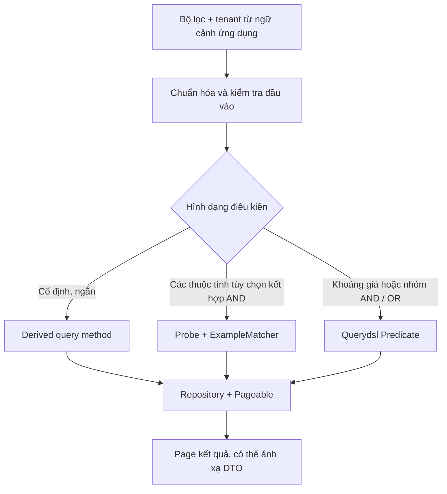

# Xây query method cùng bộ lọc QBE hoặc Querydsl

Bài thực hành thuộc chương **Thực hành tổng hợp** của **SPRING_DATA_COMMONS**. Bạn sẽ xây chức năng tìm kiếm sản phẩm bằng các abstraction dùng chung của Spring Data: repository, derived query, Query by Example (QBE), `Pageable`, `Sort` và Querydsl predicate. Phần cuối nối kết kết quả phân trang với DTO và chỉ ra cách tránh để các thuộc tính kỹ thuật, chẳng hạn thời gian auditing, vô tình trở thành điều kiện tìm kiếm.

Mục tiêu là chọn được cách biểu diễn điều kiện phù hợp, giữ nguyên ý nghĩa bộ lọc khi phân trang và giải thích được vì sao kết quả đúng trên một bộ dữ liệu xác định.

## 1. Đề bài và phạm vi triển khai

Xây chức năng tra cứu danh mục sản phẩm của một tenant, tức một đơn vị có tập dữ liệu riêng trong cùng ứng dụng. Trong thiết kế bài tập, `tenantId` đến từ ngữ cảnh đã được ứng dụng xác định; nó không nằm trong DTO bộ lọc do người dùng tùy ý gửi lên.

Các yêu cầu cơ bản:

- Có query method tìm sản phẩm theo tenant và trạng thái.
- Có bộ lọc động theo một phần tên, danh mục và trạng thái; mỗi trường có thể bỏ trống.
- Luôn giới hạn kết quả theo tenant, kể cả khi mọi trường tùy chọn đều trống.
- Phân trang tại tầng lưu trữ, có thứ tự phụ theo ID để phân biệt sản phẩm trùng giá.
- Bản mở rộng hỗ trợ khoảng giá và nhóm điều kiện OR bằng Querydsl.

Chọn **QBE làm phương án chính**. Triển khai Querydsl khi yêu cầu thực sự cần khoảng giá hoặc nhóm biểu thức. Hai phương án cùng giải quyết bài toán tìm kiếm, không phải hai tầng lọc bắt buộc chạy nối tiếp nhau.

Các ví dụ dùng cú pháp Java 17 và chọn **Spring Data JPA với Jakarta Persistence** làm adapter lưu trữ cụ thể. Cần có cấu hình repository, entity scanning và nguồn dữ liệu của ứng dụng trước khi thực thi. `Example`, `ExampleMatcher`, các executor, `Pageable` và `Sort` là các hợp đồng Spring Data; annotation entity và quá trình tạo truy vấn JPA thuộc adapter. Không suy ra rằng mọi module lưu trữ đều hỗ trợ tất cả tính năng tương tự. Xem [QBE trong Spring Data JPA](https://docs.spring.io/spring-data/jpa/reference/repositories/query-by-example.html).



## 2. Mô hình và dữ liệu thực hành

Trạng thái sản phẩm:

```java
public enum ProductStatus {
    ACTIVE,
    INACTIVE
}
```

Entity tối giản dưới đây dùng ID do bộ dữ liệu thực hành cấp sẵn để dễ đối chiếu kết quả. Trong ứng dụng thực tế, chọn chiến lược ID theo thiết kế lưu trữ của dự án.

```java
import java.math.BigDecimal;
import java.time.Instant;
import jakarta.persistence.Column;
import jakarta.persistence.Entity;
import jakarta.persistence.EnumType;
import jakarta.persistence.Enumerated;
import jakarta.persistence.Id;
import jakarta.persistence.Table;

@Entity
@Table(name = "catalog_product")
public class Product {
    @Id
    private Long id;

    @Column(nullable = false)
    private String tenantId;

    @Column(nullable = false)
    private String name;

    @Column(nullable = false)
    private String category;

    @Enumerated(EnumType.STRING)
    @Column(nullable = false)
    private ProductStatus status;

    @Column(nullable = false, precision = 18, scale = 2)
    private BigDecimal price;

    @Column(nullable = false)
    private Instant createdAt;

    protected Product() {}

    public Product(Long id, String tenantId, String name,
                   String category, ProductStatus status,
                   BigDecimal price, Instant createdAt) {
        this.id = id;
        this.tenantId = tenantId;
        this.name = name;
        this.category = category;
        this.status = status;
        this.price = price;
        this.createdAt = createdAt;
    }

    public Long getId() { return id; }
    public String getTenantId() { return tenantId; }
    public String getName() { return name; }
    public String getCategory() { return category; }
    public ProductStatus getStatus() { return status; }
    public BigDecimal getPrice() { return price; }
    public Instant getCreatedAt() { return createdAt; }

    public void setTenantId(String tenantId) { this.tenantId = tenantId; }
    public void setName(String name) { this.name = name; }
    public void setCategory(String category) { this.category = category; }
    public void setStatus(ProductStatus status) { this.status = status; }
}
```

Các kiểu trong bài được giả định thuộc cùng package. Vì vậy, lớp dựng probe có thể gọi constructor không tham số `protected` của entity.

Dùng bộ dữ liệu sau trong cơ sở dữ liệu kiểm thử riêng. Gán `createdAt` khác `null` cho tất cả bản ghi; các ví dụ kết quả bên dưới sắp xếp theo giá nên không phụ thuộc thời điểm đó.

| id | tenantId | name | category | status | price |
| --- | --- | --- | --- | --- | --- |
| 101 | tenant-a | Coffee Beans | beverage | ACTIVE | 150000 |
| 102 | tenant-a | Coffee Cup | accessories | ACTIVE | 90000 |
| 103 | tenant-a | Tea Cup | accessories | INACTIVE | 70000 |
| 104 | tenant-a | Tea Leaves | beverage | ACTIVE | 120000 |
| 105 | tenant-a | Coffee Filter | accessories | ACTIVE | 90000 |
| 201 | tenant-b | Coffee Cup | accessories | ACTIVE | 90000 |

Bản ghi `201` cố ý giống nhiều tiêu chí của `102`. Nó giúp phát hiện truy vấn vô tình bỏ điều kiện tenant. Hai bản ghi `102` và `105` có cùng giá để kiểm tra thứ tự phụ và ranh giới trang.

## 3. Query method cho hình dạng truy vấn cố định

Khai báo repository cho phương án QBE:

```java
import java.util.Optional;
import org.springframework.data.domain.Page;
import org.springframework.data.domain.Pageable;
import org.springframework.data.repository.CrudRepository;
import org.springframework.data.repository.query.QueryByExampleExecutor;

public interface ProductRepository
        extends CrudRepository<Product, Long>,
                QueryByExampleExecutor<Product> {

    Page<Product> findByTenantIdAndStatus(
        String tenantId,
        ProductStatus status,
        Pageable pageable
    );

    Optional<Product> findByTenantIdAndId(String tenantId, Long id);
}
```

`findByTenantIdAndStatus` biểu diễn điều kiện cố định `tenantId = ? AND status = ?`. Trường `tenantId`, `status` và `id` trong tên method là thuộc tính domain, không phải tên cột SQL. Cơ chế phân tích query method và các toán tử phụ thuộc hỗ trợ của store; xem [Defining Query Methods](https://docs.spring.io/spring-data/commons/reference/repositories/query-methods-details.html).

Với dữ liệu trên, gọi method trạng thái cho `tenant-a`, `ACTIVE`, sắp xếp `price ASC, id ASC` phải trả ID theo thứ tự **102, 105, 104, 101**.

Nếu thêm ba trường tùy chọn, không nên tạo một method cho từng tổ hợp có hoặc không có trường. Tên method dài chỉ giải quyết một hình dạng điều kiện cụ thể. DTO bộ lọc và QBE hoặc predicate builder giúp tập trung quy tắc xử lý đầu vào.

Một điểm cần phân biệt: **derived query method không tự ghép điều kiện của nó vào các method executor khác**. Gọi `findAll(example, pageable)` là một cách truy vấn riêng. Điều kiện tenant phải có ngay trong `Example` được truyền vào, không được kỳ vọng nó tự kế thừa từ tên `findByTenantIdAndStatus`.

## 4. Định nghĩa bộ lọc và ngữ nghĩa giá trị rỗng

DTO cho bản QBE:

```java
public record ProductFilter(
    String name,
    String category,
    ProductStatus status
) {}
```

Hợp đồng của bài tập:

| Trường | Khi có giá trị | Khi bỏ trống |
| --- | --- | --- |
| `name` | Chứa chuỗi sau khi bỏ khoảng trắng ở hai đầu, không phân biệt hoa thường theo cấu hình matcher | Không thêm điều kiện tên |
| `category` | So khớp chính xác theo mã danh mục | Không thêm điều kiện danh mục |
| `status` | So khớp enum | Không thêm điều kiện trạng thái |
| `tenantId` | Luôn so khớp tenant đã xác định | Từ chối truy vấn khi thiếu |

Ở đây, “bỏ trống” với chuỗi gồm cả `null`, `""` và chuỗi chỉ có khoảng trắng. Chuẩn hóa về `null` trước khi dựng probe để tránh việc chuỗi rỗng bị hiểu là một giá trị cần tìm.

Không bind trực tiếp request vào entity rồi dùng toàn bộ entity làm probe. DTO ở trên chủ động giới hạn những thuộc tính người dùng được tìm kiếm và tách chúng khỏi ID, giá, thời điểm tạo hoặc các field nội bộ khác.

## 5. Dựng probe và ExampleMatcher

```java
import java.util.Objects;
import org.springframework.data.domain.Example;
import org.springframework.data.domain.ExampleMatcher;

final class ProductExamples {
    private static final ExampleMatcher MATCHER =
        ExampleMatcher.matchingAll()
            .withIgnoreNullValues()
            .withIgnorePaths("id", "price", "createdAt")
            .withStringMatcher(ExampleMatcher.StringMatcher.EXACT)
            .withMatcher("tenantId", m -> m.exact())
            .withMatcher("category", m -> m.exact())
            .withMatcher("name", m -> m.contains().ignoreCase());

    private ProductExamples() {}

    static Example<Product> of(String tenantId, ProductFilter filter) {
        Objects.requireNonNull(filter, "filter");

        Product probe = new Product();
        probe.setTenantId(requireTenant(tenantId));
        probe.setName(optionalText(filter.name()));
        probe.setCategory(optionalText(filter.category()));
        probe.setStatus(filter.status());

        return Example.of(probe, MATCHER);
    }

    static String optionalText(String value) {
        if (value == null) {
            return null;
        }
        String normalized = value.strip();
        return normalized.isEmpty() ? null : normalized;
    }

    static String requireTenant(String tenantId) {
        if (tenantId == null || tenantId.isBlank()) {
            throw new IllegalArgumentException("Thiếu tenantId");
        }
        return tenantId;
    }
}
```

QBE gồm đối tượng mẫu, matcher và `Example` kết hợp chúng. Các field `null` thường được bỏ qua; field primitive vẫn có giá trị mặc định nên cần chú ý khi đưa vào probe. Khả năng so khớp chuỗi phụ thuộc store. Xem [khái niệm Query by Example](https://docs.spring.io/spring-data/commons/reference/query-by-example.html).

Trong thiết kế này:

- `matchingAll()` kết hợp các tiêu chí được đưa vào bằng AND.
- `name` có quy tắc chứa chuỗi và bỏ qua hoa thường riêng; tenant và danh mục không bị áp dụng quy tắc chứa chuỗi toàn cục.
- `id`, `price`, `createdAt` bị loại khỏi tập thuộc tính của bộ lọc QBE này.
- Matcher dùng chung, còn probe được tạo mới cho mỗi lần tìm kiếm.

`ExampleMatcher` là bất biến; các method `with...` trả lại cấu hình mới. Vì vậy, nối các lời gọi hoặc giữ giá trị trả về khi thay cấu hình. Xem [Javadoc ExampleMatcher](https://docs.spring.io/spring-data/commons/docs/current/api/org/springframework/data/domain/ExampleMatcher.html).

Không tái sử dụng probe rồi sửa field của nó giữa các request. Một probe riêng giúp tránh giữ sót điều kiện từ lần tìm trước và tránh chia sẻ đối tượng có thể thay đổi giữa các luồng.

### Ba lỗi probe thường gặp

**Primitive không diễn đạt được “không lọc”.** Nếu entity có `boolean available`, một probe mới có sẵn `false`. Không có bước loại thuộc tính đó thì `false` có thể trở thành điều kiện tìm kiếm. Dùng wrapper khi mô hình phù hợp hoặc thêm đường dẫn vào `withIgnorePaths` khi thuộc tính không tham gia bộ lọc.

**Khởi tạo mặc định làm phát sinh điều kiện ngoài ý muốn.** Nếu constructor tự gán `createdAt = Instant.now()` hoặc `status = ACTIVE`, probe không còn trống ở những thuộc tính ấy. Phải kiểm soát lại field mặc định khi mở rộng entity. Một thời điểm do auditing quản lý thường không thuộc bộ lọc dạng form này.

**Include-null khác với bỏ qua trường.** Bật `withIncludeNullValues()` có nghĩa là đưa giá trị `null` vào cách dựng điều kiện; nó không có nghĩa là “tùy chọn”. Với form hiện tại, giữ chính sách bỏ qua `null`.

## 6. Dùng chung quy tắc phân trang và sắp xếp

Tạo `Pageable` từ đầu vào đã được kiểm tra:

```java
import java.util.Objects;
import org.springframework.data.domain.PageRequest;
import org.springframework.data.domain.Pageable;
import org.springframework.data.domain.Sort;

final class ProductPages {
    private ProductPages() {}

    static Pageable of(int page, int size, String sortKey,
                       Sort.Direction direction) {
        if (page < 0) {
            throw new IllegalArgumentException("page phải >= 0");
        }
        if (size < 1 || size > 100) {
            throw new IllegalArgumentException("size phải trong khoảng 1..100");
        }
        Objects.requireNonNull(direction, "direction");
        Objects.requireNonNull(sortKey, "sortKey");

        String property = switch (sortKey) {
            case "price" -> "price";
            case "name" -> "name";
            case "createdAt" -> "createdAt";
            default -> throw new IllegalArgumentException(
                "Khóa sắp xếp không được hỗ trợ: " + sortKey
            );
        };

        Sort sort = Sort.by(direction, property)
            .and(Sort.by(Sort.Direction.ASC, "id"));
        return PageRequest.of(page, size, sort);
    }
}
```

Giới hạn `size` và danh sách khóa là quyết định của API bài tập. Không chuyển một tên thuộc tính bất kỳ từ client thành đường dẫn sắp xếp nội bộ.

ID là khóa duy nhất trong bộ dữ liệu nên `id ASC` xác định thứ tự giữa sản phẩm trùng giá. Điều này giúp đối chiếu các trang trên tập dữ liệu cố định. Nó không tạo snapshot cho nhiều request nếu có bản ghi được thêm, xóa hoặc đổi giá giữa các lần đọc.

Không lấy toàn bộ dữ liệu về rồi lọc trong Java sau khi đã phân trang. Nếu lọc sau, trang có thể thiếu phần tử và `totalElements` phản ánh tập dữ liệu trước lọc. Điều kiện phải được truyền vào truy vấn trước khi áp dụng giới hạn trang.

## 7. Hoàn thiện luồng tìm kiếm QBE

```java
import org.springframework.data.domain.Page;
import org.springframework.data.domain.Pageable;
import org.springframework.data.domain.Sort;
import org.springframework.stereotype.Service;
import org.springframework.transaction.annotation.Transactional;

@Service
public class ProductSearchService {
    private final ProductRepository repository;

    public ProductSearchService(ProductRepository repository) {
        this.repository = repository;
    }

    @Transactional(readOnly = true)
    public Page<Product> search(String tenantId, ProductFilter filter,
                                int page, int size, String sortKey,
                                Sort.Direction direction) {
        var example = ProductExamples.of(tenantId, filter);
        Pageable pageable = ProductPages.of(
            page, size, sortKey, direction
        );
        return repository.findAll(example, pageable);
    }
}
```

Lời gọi minh họa trong một nơi đã được inject service:

```java
Page<Product> result = service.search(
    "tenant-a",
    new ProductFilter(" COFFEE ", "accessories", ProductStatus.ACTIVE),
    0,
    1,
    "price",
    Sort.Direction.ASC
);
```

Các điều kiện tương đương về ý nghĩa là:

```text
 tenantId = tenant-a
 AND name chứa coffee, không phân biệt hoa thường theo matcher
 AND category = accessories
 AND status = ACTIVE
 ORDER BY price ASC, id ASC
```

Với dữ liệu đã cho, trang `0` có ID `[102]`, trang `1` có ID `[105]`, tổng số kết quả là `2`. Bản ghi `201` không thuộc tập kết quả dù trùng tên, danh mục, trạng thái và giá.

`QueryByExampleExecutor` cung cấp overload nhận `Example` và `Pageable`, cùng các thao tác `exists`, `count`, `findOne`. `findOne` không thích hợp cho form có thể trả nhiều sản phẩm: nó có thể ném lỗi khi nhiều kết quả phù hợp. Xem [Javadoc QueryByExampleExecutor](https://docs.spring.io/spring-data/commons/docs/current/api/org/springframework/data/repository/query/QueryByExampleExecutor.html).

## 8. Nhận biết giới hạn của QBE trước khi mở rộng

Giả sử yêu cầu mới là:

```text
 tenantId = tenant hiện tại
 AND status = ACTIVE
 AND (name chứa text OR category chứa text)
 AND price >= minPrice
 AND price <= maxPrice
```

Đây là hình dạng phù hợp để chuyển sang Querydsl trong bài tập. QBE thông thường không biểu diễn nhóm AND/OR tùy ý và không biến giá trị số trên probe thành toán tử khoảng.

Không giải quyết bằng cách đặt `price = minPrice` trên probe: đó là một giá trị để so khớp, không phải điều kiện `>=`. Cũng không thay `matchingAll()` bằng `matchingAny()` để tạo riêng nhóm OR cho tên và danh mục. `matchingAny()` áp dụng cho toàn bộ các tiêu chí tham gia, bao gồm tenant nếu tenant vẫn nằm trong probe.

Với ví dụ nhiều tenant, biểu thức sau có ý nghĩa sai:

```text
 tenantId = tenant-a OR name chứa coffee OR category = accessories
```

Một sản phẩm của `tenant-b` chỉ cần có danh mục phù hợp là đã thỏa biểu thức này. Điều cần giữ là tenant ở ngoài nhóm OR và kết hợp bằng AND.

Giới hạn nhóm biểu thức không có nghĩa rằng mọi đường dẫn thuộc tính lồng nhau đều bị cấm. Một đường dẫn như `address.city`, nếu được store hỗ trợ, khác với một nhóm logic có dấu ngoặc.

## 9. Phương án Querydsl cho điều kiện nâng cao

### 9.1. Điều kiện chuẩn bị

Repository implementation phải hỗ trợ Querydsl. Dự án cần thư viện Querydsl, phần tích hợp JPA phù hợp Jakarta Persistence và annotation processor để sinh metamodel `QProduct` từ entity.

Chọn các artifact và phiên bản phù hợp bộ dependency của ứng dụng. Không viết tay lớp `QProduct` chỉ để hết lỗi IDE, vì lớp sinh phải phản ánh đúng tên và kiểu thuộc tính entity. Nếu chưa có metamodel, hoàn thành cấu hình code generation trước khi áp dụng đoạn mã này. Phần hỗ trợ qua executor được mô tả trong [Querydsl Extension của Spring Data](https://docs.spring.io/spring-data/commons/reference/repositories/core-extensions.html#core.extensions.querydsl).

Repository lựa chọn cho phương án nâng cao:

```java
import org.springframework.data.querydsl.QuerydslPredicateExecutor;
import org.springframework.data.repository.Repository;

public interface ProductQuerydslRepository
        extends Repository<Product, Long>,
                QuerydslPredicateExecutor<Product> {
}
```

Có thể dùng interface này cho luồng Querydsl riêng trong bài thực hành, hoặc ghép executor vào repository hiện có nếu đó là cấu trúc dự án đã chọn. Không cần chuyển mọi query method cố định sang Querydsl.

### 9.2. DTO bộ lọc và predicate builder

```java
import java.math.BigDecimal;

public record ProductAdvancedFilter(
    String text,
    ProductStatus status,
    BigDecimal minPrice,
    BigDecimal maxPrice
) {}
```

Builder giữ tenant bắt buộc ngay từ đầu, rồi bổ sung điều kiện tùy chọn:

```java
import java.util.Objects;
import com.querydsl.core.BooleanBuilder;
import com.querydsl.core.types.Predicate;

final class ProductPredicates {
    private ProductPredicates() {}

    static Predicate of(String tenantId, ProductAdvancedFilter filter) {
        Objects.requireNonNull(filter, "filter");
        String requiredTenant = ProductExamples.requireTenant(tenantId);
        validatePriceRange(filter);

        QProduct p = QProduct.product;
        BooleanBuilder builder = new BooleanBuilder(
            p.tenantId.eq(requiredTenant)
        );

        if (filter.status() != null) {
            builder.and(p.status.eq(filter.status()));
        }

        String text = ProductExamples.optionalText(filter.text());
        if (text != null) {
            builder.and(
                p.name.containsIgnoreCase(text)
                    .or(p.category.containsIgnoreCase(text))
            );
        }

        if (filter.minPrice() != null) {
            builder.and(p.price.goe(filter.minPrice()));
        }
        if (filter.maxPrice() != null) {
            builder.and(p.price.loe(filter.maxPrice()));
        }

        return builder;
    }

    private static void validatePriceRange(ProductAdvancedFilter filter) {
        if (filter.minPrice() != null && filter.minPrice().signum() < 0) {
            throw new IllegalArgumentException("minPrice phải >= 0");
        }
        if (filter.maxPrice() != null && filter.maxPrice().signum() < 0) {
            throw new IllegalArgumentException("maxPrice phải >= 0");
        }
        if (filter.minPrice() != null && filter.maxPrice() != null
                && filter.minPrice().compareTo(filter.maxPrice()) > 0) {
            throw new IllegalArgumentException("minPrice phải <= maxPrice");
        }
    }
}
```

`Predicate` ở đây là **`com.querydsl.core.types.Predicate`**, khác với `java.util.function.Predicate`. Không phải một hàm chạy trên từng entity đã được tải vào bộ nhớ.

Đoạn `.and(nameCondition.or(categoryCondition))` cố ý xây nhóm OR trước rồi ghép vào các điều kiện bắt buộc. Builder mới được tạo cho mỗi lần gọi; không giữ nó làm biến dùng chung có thể bị sửa bởi request khác.

### 9.3. Thực thi với Pageable

Trong application service đã được inject `ProductQuerydslRepository querydslRepository`:

```java
var filter = new ProductAdvancedFilter(
    "accessories",
    ProductStatus.ACTIVE,
    new java.math.BigDecimal("90000"),
    new java.math.BigDecimal("90000")
);

var predicate = ProductPredicates.of("tenant-a", filter);
var pageable = ProductPages.of(0, 20, "price", Sort.Direction.ASC);

Page<Product> result = querydslRepository.findAll(predicate, pageable);
```

`QuerydslPredicateExecutor` có overload `findAll(Predicate, Pageable)` để trả `Page`. Không cần tải tập kết quả bằng `findAll(predicate)` rồi tự chia trang. Xem [Javadoc QuerydslPredicateExecutor](https://docs.spring.io/spring-data/commons/docs/current/api/org/springframework/data/querydsl/QuerydslPredicateExecutor.html).

Với dữ liệu thực hành, kết quả ID là **[102, 105]**. Tên sản phẩm không chứa `accessories`, nhưng danh mục có chứa nên nhóm OR thỏa. Bản ghi `103` không thỏa trạng thái và khoảng giá; bản ghi `201` không thỏa tenant.

Các khoảng giá của ví dụ có biên đóng: `goe` bao gồm giá bằng cận dưới, `loe` bao gồm giá bằng cận trên. Đầu vào `minPrice > maxPrice` bị từ chối, thay vì âm thầm trả một trang rỗng và làm người dùng khó nhận ra lỗi nhập liệu.

## 10. Derived query, QBE và Querydsl phối hợp như thế nào?

Trong thiết kế của bài, chúng là ba lối vào repository phù hợp ba nhu cầu:

| Nhu cầu | Lựa chọn | Lý do trong bài tập |
| --- | --- | --- |
| Tìm một sản phẩm theo tenant và ID | Query method | Điều kiện cố định, tên method ngắn |
| Danh sách sản phẩm đang hoạt động của tenant | Query method | Hình dạng truy vấn rõ ràng và ổn định |
| Form tìm kiếm tên, danh mục, trạng thái tùy chọn | QBE | Dựng probe theo các giá trị được nhập |
| Khoảng giá hoặc nhóm tên OR danh mục | Querydsl | Cần biểu diễn toán tử và nhóm logic rõ ràng |

Không thể “gọi query method trước rồi thêm Example vào Page” để thu được truy vấn có đủ điều kiện và metadata phân trang đúng. Nếu một endpoint dùng QBE hoặc Querydsl, hãy đưa tất cả ràng buộc bắt buộc của endpoint vào biểu thức truy vấn đó.

Khi hai cách cùng biểu diễn được một yêu cầu, có thể dùng chúng để đối chiếu trên cùng dữ liệu. Chẳng hạn, QBE với chỉ tenant và `ACTIVE` phải trả cùng tập ID với `findByTenantIdAndStatus` khi dùng cùng `Pageable`. Không so hai bộ lọc vốn có ngữ nghĩa khác nhau rồi kết luận một API bị lỗi.

## 11. Ánh xạ kết quả sang DTO và liên hệ auditing

Một DTO đầu ra đơn giản:

```java
import java.math.BigDecimal;

public record ProductRow(Long id, String name, BigDecimal price) {}
```

Trong application service:

```java
Page<ProductRow> rows = result.map(product -> new ProductRow(
    product.getId(),
    product.getName(),
    product.getPrice()
));
```

Đây là ánh xạ entity đã đọc thành DTO, vẫn giữ thông tin phân trang. Nó không tự giới hạn danh sách cột mà truy vấn lấy từ cơ sở dữ liệu. Nếu cần projection ở tầng truy vấn, kiểm tra khả năng của API fluent hoặc repository implementation đang dùng.

Ở ví dụ này, `createdAt` được cấp giá trị khi tạo dữ liệu thực hành; bài không mặc định đã bật auditing. Nếu sau đó chuyển field này sang cơ chế auditing, tiếp tục giữ nó ngoài probe khi form không có tiêu chí thời gian. Muốn tìm theo một khoảng thời gian tạo thì thiết kế DTO và toán tử khoảng riêng, thay vì vô tình so bằng một timestamp mặc định.

## 12. Các tình huống kiểm chứng để hoàn thành bài thực hành

Các tình huống sau là tiêu chí kiểm chứng dành cho dự án triển khai, không phải kết quả chạy kiểm thử của tài liệu này. Nạp bộ dữ liệu đã mô tả vào database kiểm thử riêng trước khi đối chiếu.

| Tình huống | Đầu vào chính | Kỳ vọng |
| --- | --- | --- |
| Derived query trạng thái | tenant-a, ACTIVE, giá tăng | ID 102, 105, 104, 101 |
| QBE đầy đủ | tên COFFEE, danh mục accessories, ACTIVE | ID 102, 105 |
| Chuẩn hóa khoảng trắng | tên có khoảng trắng ở hai đầu | Cùng kết quả tên đã chuẩn hóa |
| Không có trường tùy chọn | ProductFilter(null, null, null), tenant-a | Chỉ năm bản ghi tenant-a |
| Không có kết quả | tên không tồn tại | Trang có content rỗng, tổng bằng 0 |
| Chia trang có giá bằng nhau | QBE đầy đủ, size 1 | Trang 0 là 102; trang 1 là 105 |
| Tenant khác có dữ liệu giống | Bộ lọc đầy đủ của tenant-a | Không có ID 201 |
| Querydsl nhóm OR và biên giá | text accessories, ACTIVE, 90000..90000 | ID 102, 105 |
| Khoảng giá ngược | minPrice lớn hơn maxPrice | Báo lỗi trước khi gọi repository |
| Thiếu tenant | null hoặc chuỗi trắng | Từ chối truy vấn |
| Phân trang hoặc sort sai | page âm, size vượt 100, khóa lạ | Từ chối đầu vào |

Ví dụ method JUnit đặt trong một integration test đã inject `ProductRepository repository` và nạp dữ liệu fixture:

```java
import java.util.List;
import org.junit.jupiter.api.Test;
import org.springframework.data.domain.Sort;
import static org.junit.jupiter.api.Assertions.assertEquals;

@Test
void qbeKeepsTenantAndStablePages() {
    var example = ProductExamples.of(
        "tenant-a",
        new ProductFilter(" COFFEE ", "accessories", ProductStatus.ACTIVE)
    );

    var first = repository.findAll(example,
        ProductPages.of(0, 1, "price", Sort.Direction.ASC));
    var second = repository.findAll(example,
        ProductPages.of(1, 1, "price", Sort.Direction.ASC));

    assertEquals(List.of(102L), first.getContent().stream()
        .map(Product::getId).toList());
    assertEquals(List.of(105L), second.getContent().stream()
        .map(Product::getId).toList());
    assertEquals(2L, first.getTotalElements());
    assertEquals(2, first.getTotalPages());
}
```

Test này kiểm tra nội dung và metadata trên truy vấn thật. Một mock luôn trả Page mong đợi chỉ kiểm tra được luồng gọi; nó không xác minh cách adapter dịch matcher hoặc predicate sang truy vấn.

Cần thêm dữ liệu có khác biệt hoa thường, giá ở đúng hai biên và giá nằm ngoài biên khi những quy tắc đó ảnh hưởng hợp đồng. Với hệ quản trị sản xuất khác database kiểm thử nhẹ, đối chiếu thêm collation, cách so khớp chuỗi và kiểu số trên hệ quản trị đích.

## 13. Đọc lỗi từ kết quả và đánh giá hiệu năng

| Dấu hiệu | Nguyên nhân cần kiểm tra |
| --- | --- |
| Kết quả QBE luôn rỗng | Probe giữ ID, timestamp, chuỗi rỗng hoặc giá trị mặc định không mong muốn |
| Bộ lọc tên khớp quá rộng ở các field khác | Cấu hình chứa chuỗi hoặc ignore-case áp dụng toàn cục |
| Xuất hiện sản phẩm tenant khác | Thiếu tenant trong một đường truy vấn hoặc dùng OR sai nhóm |
| Chỉ tìm được giá đúng bằng cận dưới | Đặt giá lên probe thay vì dùng toán tử khoảng |
| Không tìm thấy `QProduct` | Annotation processor chưa chạy, output chưa được nhận diện hoặc bộ dependency không tương thích |
| Trang thiếu phần tử nhưng tổng vẫn lớn | Có bước lọc Java sau khi repository đã phân trang |
| Sản phẩm cùng giá thay đổi thứ tự | Thiếu thứ tự phụ duy nhất hoặc dữ liệu thay đổi giữa các request |
| Truy vấn có khoảng và OR trở nên khó đọc | Cần tách builder thành các biểu thức nhỏ với tên theo ý nghĩa nghiệp vụ |

Sau khi hành vi đúng, quan sát truy vấn và kế hoạch thực thi trên lượng dữ liệu đại diện. Tìm kiếm chứa chuỗi có thể khó tận dụng index thông thường; chuyển từ QBE sang Querydsl không tự thay đổi đặc tính đó. Chỉ số phù hợp phụ thuộc phân bố tenant, độ chọn lọc của trạng thái, điều kiện tìm kiếm và thứ tự trả về.

`Page` có nhu cầu cung cấp tổng kết quả nên có thể cần thêm count query. Khi tổng số không phục vụ trải nghiệm, đánh giá API trả `Slice` hoặc hình thức duyệt phù hợp mà phiên bản và store hỗ trợ; không tự giả định có overload executor trả `Slice` chỉ vì đã có `Page`.

Bài thực hành đạt yêu cầu khi mỗi đường truy vấn giữ đúng tenant, trường tùy chọn có ngữ nghĩa nhất quán, thứ tự và ranh giới trang được giải thích bằng dữ liệu, và lựa chọn giữa query method, QBE hoặc Querydsl xuất phát từ hình dạng điều kiện thực tế.
