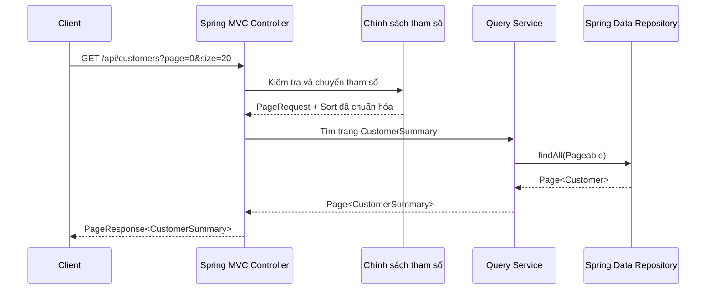

# Cung cấp tham số web và JSON phân trang ổn định

## 1. Mục tiêu của bài thực hành

Trong ứng dụng dùng Spring Data Commons, `Pageable`, `PageRequest`, `Sort` và `Page` giúp diễn đạt yêu cầu phân trang mà không gắn trực tiếp lớp web với một câu lệnh SQL. Tuy nhiên, sử dụng những abstraction này chưa đủ để tạo một HTTP API có hợp đồng rõ ràng.

Một endpoint danh sách còn phải quyết định:

- Client đánh số trang từ 0 hay từ 1?
- Kích thước trang mặc định và tối đa là bao nhiêu?
- Client được sắp xếp theo những trường nào?
- Đầu vào sai được chuẩn hóa hay bị từ chối?
- JSON có những trường nào và ai kiểm soát cấu trúc đó?
- Làm thế nào để giảm hiện tượng đảo thứ tự giữa các trang?
- Khi nào chi phí đếm tổng số bản ghi trở thành vấn đề?

Bài thực hành xây dựng hợp đồng cho endpoint `GET /api/customers`. Trọng tâm là kết nối abstraction phân trang của Spring Data Commons với tham số web và DTO phản hồi. Repository, CRUD, derived queries và projection vẫn thuộc phạm vi của module; auditing được liên hệ qua trường thời gian tạo dùng để sắp xếp.

Ví dụ sử dụng Spring MVC với Java record cho DTO. Phần lưu trữ do một module Spring Data cụ thể cung cấp; Spring Data Commons không tự kết nối database. Ví dụ không yêu cầu thay đổi mô hình persistence của dự án chỉ để thực hiện phân trang.

Kết quả cần đạt:

1. Request được kiểm tra theo quy tắc tường minh.
2. Repository nhận một `Pageable` hợp lệ.
3. Entity được chuyển thành DTO trước khi trả ra ngoài.
4. JSON phân trang không phụ thuộc cấu trúc nội bộ của `PageImpl`.
5. Các giới hạn về thứ tự, tổng số phần tử và dữ liệu thay đổi được mô tả đúng.

## 2. Thiết kế hợp đồng trước khi viết controller

### 2.1. Quy ước tham số

Chọn hợp đồng cho bài thực hành như sau:

| Tham số | Mặc định | Quy tắc |
|---|---|---|
| `page` | `0` | Số nguyên không âm, chỉ xuất hiện một lần |
| `size` | `20` | Số nguyên từ 1 đến 100, chỉ xuất hiện một lần |
| `sort` | `createdAt,desc` | Có thể lặp; mỗi giá trị có dạng `field,direction` |
| `field` của sort | Không áp dụng | Chỉ cho phép `name` và `createdAt` |
| `direction` | Không áp dụng | Chỉ nhận `asc` hoặc `desc` viết thường |

Các quyết định bổ sung:

- Trang đầu tiên có chỉ số `0`.
- Không nhận đồng thời nhiều giá trị `page` hoặc `size`.
- Không nhận cùng một trường sort hai lần.
- Không nhận tham số ngoài `page`, `size`, `sort`.
- Không tự cắt `size=500` xuống 100; request này nhận HTTP 400.
- Chỉ nhận chuỗi số dạng `0` hoặc bắt đầu bằng chữ số 1–9; khoảng trắng, dấu cộng, dấu âm và số có số 0 thừa ở đầu bị từ chối.
- Giới hạn offset bằng `page × size <= 100000` để tránh một request yêu cầu bỏ qua quá nhiều phần tử.
- Luôn thêm `id ASC` làm tiêu chí cuối cùng để phân định các bản ghi có giá trị sort chính giống nhau.

Giới hạn offset 100000 là lựa chọn của API trong bài thực hành, không phải giới hạn mặc định của Spring Data Commons. Trong dự án thật, cần chọn giá trị dựa trên data store, index và chi phí truy vấn.

Tên `name` là tên public của API, được ánh xạ sang property `displayName` trong domain model. Nhờ đó, client không cần biết tên property nội bộ.

### 2.2. Ví dụ request

Trang mặc định:

```http
GET /api/customers
```

Trang thứ hai, mỗi trang 10 khách hàng:

```http
GET /api/customers?page=1&size=10
```

Sắp xếp tên tăng dần, sau đó thời gian tạo giảm dần:

```http
GET /api/customers?page=0&size=10&sort=name,asc&sort=createdAt,desc
```

Với request cuối, thứ tự thực tế gửi xuống repository là:

```text
displayName ASC, createdAt DESC, id ASC
```

Dùng tham số `sort` lặp lại để biểu diễn nhiều tiêu chí. Không gộp thành một giá trị như `sort=name,asc,createdAt,desc`, vì parser của hợp đồng này chỉ chấp nhận hai thành phần cho mỗi giá trị.

### 2.3. Ví dụ response

```json
{
  "content": [
    {
      "id": "00000000-0000-0000-0000-000000000001",
      "name": "An",
      "createdAt": "2026-01-10T08:00:00Z"
    },
    {
      "id": "00000000-0000-0000-0000-000000000002",
      "name": "Bình",
      "createdAt": "2026-01-09T08:00:00Z"
    }
  ],
  "page": {
    "number": 0,
    "size": 2,
    "totalElements": 45,
    "totalPages": 23
  }
}
```

Ở đây:

- `content` là danh sách DTO của trang hiện tại.
- `number` tiếp tục dùng chỉ số từ 0, giống request.
- `size` là kích thước trang đã yêu cầu và được chấp nhận.
- `totalElements` là tổng số phần tử phù hợp với truy vấn, không phải số phần tử của trang hiện tại.
- `totalPages` là số trang theo tổng số phần tử và kích thước trang.

Ví dụ này tương ứng với `size=2`; không phải response của request `size=10` ở trên.

Nếu truy vấn không có dữ liệu, API vẫn trả HTTP 200 với `content: []`, `totalElements: 0` và `totalPages: 0`. Với trang vượt quá dữ liệu nhưng vẫn nằm trong giới hạn offset, API trả trang rỗng thay vì coi đó là lỗi cú pháp.

## 3. Luồng xử lý và trách nhiệm từng lớp



Phân chia trách nhiệm:

| Thành phần | Trách nhiệm |
|---|---|
| Chính sách tham số | Kiểm tra đầu vào, giới hạn size/offset, ánh xạ sort public sang property |
| Controller | Nhận request, gọi service, tạo response theo hợp đồng |
| Service | Điều phối truy vấn và chuyển entity thành DTO |
| Repository | Thực thi truy vấn theo `Pageable` |
| DTO response | Xác định cấu trúc JSON public |

Không để frontend phụ thuộc vào các trường tiện ích của implementation `Page`. Cũng không để client truyền tên property tùy ý xuyên qua mọi lớp.

## 4. Chuyển tham số web thành PageRequest

### 4.1. Vì sao ví dụ dùng parser tường minh?

Spring Data Web hỗ trợ bind trực tiếp request vào tham số `Pageable`. Đây là lựa chọn tiện lợi cho nhiều ứng dụng. Tuy nhiên, các thiết lập mặc định, fallback và giới hạn kích thước của resolver không đồng nghĩa với hợp đồng “mọi đầu vào sai đều nhận 400”.

Bài thực hành chọn parser tường minh vì đã quyết định:

- Từ chối kích thước trang vượt giới hạn.
- Từ chối tham số số học bị lặp.
- Chỉ nhận tập trường sort hữu hạn.
- Áp dụng giới hạn offset.
- Kiểm soát cách xử lý chuỗi rỗng, số quá lớn và tham số không biết.

Parser chỉ là lớp chuyển đổi đầu vào HTTP. Kết quả của nó vẫn là `Pageable` thuộc Spring Data Commons.

### 4.2. Mã chính sách tham số

```java
package com.example.customers.web;

import java.util.ArrayList;
import java.util.HashSet;
import java.util.List;
import java.util.Map;
import java.util.Set;

import org.springframework.data.domain.PageRequest;
import org.springframework.data.domain.Pageable;
import org.springframework.data.domain.Sort;
import org.springframework.http.HttpStatus;
import org.springframework.stereotype.Component;
import org.springframework.util.MultiValueMap;
import org.springframework.web.server.ResponseStatusException;

@Component
public class CustomerPageQuery {

    private static final int DEFAULT_SIZE = 20;
    private static final int MAX_SIZE = 100;
    private static final long MAX_OFFSET = 100_000L;

    private static final Set<String> ALLOWED_PARAMETERS =
            Set.of("page", "size", "sort");

    private static final Map<String, String> SORT_PROPERTIES =
            Map.of(
                    "name", "displayName",
                    "createdAt", "createdAt");

    public Pageable parse(MultiValueMap<String, String> parameters) {
        rejectUnknownParameters(parameters);

        int page = readInteger(parameters, "page", 0);
        int size = readInteger(parameters, "size", DEFAULT_SIZE);

        if (size < 1 || size > MAX_SIZE) {
            throw badRequest("size must be between 1 and 100");
        }

        long offset = (long) page * size;
        if (offset > MAX_OFFSET) {
            throw badRequest("requested offset exceeds 100000");
        }

        Sort sort = readSort(parameters.get("sort"));
        return PageRequest.of(page, size, sort);
    }

    private void rejectUnknownParameters(
            MultiValueMap<String, String> parameters) {

        for (String name : parameters.keySet()) {
            if (!ALLOWED_PARAMETERS.contains(name)) {
                throw badRequest("unknown query parameter");
            }
        }
    }

    private int readInteger(
            MultiValueMap<String, String> parameters,
            String name,
            int defaultValue) {

        List<String> values = parameters.get(name);

        if (values == null) {
            return defaultValue;
        }

        if (values.size() != 1) {
            throw badRequest(name + " must appear exactly once");
        }

        String value = values.get(0);
        if (value == null || !value.matches("0|[1-9][0-9]*")) {
            throw badRequest(name + " must be a non-negative integer");
        }

        try {
            return Integer.parseInt(value);
        } catch (NumberFormatException exception) {
            throw badRequest(name + " is too large");
        }
    }

    private Sort readSort(List<String> values) {
        List<Sort.Order> orders = new ArrayList<>();
        Set<String> seen = new HashSet<>();

        if (values == null) {
            orders.add(Sort.Order.desc("createdAt"));
        } else {
            if (values.isEmpty() || values.size() > 2) {
                throw badRequest("sort must contain one or two orders");
            }

            for (String value : values) {
                if (value == null) {
                    throw badRequest("sort must use field,direction");
                }

                String[] parts = value.split(",", -1);
                if (parts.length != 2) {
                    throw badRequest("sort must use field,direction");
                }

                String publicName = parts[0];
                String property = SORT_PROPERTIES.get(publicName);

                if (property == null) {
                    throw badRequest("unsupported sort field");
                }

                if (!seen.add(publicName)) {
                    throw badRequest("duplicate sort field");
                }

                Sort.Direction direction = switch (parts[1]) {
                    case "asc" -> Sort.Direction.ASC;
                    case "desc" -> Sort.Direction.DESC;
                    default -> throw badRequest(
                            "sort direction must be asc or desc");
                };

                orders.add(new Sort.Order(direction, property));
            }
        }

        orders.add(Sort.Order.asc("id"));
        return Sort.by(orders);
    }

    private ResponseStatusException badRequest(String reason) {
        return new ResponseStatusException(HttpStatus.BAD_REQUEST, reason);
    }
}
```

Các điểm cần hiểu trong mã:

1. `MultiValueMap` giữ được nhiều giá trị của cùng một tham số. Parser có thể phát hiện `page=0&page=1` thay vì vô tình lấy một giá trị.
2. Danh sách giá trị của `sort` được tách theo từng lần xuất hiện; sau đó từng giá trị mới được tách bởi dấu phẩy.
3. `Integer.parseInt` xử lý trường hợp chuỗi toàn chữ số nhưng vượt giới hạn kiểu `int`.
4. Phép tính offset ép sang `long` trước khi nhân, tránh tràn số kiểu `int`.
5. `id ASC` luôn là tiêu chí cuối và không được client tự thay đổi.
6. Không trim khoảng trắng vì hợp đồng đã chọn cú pháp chặt chẽ.
7. Tên sort public được ánh xạ qua allowlist trước khi tạo `Sort.Order`.

Allowlist giúp kiểm soát tính hợp lệ, khả năng tương thích và chi phí của truy vấn. Nó không thay thế parameter binding của data store. Giá trị tìm kiếm của derived query vẫn phải được xử lý theo cơ chế binding phù hợp, không ghép vào câu lệnh truy vấn bằng nối chuỗi.

Nếu sau này thêm bộ lọc như `status`, cần bổ sung rõ vào hợp đồng và parser. Không chỉ thêm một `@RequestParam` khác trong controller rồi quên rằng parser đang từ chối mọi tham số chưa được cho phép.

## 5. Tạo DTO response để kiểm soát JSON

### 5.1. Không lấy cấu trúc PageImpl làm hợp đồng public

`Page` là abstraction phục vụ kết quả truy vấn; `PageImpl` là một implementation. Việc serializer có thể biến object này thành JSON không có nghĩa mọi trường JSON của nó là hợp đồng API ổn định.

Nếu trả thẳng `Page<Customer>`, client có thể bắt đầu phụ thuộc vào:

- Cấu trúc object `pageable`.
- Cách biểu diễn `sort`.
- Các cờ hoặc thuộc tính được suy ra từ getter.
- Trường của entity và những quan hệ persistence.

Khi framework, serializer hoặc entity thay đổi, response có thể đổi ngoài ý muốn. Chuyển sang DTO của ứng dụng cho phép quyết định cụ thể những gì được công khai.

### 5.2. DTO phần tử

Giả sử domain `Customer` có ID kiểu `UUID` và các getter `getId()`, `getDisplayName()`, `getCreatedAt()`. Đây là domain đã được mapping bởi module data store của ứng dụng.

```java
package com.example.customers.api;

import java.time.Instant;
import java.util.UUID;

public record CustomerSummary(
        UUID id,
        String name,
        Instant createdAt) {
}
```

Tên trường JSON `name` được quyết định bởi DTO, không bị ràng buộc phải trùng tên `displayName` trong entity.

Ví dụ giả định serializer được cấu hình để xuất `Instant` thành chuỗi ISO-8601 như response mẫu. Định dạng thời gian cũng là một phần của hợp đồng cần kiểm chứng; không mặc định coi mọi cấu hình Jackson đều cho cùng kết quả.

### 5.3. Envelope phân trang

```java
package com.example.customers.api;

import java.util.List;
import org.springframework.data.domain.Page;

public record PageResponse<T>(
        List<T> content,
        PageMetadata page) {

    public PageResponse {
        content = List.copyOf(content);
    }

    public static <T> PageResponse<T> from(Page<T> source) {
        return new PageResponse<>(
                source.getContent(),
                new PageMetadata(
                        source.getNumber(),
                        source.getSize(),
                        source.getTotalElements(),
                        source.getTotalPages()));
    }

    public record PageMetadata(
            int number,
            int size,
            long totalElements,
            int totalPages) {
    }
}
```

`List.copyOf` tạo bản sao không cho sửa danh sách qua response; nó không làm các object phần tử trở thành immutable một cách đệ quy. Với phần tử là record chỉ chứa những kiểu giá trị như ví dụ, cấu trúc phản hồi dễ kiểm soát hơn.

Không cần sao chép mọi getter của `Page` vào DTO. Chọn các trường client thực sự cần. Nếu bổ sung `hasNext`, `hasPrevious` hoặc liên kết điều hướng, hãy định nghĩa ý nghĩa và kiểm tra chúng như các trường public khác.

## 6. Nối repository, service và controller

### 6.1. Repository đọc theo Pageable

Ví dụ khai báo repository sử dụng hai abstraction riêng:

```java
package com.example.customers;

import java.util.UUID;

import org.springframework.data.repository.CrudRepository;
import org.springframework.data.repository.PagingAndSortingRepository;

public interface CustomerRepository
        extends CrudRepository<Customer, UUID>,
                PagingAndSortingRepository<Customer, UUID> {
}
```

Trong các nhánh Spring Data hiện đại, không nên mặc định rằng interface phân trang tự kế thừa toàn bộ CRUD. Khai báo cả hai khi cần cả hai nhóm thao tác giúp ý định rõ ràng.

`Customer` và repository phải được module data store nhận diện. Đoạn interface này không tự cung cấp một implementation truy vấn khi chỉ có Spring Data Commons trên classpath.

Nếu endpoint có bộ lọc, có thể dùng một phương thức derived query trả về `Page<Customer>` và nhận `Pageable`. Cần truyền cùng tập điều kiện lọc và phân quyền vào cả truy vấn dữ liệu lẫn phép xác định tổng số phần tử mà implementation thực hiện.

### 6.2. Service chuyển entity thành DTO

```java
package com.example.customers;

import com.example.customers.api.CustomerSummary;

import org.springframework.data.domain.Page;
import org.springframework.data.domain.Pageable;
import org.springframework.stereotype.Service;

@Service
public class CustomerQueryService {

    private final CustomerRepository repository;

    public CustomerQueryService(CustomerRepository repository) {
        this.repository = repository;
    }

    public Page<CustomerSummary> findAll(Pageable pageable) {
        return repository.findAll(pageable)
                .map(customer -> new CustomerSummary(
                        customer.getId(),
                        customer.getDisplayName(),
                        customer.getCreatedAt()));
    }
}
```

`Page.map` chuyển từng phần tử và giữ thông tin phân trang của kết quả. Cách này tránh phải tự dựng lại tổng số phần tử trong service.

Chuyển entity sang DTO sau khi đọc không tự làm database chỉ lấy các cột của DTO. Nếu mục tiêu còn là tối ưu dữ liệu truy xuất, cần xem xét projection hoặc truy vấn phù hợp với module data store. Khi chuyển sang projection, vẫn có thể giữ nguyên envelope JSON của endpoint.

Ví dụ chỉ đọc các property đơn giản. Nếu DTO cần dữ liệu từ quan hệ lazy hoặc truy vấn bổ sung, cần thiết kế transaction và fetch theo persistence implementation để tránh lỗi truy cập ngoài context hoặc N+1 query. Đây là trách nhiệm của tầng truy vấn, không phải của DTO phân trang.

### 6.3. Controller trả đúng hợp đồng

```java
package com.example.customers.web;

import com.example.customers.CustomerQueryService;
import com.example.customers.api.CustomerSummary;
import com.example.customers.api.PageResponse;

import org.springframework.data.domain.Pageable;
import org.springframework.util.MultiValueMap;
import org.springframework.web.bind.annotation.GetMapping;
import org.springframework.web.bind.annotation.RequestMapping;
import org.springframework.web.bind.annotation.RequestParam;
import org.springframework.web.bind.annotation.RestController;

@RestController
@RequestMapping("/api/customers")
public class CustomerController {

    private final CustomerPageQuery pageQuery;
    private final CustomerQueryService service;

    public CustomerController(
            CustomerPageQuery pageQuery,
            CustomerQueryService service) {

        this.pageQuery = pageQuery;
        this.service = service;
    }

    @GetMapping
    public PageResponse<CustomerSummary> findAll(
            @RequestParam MultiValueMap<String, String> parameters) {

        Pageable pageable = pageQuery.parse(parameters);
        return PageResponse.from(service.findAll(pageable));
    }
}
```

Trong Spring MVC, `@RequestParam MultiValueMap<String, String>` không chỉ định tên sẽ nhận tập query parameter để parser kiểm tra. Không chuyển sang `Map<String, String>` nếu vẫn cần phát hiện các tham số bị lặp.

Controller không trả entity và không trả trực tiếp `PageImpl`. Việc đổi implementation của `Page` ở tầng repository vì thế không tự thêm trường JSON mới vào response của API.

Các lỗi do parser tạo ra dùng `ResponseStatusException` để trả HTTP 400. Mã ví dụ chưa cố định cấu trúc JSON của body lỗi; body đó còn phụ thuộc cấu hình xử lý exception của ứng dụng. Nếu API cần hợp đồng lỗi ổn định, nên bổ sung exception nghiệp vụ và `@RestControllerAdvice` trả DTO lỗi hoặc Problem Details theo chính sách chung của dự án.

## 7. Nếu muốn dùng Pageable argument resolver

### 7.1. Cơ chế có sẵn của Spring Data Web

Trong ứng dụng đã bật Spring Data Web support, có thể khai báo:

```java
public PageResponse<CustomerSummary> findAll(Pageable pageable) {
    // Kiểm tra sort và chính sách endpoint trước khi gọi repository.
    // Sau đó chuyển Page sang PageResponse.
}
```

Đây là minh họa chữ ký phương thức, không phải phần thay thế hoàn chỉnh cho controller ở mục trước. `PageableHandlerMethodArgumentResolver` có thể tạo `Pageable` từ các tham số như `page`, `size` và `sort`.

Trong ứng dụng Spring Boot có hạ tầng web tương ứng, có thể tùy chỉnh resolver qua customizer:

```java
package com.example.customers.web;

import org.springframework.context.annotation.Bean;
import org.springframework.context.annotation.Configuration;
import org.springframework.data.domain.PageRequest;
import org.springframework.data.web.config
        .PageableHandlerMethodArgumentResolverCustomizer;

@Configuration(proxyBeanMethods = false)
public class PageableWebConfiguration {

    @Bean
    PageableHandlerMethodArgumentResolverCustomizer pageableCustomizer() {
        return resolver -> {
            resolver.setPageParameterName("page");
            resolver.setSizeParameterName("size");
            resolver.setOneIndexedParameters(false);
            resolver.setFallbackPageable(PageRequest.of(0, 20));
            resolver.setMaxPageSize(100);
        };
    }
}
```

Customizer cấu hình một resolver đã được hạ tầng web tạo ra; riêng bean này không phải toàn bộ cấu hình để bật Spring Data Web cho mọi loại ứng dụng.

Nếu dùng cách bind này, vẫn phải có chính sách allowlist và ánh xạ sort. Resolver không biết rằng API chỉ cho phép `name` và cần ánh xạ nó sang `displayName`.

### 7.2. Max page size không đồng nghĩa validation trả 400

Thiết lập `setMaxPageSize(100)` là cơ chế giới hạn kích thước hiệu lực của resolver. Nó không tự thể hiện hợp đồng “`size=500` phải nhận HTTP 400”. Resolver có thể giới hạn hoặc dùng giá trị fallback cho những trường hợp đầu vào nhất định.

Tương tự, chỉ thêm `@Valid` trước `Pageable` không tự định nghĩa tất cả ràng buộc đối với chuỗi query parameter ban đầu.

Có hai lựa chọn hợp lệ:

| Lựa chọn | Điều cần công bố với client |
|---|---|
| Chuẩn hóa qua resolver | Giá trị thiếu/sai/vượt giới hạn được xử lý như thế nào, response phản ánh kích thước nào |
| Kiểm tra chặt đầu vào | Những trường hợp nhận 400 và giới hạn cụ thể |

Bài thực hành đã chọn lựa chọn thứ hai. Không thay parser bằng resolver mặc định rồi vẫn giữ tài liệu hứa hẹn mọi trường hợp sai đều nhận 400.

### 7.3. Tham số đánh số từ 1

Nếu cấu hình resolver nhận trang từ 1, request `page=1` có thể được chuyển thành `PageRequest` có `getPageNumber() == 0`.

Đổi quy ước request không tự đổi kết quả của `Page.getNumber()` hoặc DTO được tạo từ kết quả đó. Nếu hợp đồng API muốn cả request và response đều dùng chỉ số từ 1, cần ánh xạ nhất quán ở hai phía và điều chỉnh liên kết điều hướng.

Với bài thực hành hiện tại, giữ quy ước từ 0 cho cả request và response để tránh phép chuyển đổi ngầm.

## 8. Các lựa chọn JSON ổn định khác trong hệ sinh thái Spring

### 8.1. PagedModel của Spring Data Web

Từ Spring Data Commons 3.3, Spring Data Web cung cấp `org.springframework.data.web.PagedModel` làm mô hình biểu diễn trang đơn giản, thay cho việc dựa vào serialization trực tiếp của `PageImpl`.

Ví dụ phần thân phương thức trong một controller sử dụng kiểu trả về tương ứng:

```java
import org.springframework.data.web.PagedModel;

// Phương thức nhận query parameter và áp dụng cùng CustomerPageQuery.
public PagedModel<CustomerSummary> findAll(
        MultiValueMap<String, String> parameters) {

    return new PagedModel<>(
            service.findAll(pageQuery.parse(parameters)));
}
```

Đoạn này minh họa lựa chọn response thay thế; khi dùng trong controller MVC, vẫn cần annotation ánh xạ request và annotation tham số như controller đầy đủ ở mục 6.

Một lựa chọn cấu hình khác ở phiên bản hỗ trợ là:

```java
@EnableSpringDataWebSupport(
    pageSerializationMode =
        EnableSpringDataWebSupport.PageSerializationMode.VIA_DTO
)
```

Chế độ này cho phép chuyển kết quả `PageImpl` sang biểu diễn DTO của Spring Data khi serialize. Nó không đồng nghĩa mọi entity bên trong đã được chuyển thành DTO nghiệp vụ.

Khi ứng dụng đang dùng Spring Boot, việc thêm cấu hình bật web support cần được xem cùng auto-configuration và các tùy chỉnh hiện có. Không chỉ sao chép annotation để sửa JSON rồi bỏ qua tác động đến resolver.

Chọn giữa hai hướng:

- **DTO riêng như `PageResponse`**: phù hợp khi ứng dụng muốn tự sở hữu tên trường, quy tắc metadata hoặc chiến lược versioning.
- **`PagedModel` của Spring Data Web**: phù hợp khi chấp nhận mô hình trang do Spring Data cung cấp và đang dùng phiên bản có API tương ứng.

Dù chọn hướng nào, hãy kiểm chứng JSON qua HTTP với cấu hình serializer thật.

### 8.2. Phân biệt với Spring HATEOAS

`org.springframework.data.web.PagedModel` và `org.springframework.hateoas.PagedModel` là hai kiểu ở hai package khác nhau.

Khi API cần liên kết như trang đầu, trang trước, trang sau và trang cuối, có thể sử dụng Spring HATEOAS cùng assembler phù hợp, chẳng hạn `PagedResourcesAssembler`. Khi đó, hình dạng JSON và media type có thể khác envelope đơn giản trong bài này.

Không đổi giữa envelope riêng, Spring Data Web DTO và biểu diễn HATEOAS mà vẫn coi hợp đồng public hoàn toàn không thay đổi.

### 8.3. Ổn định JSON gồm nhiều lớp

Một cấu trúc envelope ổn định vẫn có thể bị phá vỡ nếu:

- Entity được lộ trực tiếp bên trong `content`.
- Tên field DTO bị đổi mà không quản lý tương thích.
- Cấu hình serializer chuyển naming strategy.
- Định dạng thời gian hoặc enum thay đổi.
- Chính sách bỏ field có giá trị null thay đổi.
- Client hiểu sai chỉ số trang.
- DTO dùng cho người dùng thường vô tình có thêm trường chỉ dành cho quản trị viên.

Tính ổn định cần được kiểm tra ở response HTTP cuối cùng. Một unit test chỉ gọi `PageResponse.from` chưa bao phủ annotation Jackson, module thời gian hay exception handler của ứng dụng.

## 9. Thứ tự ổn định và giới hạn của offset pagination

### 9.1. Vì sao cần thêm ID?

Giả sử ba khách hàng cùng có `createdAt` giống nhau. Nếu chỉ sắp xếp theo `createdAt DESC`, data store có thể không bảo đảm thứ tự tương đối giữa ba bản ghi đó.

Thêm một ID duy nhất làm tiêu chí cuối giúp xác định thứ tự đầy đủ:

```text
createdAt DESC, id ASC
```

Tương tự, với sort theo tên:

```text
displayName ASC, id ASC
```

Cần có điều kiện rằng ID là duy nhất trong tập dữ liệu đang truy vấn và có thể được data store sắp xếp. Nếu danh sách hợp nhất dữ liệu từ nhiều nguồn có thể trùng ID, cần một khóa phân định phù hợp hơn.

### 9.2. Thứ tự đầy đủ chưa phải snapshot giữa các request

Ngay cả khi đã thêm ID:

1. Client đọc trang 0.
2. Một khách hàng mới được thêm vào đầu danh sách.
3. Client đọc trang 1 theo offset mới.
4. Một phần tử có thể xuất hiện lại hoặc một phần tử khác bị bỏ qua so với danh sách tại thời điểm request đầu.

ID phụ giúp loại bỏ nhập nhằng khi các khóa sort bằng nhau. Nó không làm database giữ nguyên nội dung tập kết quả giữa nhiều HTTP request.

Nếu yêu cầu nghiệp vụ cần duyệt liên tục trên tập dữ liệu biến động, có thể cân nhắc:

- Cursor hoặc keyset pagination theo khả năng của data store.
- Một mốc thời gian hay bộ lọc phiên bản cố định.
- Cơ chế snapshot phù hợp với hệ thống.

Những phương án đó có hợp đồng và chi phí riêng. Không chỉ đổi tên `page` thành `cursor` mà vẫn thực hiện offset rồi coi vấn đề đã được giải quyết.

### 9.3. Auditing và trường thời gian

Nếu `createdAt` được điền bằng auditing, cần bảo đảm auditing đã được bật và dữ liệu cũ được xử lý phù hợp. Những bản ghi có `createdAt = null` có thể cho thứ tự khác nhau tùy data store.

Ngoài ra, nhiều bản ghi có thể cùng timestamp do độ chính xác của đồng hồ hoặc database. Vì vậy, trường thời gian không thay thế khóa phân định cuối như ID.

Nếu API nhận sort theo chuỗi, quy tắc collation và phân biệt hoa/thường của data store cũng ảnh hưởng thứ tự. Contract nên nêu những điều mà client cần dựa vào, thay vì hứa rằng mọi database đều sắp xếp tên giống nhau.

## 10. Tổng số phần tử, Page và Slice

### 10.1. Page mang theo nhu cầu về tổng số

`Page<T>` biểu diễn cả nội dung trang và metadata tổng số. Tùy truy vấn và implementation, việc cung cấp tổng số có thể cần một truy vấn đếm bổ sung; một số trường hợp có thể được tối ưu để không thực hiện phép đếm riêng.

Không giả định rằng giới hạn `size=20` làm mọi request đều rẻ. Truy vấn đếm trên tập dữ liệu lớn, có join hoặc điều kiện phức tạp vẫn có thể tốn nhiều tài nguyên.

Cần xem xét index tương ứng với bộ lọc và sort được cho phép. Allowlist sort là một điểm kiểm soát tốt để tránh mở vô hạn các cách sắp xếp có chi phí khó dự đoán.

### 10.2. Khi không cần tổng số

Nếu giao diện chỉ cần nút “tải thêm”, `Slice<T>` có thể phù hợp hơn trong những truy vấn mà module hỗ trợ. Slice cung cấp nội dung cùng thông tin có trang tiếp theo hay không, nhưng không có tổng số phần tử như Page.

Khi đổi sang Slice, nên thiết kế response khác, ví dụ:

```json
{
  "content": [],
  "page": {
    "number": 0,
    "size": 20,
    "hasNext": false
  }
}
```

Không giả mạo `totalElements` bằng số phần tử đã đọc và không gán `totalPages` một giá trị suy đoán. Nếu client đang phụ thuộc vào tổng số, thay đổi này cần được quản lý như một thay đổi hợp đồng.

### 10.3. Phân quyền phải áp dụng trước khi phân trang

Một endpoint có thể có JSON đẹp nhưng metadata vẫn sai nếu:

1. Repository phân trang toàn bộ khách hàng.
2. Service loại các khách hàng mà người dùng không được xem.
3. Response giữ tổng số từ tập dữ liệu chưa được giới hạn quyền.

Khi đó, trang có thể thiếu phần tử, tổng số không khớp và metadata có thể lộ thông tin về dữ liệu ngoài quyền truy cập.

Phải áp dụng điều kiện tenant, quyền và bộ lọc vào truy vấn trước khi phân trang, theo khả năng của data store. Tổng số phải phản ánh cùng tập dữ liệu mà người dùng được phép truy cập.

## 11. Kịch bản nghiệm thu của bài thực hành

Các kịch bản dưới đây là yêu cầu kiểm thử khi triển khai endpoint trong ứng dụng. Chúng giúp xác định “đúng” nghĩa là gì; không thay thế việc chạy ứng dụng với module data store thật.

### 11.1. Kiểm tra hợp đồng request

| Request hoặc tham số | Kết quả mong đợi |
|---|---|
| Không có query parameter | Trang 0, size 20, sort `createdAt DESC, id ASC` |
| `page=1&size=10` | Trang thứ hai, size 10 |
| `size=100` | Chấp nhận |
| `size=101` | HTTP 400 |
| `size=0` | HTTP 400 |
| `page=-1` | HTTP 400 |
| `page=abc` | HTTP 400 |
| `page=01` | HTTP 400 theo cú pháp đã chọn |
| `page=` | HTTP 400, không coi như thiếu tham số |
| `page=999999999999999999999` | HTTP 400, không lỗi tràn số ngoài kiểm soát |
| `page=0&page=1` | HTTP 400 |
| `size=20&size=20` | HTTP 400 dù hai giá trị giống nhau |
| `sort=name,asc` | `displayName ASC, id ASC` |
| `sort=name,asc&sort=createdAt,desc` | Hai tiêu chí public đúng thứ tự, sau đó `id ASC` |
| `sort=name,asc&sort=name,desc` | HTTP 400 |
| `sort=passwordHash,asc` | HTTP 400 |
| `sort=id,asc` | HTTP 400 vì ID không thuộc tập sort public |
| `sort=name,ASC` | HTTP 400 theo hợp đồng chỉ nhận chữ thường |
| `sort=name` hoặc `sort=` | HTTP 400 |
| `sort=name,asc,createdAt,desc` | HTTP 400 |
| `page=1000&size=100` | Offset đúng giới hạn, được chấp nhận |
| `page=1001&size=100` | HTTP 400 vì vượt giới hạn offset |
| `Size=20` hoặc `debug=true` | HTTP 400 do tham số không được hỗ trợ |

Cần kiểm tra thêm rằng repository không được gọi khi parser từ chối request. Điều này chứng minh validation xảy ra trước truy vấn, thay vì chỉ biến lỗi database thành HTTP 400.

### 11.2. Kiểm tra nội dung và metadata

Chuẩn bị tập dữ liệu cố định gồm 45 khách hàng mà người gọi được phép xem. Với `size=2`:

- Trang 0 có tối đa hai DTO, `number=0`, `size=2`, `totalElements=45`, `totalPages=23`.
- Trang 22 có một DTO.
- Trang 23 có `content=[]`, vẫn phản ánh tổng số 45 và tổng số trang 23.
- Tập dữ liệu rỗng có `content=[]`, tổng số phần tử và tổng số trang bằng 0.

`size` không đổi thành 1 chỉ vì trang cuối có một phần tử. Nếu client cần số phần tử thực tế của trang, có thể dùng độ dài `content` hoặc một trường được định nghĩa riêng.

Chuẩn bị thêm dữ liệu có nhiều khách hàng cùng tên và cùng `createdAt`. Xác minh thứ tự ID đúng với tiêu chí cuối, thay vì chỉ thử dữ liệu có mọi khóa sort khác nhau.

### 11.3. Kiểm tra JSON qua HTTP

Các assertion nên tập trung vào:

- Root có `content` và `page`.
- `content` là một array, kể cả khi rỗng.
- `page.number` và `page.size` là số.
- `page.totalElements` không bị chuyển thành chuỗi.
- Mỗi phần tử chỉ có những trường DTO đã công bố.
- Không xuất hiện `pageable`, object `sort` nội bộ hoặc trường persistence ngoài ý muốn.
- `createdAt` có định dạng thời gian đã thống nhất.
- Chỉ số trang trong request và response cùng dùng quy ước từ 0.

JSON object không có ý nghĩa thứ tự key. Không nên viết assertion thất bại chỉ vì `size` đứng trước hay sau `number` nếu hợp đồng không yêu cầu biểu diễn văn bản chính xác.

Đồng thời, chỉ kiểm tra “có field” là chưa đủ. Cần phát hiện field nhạy cảm hoặc cấu trúc nội bộ bị thêm ngoài ý muốn, đặc biệt khi ai đó đổi kiểu trả về từ DTO thành entity.

### 11.4. Kiểm tra truy vấn và môi trường thật

Kiểm tra HTTP với service giả lập giúp xác minh binding, validation và serialization. Nó không chứng minh data store hỗ trợ đúng mọi property sort hoặc có kế hoạch truy vấn phù hợp.

Cần có kiểm tra tích hợp với implementation repository thật để xác minh:

- Property `displayName`, `createdAt` và `id` tồn tại trong mapping.
- Sort theo các property được dịch đúng.
- Phân trang và đếm tổng số cùng áp dụng đúng bộ lọc.
- Điều kiện tenant và quyền truy cập được giữ nguyên.
- Không có truy vấn bổ sung ngoài dự kiến khi chuyển DTO.
- Dữ liệu có timestamp trùng hoặc giá trị null được xử lý theo quy tắc đã chọn.

Khi thay phiên bản Spring Data, Spring Framework hoặc serializer, ưu tiên chạy lại những kiểm tra hợp đồng HTTP và truy vấn này. Không chỉ kiểm tra project còn biên dịch được.

## 12. Các lỗi thiết kế thường gặp

### 12.1. Đưa mọi tham số sort thẳng xuống repository

Sai lầm thường gặp là coi tên property do client gửi lên luôn hợp lệ. Điều này khiến API phụ thuộc vào domain nội bộ và có thể mở ra các truy vấn đắt tiền hoặc truy cập property không được dự kiến.

Cách sửa là ánh xạ tên public sang tập property đã cho phép. Khi đổi tên property nội bộ, có thể giữ tên public nếu ý nghĩa nghiệp vụ không đổi.

### 12.2. Giới hạn size nhưng để offset không giới hạn

`size=10` không làm `page=100000000` trở thành truy vấn nhẹ. Offset lớn có thể khiến data store phải bỏ qua rất nhiều bản ghi trước khi trả về một trang nhỏ.

Cần có chính sách offset hoặc dùng cơ chế phân trang khác phù hợp. Chính sách nên được thể hiện trong validation và tài liệu API, không chỉ tồn tại như một giá trị cấu hình khó phát hiện.

### 12.3. Đếm phần tử trong trang để tạo totalElements

`content.size()` là số phần tử đang trả về. Nó không phải tổng số phần tử phù hợp toàn bộ truy vấn.

Không dùng:

```java
long totalElements = page.getContent().size();
```

để thay thế `page.getTotalElements()` trong một response có hợp đồng Page. Nếu không muốn thực hiện phép đếm, hãy thay đổi hợp đồng sang Slice hoặc dạng cursor phù hợp.

### 12.4. Cố giữ mọi trường của PageImpl

Sao chép toàn bộ JSON tình cờ nhận được từ một phiên bản framework vào DTO không tạo ra hợp đồng tốt hơn. Nó chỉ chuyển gánh nặng duy trì các chi tiết nội bộ sang ứng dụng.

Hãy bắt đầu từ nhu cầu của client: danh sách, chỉ số trang, kích thước và tổng số nếu cần. Chỉ thêm những trường có ý nghĩa sử dụng rõ ràng.

### 12.5. Dùng số trang như vị trí bền vững của một bản ghi

Bản ghi ở trang 3 hôm nay có thể nằm ở trang 4 sau khi có dữ liệu mới. Không lưu “page=3” làm định danh lâu dài cho một khách hàng.

Khi cần mở lại đúng bản ghi, dùng ID hoặc một đường dẫn tài nguyên ổn định. Khi cần tiếp tục duyệt một danh sách thay đổi liên tục, đánh giá cursor và điều kiện truy vấn.

### 12.6. Tưởng DTO ổn định đồng nghĩa dữ liệu nhất quán tuyệt đối

Envelope riêng bảo vệ hình dạng JSON. Nó không tự tạo transaction snapshot, không đồng bộ truy vấn đếm với mọi thay đổi đồng thời và không bảo đảm tính mới của dữ liệu.

Mức nhất quán còn phụ thuộc truy vấn, transaction, isolation và data store. Cần công bố yêu cầu thực tế của giao diện thay vì suy ra bảo đảm từ tên `PageResponse`.

## 13. Bài tập mở rộng

### Bài tập 1: Thêm bộ lọc trạng thái

Mở rộng endpoint nhận `status` với một tập giá trị hữu hạn.

Yêu cầu:

- Cho phép tham số mới trong parser.
- Xác định rõ trường hợp thiếu, rỗng và không hợp lệ.
- Dùng truy vấn phân trang có cùng điều kiện trạng thái cho nội dung và tổng số.
- Giữ nguyên cấu trúc JSON phản hồi.
- Kiểm tra trang rỗng và trang cuối sau khi lọc.

### Bài tập 2: Dùng projection cho danh sách

Thay việc tải entity rồi map bằng projection mà module data store hỗ trợ.

Yêu cầu:

- Không làm lộ projection hoặc entity ngoài ý muốn qua JSON.
- Giữ nguyên `CustomerSummary` hoặc hình dạng phần tử đã công bố.
- Kiểm tra lại sort và truy vấn đếm.
- Đánh giá truy vấn thực tế thay vì mặc định projection luôn nhanh hơn.

### Bài tập 3: Thay Page bằng tải thêm

Thiết kế một endpoint khác không cung cấp tổng số, dùng Slice hoặc cơ chế phù hợp của module.

Yêu cầu:

- Có trường hoặc tín hiệu cho biết còn dữ liệu hay không.
- Không bịa tổng số phần tử.
- Nêu rõ cách client lấy phần tiếp theo.
- So sánh hành vi khi dữ liệu được thêm giữa hai request.

### Bài tập 4: Quản lý thay đổi hợp đồng

Giả sử frontend yêu cầu đổi `page.number` thành `page.index` và đánh số từ 1.

Hãy phân tích:

- Client cũ sẽ bị ảnh hưởng như thế nào?
- Chỉ đổi resolver đã đủ chưa?
- Cần thay đổi DTO, tài liệu và kiểm tra hợp đồng ở đâu?
- Có nên tạo phiên bản endpoint hoặc một giai đoạn chuyển tiếp?

## 14. Tiêu chí hoàn thành

Bài thực hành hoàn thành khi endpoint:

- Có quy ước rõ ràng cho `page`, `size` và `sort`.
- Giới hạn được kích thước trang và độ sâu offset.
- Từ chối đầu vào sai đúng chính sách đã công bố.
- Ánh xạ sort public qua allowlist và thêm khóa phân định duy nhất.
- Truyền `Pageable` xuống repository của đúng data store.
- Trả DTO phần tử cùng envelope JSON được sở hữu rõ ràng.
- Phân biệt kích thước trang, số phần tử thực tế và tổng số phần tử.
- Hoạt động với trang đầu, trang cuối, trang rỗng và dữ liệu có khóa sort trùng.
- Áp dụng bộ lọc và quyền truy cập trước khi phân trang.
- Không nhầm tính ổn định của JSON với snapshot dữ liệu giữa các request.

Spring Data Commons cung cấp ngôn ngữ chung cho phân trang và sắp xếp. Hợp đồng HTTP của ứng dụng được hoàn thiện bằng chính sách đầu vào, DTO phản hồi và các kiểm tra trên đường request thực tế.
