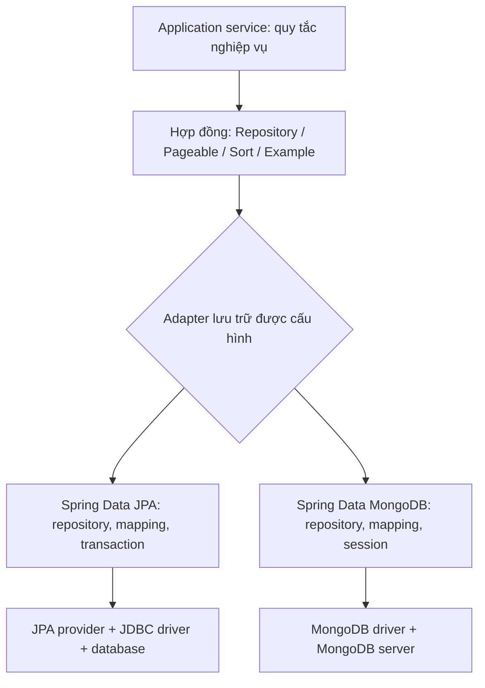

# Rà soát ranh giới Commons/store và kế hoạch nâng phiên bản

Trong chương **Thực hành tổng hợp** của **SPRING_DATA_COMMONS**, bài này kết nối các kiến thức về Repository, CRUD, derived queries, phân trang, sắp xếp, projection và auditing thành một cuộc rà soát trước khi nâng phiên bản.

Kết quả cần đạt là một bản phân định trách nhiệm rõ ràng: phần nào là hợp đồng dùng chung, phần nào cần được xác minh ở module lưu trữ, và bằng chứng nào cho phép chuyển sang bước triển khai tiếp theo. Kế hoạch nâng phiên bản phải bao gồm hành vi ứng dụng và dữ liệu, bên cạnh việc mã nguồn biên dịch thành công.

## 1. Tình huống thực hành và sản phẩm đầu ra

Giả sử ứng dụng quản lý danh mục có hai adapter:

- **JPA** lưu danh mục gốc trong cơ sở dữ liệu quan hệ.
- **MongoDB** lưu mô hình đọc phục vụ một màn hình tra cứu.

Application service làm việc với các quy tắc nghiệp vụ như tenant, trạng thái sản phẩm và giá. Mỗi adapter có repository, mapping và cấu hình hạ tầng riêng. Trong tình huống này, mô hình đọc MongoDB được đồng bộ sau thay đổi danh mục; yêu cầu về độ trễ đồng bộ là một phần của hợp đồng ứng dụng.

Đây là tình huống giả định dùng để thực hành, không phải kết quả kiểm kê một dự án có sẵn. Nếu dự án chỉ có một store, vẫn thực hiện đầy đủ các bước rà soát cho store đó.

Bản rà soát cần trả lời được bốn câu hỏi:

1. Repository này được factory của module nào tạo và truy cập dữ liệu nào?
2. Hành vi nào được biểu diễn bằng API Commons nhưng do store quyết định khi thực thi?
3. Bộ phiên bản đích có tương thích từ nền tảng đến driver và máy chủ dữ liệu không?
4. Sau nâng cấp, bằng chứng nào xác nhận hành vi đúng và việc quay lui khả thi?

Không cần chuyển store để nâng phiên bản. Cũng không mặc định rằng nâng Spring Data đồng nghĩa với phải đổi mọi tầng của ứng dụng cùng một lúc.

## 2. Hiểu ranh giới giữa hợp đồng và thực thi

`Repository<T, ID>` ghi nhận kiểu domain và ID; các interface CRUD hoặc phân trang bổ sung hợp đồng thao tác. Module như JPA hay MongoDB cung cấp phần triển khai phù hợp công nghệ lưu trữ. Khả năng của một extension phải được đối chiếu với store sử dụng. Xem [Core concepts của Spring Data](https://docs.spring.io/spring-data/jpa/reference/repositories/core-concepts.html).



Bảng sau là khung phân định trách nhiệm khi rà soát:

| Khả năng | Phần dùng chung cần nhận diện | Phần phải kiểm chứng ở store |
| --- | --- | --- |
| Repository | Kiểu domain, ID, hợp đồng method | Factory, repository implementation, phạm vi scanning |
| CRUD | Chữ ký `save`, `findById`, `delete` | Phát hiện đối tượng mới, cách ghi, lifecycle, concurrency |
| Derived query | Tên method và các thuộc tính được tham chiếu | Toán tử được hỗ trợ, truy vấn sinh ra, mapping đường dẫn |
| Phân trang | `Pageable`, `Page`, `Slice` | Cách giới hạn kết quả, count query, chi phí đọc |
| Sắp xếp | Danh sách thuộc tính, chiều, gợi ý null handling | Collation, thứ tự null, mapping và khả năng dùng index |
| Projection | Kiểu đầu ra hoặc view dữ liệu | Cột/field được tải, ánh xạ constructor, truy vấn bổ sung |
| QBE, Querydsl | Cách mô tả điều kiện và executor | Mức hỗ trợ của module, phép so khớp và truy vấn thực tế |
| Auditing | Metadata thời gian/người thao tác và SPI cung cấp giá trị | Cách bật, listener/callback và đường ghi có đi qua chúng không |
| Reactive | Hợp đồng trả publisher và các API liên quan | Driver, luồng thực thi, transaction context, thao tác blocking |
| AOT/native | Thông tin cần để dựng ứng dụng | Mapping, proxy, converter và đường truy vấn của adapter |

Bảng này là một cách tổ chức công việc của bài thực hành. Nó không phải tuyên bố rằng tất cả hàng đều được mọi store hỗ trợ ngang nhau.

Một dấu hiệu cần chú ý là tài liệu nội bộ dùng câu “Spring Data luôn làm…” nhưng không nêu module và điều kiện. Hãy chuyển câu đó thành một phát biểu có phạm vi, chẳng hạn: “Trong adapter JPA này, với cấu hình transaction hiện tại, thao tác đọc sau ghi nhìn thấy thay đổi theo kịch bản đã kiểm chứng”.

## 3. Lập danh sách repository và gắn đúng store

### 3.1. Ghi nhận theo từng repository

Dùng một bảng như sau trong bản rà soát:

| Mục cần ghi nhận | Ví dụ trong tình huống thực hành |
| --- | --- |
| Repository và package | `ProductJpaRepository` ở `example.catalog.jpa` |
| Domain và ID | `JpaProduct`, ID kiểu `Long` |
| Interface chuyên biệt | `JpaRepository<JpaProduct, Long>` |
| Mapping domain | JPA entity, bảng và tên cột đã xác định |
| Hạ tầng dùng để thực thi | EntityManagerFactory, transaction manager, datasource |
| Các method đặc biệt | Derived query, custom query, projection, bulk operation |
| Vai trò dữ liệu | Danh mục gốc hay mô hình đọc |
| Bằng chứng kiểm tra | Khởi tạo bean đúng, đọc/ghi đúng nơi, kiểm tra hành vi |

Repository chỉ có tên kết thúc bằng `JpaRepository` chưa đủ chứng minh nó thuộc JPA. Cần xem type hierarchy, mapping và cấu hình khởi tạo thật sự của ứng dụng khi thực hiện rà soát.

### 3.2. Tránh mơ hồ khi có nhiều module

Khi có nhiều repository factory trên classpath, Spring Data dùng chế độ cấu hình chặt để xác định module phù hợp. Type hierarchy chuyên biệt, annotation domain và phạm vi quét là những căn cứ cần kiểm tra. Một base interface generic có `@NoRepositoryBean` giúp tránh tạo bean cho chính base interface, nhưng không tự lựa chọn store cho các repository con. Xem [Using Repositories with Multiple Spring Data Modules](https://docs.spring.io/spring-data/commons/reference/repositories/definition.html#repositories.multiple-modules).

Ví dụ base interface chọn lọc thao tác:

```java
import java.util.Optional;
import org.springframework.data.repository.NoRepositoryBean;
import org.springframework.data.repository.Repository;

@NoRepositoryBean
public interface CatalogAccess<T, ID> extends Repository<T, ID> {
    Optional<T> findById(ID identifier);
    <S extends T> S save(S aggregate);
}
```

Hai repository cụ thể bổ sung dấu hiệu công nghệ rõ ràng:

```java
// Thuộc package example.catalog.jpa
import org.springframework.data.jpa.repository.JpaRepository;

public interface ProductJpaRepository
        extends CatalogAccess<JpaProduct, Long>,
                JpaRepository<JpaProduct, Long> {
}
```

```java
// Thuộc package example.catalog.mongo
import org.springframework.data.mongodb.repository.MongoRepository;

public interface ProductMongoRepository
        extends CatalogAccess<MongoProduct, String>,
                MongoRepository<MongoProduct, String> {
}
```

`JpaProduct` và `MongoProduct` là hai kiểu persistence riêng trong ví dụ, có mapping phù hợp adapter. `CatalogAccess` nằm trong package dùng chung và được import ở hai adapter. Việc kế thừa repository chuyên biệt cũng làm lộ thêm các thao tác của interface đó; base interface chọn lọc không giới hạn lại những method đã được kế thừa.

Phạm vi quét có thể được chỉ rõ:

```java
import org.springframework.context.annotation.Configuration;
import org.springframework.data.jpa.repository.config.EnableJpaRepositories;
import org.springframework.data.mongodb.repository.config.EnableMongoRepositories;

@Configuration
@EnableJpaRepositories(basePackages = "example.catalog.jpa")
class CatalogJpaConfiguration {
}

@Configuration
@EnableMongoRepositories(basePackages = "example.catalog.mongo")
class CatalogMongoConfiguration {
}
```

Đoạn cấu hình minh họa phạm vi repository scanning, chưa phải cấu hình hoàn chỉnh cho datasource hoặc MongoDB client. Nếu có nhiều bean hạ tầng cùng loại, cần gắn repository với đúng factory, template và transaction manager theo cấu hình module.

Trong tình huống thực hành, không gắn cả mapping JPA lẫn MongoDB vào cùng một lớp chỉ để tái sử dụng tên thuộc tính. Hai persistence model riêng giúp nhận diện adapter, chiến lược ID và cách ánh xạ. Có thể dùng chung value object hoặc DTO ở nơi phù hợp với thiết kế nghiệp vụ.

## 4. Rà soát CRUD và transaction theo đường đi thực tế

### 4.1. Hợp đồng save không mô tả toàn bộ cách ghi

Khi đọc mã ứng dụng, đánh dấu những chỗ dựa vào một giả định chưa được xác minh:

- `save` luôn tương đương một câu SQL `UPDATE`.
- Thay đổi entity trong bộ nhớ luôn được lưu giống nhau ở mọi store.
- `saveAll` luôn là một lần ghi theo lô ở driver.
- Giá trị ID có sẵn luôn đủ để xác định đối tượng đã tồn tại.

Thay mỗi giả định bằng một kịch bản kiểm chứng: tạo mới, sửa đối tượng có sẵn, ghi dữ liệu với ID tự cấp, cập nhật cạnh tranh và quan sát dữ liệu sau khi đọc lại. Dùng đối tượng được trả về từ thao tác lưu khi logic tiếp theo cần trạng thái lưu trữ đã cập nhật.

Ở JPA, transaction của các method CRUD kế thừa và transaction của query method tự khai báo cần được phân biệt; transaction bên ngoài application service cũng ảnh hưởng ranh giới thực thi. Xem [Transactionality của Spring Data JPA](https://docs.spring.io/spring-data/jpa/reference/jpa/transactions.html).

### 4.2. Xác định manager và tài nguyên tham gia

Trong bài thực hành, một method service vừa sửa danh mục gốc vừa cập nhật mô hình đọc phải được phân tích theo từng tài nguyên:

| Thao tác | Tài nguyên | Câu hỏi bắt buộc |
| --- | --- | --- |
| Sửa giá danh mục gốc | Datasource JPA | Có tham gia đúng transaction manager không? |
| Ghi mô hình đọc | MongoDB | Có session/transaction tương ứng không? |
| Báo thành công | API hoặc message | Thành công phản ánh phần nào của luồng? |
| Thử lại sau lỗi | Một hoặc cả hai store | Ghi lại có tạo dữ liệu trùng hoặc ghi đè trạng thái mới hơn không? |

Một annotation `@Transactional` sử dụng manager JPA không tự tạo giao dịch nguyên tử bao phủ cả MongoDB. Với MongoDB, hỗ trợ transaction cần hạ tầng transaction/session và điều kiện máy chủ tương ứng; xem [Sessions & Transactions](https://docs.spring.io/spring-data/mongodb/reference/mongodb/client-session-transactions.html).

Với mô hình đọc đồng bộ bất đồng bộ của bài tập, cần định nghĩa rõ trạng thái “danh mục đã lưu nhưng mô hình đọc chưa cập nhật”, khả năng thử lại và giới hạn độ trễ được chấp nhận. Nếu ứng dụng có yêu cầu nguyên tử khác, lựa chọn cơ chế phối hợp phải được đánh giá riêng; tên interface Commons không giải quyết yêu cầu đó.

Không thay đổi mô hình nhất quán dữ liệu trong lúc nâng dependency mà chưa đưa nó vào phạm vi kiểm chứng. Nếu cả hai thay đổi đều cần thiết, lập bằng chứng chấp nhận riêng cho từng thay đổi.

## 5. Rà soát truy vấn, phân trang và projection

### 5.1. Derived query và bộ lọc

Xét method minh họa trên domain có các thuộc tính `tenantId`, `status`, `price`, `productKey`:

```java
Page<JpaProduct> findByTenantIdAndStatus(
    String tenantId,
    ProductStatus status,
    Pageable pageable
);
```

Tên method mô tả điều kiện theo thuộc tính domain. Việc dịch điều kiện và các toán tử được hỗ trợ cần đối chiếu tài liệu store. Các từ khóa chung không chứng minh rằng một đường dẫn quan hệ, so khớp chuỗi hoặc truy vấn khai báo sẽ hoạt động giống nhau ở hai adapter. Xem [Defining Query Methods](https://docs.spring.io/spring-data/commons/reference/repositories/query-methods-details.html).

Trong bản rà soát, ghi rõ từng query method được gọi từ luồng nào và bất biến nào phải giữ. Ví dụ: “mọi trang danh mục chỉ chứa sản phẩm của tenant hiện tại”. Với QBE hoặc Querydsl, bất biến này phải xuất hiện trong chính `Example` hoặc predicate được thực thi; không tự kế thừa điều kiện từ một query method khác.

### 5.2. Phân trang và sắp xếp

Giữ thứ tự xác định cho bộ dữ liệu kiểm chứng:

```java
import org.springframework.data.domain.PageRequest;
import org.springframework.data.domain.Pageable;
import org.springframework.data.domain.Sort;

Pageable pageable = PageRequest.of(
    0,
    2,
    Sort.by(Sort.Order.asc("price"), Sort.Order.asc("productKey"))
);
```

Trong ví dụ, `productKey` là khóa nghiệp vụ duy nhất trong phạm vi tenant. Cùng một `Pageable` chỉ có ý nghĩa đúng khi đường truy vấn đã giữ điều kiện tenant và các thuộc tính được mapping tương ứng.

Đối chiếu cả thứ tự ID hoặc khóa nghiệp vụ lẫn `totalElements`, không chỉ số phần tử trong trang. Khi có `null`, khác biệt hoa thường hoặc ký tự đặc biệt, xác nhận quy tắc mong đợi và collation của store. Đừng xem `Sort` như một lời bảo đảm rằng hai hệ quản trị có cùng mọi quy tắc so sánh.

Thứ tự phụ giúp kết quả xác định trên dữ liệu cố định. Nếu dữ liệu bị sửa giữa các lần đọc trang, offset pagination vẫn có thể thay đổi vị trí phần tử; cần phân biệt điều đó với lỗi do nâng phiên bản.

### 5.3. Projection và dữ liệu thực sự được đọc

Ví dụ một interface projection:

```java
import java.math.BigDecimal;

public interface ProductSummary {
    String getProductKey();
    String getName();
    BigDecimal getPrice();
}
```

Kiểu đầu ra là một phần của hợp đồng projection; khả năng tối ưu field được tải cần xem ở module. Việc ánh xạ entity sang DTO sau khi truy vấn không tự thay đổi lượng dữ liệu đã lấy từ store. Xem [Projections của Spring Data](https://docs.spring.io/spring-data/commons/reference/repositories/projections.html).

Trước và sau nâng cấp, xác nhận giá trị field, quy tắc `null`, tên thuộc tính/alias, số truy vấn và các truy cập dữ liệu phát sinh khi đọc projection. Nếu trả kết quả ra HTTP, giữ hình dạng phản hồi theo hợp đồng ứng dụng; không mặc định việc đổi thư viện sẽ duy trì mọi chi tiết serialize của một kiểu nội bộ.

## 6. Rà soát auditing, reactive và AOT theo phạm vi sử dụng

### 6.1. Auditing

Các annotation như `@CreatedDate`, `@LastModifiedDate`, `@CreatedBy`, `@LastModifiedBy` cung cấp metadata chung, nhưng hạ tầng auditing phải được bật theo store. Nếu chỉ theo dõi thời gian, không bắt buộc có `AuditorAware`; nếu theo dõi người thao tác, phải xác định đúng nguồn auditor. Xem [Auditing của Spring Data Commons](https://docs.spring.io/spring-data/commons/reference/auditing.html).

Đặt ra kịch bản cho từng adapter thực tế có auditing:

1. Tạo đối tượng với thời gian và auditor có thể kiểm soát trong môi trường kiểm thử.
2. Đọc lại và kiểm tra các field tạo mới theo chính sách đã cấu hình.
3. Sửa ở thời điểm khác, kiểm tra field tạo mới được giữ và field cập nhật thay đổi đúng.
4. Lặp lại với những đường ghi riêng như bulk update hoặc thao tác template nếu ứng dụng có sử dụng, xác định đường nào đi qua callback/listener.

Không dùng một phép kiểm tra rằng “timestamp khác null” làm bằng chứng đầy đủ. Cần quan sát đúng đối tượng, đúng đường ghi và đúng principal hoặc tài khoản hệ thống.

### 6.2. Reactive

Nếu ứng dụng có adapter reactive, ghi rõ repository, driver, nguồn context và transaction manager tương ứng. Một method trả về `Mono` không đủ chứng minh toàn bộ thao tác bên trong là non-blocking.

Đối với kế hoạch nâng cấp, giữ nguyên mô hình thực thi trừ khi yêu cầu thay đổi nó đã được đưa vào phạm vi. Chuyển từ blocking sang reactive là thay đổi cần kiểm chứng thêm về context, tài nguyên và cách tiêu thụ publisher, không chỉ đổi kiểu trả về.

### 6.3. AOT và native image

Nếu sản phẩm phát hành native executable, kiểm tra các đường chạy có repository proxy, converter, projection và auditing mà ứng dụng sử dụng. Biên dịch Java hoặc khởi động executable chưa xác nhận được một query branch chỉ chạy khi người dùng chọn một bộ lọc cụ thể.

Ghi rõ việc kiểm chứng nào chạy trên JVM và việc nào chạy trên native executable. Chỉ đưa thay đổi metadata hoặc cấu hình native vào kế hoạch khi có nhu cầu và bằng chứng liên quan.

## 7. Xác định bộ phiên bản đích

Nâng cấp cần một ma trận tương thích, không chỉ một số phiên bản của `spring-data-commons`. Spring Data cung cấp release train BOM để phối hợp phiên bản các module; các module trong cùng train có thể mang số major/minor khác nhau. Spring Boot cũng quản lý các phiên bản Spring Data theo bộ dependency của nó. Xem [Dependencies của Spring Data Commons](https://docs.spring.io/spring-data/commons/reference/dependencies.html).

Bảng thu thập thông tin cho dự án triển khai:

| Lớp | Hiện tại cần ghi gì? | Phiên bản đích cần xác nhận gì? |
| --- | --- | --- |
| JDK | Phiên bản dùng khi build và runtime | Baseline và hỗ trợ của nền tảng đích |
| Spring Boot nếu có | Phiên bản, parent/BOM thực sự có hiệu lực | Dependency management và hướng dẫn migration |
| Spring Framework | Phiên bản đã resolve | Yêu cầu của Spring Data và Boot đích |
| Spring Data | Commons, store module, release train | Bộ phiên bản tương thích, các override chủ động |
| Persistence provider | Ví dụ JPA provider đang dùng | Tính tương thích namespace, mapping, runtime |
| Driver | JDBC hoặc MongoDB driver | Tương thích với framework và máy chủ |
| Máy chủ dữ liệu | Engine, version, cấu hình liên quan | Dải hỗ trợ và tính năng truy vấn/transaction cần dùng |
| Thành phần mở rộng | Querydsl, converter, serializer, native toolchain nếu có | API, code generation và khả năng tích hợp |

Phải phân biệt phiên bản khai báo với phiên bản dependency đã resolve. Một dependency bắc cầu hoặc override có thể khiến phiên bản chạy thật khác điều người đọc cấu hình tưởng tượng.

Trong bài, gọi bộ hiện tại là **R0** và bộ đích là **R1**. Đây là nhãn để lập kế hoạch; khi áp dụng, thay bằng số phiên bản cụ thể và ngày chốt tài liệu. Không chọn một số “mới nhất” không có ngày tham chiếu làm tiêu chí nghiệm thu.

Đọc release notes và migration guide của những thế hệ đã đi qua, cùng tài liệu đúng store. Khi nâng Spring Boot, xem cả thay đổi Boot và provider/driver được Boot quản lý. BOM giúp phối hợp dependency, còn tính đúng của truy vấn và dữ liệu vẫn cần được ứng dụng kiểm chứng.

## 8. Phân loại thay đổi trước khi sửa mã

| Nhóm thay đổi | Ví dụ cần nhận diện | Bằng chứng cần có |
| --- | --- | --- |
| API nguồn | Chữ ký, kiểu trả về, import bị đổi | Mã sử dụng biên dịch trên R1 |
| Type hierarchy | Repository phân trang và CRUD được tách | Các thao tác ứng dụng cần vẫn được khai báo |
| Khởi tạo | Binding store, scanning, bean hạ tầng | Application context đúng và không mơ hồ |
| Hành vi | So khớp chuỗi, projection, auditing | Kết quả hồi quy trên dữ liệu xác định |
| Mapping và dữ liệu | Converter, kiểu số, enum, thời gian | R0/R1 đọc ghi theo điều kiện tương thích đã chọn |
| Vận hành | Truy vấn, connection, timeout, native metadata | Quan sát trên tải và môi trường đại diện |

### 8.1. Ví dụ thay đổi hierarchy từ thế hệ 3.0

Từ Spring Data 3.0, các repository sorting không còn mặc định kế thừa CRUD như trước. Nếu ứng dụng dùng base interface chung và cần cả hai nhóm thao tác, thể hiện cả hai hợp đồng:

```java
import org.springframework.data.repository.CrudRepository;
import org.springframework.data.repository.NoRepositoryBean;
import org.springframework.data.repository.PagingAndSortingRepository;

@NoRepositoryBean
public interface PagedCatalogAccess<T, ID>
        extends CrudRepository<T, ID>,
                PagingAndSortingRepository<T, ID> {
}
```

Đây là thay đổi cần kiểm tra khi đi qua mốc liên quan, không phải thao tác bắt buộc sửa ở mọi dự án. Repository chuyên biệt có thể đã cung cấp các khả năng cần thiết. Xem [Defining Repository Interfaces](https://docs.spring.io/spring-data/commons/reference/repositories/definition.html).

### 8.2. Ví dụ deprecated theo phiên bản: TypedSort

Javadoc API 4.1 đánh dấu `Sort.TypedSort` deprecated từ 4.1 và chỉ ra hướng thay thế bằng `Sort.by(TypedPropertyPath...)`. Deprecated không đồng nghĩa API đã bị xóa trong chính phiên bản đó. Khi R1 có API thay thế, lập việc chuyển biểu thức và kiểm chứng lại danh sách tiêu chí, chiều và thứ tự phụ. Xem [Javadoc TypedSort](https://docs.spring.io/spring-data/commons/docs/current/api/org/springframework/data/domain/Sort.TypedSort.html).

Một phát hiện tốt trong bản rà soát phải nêu được “mã nào bị ảnh hưởng, từ mốc nào, hành vi nào cần giữ”. Tránh chỉ ghi “sửa deprecated” rồi coi hết cảnh báo là hoàn tất.

### 8.3. Namespace và mapping khi đổi thế hệ

Nếu bộ đích chuyển nền tảng persistence sang namespace khác, kiểm tra import annotation, provider và thư viện bổ sung theo cùng thế hệ. Việc một annotation có cùng tên ngắn như `Id` hoặc `Entity` không chứng minh nó thuộc đúng hệ mapping.

Tương tự, việc đổi converter của enum, thời gian hoặc số thập phân phải được xem là thay đổi có thể ảnh hưởng dữ liệu đã lưu. Cần kiểm tra các bản ghi do R0 tạo trước khi ghi dữ liệu bằng R1.

## 9. Kế hoạch nâng cấp theo các mốc có điều kiện ra

| Mốc | Công việc | Điều kiện để đi tiếp |
| --- | --- | --- |
| P0 — Chốt baseline R0 | Ghi bộ dependency, cấu hình, luồng nghiệp vụ và kết quả đối chiếu | Tái hiện được hành vi hiện tại trên dữ liệu kiểm thử |
| P1 — Chọn R1 | Chốt ma trận tương thích và đọc các thay đổi liên quan | Không còn thành phần quan trọng thiếu xác nhận hỗ trợ |
| P2 — Chuẩn bị mã | Xử lý cấu hình mơ hồ, sửa API cũ khi còn tương thích R0 | R0 vẫn giữ kết quả baseline sau các sửa chuẩn bị |
| P3 — Đổi bộ dependency | Nâng đồng bộ theo chiến lược dependency management đã chọn | Biên dịch và khởi tạo đúng các repository |
| P4 — Kiểm chứng adapter | Chạy kịch bản đọc, ghi, transaction, query, projection, auditing | Các bất biến và kết quả mong đợi được xác nhận |
| P5 — Kiểm chứng tương thích dữ liệu | Kiểm tra dữ liệu cũ, dữ liệu mới và các bản ứng dụng chạy đồng thời nếu có | Xác định rõ điều kiện triển khai và quay lui |
| P6 — Triển khai có quan sát | Phát hành theo phạm vi giới hạn phù hợp hệ thống | Chỉ số và dữ liệu nằm trong ngưỡng đã chốt |
| P7 — Kết thúc giai đoạn chuyển tiếp | Bỏ cấu hình hoặc đường tương thích tạm thời | Hết nhu cầu chạy R0 và dữ liệu đã sẵn sàng cho bước thu gọn |

Không bắt buộc mỗi mốc phải là một đợt phát hành. Tuy nhiên, cần tách được bằng chứng để khi có lỗi biết vấn đề đến từ dependency, mã ứng dụng, cấu hình hay chuyển đổi dữ liệu.

Trong từng mốc, ghi người chịu trách nhiệm về mã ứng dụng, hạ tầng store và dữ liệu. Một việc chưa có bằng chứng không được đánh dấu xong chỉ vì việc ở mốc sau đã bắt đầu.

## 10. Thiết kế đối chiếu trước và sau nâng cấp

Dùng tập dữ liệu nhỏ có mục đích, với giá biểu diễn theo cùng đơn vị nghiệp vụ:

| productKey | tenantId | status | price |
| --- | --- | --- | --- |
| A1 | tenant-a | ACTIVE | 100 |
| A2 | tenant-a | ACTIVE | 100 |
| A3 | tenant-a | INACTIVE | 80 |
| A4 | tenant-a | ACTIVE | 120 |
| B1 | tenant-b | ACTIVE | 90 |

Với bộ lọc `tenant-a`, `ACTIVE`, sắp xếp `price ASC, productKey ASC`, kết quả mong đợi là **A1, A2, A4**. Trang kích thước hai có `[A1, A2]` rồi `[A4]`, tổng kết quả bằng `3`.

So sánh bằng khóa nghiệp vụ thay vì yêu cầu ID vật lý của hai store giống nhau. Nếu kiểm chứng một adapter trước và sau nâng cấp, vẫn cần kiểm tra thêm ID và kiểu dữ liệu persistence theo hợp đồng của adapter đó.

| Kịch bản | Nội dung đối chiếu | Lỗi có thể phát hiện |
| --- | --- | --- |
| Truy vấn theo tenant | Tập khóa trả về | Thiếu điều kiện hoặc thay đổi binding |
| Hai sản phẩm cùng giá | Thứ tự A1 trước A2 | Mất tiêu chí sắp xếp phụ |
| Phân trang | Content, tổng, ranh giới trang | Count khác tập lọc hoặc chia trang sai |
| Projection | Giá trị field, null, query phát sinh | Mapping hoặc truy vấn bổ sung ngoài dự kiến |
| Tạo và sửa | Dữ liệu sau khi đọc lại | Khác cách nhận diện mới/cũ hoặc ghi dữ liệu |
| Cập nhật cạnh tranh nếu có versioning | Kết quả của hai lần sửa cạnh tranh | Mất cơ chế phát hiện xung đột |
| Auditing | Thời gian tạo/sửa và auditor | Hạ tầng hoặc context chưa hoạt động |
| Transaction | Trạng thái sau lỗi giữa luồng | Ranh giới rollback không đúng giả định |
| Đồng bộ mô hình đọc | Giá trị và độ trễ quan sát | Khác mapping, thử lại hoặc thứ tự xử lý |
| Native nếu sử dụng | Chính đường truy vấn được gọi | Nhánh runtime thiếu hỗ trợ hoặc metadata |

Những kịch bản ghi hoặc phát sinh auditing cần môi trường dữ liệu riêng cho mỗi lần chạy. Không so R0 với R1 trên hai trạng thái dữ liệu đã bị thay đổi khác nhau rồi quy mọi sai khác cho thư viện.

Đặt ngưỡng vận hành trước khi xem kết quả. Chẳng hạn, dự án có thể chọn giới hạn số truy vấn cho một màn hình và mức tăng độ trễ p95 chấp nhận được. Các ngưỡng ấy là quyết định của hệ thống, không phải tiêu chuẩn mặc định của Spring Data.

Một mock repository phù hợp kiểm tra logic application service, nhưng không chứng minh adapter sinh truy vấn, mapping hay transaction đúng. Bằng chứng về store cần quan sát trên hạ tầng tương ứng và dữ liệu đại diện.

## 11. Kế hoạch triển khai và quay lui

### 11.1. Xác định điều kiện quay lui từ dữ liệu

Cần phân biệt hai việc:

- Đưa binary và cấu hình ứng dụng từ R1 về R0.
- Khôi phục hoặc xử lý dữ liệu đã được R1 ghi.

Quay lui ứng dụng chỉ khả thi nếu R0 còn đọc và xử lý được dữ liệu hiện tại. Một bản sao binary R0 không tự giải quyết dữ liệu mới có enum, kiểu mã hóa hoặc cấu trúc khác mà R0 không hiểu.

Trước P6, trả lời các câu hỏi cụ thể:

1. R1 đọc được toàn bộ mẫu dữ liệu do R0 tạo chưa?
2. Trong cửa sổ quay lui, R0 có đọc được dữ liệu mới do R1 ghi không?
3. Nếu R0 và R1 cùng chạy, chúng có chấp nhận cùng hợp đồng schema hoặc document không?
4. Nếu mô hình đọc bị sai, có thể dựng lại từ danh mục gốc bằng cách nào?
5. Nếu cần phục hồi dữ liệu, phạm vi thời gian và giao dịch phát sinh sau bản sao lưu được xử lý ra sao?

### 11.2. Triển khai theo phạm vi đã chốt

Trong tình huống thực hành, có thể giới hạn trước một phần luồng đọc để quan sát query, mapping và projection trên R1. Với luồng ghi, chỉ tăng phạm vi khi đã xác minh tương thích dữ liệu và tính đúng của quá trình đồng bộ.

Nếu dùng chiến lược mở rộng rồi thu gọn schema, giữ các thành phần mà R0 còn cần trong giai đoạn chạy song song. Chỉ xóa chúng khi kết thúc cửa sổ tương thích. Việc thay cấu trúc dữ liệu phá vỡ R0 phải được nêu như một mốc thay đổi điều kiện quay lui.

Các tín hiệu để dừng mở rộng triển khai nên có liên hệ với hành vi: sai tập sản phẩm theo tenant, count không đúng, lỗi mapping dữ liệu cũ, auditing mất principal, tỷ lệ lỗi ghi hoặc độ trễ đồng bộ vượt ngưỡng đã định.

Không nhân đôi thao tác ghi chỉ để so kết quả hai phiên bản nếu thao tác đó có side effect. Các kịch bản đối chiếu phải tính đến ID, auditing, sự kiện và khả năng xử lý lặp của chính ứng dụng.

## 12. Mẫu kết luận rà soát cho bài thực hành

Một kết luận có thể kiểm chứng nên ghi ngắn gọn theo các nội dung sau:

| Nội dung | Cách ghi đạt yêu cầu |
| --- | --- |
| Phạm vi | Nêu adapter, các luồng đọc/ghi và môi trường cần nâng |
| Ranh giới Commons/store | Liệt kê hợp đồng dùng chung và các hành vi đã gắn với store |
| Binding repository | Nêu package, domain, factory và hạ tầng liên quan |
| Bộ R0/R1 | Ghi phiên bản đã resolve, bộ quản lý dependency và ngày chốt |
| Thay đổi mã | Nêu API/cấu hình bị ảnh hưởng và bất biến cần giữ |
| Bằng chứng | Ghi kịch bản, dữ liệu, kết quả mong đợi/thực tế và sai khác còn mở |
| Dữ liệu | Nêu khả năng đọc dữ liệu cũ/mới, chạy song song và tái dựng mô hình đọc |
| Phát hành | Nêu phạm vi ban đầu, ngưỡng quan sát và điều kiện quay lui |

Tránh kết luận chung chung như “Commons đã ổn” hoặc “JPA/MongoDB đều hỗ trợ repository nên không có rủi ro”. Một cách diễn đạt hữu ích hơn là: “Hai adapter đã được kiểm chứng cho các luồng được liệt kê; tập khóa, metadata phân trang và auditing giữ đúng hợp đồng; phần tương thích dữ liệu còn mở được nêu rõ trước mốc triển khai”. Chỉ sử dụng kết luận đó khi thực sự có bằng chứng.

Bài thực hành hoàn thành khi người đọc bản rà soát biết chính xác trách nhiệm của Commons, trách nhiệm của từng store, thay đổi nào cần áp dụng và điều kiện nào cho phép nâng cấp hoặc quay lui. Đây là cách biến kiến thức abstraction dùng chung thành một kế hoạch vận hành được trên ứng dụng cụ thể.
