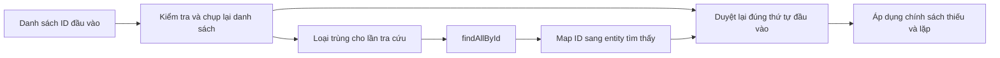

# findAll, findAllById và giới hạn bảo đảm thứ tự

`findAll()` đọc các entity thuộc phạm vi repository. `findAllById(ids)` đọc những entity tìm thấy theo tập ID được yêu cầu. Cả hai method CRUD cơ sở đều không cung cấp một hợp đồng sắp xếp theo ý nghĩa nghiệp vụ; riêng `findAllById` cũng không bảo đảm kết quả đi theo thứ tự ID đầu vào.

Một kết quả có kiểu `List` có vị trí phần tử, nhưng điều đó chưa xác định phần tử ở vị trí nào phải tương ứng với yêu cầu nào. Đây là khác biệt cần hiểu trước khi ghép dữ liệu, trả kết quả tra cứu hàng loạt hoặc xây dựng phân trang.

Trong chương **Hợp đồng CRUD** của module `SPRING_DATA_COMMONS`, bài này tập trung vào phạm vi bảo đảm của các method đọc nhiều phần tử, cách xử lý ID không tìm thấy và cách bổ sung một chính sách thứ tự rõ ràng ở tầng ứng dụng.

## 1. Đọc đúng hợp đồng hai method

Với `CrudRepository<T, ID>`:

```java
Iterable<T> findAll();

Iterable<T> findAllById(Iterable<ID> ids);
```

Các điểm chính:

| Khía cạnh | `findAll()` | `findAllById(ids)` |
| --- | --- | --- |
| Phạm vi tìm kiếm | Các entity do repository quản lý trong ngữ cảnh thực thi | Entity có định danh thuộc các ID được yêu cầu |
| Tham số đầu vào | Không có | `Iterable<ID>` hợp lệ |
| Kiểu kết quả | `Iterable<T>` | `Iterable<T>` |
| Thứ tự theo thuộc tính | Không được chỉ định trong chữ ký | Không được chỉ định trong chữ ký |
| Quan hệ vị trí với ID đầu vào | Không áp dụng | Không được bảo đảm |
| ID không tìm thấy | Không áp dụng | Không có entity tương ứng trong kết quả |

`findAllById` yêu cầu đối số không `null` và không chứa phần tử `null`. Khi một số ID không tồn tại, kết quả chỉ chứa entity tìm thấy; số phần tử có thể ít hơn số ID đã truyền. Javadoc nêu rõ thứ tự kết quả không được bảo đảm. [CrudRepository API](https://docs.spring.io/spring-data/commons/docs/current/api/org/springframework/data/repository/CrudRepository.html)

Không diễn giải kết quả thành “mỗi ID đầu vào có một ô trả về”. Hợp đồng cơ sở không trả một `Optional<T>` cho từng vị trí và không chèn `null` để bù vị trí thiếu.

## 2. Ví dụ domain và repository

Ví dụ xuyên suốt dùng `Customer` có ID `Long`. Để có một mapping cụ thể, phần domain dưới đây dùng JPA; thuật toán xử lý thứ tự phía service dựa trên hợp đồng Commons.

Mỗi kiểu public đặt trong file riêng. Giả định dự án đã có module lưu trữ, repository scanning, kết nối và hạ tầng giao dịch phù hợp.

```java
import jakarta.persistence.Entity;
import jakarta.persistence.GeneratedValue;
import jakarta.persistence.Id;
import jakarta.persistence.Table;

@Entity
@Table(name = "customers")
public class Customer {

    @Id
    @GeneratedValue
    private Long id;

    private String name;

    protected Customer() {
    }

    public Customer(String name) {
        this.name = name;
    }

    public Long getId() {
        return id;
    }

    public String getName() {
        return name;
    }
}
```

Repository ban đầu:

```java
import org.springframework.data.repository.CrudRepository;

public interface CustomerRepository
        extends CrudRepository<Customer, Long> {
}
```

Giả sử dữ liệu đang có:

| ID | name |
| --- | --- |
| 10 | An |
| 20 | Binh |
| 30 | Chi |

Các ID trong bảng chỉ là dữ liệu giả định để đọc ví dụ, không phải giả định về thứ tự sinh ID hoặc kết quả đã chạy từ một dự án cụ thể.

## 3. `findAll()` không mặc định sắp xếp theo ID

Lời gọi:

```java
Iterable<Customer> customers = repository.findAll();
```

không đưa ra tiêu chí như `id ASC`, `name ASC` hay thời điểm tạo.

Nếu quan sát thấy kết quả `[10, 20, 30]` nhiều lần, chưa thể kết luận đó là hợp đồng mặc định. Một kế hoạch thực thi, index, cách lưu dữ liệu hoặc phiên bản hạ tầng khác có thể dẫn đến thứ tự quan sát khác.

Trong SQL, kết quả không có bước sắp xếp tường minh không có bảo đảm thứ tự. PostgreSQL cũng mô tả rõ nguyên tắc này và yêu cầu chọn sorting để bảo đảm một thứ tự đầu ra. Đây là một ví dụ ở tầng database, không phải quy tắc rằng mọi module Spring Data đều sinh SQL. [PostgreSQL — Sorting Rows](https://www.postgresql.org/docs/current/queries-order.html)

### 3.1. Những thứ tự không nên tự suy ra

Không mặc định `findAll()` trả theo:

- ID tăng dần.
- Thứ tự insert.
- Thứ tự mà entity được lưu trong một test fixture.
- Thứ tự lần đọc trước.
- Thứ tự của một index đang tồn tại.

Một mapping quan hệ hoặc cấu hình sorting cho một collection con cũng không tự thiết lập thứ tự cho mọi lời gọi `findAll()` của repository.

### 3.2. `Iterable` không cam kết streaming hoặc phân trang

`Iterable` mô tả khả năng duyệt kết quả. Nó không cam kết rằng dữ liệu được tải từng phần với bộ nhớ cố định hoặc được phân trang tự động.

Không chọn `findAll()` để xử lý một tập rất lớn chỉ vì kiểu trả về chưa phải `List`. Cần xét khả năng paging, scrolling hoặc streaming của module và vòng đời tài nguyên tương ứng.

### 3.3. “Tất cả” vẫn có ngữ cảnh thực thi

`findAll()` làm việc theo domain và cơ chế của repository đang cấu hình. Nó không phải một lời gọi bỏ qua mọi mapping, filter theo module hoặc phạm vi dữ liệu của ứng dụng.

Khi cần hiểu vì sao kết quả ít hơn dữ liệu nhìn thấy trực tiếp trong database, hãy đối chiếu domain, nguồn dữ liệu và các điều kiện thực thi thực tế.

## 4. `findAllById(ids)` không ghép kết quả theo vị trí

Xét yêu cầu:

```java
java.util.List<Long> requestedIds =
        java.util.List.of(30L, 10L, 20L, 10L, 99L);

Iterable<Customer> found =
        repository.findAllById(requestedIds);
```

Trong dữ liệu giả định, ID `99` không tồn tại và ID `10` xuất hiện hai lần ở đầu vào.

Một kết quả chứa các customer với ID `[20, 10, 30]` là đủ để cho thấy vì sao không thể ghép theo chỉ số. Hợp đồng không yêu cầu danh sách trả về giữ thứ tự `[30, 10, 20, 10, 99]`.

### 4.1. Sai lầm khi “zip” hai danh sách

Ví dụ cần tránh:

```java
// Sai về giả định hợp đồng:
// requestedIds.get(i) không được bảo đảm khớp foundList.get(i).
for (int i = 0; i < foundList.size(); i++) {
    attachToRequest(requestedIds.get(i), foundList.get(i));
}
```

Nếu kết quả bị đổi thứ tự, dữ liệu có thể bị gắn sang ID khác. Nếu có ID thiếu hoặc lặp, số phần tử và vị trí càng không thể suy ra từ đầu vào.

Muốn liên hệ kết quả với yêu cầu, hãy dùng chính định danh của từng entity.

### 4.2. ID thiếu không có placeholder

Với yêu cầu `[30, 99, 10]`, kết quả không mặc định là:

```text
[Customer(30), null, Customer(10)]
```

Repository trả entity tìm thấy. Ứng dụng phải chủ động quyết định có bỏ qua ID thiếu, báo lỗi hay trả một cấu trúc có trạng thái cho từng ID.

Không có kết quả cho ID `99` khác với đầu vào chứa `null`. `99` là một giá trị ID hợp lệ để tìm kiếm trong ví dụ; `null` vi phạm điều kiện của method.

### 4.3. ID lặp không có bảo đảm nhân bản kết quả

Không mặc định rằng `[10, 10]` sẽ tạo ra đúng hai phần tử cùng ID trong kết quả repository. Hợp đồng không hứa một bản sao entity cho mỗi lần xuất hiện của ID.

Cũng không dựa vào việc một implementation cụ thể luôn loại trùng. Nếu ứng dụng cần loại trùng hoặc giữ số lần lặp, hãy tự diễn tả chính sách đó.

### 4.4. Collection đầu vào có thứ tự chưa đủ

`List` và `LinkedHashSet` có thể giữ thứ tự duyệt đầu vào của chúng. Khi truyền cho repository, thứ tự đó chưa trở thành một điều khoản sắp xếp của query hoặc kết quả.

Chuyển `List` sang `LinkedHashSet` chỉ thay đổi cấu trúc dữ liệu đầu vào. Nó không tự làm database trả theo thứ tự của set.

## 5. Đổi sang `ListCrudRepository` có thay đổi bảo đảm không?

`ListCrudRepository<T, ID>` cung cấp các chữ ký tương ứng:

```java
java.util.List<T> findAll();

java.util.List<T> findAllById(Iterable<ID> ids);
```

Có thể thay khai báo repository bằng:

```java
import org.springframework.data.repository.ListCrudRepository;

public interface CustomerRepository
        extends ListCrudRepository<Customer, Long> {
}
```

Đây là phương án thay thế cho interface ở phần 2, không phải khai báo thứ hai cùng tên trong một package.

Lợi ích là mã gọi nhận `List` trực tiếp ở các method tương ứng. Tuy nhiên, `findAllById` của biến thể này vẫn không bảo đảm thứ tự theo đầu vào và vẫn bỏ qua ID không tìm thấy. [ListCrudRepository API](https://docs.spring.io/spring-data/commons/docs/current/api/org/springframework/data/repository/ListCrudRepository.html)

Phân biệt hai ý nghĩa:

| Đặc điểm của `List` | Điều chưa được suy ra |
| --- | --- |
| Có thứ tự các phần tử trong kết quả hiện tại | Thứ tự đó giống danh sách ID yêu cầu |
| Có thể truy cập theo chỉ số | Cùng chỉ số giữa request và response nói về cùng ID |
| Có số phần tử xác định | Số phần tử bằng số ID đầu vào |
| Có thể duyệt theo thứ tự của list | Các lần gọi sau có cùng thứ tự |

Việc chuyển một `Iterable` sang `ArrayList` cũng chỉ giữ thứ tự duyệt vừa quan sát. Nó không tạo thêm bảo đảm từ repository.

Ngoài ra, không mặc định danh sách trả về có thể bị sửa tại chỗ. Nếu cần sort hoặc thay đổi trong bộ nhớ, hãy dùng một bản sao phù hợp thay vì phụ thuộc vào tính mutable của một implementation.

## 6. Chọn chính sách thứ tự theo yêu cầu nghiệp vụ

Có ít nhất ba yêu cầu khác nhau:

| Nhu cầu | Ví dụ kết quả theo ID |
| --- | --- |
| Sắp xếp theo thuộc tính ID tăng dần | `[10, 20, 30]` |
| Giữ thứ tự xuất hiện đầu tiên của các ID tìm thấy | `[30, 10, 20]` |
| Giữ thứ tự và số lần lặp ở đầu vào, bỏ ID thiếu | `[30, 10, 20, 10]` |
| Giữ đủ vị trí, nêu rõ ID thiếu | `[30:found, 10:found, 20:found, 10:found, 99:missing]` |

Bảng dùng cùng đầu vào `[30, 10, 20, 10, 99]`. Đây là các hợp đồng khác nhau; cần chọn trước khi viết mã.

Sắp xếp theo `id ASC` không tạo ra thứ tự tùy ý `[30, 10, 20]`. Để giữ thứ tự do người dùng gửi, một cách dùng chung là tra cứu, lập map theo ID rồi duyệt lại yêu cầu ban đầu.



Map là cấu trúc để tìm entity theo khóa. Thứ tự đầu ra đến từ bước duyệt lại danh sách yêu cầu, không đến từ thứ tự duyệt map.

## 7. Hiện thực hai chính sách ở service

Phần này dùng Java 17 trở lên cho record. Với dự án JPA đã cấu hình giao dịch, service có thể đặt ranh giới đọc ở tầng nghiệp vụ.

Khai báo kết quả cho trường hợp cần giữ đủ vị trí:

```java
import java.util.Optional;

public record CustomerLookup(
        Long requestedId,
        Optional<Customer> customer) {
}
```

Service sử dụng `CustomerRepository`, với cả phương án `CrudRepository` hoặc `ListCrudRepository` ở các phần trước:

```java
import java.util.ArrayList;
import java.util.HashMap;
import java.util.LinkedHashSet;
import java.util.List;
import java.util.Map;
import java.util.Optional;
import java.util.Set;

import org.springframework.stereotype.Service;
import org.springframework.transaction.annotation.Transactional;

@Service
@Transactional(readOnly = true)
public class CustomerBatchReader {

    private final CustomerRepository customers;

    public CustomerBatchReader(CustomerRepository customers) {
        this.customers = customers;
    }

    public List<Customer> findFoundInRequestedOrder(List<Long> ids) {
        List<Long> requested = validatedSnapshot(ids);

        if (requested.isEmpty()) {
            return List.of();
        }

        Map<Long, Customer> byId = loadById(requested);
        List<Customer> result = new ArrayList<>(requested.size());

        for (Long id : requested) {
            Customer customer = byId.get(id);
            if (customer != null) {
                result.add(customer);
            }
        }

        return result;
    }

    public List<CustomerLookup> findEachInRequestedOrder(
            List<Long> ids) {

        List<Long> requested = validatedSnapshot(ids);

        if (requested.isEmpty()) {
            return List.of();
        }

        Map<Long, Customer> byId = loadById(requested);
        List<CustomerLookup> result =
                new ArrayList<>(requested.size());

        for (Long id : requested) {
            result.add(new CustomerLookup(
                    id,
                    Optional.ofNullable(byId.get(id))));
        }

        return result;
    }

    private Map<Long, Customer> loadById(List<Long> requested) {
        Set<Long> uniqueIds = new LinkedHashSet<>(requested);
        Map<Long, Customer> byId = new HashMap<>();

        for (Customer customer : customers.findAllById(uniqueIds)) {
            byId.put(customer.getId(), customer);
        }

        return byId;
    }

    private static List<Long> validatedSnapshot(List<Long> ids) {
        if (ids == null) {
            throw new IllegalArgumentException(
                    "Danh sách ID không được null");
        }

        List<Long> snapshot = new ArrayList<>(ids);

        for (Long id : snapshot) {
            if (id == null) {
                throw new IllegalArgumentException(
                        "Danh sách ID không được chứa null");
            }
        }

        return snapshot;
    }
}
```

### 7.1. Chính sách bỏ ID thiếu và giữ ID lặp

Với `findFoundInRequestedOrder`:

```text
Yêu cầu:            [30, 10, 20, 10, 99]
Repository trả:     [20, 30, 10]
Service trả:        [30, 10, 20, 10]
```

Method duyệt lại danh sách `requested`, nên giữ thứ tự và số lần xuất hiện của ID tìm thấy. ID `99` bị bỏ theo chính sách được chọn.

Kết quả service có thể chứa nhiều vị trí hơn số entity trong kết quả repository vì service chủ động tái tạo các vị trí lặp. Đây là hợp đồng riêng của service, không phải một bảo đảm mới của `findAllById`.

Những mục cùng ID dùng entity đã tìm được cho ID đó; việc lặp vị trí không tạo thêm một bản ghi hoặc một identity mới.

### 7.2. Chính sách giữ đủ vị trí và biểu diễn thiếu

Với `findEachInRequestedOrder`:

```text
30 -> Optional[Customer(30)]
10 -> Optional[Customer(10)]
20 -> Optional[Customer(20)]
10 -> Optional[Customer(10)]
99 -> Optional.empty
```

Số `CustomerLookup` bằng số ID đầu vào hợp lệ. Record này là cấu trúc kết quả của service; repository cơ sở vẫn chỉ trả các entity tìm thấy.

Nếu ứng dụng cần một dạng response khác, có thể chuyển kết quả service sang DTO phù hợp mà vẫn giữ chính sách vị trí.

### 7.3. Vì sao vẫn giữ danh sách ban đầu sau khi loại trùng?

`uniqueIds` phục vụ việc tra cứu, còn `requested` giữ ý nghĩa của yêu cầu.

Nếu thay luôn `requested` bằng set, thông tin số lần lặp sẽ bị mất. Nếu duyệt map để tạo response, thứ tự yêu cầu cũng không còn là nguồn quyết định.

`LinkedHashSet` trong helper giữ thứ tự lần xuất hiện đầu tiên khi loại trùng, nhưng thuật toán không cần repository bảo toàn thứ tự đó.

### 7.4. Nếu muốn loại trùng trong kết quả

Có thể tạo đầu ra từ danh sách ID duy nhất theo lần xuất hiện đầu tiên, thay vì từ toàn bộ `requested`. Với ví dụ, kết quả sẽ là `[30, 10, 20]` sau khi bỏ ID thiếu.

Hãy công bố rõ chính sách này. Không để việc loại trùng xảy ra ngẫu nhiên chỉ vì implementation đang dùng một câu query có ngữ nghĩa tập hợp.

## 8. Khi cần thứ tự theo thuộc tính

Nếu yêu cầu là “khách hàng theo name tăng dần”, hãy dùng khả năng sorting phù hợp.

Từ Spring Data 3.0, các nhánh CRUD và sorting của Commons được tách ra. Có thể thay repository bằng:

```java
import org.springframework.data.repository.ListCrudRepository;
import org.springframework.data.repository.ListPagingAndSortingRepository;

public interface CustomerRepository
        extends ListCrudRepository<Customer, Long>,
                ListPagingAndSortingRepository<Customer, Long> {
}
```

Lời gọi:

```java
import org.springframework.data.domain.Sort;

java.util.List<Customer> sorted = repository.findAll(
        Sort.by("name").ascending()
                .and(Sort.by("id").ascending()));
```

`id` là tiêu chí phụ để các customer trùng name vẫn có thứ tự xác định trong tập dữ liệu đang xét. Nhánh paging/sorting công bố các method nhận `Sort` hoặc `Pageable`; nó không tự thêm một overload sorting cho mọi method CRUD. [PagingAndSortingRepository API](https://docs.spring.io/spring-data/commons/docs/current/api/org/springframework/data/repository/PagingAndSortingRepository.html), [Defining Repository Interfaces](https://docs.spring.io/spring-data/commons/reference/repositories/definition.html)

### 8.1. `findAllById(ids, sort)` không phải method CRUD có sẵn

Hai interface trên không cung cấp sẵn:

```java
// Không có overload cơ sở này chỉ nhờ kết hợp hai interface:
// repository.findAllById(ids, sort);
```

Nếu cần lọc theo danh sách ID rồi sort ở tầng lưu trữ, có thể khai báo query method được module hỗ trợ. Ví dụ JPA với thuộc tính `id` của `Customer`:

```java
java.util.List<Customer> findByIdIn(
        java.util.Collection<Long> ids,
        org.springframework.data.domain.Sort sort);
```

Đây là method thêm vào interface, không phải sửa chữ ký `findAllById` kế thừa.

Lời gọi với `Sort.by("id")` yêu cầu thứ tự ID tăng dần. Nó không yêu cầu thứ tự tùy ý theo danh sách đầu vào.

### 8.2. Sorting có giá trị bằng nhau

Nếu chỉ sort theo `name`, các entity có cùng name chưa có một thứ tự duy nhất giữa chúng. Thêm tiêu chí duy nhất phù hợp như ID giúp diễn đạt rõ hơn.

Với chuỗi, thứ tự còn phụ thuộc quy tắc so sánh của kho dữ liệu, collation và tính năng được module hỗ trợ. Sorting trong Java và sorting tại database không mặc định tương đương về mọi quy tắc.

### 8.3. Giữ thứ tự tùy ý ngay trong query

Một query chuyên biệt có thể dùng cơ chế của database để xếp theo vị trí ID yêu cầu. Cách đó cần được thiết kế và kiểm tra theo công nghệ cụ thể, không phải bảo đảm của Commons.

Nếu cần tái sử dụng qua nhiều loại kho dữ liệu với tập kết quả vừa phải, cách dựng map rồi phục hồi thứ tự ở service dễ làm rõ hợp đồng hơn.

## 9. Hiệu năng và giới hạn khi đọc nhiều phần tử

### 9.1. Không dùng `findAll()` rồi lọc để thay cho truy vấn theo ID

Một cách làm dễ gặp là tải mọi customer, sau đó giữ những phần tử có ID nằm trong request.

Điều đó có thể đọc lượng dữ liệu lớn hơn nhiều so với yêu cầu. Nó cũng chưa tự bảo đảm thứ tự theo request.

Khi cần một tập ID, bắt đầu từ thao tác truy vấn tập ID hoặc query chuyên biệt. Khi cần duyệt toàn bộ dữ liệu lớn, chọn cơ chế chia phần phù hợp thay vì ngầm tải hết.

### 9.2. Một lời gọi repository chưa cam kết một query

Không diễn giải `findAllById` thành “chắc chắn một câu SQL IN duy nhất”.

Ví dụ, trong `SimpleJpaRepository` tại mốc 3.5.0, nhánh xử lý ID ghép có thể duyệt từng ID và dùng `findById`, trong khi nhánh khóa đơn có đường truy vấn theo tập ID. Đây là khác biệt implementation theo tình huống, không phải hợp đồng phổ quát của Commons. [SimpleJpaRepository 3.5.0](https://github.com/spring-projects/spring-data-jpa/blob/3.5.0/spring-data-jpa/src/main/java/org/springframework/data/jpa/repository/support/SimpleJpaRepository.java)

Cache, persistence context và cơ chế của module cũng có thể ảnh hưởng số lần thực sự truy cập kho dữ liệu. Đánh giá bằng cấu hình và quan sát thực tế khi hiệu năng là yêu cầu của bài toán.

### 9.3. Không gọi `findById` cho từng phần tử chỉ để giữ thứ tự

Một vòng lặp theo request có thể tạo ra thứ tự mong muốn, nhưng cũng tạo nhiều lời gọi repository và có thể tăng chi phí truy cập.

Mẫu service ở phần 7 tách hai mục tiêu: lấy dữ liệu theo tập ID trước, phục hồi thứ tự sau. Điều này không cam kết một lần network I/O, nhưng tránh buộc ứng dụng phải gọi lookup riêng cho từng vị trí lặp.

### 9.4. Danh sách ID lớn có thể cần chia lô

Giới hạn tham số query, kích thước request và bộ nhớ phụ thuộc database, driver và module. Commons không cung cấp một batch size tối ưu chung cho mọi kho dữ liệu.

Nếu cần chia lô:

1. Giữ lại danh sách yêu cầu làm nguồn thứ tự.
2. Loại trùng các ID phục vụ lookup.
3. Chia ID tra cứu thành các lô theo giới hạn đã chọn.
4. Gộp kết quả tìm thấy vào map theo ID.
5. Phục hồi đầu ra từ danh sách yêu cầu.

Chỉ nối các danh sách kết quả của từng lô chưa bảo đảm thứ tự trong từng lô giống request.

Với `n` ID yêu cầu và `m` entity tìm thấy, bước dựng map và phục hồi thứ tự có chi phí kỳ vọng tuyến tính theo `n + m` khi dùng hash map thích hợp. Bộ nhớ vẫn tăng theo kích thước yêu cầu và kết quả; đây không phải thuật toán bộ nhớ cố định.

### 9.5. Khóa ghép cần equality đúng

Nếu ID là một lớp khóa ghép thay vì `Long`, map và set cần `equals` cùng `hashCode` nhất quán theo các thành phần khóa.

Không thay đổi giá trị khóa khi đang dùng nó làm key của hash map. Cách ánh xạ ID của module và ngữ nghĩa equality trong Java phải được thiết kế phù hợp.

## 10. Thứ tự rõ ràng không có nghĩa là dữ liệu ở một snapshot bất biến

Ngay cả khi đầu ra được phục hồi đúng thứ tự request, dữ liệu có thể thay đổi trong thời gian thực hiện truy vấn.

Một entity có thể bị xóa trước lần đọc, hoặc giá trị dùng để sort có thể thay đổi giữa hai lần lấy trang. Chia thành nhiều lô cũng tạo thêm các thời điểm quan sát dữ liệu.

Trong ví dụ JPA, `@Transactional(readOnly = true)` thể hiện ranh giới đọc và có thể hỗ trợ các tối ưu hóa theo hạ tầng. Nó không tự bảo đảm mọi isolation level đều tạo cùng một snapshot cho mọi lời gọi.

Nếu nghiệp vụ cần tính nhất quán mạnh hơn, hãy xác định yêu cầu giao dịch, isolation hoặc cơ chế khác theo kho dữ liệu. Đây là một yêu cầu bổ sung ngoài việc xếp thứ tự phần tử.

### 10.1. Không kiểm tra tồn tại rồi coi kết quả sau đó là chắc chắn

Gọi `existsById` trước cho từng ID vừa tăng số thao tác, vừa không loại bỏ khả năng dữ liệu thay đổi trước lần đọc sau.

Hãy xử lý trực tiếp kết quả đọc theo chính sách thiếu đã công bố. Nếu yêu cầu là “phải có đủ tất cả ID”, so sánh tập ID tìm thấy với yêu cầu và báo các ID thiếu theo hợp đồng service.

### 10.2. Không biến lỗi truy cập thành kết quả không tìm thấy

Một danh sách rỗng hợp lệ và một lỗi database là hai kết quả khác nhau.

Không bắt mọi exception từ `findAllById` rồi trả `List.of()` chỉ để giữ kiểu kết quả. Cách đó làm mất thông tin liệu các ID thật sự không có dữ liệu hay quá trình truy cập đã thất bại.

## 11. Các tình huống nên kiểm tra khi áp dụng

Với dữ liệu giả định có ID `10`, `20` và `30`:

| Đầu vào | Điều nên kiểm tra với repository | Kỳ vọng của service giữ đủ vị trí |
| --- | --- | --- |
| `[]` | Kết quả không có entity | Danh sách rỗng |
| `[10]` | Có customer 10 | Một vị trí found |
| `[30, 10, 20]` | Có các ID tìm thấy; không assertion thứ tự input | Các vị trí 30, 10, 20 |
| `[30, 99, 10]` | Không có placeholder cho 99 | 30:found, 99:missing, 10:found |
| `[10, 10]` | Không áp đặt số lần lặp từ input lên hợp đồng cơ sở | Hai vị trí cùng requestedId 10 |
| `[99, 98]` | Không có entity tương ứng | Hai vị trí missing |
| Danh sách chứa `null` | Đầu vào không hợp lệ | Bị từ chối trước lookup |
| Đối số danh sách `null` | Đầu vào không hợp lệ | Bị từ chối trước lookup |

Khi kiểm tra repository cơ sở, assertion thứ tự phải xuất phát từ một hợp đồng sorting đã được yêu cầu. Với `findAllById` thông thường, đối chiếu membership và chính sách ID thiếu thích hợp thay vì buộc thứ tự bằng request.

Khi kiểm tra service phục hồi thứ tự, nên cho dependency trả các hoán vị khác nhau, chẳng hạn `[20, 30, 10]` và `[10, 20, 30]`. Kết quả service vẫn phải tuân theo chính sách đã chọn.

Một test chỉ chạy với ID tăng dần trên một database nhỏ có thể che lỗi ghép theo vị trí. Dùng request có thứ tự đảo, có ID thiếu và có ID lặp sẽ kiểm tra đúng yêu cầu hơn.

Các tình huống trên là hướng thực hành; chúng không phải báo cáo rằng mã trong bài đã được chạy ở một dự án cụ thể.

## 12. Bài tập củng cố

### Tình huống A: kết quả trông như đã sort

Một nhóm quan sát `findAll()` luôn trả ID tăng dần nên bỏ toàn bộ sort khỏi màn hình.

**Giải thích:** quan sát đó chưa tạo ra bảo đảm thứ tự. Màn hình cần một hợp đồng sort cụ thể nếu thứ tự có ý nghĩa.

### Tình huống B: ghép response theo index

Request là `[30, 99, 10]`, repository trả entity 10 rồi entity 30. Mã ứng dụng gắn entity đầu tiên cho ID 30.

**Cách sửa:** lập map theo ID của entity và duyệt lại request. Không dùng vị trí response để suy ra ID.

### Tình huống C: chuyển sang `ListCrudRepository`

Nhóm phát triển mong đổi kiểu trả về sang `List` sẽ làm `findAllById` giữ nguyên thứ tự request.

**Giải thích:** thay đổi này chỉ cung cấp kiểu kết quả List ở các method tương ứng. Cần sorting hoặc chính sách phục hồi thứ tự riêng theo yêu cầu.

### Tình huống D: client yêu cầu giữ ID lặp

Request là `[10, 20, 10]`. Màn hình cần ba vị trí, trong đó vị trí đầu và cuối cùng tham chiếu customer 10.

**Cách xử lý:** giữ danh sách request, có thể loại trùng khi lookup, rồi dựng lại đầu ra từ request. Không phụ thuộc số lần entity 10 xuất hiện trong kết quả repository.

### Tình huống E: cần thứ tự name thay vì thứ tự request

Client gửi `[30, 10, 20]` nhưng yêu cầu bảng kết quả sort theo name và ID.

**Cách xử lý:** khai báo query phù hợp để lọc tập ID và yêu cầu sort, hoặc sort tập kết quả đã lấy theo chính sách rõ ràng. Dựng lại theo request sẽ giải quyết một yêu cầu khác.

Khi sử dụng `findAll` và `findAllById`, hãy ghi rõ ba điều trong thiết kế: tập dữ liệu cần đọc, cách xử lý ID thiếu hoặc lặp, và nguồn quyết định thứ tự. Hợp đồng Commons giúp truy xuất entity; những bảo đảm bổ sung cần được diễn tả bằng interface sorting, query theo module hoặc logic service phù hợp.
