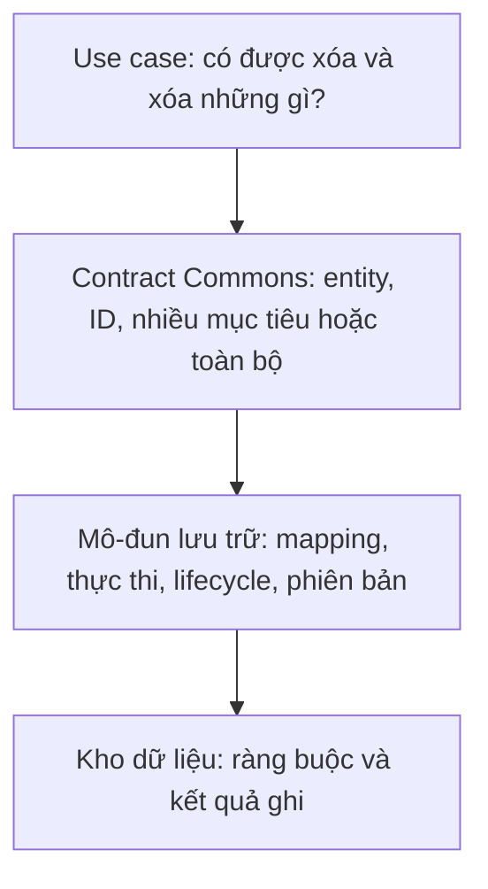

# delete, deleteById, deleteAllById và deleteAll

Các phương thức xóa của `CrudRepository<T, ID>` khác nhau trước hết ở **cách xác định đối tượng cần xóa**: bằng một entity, một ID, nhiều ID, nhiều entity hoặc toàn bộ phạm vi repository.

Tên phương thức không tự cho biết có bao nhiêu câu lệnh được thực thi, dữ liệu có được tải trước hay không hoặc thao tác có bỏ qua kiểm tra phiên bản hay không. Để sử dụng đúng, cần đọc cả contract của Spring Data Commons lẫn cách mô-đun lưu trữ thực hiện contract đó.

Bài học thuộc chương **Hợp đồng CRUD** của mô-đun **SPRING_DATA_COMMONS**. Chúng ta xét API repository đồng bộ, tập trung vào mục tiêu xóa, đầu vào hợp lệ, trường hợp không tìm thấy và những giới hạn cần hiểu trước khi dùng trong nghiệp vụ.

## 1. Bản đồ các phương thức xóa

Nhóm phương thức có các chữ ký:

```java
void delete(T entity);

void deleteById(ID id);

void deleteAllById(Iterable<? extends ID> ids);

void deleteAll(Iterable<? extends T> entities);

void deleteAll();
```

Đây là phần contract cần phân biệt. `deleteAll` có **hai overload**, không phải một phương thức với tham số tùy chọn.

| Phương thức | Đầu vào xác định mục tiêu | Phạm vi yêu cầu |
| --- | --- | --- |
| `delete(entity)` | Một đối tượng miền | Đối tượng được cung cấp |
| `deleteById(id)` | Một định danh | Đối tượng tương ứng ID |
| `deleteAllById(ids)` | Tập định danh | Các đối tượng tương ứng những ID được cung cấp |
| `deleteAll(entities)` | Tập đối tượng miền | Các đối tượng được cung cấp |
| `deleteAll()` | Không có tham số | Toàn bộ đối tượng thuộc phạm vi thao tác của repository |

Tất cả đều trả `void`. Vì vậy, bên gọi không nhận trực tiếp số đối tượng đã xóa từ các chữ ký này.

`ListCrudRepository` kế thừa nhóm phương thức xóa trên mà không đổi chúng thành kết quả `List` hay số lượng bản ghi. Khác biệt kiểu trả về giữa `CrudRepository` và `ListCrudRepository` nằm ở một số phương thức lưu/đọc tập hợp, không nằm ở nhóm xóa.

## 2. Đặt contract Commons trong môi trường thực thi cụ thể

Ví dụ repository:

```java
import org.springframework.data.repository.CrudRepository;

public interface ProductRepository
        extends CrudRepository<Product, Long> {
}
```

Trong contract này, `Product` là kiểu miền và `Long` là kiểu định danh. Để xóa dữ liệu thực tế, ứng dụng vẫn cần mô-đun lưu trữ và cấu hình phù hợp.

Phần ví dụ JPA trong bài giả định:

- Ứng dụng đã có Spring Data JPA và JPA provider.
- `Product` đã được mapping hợp lệ.
- Repository được hạ tầng JPA phát hiện và đăng ký.
- Có kết nối dữ liệu và cấu hình giao dịch tương ứng.

Các mô-đun khác có thể thực thi cùng contract bằng cách khác. Đặc biệt, không suy ra số câu SQL, cascade hoặc persistence context cho mọi loại kho dữ liệu.

Có thể hình dung ba tầng trách nhiệm:



API xóa giải quyết nhu cầu truy cập dữ liệu. Nó không tự quyết định sản phẩm nào còn được phép bán, ai có quyền xóa hoặc dữ liệu nào phải được giữ để đối soát.

## 3. delete(entity): cung cấp một đối tượng để xóa

Ví dụ:

```java
Product product = productRepository.findById(productId)
    .orElseThrow(() ->
        new IllegalArgumentException("Không tìm thấy sản phẩm")
    );

productRepository.delete(product);
```

Đoạn mã nằm trong một phương thức đã được cung cấp repository và có `productId` hợp lệ. Bên gọi đã tải entity, nên có thể kiểm tra trạng thái trước khi xóa.

### 3.1. Khi nào đầu vào entity có ích?

Đối tượng có thể mang theo:

- Định danh được mapping.
- Trạng thái cần cho kiểm tra nghiệp vụ.
- Metadata phiên bản khi dùng optimistic locking.
- Thông tin phục vụ các cơ chế vòng đời hoặc domain event phù hợp.

Điều đó không có nghĩa implementation luôn sử dụng mọi field của đối tượng như điều kiện xóa. Cách nhận diện entity và kiểm tra phiên bản phụ thuộc contract cụ thể cùng mô-đun.

Cũng không nên tự tạo một đối tượng chỉ có ID rồi mặc định nó tương đương một entity đã được tải với phiên bản hiện tại. Trạng thái mới, detached hoặc thiếu metadata có thể được xử lý khác nhau.

### 3.2. Entity không tồn tại và phiên bản không phù hợp

Không suy ra rằng `delete(entity)` luôn thành công nếu đối tượng không còn trong kho dữ liệu.

Contract cho phép lỗi optimistic locking trong những tình huống như phiên bản không phù hợp hoặc entity được giả định còn tồn tại nhưng không còn tìm thấy khi thực hiện thao tác. Chi tiết kiểm tra cần được đọc theo mô-đun và mapping.

Với entity có thuộc tính phiên bản, một bản đã tải từ trước có thể trở nên cũ sau khi tiến trình khác cập nhật dữ liệu.

### 3.3. Có entity chưa đồng nghĩa đã kiểm soát đồng thời

Việc đọc entity trước khi xóa giúp kiểm tra nghiệp vụ, nhưng không tự khóa dữ liệu cho tới lúc xóa.

Nếu một thay đổi đồng thời có thể làm kết quả kiểm tra không còn đúng, ứng dụng cần chiến lược phù hợp: kiểm tra phiên bản, khóa được hỗ trợ hoặc thao tác có điều kiện. Ranh giới giao dịch và mức cô lập cũng phải được xét theo kho dữ liệu.

## 4. deleteById(id): cung cấp một định danh

Ví dụ:

```java
productRepository.deleteById(productId);
```

Bên gọi chỉ cung cấp ID. Contract không yêu cầu bên gọi phải tải `Product` trước đó.

### 4.1. ID không tồn tại không giống ID null

Trong contract API hiện đại, `deleteById` mô tả trường hợp không tìm thấy đối tượng trong kho dữ liệu là **bỏ qua**.

Điều này cần được phân biệt với:

```java
productRepository.deleteById(null);
```

ID null là đầu vào không hợp lệ, không phải cách biểu diễn một ID hợp lệ nhưng không tồn tại.

Khi làm việc với hệ thống đang dùng phiên bản cũ hoặc implementation tùy chỉnh, cần đối chiếu contract của phiên bản đó. Không áp dụng máy móc kinh nghiệm từ một phiên bản khác.

### 4.2. Bỏ qua trường hợp thiếu không có nghĩa bỏ qua mọi lỗi

Thao tác vẫn có thể thất bại vì:

- Ràng buộc tham chiếu hoặc ràng buộc dữ liệu khác.
- Xung đột phiên bản theo cách thực thi.
- Lỗi kết nối.
- Lỗi giao dịch.
- Lỗi mapping hoặc cấu hình.

Không nên bắt mọi exception rồi coi kết quả là “đã xóa hoặc vốn không tồn tại”. Cách đó làm mất sự khác biệt giữa một yêu cầu đã được đáp ứng và một thao tác không thực hiện được.

### 4.3. Không mặc định một ID tương ứng một câu DELETE

Một implementation có thể tải entity trước khi xóa để xử lý vòng đời, mapping hoặc các yêu cầu khác.

Vì vậy, `deleteById` không cam kết:

- Chỉ một lần trao đổi với kho dữ liệu.
- Không có truy vấn đọc.
- Bỏ qua kiểm tra phiên bản.
- Bỏ qua cascade hoặc ràng buộc.

ID là cách bên gọi xác định mục tiêu. Nó không phải chỉ thị bắt buộc về kế hoạch thực thi.

## 5. deleteAllById(ids): xóa theo một tập định danh

Ví dụ:

```java
import java.util.List;

// firstId và secondId lấy từ dữ liệu đã lưu thực tế.
productRepository.deleteAllById(
    List.of(firstId, secondId)
);
```

Đầu vào là `Iterable<? extends ID>`. Bạn có thể truyền một tập hợp phù hợp; contract không bắt buộc đầu vào phải là `List`.

Trong contract API hiện đại, những đối tượng không tìm thấy theo ID được cung cấp được bỏ qua. Đầu vào không phải một cam kết rằng tất cả ID đều đang tồn tại.

### 5.1. Không có kết quả số lượng

Lời gọi không trả:

- Danh sách ID đã xóa.
- Danh sách ID còn thiếu.
- Số bản ghi chịu tác động.

Nếu nghiệp vụ yêu cầu “phải tìm thấy và được phép xóa đủ tất cả mục tiêu”, chỉ gọi `deleteAllById` là chưa đủ để biểu đạt yêu cầu đó.

Ứng dụng cần thiết kế bước kiểm tra và thực thi phù hợp. Việc kiểm tra trước cũng phải xét thay đổi đồng thời; không coi một lần đọc trước là bảo đảm tuyệt đối cho bước xóa sau.

### 5.2. Không có cam kết về thứ tự hay một lệnh duy nhất

Không dựa vào thứ tự ID đầu vào để suy ra thứ tự xóa thực tế. Nếu các mục tiêu có quan hệ hoặc ràng buộc đặc biệt, hãy thiết kế theo mapping và khả năng của kho dữ liệu.

Đầu vào có nhiều ID không đồng nghĩa implementation phải dùng một truy vấn dạng `IN`. Nó có thể thực hiện nhiều thao tác, tải dữ liệu hoặc xử lý theo cách riêng.

Tương tự, không suy ra chính sách xử lý ID lặp về số lần truy vấn hoặc số lần phát sự kiện chỉ từ kiểu `Iterable`. Nếu cần ngữ nghĩa rõ ràng cho tập mục tiêu, ứng dụng nên chuẩn hóa đầu vào có chủ đích.

## 6. deleteAll(entities): xóa theo những đối tượng được cung cấp

Ví dụ:

```java
import java.util.List;

productRepository.deleteAll(
    List.of(firstProduct, secondProduct)
);
```

Trong đó, `firstProduct` và `secondProduct` là các đối tượng miền phù hợp. Phương thức này không có cùng loại đầu vào với `deleteAllById`.

| Lời gọi | Dữ liệu bên gọi cung cấp |
| --- | --- |
| `deleteAllById(ids)` | Các định danh |
| `deleteAll(entities)` | Các đối tượng miền |

Nếu các entity đã được tải để kiểm tra nghiệp vụ, truyền chúng có thể giữ lại thông tin trạng thái hoặc phiên bản cần thiết cho đường xử lý tương ứng. Không nên chuyển chúng thành ID rồi mặc định mọi ngữ nghĩa vẫn hoàn toàn giống nhau.

Với các đối tượng có kiểm soát phiên bản, lỗi optimistic locking có thể phát sinh khi ít nhất một mục tiêu không còn phù hợp trạng thái được giả định.

### Xóa nhiều entity không phải mặc định bỏ qua lifecycle

Tên `deleteAll` trong overload này không khẳng định đây là một bulk delete bỏ qua từng entity.

Một implementation có thể xử lý từng đối tượng để đáp ứng cơ chế vòng đời hoặc yêu cầu của mô-đun. Nếu bạn cần cơ chế bulk riêng, phải đọc contract của API bulk đó thay vì suy luận từ chữ “All”.

## 7. deleteAll(): xóa toàn bộ phạm vi repository

Ví dụ:

```java
productRepository.deleteAll();
```

Không có tham số chọn mục tiêu. Với một repository sản phẩm thông thường, thao tác yêu cầu xóa toàn bộ các sản phẩm trong phạm vi mà implementation quản lý.

Nó không có nghĩa:

- Chỉ xóa trang hiện tại.
- Chỉ xóa những sản phẩm đã đọc ở lời gọi trước.
- Chỉ xóa những sản phẩm đang hiển thị trên giao diện.
- Xóa toàn bộ mọi bảng trong cơ sở dữ liệu.
- Tự lọc theo người dùng hiện tại hoặc tenant.

Phạm vi tenant, bộ lọc và mapping nếu có cần được xác định từ implementation và cấu hình cụ thể. Generic `Product, Long` không tự tạo điều kiện bảo vệ theo người gọi.

### 7.1. Hai overload deleteAll phải được đọc rõ

```java
productRepository.deleteAll(selectedProducts);
```

khác với:

```java
productRepository.deleteAll();
```

Lời gọi đầu có tập mục tiêu. Lời gọi sau không nhận tập mục tiêu.

Không thiết kế một wrapper coi đầu vào null là tín hiệu tự chuyển sang `deleteAll()`. Null là dữ liệu không hợp lệ hoặc một tình huống cần được xử lý theo contract ứng dụng, không phải mặc định “xóa mọi thứ”.

### 7.2. Không mặc định đây là lệnh xóa nhanh nhất

Một implementation có thể tải các entity rồi xóa để giữ các hành vi cần thiết. Với nhiều dữ liệu, điều này có thể tạo nhiều thao tác và tiêu thụ bộ nhớ.

Không coi `deleteAll()` là từ đồng nghĩa với `TRUNCATE`, một câu SQL duy nhất hoặc một thao tác không có lifecycle.

## 8. Đầu vào hợp lệ và ý nghĩa của void

### 8.1. Kiểm tra đầu vào theo loại phương thức

| Đầu vào | Cách hiểu |
| --- | --- |
| Entity null cho `delete` | Không hợp lệ |
| ID null cho `deleteById` | Không hợp lệ |
| Iterable null | Không hợp lệ |
| Iterable chứa phần tử null | Không phải tập mục tiêu hợp lệ theo contract |
| ID hợp lệ nhưng không tồn tại | Xét hành vi không tìm thấy của phương thức và phiên bản |
| Tập mục tiêu rỗng | Không có mục tiêu được chỉ định; ứng dụng có thể xử lý sớm theo contract của mình |

Với đầu vào từ API bên ngoài, nên kiểm tra kiểu, kích thước và phạm vi dữ liệu được phép trước khi gọi repository. Đó là phần chuyển yêu cầu ứng dụng thành tập mục tiêu rõ ràng.

### 8.2. void không xác nhận số lượng đã xóa

Các phương thức cơ sở không trả số lượng chịu tác động. Vì vậy, không thể kết luận “đã xóa đúng ba bản ghi” chỉ từ việc gọi `deleteAllById` với ba ID.

Dùng `count()` trước và sau cũng không tự tạo một phép đo chính xác trong hệ thống có cập nhật đồng thời.

Nếu nghiệp vụ cần số lượng hoặc danh sách mục tiêu cụ thể, hãy thiết kế contract phù hợp và chọn cơ chế thực thi được mô-đun hỗ trợ. Một query xóa tùy chỉnh trả số lượng là một contract khác, cần được xét cùng giới hạn lifecycle, phiên bản và giao dịch của nó.

### 8.3. Lời gọi trả về chưa chắc giao dịch đã commit

Trong một giao dịch lớn hơn, lệnh xóa có thể được thực hiện hoặc kiểm tra ràng buộc khi flush/commit. Do đó, một dòng mã đã chạy qua không đồng nghĩa toàn bộ use case đã được commit thành công.

Cách và thời điểm báo lỗi phụ thuộc công nghệ. Không phát thông báo thành công ra bên ngoài chỉ dựa trên một giả định về thời điểm xóa của mọi implementation.

## 9. Ví dụ nghiệp vụ: chỉ xóa sản phẩm đã ngừng sử dụng

Giả sử quy tắc của ứng dụng là sản phẩm phải được đánh dấu lưu trữ trước khi xóa. Ví dụ mô hình JPA:

```java
package example.deletion.domain;

import jakarta.persistence.Entity;
import jakarta.persistence.GeneratedValue;
import jakarta.persistence.Id;
import jakarta.persistence.Table;
import jakarta.persistence.Version;

@Entity
@Table(name = "products")
public class Product {

    @Id
    @GeneratedValue
    private Long id;

    @Version
    private Long version;

    private String name;

    private boolean archived;

    protected Product() {
    }

    public Product(String name) {
        if (name == null || name.isBlank()) {
            throw new IllegalArgumentException(
                "Tên sản phẩm không được rỗng"
            );
        }

        this.name = name.trim();
    }

    public void archive() {
        this.archived = true;
    }

    public void requireDeletionAllowed() {
        if (!archived) {
            throw new IllegalStateException(
                "Chỉ được xóa sản phẩm đã lưu trữ"
            );
        }
    }

    public Long getId() {
        return id;
    }

    public String getName() {
        return name;
    }
}
```

`@Version` ở đây là annotation Jakarta Persistence. Nó tạo điều kiện cho kiểm soát phiên bản của môi trường JPA; không phải mọi kho dữ liệu đều dùng cùng annotation và cơ chế này.

Repository:

```java
package example.deletion.data;

import example.deletion.domain.Product;

import org.springframework.data.repository.CrudRepository;

public interface ProductRepository
        extends CrudRepository<Product, Long> {
}
```

Use case:

```java
package example.deletion.application;

import example.deletion.data.ProductRepository;
import example.deletion.domain.Product;

import org.springframework.stereotype.Service;
import org.springframework.transaction.annotation.Transactional;

@Service
public class ProductDeletionService {

    private final ProductRepository products;

    public ProductDeletionService(ProductRepository products) {
        this.products = products;
    }

    @Transactional
    public void deleteArchivedProduct(Long productId) {
        Product product = products.findById(productId)
            .orElseThrow(() ->
                new IllegalArgumentException(
                    "Không tìm thấy sản phẩm"
                )
            );

        product.requireDeletionAllowed();

        products.delete(product);
    }
}
```

Ví dụ giả định yêu cầu đã đi qua cơ chế xác thực và kiểm tra quyền cần thiết; phương thức trên tập trung vào quy tắc trạng thái và lưu trữ. Nếu có tenant hoặc chủ sở hữu, phải giới hạn và kiểm tra phạm vi truy cập phù hợp.

### Vì sao chọn delete(entity) trong use case này?

Use case cần đọc trạng thái để xác định sản phẩm được phép xóa. Nó cũng có thể cần thông tin phiên bản của entity. Gọi `deleteById` ngay từ đầu không biểu đạt bước kiểm tra đó.

`@Transactional` thuộc Spring, cần hạ tầng giao dịch và cơ chế áp dụng phù hợp. Trong môi trường JPA có kiểm soát phiên bản, xung đột có thể được phát hiện trong quá trình thực thi, flush hoặc commit.

Ví dụ không chứng minh rằng mọi xung đột đều bị ngăn chỉ bằng một annotation. Ràng buộc liên aggregate, chính sách xóa và tác dụng phụ bên ngoài vẫn cần thiết kế theo yêu cầu thực tế.

## 10. Giao dịch, lỗi và xóa nhiều mục tiêu

Giả sử một yêu cầu muốn xóa ba sản phẩm, nhưng một sản phẩm đang được tham chiếu bởi dữ liệu khác.

Những câu hỏi cần được trả lời là:

1. Yêu cầu có phải thành công toàn bộ hoặc thất bại toàn bộ không?
2. Kho dữ liệu và transaction manager có hỗ trợ ranh giới đó không?
3. Những thao tác đã thực hiện trước khi lỗi có được rollback không?
4. Lỗi xuất hiện khi gọi repository hay khi commit?
5. Có tác dụng phụ bên ngoài giao dịch cần xử lý không?

Ở môi trường JPA, các phương thức cơ sở thường có cấu hình giao dịch của implementation. Nhưng một chuỗi “đọc nhiều mục tiêu, kiểm tra rồi xóa” cần ranh giới use case rõ ràng nếu muốn các bước tham gia cùng giao dịch phù hợp.

Không suy ra khả năng nguyên tử của toàn bộ quy trình chỉ từ một lời gọi `deleteAllById` hoặc `deleteAll` dùng chung ở mọi mô-đun.

Lỗi ràng buộc có thể được Spring dịch sang exception truy cập dữ liệu phù hợp, chẳng hạn `DataIntegrityViolationException`, tùy công nghệ và vị trí phát sinh. Ứng dụng cần phân biệt lỗi dữ liệu, xung đột và lỗi hạ tầng thay vì gom chúng thành kết quả “không tìm thấy”.

### Không dùng existsById như một khóa

Mẫu sau không bảo đảm trạng thái giữ nguyên giữa hai thao tác:

```java
if (productRepository.existsById(productId)) {
    productRepository.deleteById(productId);
}
```

Một tiến trình khác có thể thay đổi dữ liệu sau bước kiểm tra. Nếu chỉ cần trạng thái cuối là không còn đối tượng theo ID, kiểm tra tồn tại trước có thể là một lượt truy cập không cần thiết.

Nếu cần chính sách lỗi hoặc kiểm tra nghiệp vụ riêng, hãy tải và xử lý theo contract use case, đồng thời thiết kế kiểm soát đồng thời tương ứng.

## 11. Lifecycle, domain event và bulk delete là các khía cạnh riêng

### 11.1. Không gộp mọi loại sự kiện thành một

Khi xóa dữ liệu, có thể có những cơ chế khác nhau:

| Cơ chế | Nơi quyết định hành vi |
| --- | --- |
| Callback vòng đời entity | Mô hình persistence và provider |
| Cascade hoặc ràng buộc tham chiếu | Mapping và cơ sở dữ liệu |
| Domain event của aggregate | Mô hình miền và tích hợp phát sự kiện |
| Ghi nhận lịch sử nghiệp vụ | Thiết kế ứng dụng |
| Trigger cơ sở dữ liệu | Cấu hình của kho dữ liệu |

Việc một cơ chế hoạt động không chứng minh các cơ chế còn lại cũng hoạt động.

Với cơ chế domain event của Spring Data, cần đặc biệt phân biệt phương thức nhận aggregate với phương thức chỉ nhận ID. Không dựa vào `deleteById` như một bảo đảm phát các event đang được giữ trong một aggregate ở phía bên gọi.

Nếu cần một sự kiện nghiệp vụ như “sản phẩm được gỡ khỏi danh mục”, hãy xác định rõ sự kiện được tạo, phát và ghi nhận ở đâu. Thành công của lệnh xóa cũng không tự bảo đảm việc gửi sự kiện sang hệ thống ngoài thành công đúng một lần.

### 11.2. Bulk API có contract riêng

Một API xóa hàng loạt hoặc query xóa tùy chỉnh có thể được thiết kế để giảm số lần tải entity. Đổi lại, nó có thể không đi qua cùng đường lifecycle, không đồng bộ cùng cách với persistence context hoặc không kiểm tra phiên bản theo từng entity.

Những điều này cần được đọc theo API và mô-đun thực tế.

Không thay thế `deleteAll(entities)` bằng một bulk query chỉ vì tên đều có nghĩa “xóa nhiều”, nếu nghiệp vụ đang phụ thuộc vào hành vi ở từng entity.

### 11.3. Soft delete không tự có từ CrudRepository

Nếu yêu cầu là đánh dấu `deleted`, giữ lịch sử hoặc cho phép khôi phục, cần cơ chế soft delete được thiết kế rõ ràng.

Contract chung không tự thêm field, bộ lọc đọc hoặc chính sách lưu lịch sử. Một implementation hoặc mapping tùy chỉnh có thể thay đổi cách thực hiện xóa, nhưng đó là khả năng bổ sung của hệ thống, không phải bảo đảm mặc định từ tên phương thức.

## 12. Xóa lặp lại và ý nghĩa idempotent

Với một thao tác theo ID có chính sách bỏ qua khi thiếu, gọi lại có thể giữ cùng trạng thái cuối: đối tượng không còn tồn tại.

Tuy nhiên, cần phân biệt:

- Trạng thái lưu trữ cuối cùng.
- Mã lỗi hoặc phản hồi do use case lựa chọn.
- Nhật ký nghiệp vụ.
- Sự kiện hoặc thông báo được gửi.
- Các tác dụng phụ bên ngoài kho dữ liệu.

Một thao tác có cùng trạng thái cuối không tự chứng minh mọi tác dụng phụ cũng chỉ xảy ra một lần.

Nếu hệ thống có retry, hãy xác định điều gì được phép thử lại và cách nhận diện yêu cầu lặp. Không bắt mọi lỗi rồi retry vô điều kiện, đặc biệt khi một phần tác dụng phụ đã xảy ra.

Đối với nhóm nhiều ID, cũng cần xác định liệu mục tiêu thiếu được phép bỏ qua hay phải làm toàn bộ yêu cầu thất bại. Đó là lựa chọn của contract nghiệp vụ, khác với hành vi cơ sở của repository.

## 13. Bảng lựa chọn theo nhu cầu

| Nhu cầu thực tế | Phương thức hoặc hướng lựa chọn |
| --- | --- |
| Chỉ cần xóa một mục tiêu theo ID và chấp nhận trường hợp đã không còn | `deleteById`, với xử lý lỗi phù hợp |
| Cần kiểm tra trạng thái entity trước khi xóa | Tải, kiểm tra và `delete(entity)` trong ranh giới phù hợp |
| Có tập ID và chấp nhận bỏ qua ID không tồn tại | `deleteAllById` |
| Đã có các entity và cần đường xử lý tương ứng | `deleteAll(entities)` |
| Chủ đích xóa toàn bộ phạm vi repository | `deleteAll()` |
| Cần biết số lượng thực sự chịu tác động | Contract truy vấn/thao tác riêng được mô-đun hỗ trợ |
| Cần xóa rất nhiều dữ liệu với yêu cầu hiệu năng cụ thể | Đánh giá API bulk, xử lý theo lô hoặc cơ chế riêng cùng các đánh đổi |
| Cần giữ dữ liệu để khôi phục hoặc đối soát | Thiết kế lưu trữ/lưu lịch sử hoặc soft delete phù hợp |

Không chọn phương thức chỉ dựa trên việc đã có một biến ID hay một biến entity. Hãy xét điều kiện nghiệp vụ, metadata cần giữ và ngữ nghĩa thực thi mong muốn.

## 14. Tình huống tự kiểm tra

Giả sử có hai sản phẩm với ID `idA` và `idB`; `missingId` là một ID hợp lệ nhưng không tồn tại. Các tình huống dưới đây độc lập, dùng trạng thái ban đầu riêng và giả định không có lỗi ràng buộc hoặc xung đột.

### Tình huống A: deleteById(missingId)

Theo contract hiện đại, trường hợp không tìm thấy được bỏ qua. Không được đồng nhất nó với truyền ID null.

### Tình huống B: deleteAllById gồm idA và missingId

Phạm vi yêu cầu gồm hai ID. Đối tượng A được yêu cầu xóa; ID không tồn tại được bỏ qua. Phương thức không trả số lượng để báo “một đối tượng đã bị xóa”.

### Tình huống C: deleteAll với một danh sách chỉ chứa entity B

Phạm vi mục tiêu là B, không phải toàn bộ repository. Trạng thái và phiên bản của entity vẫn có thể liên quan đến cách thực thi.

### Tình huống D: gọi deleteAll sau khi vừa đọc một trang

Trang đã đọc không trở thành điều kiện của `deleteAll()`. Lời gọi không tham số vẫn yêu cầu xóa toàn bộ phạm vi thao tác của repository.

### Tình huống E: delete(entity) với entity có phiên bản cũ

Không thể coi đây là một thao tác chắc chắn được bỏ qua hoặc thành công. Kiểm soát phiên bản có thể làm thao tác thất bại; cần xử lý theo contract của mô-đun và chính sách ứng dụng.

## 15. Điểm cần ghi nhớ

Phân biệt phương thức xóa bằng đầu vào và phạm vi: một entity, một ID, nhiều ID, nhiều entity hoặc toàn bộ repository. Đọc rõ hai overload của `deleteAll` và nhớ rằng nhóm phương thức này trả `void`, không báo số lượng đã xóa.

Sau khi chọn đúng contract, vẫn phải xét quyền truy cập, quy tắc nghiệp vụ, phiên bản, giao dịch, lifecycle và ràng buộc của kho dữ liệu. Spring Data Commons thống nhất cách gọi; mô-đun thực thi và thiết kế ứng dụng quyết định hành vi thực tế.
