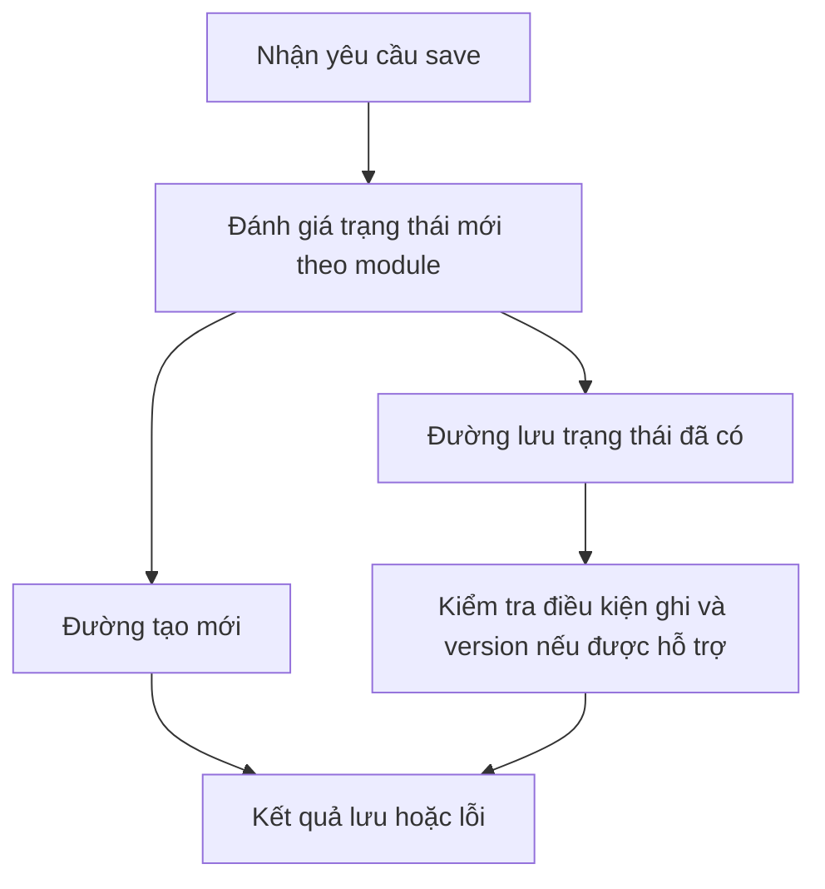

# Phát hiện entity mới, version và khả năng optimistic locking

Một đối tượng Java vừa được tạo bằng `new` chưa chắc được Spring Data nhận diện là entity mới. Một entity có ID khác null cũng chưa chắc đã tồn tại trong kho dữ liệu. Và một lời gọi `save` thành công trong luồng đơn lẻ chưa chứng minh nó được bảo vệ trước cập nhật đồng thời.

Trong chương **Hợp đồng CRUD** của Spring Data Commons (`SPRING_DATA_COMMONS`), bài này nối ba khái niệm có liên quan nhưng có trách nhiệm khác nhau: **phát hiện entity mới**, **thuộc tính version** và **optimistic locking**. Commons cung cấp abstraction và metadata dùng chung; cách một module dùng chúng để lưu dữ liệu và phát hiện xung đột cần được hiểu theo khả năng của store.

Ví dụ cụ thể dùng Spring Data JPA với Jakarta Persistence. Những phần có `EntityManager`, `persist`, `merge` hoặc annotation JPA thuộc đường triển khai JPA. Không áp dụng nguyên các chi tiết đó cho JDBC, MongoDB hay repository reactive chỉ vì chúng cùng xuất hiện trong hệ sinh thái Spring Data.

## 1. Ba câu hỏi khác nhau trong một lần lưu

Giả sử ứng dụng quản lý lượng hàng có thể đặt của một mặt hàng:

```text
StockItem
├── id: định danh mặt hàng được quản lý
├── sku: mã hàng
├── available: lượng còn có thể đặt
└── version: phiên bản dùng cho cơ chế kiểm soát đồng thời
```

Khi gọi `save(item)`, có ít nhất ba câu hỏi cần phân biệt:

| Câu hỏi | Trách nhiệm |
| --- | --- |
| Đối tượng này được coi là mới hay đã có trạng thái persistence? | Cơ chế nhận diện mới của module và metadata của mô hình. |
| Đối tượng mang phiên bản nào của dữ liệu? | Thuộc tính version và trạng thái đã được đọc hoặc cấp khi lưu. |
| Dữ liệu có bị thay đổi kể từ phiên bản người gọi đang giữ không? | Điều kiện ghi và cơ chế optimistic locking được store thực thi. |

Một giá trị version có thể tham gia cả việc nhận diện mới lẫn kiểm tra xung đột. Điều đó không có nghĩa hai bước là một:

- Nhận diện mới thường quyết định trước hoặc trong quá trình chọn đường lưu.
- Kiểm tra optimistic locking phải đối chiếu với trạng thái trong store theo cách tránh được khoảng trống cạnh tranh ở thao tác ghi.



Sơ đồ mô tả trách nhiệm khái niệm. Nó không khẳng định mỗi module đều có đúng hai câu lệnh database hoặc cùng một thuật toán nội bộ.

## 2. Entity mới không đồng nghĩa vừa tạo instance Java

### 2.1. Instance mới có thể đại diện dữ liệu đã có

Một request có thể được chuyển thành một instance Java mới chứa ID và version của dữ liệu đã đọc trước đó. Instance này mới trong bộ nhớ, nhưng nghiệp vụ đang yêu cầu cập nhật một bản ghi có sẵn.

Ngược lại, ứng dụng có thể cấp UUID cho một aggregate ngay từ constructor. Instance ấy có ID khác null trước khi được lưu lần đầu.

```text
Tình huống A: new object + ID rỗng       -> có thể là yêu cầu tạo mới
Tình huống B: new object + ID được cấp  -> vẫn có thể là yêu cầu tạo mới
Tình huống C: new object + ID/version cũ -> có thể đại diện dữ liệu đã tồn tại
```

Không dùng thời điểm cấp phát đối tượng Java để thay cho chiến lược nhận diện persistence.

### 2.2. ID là tín hiệu, không phải truy vấn chứng minh tồn tại

Hạ tầng Spring Data có các chiến lược nhận diện mới dựa trên metadata, chẳng hạn xem xét ID, version hoặc ủy quyền cho `Persistable.isNew()`. Chi tiết và thứ tự ưu tiên phải được xác định ở module đang dùng.

Với chiến lược dựa trên ID, một ID tham chiếu bằng null thường là tín hiệu mới; khi ID là kiểu nguyên thủy số, một số hạ tầng sử dụng giá trị không như tín hiệu mặc định. Không đồng nhất `Long` bằng `0L` với một ID nguyên thủy `long` bằng `0`, và không suy rộng quy tắc này sang mọi mapping.

Quan trọng hơn, nhận diện từ metadata không nhất thiết thực hiện `existsById` trước mỗi lần lưu. “Không mới” theo chiến lược không phải bằng chứng rằng bản ghi chắc chắn còn tồn tại ở thời điểm ghi.

### 2.3. Tự kiểm tra tồn tại cũng không xóa được cuộc đua

```java
if (repository.existsById(id)) {
    repository.save(item);
}
```

Giữa hai lời gọi, một luồng khác có thể sửa hoặc xóa dữ liệu. Nếu yêu cầu là ghi dựa trên một phiên bản đã đọc, cần điều kiện ghi hoặc cơ chế kiểm soát đồng thời thích hợp, không chỉ một phép kiểm tra tồn tại tách rời.

## 3. Spring Data JPA nhận diện mới như thế nào?

Với chiến lược mặc định của Spring Data JPA, một thuộc tính version **không phải kiểu nguyên thủy** được xem xét trước. Nếu có thuộc tính đó và giá trị là null, entity được coi là mới. Khi không có version phù hợp cho cách kiểm tra này, việc xem xét ID được sử dụng theo cơ chế tương ứng.

Ví dụ một entity có:

```java
@Id
@GeneratedValue(strategy = GenerationType.IDENTITY)
private Long id;

@Version
private Long version;
```

Cách đọc những trạng thái thường gặp:

| Trạng thái mô hình | Cách hiểu theo chiến lược JPA nêu trên |
| --- | --- |
| `id == null`, `version == null` | Entity được nhận diện là mới. |
| ID đã được ứng dụng gán, `version == null` | Version nullable vẫn có thể giúp nhận diện mới, nếu mapping dùng ID gán sẵn phù hợp. |
| ID đã có, version đã được persistence provider thiết lập | Entity thường đi theo đường không mới. |
| ID đã có, không khai báo version dùng được cho nhận diện mới | Cơ chế nhận diện dựa vào ID cần được xem xét. |
| ID đã có, version cũ so với database | Không mới; đây có thể là tình huống xung đột khi ghi, không phải một yêu cầu tạo mới. |

Hàng về ID gán sẵn là một phương án mapping khác với field `@GeneratedValue` trong đoạn mã đầu. Không vừa yêu cầu provider sinh ID vừa tùy tiện gán ID để thử một chiến lược khác.

Spring Data JPA thường dùng `EntityManager.persist` cho đường mới và `EntityManager.merge` cho đường không mới. Đây không phải cam kết rằng `persist` luôn phát SQL ngay hoặc `merge` luôn chỉ có đúng một câu `UPDATE`.

### 3.1. Vì sao version nullable có ích?

Một thuộc tính `Long version` có thể biểu diễn trạng thái chưa được persistence provider thiết lập bằng null. Sau khi đã lưu và nạp trạng thái phù hợp, nó có một giá trị version do provider quản lý.

```java
@Version
private Long version;
```

Không tự khởi tạo field này bằng `0L` chỉ để tránh null. Với chiến lược nhận diện nêu trên, giá trị khác null có thể làm entity mới bị nhận diện là không mới.

Cũng không viết nghiệp vụ dựa trên giả định mọi provider và store đều cấp cùng một version ban đầu. Trong ví dụ cập nhật, ta chỉ cần biết version đã được thiết lập và được cơ chế hỗ trợ quản lý đúng.

### 3.2. Version nguyên thủy cần được phân biệt

```java
@Version
private long version;
```

Trong JPA, giá trị không có thể là một version đầu tiên hợp lệ. Spring Data JPA không dùng version nguyên thủy theo cách kiểm tra null để nhận diện mới; nó quay về cơ chế nhận diện phù hợp khác, chẳng hạn ID.

Vì vậy, không dùng quy tắc “version bằng không thì chắc chắn mới” cho JPA. Điều này khác với những chiến lược metadata có thể coi số không là tín hiệu mặc định trong một số module hoặc kiểu thuộc tính khác.

### 3.3. Nhận diện mới sai có thể gây hậu quả gì?

- Một entity mới với ID gán sẵn nhưng không có chiến lược phù hợp có thể đi vào đường merge ngoài ý định, tạo thêm truy cập hoặc hành vi phụ thuộc mapping/provider.
- Một entity đã tồn tại bị đánh dấu mới có thể đi vào đường tạo mới và gặp lỗi định danh hoặc ràng buộc.
- Một đối tượng dựng thiếu version có thể bị coi là mới thay vì được xem như bản cập nhật hợp lệ.

Không chữa những tình huống này bằng cách sửa version thủ công đến khi hết lỗi. Cần kiểm tra nguồn của đối tượng, cơ chế cấp ID và chiến lược nhận diện mới.

## 4. Khi nào cần `Persistable.isNew()`?

`Persistable<ID>` là abstraction Commons cho phép mô hình cung cấp ID và tín hiệu mới. Trong module có hỗ trợ cơ chế này, hạ tầng có thể ủy quyền việc nhận diện cho `isNew()`.

Một trường hợp thường gặp là ID được gán từ ứng dụng trước khi lưu, trong khi mô hình không dùng version nullable để hỗ trợ nhận diện mới.

Ví dụ một lớp cơ sở dành riêng cho JPA:

```java
import java.util.Objects;
import java.util.UUID;
import jakarta.persistence.Id;
import jakarta.persistence.MappedSuperclass;
import jakarta.persistence.PostLoad;
import jakarta.persistence.PostPersist;
import jakarta.persistence.Transient;
import org.springframework.data.domain.Persistable;

@MappedSuperclass
public abstract class AssignedIdEntity implements Persistable<UUID> {

    @Id
    private UUID id;

    @Transient
    private boolean newEntity = true;

    protected AssignedIdEntity() {
    }

    protected AssignedIdEntity(UUID id) {
        this.id = Objects.requireNonNull(id, "id");
    }

    @Override
    public UUID getId() {
        return id;
    }

    @Override
    public boolean isNew() {
        return newEntity;
    }

    @PostPersist
    @PostLoad
    private void markNotNew() {
        newEntity = false;
    }
}
```

Đây là lớp cơ sở; entity cụ thể cần kế thừa, được mapping và đáp ứng yêu cầu của JPA. Do field ID mang annotation trên field, ví dụ dùng kiểu truy cập field của JPA. `newEntity` là trạng thái hỗ trợ vòng đời, không được mapping thành cột.

Các annotation `PostPersist`, `PostLoad` và `Transient` trong ví dụ thuộc JPA. Với module khác, phải thiết kế cơ chế chuyển trạng thái tương ứng, không mang nguyên callback JPA sang đó.

### 4.1. Trách nhiệm đi kèm với cờ mới

- Entity do ứng dụng tạo để lưu lần đầu có cờ phù hợp với yêu cầu tạo mới.
- Entity được nạp từ persistence chuyển sang trạng thái không mới.
- Không trả `true` vĩnh viễn chỉ vì muốn tránh đường cập nhật.
- Khi dựng lại đối tượng từ request hoặc message, không mặc định constructor với cờ mới phản ánh đúng mục đích cập nhật.

`PostPersist` cũng không phải thông báo rằng toàn bộ giao dịch đã commit. Nếu giao dịch rollback sau callback, trạng thái trong instance có thể không còn phản ánh sự tồn tại thực tế trong database. Không tái sử dụng mù quáng instance đó cho lần thử tiếp theo.

### 4.2. `isNew()` không cung cấp optimistic locking

Cờ mới chỉ giúp chọn đường xử lý trạng thái persistence. Nó không kiểm tra một người khác đã sửa dữ liệu hay chưa.

Nếu entity vừa implement `Persistable` vừa có version, cần phân biệt hai vai trò: `isNew()` có thể quyết định nhận diện mới theo cơ chế module, còn version tham gia kiểm soát cập nhật khi store hỗ trợ. Không thêm `Persistable` chỉ với mục đích “bật khóa lạc quan”.

## 5. Optimistic locking giải quyết lost update như thế nào?

Giả sử lượng hàng ban đầu là `10`, version minh họa là `7`. Hai yêu cầu đọc cùng trạng thái trước khi yêu cầu nào ghi:

| Bước | Yêu cầu A | Yêu cầu B | Database |
| --- | --- | --- | --- |
| 1 | Đọc `available=10`, `version=7` | | `10`, version `7` |
| 2 | | Đọc `available=10`, `version=7` | Chưa đổi |
| 3 | Đặt 3, muốn ghi lượng còn `7` | | Ghi thành công, version đổi |
| 4 | | Đặt 4 từ bản đọc cũ, muốn ghi lượng còn `6` | Version đã khác `7` |

Nếu B ghi đè không có điều kiện phù hợp, database có thể kết thúc ở `6`, làm mất tác động của lần đặt 3 từ A. Đây là một dạng lost update.

Với optimistic locking bằng version, ý tưởng ghi thường có dạng:

```sql
UPDATE stock_items
SET available = :new_available,
    version = :new_version
WHERE id = :id
  AND version = :expected_version;
```

Câu SQL chỉ minh họa điều kiện ghi trên kho quan hệ, không phải SQL chính xác bắt buộc của mọi provider. Nếu không có hàng nào còn khớp version kỳ vọng, triển khai có cơ sở phát hiện xung đột thay vì coi thao tác là cập nhật thành công bình thường.

Điểm quyết định là **điều kiện version gắn với thao tác ghi**. Đọc version trước rồi thực hiện một lệnh ghi không có điều kiện không tạo ra cùng bảo đảm: vẫn có thể có thay đổi xen vào giữa.

### 5.1. Version không phải số lần người dùng bấm lưu

Version phục vụ cơ chế persistence và kiểm soát đồng thời. Không dùng nó làm số hóa đơn, thứ tự nghiệp vụ hoặc bộ đếm mà ứng dụng tùy ý tăng.

Một lần nghiệp vụ có thể tạo ra những đường đồng bộ khác nhau. Cách cấp và tăng version phải do cơ chế được module hỗ trợ quản lý, trừ khi đang chủ đích xây dựng một thao tác tùy biến với đầy đủ điều kiện và trách nhiệm tương ứng.

### 5.2. Xung đột không chỉ đến từ hai người sửa cùng lúc

Một đối tượng có thể giữ version cũ do nằm trong bộ nhớ lâu, do một message đến trễ hoặc do bản ghi đã bị thay đổi/xóa trước đó. Cơ chế không cần hai luồng đang chạy đúng cùng một mili giây mới phát hiện được trạng thái cũ.

Version cũng khác auditing: thời điểm sửa và người sửa giúp truy vết, nhưng không tự tạo điều kiện cập nhật nguyên tử như cơ chế version hỗ trợ.

## 6. Ví dụ JPA: lưu lượng hàng với version

Các đoạn mã sau thuộc một ứng dụng đã có Spring Data JPA, JPA provider, driver và cấu hình database phù hợp. Chúng minh họa mô hình và đường ghi, không phải toàn bộ project.

### 6.1. Entity có version do provider quản lý

```java
package com.example.inventory;

import jakarta.persistence.Column;
import jakarta.persistence.Entity;
import jakarta.persistence.GeneratedValue;
import jakarta.persistence.GenerationType;
import jakarta.persistence.Id;
import jakarta.persistence.Table;
import jakarta.persistence.Version;

@Entity
@Table(name = "stock_items")
public class StockItem {

    @Id
    @GeneratedValue(strategy = GenerationType.IDENTITY)
    private Long id;

    @Version
    private Long version;

    @Column(nullable = false)
    private String sku;

    @Column(nullable = false)
    private int available;

    protected StockItem() {
    }

    public StockItem(String sku, int available) {
        if (sku == null || sku.isBlank()) {
            throw new IllegalArgumentException("SKU không được rỗng");
        }
        if (available < 0) {
            throw new IllegalArgumentException("Lượng hàng không được âm");
        }
        this.sku = sku;
        this.available = available;
    }

    public void reserve(int quantity) {
        if (quantity <= 0 || quantity > available) {
            throw new IllegalArgumentException("Số lượng đặt không hợp lệ");
        }
        available -= quantity;
    }

    public Long getId() {
        return id;
    }

    public Long getVersion() {
        return version;
    }

    public String getSku() {
        return sku;
    }

    public int getAvailable() {
        return available;
    }
}
```

Không cung cấp setter nghiệp vụ để tùy ý sửa version. Đối tượng mới có ID và version null; persistence provider quản lý các giá trị ấy theo mapping.

### 6.2. Repository và service

```java
package com.example.inventory;

import org.springframework.data.repository.CrudRepository;

public interface StockItemRepository extends CrudRepository<StockItem, Long> {
}
```

```java
package com.example.inventory;

import org.springframework.stereotype.Service;
import org.springframework.transaction.annotation.Transactional;

@Service
public class InventoryService {

    private final StockItemRepository items;

    public InventoryService(StockItemRepository items) {
        this.items = items;
    }

    @Transactional
    public void reserve(Long id, int quantity) {
        StockItem item = items.findById(id)
            .orElseThrow(() -> new IllegalArgumentException("Không tìm thấy mặt hàng"));
        item.reserve(quantity);
        items.save(item);
    }
}
```

Service thể hiện ý định nghiệp vụ: đọc lượng hàng, kiểm tra yêu cầu, thay đổi và lưu trong một ranh giới giao dịch phù hợp. Trong JPA, entity đang managed còn có dirty checking; lời gọi `save` ở đây giữ đường điều phối rõ ràng, không biến dirty checking thành bảo đảm chung của Commons.

Nếu hai giao dịch đọc cùng version rồi ghi cạnh tranh, cơ chế JPA/version có thể làm một giao dịch thất bại khi đồng bộ hoặc commit. Chỉ kiểm tra `quantity <= available` trong bộ nhớ chưa đủ để phát hiện mọi thay đổi đã xảy ra sau lần đọc.

Không xây phản hồi với giả định version mới luôn đã có ngay sau `save` trong thân giao dịch. Thời điểm đồng bộ và tăng version có thể phụ thuộc provider; nếu cần công bố trạng thái sau ghi, thiết kế điểm quan sát phù hợp với ranh giới hoàn tất giao dịch.

## 7. Kiểm chứng xung đột bằng hai bản đọc cũ

Không cần dùng thời gian chờ hoặc hai luồng khó điều khiển để kiểm tra trường hợp version cũ. Có thể đọc hai snapshot trước, ghi snapshot A thành công rồi thử ghi snapshot B.

Đoạn test sau giả định:

- Có application context JPA quét được entity và repository ở trên.
- Profile `test` kết nối database dành riêng cho kiểm thử, schema đã được chuẩn bị.
- Có JUnit Jupiter, AssertJ và thư viện test Spring Boot phù hợp.
- Không có giao dịch test bao ngoài; mỗi lần dùng `TransactionTemplate` bên dưới tạo một ranh giới riêng trong bối cảnh này.
- Không chạy các thao tác cleanup cạnh tranh trên cùng database.

Ví dụ cấu hình cho database H2 nhúng ở môi trường test có thể dùng `generate-unique-name: true` và `ddl-auto: create-drop`, với H2 trên test classpath và không có URL bên ngoài ghi đè. Chỉ áp dụng chính sách tạo/xóa schema cho dữ liệu test có thể bỏ đi.

```java
package com.example.inventory;

import static org.assertj.core.api.Assertions.assertThat;
import static org.assertj.core.api.Assertions.assertThatThrownBy;

import java.util.Objects;
import org.junit.jupiter.api.AfterEach;
import org.junit.jupiter.api.BeforeEach;
import org.junit.jupiter.api.Test;
import org.springframework.beans.factory.annotation.Autowired;
import org.springframework.boot.test.context.SpringBootTest;
import org.springframework.dao.OptimisticLockingFailureException;
import org.springframework.test.context.ActiveProfiles;
import org.springframework.transaction.PlatformTransactionManager;
import org.springframework.transaction.support.TransactionTemplate;

@SpringBootTest(webEnvironment = SpringBootTest.WebEnvironment.NONE)
@ActiveProfiles("test")
class StockOptimisticLockTest {

    @Autowired
    private StockItemRepository items;

    @Autowired
    private PlatformTransactionManager transactionManager;

    private TransactionTemplate tx;

    @BeforeEach
    void configureTransactions() {
        tx = new TransactionTemplate(transactionManager);
    }

    @AfterEach
    void removeTestData() {
        items.deleteAll();
    }

    @Test
    void rejectsAStaleSnapshotInsteadOfLosingAnUpdate() {
        StockItem created = Objects.requireNonNull(tx.execute(status ->
            items.save(new StockItem("BOOK-001", 10))
        ));
        Long id = created.getId();

        StockItem a = readInTransaction(id);
        StockItem b = readInTransaction(id);
        Long expectedVersion = b.getVersion();

        assertThat(expectedVersion).isNotNull();
        assertThat(a.getVersion()).isEqualTo(expectedVersion);

        a.reserve(3);
        tx.executeWithoutResult(status -> items.save(a));

        b.reserve(4);
        assertThatThrownBy(() ->
            tx.executeWithoutResult(status -> items.save(b))
        ).isInstanceOf(OptimisticLockingFailureException.class);

        StockItem current = readInTransaction(id);
        assertThat(current.getAvailable()).isEqualTo(7);
        assertThat(current.getVersion()).isNotEqualTo(expectedVersion);
    }

    private StockItem readInTransaction(Long id) {
        return Objects.requireNonNull(tx.execute(status ->
            items.findById(id).orElseThrow()
        ));
    }
}
```

Trong cấu hình JPA/Spring thông dụng của ví dụ, lỗi provider được dịch sang hệ thống ngoại lệ Spring, nên assertion kiểm tra `OptimisticLockingFailureException`. Khi thay cấu hình persistence hoặc ranh giới gọi, cần xác minh kiểu ngoại lệ thực sự được công bố và thời điểm nó xuất hiện.

### 7.1. Vì sao không đặt `@Transactional` lên test này?

Nếu test có một giao dịch bao ngoài và các transaction template tham gia giao dịch đó theo propagation mặc định, các bước có thể không còn là những giao dịch riêng như dự định. Persistence context cũng có thể giữ lại cùng entity, làm hai lần đọc không tạo ra hai snapshot tách biệt.

Ví dụ chủ đích không có giao dịch test bao ngoài. Mỗi lần đọc kết thúc giao dịch trước bước tiếp theo; các đối tượng mang trạng thái cũ được sử dụng để tái hiện xung đột một cách xác định.

Phép kiểm tra này xác nhận đường xử lý stale version. Nó không thay thế stress test với nhiều luồng hoặc kiểm tra những mức isolation khác nhau.

### 7.2. Vì sao không so version với một số cố định?

Test giữ lại version đã đọc, rồi kiểm tra version hiện tại khác nó sau cập nhật thành công. Không cần khẳng định version ban đầu phải là `0` hay một số khác để chứng minh xung đột đã được phát hiện.

Đồng thời, phép kiểm tra lượng hàng `7` chứng minh lần ghi cũ từ B không làm ghi đè kết quả A thành `6`. Chỉ kiểm tra “có ngoại lệ” mà không đọc lại trạng thái sẽ thiếu một phần bằng chứng về dữ liệu còn lại sau thất bại.

### 7.3. Vì sao không tiếp tục quan sát instance cũ của A?

JPA có thể merge trạng thái detached vào một instance managed khác. Kết quả `save` cần được dùng nếu muốn tiếp tục với trạng thái sau lưu trong bối cảnh phù hợp; không mặc định instance đầu vào đã có version mới.

Ở test này, sau khi ghi A, ta chủ đích đọc lại database trong một giao dịch khác để quan sát kết quả đã commit. Không dùng version trên instance detached của A làm bằng chứng thay thế.

## 8. Khả năng optimistic locking phụ thuộc module và đường ghi

Có annotation version trong project chưa đủ để kết luận mọi thao tác đều được bảo vệ như nhau.

| Đường lưu trữ | Cần xác định |
| --- | --- |
| Spring Data JPA | Annotation `jakarta.persistence.Version`, mapping/provider, entity managed hay detached và thời điểm flush/commit. |
| Spring Data JDBC | Metadata version theo module relational, cách lưu aggregate và điều kiện ghi tương ứng; không dựa vào persistence context của JPA. |
| Spring Data MongoDB | Annotation/version được module hỗ trợ, thao tác nào tham gia kiểm tra version và cấu hình xác nhận ghi phù hợp. |
| Module reactive có hỗ trợ version | Cơ chế cập nhật của module, driver và thời điểm publisher được thực thi, phát lỗi. |
| Mã truy cập trực tiếp hoặc bulk tùy biến | Có tự đưa version vào điều kiện, cập nhật version và xử lý số kết quả ghi đúng không? |

Với các module sử dụng annotation Spring Data, có thể gặp `org.springframework.data.annotation.Version`. Nó khác `jakarta.persistence.Version`. Chọn import theo module đang mapping mô hình, không theo việc IDE gợi ý annotation nào trước.

Trong MongoDB, việc quan sát xung đột còn liên quan đến write concern có xác nhận phù hợp. Không suy ra một đường ghi không chờ xác nhận sẽ cung cấp cùng khả năng báo lỗi như đường ghi được module yêu cầu cho optimistic locking.

Với repository reactive, việc nhận được publisher chưa phải bằng chứng thao tác đã hoàn tất. Lỗi version xuất hiện theo vòng đời thực thi reactive, không nhất thiết tại dòng tạo publisher.

### 8.1. Cập nhật bulk hoặc trực tiếp có thể đi vòng cơ chế entity

Một câu JPQL bulk, SQL trực tiếp hoặc API bulk của store có thể không đi qua cùng vòng đời kiểm tra version, callback và auditing như `save` một entity.

Nếu chọn đường cập nhật tùy biến, cần quyết định rõ:

1. Có điều kiện version kỳ vọng trong thao tác ghi không?
2. Có cập nhật version theo thiết kế nhất quán không?
3. Trường hợp không có dữ liệu khớp được xem là không tồn tại hay xung đột?
4. Những entity đang nằm trong bộ nhớ hoặc persistence context có trở nên cũ không?

Không thực hiện ghi trực tiếp bỏ qua version rồi kỳ vọng những lần `save` khác vẫn phát hiện được toàn bộ thay đổi đó.

### 8.2. Version ở root không tự khóa mọi thành phần của aggregate

Một aggregate có thể gồm nhiều entity hoặc nhiều biểu diễn lưu trữ. Version trên root bảo vệ những thao tác mà module và mapping thực sự gắn với root đó; nó không tự động bảo đảm mọi thay đổi ở bảng, document hoặc entity con đều làm version root tăng.

Nếu quy tắc yêu cầu toàn bộ aggregate cùng một ranh giới nhất quán, phải kiểm tra đường ghi từng thành phần, giao dịch và cách phát hiện xung đột. Đừng chỉ nhìn thấy field `version` trên root rồi coi thiết kế đã hoàn tất.

## 9. Xử lý xung đột bằng ý định nghiệp vụ

Khi B thất bại trong ví dụ đặt hàng, có hai dữ liệu khác nhau:

```text
Trạng thái cũ B đã tính: available = 6
Ý định của B: đặt thêm 4 đơn vị
```

Nếu đọc lại lượng hàng `7` rồi áp dụng lại ý định đặt `4`, kết quả có thể là `3`, sau khi kiểm tra lại quy tắc. Nếu chỉ ghi lại con số cũ `6` bằng version mới, ứng dụng đang tiếp tục một phép tính dựa trên dữ liệu lỗi thời.

Một quy trình xử lý có thể là:

1. Để giao dịch thất bại kết thúc và rollback theo cơ chế của nó.
2. Phân loại xung đột và quyết định có cho phép thử lại hay cần người dùng xem lại dữ liệu.
3. Nếu thử lại, mở một giao dịch mới và đọc trạng thái hiện tại.
4. Kiểm tra lại ý định cùng quy tắc nghiệp vụ trên trạng thái mới.
5. Thực hiện ghi, với số lần thử được giới hạn theo chính sách ứng dụng.

Không tiếp tục một giao dịch đã bị đánh dấu rollback-only như thể chỉ cần sửa field version là có thể commit. Không dùng lại mù quáng entity có trạng thái hoặc cờ `isNew` đã đi qua một lần lưu thất bại.

### 9.1. Không bắt lỗi chỉ quanh `save` rồi bỏ qua commit

Trong JPA, lỗi version có thể được phát hiện ở merge, flush hoặc khi hoàn tất giao dịch. Nếu cần xử lý ở tầng điều phối, đặt điểm xử lý nơi có thể quan sát kết quả của toàn bộ ranh giới giao dịch tương ứng.

Một khối `try/catch` bên trong thân phương thức `@Transactional` không chắc nhìn thấy mọi lỗi phát sinh sau khi thân phương thức kết thúc. Việc retry phải bảo đảm lần thử sau có giao dịch và trạng thái mới phù hợp.

### 9.2. Tránh mặc định mọi thao tác đều nên tự retry

Cập nhật giá trị từ màn hình cũ có thể cần báo xung đột để người dùng quyết định. Một yêu cầu điều chỉnh số lượng có thể phù hợp với việc đọc lại rồi tính lại, nếu các điều kiện nghiệp vụ cho phép.

Nếu ca sử dụng có tác động bên ngoài database, rollback database không tự hoàn tác các tác động đó. Chính sách thử lại phải xét cả tính lặp lại an toàn của ca sử dụng, không chỉ việc câu `save` có thể chạy thêm lần nữa.

### 9.3. Version từ client có vai trò riêng

Giả sử người dùng đọc một bản dữ liệu rồi sửa sau nhiều phút. Nếu server luôn đọc bản mới nhất và ghi đè theo request mà không kiểm tra version người dùng đã xem, `@Version` vẫn có thể bảo vệ cuộc đua trong khoảng đọc/ghi của server, nhưng không tự phát hiện toàn bộ quyết định dựa trên màn hình cũ.

Khi nghiệp vụ yêu cầu điều đó, đưa version kỳ vọng hoặc một cơ chế điều kiện tương đương vào hợp đồng cập nhật. So sánh với trạng thái đang đọc để phát hiện bản nhìn cũ; đồng thời vẫn giữ cơ chế version ở thao tác ghi để chống thay đổi tiếp theo sau bước so sánh.

Không gán version do client gửi lên vào entity managed chỉ để làm cho một bản cập nhật trông hợp lệ. Version là điều kiện cần kiểm chứng, không phải giá trị để tùy ý chỉnh cho vượt kiểm tra.

## 10. Những tình huống nên kiểm tra trước khi sử dụng rộng hơn

| Tình huống | Kỳ vọng cần xác định |
| --- | --- |
| Entity mới có ID do store sinh | Được nhận diện mới, ID/version sau lưu có trạng thái phù hợp. |
| Entity mới có ID do ứng dụng cấp | Đường tạo mới được chọn theo chiến lược có chủ đích. |
| Entity đã tải rồi được cập nhật | ID giữ danh tính, version được quản lý đúng theo module. |
| Hai snapshot có cùng version, ghi lần lượt | Lần ghi cũ không âm thầm ghi đè kết quả mới. |
| Bản ghi bị xóa sau khi được đọc | Ứng dụng xử lý kết quả thiếu hoặc xung đột theo khả năng store. |
| Giao dịch rollback sau callback persistence | Không dùng cờ trên instance làm bằng chứng dữ liệu đã tồn tại. |
| Cập nhật trực tiếp hoặc bulk | Điều kiện version và trạng thái bộ nhớ được xử lý nhất quán nếu cần. |
| Ghi từ một bản nhìn cũ của client | Version kỳ vọng của client được kiểm chứng theo hợp đồng cập nhật. |

Đọc lại dữ liệu ở bối cảnh phù hợp giúp phân biệt trạng thái trong bộ nhớ với trạng thái đã được store chấp nhận. Không chỉ kiểm tra một field version đổi trên object rồi kết luận toàn bộ giao dịch đã commit.

Khi kiểm tra JPA, chú ý persistence context và giao dịch bao ngoài của test. Khi dùng module khác, thay kỹ thuật quan sát bằng cơ chế tương ứng; không sao chép việc flush/clear của `EntityManager` sang một store không có JPA.

## 11. Các nhầm lẫn thường gặp

| Nhầm lẫn | Cách hiểu phù hợp |
| --- | --- |
| Có ID nghĩa là đã có trong database. | ID có thể được cấp trước lần lưu đầu; tồn tại còn phụ thuộc dữ liệu thực tế. |
| Version bằng không luôn nghĩa là mới. | Quy tắc phụ thuộc kiểu và module; version nguyên thủy của JPA không dùng phép kiểm tra null. |
| `isNew()` đã kiểm tra xung đột. | Nó phục vụ nhận diện trạng thái mới; optimistic locking là trách nhiệm khác. |
| Có annotation version thì mọi câu cập nhật đều được bảo vệ. | Cần xem thao tác đó có đi qua cơ chế version hay không. |
| Tự tăng version trước `save` sẽ tránh lỗi. | Có thể làm sai điều kiện kỳ vọng và vòng đời persistence. |
| Có `@Transactional` là mọi lost update tự biến mất. | Giao dịch, isolation và cơ chế kiểm soát đồng thời phải được chọn đúng. |
| Auditing timestamp thay thế được version. | Truy vết thao tác không tự tạo điều kiện ghi nguyên tử. |
| Retry bằng cách lưu lại cùng snapshot cũ. | Cần đọc lại và áp dụng ý định trên trạng thái mới theo chính sách. |
| Version root tự bao phủ mọi entity con. | Ranh giới bảo vệ phụ thuộc đường ghi, mapping và store. |
| Lỗi chỉ có thể xuất hiện tại dòng `save`. | Có thể xuất hiện khi đồng bộ hoặc hoàn tất giao dịch. |

## 12. Bài tập tình huống

### Bài 1: UUID đã có trước lần lưu đầu

Một entity được tạo với UUID khác null, không có version nullable và chưa implement `Persistable`. `save` đi vào đường không mới ngoài dự định.

**Gợi ý:** Xem cơ chế nhận diện của module, chiến lược cấp ID và việc dùng version nullable hoặc `Persistable` có phù hợp không. Không kết luận có UUID là đã tồn tại.

### Bài 2: khởi tạo `Long version = 0L`

Một mô hình JPA đặt giá trị mặc định như trên để tránh null. Điều gì có thể thay đổi trong nhận diện mới?

**Gợi ý:** Với chiến lược dùng version nullable, giá trị khác null làm mất tín hiệu chưa được persistence provider thiết lập. Không tùy ý gán version của provider.

### Bài 3: snapshot cũ muốn ghi lượng hàng

A và B cùng đọc lượng `10`. A đặt `3` thành công. B đặt `4` từ snapshot cũ và bị lỗi version. Nếu thử lại, nên lấy con số `6` hay ý định đặt `4` làm cơ sở?

**Gợi ý:** Đọc trạng thái hiện tại rồi xét lại ý định. Con số `6` đã được tính từ trạng thái cũ và có thể tiếp tục gây lost update.

### Bài 4: test không thấy xung đột

Hai lần đọc đều chạy bên trong một test `@Transactional` và dùng cùng persistence context. Vì sao test chưa chắc tạo ra hai snapshot độc lập?

**Gợi ý:** Context có thể trả cùng entity managed, còn các giao dịch con mặc định có thể tham gia giao dịch test. Thiết kế các ranh giới riêng có chủ đích.

### Bài 5: cập nhật SQL trực tiếp

Một công cụ sửa `available` nhưng giữ nguyên version. Những lần `save` khác có chắc phát hiện đầy đủ thay đổi đó không?

**Gợi ý:** Nếu đường ghi bỏ qua cơ chế version, giả định xung đột dựa trên version có thể bị phá vỡ. Tất cả đường ghi liên quan phải tuân thủ chính sách nhất quán hoặc được thiết kế phối hợp phù hợp.

Phát hiện entity mới giúp chọn đường lưu; version mô tả trạng thái cần đối chiếu; optimistic locking bảo vệ những đường ghi mà store thực sự hỗ trợ. Giữ rõ ba trách nhiệm này giúp sử dụng hợp đồng CRUD của Commons đúng hơn, đặc biệt khi có ID gán sẵn, nhiều người cùng cập nhật hoặc nhu cầu chuyển giữa các module lưu trữ.
