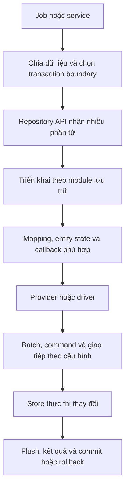

# Thao tác hàng loạt, giao dịch và hiệu năng cần kiểm chứng theo store

Một lời gọi `saveAll(items)` nhận nhiều entity, nhưng tên method chưa chứng minh rằng hệ thống gửi một câu lệnh, dùng JDBC batching, tạo một transaction cho toàn bộ nghiệp vụ hoặc đạt hiệu năng tốt hơn mọi cách khác.

Trong Spring Data Commons, hợp đồng repository mô tả thao tác với domain và kết quả. Module lưu trữ, provider, driver, cấu hình giao dịch và mô hình dữ liệu quyết định cách thao tác được thực thi.

Bài thuộc chương **Hợp đồng CRUD** của module `SPRING_DATA_COMMONS`. Mục tiêu là phân biệt các tầng xử lý hàng loạt, chọn ranh giới giao dịch theo yêu cầu nghiệp vụ và biết cần kiểm chứng điều gì trước khi kết luận về tính nguyên tử hoặc hiệu năng.

## 1. Các khái niệm cần phân biệt

| Khái niệm | Ví dụ | Điều nó diễn tả |
| --- | --- | --- |
| API nhận nhiều phần tử | `saveAll(entities)` | Một lời gọi repository tiếp nhận nhiều entity |
| Chia chunk ở ứng dụng | Mỗi lượt xử lý 200 dòng | Cách ứng dụng chia dữ liệu và tổ chức công việc |
| Batching ở provider/driver | Gửi nhiều statement qua một cơ chế batch | Cách giảm hoặc tổ chức giao tiếp với store |
| Bulk command theo store | Một lệnh update/delete theo điều kiện hoặc bulk write API | Cách công nghệ lưu trữ xử lý nhiều thay đổi |
| Transaction | Một đơn vị commit/rollback | Ranh giới nguyên tử theo tài nguyên và cấu hình được hỗ trợ |

Các khái niệm này có thể kết hợp nhưng không đồng nghĩa.

Ví dụ minh họa:

```text
Một job:                   5.000 dòng
Chunk ở ứng dụng:          200 dòng/lượt
JDBC batch size:           32 statement, nếu được hỗ trợ và kích hoạt
Ranh giới transaction:     cả job hoặc từng chunk, tùy thiết kế
```

Các con số trên chỉ giúp phân biệt khái niệm. Chúng không phải cấu hình tối ưu đã được đo.

Một chunk có thể chứa nhiều driver batch. Một transaction có thể bao trùm nhiều chunk. Một bulk command cũng không tự tạo transaction cho mọi dữ liệu liên quan.

## 2. Commons bảo đảm gì qua hợp đồng CRUD?

Một số chữ ký liên quan:

```java
<S extends T> Iterable<S> saveAll(Iterable<S> entities);

void deleteAll(Iterable<? extends T> entities);

void deleteAllById(Iterable<? extends ID> ids);

void deleteAll();
```

`saveAll` yêu cầu đầu vào không `null` và không chứa entity `null`. Kết quả thành công chứa các entity đã lưu, có số phần tử bằng đầu vào theo hợp đồng. Cần sử dụng các instance trả về khi thao tác lưu có thể thay đổi instance hoặc trạng thái.

Hợp đồng còn có các điều kiện về lỗi như optimistic locking khi tính năng đó áp dụng. Nó không xác định chung một kế hoạch SQL hoặc số lần trao đổi network cho mọi module. [CrudRepository API](https://docs.spring.io/spring-data/commons/docs/current/api/org/springframework/data/repository/CrudRepository.html)

Với `ListCrudRepository`, các method nhiều phần tử tương ứng trả `List`. Thay đổi kiểu container này không tự bật batching, không đặt transaction boundary và không biến lời gọi thành streaming.

### Những bảo đảm không nên tự suy ra

Từ một lời gọi `saveAll`, chưa được kết luận:

- Mọi entity được xử lý bằng một câu lệnh lưu trữ duy nhất.
- Mọi entity đều là insert hoặc đều là update.
- Số round trip bằng một.
- Các thao tác của toàn bộ job nằm trong một transaction.
- Kết quả trả về đồng nghĩa mọi giao dịch ngoài method đã commit.
- Callback, auditing và versioning có cùng hành vi với mọi API bulk khác.

Tương tự, `deleteAll(entities)` không có nghĩa chung là một câu `DELETE ... WHERE id IN (...)`. Module có thể cần đi qua các entity hoặc thực hiện công việc bổ sung để phục vụ ngữ nghĩa của nó.

## 3. Một lời gọi đi qua nhiều tầng



Đây là sơ đồ trách nhiệm, không phải thứ tự cố định của mọi callback. Một số đường bulk đi khác với đường xử lý từng entity.

Các tầng có thể đưa ra những quyết định khác nhau:

| Tầng | Ví dụ câu hỏi |
| --- | --- |
| Ứng dụng | Nếu dòng thứ 701 lỗi, các dòng trước có được giữ không? |
| Repository/module | Lặp qua entity, dùng insert theo tập hay dùng bulk query? |
| Mapping | Entity mới hay đã tồn tại? Có version hay callback không? |
| Provider/driver | Có batch được không? Có giới hạn số tham số hoặc kích thước message không? |
| Store | Atomicity áp dụng cho document, statement hay transaction nào? |

Muốn đánh giá hiệu năng, phải biết đường thực thi thực tế thay vì chỉ đếm số lời gọi Java.

## 4. Ví dụ JPA: một transaction cho toàn bộ lượt import

Phần thực hành dùng Java 17 trở lên và JPA với namespace `jakarta.persistence`. Giả định đã có module JPA tương thích, datasource, transaction manager và repository scanning.

Mỗi kiểu public trong ví dụ đặt ở file riêng.

### 4.1. Dữ liệu đầu vào và domain

```java
public record ImportRow(String sourceKey, String label) {

    public ImportRow {
        if (sourceKey == null || sourceKey.isBlank()) {
            throw new IllegalArgumentException(
                    "sourceKey không được rỗng");
        }
        if (label == null || label.isBlank()) {
            throw new IllegalArgumentException(
                    "label không được rỗng");
        }
    }
}
```

```java
import jakarta.persistence.Column;
import jakarta.persistence.Entity;
import jakarta.persistence.GeneratedValue;
import jakarta.persistence.Id;
import jakarta.persistence.Table;
import jakarta.persistence.Version;

@Entity
@Table(name = "catalog_items")
public class CatalogItem {

    @Id
    @GeneratedValue
    private Long id;

    @Version
    private Long version;

    @Column(nullable = false, unique = true)
    private String sourceKey;

    private String label;

    protected CatalogItem() {
    }

    public CatalogItem(String sourceKey, String label) {
        this.sourceKey = sourceKey;
        this.label = label;
    }

    public Long getId() {
        return id;
    }

    public Long getVersion() {
        return version;
    }

    public String getSourceKey() {
        return sourceKey;
    }

    public String getLabel() {
        return label;
    }
}
```

Repository:

```java
import org.springframework.data.repository.ListCrudRepository;

public interface CatalogItemRepository
        extends ListCrudRepository<CatalogItem, Long> {
}
```

Ví dụ tạo entity mới cho từng dòng. Nó không tự tìm entity cũ theo `sourceKey` để cập nhật. Ràng buộc unique ngăn hai bản ghi cùng key trong cấu hình schema tương ứng; nó không biến import thành upsert hoặc một cơ chế retry tự động.

### 4.2. Service đặt đơn vị công việc

```java
import java.util.List;

import org.springframework.stereotype.Service;
import org.springframework.transaction.annotation.Transactional;

@Service
public class AtomicCatalogImporter {

    private final CatalogItemRepository items;

    public AtomicCatalogImporter(CatalogItemRepository items) {
        this.items = items;
    }

    @Transactional
    public List<CatalogItem> importAll(List<ImportRow> rows) {
        if (rows == null || rows.stream().anyMatch(row -> row == null)) {
            throw new IllegalArgumentException(
                    "Danh sách dòng phải hợp lệ");
        }

        List<CatalogItem> entities = rows.stream()
                .map(row -> new CatalogItem(
                        row.sourceKey(), row.label()))
                .toList();

        return items.saveAll(entities);
    }
}
```

Với một transaction manager JPA phù hợp, lời gọi đi từ bean khác qua service proxy có thể tạo hoặc tham gia transaction bao trùm method này. Trong Spring Data JPA, các thao tác CRUD kế thừa có cấu hình giao dịch từ triển khai cơ sở; một transaction bên ngoài có thể xác định ranh giới thực tế. [Spring Data JPA — Transactionality](https://docs.spring.io/spring-data/jpa/reference/jpa/transactions.html)

Nếu lỗi dẫn đến rollback theo quy tắc đã cấu hình, các thay đổi trong cùng transaction không được commit riêng theo từng entity.

Tuy nhiên, `@Transactional` chưa giải quyết mọi trường hợp:

- Method có thể tham gia một transaction đã tồn tại ở tầng ngoài.
- Rollback rules phải phù hợp với loại exception của ứng dụng.
- Công việc gửi ra một hệ thống ngoài transaction không tự được rollback cùng database.
- Một đối tượng tự tạo bằng `new` không tự nhận transaction advice của service bean.

Tên lớp `AtomicCatalogImporter` diễn tả chủ đích trong cấu hình JPA này. Tính nguyên tử thực tế phải được xác nhận theo transaction manager, tài nguyên tham gia và cách method được gọi.

### 4.3. Lỗi có thể xuất hiện khi flush hoặc commit

Trong JPA, nhiều thay đổi có thể được giữ trong persistence context trước khi được gửi xuống database. Vì thế, lỗi unique constraint có thể xuất hiện ở lần flush hoặc khi transaction commit, thay vì ngay tại dòng `saveAll`.

Một log ở cuối thân method chưa chứng minh transaction ngoài method đã commit. Khi kiểm tra, caller phải chờ kết thúc ranh giới giao dịch tương ứng và đọc lại từ một ngữ cảnh độc lập.

Nếu method tham gia transaction ngoài, việc nó trả về bình thường còn sớm hơn thời điểm commit của transaction đó.

## 5. Chia chunk không tự chia transaction

Xét một service có transaction bao trùm cả vòng lặp:

```java
@Transactional
public void importManyChunks(...) {
    // Với mỗi chunk:
    // items.saveAll(chunk);
}
```

Nếu các lời gọi repository tham gia transaction hiện có, tất cả chunk vẫn thuộc cùng transaction vật lý. Việc chia danh sách chỉ thay đổi cách ứng dụng xử lý dữ liệu.

Ba thiết kế cần phân biệt:

| Thiết kế | Phạm vi commit | Khi một chunk sau lỗi |
| --- | --- | --- |
| Một transaction cho cả job | Toàn bộ job | Các thay đổi trong transaction cùng chịu rollback nếu quy tắc yêu cầu |
| Một transaction riêng mỗi chunk | Từng chunk | Chunk đã commit trước đó vẫn còn |
| Không có transaction nhiều thao tác phù hợp | Theo các đơn vị mà store hỗ trợ | Có thể có trạng thái thành công một phần |

Kích thước chunk là quyết định về tổ chức dữ liệu. Propagation và vị trí áp dụng transaction mới quyết định cách các lời gọi tham gia hay tạo giao dịch.

## 6. Ví dụ JPA: commit độc lập từng chunk

Nếu nghiệp vụ chấp nhận tiến độ được commit dần, có thể tách một bean ghi chunk riêng.

### 6.1. Bean chịu trách nhiệm một chunk

```java
import java.util.List;

import org.springframework.stereotype.Service;
import org.springframework.transaction.annotation.Propagation;
import org.springframework.transaction.annotation.Transactional;

@Service
public class CatalogChunkWriter {

    private final CatalogItemRepository items;

    public CatalogChunkWriter(CatalogItemRepository items) {
        this.items = items;
    }

    @Transactional(propagation = Propagation.REQUIRES_NEW)
    public int writeChunk(List<ImportRow> rows) {
        List<CatalogItem> entities = rows.stream()
                .map(row -> new CatalogItem(
                        row.sourceKey(), row.label()))
                .toList();

        return items.saveAll(entities).size();
    }
}
```

### 6.2. Bean điều phối gọi qua proxy

```java
import java.util.List;

import org.springframework.stereotype.Service;

@Service
public class CatalogImportJob {

    private final CatalogChunkWriter writer;

    public CatalogImportJob(CatalogChunkWriter writer) {
        this.writer = writer;
    }

    public long importInChunks(
            List<ImportRow> rows, int chunkSize) {

        if (rows == null) {
            throw new IllegalArgumentException(
                    "Danh sách dòng không được null");
        }
        if (chunkSize < 1) {
            throw new IllegalArgumentException(
                    "chunkSize phải lớn hơn 0");
        }

        long committed = 0;

        for (int start = 0; start < rows.size();) {
            int end = start
                    + Math.min(chunkSize, rows.size() - start);

            List<ImportRow> chunk =
                    List.copyOf(rows.subList(start, end));

            committed += writer.writeChunk(chunk);
            start = end;
        }

        return committed;
    }
}
```

Trong ví dụ, `CatalogChunkWriter` là bean khác được inject, nên lời gọi có thể đi qua transaction proxy. `REQUIRES_NEW` yêu cầu transaction độc lập khi hạ tầng hỗ trợ, và có thể tạm dừng transaction ngoài nếu có. Tài nguyên, connection pool và transaction manager cần đáp ứng cách thực thi đó. [Spring Framework — Transaction Propagation](https://docs.spring.io/spring-framework/reference/data-access/transaction/declarative/tx-propagation.html)

Khi `writer.writeChunk(...)` trả về qua proxy thành công, transaction mới của chunk đã kết thúc thành công. Nếu chunk sau lỗi, các chunk trước không được tự động hoàn tác bởi lỗi đó.

### Những điều ví dụ chưa tự cung cấp

- Bộ đếm `committed` chỉ nằm trong bộ nhớ, không phải checkpoint bền vững.
- Khi exception thoát ra, method không trả một báo cáo job thành công.
- Dữ liệu đã commit trước lỗi có thể vẫn còn khi job được chạy lại.
- Việc nhận toàn bộ `List<ImportRow>` chưa phải cách đọc nguồn đầu vào với bộ nhớ cố định.
- Nếu dữ liệu đầu vào có lỗi ở chunk sau, các chunk trước vẫn có thể đã commit.

Một hệ thống import cần khôi phục sau lỗi thường phải bổ sung job ID, trạng thái chunk, khóa idempotency hoặc chính sách upsert đúng nghiệp vụ.

Không chuyển method ghi chunk vào cùng lớp rồi gọi `this.writeChunk(...)` và mặc định propagation mới vẫn được áp dụng. Với mô hình proxy thông thường, self-invocation không tạo một lần đi qua proxy như ví dụ hai bean.

## 7. JPA: phân biệt `saveAll`, flush và JDBC batching

### 7.1. `flush` không phải `commit`

Trong transaction JPA, có thể gặp mẫu:

```java
// Bên trong transaction JPA đã được cấu hình:
items.saveAll(chunk);
entityManager.flush();
entityManager.clear();
```

Ý nghĩa:

| Thao tác | Vai trò |
| --- | --- |
| `saveAll` | Lưu theo ngữ nghĩa repository và entity state |
| `flush` | Đồng bộ thay đổi đang chờ của persistence context xuống database |
| `clear` | Tách các entity đang được quản lý khỏi persistence context |
| `commit` | Hoàn tất transaction và xác nhận thay đổi theo cơ chế giao dịch |

Flush có thể làm lỗi database xuất hiện sớm hơn, nhưng transaction vẫn có thể rollback sau đó. Clear cũng không commit dữ liệu.

Flush trước clear khi còn thay đổi cần ghi. Đồng thời phải hiểu clear tác động đến toàn bộ persistence context đó, không chỉ một danh sách cục bộ.

Nếu caller vẫn giữ mọi entity trong các collection lớn, clear chưa giải phóng toàn bộ bộ nhớ của ứng dụng. Nó chỉ xử lý một phần liên quan đến trạng thái do persistence context quản lý.

### 7.2. `saveAllAndFlush` chưa tạo một bulk insert

`JpaRepository` có các API riêng như `flush` và `saveAllAndFlush`. Chúng cung cấp khả năng đồng bộ thay đổi, không phải cam kết biến mọi entity thành một câu insert nhiều dòng.

Có thể dùng flush để kiểm soát thời điểm đồng bộ hoặc phát hiện lỗi, nhưng flush sau từng entity cũng có thể làm mất cơ hội gom công việc. Cần đo theo cấu hình thực tế.

### 7.3. Batching của Hibernate cần điều kiện riêng

Nếu ứng dụng dùng Hibernate, có thể thử cấu hình minh họa:

```properties
spring.jpa.properties.hibernate.jdbc.batch_size=32
spring.jpa.properties.hibernate.order_inserts=true
spring.jpa.properties.hibernate.order_updates=true
```

Đây là cấu hình theo provider trong một ứng dụng Boot, không phải thuộc tính chung của Commons. Giá trị 32 là điểm thử nghiệm, không phải mức tối ưu cho mọi workload.

Khả năng batching còn phụ thuộc loại statement, mapping, chiến lược ID, phiên bản provider và driver. Tài liệu Hibernate 6.6 nêu rằng cơ chế sinh ID `IDENTITY` làm các entity đó không dùng được batching insert theo cách thông thường của Hibernate. Chỉ thêm `batch_size` chưa giải quyết điều kiện này. [Hibernate ORM 6.6 User Guide](https://docs.hibernate.org/orm/6.6/userguide/html_single/)

Không đổi chiến lược ID chỉ để bật một property mà bỏ qua schema, tính tương thích và hành vi nghiệp vụ.

### 7.4. SQL log chưa bằng số network round trip

Một driver batch có thể chứa nhiều statement, trong khi công cụ log vẫn hiển thị từng statement. Ngược lại, một lời gọi repository có thể phát sinh thêm truy vấn để xác định trạng thái hoặc tải dữ liệu.

Cần quan sát các thông tin phù hợp như số lần thực thi batch, hoạt động driver, thời gian database và số lần trao đổi thực tế. Đếm dòng SQL log một mình chưa đủ để kết luận batching hiệu quả.

## 8. Bulk delete/update có thể thay đổi ngữ nghĩa entity

### 8.1. API Commons và API JPA riêng

Các tên method gần nhau chưa có cùng hợp đồng thực thi:

| Method ví dụ | Nguồn hợp đồng |
| --- | --- |
| `deleteAll(entities)` | CRUD dùng chung |
| `deleteAllById(ids)` | CRUD dùng chung |
| `deleteAllInBatch(entities)` | API riêng của JPA |
| `deleteAllByIdInBatch(ids)` | API riêng của JPA |
| Một query update/delete tự khai báo | Query và cấu hình riêng theo module |

Javadoc của `deleteAllInBatch(Iterable)` nêu rằng thao tác dùng một query, có thể làm persistence context và database lệch nhau, không áp dụng cascade JPA và không phát lifecycle event JPA như đường entity tương ứng. [JpaRepository API](https://docs.spring.io/spring-data/jpa/docs/current/api/org/springframework/data/jpa/repository/JpaRepository.html)

Vì vậy, đổi method xóa theo entity sang bulk delete cần đánh giá lại:

- Quan hệ phụ thuộc vào cascade hoặc orphan handling.
- Callback và listener của entity.
- Các trường hoặc hành vi auditing gắn với đường thực thi.
- Kiểm tra version và xung đột đồng thời.
- Entity còn đang được giữ trong persistence context.

### 8.2. Đừng dùng nhãn “nhanh hơn” để bỏ qua khác biệt kết quả

Một phương án bulk có ít query hơn nhưng bỏ qua hành vi ứng dụng đang cần chưa phải phương án tương đương về nghiệp vụ.

Ví dụ, ứng dụng dựa vào callback khi xóa một entity. Một query xóa theo điều kiện không tự có nghĩa callback đó chạy cho từng hàng bị xóa.

Nếu cần xử lý nhiều hàng bằng bulk query và vẫn phát sinh sự kiện nghiệp vụ, phải thiết kế đường tạo sự kiện tương ứng thay vì mặc định nó được suy ra từ tên method.

### 8.3. Auditing và optimistic locking cần kiểm tra theo đường ghi

Có annotation auditing hoặc version trên domain chưa chứng minh mọi API bulk đều cập nhật trường và kiểm tra version như `save`.

Khi thay đường thực thi, hãy xác nhận trực tiếp điều kiện version trong thao tác, kết quả khi version cũ và hành vi của callback/listener. Đây là một phần của kiểm chứng đúng đắn, không chỉ của benchmark.

## 9. MongoDB: bulk write chưa đồng nghĩa transaction nhiều document

MongoDB có atomicity ở mức một document cho thao tác ghi tương ứng. Một công việc sửa nhiều document cần được xem xét riêng nếu yêu cầu tất cả cùng thành công hoặc cùng thất bại. [MongoDB — Atomicity and Transactions](https://www.mongodb.com/docs/manual/core/write-operations-atomicity/)

### 9.1. Điều kiện giao dịch phải được thiết lập

Trong Spring Data MongoDB, transaction nhiều thao tác cần hạ tầng như `MongoTransactionManager`, session và môi trường MongoDB có khả năng hỗ trợ transaction theo yêu cầu.

Tài liệu Spring Data MongoDB nêu transaction support không được bật chỉ vì đã có repository; cần transaction manager phù hợp trong application context. [Spring Data MongoDB — Sessions & Transactions](https://docs.spring.io/spring-data/mongodb/reference/mongodb/client-session-transactions.html)

Một annotation `@Transactional` dùng sai manager hoặc một môi trường không đáp ứng điều kiện không tạo ra bảo đảm mong muốn.

### 9.2. Bulk API có ngữ nghĩa riêng

`MongoOperations.bulkOps(...)` cung cấp `BulkOperations` để gom các thao tác insert/update/remove và thực thi bằng `execute()`.

API này có giới hạn riêng. Javadoc nêu các thao tác cần kết quả từng operation như optimistic locking bằng `@Version` không được hỗ trợ theo đường bulk đó. Không mặc định dùng bulkOps là cách thay thế tương đương cho mọi repository save có version. [BulkOperations API](https://docs.spring.io/spring-data/mongodb/docs/current/api/org/springframework/data/mongodb/core/BulkOperations.html)

### 9.3. Ordered và unordered không phải hai isolation level

Trong bulk write, ordered và unordered liên quan đến cách thực thi và xử lý lỗi của các operation. Ordered thường dừng khi gặp lỗi; unordered cho phép tiếp tục các operation khác theo ngữ nghĩa được hỗ trợ.

Khi thực thi trong transaction, phải xét thêm quy tắc của transaction và lỗi tương ứng. Dù chọn ordered, nó cũng không tự tạo bảo đảm rollback mọi operation đã ghi ngoài một transaction nhiều document. [MongoDB — Bulk Write Operations](https://www.mongodb.com/docs/manual/core/bulk-write-operations/)

Không đồng nhất “thực hiện theo thứ tự” với “nguyên tử cho toàn bộ danh sách”.

## 10. Luồng reactive cần ranh giới giao dịch của pipeline

Với repository reactive, `saveAll` trả publisher. Công việc thực thi gắn với subscription và vòng đời pipeline, không chỉ với thời điểm method Java tạo publisher rồi trả về.

Trong một store reactive và transaction manager đã cấu hình phù hợp, có thể dùng `TransactionalOperator` để bọc một publisher:

```java
// Mảnh pipeline minh họa trong một luồng reactive phù hợp:
Flux<T> persisted = reactiveRepository.saveAll(entities);
return persisted.as(transactionalOperator::transactional);
```

`TransactionalOperator` là abstraction quản lý transaction cho reactive code. Hạ tầng và tài nguyên phải hỗ trợ giao dịch tương ứng. [Spring Framework — Programmatic Transaction Management](https://docs.spring.io/spring-framework/reference/data-access/transaction/programmatic.html)

Không tự gọi `subscribe()` bên trong service rồi trả kết quả “đã xong” ở một luồng khác. Cần để caller quan sát completion/error của pipeline và ranh giới transaction.

Các operator về song song, số subscription, cancel và retry có thể ảnh hưởng cách công việc được thực thi. Không áp nguyên mẫu transaction theo thread của JPA đồng bộ cho reactive chỉ bằng cách đổi kiểu trả về.

## 11. Thành công một phần, retry và idempotency

Một phương án commit theo chunk hoặc một bulk write ngoài transaction có thể để lại dữ liệu thành công một phần.

Trước khi thêm retry, cần trả lời:

| Câu hỏi | Lý do |
| --- | --- |
| Operation trước lỗi đã commit chưa? | Tránh thực hiện lặp một thay đổi đã có hiệu lực |
| Có thể xác định chunk hoặc dòng đã hoàn thành không? | Cần tiếp tục công việc từ trạng thái có căn cứ |
| Retry dùng khóa nào? | Cần phân biệt yêu cầu lặp với dữ liệu mới |
| Việc ghi là insert, update, upsert hay tăng một giá trị? | Các thao tác có tính lặp an toàn khác nhau |
| Kết quả database và checkpoint có thể lệch nhau không? | Có thể commit rồi mất kết nối trước khi ghi tiến độ |
| Callback hoặc sự kiện có thể được phát nhiều lần không? | Cần chính sách xử lý trùng ở các tầng liên quan |

Ví dụ trong bài, tạo một `CatalogItem` mới với cùng `sourceKey` khi chạy lại có thể gặp unique constraint. Ràng buộc giúp phát hiện trùng, nhưng chưa làm toàn bộ job trở thành idempotent.

Một thao tác tăng bộ đếm cũng không tự an toàn khi chạy lại sau lỗi không biết rõ trạng thái. “Retry khi exception” cần được thiết kế cùng ngữ nghĩa của operation.

Không bắt mọi lỗi rồi trả số dòng đầu vào như số dòng thành công. Báo cáo phải phân biệt requested, attempted, committed và failed theo mô hình thực thi được chọn.

## 12. Cần kiểm chứng điều gì theo từng store?

| Khía cạnh | JPA | MongoDB | Luồng reactive hoặc module khác |
| --- | --- | --- | --- |
| Atomicity | Transaction manager, tài nguyên tham gia và propagation | Session, transaction manager và khả năng deployment | Manager và giao thức của store, vòng đời pipeline |
| Đường ghi | Persist/merge, mapping, flush | Save/insert/update hoặc bulk API | Cách module và driver thực thi publisher |
| Gom thao tác | Provider, driver, ID strategy | Bulk mode, kích thước command và driver | Khả năng batch, concurrency và backpressure tương ứng |
| Trạng thái trong bộ nhớ | Persistence context và các tham chiếu ứng dụng giữ | Kích thước danh sách, mapping và dữ liệu trả về | Buffer, mức concurrency và số subscription |
| Callback/auditing/version | Theo đường entity hoặc bulk query | Theo API repository/template/bulk đang dùng | Theo khả năng module và đường operation |
| Lỗi giữa chừng | Flush/commit, rollback và các transaction riêng | Operation error, bulk error và transaction error | Error/cancel/retry cùng transaction boundary |

Bảng là danh sách câu hỏi, không phải ma trận tuyên bố mọi store có cùng một mức hỗ trợ. Khi thay store, cần xác nhận lại hành vi thay vì giữ nguyên các giả định đã đo ở store cũ.

Đặc biệt, một kết quả tốt trên database nhúng chưa chứng minh cùng hiệu năng hoặc cơ chế transaction ở môi trường triển khai khác.

## 13. Thiết kế kiểm chứng đúng đắn trước khi đo tốc độ

### 13.1. Chèn lỗi có kiểm soát

Trong một dự án thực hành và dữ liệu có thể tạo lại, chọn các tình huống:

- Lỗi đầu vào trước operation đầu tiên.
- Unique constraint ở giữa danh sách.
- Version cũ khi cập nhật entity có optimistic locking.
- Lỗi xuất hiện khi flush hoặc commit.
- Một chunk sau thất bại khi chunk trước đã commit.
- Bulk operation lỗi trong ordered và unordered theo store.
- Retry sau một lần thành công một phần.

Sau mỗi trường hợp, đọc lại trạng thái từ một context hoặc kết nối độc lập phù hợp. Không chỉ kiểm tra danh sách entity đang được giữ trong bộ nhớ.

### 13.2. Xác nhận ranh giới bằng kết quả thực tế

Nếu thiết kế yêu cầu atomic cho cả job, kiểm tra trạng thái sau rollback theo transaction boundary đã chọn.

Nếu thiết kế yêu cầu commit từng chunk, xác nhận chunk đã thành công còn dữ liệu và chunk lỗi có trạng thái đúng chính sách. Không assertion rằng cả job phải rỗng trong mô hình này.

Một test tự đặt transaction bao ngoài có thể làm hành vi khác với job thật. Cần hiểu test đang tham gia transaction nào và thời điểm nào commit thực sự xảy ra.

### 13.3. Giữ các điều kiện so sánh tương đương

Khi so sánh `saveAll` với một vòng lặp `save`, phải giữ tương đương transaction boundary. Một phương án tạo giao dịch cho từng lời gọi còn phương án kia dùng một giao dịch chung sẽ đo nhiều khác biệt cùng lúc.

Tương tự, không so sánh đường entity có callback/version với bulk path đã bỏ các hành vi đó rồi kết luận hai phương án tương đương chỉ từ thời gian.

## 14. Đo hiệu năng với tiêu chí có thể giải thích

| Nhóm thông tin | Điều nên ghi nhận |
| --- | --- |
| Môi trường | Phiên bản module, provider, driver, store và cấu hình liên quan |
| Dữ liệu | Số entity, kích thước entity, tỷ lệ insert/update và quan hệ |
| Giao dịch | Phạm vi commit, isolation, propagation và thời gian giữ tài nguyên |
| Chi phí truy cập | Số statement/command, batch execution và round trip phù hợp |
| Độ trễ | Toàn bộ thời gian caller chờ đến kết thúc ranh giới mong muốn |
| Tài nguyên | Heap, GC, connection pool, lock và CPU theo workload |
| Đúng đắn | Dữ liệu sau commit, số thất bại, callback/version và khả năng retry |

Đo riêng các tham số thay đổi như chunk size, driver batch size và concurrency. Một chunk lớn hơn có thể giảm overhead nhưng tăng bộ nhớ, thời gian giữ lock hoặc chi phí rollback.

Với JPA đồng bộ, đo quanh lời gọi qua proxy và ranh giới transaction phù hợp, thay vì chỉ đặt đồng hồ trong thân method trước commit. Với reactive, chờ pipeline hoàn thành và xét vị trí transaction operator.

Chạy warm-up và lặp đo khi cần để tránh kết luận từ một lần thực thi. Dùng workload đủ giống mục tiêu, giữ điều kiện môi trường có thể mô tả và kiểm tra dữ liệu sau mỗi phương án.

Không công bố một tỷ lệ “nhanh hơn bao nhiêu lần” nếu chưa có dữ liệu đo và điều kiện đi kèm. Bài này không cung cấp số đo benchmark từ một dự án cụ thể.

## 15. Bài tập củng cố

### Tình huống A: có `saveAll` nên chắc chắn có JDBC batch

Một ứng dụng gọi `saveAll` cho 1.000 entity nhưng chưa kiểm tra provider, driver và chiến lược ID.

**Giải thích:** đó là một lời gọi nhận nhiều entity. Muốn kết luận JDBC batching, cần kiểm tra cấu hình, điều kiện và hoạt động thực tế của hạ tầng JPA đang dùng.

### Tình huống B: mỗi chunk 100 dòng nên mỗi 100 dòng commit

Một service có `@Transactional` bao quanh vòng lặp gọi repository theo chunk.

**Giải thích:** các chunk có thể cùng tham gia transaction ngoài. Chia dữ liệu không tự tạo transaction mới.

### Tình huống C: thay xóa từng entity bằng bulk delete

Nhóm phát triển thấy query ít hơn nên coi phương án mới tương đương.

**Điều cần xác nhận:** cascade, callback, auditing, version và trạng thái persistence context có còn đáp ứng nghiệp vụ không.

### Tình huống D: bulk MongoDB ordered là nguyên tử toàn bộ

Một bulk write dừng sau operation lỗi, nhưng các operation trước đó đã ghi thành công ngoài transaction nhiều document.

**Giải thích:** ordered điều khiển cách thực thi và dừng khi lỗi. Nó không tự tạo rollback cho toàn bộ danh sách.

### Tình huống E: chunk đã commit nhưng job bị chạy lại

Ứng dụng chỉ lưu bộ đếm tiến độ trong một biến cục bộ và retry toàn bộ import sau lỗi.

**Điều cần thiết kế:** trạng thái bền vững, khóa nhận diện yêu cầu, idempotency và cách đối chiếu dữ liệu đã commit. Bộ đếm trong bộ nhớ chưa đủ để khôi phục chính xác.

Khi dùng thao tác hàng loạt, hãy xác định trước ranh giới nghiệp vụ, ngữ nghĩa lỗi và những hành vi entity cần giữ. Sau đó mới chọn API, transaction và kỹ thuật batching/bulk, rồi kiểm chứng đúng đắn cùng hiệu năng trên store thực tế.
