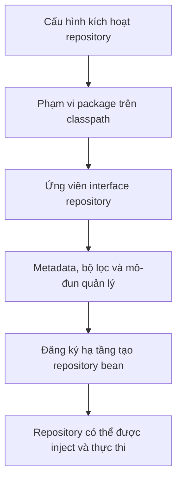

# Quét package và nhận diện giao diện repository

Khai báo một interface kế thừa `Repository` hoặc `CrudRepository` mới chỉ mô tả contract. Để ứng dụng có một bean repository có thể inject và sử dụng, hạ tầng Spring Data còn phải **tìm thấy interface, nhận diện đúng mô-đun quản lý và đăng ký các thành phần tạo implementation**.

Một lỗi phổ biến là repository đã viết đúng nhưng nằm ngoài phạm vi quét. Một lỗi khác là mở rộng component scan rồi cho rằng entity và repository chắc chắn cũng được quét theo cùng phạm vi.

Bài học thuộc chương **Kích hoạt repository** của mô-đun **SPRING_DATA_COMMONS**. Chúng ta tìm hiểu package nào được quét, interface nào được nhận diện và cách xác định một lỗi thuộc khâu quét hay thuộc những bước tích hợp khác.

## 1. Quét repository phục vụ việc gì?

Quét repository là quá trình tìm các khai báo repository trong những package được cấu hình trên classpath.

Hạ tầng cần xác định:

1. Những interface nào nằm trong phạm vi tìm kiếm.
2. Interface nào đáp ứng quy tắc nhận diện repository.
3. Interface nào chỉ là contract cơ sở cần bỏ qua.
4. Mô-đun lưu trữ nào chịu trách nhiệm xử lý.
5. Những bean definition và thành phần factory nào cần được đăng ký.

Có thể hình dung theo trách nhiệm:



Sơ đồ không có nghĩa mọi bước luôn hoàn thành ngay tại cùng một thời điểm. Cách khởi tạo bean và bootstrap có thể làm thời điểm phát hiện lỗi khác nhau.

Quét không phải việc tự viết source code implementation vào thư mục dự án. Hạ tầng thường cung cấp proxy và các thành phần thực thi ở runtime.

## 2. Commons cung cấp nền tảng, mô-đun cụ thể kích hoạt tích hợp

Spring Data Commons có marker `Repository`, metadata và nhiều thành phần hạ tầng dùng chung. Tuy nhiên, việc tạo repository truy cập một kho dữ liệu vẫn cần mô-đun tương ứng.

| Môi trường | Cơ chế kích hoạt tiêu biểu |
| --- | --- |
| Spring Data JPA | `@EnableJpaRepositories` hoặc auto-configuration phù hợp |
| Spring Data MongoDB | `@EnableMongoRepositories` hoặc auto-configuration phù hợp |
| Mô-đun Spring Data khác | Cơ chế cấu hình được mô-đun đó hỗ trợ |

Không có lý do để suy ra một annotation chung bất kỳ sẽ tự chọn được mọi loại kho dữ liệu chỉ từ tên interface.

Ví dụ JPA cần entity mapping, JPA provider và hạ tầng kết nối. Quét đúng package không thay thế những điều kiện này.

Bài học dùng ví dụ **Spring Boot 3.x, Spring Data JPA và Jakarta Persistence** để có cấu hình cụ thể. Các import của Spring Boot trong ví dụ thuộc dòng 3.x; khi áp dụng cho dự án, cần dùng bộ phiên bản tương thích của chính dự án.

## 3. Ba phạm vi quét cần phân biệt

| Cơ chế | Đối tượng chính được tìm | Ví dụ |
| --- | --- | --- |
| Component scan | Các component Spring thông thường | Service, controller, configuration, class được đánh dấu phù hợp |
| Repository scan | Interface repository để hạ tầng tạo bean | `ProductRepository extends CrudRepository<...>` |
| Entity scan trong môi trường JPA | Kiểu được đưa vào mô hình persistence | `Product` có `@Entity` |

Ba phạm vi có thể được thiết lập thuận tiện từ cùng một package gốc, nhưng không phải một cơ chế duy nhất.

Các suy luận sau đều thiếu căn cứ:

- “Service đã được inject thì repository trong package khác chắc chắn đã được quét.”
- “Repository được tìm thấy thì entity tương ứng chắc chắn thuộc persistence unit.”
- “Thêm `@ComponentScan` rộng hơn là đủ để sửa mọi lỗi repository.”
- “`@EnableJpaRepositories` cũng quét mọi service và cấu hình kết nối.”

Khi gặp lỗi, hãy xác định đúng loại đối tượng chưa được nhận diện trước khi thay đổi cấu hình.

## 4. Một interface được nhận diện như thế nào?

### 4.1. Kế thừa marker repository

Ví dụ:

```java
import org.springframework.data.repository.Repository;

public interface ProductRepository
        extends Repository<Product, Long> {
}
```

Hoặc kế thừa qua interface có sẵn:

```java
import org.springframework.data.repository.CrudRepository;

public interface ProductRepository
        extends CrudRepository<Product, Long> {
}
```

Việc nhận diện có thể đi qua hệ phân cấp interface, không chỉ nhìn đúng một dòng `extends Repository` trực tiếp.

Tên kết thúc bằng `Repository` không phải điều kiện đủ. Một interface thông thường như sau không tự tham gia mô hình repository chỉ nhờ tên:

```java
public interface ProductRepository {
}
```

### 4.2. Khai báo bằng @RepositoryDefinition

Một cách mô tả khác là:

```java
import java.util.Optional;

import org.springframework.data.repository.RepositoryDefinition;

@RepositoryDefinition(
    domainClass = Product.class,
    idClass = Long.class
)
public interface ProductLookup {

    Optional<Product> findById(Long id);
}
```

Interface vẫn cần nằm trong phạm vi được cơ chế repository phù hợp phát hiện.

`@RepositoryDefinition` không phải `org.springframework.stereotype.Repository`. Annotation stereotype `@Repository` trên một interface bất kỳ không tự làm component scanning thông thường sinh implementation cho abstract method.

### 4.3. Nhận diện chưa đồng nghĩa thực thi được

Một interface có thể đáp ứng quy tắc nhận diện nhưng vẫn lỗi vì:

- Không phân giải được kiểu miền hoặc kiểu ID.
- Mô-đun không xác định được interface thuộc kho dữ liệu nào.
- Entity chưa được mapping.
- Phương thức truy vấn không hợp lệ.
- Fragment cần thiết chưa được nối.
- Hạ tầng kết nối hoặc giao dịch chưa đầy đủ.

Quét package trả lời câu hỏi “có tìm trong đúng vùng và có ứng viên không?”. Các bước sau còn phải làm contract có thể thực thi.

## 5. Cấu trúc package thuận tiện với Spring Boot

Một bố cục đơn giản là đặt lớp ứng dụng ở package cha:

```text
example.catalog
  CatalogApplication

example.catalog.domain
  Product

example.catalog.repository
  ProductRepository

example.catalog.service
  CatalogService
```

Lớp ứng dụng:

```java
package example.catalog;

import org.springframework.boot.SpringApplication;
import org.springframework.boot.autoconfigure.SpringBootApplication;

@SpringBootApplication
public class CatalogApplication {

    public static void main(String[] args) {
        SpringApplication.run(CatalogApplication.class, args);
    }
}
```

Với starter JPA và các điều kiện auto-configuration phù hợp, package của lớp ứng dụng là điểm gốc thuận tiện để hạ tầng mặc định phát hiện repository và entity ở các package con.

Trong bố cục này, thường không cần thêm `@EnableJpaRepositories` hoặc `@EntityScan` chỉ để lặp lại phạm vi đã phù hợp.

Tuy vậy, việc có một dòng `@SpringBootApplication` không chứng minh mọi auto-configuration đều được áp dụng. Dependency, cấu hình loại trừ, thuộc tính và những bean do ứng dụng khai báo có thể ảnh hưởng điều kiện kích hoạt.

Không đặt lớp ứng dụng vào default package. Hãy dùng package có tên rõ ràng để phạm vi phát hiện có chủ đích và dễ kiểm soát.

## 6. Ví dụ entity và repository để quan sát việc nhận diện

Entity tối thiểu:

```java
package example.catalog.domain;

import jakarta.persistence.Entity;
import jakarta.persistence.GeneratedValue;
import jakarta.persistence.Id;
import jakarta.persistence.Table;

@Entity
@Table(name = "products")
public class Product {

    @Id
    @GeneratedValue
    private Long id;

    private String name;

    protected Product() {
    }

    public Product(String name) {
        this.name = name;
    }

    public Long getId() {
        return id;
    }

    public String getName() {
        return name;
    }
}
```

Repository:

```java
package example.catalog.repository;

import java.util.List;

import example.catalog.domain.Product;

import org.springframework.data.repository.CrudRepository;

public interface ProductRepository
        extends CrudRepository<Product, Long> {

    List<Product> findByName(String name);
}
```

Không cần gắn `@Repository` lên interface trên để hạ tầng repository tạo bean trong cấu hình phù hợp.

Phương thức `findByName` sẽ được phân tích theo thuộc tính `name` của `Product`. Nếu viết sai tên thuộc tính, lỗi đó thuộc phần tạo/xác thực query, dù interface đã được tìm thấy thành công.

Điều này giúp tách hai nhóm lỗi: không nhận diện được repository và đã nhận diện nhưng không thể khởi tạo đúng hành vi.

## 7. Khi cần chỉ định package bằng @EnableJpaRepositories

Nếu muốn kích hoạt JPA repository một cách tường minh, có thể dùng:

```java
package example.catalog.config;

import org.springframework.context.annotation.Configuration;
import org.springframework.data.jpa.repository.config.EnableJpaRepositories;

@Configuration
@EnableJpaRepositories(
    basePackages = "example.catalog.repository"
)
public class CatalogRepositoryConfiguration {
}
```

`basePackages` nhận tên package Java, không phải đường dẫn source:

```text
Đúng: example.catalog.repository

Không phải:
src/main/java/example/catalog/repository
```

Phạm vi tìm kiếm thông thường bao gồm package được chỉ định và các package con.

### 7.1. Mặc định không có tham số dựa vào vị trí cấu hình

Khi dùng `@EnableJpaRepositories` mà không chỉ định base package, điểm gốc mặc định là package của lớp cấu hình mang annotation.

Vì vậy, nếu lớp cấu hình nằm ở:

```text
example.catalog.config
```

còn repository ở:

```text
example.catalog.repository
```

thì hai package là anh em. Quét từ `example.catalog.config` không tự bao gồm package `example.catalog.repository`.

Đây là lý do một annotation kích hoạt đã có mặt nhưng không tìm được repository nào.

### 7.2. Cấu hình cũng phải được nạp

Một class có `@Configuration` không tự có hiệu lực nếu nó không được application context nạp qua component scan, import hoặc cơ chế đăng ký phù hợp.

Nếu lớp ứng dụng nằm ngoài vùng của cấu hình, cần đưa cấu hình vào context một cách tường minh. Không chỉ kiểm tra nội dung annotation; hãy kiểm tra cả việc lớp cấu hình có được sử dụng hay không.

### 7.3. Không thêm nhiều cấu hình trùng nhau để thử

Hai cấu hình quét chồng phạm vi có thể cùng cố đăng ký một repository. Khi đó, bạn có thể gặp lỗi đăng ký trùng hoặc hành vi cấu hình khó theo dõi.

Nên chọn một cơ chế rõ ràng cho từng vùng repository: dựa vào mặc định phù hợp hoặc cấu hình tường minh theo nhu cầu thực tế.

## 8. basePackageClasses: dùng kiểu làm mốc package

Thay vì chuỗi tên package, có thể tham chiếu một kiểu nằm trong package cần quét:

```java
package example.catalog.config;

import example.catalog.repository.ProductRepository;

import org.springframework.context.annotation.Configuration;
import org.springframework.data.jpa.repository.config.EnableJpaRepositories;

@Configuration
@EnableJpaRepositories(
    basePackageClasses = ProductRepository.class
)
public class CatalogRepositoryConfiguration {
}
```

Điểm cần hiểu: `basePackageClasses` chọn **package của kiểu được tham chiếu**, không chỉ đăng ký duy nhất kiểu đó. Những repository khác trong vùng package phù hợp cũng có thể được phát hiện.

Ưu điểm là việc đổi package bằng công cụ refactor dễ được theo dõi hơn so với một chuỗi viết tay.

Bạn cũng có thể tạo một kiểu marker không có hành vi trong package để làm mốc:

```java
package example.catalog.repository;

public interface CatalogRepositoryPackage {
}
```

Marker package này không cần kế thừa `Repository`. Nó chỉ phục vụ việc tham chiếu package trong cấu hình, không phải một repository dữ liệu cần được tạo bean.

Hai loại “marker” có mục đích khác nhau:

| Kiểu | Điều được đánh dấu |
| --- | --- |
| `Repository<Product, Long>` | Contract repository và thông tin kiểu miền |
| `CatalogRepositoryPackage` trong ví dụ | Vị trí package để cấu hình tham chiếu |

## 9. Ví dụ repository và entity nằm ngoài package lớp ứng dụng

Giả sử cấu trúc là:

```text
example.launcher
  LauncherApplication

example.catalog.config
  CatalogPersistenceConfiguration

example.catalog.domain
  Product

example.catalog.repository
  ProductRepository
```

Package `example.catalog` không phải package con của `example.launcher`. Cấu hình tường minh giúp làm rõ cả entity lẫn repository.

```java
package example.catalog.config;

import example.catalog.domain.Product;
import example.catalog.repository.ProductRepository;

import org.springframework.boot.autoconfigure.domain.EntityScan;
import org.springframework.context.annotation.Configuration;
import org.springframework.data.jpa.repository.config.EnableJpaRepositories;

@Configuration
@EntityScan(basePackageClasses = Product.class)
@EnableJpaRepositories(
    basePackageClasses = ProductRepository.class
)
public class CatalogPersistenceConfiguration {
}
```

Lớp ứng dụng import cấu hình:

```java
package example.launcher;

import example.catalog.config.CatalogPersistenceConfiguration;

import org.springframework.boot.SpringApplication;
import org.springframework.boot.autoconfigure.SpringBootApplication;
import org.springframework.context.annotation.Import;

@SpringBootApplication
@Import(CatalogPersistenceConfiguration.class)
public class LauncherApplication {

    public static void main(String[] args) {
        SpringApplication.run(LauncherApplication.class, args);
    }
}
```

Các ví dụ bố cục mặc định và bố cục ngoài package là những phương án thay thế để học phạm vi quét, không yêu cầu chạy đồng thời hai lớp ứng dụng.

Trong phương án này:

- `@Import` bảo đảm cấu hình persistence được đưa vào context.
- `@EnableJpaRepositories` chỉ rõ vùng repository.
- `@EntityScan` chỉ rõ vùng entity trong môi trường Spring Boot đang minh họa.
- Cấu hình datasource và hạ tầng JPA vẫn phải có.

### Vì sao chỉ scanBasePackages chưa đủ?

Ví dụ:

```java
@SpringBootApplication(scanBasePackages = "example")
```

Thuộc tính này tùy chỉnh component scan. Nó không có nghĩa đã đồng thời thay đổi mọi phạm vi entity và repository theo cùng chuỗi.

Khi các kiểu persistence nằm ngoài package gốc mà auto-configuration sử dụng, cần xử lý các phạm vi tương ứng một cách rõ ràng. Trong ví dụ trên, import cấu hình cùng entity/repository scan là cách thể hiện ý định cụ thể.

## 10. Interface cơ sở cần được loại khỏi việc tạo bean

Ví dụ một contract trung gian:

```java
package example.catalog.repository;

import org.springframework.data.repository.CrudRepository;
import org.springframework.data.repository.NoRepositoryBean;

@NoRepositoryBean
public interface BaseRepository<T, ID>
        extends CrudRepository<T, ID> {
}
```

Repository cụ thể:

```java
package example.catalog.repository;

import example.catalog.domain.Product;

public interface ProductRepository
        extends BaseRepository<Product, Long> {
}
```

`BaseRepository` chưa cố định kiểu miền. Nó phục vụ kế thừa contract, không phải một repository cụ thể cần tạo bean.

`@NoRepositoryBean` yêu cầu hạ tầng bỏ qua việc tạo repository bean trực tiếp cho interface đó. Nó không tắt toàn bộ các repository con đã cố định kiểu miền.

Không đặt annotation này lên `ProductRepository` nếu muốn chính interface cụ thể đó được tạo bean.

Ngược lại, nếu repository cụ thể không được tìm thấy, đừng thêm hoặc bỏ annotation ở interface cơ sở mà không xem log và metadata. Có thể vấn đề thật sự là phạm vi package hoặc việc cấu hình chưa được nạp.

## 11. Classpath, bộ lọc và interface lồng nhau

### 11.1. Quét diễn ra trên classpath, không chỉ trong source hiện tại

Một interface có thể nằm trong JAR dependency. Để được tìm thấy:

- JAR phải có mặt trên classpath phù hợp.
- Package của interface phải nằm trong vùng repository scan.
- Interface phải đáp ứng quy tắc nhận diện và mô-đun quản lý.

Chỉ thêm một thư viện chứa repository không bảo đảm ứng dụng tự quét toàn bộ package của thư viện đó.

Nếu thư viện cung cấp một configuration class để import, ứng dụng cần tuân theo contract tích hợp của thư viện. Nếu ứng dụng tự quản lý phạm vi, có thể dùng kiểu trong dependency làm mốc package.

### 11.2. Include và exclude filter

Một số annotation kích hoạt repository hỗ trợ bộ lọc để giới hạn các ứng viên. Trong JPA, có thể dùng các tùy chọn tương ứng của `@EnableJpaRepositories`.

Khi cấu hình bộ lọc, cần nhớ:

- Một interface ở đúng package vẫn có thể bị loại.
- Bộ lọc không tự cung cấp mapping hoặc implementation.
- Không nên dùng bộ lọc để che giấu việc hai mô-đun đang tranh cùng một vùng repository.
- Không coi một filter là cách biến mọi class hoặc interface tùy ý thành repository hợp lệ.

Với dự án nhỏ, phạm vi package rõ ràng thường dễ hiểu hơn một tập filter phức tạp.

### 11.3. Interface repository lồng nhau

Một interface khai báo bên trong class khác có thể không được xem xét như repository độc lập theo cấu hình mặc định.

Nếu chủ đích dùng kiểu lồng nhau, cần kiểm tra khả năng và tùy chọn của mô-đun; ví dụ JPA có tùy chọn `considerNestedRepositories`. Với ví dụ nhập môn, đặt repository ở top-level giúp phạm vi và tên bean dễ theo dõi hơn.

## 12. Khi nhiều mô-đun Spring Data cùng có mặt

Một ứng dụng có thể vừa dùng JPA vừa dùng MongoDB. Khi đó, không chỉ cần tìm thấy interface mà còn phải biết mô-đun nào quản lý nó.

Các dấu hiệu nhận diện có thể liên quan đến:

- Interface đặc trưng của mô-đun được kế thừa.
- Annotation mapping của kiểu miền.
- Phạm vi repository được cấu hình cho từng mô-đun.

`CrudRepository` là contract chung. Kế thừa nó không tự nói rằng repository thuộc JPA hay MongoDB.

Tuy nhiên, cũng không nên kết luận mọi repository generic đều sai khi có nhiều mô-đun. Metadata miền và phạm vi cấu hình có thể cung cấp thông tin cần thiết; điều cần tránh là sự mơ hồ.

Một cấu trúc minh họa:

```text
example.orders.jpa
  OrderJpaRepository

example.search.mongo
  ProductSearchRepository
```

Mỗi mô-đun được cấu hình cho vùng phù hợp. Khi cần thể hiện rõ công nghệ, các interface như `JpaRepository` hoặc `MongoRepository` cũng là tín hiệu có ý nghĩa.

Nếu cùng một kiểu miền mang nhiều loại mapping và nhiều cơ chế quét chồng lấn, việc gán repository có thể khó xác định. Cần giải quyết bằng thiết kế và cấu hình rõ ràng, không chỉ thêm annotation stereotype.

Với nhiều persistence unit hoặc datasource trong JPA, còn cần nối vùng repository với `EntityManagerFactory` và transaction manager tương ứng. Tìm thấy interface không tự chọn đúng kết nối trong mọi cấu hình.

## 13. Kiểm tra một ví dụ tối thiểu mà không nhầm các mức thành công

Để tự quan sát, có thể dùng dự án Spring Boot 3.x đã quản lý phiên bản, với các dependency:

```xml
<dependencies>
    <dependency>
        <groupId>org.springframework.boot</groupId>
        <artifactId>spring-boot-starter-data-jpa</artifactId>
    </dependency>

    <dependency>
        <groupId>com.h2database</groupId>
        <artifactId>h2</artifactId>
        <scope>runtime</scope>
    </dependency>
</dependencies>
```

Đây là phần dependency trong một dự án có parent/BOM phù hợp, không phải một POM độc lập.

Cấu hình H2 tạm thời để đối chiếu:

```yaml
spring:
  datasource:
    url: jdbc:h2:mem:repository_scan
    username: sa
    password: ""
  jpa:
    hibernate:
      ddl-auto: create-drop
```

`create-drop` dùng cho cơ sở dữ liệu thực hành trong bộ nhớ này: schema được tạo khi khởi tạo và dọn khi đóng môi trường. Nó không thay thế quản lý schema cho dữ liệu cần giữ lâu dài.

Trong lớp cấu hình đã được nạp vào context, có thể thêm một bean kiểm tra:

```java
import example.catalog.repository.ProductRepository;

import org.springframework.boot.ApplicationRunner;
import org.springframework.context.annotation.Bean;

@Bean
ApplicationRunner verifyProductRepository(
        ProductRepository products) {
    return args -> {
        System.out.println(
            "Số sản phẩm hiện có: " + products.count()
        );

        System.out.println(
            "Số kết quả tìm thử: "
                + products.findByName("probe").size()
        );
    };
}
```

Đoạn trên nằm trong thân một configuration class, không phải một file Java độc lập.

Với schema mới, không nạp dữ liệu khác, kết quả dự kiến là hai số 0. Các kết quả này có ý nghĩa khác nhau:

| Quan sát | Điều có thể suy ra |
| --- | --- |
| Cấu hình repository được xử lý | Cơ chế kích hoạt đã được nạp |
| Log báo tìm thấy repository | Có ứng viên trong phạm vi tương ứng |
| Inject được `ProductRepository` | Bean phù hợp đã có thể được cung cấp |
| Gọi được `count()` | Đường thực thi CRUD và hạ tầng dữ liệu phục vụ lời gọi đó hoạt động |
| Gọi được `findByName` | Query method cụ thể thực thi được trong môi trường đang xét |

Không dùng riêng con số repository trong log để khẳng định mọi query đã được kiểm tra thành công. Những cấu hình khởi tạo trì hoãn có thể làm một số lỗi xuất hiện muộn hơn.

Đây là mã và kết quả kỳ vọng để người học thực hành; bài viết không ghi nhận rằng ứng dụng đã được chạy.

## 14. Chẩn đoán lỗi theo đúng giai đoạn

| Dấu hiệu | Câu hỏi nên kiểm tra trước |
| --- | --- |
| Không tìm thấy repository nào | Annotation kích hoạt có hiệu lực không, base package có đúng không? |
| Không có bean để inject | Interface có bị loại, nằm ngoài scan hoặc bị `@NoRepositoryBean` không? |
| Không xác định được mô-đun quản lý | Có nhiều mô-đun và metadata/package mơ hồ không? |
| Entity không được quản lý | Entity có mapping đúng và nằm trong phạm vi persistence không? |
| Lỗi thuộc tính trong query method | Interface đã được nhận diện, nhưng tên thuộc tính có khớp mô hình không? |
| Lỗi kết nối khi dùng repository | Datasource/client có cấu hình và dependency phù hợp không? |
| Đăng ký bean trùng | Có các vùng scan chồng nhau hoặc tên bean mặc định va chạm không? |
| Dependency có repository nhưng không được thấy | JAR có trên classpath và package có thuộc phạm vi scan không? |

Hai repository có cùng tên đơn giản ở hai package khác nhau cũng có thể dẫn tới va chạm tên bean theo quy ước mặc định. Package Java khác nhau không tự bảo đảm tên bean luôn khác nhau.

Khi đọc log, hãy tìm lỗi gốc và giai đoạn phát sinh. Không xử lý mọi lỗi bằng cách mở rộng scan tới toàn bộ namespace vì điều đó có thể kéo vào những repository ngoài ý định.

## 15. Tình huống tự kiểm tra

### Tình huống A: cấu hình ở package config, repository ở package repository

Lớp cấu hình dùng `@EnableJpaRepositories` không tham số. Hai package nằm cùng cấp.

**Giải thích:** điểm gốc mặc định của annotation là package lớp cấu hình. Cần chọn base package đúng hoặc tổ chức lại vị trí cấu hình theo ý định.

### Tình huống B: đã thêm scanBasePackages nhưng entity vẫn không được quản lý

**Giải thích:** component scan và phạm vi entity không phải cùng một cấu hình. Cần kiểm tra entity scan hoặc persistence unit, đồng thời giữ rõ phạm vi repository.

### Tình huống C: interface được tìm thấy nhưng phương thức findByNmae bị lỗi

**Giải thích:** đây là lỗi query method do tên thuộc tính không khớp `name`, không phải bằng chứng package scan chưa chạy.

### Tình huống D: thư viện chứa ProductRepository đã có trong dependency

Ứng dụng nằm ở package khác và không import cấu hình của thư viện.

**Giải thích:** có class trên classpath chưa đủ để nó nằm trong phạm vi scan. Cần cấu hình vùng repository và entity, hoặc nạp configuration phù hợp của thư viện.

### Tình huống E: base generic được bỏ qua nhưng repository cụ thể vẫn có bean

**Giải thích:** đây là cách dùng đúng `@NoRepositoryBean`: bỏ qua interface cơ sở, đồng thời cho phép interface cụ thể đã cố định kiểu miền được xử lý.

## 16. Điểm cần ghi nhớ

Quét package là bước tìm và phân loại các interface repository để hạ tầng đăng ký implementation phù hợp. Nó cần một phạm vi rõ ràng, quy tắc nhận diện hợp lệ và mô-đun lưu trữ có thể quản lý interface đó.

Hãy phân biệt **component scan, repository scan và entity scan**. Sau khi tìm thấy repository, vẫn phải kiểm tra mapping, query, kết nối và giao dịch theo khả năng thực tế của mô-đun. Cách phân chia này giúp sửa đúng nguyên nhân thay vì thêm annotation hoặc mở rộng phạm vi quét một cách thiếu chủ đích.
