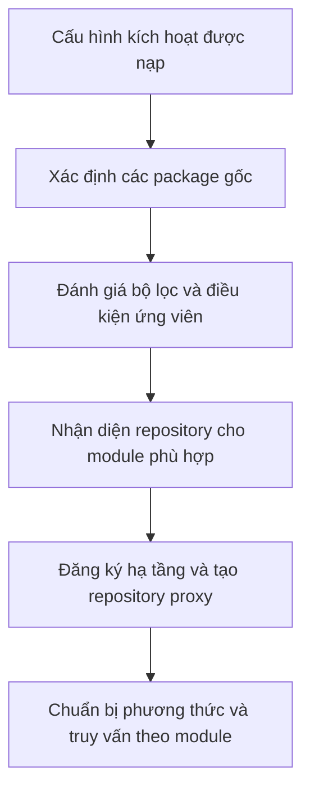

# `basePackages`, `basePackageClasses` và bộ lọc quét

Khai báo một interface kế thừa `CrudRepository` chưa đủ để interface đó trở thành bean có thể truy cập dữ liệu. Hạ tầng repository phải được kích hoạt, tìm thấy interface trong phạm vi quét, nhận diện nó thuộc module phù hợp và tạo proxy cùng các thành phần lưu trữ cần thiết.

Bài này thuộc chương **Kích hoạt repository** của Spring Data Commons (`SPRING_DATA_COMMONS`). Ta tập trung vào ba công cụ chọn phạm vi: `basePackages`, `basePackageClasses` và các bộ lọc `includeFilters`/`excludeFilters`. Mục tiêu là biết **repository nào được xét để đăng ký**, không nhầm việc quét với mapping entity, chọn database hoặc khả năng thực thi truy vấn của store.

Ví dụ chính dùng `@EnableJpaRepositories` của Spring Data JPA. Nhiều module Spring Data có cơ chế cấu hình tương tự, nhưng annotation kích hoạt và thuộc tính được hỗ trợ phải được xác định theo module, phiên bản đang dùng. Commons không cung cấp một annotation chung tự bật mọi loại repository cho mọi kho dữ liệu.

## 1. Quét repository đứng ở đâu trong đường khởi tạo?

Có thể nhìn quá trình đăng ký qua những trách nhiệm sau:



Đây là bản đồ chức năng, không phải cam kết về thời điểm khởi tạo mọi đối tượng nội bộ. Chẳng hạn chế độ bootstrap có thể ảnh hưởng lúc repository được khởi tạo hoặc kiểm tra.

Ba câu hỏi cần giữ riêng:

| Câu hỏi | Công cụ hoặc cấu hình liên quan |
| --- | --- |
| Interface repository nào được tìm và xét? | Package gốc, bộ lọc, điều kiện ứng viên repository. |
| Kiểu miền nào được persistence quản lý? | Mapping, entity scanning hoặc mapping context của module. |
| Repository sử dụng kết nối và transaction manager nào? | Cấu hình store, factory, datasource hoặc client tương ứng. |

Một interface nằm trong package được quét vẫn có thể không được tạo thành bean vì bị exclude, không phải repository hợp lệ, bị đánh dấu `@NoRepositoryBean` hoặc không được module nhận diện. Ngược lại, entity đã được mapping không có nghĩa repository của nó tự được quét ở mọi vị trí.

## 2. Bắt đầu từ phạm vi mặc định

Ví dụ cấu hình JPA:

```java
package com.example.shop.config;

import org.springframework.context.annotation.Configuration;
import org.springframework.data.jpa.repository.config.EnableJpaRepositories;

@Configuration(proxyBeanMethods = false)
@EnableJpaRepositories
public class JpaRepositoryConfig {
}
```

Khi không khai báo package gốc, cơ chế kích hoạt JPA dùng package của lớp cấu hình làm điểm bắt đầu theo quy ước. Trong ví dụ, đó là `com.example.shop.config` và các package con phù hợp, không phải mặc định toàn bộ `com.example.shop`.

Nếu repository nằm ở `com.example.shop.persistence.jpa`, nó ở một nhánh khác với `config`. Cấu hình trên có thể không tìm thấy repository như người viết mong đợi.

Một lỗi phổ biến là chuyển lớp cấu hình sang package khác trong lúc refactor rồi quên rằng phạm vi mặc định cũng thay đổi. Chỉ thêm `@Configuration` không giữ nguyên phạm vi quét cũ.

### 2.1. Cấu hình phải thực sự được nạp

Annotation `@EnableJpaRepositories` trên một lớp không được import hoặc không nằm trong phạm vi phát hiện cấu hình sẽ không tự có hiệu lực.

Có thể đưa lớp cấu hình vào context bằng một đường rõ ràng, chẳng hạn:

```java
@Import(JpaRepositoryConfig.class)
```

hoặc để cơ chế quét component/configuration của ứng dụng tìm thấy nó. Khi chẩn đoán thiếu repository, kiểm tra cấu hình kích hoạt đã được nạp trước khi sửa package hoặc filter.

## 3. `basePackages`: chọn package bằng tên

### 3.1. Một hoặc nhiều package gốc

```java
package com.example.shop.config;

import org.springframework.context.annotation.Configuration;
import org.springframework.data.jpa.repository.config.EnableJpaRepositories;

@Configuration(proxyBeanMethods = false)
@EnableJpaRepositories(
    basePackages = "com.example.shop.persistence.jpa"
)
public class JpaRepositoryConfig {
}
```

Phạm vi bắt đầu tại package khai báo và bao gồm các package con theo cơ chế quét. Tên ở đây là tên package Java, không phải đường dẫn thư mục hệ điều hành.

Ví dụ nhiều gốc:

```java
@EnableJpaRepositories(basePackages = {
    "com.example.shop.orders.persistence.jpa",
    "com.example.shop.catalog.persistence.jpa"
})
```

Các gốc mô tả tập phạm vi được xét. Không hiểu hai gốc là điều kiện giao nhau đòi một interface phải đồng thời ở cả hai package.

### 3.2. Ưu điểm và rủi ro

`basePackages` dễ đọc và hữu ích khi cần cấu hình bằng những package cụ thể. Tuy nhiên, một chuỗi sai chính tả vẫn có thể là Java hợp lệ:

```java
@EnableJpaRepositories(basePackages = "com.example.shop.persistnce.jpa")
```

Compiler không bắt buộc xác nhận package trong chuỗi đó tồn tại. Tùy toàn bộ context và điểm sử dụng, ứng dụng có thể khởi động với thiếu bean hoặc thất bại khi inject dependency.

Khi đổi tên package, không nên mặc định công cụ refactor luôn cập nhật mọi chuỗi cấu hình. Cần xác nhận lại phạm vi và kết quả đăng ký.

### 3.3. Tránh chọn một gốc quá rộng

```java
@EnableJpaRepositories(basePackages = "com.example")
```

Một gốc rộng có thể đưa vào phạm vi xét những repository thuộc module thử nghiệm, store khác hoặc vùng persistence không dùng cùng cấu hình. Việc có filter không làm cho một phạm vi quá rộng trở thành lựa chọn rõ ràng hơn mặc định.

Hãy chọn gốc phù hợp với ranh giới tổ chức của repository, rồi dùng filter cho những khác biệt có chủ đích bên trong ranh giới đó.

## 4. `basePackageClasses`: chọn package qua một kiểu Java

### 4.1. Tạo lớp marker đúng vị trí

```java
package com.example.shop.persistence.jpa;

public final class JpaRepositoryPackage {
    private JpaRepositoryPackage() {
    }
}
```

Lớp này không cần là entity, repository hoặc Spring bean. Nó chỉ cung cấp một vị trí package có thể tham chiếu bằng kiểu Java.

Cấu hình tương ứng:

```java
package com.example.shop.config;

import com.example.shop.persistence.jpa.JpaRepositoryPackage;
import org.springframework.context.annotation.Configuration;
import org.springframework.data.jpa.repository.config.EnableJpaRepositories;

@Configuration(proxyBeanMethods = false)
@EnableJpaRepositories(basePackageClasses = JpaRepositoryPackage.class)
public class JpaRepositoryConfig {
}
```

Framework lấy **package của marker**, không chỉ quét riêng lớp marker. Với vị trí trên, phạm vi bắt đầu ở `com.example.shop.persistence.jpa` và tiếp tục xuống các package con.

### 4.2. Đặt marker ở package con có thể làm phạm vi bị hẹp

Nếu chuyển marker vào:

```text
com.example.shop.persistence.jpa.marker.JpaRepositoryPackage
```

thì package gốc của marker là `com.example.shop.persistence.jpa.marker`. Các repository nằm trực tiếp ở `com.example.shop.persistence.jpa` không tự trở thành package con của nó.

Tên lớp có chữ `Package` không quyết định phạm vi; vị trí khai báo `package` mới quyết định. Nếu dùng một interface repository thật làm marker, package của interface đó cũng được sử dụng theo cùng nguyên tắc.

### 4.3. An toàn kiểu không đồng nghĩa phạm vi bất biến

Tham chiếu `.class` giúp compiler kiểm tra sự tồn tại của kiểu và thường phối hợp tốt với công cụ refactor. Nhưng nếu di chuyển marker sang một package khác, phạm vi quét cũng thay đổi theo thiết kế.

Không thêm annotation entity hoặc stereotype vào marker chỉ để “kích hoạt quét”. Những annotation đó không cần cho vai trò xác định package và có thể tạo ra một ý nghĩa ngoài dự định.

### 4.4. Nhiều marker cho nhiều gốc

```java
@EnableJpaRepositories(basePackageClasses = {
    OrdersJpaPackage.class,
    CatalogJpaPackage.class
})
```

Mỗi marker đại diện cho package của nó. Chọn marker tại những ranh giới mà project muốn công khai cho cấu hình.

Nên dùng một cách chính để diễn đạt phạm vi trong một cấu hình: tên package hoặc marker. Không coi việc khai báo cả `basePackages` và `basePackageClasses` là cách yêu cầu một phép giao phạm vi; nếu thực sự kết hợp, phải hiểu cách annotation của module tổng hợp các gốc được cung cấp.

## 5. Bộ lọc chọn gì bên trong phạm vi?

Package gốc trả lời “tìm ở đâu”. Filter trả lời “ứng viên nào khớp điều kiện trong vùng được tìm”. Một include filter không tự kéo vào repository nằm ngoài mọi package gốc.

Cấu hình thường dùng các thuộc tính:

```java
includeFilters = ...
excludeFilters = ...
```

Phần tử filter có thể được khai báo bằng `@ComponentScan.Filter`. Việc tái sử dụng kiểu annotation này không có nghĩa repository đang được đăng ký bằng component scan thông thường; hạ tầng repository vẫn chịu trách nhiệm tạo proxy.

### 5.1. Ý nghĩa của include và exclude

Trong cơ chế quét repository tiêu chuẩn, khi khai báo include filter tường minh, các filter đó xác định tập khớp thay cho tập include mặc định. Hạ tầng vẫn kiểm tra tính hợp lệ của ứng viên repository. Vì vậy, không hiểu `includeFilters` là “thêm vài kiểu nữa, còn mọi repository mặc định vẫn luôn được nhận”.

Với cấu hình lọc thông dụng:

- Nhiều include filter tạo các khả năng khớp; ứng viên có thể được nhận khi khớp một include phù hợp.
- Exclude filter loại ứng viên khớp khỏi kết quả, kể cả khi nó đã khớp include.
- Khớp include chưa đủ nếu kiểu không đáp ứng điều kiện của repository hoặc không được module xử lý.

Có thể dùng mô hình quyết định sau để đọc cấu hình:

```text
Nằm trong một package gốc?
    Không -> không được đưa vào vùng xét bởi lần quét này.
    Có -> kiểm tra điều kiện include phù hợp.
        Không khớp -> không được chọn.
        Khớp -> có bị exclude hoặc không hợp lệ theo hạ tầng repository không?
            Có -> không được đăng ký từ ứng viên đó.
            Không -> tiếp tục quy trình nhận diện/đăng ký của module.
```

Đây là cách diễn giải điều kiện, không phải thứ tự chạy nội bộ bắt buộc của mọi đoạn mã framework.

### 5.2. Filter không biến lớp thường thành repository

Một class `ReportFormatter` khớp regex hoặc annotation marker chưa trở thành Spring Data repository. Hạ tầng cần một định nghĩa repository hợp lệ, chẳng hạn interface kế thừa `Repository` phù hợp hoặc interface sử dụng cơ chế `@RepositoryDefinition` được hỗ trợ.

Filter không thay thế khai báo domain type, kiểu ID, repository factory hoặc các thành phần store.

## 6. Ví dụ hoàn chỉnh về phạm vi: marker, include và exclude

Giả sử các kiểu được tổ chức như sau:

```text
com.example.shop
├── config
│   └── JpaRepositoryConfig
├── model.jpa
│   └── BookEntity
└── persistence.jpa
    ├── JpaRepositoryPackage
    ├── ExposedRepository
    ├── BookRepository
    ├── InternalBookRepository
    └── experimental
        └── ExperimentalBookRepository
```

Mỗi kiểu public bên dưới thuộc file Java riêng theo tên lớp hoặc interface. Đây là cấu trúc mẫu để giải thích cấu hình, không phải yêu cầu tạo thêm file trong tài liệu hiện tại.

### 6.1. Annotation đánh dấu những repository được công khai

```java
package com.example.shop.persistence.jpa;

import java.lang.annotation.ElementType;
import java.lang.annotation.Retention;
import java.lang.annotation.RetentionPolicy;
import java.lang.annotation.Target;

@Target(ElementType.TYPE)
@Retention(RetentionPolicy.RUNTIME)
public @interface ExposedRepository {
}
```

Annotation không cần kế thừa `@Repository`. Trong mẫu, hãy gắn marker trực tiếp vào từng interface cần chọn, không dựa vào suy luận rằng annotation trên interface cha tự được kế thừa như một điều kiện lọc ở mọi trường hợp.

### 6.2. Mô hình JPA tối thiểu

```java
package com.example.shop.model.jpa;

import jakarta.persistence.Entity;
import jakarta.persistence.GeneratedValue;
import jakarta.persistence.GenerationType;
import jakarta.persistence.Id;

@Entity
public class BookEntity {

    @Id
    @GeneratedValue(strategy = GenerationType.IDENTITY)
    private Long id;

    private String title;

    protected BookEntity() {
    }

    public BookEntity(String title) {
        this.title = title;
    }

    public Long getId() {
        return id;
    }

    public String getTitle() {
        return title;
    }
}
```

Mapping này thuộc JPA. Nó không chịu sự quyết định của include/exclude filter dành cho repository.

### 6.3. Ba repository cùng dùng một domain type

```java
package com.example.shop.persistence.jpa;

import com.example.shop.model.jpa.BookEntity;
import org.springframework.data.repository.CrudRepository;

@ExposedRepository
public interface BookRepository extends CrudRepository<BookEntity, Long> {
}
```

```java
package com.example.shop.persistence.jpa;

import com.example.shop.model.jpa.BookEntity;
import org.springframework.data.repository.CrudRepository;

public interface InternalBookRepository extends CrudRepository<BookEntity, Long> {
}
```

```java
package com.example.shop.persistence.jpa.experimental;

import com.example.shop.model.jpa.BookEntity;
import com.example.shop.persistence.jpa.ExposedRepository;
import org.springframework.data.repository.CrudRepository;

@ExposedRepository
public interface ExperimentalBookRepository
        extends CrudRepository<BookEntity, Long> {
}
```

Dùng cùng một entity ở đây giúp tập trung vào điều kiện quét, không phải cách chọn domain type khác nhau. Trong ứng dụng thật, tổ chức repository theo nhu cầu và ranh giới nghiệp vụ, không nhân bản interface chỉ để có nhiều bean cùng chức năng.

### 6.4. Cấu hình chọn annotation nhưng loại nhánh thử nghiệm

```java
package com.example.shop.config;

import com.example.shop.persistence.jpa.ExposedRepository;
import com.example.shop.persistence.jpa.JpaRepositoryPackage;
import org.springframework.context.annotation.ComponentScan;
import org.springframework.context.annotation.Configuration;
import org.springframework.context.annotation.FilterType;
import org.springframework.data.jpa.repository.config.EnableJpaRepositories;

@Configuration(proxyBeanMethods = false)
@EnableJpaRepositories(
    basePackageClasses = JpaRepositoryPackage.class,
    includeFilters = @ComponentScan.Filter(
        type = FilterType.ANNOTATION,
        classes = ExposedRepository.class
    ),
    excludeFilters = @ComponentScan.Filter(
        type = FilterType.REGEX,
        pattern = "com\\.example\\.shop\\.persistence\\.jpa\\.experimental\\..*"
    )
)
public class JpaRepositoryConfig {
}
```

Kỳ vọng từ riêng cấu hình này:

| Interface | Trong gốc? | Khớp include? | Khớp exclude? | Được chọn? |
| --- | --- | --- | --- | --- |
| `BookRepository` | Có | Có | Không | Có, nếu các điều kiện JPA khác hợp lệ. |
| `InternalBookRepository` | Có | Không | Không | Không. |
| `ExperimentalBookRepository` | Có | Có | Có | Không. |
| Repository ở `com.example.other` | Không | Không cần xét | Không cần xét | Không. |

`ExperimentalBookRepository` vẫn bị loại dù mang marker. Đây là lý do cần đọc cả include lẫn exclude khi thấy một interface có vẻ đã đủ điều kiện nhưng không có bean.

Regex sử dụng tên kiểu đầy đủ. Trong literal Java, dấu chấm regex phải được escape bằng hai dấu gạch chéo ngược như đoạn mã; đó là lớp escape của chuỗi Java trước khi regex được diễn giải.

## 7. Chọn loại filter phù hợp

Một số loại thường dùng:

| `FilterType` | Tiêu chí | Trường hợp phù hợp |
| --- | --- | --- |
| `ANNOTATION` | Kiểu mang annotation được chỉ định theo cơ chế lọc annotation. | Đánh dấu nhóm repository có chủ đích. |
| `ASSIGNABLE_TYPE` | Kiểu có thể gán cho kiểu đã chỉ định. | Nhóm repository theo một interface hoặc một kiểu gốc. |
| `REGEX` | Tên kiểu khớp biểu thức chính quy. | Một quy ước tên hoặc nhánh package ổn định. |
| `CUSTOM` | Quy tắc do một `TypeFilter` hiện thực. | Cần đọc metadata theo điều kiện mà filter có sẵn không diễn đạt phù hợp. |

Các đoạn dưới là những phương án thay thế để giải thích loại filter, không phải các filter bắt buộc phải thêm hết vào cấu hình chính.

### 7.1. `ASSIGNABLE_TYPE` kiểm tra quan hệ kiểu

Giả sử có interface marker không tự kế thừa repository:

```java
public interface PublicRepositoryTag {
}
```

Một repository cụ thể có thể cùng kế thừa hợp đồng dữ liệu và marker:

```java
public interface PublicBookRepository
        extends CrudRepository<BookEntity, Long>, PublicRepositoryTag {
}
```

Filter tương ứng:

```java
includeFilters = @ComponentScan.Filter(
    type = FilterType.ASSIGNABLE_TYPE,
    classes = PublicRepositoryTag.class
)
```

Không hiểu loại filter này là “chỉ đúng interface có tên bằng marker”. Nó kiểm tra quan hệ có thể gán, nên các kiểu con phù hợp cũng khớp.

Tương tự, exclude theo một base repository có thể loại luôn những repository cụ thể kế thừa base. Khi mục tiêu chỉ là không tạo bean cho interface cơ sở, dùng `@NoRepositoryBean` theo đúng vai trò thay vì một exclude có phạm vi quá rộng.

### 7.2. `REGEX` khác glob đường dẫn

Một regex tên kiểu không phải đường dẫn như `src/main/java/...` và không mặc định dùng cú pháp wildcard của hệ thống file.

Trong regex:

- Dấu chấm không escape có ý nghĩa khớp ký tự theo quy tắc regex, không chỉ dấu chấm trong package.
- `.*` biểu thị chuỗi ký tự phù hợp; một dấu `*` đơn lẻ không phải cách viết “mọi repository”.
- Chuỗi literal Java có lớp escape riêng trước lớp regex.

Nên kiểm tra mẫu bằng chính các tên đầy đủ mà cấu hình muốn nhận và muốn loại. Một mẫu khớp quá rộng có thể làm mất nhiều bean hơn dự kiến.

### 7.3. `CUSTOM` khi cần đọc giá trị annotation

`ANNOTATION` phù hợp để chọn kiểu mang marker. Nếu muốn chọn theo giá trị một thuộc tính annotation, có thể dùng một filter tùy biến khi thật sự cần.

Ví dụ annotation:

```java
import java.lang.annotation.ElementType;
import java.lang.annotation.Retention;
import java.lang.annotation.RetentionPolicy;
import java.lang.annotation.Target;

@Target(ElementType.TYPE)
@Retention(RetentionPolicy.RUNTIME)
public @interface RepositoryGroup {
    String value();
}
```

Một filter đọc metadata trực tiếp:

```java
import java.io.IOException;
import java.util.Map;
import org.springframework.core.type.classreading.MetadataReader;
import org.springframework.core.type.classreading.MetadataReaderFactory;
import org.springframework.core.type.filter.TypeFilter;

public final class PublicGroupFilter implements TypeFilter {

    @Override
    public boolean match(
            MetadataReader metadataReader,
            MetadataReaderFactory metadataReaderFactory) throws IOException {
        Map<String, Object> attributes = metadataReader
            .getAnnotationMetadata()
            .getAnnotationAttributes(RepositoryGroup.class.getName());
        return attributes != null
            && "public".equals(attributes.get("value"));
    }
}
```

Cấu hình:

```java
includeFilters = @ComponentScan.Filter(
    type = FilterType.CUSTOM,
    classes = PublicGroupFilter.class
)
```

Trong ví dụ, interface cần mang trực tiếp `@RepositoryGroup("public")` theo quy tắc filter đã viết. Nếu muốn xét annotation kết hợp hoặc quan hệ kế thừa, đó phải là hành vi được thiết kế và kiểm tra riêng.

Filter phục vụ chọn metadata trong quá trình khởi tạo. Không truy vấn database, gọi dịch vụ từ xa hoặc dựa vào trạng thái người dùng hiện tại bên trong filter. Dùng loại có sẵn khi nó đã diễn đạt đủ điều kiện; custom filter làm tăng trách nhiệm bảo trì quy tắc quét.

## 8. `@NoRepositoryBean` không phải một package filter

Một interface cơ sở có thể cung cấp hợp đồng chung nhưng chưa xác định domain type cụ thể:

```java
import org.springframework.data.repository.CrudRepository;
import org.springframework.data.repository.NoRepositoryBean;

@NoRepositoryBean
public interface BaseRepository<T, ID> extends CrudRepository<T, ID> {
}
```

Các repository cụ thể có thể kế thừa nó và cung cấp kiểu miền cùng ID:

```java
public interface ConcreteBookRepository
        extends BaseRepository<BookEntity, Long> {
}
```

`@NoRepositoryBean` cho biết interface cơ sở không phải repository cần tạo bean riêng. Nó không có mục đích loại cả package hoặc cấm mọi interface con trở thành repository.

Repository cụ thể vẫn cần đáp ứng package, filter và điều kiện module. Nếu cấu hình có include theo annotation, việc kế thừa base không tự thay cho marker mà include yêu cầu.

Một lỗi thường gặp là exclude theo `ASSIGNABLE_TYPE` của `BaseRepository`. Điều đó có thể khớp tất cả repository con và loại đúng những bean mà ứng dụng muốn tạo.

## 9. Đừng nhầm với component scan và entity scan

Ba cấu hình có thể cùng nhắc đến package, nhưng tạo ra các kết quả khác nhau:

| Cấu hình | Mục tiêu chính trong ví dụ JPA |
| --- | --- |
| Component/configuration scanning | Tìm service, configuration và các component theo quy tắc Spring. |
| `@EnableJpaRepositories` | Tìm và đăng ký repository theo cơ chế Spring Data JPA. |
| Entity scanning hoặc cấu hình persistence unit | Xác định entity được JPA provider quản lý. |

### 9.1. Mở component scan chưa chắc mở repository scan

Trong Boot, các package auto-configuration được dùng theo cơ chế riêng để xác định phạm vi mặc định liên quan đến persistence. Không suy ra rằng sửa `scanBasePackages` trên `@SpringBootApplication` sẽ tự cấu hình lại mọi package entity và repository theo cùng một cách.

Nếu đặt entity hoặc repository ra ngoài vùng mặc định, cấu hình rõ cơ chế tương ứng. Ví dụ với JPA/Boot phù hợp có thể dùng entity scanning cho entity và `@EnableJpaRepositories` cho repository.

Một annotation `@Repository` trên interface cũng không thay thế việc kích hoạt repository factory. Component scan thông thường không tự hiện thực hóa tất cả phương thức của một interface dữ liệu.

### 9.2. Quét được repository nhưng entity chưa managed

Ví dụ repository nằm trong đúng package, nhưng `BookEntity` chưa thuộc persistence unit mà repository đang dùng. Context có thể thất bại với lỗi liên quan tới kiểu không được quản lý.

Sửa trường hợp này ở mapping hoặc phạm vi entity của đúng persistence unit, không bằng cách mở rộng package repository một cách ngẫu nhiên.

### 9.3. Filter không bật tính năng truy vấn hoặc auditing

Chọn được repository không có nghĩa module hỗ trợ mọi kiểu trả về hoặc keyword mà interface sử dụng. Derived query, `Page`, projection và Query by Example vẫn phải được module thực thi hợp lệ.

Tương tự, include filter trên repository không tự đăng ký một auditor provider hoặc bật auditing. Những bean và hạ tầng đó có cơ chế cấu hình riêng.

## 10. Khi ứng dụng có nhiều store hoặc nhiều cấu hình JPA

### 10.1. Tách phạm vi repository của các module

Ví dụ tổ chức:

```text
com.example.shop.persistence.jpa
com.example.shop.persistence.mongo
```

Một cấu hình JPA có marker ở nhánh JPA. Cấu hình MongoDB, khi dự án có module và kết nối MongoDB tương ứng, có thể bắt đầu như sau:

```java
@Configuration(proxyBeanMethods = false)
@EnableMongoRepositories(basePackageClasses = MongoRepositoryPackage.class)
public class MongoRepositoryConfig {
}
```

`MongoRepositoryPackage` phải nằm đúng nhánh repository MongoDB muốn quét. Đoạn này là phương án thêm store, không thuộc bộ cấu hình JPA/H2 tối thiểu ở ví dụ kiểm thử bên dưới.

Khi nhiều module Spring Data cùng hiện diện, hạ tầng có thể dùng chế độ nhận diện chặt hơn để xác định repository thuộc module nào, dựa trên những tín hiệu như interface đặc thù hoặc annotation miền được hỗ trợ. Package rõ ràng giúp giới hạn ứng viên; nó không cho phép JPA tự xử lý một mô hình chỉ hợp lệ với MongoDB.

Tránh để hai cấu hình quét rộng cùng một nhóm repository rồi trông chờ thứ tự đăng ký chọn đúng. Nếu có kiểu miền mang nhiều annotation store, cần hiểu rõ hệ quả nhận diện module và thiết kế phạm vi một cách có chủ đích.

### 10.2. Hai persistence unit JPA cần nhiều hơn package

Giả sử có database đơn hàng và database báo cáo. Ngoài package riêng, một cấu hình có thể cần chỉ rõ factory và transaction manager:

```java
@EnableJpaRepositories(
    basePackageClasses = OrdersJpaPackage.class,
    entityManagerFactoryRef = "ordersEntityManagerFactory",
    transactionManagerRef = "ordersTransactionManager"
)
```

Các bean được tham chiếu phải thực sự được cấu hình với datasource, entity và persistence unit tương ứng. Khai báo tên trong annotation không tự tạo chúng.

`basePackages` không phải bộ định tuyến kết nối. Nếu package đúng nhưng repository gắn nhầm factory, nó vẫn có thể truy cập nhầm persistence unit hoặc không tìm thấy entity managed.

### 10.3. Cẩn thận với các phạm vi quét chồng lấp

Nếu hai cấu hình cùng xét một interface, có thể xuất hiện đăng ký trùng, xung đột tên bean hoặc hành vi phụ thuộc cơ chế đăng ký cụ thể. Không coi bật bean overriding là cách sửa mặc định; trước hết làm rõ quyền sở hữu của từng vùng repository.

Boot auto-configuration có thể lùi lại khi phát hiện cấu hình repository tường minh phù hợp, theo điều kiện của phiên bản đang dùng. Vì vậy cũng không kết luận rằng mọi lần kết hợp Boot với `@EnableJpaRepositories` đều gây quét trùng. Quan sát cấu hình thực sự có hiệu lực thay vì suy luận chỉ từ số annotation nhìn thấy.

## 11. Kiểm tra tập repository thực sự được đăng ký

Một phép kiểm tra chỉ xác nhận context khởi động được chưa đủ cho trường hợp “một số repository phải có, một số phải không có”. Cần kiểm tra trực tiếp cả hai phía của điều kiện.

Ví dụ sau kiểm tra cấu hình JPA ở mục 6. Các import entity scanning của phần test dùng bố cục Spring Boot 3.x với Jakarta Persistence; nếu dùng major khác, đối chiếu module và package annotation của phiên bản đó.

Điều kiện chạy ví dụ:

- Có starter JPA, thư viện test Boot và H2 trên test classpath với bộ version phù hợp.
- Có các kiểu `BookEntity`, marker, annotation, ba repository và cấu hình JPA đã trình bày.
- Không có URL database bên ngoài hoặc cấu hình môi trường ghi đè đưa test tới dữ liệu cần giữ.

```java
package com.example.shop;

import static org.assertj.core.api.Assertions.assertThat;

import com.example.shop.config.JpaRepositoryConfig;
import com.example.shop.model.jpa.BookEntity;
import com.example.shop.persistence.jpa.BookRepository;
import com.example.shop.persistence.jpa.InternalBookRepository;
import com.example.shop.persistence.jpa.experimental.ExperimentalBookRepository;
import org.junit.jupiter.api.Test;
import org.springframework.beans.factory.annotation.Autowired;
import org.springframework.boot.autoconfigure.EnableAutoConfiguration;
import org.springframework.boot.autoconfigure.domain.EntityScan;
import org.springframework.boot.test.context.SpringBootTest;
import org.springframework.context.ApplicationContext;
import org.springframework.context.annotation.Configuration;
import org.springframework.context.annotation.Import;

@SpringBootTest(
    classes = RepositoryScopeTest.TestApplication.class,
    webEnvironment = SpringBootTest.WebEnvironment.NONE,
    properties = {
        "spring.data.jpa.repositories.enabled=false",
        "spring.datasource.generate-unique-name=true",
        "spring.jpa.hibernate.ddl-auto=create-drop"
    }
)
class RepositoryScopeTest {

    @Autowired
    private ApplicationContext context;

    @Test
    void registersOnlyRepositoriesSelectedByTheConfiguration() {
        assertThat(context.getBeansOfType(BookRepository.class))
            .hasSize(1);
        assertThat(context.getBeansOfType(InternalBookRepository.class))
            .isEmpty();
        assertThat(context.getBeansOfType(ExperimentalBookRepository.class))
            .isEmpty();
    }

    @Configuration(proxyBeanMethods = false)
    @EnableAutoConfiguration
    @EntityScan(basePackageClasses = BookEntity.class)
    @Import(JpaRepositoryConfig.class)
    static class TestApplication {
    }
}
```

### 11.1. Vì sao test import một cấu hình cụ thể?

Test cố ý nạp `JpaRepositoryConfig`, không component-scan toàn bộ cấu hình ứng dụng. Điều này giúp xác định kết quả đang đến từ cấu hình nào, tránh một lần quét khác vô tình tạo bean cho interface đáng ra bị loại trong ví dụ.

Property `spring.data.jpa.repositories.enabled=false` ở đây chặn đường tự cấu hình repository JPA của Boot trong phạm vi test; nó không vô hiệu hóa annotation `@EnableJpaRepositories` mà test đã import tường minh. Mục đích là kiểm tra riêng cấu hình ấy. Đây không phải property bắt buộc phải thêm vào mọi ứng dụng sử dụng repository.

Test vẫn dùng auto-configuration cần thiết cho JPA và datasource, cùng entity scan rõ ràng. Nếu thiếu mapping hoặc database test, context có thể thất bại trước assertion; lỗi đó phải được sửa ở tầng tương ứng.

### 11.2. Kiểm tra kiểu bean hay tên bean?

Test dùng kiểu repository để kiểm tra hợp đồng cần inject. Nếu ứng dụng còn có yêu cầu về tên bean hoặc qualifier, kiểm tra thêm yêu cầu đó riêng.

Hai interface cùng simple name ở hai package khác nhau có thể tạo vấn đề tên bean dù phạm vi đều được chọn đúng. Filter giải quyết tập ứng viên, không tự thiết kế một quy ước đặt tên phù hợp cho mọi trường hợp.

### 11.3. Test này chứng minh tới đâu?

Nó xác nhận trong context và cấu hình đang kiểm tra:

- Repository được cho phép có đúng một bean theo kiểu đã chọn.
- Repository thiếu marker không có bean.
- Repository khớp include nhưng nằm ở nhánh exclude không có bean.

Nó chưa kiểm tra mọi query method, dữ liệu CRUD hoặc kết nối tới database triển khai. Khi thêm truy vấn, projection hay auditing, bổ sung phép kiểm tra cho khả năng tương ứng thay vì coi test phạm vi đã bao phủ toàn bộ persistence.

Để kiểm tra wiring tổng thể của ứng dụng thật, có thể cần một test khác dùng cấu hình ứng dụng thật. Test cô lập cấu hình quét và test tích hợp toàn ứng dụng trả lời hai câu hỏi bổ sung cho nhau.

## 12. Chẩn đoán khi kết quả quét không đúng

| Dấu hiệu | Điều cần kiểm tra |
| --- | --- |
| Không có repository bean nào | Cấu hình kích hoạt có được nạp không, module có trên classpath không, gốc package có đúng không? |
| Một repository cụ thể bị thiếu | Có nằm dưới package marker không, có khớp include và bị exclude không? |
| Repository thiếu marker vẫn xuất hiện | Có cấu hình quét khác hoặc đường tự cấu hình khác đang tạo nó không? |
| Nhánh thử nghiệm vẫn có bean | Regex có khớp tên đầy đủ không, class có ở package dự kiến không, có lần quét khác không? |
| Repository cơ sở bị tạo bean | Có thiếu `@NoRepositoryBean` hoặc định nghĩa cơ sở chưa phù hợp không? |
| Mọi repository con cùng biến mất | Exclude theo `ASSIGNABLE_TYPE` có đang loại cả họ kiểu không? |
| Kiểu miền không managed | Entity scan, mapping và factory/persistence unit mà repository đang dùng. |
| Xung đột bean khi thêm store | Package bị chồng lấp, nhận diện module, quy ước tên hoặc cấu hình đăng ký trùng. |
| Repository nested không được thấy | Module có yêu cầu cấu hình xét nested repository riêng không? Mở package chưa tự giải quyết điều kiện này. |
| Lỗi chỉ xuất hiện khi gọi lần đầu | Chế độ bootstrap/khởi tạo có trì hoãn việc dựng hoặc kiểm tra repository không? |

Log của module thường cho biết quá trình tìm repository hoặc số lượng được nhận diện. Dùng nó như một dấu hiệu hỗ trợ rồi kiểm tra bean cần có; không chỉ nhìn một con số tổng để kết luận mọi interface đã thuộc đúng cấu hình.

Một trình tự điều tra hữu ích:

1. Xác định đúng context và profile đang khởi động.
2. Xác nhận lớp cấu hình kích hoạt có hiệu lực.
3. Tính package gốc từ chuỗi hoặc vị trí marker thực tế.
4. Lấy tên interface đầy đủ và đối chiếu từng điều kiện lọc.
5. Kiểm tra điều kiện repository, `@NoRepositoryBean` và nhận diện module.
6. Kiểm tra mapping, factory và các thành phần store sau khi phạm vi đã rõ.

Thay một nhóm điều kiện có căn cứ rồi quan sát lại. Mở rộng scan tới package gốc cao nhất có thể làm hết lỗi thiếu bean trước mắt nhưng đồng thời kéo vào các repository ngoài dự định.

## 13. Bài tập áp dụng

### Bài 1: marker nằm nhầm nhánh

Marker ở `com.example.billing.jpa.marker`, còn repository ở `com.example.billing.jpa.invoice`. `basePackageClasses` tham chiếu marker. Vì sao repository chưa chắc được tìm thấy?

**Gợi ý:** Package của marker là gốc quét; `invoice` là nhánh anh em với `marker`, không phải package con của nó. Đặt marker ở ranh giới muốn quét hoặc chọn gốc phù hợp khác.

### Bài 2: include và exclude cùng khớp

Một repository có marker được include nhưng cũng khớp regex exclude. Nó có được đăng ký từ lần quét này không?

**Gợi ý:** Không. Exclude loại ứng viên dù điều kiện include đã khớp. Nếu vẫn thấy bean, tìm một nguồn đăng ký khác.

### Bài 3: loại base nhưng mất cả repository con

Cấu hình dùng exclude `ASSIGNABLE_TYPE` cho `BaseRepository`. Sau đó mọi repository cụ thể kế thừa base đều biến mất.

**Gợi ý:** Filter khớp quan hệ có thể gán, không chỉ đúng interface base. Dùng `@NoRepositoryBean` cho vai trò interface cơ sở và giữ điều kiện chọn repository cụ thể rõ ràng.

### Bài 4: đổi component scan nhưng vẫn thiếu repository

Ứng dụng mở rộng `scanBasePackages` để tìm service ở module khác. Repository của module ấy vẫn không có bean.

**Gợi ý:** Component scan và repository scan không phải một cấu hình. Xác định package auto-configuration mặc định hoặc cấu hình kích hoạt repository tường minh theo module.

### Bài 5: cùng JPA nhưng hai database

Hai nhánh repository đã tách package, nhưng một nhánh vẫn dùng nhầm persistence unit.

**Gợi ý:** Kiểm tra `entityManagerFactoryRef`, `transactionManagerRef`, entity và datasource được cấu hình cho từng factory. Package chỉ chọn interface, không tự chọn kết nối.

Phạm vi quét tốt phải diễn đạt được ba điều: **package nào được xét, điều kiện nào chọn hoặc loại repository, và cấu hình store nào chịu trách nhiệm cho các bean được chọn**. `basePackages` và `basePackageClasses` xác định vùng tìm; filter tinh chỉnh ứng viên; mapping và hạ tầng store hoàn tất khả năng hoạt động của repository.
