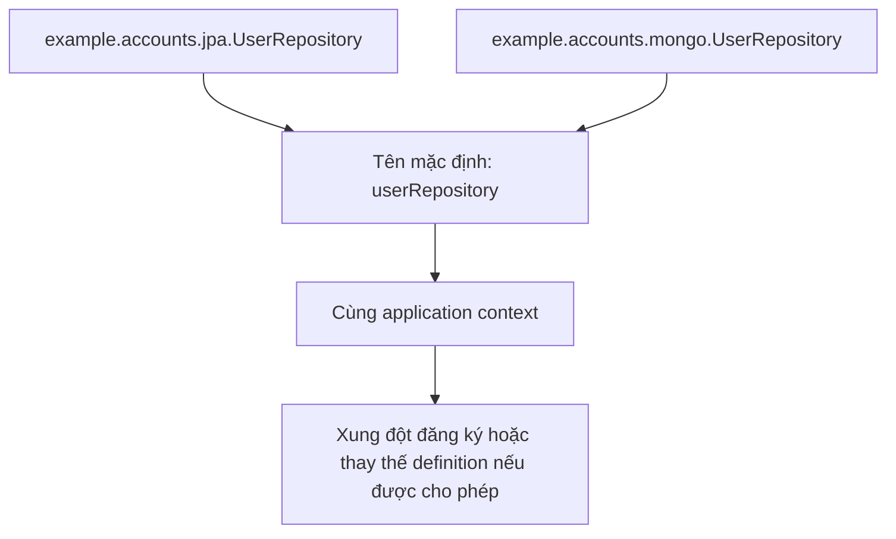

# Bean name, repository trùng tên và phạm vi cấu hình

Hai interface repository nằm ở hai package khác nhau vẫn có thể tạo ra các bean trùng tên. Ngược lại, hai repository đã có tên khác nhau vẫn có thể khiến Spring không biết chọn bean nào khi inject.

Đây là hai vấn đề khác nhau: **xung đột tên trong lúc đăng ký bean** và **có nhiều ứng viên phù hợp trong lúc giải quyết dependency**. Cần xác định đúng giai đoạn để chọn cách sửa.

Bài học thuộc chương **Kích hoạt repository** của mô-đun **SPRING_DATA_COMMONS**. Chúng ta tìm hiểu cách đặt tên repository bean, tác dụng của qualifier và giới hạn của phạm vi quét/cấu hình, đặc biệt khi ứng dụng có nhiều mô-đun hoặc nhiều vùng dữ liệu.

## 1. Bốn khái niệm cần tách riêng

| Khái niệm | Ví dụ | Trả lời câu hỏi |
| --- | --- | --- |
| Tên kiểu Java đầy đủ | `example.accounts.jpa.UserRepository` | Đây là interface nào trong mã nguồn? |
| Bean name | `userRepository` | Bean được đăng ký dưới tên nào trong context? |
| Kiểu dùng để inject | `UserRepository`, `CrudRepository<User, Long>` | Những bean nào tương thích với dependency này? |
| Phạm vi cấu hình | Package scan và application context | Cấu hình nào tạo bean và tạo nó ở đâu? |

Tên package giúp Java phân biệt hai interface. Nó không tự bảo đảm tên bean mặc định cũng chứa toàn bộ package đó.

Tương tự, tên bean không tự quyết định kho dữ liệu. Một bean tên `archiveRepository` chỉ thực sự truy cập kho lưu trữ mong muốn khi được tạo bởi hạ tầng đã nối đúng client, persistence unit hoặc transaction manager.

Trong bài, “phạm vi cấu hình” nói đến vùng repository được một cấu hình quản lý và context nơi bean được đăng ký. Nó khác với việc lựa chọn bean scope như singleton hoặc prototype.

## 2. Repository bean thường được đặt tên như thế nào?

Với quy ước mặc định thông dụng, tên bean được suy ra từ tên interface theo cách đặt tên component của Spring.

Ví dụ:

| Interface | Tên bean thường gặp |
| --- | --- |
| `ProductRepository` | `productRepository` |
| `OrderRepository` | `orderRepository` |
| `JpaUserRepository` | `jpaUserRepository` |
| `MongoUserRepository` | `mongoUserRepository` |

Đây là quy ước mặc định, không phải cam kết mọi ứng dụng phải dùng đúng tên đó. Tên khai báo tường minh hoặc cơ chế sinh tên được cấu hình có thể thay đổi kết quả.

Cũng không nên tự viết quy tắc “chuyển toàn bộ tên interface thành chữ thường”. Quy tắc đặt tên của framework có xử lý tên kiểu; bên gọi nên dùng tên thực tế đã đăng ký.

### Interface không tự thành bean chỉ vì có tên đẹp

Ví dụ:

```java
import org.springframework.data.repository.CrudRepository;

public interface ProductRepository
        extends CrudRepository<Product, Long> {
}
```

Bean chỉ được tạo khi interface được hạ tầng repository phù hợp phát hiện và xử lý. Commons cung cấp contract, nhưng mô-đun lưu trữ, mapping và cấu hình vẫn cần đầy đủ.

Không có bean tên `productRepository` nếu không có cơ chế đăng ký thành công.

## 3. Hai package khác nhau vẫn có thể trùng bean name

Giả sử ứng dụng có:

```text
example.accounts.jpa.UserRepository
example.accounts.mongo.UserRepository
```

Đối với Java, đây là hai kiểu khác nhau. Nhưng nếu cả hai được đặt tên mặc định theo tên đơn giản, chúng đều có thể yêu cầu tên bean:

```text
userRepository
```

Nếu cả hai được đăng ký trong cùng context, đây là một xung đột namespace bean.



Việc mỗi mô-đun quét đúng một package không tự giải quyết xung đột tên. Hai cấu hình vẫn có thể đăng ký kết quả vào cùng context.

### Điều gì xảy ra khi trùng tên?

Khi cấu hình không cho ghi đè bean definition, quá trình khởi tạo có thể bị chặn bởi lỗi đăng ký trùng.

Nếu cho phép ghi đè, một definition có thể thay definition khác theo quá trình đăng ký. Điều này không biến hai repository thành hai bean độc lập có cùng tên để qualifier chọn sau.

Do đó, bật khả năng ghi đè không phải cách thích hợp để giữ đồng thời hai repository khác nhau.

## 4. Cách thứ nhất: đặt tên interface thể hiện vai trò

Một cách dễ đọc là dùng tên interface riêng:

```java
package example.accounts.jpa;

import example.accounts.domain.UserEntity;

import org.springframework.data.jpa.repository.JpaRepository;

public interface JpaUserRepository
        extends JpaRepository<UserEntity, Long> {
}
```

```java
package example.accounts.mongo;

import example.accounts.document.UserDocument;

import org.springframework.data.mongodb.repository.MongoRepository;

public interface MongoUserRepository
        extends MongoRepository<UserDocument, String> {
}
```

Các kiểu `UserEntity` và `UserDocument` là những mô hình đã được mapping phù hợp cho từng công nghệ. Ví dụ tập trung vào tên và cấu hình repository, không trình bày toàn bộ môi trường kết nối.

Với quy ước mặc định, hai tên bean dự kiến là:

```text
jpaUserRepository
mongoUserRepository
```

Ưu điểm:

- Phân biệt được ngay trong mã Java và log.
- Không cần nhập hai interface có cùng tên đơn giản.
- Contract thể hiện rõ lựa chọn công nghệ trong ví dụ này.

Tên theo công nghệ không phải lựa chọn duy nhất. Bạn có thể đặt tên theo vai trò như `UserProfileRepository` và `UserDirectoryRepository` nếu điều đó phản ánh chính xác mô hình.

Điều quan trọng là hai contract có ý nghĩa rõ ràng và không vô tình tranh cùng tên bean.

## 5. Cách thứ hai: khai báo bean name tường minh trên interface

Nếu muốn giữ cùng tên đơn giản ở các package khác nhau, có thể khai báo tên component tường minh mà cơ chế đăng ký repository của Spring Data nhận diện.

Ví dụ phương án JPA:

```java
package example.accounts.jpa;

import example.accounts.domain.UserEntity;

import org.springframework.data.jpa.repository.JpaRepository;
import org.springframework.stereotype.Repository;

@Repository("jpaUserRepository")
public interface UserRepository
        extends JpaRepository<UserEntity, Long> {
}
```

Phương án MongoDB:

```java
package example.accounts.mongo;

import example.accounts.document.UserDocument;

import org.springframework.data.mongodb.repository.MongoRepository;
import org.springframework.stereotype.Repository;

@Repository("mongoUserRepository")
public interface UserRepository
        extends MongoRepository<UserDocument, String> {
}
```

Hai bean có tên khác nhau dù các interface có cùng tên đơn giản.

### Hiểu đúng vai trò của @Repository trong ví dụ

Annotation được dùng để cung cấp tên tường minh. Nó không thay thế:

- Quan hệ contract repository.
- Quét repository của mô-đun.
- Mapping kiểu miền.
- Cấu hình kết nối.
- Hạ tầng tạo implementation.

Một interface bất kỳ được gắn `@Repository("someName")` không tự có implementation chỉ nhờ component scanning thông thường.

Với interface Spring Data được cấu hình đúng, không cần annotation này nếu tên mặc định đã phù hợp. Sử dụng nó ở đây là một lựa chọn đặt tên có chủ đích.

Các phương án đổi tên interface và khai báo tên tường minh là những lựa chọn thay thế; không bắt buộc làm cả hai cho cùng một nhu cầu.

## 6. Tên duy nhất chưa đủ: còn phải chia đúng phạm vi repository

Với hai interface `UserRepository` đã có tên tường minh ở phần trước, cấu hình có thể xác định vùng quản lý riêng:

```java
package example.accounts.config;

import org.springframework.context.annotation.Configuration;
import org.springframework.data.jpa.repository.config.EnableJpaRepositories;
import org.springframework.data.mongodb.repository.config.EnableMongoRepositories;

@Configuration
@EnableJpaRepositories(
    basePackageClasses =
        example.accounts.jpa.UserRepository.class
)
@EnableMongoRepositories(
    basePackageClasses =
        example.accounts.mongo.UserRepository.class
)
public class AccountRepositoryConfiguration {
}
```

Ví dụ giả định:

- Configuration class được nạp vào application context.
- Hạ tầng JPA và MongoDB đã được cấu hình tương ứng.
- Mapping entity/document hợp lệ.
- Không có một cấu hình khác vô tình quét chồng cùng vùng repository.

`basePackageClasses` chọn package của kiểu làm mốc và vùng package con phù hợp; nó không chỉ đăng ký một interface duy nhất.

### Hai bài toán được giải quyết ở hai nơi

| Bài toán | Cơ chế trong ví dụ |
| --- | --- |
| Interface nào thuộc vùng JPA hoặc MongoDB? | Cấu hình package và metadata theo mô-đun |
| Bean được đăng ký dưới tên nào? | Tên tường minh trên interface |
| Bean nào được chọn khi inject? | Kiểu dependency và qualifier khi cần |
| Dữ liệu thực tế đi tới đâu? | Client, persistence unit và cấu hình kết nối của mô-đun |

Chỉ sửa bean name không đủ nếu một repository vẫn bị hai cấu hình quét chồng lấn hoặc được gắn nhầm mô-đun.

Ngược lại, chỉ tách package không bảo đảm hai tên mặc định khác nhau khi kết quả được đưa vào cùng context.

## 7. Phân biệt xung đột đăng ký với nhiều ứng viên inject

Đây là điểm cần chẩn đoán trước khi sửa.

| Trường hợp | Giai đoạn | Ví dụ | Hướng xử lý chính |
| --- | --- | --- | --- |
| Hai definition cùng tên | Đăng ký bean | Cả hai đều muốn tên `userRepository` | Đổi tên hoặc sửa vùng đăng ký |
| Nhiều bean khác tên cùng phù hợp một dependency | Giải quyết injection | Hai bean cùng tương thích một contract chung | Thu hẹp kiểu hoặc dùng qualifier/primary phù hợp |
| Không có bean phù hợp | Giải quyết injection hoặc khởi tạo | Repository không được phát hiện hoặc qualifier sai | Kiểm tra registration, kiểu và tên |
| Bean đúng tên nhưng nối sai hạ tầng | Thực thi | Repository ghi vào datasource ngoài ý định | Sửa cấu hình factory và kết nối |

### Vì sao @Qualifier không sửa được lỗi trùng tên?

Nếu context chưa thể hoàn tất đăng ký vì hai definition cùng tên, chưa có hai bean độc lập để injection chọn.

`@Qualifier` tác động đến việc lọc ứng viên dependency. Nó không đổi tên bean definition và không tự tách một tên thành hai bean.

### Vì sao @Primary không sửa được lỗi trùng tên?

Primary là tín hiệu ưu tiên giữa các ứng viên đã được đăng ký phù hợp. Nó không tạo namespace riêng và không ngăn một definition trùng tên.

Khi muốn có một lựa chọn mặc định cho nhiều bean tương thích, cần cấu hình primary bằng cơ chế đăng ký được hỗ trợ. Nhưng trước đó, các bean vẫn phải có thể cùng tồn tại dưới những tên hợp lệ.

## 8. Dùng qualifier khi cần chọn một bean cụ thể

Giả sử có hai repository khác tên nhưng cùng có thể được nhìn qua contract:

```java
CrudRepository<Product, Long>
```

Nếu service yêu cầu kiểu chung đó, cả hai có thể trở thành ứng viên. Có thể chọn theo bean name:

```java
package example.products.application;

import example.products.domain.Product;

import org.springframework.beans.factory.annotation.Qualifier;
import org.springframework.data.repository.CrudRepository;
import org.springframework.stereotype.Service;

@Service
public class ProductMaintenanceService {

    private final CrudRepository<Product, Long> products;

    public ProductMaintenanceService(
            @Qualifier("productMaintenanceRepository")
            CrudRepository<Product, Long> products) {
        this.products = products;
    }

    public boolean contains(Long productId) {
        return products.existsById(productId);
    }
}
```

Đoạn mã giả định một bean phù hợp đã được đăng ký dưới tên `productMaintenanceRepository`.

Qualifier không chỉ có thể mang ý nghĩa tên bean; Spring còn hỗ trợ metadata qualifier. Trong ví dụ này, chuỗi được dùng để chọn bean đã có tên tương ứng.

### Ưu tiên kiểu cụ thể khi nó diễn đạt đúng nhu cầu

Nếu service thật sự cần contract `ProductMaintenanceRepository`, constructor có thể nhận chính kiểu đó thay vì contract CRUD tổng quát.

Điều này thường làm ý định rõ hơn và giảm số ứng viên. Tuy nhiên, nếu có nhiều bean cùng kiểu interface cụ thể, vẫn cần phân biệt bằng cấu hình hoặc qualifier phù hợp.

Không nên đổi kiểu dependency thành một abstraction quá rộng rồi dựa vào tên tham số constructor để đoán lựa chọn. Tên bean hoặc qualifier tường minh giúp ý định ổn định hơn khi refactor và thay đổi cách biên dịch.

## 9. Hai interface cùng tên trong mã Java cũng cần được phân biệt

Với:

```text
example.accounts.jpa.UserRepository
example.accounts.mongo.UserRepository
```

không thể import cả hai bằng cùng tên đơn giản rồi dùng `UserRepository` mà không phân biệt.

Một service minh họa có thể dùng tên đầy đủ:

```java
package example.accounts.application;

import org.springframework.beans.factory.annotation.Qualifier;
import org.springframework.stereotype.Service;

@Service
public class UserLookupService {

    private final example.accounts.jpa.UserRepository relational;
    private final example.accounts.mongo.UserRepository document;

    public UserLookupService(
            @Qualifier("jpaUserRepository")
            example.accounts.jpa.UserRepository relational,
            @Qualifier("mongoUserRepository")
            example.accounts.mongo.UserRepository document) {
        this.relational = relational;
        this.document = document;
    }
}
```

Hai field có kiểu Java khác nhau. Nếu mỗi kiểu chỉ có một bean phù hợp thì type-based injection đã có thể phân biệt; qualifier ở đây làm rõ lựa chọn tên đã khai báo.

Tên đầy đủ giải quyết sự mơ hồ của kiểu trong source code. Qualifier giải quyết lựa chọn bean trong context. Chúng không phải cùng một cơ chế.

Nếu tên đầy đủ làm mã khó đọc ở nhiều nơi, đổi tên interface theo vai trò có thể là thiết kế dễ duy trì hơn.

## 10. Nhiều cấu hình JPA: tên bean không quyết định persistence unit

Giả sử ứng dụng có hai vùng repository JPA cho hai nguồn dữ liệu. Mỗi vùng cần được nối đúng hạ tầng:

```java
package example.sales.config;

import org.springframework.context.annotation.Configuration;
import org.springframework.data.jpa.repository.config.EnableJpaRepositories;

@Configuration
@EnableJpaRepositories(
    basePackages = "example.sales.repository",
    entityManagerFactoryRef = "salesEntityManagerFactory",
    transactionManagerRef = "salesTransactionManager"
)
public class SalesRepositoryConfiguration {
}
```

```java
package example.billing.config;

import org.springframework.context.annotation.Configuration;
import org.springframework.data.jpa.repository.config.EnableJpaRepositories;

@Configuration
@EnableJpaRepositories(
    basePackages = "example.billing.repository",
    entityManagerFactoryRef = "billingEntityManagerFactory",
    transactionManagerRef = "billingTransactionManager"
)
public class BillingRepositoryConfiguration {
}
```

Đây là phần cấu hình gán repository cho hạ tầng đã có. Các bean `EntityManagerFactory`, transaction manager, datasource và mapping cần được tạo đúng tên và đúng quan hệ trong ứng dụng.

Không chỉ đổi repository bean name thành `sales...` hoặc `billing...` rồi coi như đã chọn được datasource.

### Phạm vi quét cần tránh chồng lấn

Nếu cấu hình sales quét `example` còn billing quét `example.billing.repository`, vùng billing vẫn nằm trong cả hai phạm vi.

Ngay cả khi giải quyết được một xung đột tên, ý định gắn repository với persistence unit vẫn mơ hồ hoặc sai. Cần chia lại phạm vi theo các tập repository có chủ đích.

Entity scan và mô hình của từng persistence unit cũng là vấn đề riêng. Một repository đã có đúng tên chưa chứng minh entity của nó thuộc đúng mô hình persistence.

## 11. ApplicationContext là ranh giới của namespace bean

Trong một application context, mỗi bean name dùng để nhận diện một đăng ký tương ứng; alias có thể cung cấp thêm tên cho cùng một bean.

Đổi sang alias không tự tạo ra một repository thứ hai với implementation hoặc nguồn dữ liệu khác.

### Context cha và context con

Trong ứng dụng có context phân cấp, một bean ở context con có thể che khuất bean cùng tên ở context cha khi tra cứu theo tên.

Vì vậy, “cùng tên” giữa hai context không hoàn toàn giống hai definition tranh cùng tên trong một context. Khi chẩn đoán, cần xác định:

- Bean được đăng ký ở context nào.
- Thành phần cần injection thuộc context nào.
- Có context cha hay không.
- Việc tra cứu đang hướng tới vùng nào.

Không dùng tên package như một namespace context tự động. Các context chỉ khác nhau khi kiến trúc ứng dụng thực sự tạo và cấu hình chúng như vậy.

### Test cũng có phạm vi cấu hình riêng

Một lớp test có thể import thêm configuration hoặc kích hoạt profile khiến hai vùng repository cùng được đăng ký, trong khi ứng dụng chạy theo cấu hình khác.

Khi lỗi chỉ xuất hiện trong test, hãy xem tập cấu hình test đang nạp. Không vội đổi tên repository toàn hệ thống trước khi biết có phải test đã quét hoặc import trùng hay không.

## 12. Repository bean, factory và fragment implementation không cùng một tên khái niệm

Repository được Spring Data cung cấp thường liên quan tới một `FactoryBean`.

Khi được đăng ký theo cơ chế đó:

```text
context.getBean("productRepository")
```

trả về đối tượng repository mà ứng dụng sử dụng.

Cú pháp tên có tiền tố `&`, chẳng hạn:

```text
context.getBean("&productRepository")
```

được Spring dùng để yêu cầu chính factory, không phải sản phẩm repository. Đây là chi tiết hạ tầng; không thêm `&` vào qualifier chỉ để “chỉ rõ hơn” repository cho service nghiệp vụ.

Một fragment implementation như `ProductQueriesImpl` lại là thành phần khác. Tên và quy ước dò fragment không tự đổi tên repository chính.

Nếu có nhiều implementation fragment trùng quy ước ở những package khác nhau, cần xử lý theo cơ chế phát hiện và ghép fragment. Không nên sửa tên repository bean mà mặc định mọi xung đột fragment cũng đã biến mất.

## 13. Quan sát những bean đã được đăng ký

Trong một configuration class đã được nạp, có thể dùng đoạn kiểm tra:

```java
import java.util.Arrays;

import org.springframework.boot.ApplicationRunner;
import org.springframework.context.ApplicationContext;
import org.springframework.context.annotation.Bean;
import org.springframework.data.repository.Repository;

@Bean
ApplicationRunner listRepositoryBeans(
        ApplicationContext context) {
    return args -> Arrays.stream(
            context.getBeanNamesForType(Repository.class)
        )
        .sorted()
        .forEach(name ->
            System.out.println(
                name + " -> " + context.getType(name)
            )
        );
}
```

Đây là method đặt trong configuration class, không phải một file Java độc lập. Ví dụ sử dụng `ApplicationRunner` trong ứng dụng Spring Boot.

Đoạn mã lọc theo kiểu repository mà context cung cấp. Kết quả phản ánh các bean đã được đăng ký trong phạm vi context được hỏi, không phải danh sách mọi interface repository có trong source hoặc trong các dependency.

Nếu muốn kiểm tra một repository cụ thể, có thể yêu cầu cả tên lẫn kiểu:

```java
example.accounts.jpa.UserRepository repository =
    context.getBean(
        "jpaUserRepository",
        example.accounts.jpa.UserRepository.class
    );
```

Không dựa vào tên class proxy sinh ở runtime để đặt qualifier. Contract interface và bean name đã đăng ký mới là các mốc phù hợp.

### Khi context chưa khởi tạo được

Nếu xung đột đăng ký đã chặn startup, runner phía trên chưa thể chạy để liệt kê bean. Khi đó cần đọc lỗi đăng ký và tìm:

- Bean name bị trùng.
- Hai interface hoặc bean definition liên quan.
- Configuration class hoặc registrar nào tạo chúng.
- Các base package có chồng nhau hay không.
- Tên tường minh có bị sao chép giống nhau hay không.

Những đoạn mã trên phục vụ việc tự quan sát trong môi trường thực hành; bài viết không ghi nhận rằng ứng dụng đã được chạy.

## 14. Chọn cách sửa theo nguyên nhân

| Nguyên nhân | Hướng sửa có cơ sở |
| --- | --- |
| Hai interface khác package có cùng tên mặc định | Đổi tên interface theo vai trò hoặc khai báo bean name riêng |
| Cùng một repository bị hai cấu hình đăng ký | Sửa phạm vi quét/import, tránh đăng ký chồng |
| Hai bean khác tên cùng phù hợp một dependency | Dùng kiểu cụ thể hơn, qualifier hoặc một lựa chọn primary hợp lý |
| Qualifier trỏ tới tên không có | Đối chiếu tên thực tế và cơ chế đặt tên |
| Tên bean đúng nhưng truy cập sai datasource | Sửa liên kết factory/persistence unit/transaction manager |
| Test nạp thêm một cấu hình ngoài ý định | Sửa tập cấu hình test hoặc profile |
| Context con che khuất bean cha | Xem lại ranh giới context và ý định tra cứu |
| Fragment implementation bị nhận diện mơ hồ | Sửa tên, phạm vi hoặc cấu hình ghép fragment tương ứng |

Một số cấu hình cho phép tùy chỉnh bộ sinh tên bean. Khả năng và thuộc tính cấu hình cụ thể phụ thuộc mô-đun, phiên bản. Nếu lựa chọn hướng đó, cần kiểm tra cơ chế thực sự áp dụng cho repository registration; thay bộ sinh tên của component scan thông thường không tự chứng minh repository scan cũng đã đổi.

Với nhiều trường hợp, tên interface hoặc tên tường minh rõ ràng đã đủ và dễ theo dõi hơn một cơ chế sinh tên tùy chỉnh.

## 15. Tình huống tự kiểm tra

### Tình huống A: đã tách package JPA và MongoDB nhưng vẫn lỗi userRepository

**Giải thích:** phạm vi quét riêng không bảo đảm tên mặc định riêng. Hai kết quả vẫn có thể được đăng ký vào cùng context với một tên. Cần giải quyết namespace bean và kiểm tra mỗi vùng đã thuộc đúng mô-đun.

### Tình huống B: thêm @Qualifier nhưng startup vẫn báo trùng definition

**Giải thích:** qualifier lọc ứng viên ở bước injection. Nó không sửa xung đột trước đó khi đăng ký hai definition cùng tên.

### Tình huống C: hai bean có tên khác nhưng service nhận contract chung bị mơ hồ

**Giải thích:** đây là bài toán nhiều ứng viên theo kiểu. Thu hẹp contract hoặc chọn bean rõ ràng, thay vì tiếp tục đổi tên mà không thay tiêu chí injection.

### Tình huống D: đặt tên archiveUserRepository nhưng vẫn đọc nguồn dữ liệu chính

**Giải thích:** tên chỉ định danh bean. Cần xem repository được factory nào tạo và được nối với client hoặc persistence unit nào.

### Tình huống E: bật override làm lỗi biến mất

**Giải thích:** điều đó không chứng minh cả hai repository còn tồn tại đúng như mong muốn. Một definition có thể đã bị thay. Cần xác nhận lại các đăng ký, kiểu và liên kết hạ tầng.

## 16. Điểm cần ghi nhớ

Tên kiểu Java, bean name, tiêu chí injection và phạm vi cấu hình là bốn lớp thông tin khác nhau. Hai package khác nhau không tự tạo tên bean khác nhau; tên bean khác nhau không tự làm một dependency chỉ còn một ứng viên.

Hãy xử lý đúng giai đoạn: **đăng ký tên duy nhất, phân chia vùng repository rõ ràng, chọn dependency có chủ đích và nối đúng hạ tầng lưu trữ**. Commons cung cấp mô hình repository chung; việc đặt tên và cấu hình cần giúp mô hình đó thể hiện đúng ý định của ứng dụng.
