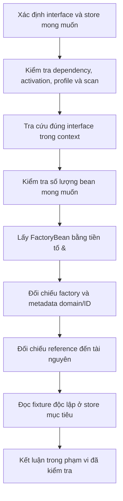

# Kiểm chứng repository bean đã được đăng ký đúng store

Inject được một repository chưa đủ để kết luận nó đã được đăng ký đúng store. Bạn cần biết interface nào được đăng ký, factory của module nào tạo nó, domain type và kiểu ID có đúng không, rồi mới xác nhận tài nguyên lưu trữ mà bean thực sự sử dụng.

Trong module `SPRING_DATA_COMMONS`, các abstraction như `Repository` và `CrudRepository` dùng chung cho nhiều công nghệ. Chính tính dùng chung này khiến việc kiểm chứng module binding trở nên quan trọng, đặc biệt khi ứng dụng có cả JPA, MongoDB hoặc nhiều nguồn dữ liệu.

Bài thuộc chương **Kích hoạt repository** và hướng tới bốn kết quả:

- Xác nhận bean của đúng repository interface tồn tại với số lượng mong muốn.
- Đối chiếu factory và metadata để xác định module đã tạo repository.
- Kiểm tra cấu hình tài nguyên theo store.
- Thực hiện một phép đọc có căn cứ để xác nhận đường truy cập thực tế.

## 1. Các mức bằng chứng cần phân biệt

| Mức kiểm tra | Bằng chứng thu được | Giới hạn |
| --- | --- | --- |
| Có bean definition hoặc tên bean | Container biết một đăng ký tương ứng | Chưa chứng minh bean khởi tạo thành công hoặc thuộc module mong muốn |
| Lấy được bean theo interface | Có đối tượng phù hợp hợp đồng Java | Đối tượng có thể là mock, adapter hoặc bean tự khai báo |
| Factory và metadata đúng | Hạ tầng repository của module dự kiến đã tham gia tạo bean | Chưa phân biệt mọi database cùng loại |
| Tài nguyên và phép đọc đúng | Bean đọc dữ liệu từ tài nguyên dự kiến trong môi trường kiểm tra | Chưa kiểm tra toàn bộ query hoặc mọi môi trường triển khai |

Một ứng dụng khởi động thành công chỉ chứng minh những điều kiện đã được kiểm tra trong vòng đời khởi tạo đó. Lazy initialization hoặc bootstrap mode có thể làm một số lỗi chỉ xuất hiện khi repository được sử dụng.

Ngược lại, lỗi xuất hiện khi lấy bean chưa chắc do chọn sai store; nó có thể đến từ mapping, tài nguyên hoặc query được chuẩn bị lúc khởi tạo. Cần đọc nguyên nhân gốc.

## 2. Spring Data chọn module cho repository như thế nào?

Khi có nhiều repository factory trên classpath, Spring Data dùng strict repository configuration để phân biệt ứng viên theo thông tin của repository và domain.

Các dấu hiệu quan trọng gồm:

- Interface chuyên biệt của module, chẳng hạn `JpaRepository` hoặc `MongoRepository`.
- Annotation nhận diện domain theo module, chẳng hạn `@Entity` hoặc `@Document`.
- Phạm vi package mà từng cấu hình repository được phép scan.

Một interface chỉ mở rộng `CrudRepository<Customer, Long>` cung cấp hợp đồng dùng chung. Khi có nhiều module, riêng hợp đồng generic đó có thể chưa diễn tả rõ repository thuộc công nghệ nào. [Spring Data Commons — Using Repositories with Multiple Spring Data Modules](https://docs.spring.io/spring-data/commons/reference/repositories/definition.html#repositories.multiple-modules)

### 2.1. Tên interface không quyết định store

Đặt tên `CustomerJpaRepository` giúp con người đọc mã nhưng chưa thay thế hợp đồng hoặc cấu hình. Một interface mang chữ “Jpa” vẫn có thể bị scan sai phạm vi hoặc bị một bean tự khai báo cùng vai trò che khuất.

Tương tự, tên bean `customerRepository` không chứa bằng chứng đầy đủ về module và nguồn dữ liệu.

### 2.2. Domain có nhiều annotation cần được xem xét rõ

Một lớp mang cả annotation entity JPA và document của module khác có thể tạo các dấu hiệu nhận diện chồng lấn. Không mặc định strict mode tự hiểu mong muốn nghiệp vụ của ứng dụng.

Việc phân tách mô hình hoặc giới hạn scan tường minh giúp cấu hình dễ kiểm chứng hơn. Nếu ứng dụng chủ động dùng một mô hình chung, cần làm rõ module binding và kiểm tra nó theo thiết kế đó.

### 2.3. Commons không tự chọn database cho bạn

`Repository<T, ID>` chứa thông tin về kiểu miền và định danh. Nó không tự chọn datasource, MongoDB database, schema hoặc connection factory.

Ngay cả khi module đã đúng, tài nguyên vẫn có thể bị cấu hình nhầm.

## 3. Ví dụ hai store với tín hiệu nhận diện rõ ràng

Phần mã dùng Java 17 trở lên, JPA theo namespace `jakarta.persistence` và repository MongoDB đồng bộ. Mỗi kiểu public nằm trong một file riêng.

Giả định ứng dụng đã có:

- Spring Data JPA và Spring Data MongoDB tương thích với nền tảng đang dùng.
- Một `EntityManagerFactory` và transaction manager JPA phù hợp.
- Một `MongoTemplate` có thể truy cập môi trường MongoDB kiểm tra.
- Cấu hình Spring Boot hoặc cấu hình Spring tương đương để tạo application context.
- Dependency kiểm tra tích hợp nếu dùng các test ở phần sau.

Các mảnh mã không tự tạo database server hoặc thông tin kết nối.

### 3.1. Tách package theo module

```text
com.example.storecheck
├── StoreCheckApplication
├── config
│   ├── JpaRepositoriesConfiguration
│   └── MongoRepositoriesConfiguration
├── jpa
│   ├── domain
│   │   └── CustomerEntity
│   └── repository
│       └── CustomerJpaRepository
└── mongo
    ├── domain
    │   └── CustomerDocument
    └── repository
        └── CustomerMongoRepository
```

Lớp application đặt tại root package:

```java
package com.example.storecheck;

import org.springframework.boot.SpringApplication;
import org.springframework.boot.autoconfigure.SpringBootApplication;

@SpringBootApplication
public class StoreCheckApplication {

    public static void main(String[] args) {
        SpringApplication.run(StoreCheckApplication.class, args);
    }
}
```

Trong ứng dụng Boot với hạ tầng mặc định phù hợp, root package này giúp các thành phần trong ví dụ nằm dưới phạm vi cấu hình. Nếu tự tạo `EntityManagerFactory`, phải cấu hình cả managed entities của nó; repository scanning không tự sửa một persistence unit thiếu entity.

### 3.2. Domain và repository JPA

```java
package com.example.storecheck.jpa.domain;

import jakarta.persistence.Entity;
import jakarta.persistence.Id;
import jakarta.persistence.Table;

@Entity
@Table(name = "customers")
public class CustomerEntity {

    @Id
    private Long id;

    private String marker;

    protected CustomerEntity() {
    }

    public CustomerEntity(Long id, String marker) {
        this.id = id;
        this.marker = marker;
    }

    public Long getId() {
        return id;
    }

    public String getMarker() {
        return marker;
    }
}
```

```java
package com.example.storecheck.jpa.repository;

import com.example.storecheck.jpa.domain.CustomerEntity;
import org.springframework.data.jpa.repository.JpaRepository;

public interface CustomerJpaRepository
        extends JpaRepository<CustomerEntity, Long> {
}
```

### 3.3. Domain và repository MongoDB

```java
package com.example.storecheck.mongo.domain;

import org.springframework.data.annotation.Id;
import org.springframework.data.mongodb.core.mapping.Document;

@Document("customers")
public class CustomerDocument {

    @Id
    private String id;

    private String marker;

    public CustomerDocument() {
    }

    public CustomerDocument(String id, String marker) {
        this.id = id;
        this.marker = marker;
    }

    public String getId() {
        return id;
    }

    public String getMarker() {
        return marker;
    }
}
```

```java
package com.example.storecheck.mongo.repository;

import com.example.storecheck.mongo.domain.CustomerDocument;
import org.springframework.data.mongodb.repository.MongoRepository;

public interface CustomerMongoRepository
        extends MongoRepository<CustomerDocument, String> {
}
```

Hai model đại diện dữ liệu khách hàng theo hai hệ mapping khác nhau. Cặp kiểu cần kiểm tra là:

| Repository | Domain | ID |
| --- | --- | --- |
| `CustomerJpaRepository` | `CustomerEntity` | `Long` |
| `CustomerMongoRepository` | `CustomerDocument` | `String` |

Không chọn kiểu ID theo chuỗi hiển thị trên URL hoặc theo suy đoán từ tên store. Generic phải khớp định danh Java của model đã mapping.

## 4. Giới hạn scan cho từng store

Cấu hình JPA:

```java
package com.example.storecheck.config;

import com.example.storecheck.jpa.repository.CustomerJpaRepository;

import org.springframework.context.annotation.Configuration;
import org.springframework.data.jpa.repository.config.EnableJpaRepositories;

@Configuration(proxyBeanMethods = false)
@EnableJpaRepositories(
        basePackageClasses = CustomerJpaRepository.class)
public class JpaRepositoriesConfiguration {
}
```

Cấu hình MongoDB:

```java
package com.example.storecheck.config;

import com.example.storecheck.mongo.repository.CustomerMongoRepository;

import org.springframework.context.annotation.Configuration;
import org.springframework.data.mongodb.repository.config.EnableMongoRepositories;

@Configuration(proxyBeanMethods = false)
@EnableMongoRepositories(
        basePackageClasses = CustomerMongoRepository.class)
public class MongoRepositoriesConfiguration {
}
```

`basePackageClasses` là cách chọn package bằng kiểu Java đại diện. Nó vẫn scan package và các vùng được cấu hình liên quan, không có nghĩa chỉ đăng ký duy nhất class được truyền.

Các annotation kích hoạt có các lựa chọn riêng theo module. `@EnableJpaRepositories` quản lý repository JPA; `@EnableMongoRepositories` quản lý repository MongoDB. [EnableJpaRepositories API](https://docs.spring.io/spring-data/jpa/docs/current/api/org/springframework/data/jpa/repository/config/EnableJpaRepositories.html), [EnableMongoRepositories API](https://docs.spring.io/spring-data/mongodb/docs/current/api/org/springframework/data/mongodb/repository/config/EnableMongoRepositories.html)

Các ví dụ trên dùng tên tài nguyên mặc định của cấu hình module. Chúng giả định các bean hạ tầng tương ứng đã được cung cấp.

Trong một ứng dụng Boot đơn giản, auto-configuration có thể đã đăng ký repository đúng. Chỉ thêm cấu hình tường minh khi nó giúp diễn tả phạm vi hoặc tài nguyên cần kiểm soát; đồng thời kiểm tra tương tác với auto-configuration thay vì để nhiều phạm vi scan chồng nhau.

## 5. Kiểm tra bean theo interface cụ thể

Trong một phép kiểm tra với `ApplicationContext`:

```java
java.util.Map<String, CustomerJpaRepository> beans =
        context.getBeansOfType(CustomerJpaRepository.class);

if (beans.size() != 1) {
    throw new IllegalStateException(
            "Cần đúng một CustomerJpaRepository, nhận được "
                    + beans.keySet());
}

String beanName = beans.keySet().iterator().next();
CustomerJpaRepository repository = beans.get(beanName);
```

Điểm tốt của cách này:

- Không cần đoán tên bean mặc định.
- Kiểm tra số ứng viên của đúng interface đang quan tâm.
- Có tên bean thực tế để tra cứu factory ở bước tiếp theo.

Tuy nhiên, kiểu interface chưa đủ chứng minh nguồn gốc đối tượng. Một mock hoặc một bean adapter tự khai báo cũng có thể thực hiện `CustomerJpaRepository`.

### 5.1. Phạm vi context cũng quan trọng

`getBeansOfType` xét factory/context tương ứng; với hệ thống có parent/child context, không tự coi kết quả đó đã liệt kê mọi bean ở tất cả tầng.

Nếu cần kiểm tra cả ancestor, chọn cách tra cứu phù hợp như các helper của `BeanFactoryUtils`. Trước hết phải xác định context nào chịu trách nhiệm chứa repository trong kiến trúc của ứng dụng. [ListableBeanFactory API](https://docs.spring.io/spring-framework/docs/current/javadoc-api/org/springframework/beans/factory/ListableBeanFactory.html)

### 5.2. Phép kiểm tra có thể kích hoạt khởi tạo

Tra cứu bean theo kiểu hoặc yêu cầu đối tượng có thể làm factory/repository được khởi tạo. Với cấu hình lazy, đây có thể là lúc lỗi mapping hoặc kết nối lần đầu xuất hiện.

Vì vậy, phân biệt “tên hoặc definition có mặt” với “đã lấy được instance”. Khi mục tiêu là kiểm chứng repository có thể tạo, việc kích hoạt khởi tạo là có chủ đích.

## 6. Lấy đúng factory bằng tiền tố `&`

Repository proxy thường là sản phẩm của một Spring `FactoryBean`. Spring phân biệt hai thao tác tra cứu:

```java
Object repository = context.getBean(beanName);

Object factory = context.getBean("&" + beanName);
```

- Tên thông thường trả sản phẩm repository.
- Tên có tiền tố `&` trả chính factory bean.

Đây là cơ chế của Spring container, không phải quy ước tự đặt tên thêm một bean khác. [Spring Framework — Customizing Instantiation Logic with a FactoryBean](https://docs.spring.io/spring-framework/reference/core/beans/factory-extension.html#beans-factory-extension-factorybean)

Với cấu hình chuẩn, các factory thường gặp là:

| Module dự kiến | Factory bean tương ứng |
| --- | --- |
| JPA | `JpaRepositoryFactoryBean` |
| MongoDB đồng bộ | `MongoRepositoryFactoryBean` |

Hai factory này tích hợp với cơ chế repository của từng module. [JpaRepositoryFactoryBean API](https://docs.spring.io/spring-data/jpa/docs/current/api/org/springframework/data/jpa/repository/support/JpaRepositoryFactoryBean.html), [MongoRepositoryFactoryBean API](https://docs.spring.io/spring-data/mongodb/docs/current/api/org/springframework/data/mongodb/repository/support/MongoRepositoryFactoryBean.html)

### Không suy module từ tên lớp proxy

Các tên runtime như một JDK proxy hoặc một lớp proxy do framework tạo chưa cho biết đầy đủ store. Cả nhiều module đều có thể dùng cơ chế proxy tương tự.

`repository.getClass().getName()` hữu ích để quan sát, nhưng không nên là assertion chính kiểu “tên chứa Jpa thì đúng JPA”.

Nếu ứng dụng dùng factory tùy biến hoặc một lớp bọc repository, phép kiểm tra phải phản ánh cấu trúc đó. Không coi mọi trường hợp không dùng factory chuẩn là sai; cần có bằng chứng thay thế theo thiết kế.

## 7. Đối chiếu metadata từ factory thực tế

`RepositoryFactoryInformation` là hợp đồng Commons cung cấp metadata liên quan đến factory và repository. Từ đó có thể lấy `RepositoryInformation` để xem interface, domain type và ID type. [RepositoryFactoryInformation API](https://docs.spring.io/spring-data/commons/docs/current/api/org/springframework/data/repository/core/support/RepositoryFactoryInformation.html)

Một helper kiểm tra dùng trong test hoặc công cụ chẩn đoán:

```java
import java.util.Map;

import org.springframework.beans.factory.BeanFactory;
import org.springframework.context.ApplicationContext;
import org.springframework.data.repository.core.RepositoryInformation;
import org.springframework.data.repository.core.support.RepositoryFactoryInformation;

public final class RepositoryRegistrationProbe {

    private RepositoryRegistrationProbe() {
    }

    public static <R> String requireSingle(
            ApplicationContext context,
            Class<R> repositoryType,
            Class<?> expectedFactoryType,
            Class<?> expectedDomainType,
            Class<?> expectedIdType) {

        Map<String, R> beans =
                context.getBeansOfType(repositoryType);

        if (beans.size() != 1) {
            throw new IllegalStateException(
                    "Cần một bean cho " + repositoryType.getName()
                            + ", nhận được " + beans.keySet());
        }

        String beanName = beans.keySet().iterator().next();

        Object factory = context.getBean(
                BeanFactory.FACTORY_BEAN_PREFIX + beanName);

        if (!expectedFactoryType.isInstance(factory)) {
            throw new IllegalStateException(
                    "Factory không đúng cho " + beanName
                            + ": " + factory.getClass().getName());
        }

        if (!(factory instanceof RepositoryFactoryInformation<?, ?> info)) {
            throw new IllegalStateException(
                    "Factory không cung cấp metadata repository: "
                            + beanName);
        }

        RepositoryInformation metadata =
                info.getRepositoryInformation();

        if (!metadata.getRepositoryInterface().equals(repositoryType)) {
            throw new IllegalStateException(
                    "Repository interface không khớp: " + beanName);
        }

        if (!metadata.getDomainType().equals(expectedDomainType)) {
            throw new IllegalStateException(
                    "Domain type không khớp: " + beanName);
        }

        if (!metadata.getIdType().equals(expectedIdType)) {
            throw new IllegalStateException(
                    "ID type không khớp: " + beanName);
        }

        return beanName;
    }
}
```

Helper kiểm tra mô hình đăng ký bằng factory chuẩn hoặc subclass phù hợp. Nó kiểm tra chính xác leaf interface được yêu cầu, không chỉ một base repository generic.

`getDomainType`, `getIdType` và `getRepositoryInterface` thuộc metadata repository của Commons. Chúng giúp đối chiếu hợp đồng đã được factory sử dụng. [RepositoryMetadata API](https://docs.spring.io/spring-data/commons/docs/current/api/org/springframework/data/repository/core/RepositoryMetadata.html)

### 7.1. Vì sao dùng `isInstance` cho factory?

`expectedFactoryType.isInstance(factory)` chấp nhận subclass của factory mong muốn. So sánh tuyệt đối `factory.getClass() == ...` có thể loại nhầm một customization hợp lệ.

Nếu factory tùy biến không kế thừa loại chuẩn, cần viết phép kiểm tra phù hợp với customization đó thay vì nới lỏng mọi điều kiện.

### 7.2. Vì sao chưa kiểm tra persistent entity bằng một giả định chung?

Một số persistence mechanism không cung cấp `MappingContext` qua đường này, nên thông tin persistent entity từ factory có thể không sẵn có.

Không dùng việc thiếu đối tượng metadata đó làm kết luận phổ quát rằng repository chắc chắn sai. Hãy chọn API và mức bằng chứng phù hợp module; helper trên tập trung vào interface, domain, ID và factory.

### 7.3. Hợp đồng metadata chưa kiểm tra mọi mapping

ID metadata khớp generic repository vẫn chưa chứng minh mọi annotation, converter hoặc mapping quan hệ đều đúng. Mapping và query có thể cần bước khởi tạo hoặc thao tác dữ liệu bổ sung để kiểm tra.

Đừng thay việc gọi repository bằng cách chỉ tạo metadata phản chiếu từ interface rồi coi như đã kiểm tra đăng ký runtime. Cần kiểm tra đối tượng và factory thực tế trong context.

## 8. Kiểm tra tích hợp cho cả hai module

Trong dự án mẫu, đặt helper ở nguồn test và dùng một profile kiểm tra có hạ tầng thực.

```java
package com.example.storecheck;

import com.example.storecheck.jpa.domain.CustomerEntity;
import com.example.storecheck.jpa.repository.CustomerJpaRepository;
import com.example.storecheck.mongo.domain.CustomerDocument;
import com.example.storecheck.mongo.repository.CustomerMongoRepository;

import org.junit.jupiter.api.Test;
import org.springframework.beans.factory.annotation.Autowired;
import org.springframework.boot.test.context.SpringBootTest;
import org.springframework.context.ApplicationContext;
import org.springframework.data.jpa.repository.support.JpaRepositoryFactoryBean;
import org.springframework.data.mongodb.repository.support.MongoRepositoryFactoryBean;
import org.springframework.test.context.ActiveProfiles;

import static org.assertj.core.api.Assertions.assertThat;

@SpringBootTest
@ActiveProfiles("store-check")
class RepositoryRegistrationTest {

    @Autowired
    private ApplicationContext context;

    @Test
    void registersJpaRepositoryWithJpaFactory() {
        String beanName = RepositoryRegistrationProbe.requireSingle(
                context,
                CustomerJpaRepository.class,
                JpaRepositoryFactoryBean.class,
                CustomerEntity.class,
                Long.class);

        assertThat(context.getBean(beanName))
                .isInstanceOf(CustomerJpaRepository.class);
    }

    @Test
    void registersMongoRepositoryWithMongoFactory() {
        String beanName = RepositoryRegistrationProbe.requireSingle(
                context,
                CustomerMongoRepository.class,
                MongoRepositoryFactoryBean.class,
                CustomerDocument.class,
                String.class);

        assertThat(context.getBean(beanName))
                .isInstanceOf(CustomerMongoRepository.class);
    }
}
```

Helper của phần 7 cần đặt cùng package `com.example.storecheck` hoặc được import tương ứng.

Các test này kiểm tra số lượng bean, loại factory và metadata của hai repository cụ thể. Chúng chưa chứng minh đang dùng đúng database hoặc đúng schema nếu có nhiều tài nguyên cùng công nghệ.

### 8.1. Không thay repository thật bằng mock trong phép kiểm tra này

Mục tiêu là kiểm tra đăng ký của Spring Data. Nếu một annotation test hoặc một cấu hình đã thay repository bằng mock, việc inject được interface không còn kiểm chứng đường tạo repository thật.

Một unit test service dùng mock có mục tiêu khác và vẫn có thể hữu ích. Nó không thay thế phép kiểm tra factory trong context.

### 8.2. Slice test có phạm vi bằng chứng riêng

Một test chỉ khởi tạo lát cắt JPA có thể xác nhận phần JPA trong context đó. Nó chưa chứng minh ứng dụng đầy đủ phân biệt đúng các module khi cả JPA và MongoDB cùng hiện diện.

Chọn phạm vi test theo câu hỏi đang kiểm chứng. Profile kiểm tra cũng cần phản ánh các cấu hình activation liên quan, thay vì vô tình loại bỏ toàn bộ module cần phân biệt.

### 8.3. Kết quả cần đọc đúng

Nếu các test trên thành công trong dự án đã cấu hình, có thể kết luận các đăng ký được kiểm tra khớp factory và metadata dự kiến trong context đó.

Đây là mã kiểm tra để áp dụng vào dự án mẫu, không phải báo cáo rằng một application context cụ thể đã được khởi động trong bài.

## 9. Đúng module vẫn có thể sai tài nguyên cùng loại

Hai repository đều do JPA factory tạo nhưng có thể cần hai persistence unit khác nhau. Tương tự, hai repository MongoDB có thể phải dùng hai `MongoTemplate` khác nhau.

Với JPA, cấu hình tài nguyên có thể được chỉ rõ bằng:

```java
@EnableJpaRepositories(
        basePackageClasses = CustomerJpaRepository.class,
        entityManagerFactoryRef = "customerEntityManagerFactory",
        transactionManagerRef = "customerTransactionManager")
```

Với MongoDB:

```java
@EnableMongoRepositories(
        basePackageClasses = CustomerMongoRepository.class,
        mongoTemplateRef = "customerMongoTemplate")
```

Đây là các phương án thay thế cho annotation ở phần 4 khi ứng dụng có những bean hạ tầng được đặt tên như trên. Các chuỗi tên không tự tạo `EntityManagerFactory`, transaction manager hoặc template.

Cần đối chiếu:

| Trường hợp | Những gì cần xác nhận |
| --- | --- |
| Nhiều JPA persistence unit | Package repository, managed entities, EMF reference và transaction manager tương ứng |
| Nhiều datasource | EMF thực sự dùng datasource nào, database/schema và profile nào |
| Nhiều Mongo template | Template reference, database và collection mapping |
| Nhiều profile hoặc cấu hình test | Bean hạ tầng nào đang có hiệu lực trong lượt chạy đó |

Factory đúng loại chỉ trả lời câu hỏi về module. Nó không tự phân biệt database A với database B.

## 10. Phép đọc fixture để xác nhận đích truy cập

Một cách kiểm tra hữu ích là dùng dữ liệu đánh dấu có chủ đích trong tài nguyên dự kiến.

Giả sử môi trường kiểm tra được chuẩn bị độc lập:

| Tài nguyên dự kiến | Fixture |
| --- | --- |
| Database/schema JPA mục tiêu | Customer ID `9001`, marker `jpa-target-A` |
| MongoDB database mục tiêu | Document ID `storecheck-customer`, marker `mongo-target-A` |

Fixture cần được tạo qua kết nối hoặc client đã biết là trỏ đúng tài nguyên dự kiến, sau khi schema được khởi tạo và trước phép đọc kiểm tra.

Không seed qua chính repository đang nghi bị nối sai rồi đọc lại bằng repository đó để chứng minh đúng đích. Cả hai thao tác có thể cùng đi vào một tài nguyên sai mà test vẫn thành công.

### 10.1. Phép đọc JPA

Trong một test đã có fixture:

```java
CustomerJpaRepository repository =
        context.getBean(CustomerJpaRepository.class);

CustomerEntity marker = repository.findById(9001L)
        .orElseThrow(() -> new AssertionError(
                "Không đọc được fixture JPA ở tài nguyên dự kiến"));

assertThat(marker.getMarker()).isEqualTo("jpa-target-A");
```

### 10.2. Phép đọc MongoDB

```java
CustomerMongoRepository repository =
        context.getBean(CustomerMongoRepository.class);

CustomerDocument marker =
        repository.findById("storecheck-customer")
                .orElseThrow(() -> new AssertionError(
                        "Không đọc được fixture MongoDB ở tài nguyên dự kiến"));

assertThat(marker.getMarker()).isEqualTo("mongo-target-A");
```

Hai đoạn trên là nội dung cho các test riêng. Chúng yêu cầu fixture thực sự đã được chuẩn bị; phần mã không tự tạo dữ liệu.

### 10.3. Tránh fixture không phân biệt được tài nguyên

Nếu mọi database đều chứa cùng ID và cùng marker, phép đọc đó không phân biệt được đích.

Có thể dùng marker khác nhau giữa các tài nguyên hoặc chọn fixture riêng cho môi trường kiểm tra. Khi cần phân biệt hai database JPA cùng kiểu, dữ liệu đánh dấu phải giúp phát hiện nhầm database, không chỉ phát hiện thiếu kết nối.

Nếu còn nghi ngờ cache hoặc context dữ liệu đang che việc truy cập, chọn một ngữ cảnh đọc độc lập và quan sát hoạt động phía store phù hợp. Không dựa vào một đối tượng đã có sẵn trong bộ nhớ làm bằng chứng duy nhất.

### 10.4. Phạm vi phép đọc

Phép đọc fixture chứng minh một đường truy cập theo ID và mapping cần thiết cho nó. Nó chưa kiểm tra mọi derived query, projection, auditing hoặc giao dịch ghi.

Các khả năng bổ sung cần phép kiểm tra riêng theo yêu cầu và mức hỗ trợ của store.

## 11. Dùng log và auto-configuration report để khoanh vùng

Trong cấu hình của dự án kiểm tra, có thể bật:

```properties
logging.level.org.springframework.data.repository.config=DEBUG
debug=true
```

Log repository giúp quan sát quá trình scan, nhận diện ứng viên và đăng ký. Với Boot, chế độ debug cung cấp condition evaluation report để xem auto-configuration nào áp dụng hoặc không áp dụng. [Spring Boot — Auto-configuration](https://docs.spring.io/spring-boot/reference/using/auto-configuration.html)

Các câu hỏi cần trả lời từ log:

1. Module nào đang thực hiện repository scan?
2. Package scan có bao phủ đúng interface không?
3. Có interface bị loại vì không xác định được module binding không?
4. Có hai cấu hình cùng cố đăng ký một repository hoặc cùng tên bean không?
5. Auto-configuration bị thay thế hoặc không thỏa điều kiện vì bean nào?

Log cho biết một số lượng repository được tìm thấy chưa chứng minh từng repository cụ thể được gắn đúng module. Cần đối chiếu tên interface, factory và metadata.

Thông điệp log có thể thay đổi theo phiên bản. Kiểm tra nên dựa vào API và hành vi khi có thể, thay vì assertion nguyên văn một dòng log.

## 12. Quy trình chẩn đoán theo dấu hiệu

| Dấu hiệu | Điểm kiểm tra trước | Điều không nên kết luận vội |
| --- | --- | --- |
| Không có bean theo interface | Activation, profile, package scan và module dependency | Không phải mọi trường hợp đều thiếu `@Repository` |
| Có nhiều bean cùng phù hợp | Các đăng ký cụ thể, alias, cấu hình tự tạo và phạm vi context | `@Primary` không tự sửa store binding của các bean |
| Bean có mặt nhưng không lấy được factory bằng `&` | Mock, adapter hoặc cách đăng ký tùy biến | Không mặc định đối tượng đó được factory chuẩn của Spring Data tạo |
| Factory khác module dự kiến | Scan, interface chuyên biệt và annotation domain | Tên interface chứa tên store chưa đủ |
| Factory đúng nhưng domain/ID không khớp | Generic, base interface và bean đang tra cứu | Không sửa bằng raw type hoặc ép kiểu |
| Factory và metadata đúng nhưng fixture sai | Reference đến EMF/template, database/schema và profile | Factory cùng loại chưa chứng minh cùng tài nguyên |
| Context khởi động nhưng lần gọi đầu lỗi | Lazy/bootstrap mode, mapping, query và kết nối | Startup thành công chưa kiểm tra mọi đường thực thi |
| Repository bị đăng ký trùng | Cấu hình scan và cơ chế auto-configuration | Cho phép override tên bean có thể che mất nguyên nhân |

### 12.1. `@Qualifier` và `@Primary` giải quyết lựa chọn injection

Các cơ chế này giúp chọn một bean trong số ứng viên. Chúng không thay factory đã tạo bean hoặc tự chuyển repository từ MongoDB sang JPA.

Nếu có hai bean cùng interface nhưng một bean cấu hình sai store, chọn bean còn lại không làm đăng ký sai biến mất. Cần sửa hoặc giải thích rõ toàn bộ cấu hình theo thiết kế.

### 12.2. Không sửa mù bằng annotation

Thêm `@Repository` lên interface không thay thế repository activation. Thêm `@ComponentScan` không tự cấu hình đầy đủ entity scanning, repository scanning và tài nguyên.

Nếu một base interface generic không phải repository cụ thể, kiểm tra cách dùng `@NoRepositoryBean`. Không đặt annotation này lên leaf repository đang muốn tạo chỉ để làm lỗi đăng ký biến mất.

### 12.3. Hợp đồng đúng vẫn cần tài nguyên đúng

Một test chỉ so sánh generic hoặc chỉ nhìn annotation trên source mới kiểm tra ý định khai báo. Để kiểm chứng runtime, cần đối chiếu context, factory và tài nguyên được sử dụng.

## 13. Thứ tự thực hiện kiểm chứng



Thứ tự này giúp mỗi kết luận có bằng chứng:

- “Bean tồn tại” dựa trên tra cứu context.
- “Bean do module dự kiến tạo” dựa trên factory tương ứng.
- “Bean mang hợp đồng đúng” dựa trên metadata.
- “Bean đi đến tài nguyên dự kiến” dựa trên cấu hình và phép đọc phân biệt đích.

Nếu hệ thống dùng factory, proxy hoặc context tùy biến, điều chỉnh cách thu bằng chứng theo cấu trúc đó. Không bỏ các câu hỏi chỉ vì một helper tiêu chuẩn không áp dụng nguyên vẹn.

## 14. Bài tập củng cố

### Tình huống A: ứng dụng có cả JPA và MongoDB nhưng repository chỉ dùng Commons

Một interface mở rộng `CrudRepository<Customer, Long>`, domain không có dấu hiệu nhận diện rõ cho module và phạm vi scan hai bên chồng nhau.

**Hướng xử lý:** làm rõ module binding bằng interface chuyên biệt, mapping và phạm vi scan phù hợp. Sau đó kiểm tra factory thực tế; không dựa vào tên repository.

### Tình huống B: inject được repository trong test có mock

Service test inject được `CustomerJpaRepository` và chạy thành công với dữ liệu giả.

**Giới hạn:** test kiểm tra tương tác với mock, chưa kiểm tra Spring Data đã đăng ký repository JPA thật. Cần một phép kiểm tra context và factory riêng.

### Tình huống C: factory JPA đúng nhưng customer được đọc từ database khác

Ứng dụng có hai `EntityManagerFactory` cùng hoạt động. Generic và factory type đều khớp, nhưng marker không đúng.

**Hướng xử lý:** kiểm tra `entityManagerFactoryRef`, transaction manager và datasource/schema của persistence unit được repository sử dụng.

### Tình huống D: có tên bean nhưng lần lấy đầu tiên thất bại

Repository được cấu hình khởi tạo muộn. Kiểm tra definition thành công nhưng `getBean` hoặc lời gọi đầu tiên báo lỗi.

**Giải thích:** definition và instance là hai mức bằng chứng khác nhau. Đọc nguyên nhân gốc để phân biệt lỗi mapping, query hoặc tài nguyên.

### Tình huống E: test ghi rồi đọc bằng cùng một repository và đều thành công

Nhóm phát triển coi đó là bằng chứng repository đã nối đúng tài nguyên.

**Giới hạn:** cả hai thao tác có thể cùng dùng một tài nguyên sai. Cần fixture được chuẩn bị qua đích dự kiến một cách độc lập hoặc bằng chứng phân biệt tài nguyên tương đương.

Kiểm chứng đúng store cần nối được ý định cấu hình với đối tượng runtime và đích dữ liệu thực tế. Khi có đủ bằng chứng về bean, factory, metadata và tài nguyên, bạn mới có nền tảng rõ ràng để tiếp tục kiểm tra các khả năng repository theo từng module.
