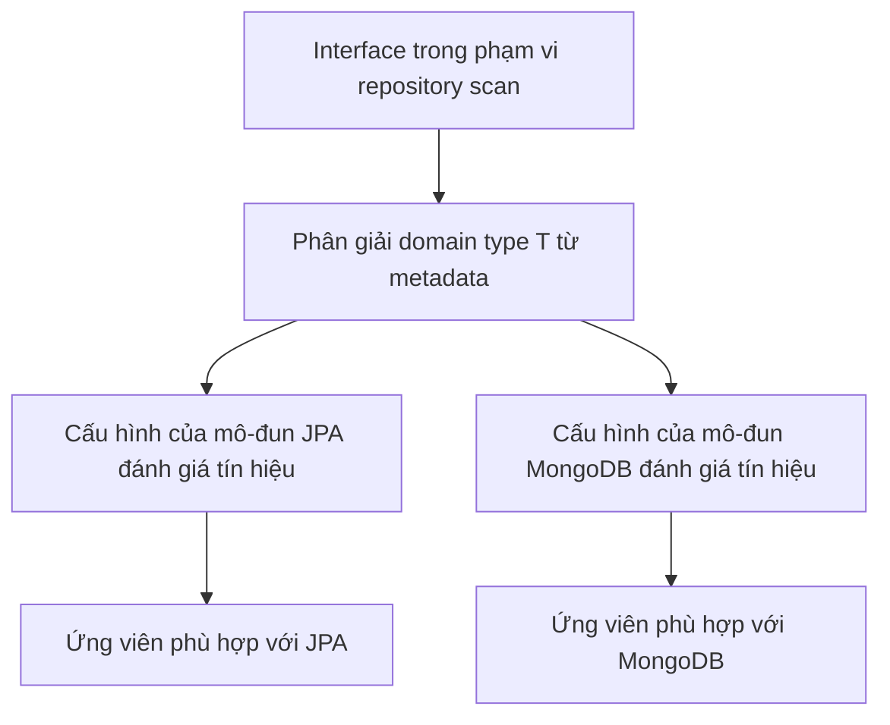

# Phân loại theo annotation của kiểu miền

Khi nhiều mô-đun Spring Data cùng có mặt, hạ tầng phải xác định repository nào thuộc mô-đun nào. Một interface chỉ kế thừa `CrudRepository<T, ID>` sử dụng contract chung của Spring Data Commons, nên bản thân quan hệ kế thừa đó chưa nói rõ repository dành cho JPA, MongoDB hay một công nghệ khác.

Một nguồn thông tin quan trọng là **annotation mà mô-đun nhận diện trên kiểu miền `T`**. Chẳng hạn, entity JPA và document MongoDB mang những tín hiệu mapping khác nhau, giúp hạ tầng đánh giá repository có phù hợp với mô-đun đang xử lý hay không.

Bài học thuộc chương **Nhiều store** của mô-đun **SPRING_DATA_COMMONS**. Chúng ta tập trung vào cách phân loại dựa trên annotation của kiểu miền, giới hạn của tín hiệu này và cách thiết kế mô hình để tránh gán repository mơ hồ.

## 1. Vì sao cần phân loại khi dùng nhiều store?

Giả sử ứng dụng cùng dùng:

- Spring Data JPA để lưu dữ liệu quan hệ.
- Spring Data MongoDB để lưu tài liệu.
- Các contract dùng chung như `Repository` và `CrudRepository`.

Với khai báo:

```java
import org.springframework.data.repository.CrudRepository;

public interface CustomerRepository
        extends CrudRepository<Customer, Long> {
}
```

Java biết kiểu miền là `Customer` và kiểu định danh là `Long`. Nhưng `CrudRepository` không tự chọn công nghệ lưu trữ.

Khi phát hiện nhiều mô-đun repository, Spring Data có cơ chế cấu hình nghiêm ngặt hơn để nhận diện sự phù hợp của repository với từng mô-đun. Các tín hiệu thường bao gồm:

| Tín hiệu | Ví dụ | Vai trò |
| --- | --- | --- |
| Interface đặc trưng được kế thừa | `JpaRepository`, `MongoRepository` | Thể hiện quan hệ contract với một mô-đun |
| Annotation được nhận diện trên kiểu miền | `@Entity`, `@Document` của MongoDB | Thể hiện thông tin mapping mà mô-đun biết xử lý |
| Phạm vi cấu hình repository | Các base package riêng | Giới hạn interface mà mỗi cấu hình xem xét |

Bài này đi sâu vào tín hiệu thứ hai. Không nên tách nó khỏi phạm vi quét và các điều kiện tích hợp còn lại.

“Nhiều mô-đun repository” cũng khác với “nhiều datasource của cùng một mô-đun”. Hai nguồn dữ liệu JPA đều dùng cùng mô hình annotation JPA; annotation không tự phân biệt hai nguồn đó.

## 2. Kiểu miền được xét là kiểu nào?

Trong:

```java
CrudRepository<CustomerEntity, Long>
```

kiểu miền là `CustomerEntity`, không phải interface repository và cũng không phải `Long`.

Hạ tầng đọc metadata repository, phân giải generic và xác định kiểu miền liên quan. Sau đó, phần cấu hình của mô-đun có thể kiểm tra những annotation mà nó nhận diện trên kiểu đó.

Quá trình vẫn có thể đi qua interface trung gian:

```java
import org.springframework.data.repository.CrudRepository;
import org.springframework.data.repository.NoRepositoryBean;

@NoRepositoryBean
public interface BaseRepository<T, ID>
        extends CrudRepository<T, ID> {
}
```

```java
public interface CustomerRepository
        extends BaseRepository<CustomerEntity, Long> {
}
```

Đối với repository cụ thể, `T` được phân giải thành `CustomerEntity`. `@NoRepositoryBean` chỉ ngăn tạo bean trực tiếp cho interface cơ sở; nó không tự chỉ định store cho các interface con.

Điểm cần giữ rõ:

- Annotation trên kiểu miền phục vụ phân loại theo metadata miền.
- Annotation stereotype trên repository không thay thế metadata đó.
- Tên interface có chữ “Jpa” hoặc “Mongo” chỉ là tên nếu nó không mang thêm quan hệ kiểu hoặc cấu hình tương ứng.

## 3. Ví dụ tín hiệu của JPA và MongoDB

| Mô-đun minh họa | Annotation miền tiêu biểu | Kiểu annotation đầy đủ |
| --- | --- | --- |
| Spring Data JPA trong môi trường Jakarta Persistence | `@Entity` | `jakarta.persistence.Entity` |
| Spring Data MongoDB | `@Document` | `org.springframework.data.mongodb.core.mapping.Document` |

Đây là các ví dụ tiêu biểu, không phải danh sách đầy đủ mọi annotation của mọi mô-đun. Tập tín hiệu được nhận diện là quyết định của từng mô-đun và phiên bản tương ứng.

### 3.1. Phải kiểm tra đúng kiểu annotation, không chỉ tên ngắn

Hai annotation có cùng tên đơn giản ở hai package khác nhau vẫn là hai kiểu Java khác nhau.

Một annotation tên `Document` do công nghệ khác cung cấp không tự trở thành annotation document của MongoDB. Khi chẩn đoán, hãy kiểm tra import và tên đầy đủ thay vì chỉ nhìn chữ `@Document` trên màn hình.

Tương tự, các ví dụ Jakarta Persistence dùng `jakarta.persistence`. Dự án cần một bộ phiên bản phù hợp; không trộn ngẫu nhiên annotation của các thế hệ persistence khác nhau.

### 3.2. Nội dung tên bảng hoặc collection không chọn mô-đun

Trong:

```java
@Entity(name = "CustomerRecord")
```

hoặc:

```java
@Document(collection = "customer_records")
```

tên entity hoặc collection có ý nghĩa mapping trong công nghệ tương ứng. Nó không phải tên bean repository và không phải một quy tắc chọn datasource.

Mô-đun nhận diện kiểu annotation mà nó hỗ trợ, không đoán công nghệ từ chuỗi `customer_records`.

## 4. Mỗi mô-đun đánh giá ứng viên của mình

Có thể hình dung cơ chế theo trách nhiệm như sau:



Đây là mô hình giải thích, không phải mô tả một bộ định tuyến trung tâm tự chọn một store thắng cuộc rồi loại bỏ mọi store còn lại.

Trong cách nhận diện nghiêm ngặt thông thường, một mô-đun có thể dựa vào interface đặc trưng **hoặc** annotation miền mà nó nhận diện để đánh giá sự phù hợp. Các điều kiện khác của mô-đun và cấu hình vẫn có thể tham gia.

Hệ quả quan trọng: **có một tín hiệu phù hợp với JPA không tự làm mọi tín hiệu MongoDB biến mất**. Nếu cùng kiểu miền mang annotation được nhiều mô-đun nhận diện và vùng quét chồng nhau, nhiều mô-đun có thể cùng xem repository là ứng viên.

Không dựa vào thứ tự startup để mong một mô-đun “chọn trước” rồi giải quyết hết sự mơ hồ.

## 5. Mô hình thực hành có tín hiệu riêng cho từng store

Ví dụ chọn hai mô hình persistence riêng cho cùng khái niệm khách hàng:

```text
example.multistore.jpa.entity.CustomerEntity
example.multistore.mongo.document.CustomerDocument
```

Các đoạn mã minh họa dùng Jakarta Persistence cho JPA và annotation MongoDB tương ứng. Môi trường phải có các mô-đun, provider/client và cấu hình kết nối phù hợp.

### 5.1. Mô hình JPA

```java
package example.multistore.jpa.entity;

import jakarta.persistence.Entity;
import jakarta.persistence.GeneratedValue;
import jakarta.persistence.Id;
import jakarta.persistence.Table;

@Entity
@Table(name = "customers")
public class CustomerEntity {

    @Id
    @GeneratedValue
    private Long id;

    private String name;

    protected CustomerEntity() {
    }

    public CustomerEntity(String name) {
        this.name = name;
    }

    public Long getId() {
        return id;
    }

    public String getName() {
        return name;
    }
}
```

Ở đây, `@Entity` là tín hiệu tiêu biểu cho môi trường JPA. `@Table` mô tả bảng theo mapping JPA; nó không tự cung cấp kết nối.

### 5.2. Mô hình MongoDB

```java
package example.multistore.mongo.document;

import org.springframework.data.annotation.Id;
import org.springframework.data.mongodb.core.mapping.Document;

@Document(collection = "customer_profiles")
public class CustomerDocument {

    @Id
    private String id;

    private String name;

    public CustomerDocument() {
    }

    public CustomerDocument(String name) {
        this.name = name;
    }

    public String getId() {
        return id;
    }

    public String getName() {
        return name;
    }
}
```

`@Document` thể hiện mapping tài liệu MongoDB. Kiểu ID `String` là lựa chọn của mô hình ví dụ, không phải một quy tắc rằng mọi repository MongoDB đều phải dùng String.

### 5.3. Repository vẫn có thể dùng contract chung

```java
package example.multistore.jpa.repository;

import example.multistore.jpa.entity.CustomerEntity;

import org.springframework.data.repository.CrudRepository;

public interface RelationalCustomerRepository
        extends CrudRepository<CustomerEntity, Long> {
}
```

```java
package example.multistore.mongo.repository;

import example.multistore.mongo.document.CustomerDocument;

import org.springframework.data.repository.CrudRepository;

public interface DocumentCustomerRepository
        extends CrudRepository<CustomerDocument, String> {
}
```

Cả hai đều kế thừa `CrudRepository`, không kế thừa trực tiếp `JpaRepository` hoặc `MongoRepository`.

Trong ví dụ này, thông tin annotation trên kiểu miền là tín hiệu phân loại quan trọng. Các tên `RelationalCustomerRepository` và `DocumentCustomerRepository` giúp con người đọc mã; tên gọi không thay thế cơ chế metadata.

## 6. Kết hợp annotation với phạm vi cấu hình rõ ràng

Một cấu trúc package có chủ đích:

```text
example.multistore
  config

example.multistore.jpa
  entity
  repository

example.multistore.mongo
  document
  repository
```

Ví dụ cấu hình trong ứng dụng Spring Boot 3.x:

```java
package example.multistore.config;

import example.multistore.jpa.entity.CustomerEntity;
import example.multistore.jpa.repository.RelationalCustomerRepository;
import example.multistore.mongo.repository.DocumentCustomerRepository;

import org.springframework.boot.autoconfigure.domain.EntityScan;
import org.springframework.context.annotation.Configuration;
import org.springframework.data.jpa.repository.config.EnableJpaRepositories;
import org.springframework.data.mongodb.repository.config.EnableMongoRepositories;

@Configuration
@EntityScan(basePackageClasses = CustomerEntity.class)
@EnableJpaRepositories(
    basePackageClasses = RelationalCustomerRepository.class
)
@EnableMongoRepositories(
    basePackageClasses = DocumentCustomerRepository.class
)
public class CustomerStoreConfiguration {
}
```

Cấu hình giả định đã được nạp vào context và ứng dụng có hạ tầng JPA/MongoDB cần thiết. Đây không phải cấu hình hoàn chỉnh để tự tạo mọi kết nối.

Ba điểm khác nhau:

| Thành phần | Vai trò |
| --- | --- |
| `@EntityScan` | Chỉ rõ package entity trong môi trường Spring Boot đang minh họa |
| `@EnableJpaRepositories` | Chỉ rõ vùng interface repository do cấu hình JPA xử lý |
| `@EnableMongoRepositories` | Chỉ rõ vùng interface repository do cấu hình MongoDB xử lý |

Annotation miền và package scan không thay thế nhau. Phạm vi scan quyết định những interface được xem xét; metadata miền giúp mô-đun nhận diện tính phù hợp và mapping.

Khi dùng cấu hình tường minh, cũng cần kiểm soát các cấu hình khác để tránh quét chồng. Không chỉ nhìn riêng một class cấu hình rồi kết luận toàn bộ ứng dụng đã có phạm vi tách biệt.

## 7. Các tình huống phân loại thường gặp

Bảng dưới giả định môi trường nhiều mô-đun JPA/MongoDB, cơ chế nhận diện thông thường và không có filter hoặc factory tùy chỉnh làm thay đổi quy tắc.

| Kiểu miền | Contract repository | Nhận định về tín hiệu |
| --- | --- | --- |
| Chỉ có `@Entity` phù hợp | `CrudRepository` | Có tín hiệu miền tiêu biểu cho JPA |
| Chỉ có `@Document` của MongoDB | `CrudRepository` | Có tín hiệu miền tiêu biểu cho MongoDB |
| Không có annotation nhận diện phù hợp | `CrudRepository` | Thiếu thông tin rõ ràng để gán theo hai tín hiệu đang xét |
| Có cả hai annotation | `CrudRepository` | Có thể phù hợp với nhiều mô-đun khi cùng được xem xét |
| Không có mapping entity JPA hợp lệ | `JpaRepository` | Có tín hiệu từ interface, nhưng chưa chứng minh mapping JPA hợp lệ |
| Có mapping miền rõ ràng nhưng nằm ngoài scan | Contract phù hợp | Annotation không làm interface tự xuất hiện trong phạm vi quét |

Bảng giúp xác định điều cần kiểm tra. Nó không cam kết mọi trường hợp sai sẽ phát sinh cùng một exception hoặc tại cùng một thời điểm.

### Nhận diện được khác với sử dụng được

Một repository có thể được gán cho mô-đun nhờ interface đặc trưng, nhưng sau đó thất bại vì kiểu miền chưa phải một đối tượng persistence hợp lệ.

Ngược lại, một class có `@Entity` hợp lệ không tự tạo repository nếu không có interface tương ứng được đăng ký.

Cần phân biệt:

1. Tín hiệu để mô-đun nhận diện ứng viên.
2. Mapping hợp lệ để thực hiện persistence.
3. Cấu hình runtime để truy cập đúng kho dữ liệu.

## 8. Kiểu miền có nhiều annotation: vì sao dễ mơ hồ?

Xét mô hình minh họa:

```java
package example.multistore.shared;

@jakarta.persistence.Entity
@org.springframework.data.mongodb.core.mapping.Document(
    collection = "hybrid_customers"
)
public class HybridCustomer {

    @jakarta.persistence.Id
    @org.springframework.data.annotation.Id
    private String id;

    private String name;
}
```

Repository chung:

```java
import org.springframework.data.repository.CrudRepository;

public interface HybridCustomerRepository
        extends CrudRepository<HybridCustomer, String> {
}
```

Đoạn mã dùng tên annotation đầy đủ để làm rõ hai hệ mapping. Nó phục vụ quan sát tín hiệu, không phải một mẫu hoàn chỉnh để dùng chung persistence cho hai store.

Nếu cả cấu hình JPA và MongoDB cùng xem xét interface này:

- Phần JPA thấy annotation miền thuộc hệ JPA.
- Phần MongoDB thấy annotation miền thuộc hệ MongoDB.
- Contract CRUD chung không phân biệt một lựa chọn duy nhất.

Kết quả có thể dẫn đến nhiều ứng viên quản lý, xung đột đăng ký hoặc lỗi tích hợp ở bước sau, tùy cấu hình. Không khẳng định mọi môi trường phải báo một thông báo lỗi duy nhất.

### Đổi sang JpaRepository có tự giải quyết mọi trường hợp không?

Không nên giả định có một thứ tự ưu tiên toàn cục rằng interface đặc trưng sẽ tự vô hiệu hóa mọi annotation của store khác.

Nếu mô-đun khác vẫn xem xét cùng repository và nhận ra annotation miền của nó, sự chồng tín hiệu vẫn cần được xử lý bằng thiết kế và cấu hình rõ ràng.

### Một class mang nhiều annotation có bị cấm hoàn toàn không?

Java cho phép class mang nhiều annotation. Một hệ thống có thể chủ đích tích hợp một kiểu với nhiều công nghệ nếu quản lý đầy đủ các ngữ cảnh tương ứng.

Nhưng đó là một lựa chọn cần kiểm soát, không phải một lời hứa rằng Spring Data sẽ tự tìm ra nơi lưu đúng cho mọi lời gọi. Với nhiều ứng dụng, tách mô hình persistence là cách dễ theo dõi hơn.

## 9. Những annotation không tự chọn store thay bạn

### 9.1. Annotation định danh dùng chung

`org.springframework.data.annotation.Id` mô tả vai trò định danh trong các mô-đun hỗ trợ nó. Không nên coi annotation ID dùng chung này là dấu hiệu độc quyền của MongoDB.

Đối với JPA, annotation định danh và việc khai báo entity có quy tắc riêng. Chỉ thêm một field ID không thay thế một mô hình JPA hợp lệ.

Trong chiến lược phân loại đang xét, cần tìm annotation mà mô-đun thực sự dùng để nhận diện, không chỉ bất kỳ annotation liên quan tới dữ liệu.

### 9.2. @Repository trên interface

`org.springframework.stereotype.Repository` là stereotype của Spring. Nó có thể mang ý nghĩa đăng ký/tên component trong những cơ chế hỗ trợ, nhưng không tự tuyên bố domain type thuộc JPA hay MongoDB.

### 9.3. @RepositoryDefinition

`@RepositoryDefinition` có thể mô tả domain class và ID class thay cho việc kế thừa marker. Nó không mặc định chỉ định một mô-đun lưu trữ duy nhất.

Sau khi biết domain class, hạ tầng vẫn cần cơ chế phân loại và cấu hình phù hợp.

### 9.4. @Qualifier và @Primary

Qualifier và primary phục vụ lựa chọn dependency trong context theo cơ chế tương ứng. Chúng không làm mapping miền đổi từ JPA sang MongoDB và không sửa một factory đã gán sai.

Tên bean cũng không phải annotation mapping. Một bean tên `mongoCustomerRepository` chưa chứng minh nó được tạo bởi hạ tầng MongoDB.

### 9.5. Annotation do ứng dụng tự đặt

Không giả định một annotation tự tạo như `@StoredInMongo` sẽ được mô-đun nhận diện chỉ vì tên có ý nghĩa với người đọc.

Nếu muốn dùng annotation ghép hoặc cơ chế nhận diện tùy chỉnh, phải xác minh sự hỗ trợ của mô-đun và phiên bản. Với cấu hình thông thường, nên dùng các tín hiệu đã được hỗ trợ và có phạm vi rõ ràng.

## 10. Tách mô hình persistence khi cùng một khái niệm đi qua nhiều store

“Khách hàng” có thể là một khái niệm nghiệp vụ chung, nhưng hai mô hình lưu trữ có mục tiêu khác nhau:

| Mô hình | Mục tiêu |
| --- | --- |
| `CustomerEntity` | Dữ liệu quan hệ và các ràng buộc theo thiết kế JPA |
| `CustomerDocument` | Cấu trúc tài liệu phục vụ nhu cầu MongoDB |
| Kiểu nghiệp vụ hoặc DTO của ứng dụng | Contract không nhất thiết gắn với một mapping cụ thể |

Việc tách mô hình giúp:

- Annotation trên từng kiểu có ý nghĩa rõ ràng.
- Kiểu ID được chọn theo thiết kế tương ứng.
- Quan hệ, cấu trúc tài liệu và cách chuyển đổi không bị trộn.
- Repository có domain type phản ánh đúng mô hình mà nó lưu.
- Thay đổi mapping của một store có phạm vi dễ đánh giá hơn.

Đổi lại, ứng dụng phải duy trì mapping và quyết định nguồn dữ liệu có thẩm quyền. Không tự xuất hiện cơ chế đồng bộ chỉ vì cả hai model cùng nói về khách hàng.

### Repository phải khai báo đúng kiểu được quản lý

Nếu một kiểu nghiệp vụ thuần không có mapping, khai báo:

```java
CrudRepository<Customer, Long>
```

không tự làm hạ tầng tìm tới `CustomerEntity` chỉ vì hai class có các field gần giống nhau.

Adapter của ứng dụng có thể chuyển đổi giữa mô hình nghiệp vụ và mô hình persistence. Repository Spring Data bên trong adapter cần quản lý kiểu phù hợp với mapping, trừ khi hệ thống đã chủ đích xây cơ chế tích hợp khác.

## 11. Phân loại theo annotation không phải định tuyến dữ liệu động

Một ngộ nhận là sau khi có đủ annotation, mỗi lời gọi repository sẽ tự chọn store theo giá trị đầu vào.

Cơ chế đang học chủ yếu phục vụ nhận diện và cấu hình repository. Nó không mặc định có các hành vi sau:

- `save` tự ghi đồng thời vào JPA và MongoDB.
- `findById` thử JPA trước rồi tự tìm tiếp ở MongoDB.
- Dữ liệu được tự đồng bộ giữa entity và document.
- Một giao dịch chung tự bao phủ hai store.
- Một annotation miền quyết định tenant hoặc database vật lý của từng request.

Nếu ứng dụng cần những hành vi đó, phải thiết kế lớp điều phối, đồng bộ, routing hoặc giao dịch theo khả năng thực tế.

Tương tự, hai `EntityManagerFactory` JPA cùng hiểu `@Entity` không thể được phân biệt chỉ bằng annotation này. Cần phạm vi repository và tham chiếu hạ tầng tương ứng.

Annotation giúp nhận diện mô hình công nghệ; nó không thay thế mọi quyết định vận hành dữ liệu.

## 12. Chẩn đoán khi repository bị bỏ qua hoặc bị nhiều mô-đun nhận diện

Có thể kiểm tra theo thứ tự:

1. **Xác định interface cụ thể:** đừng chỉ nhìn interface generic cơ sở.
2. **Phân giải domain type:** kiểu `T` thực sự của repository là class nào?
3. **Kiểm tra import annotation:** dùng đúng kiểu đầy đủ của mô-đun mong muốn không?
4. **Tìm tín hiệu chồng nhau:** domain type có annotation được mô-đun khác nhận diện không?
5. **Kiểm tra quan hệ interface:** repository có kế thừa contract đặc trưng của mô-đun nào không?
6. **Kiểm tra các vùng scan:** mô-đun nào đang được cấu hình xem xét interface?
7. **Kiểm tra mapping và kết nối:** sau phân loại, model có thực thi được persistence không?

Bảng định hướng:

| Dấu hiệu | Điều cần xem xét |
| --- | --- |
| Log không thể gán repository an toàn cho store | Contract chung và domain annotation có đủ tín hiệu phù hợp không? |
| Nhiều mô-đun cùng xem repository là ứng viên | Domain type hoặc vùng scan có chồng tín hiệu không? |
| Repository được nhận diện nhưng báo entity không được quản lý | Mapping và phạm vi persistence của JPA có đúng không? |
| Tên có chữ Mongo nhưng vẫn không được nhận diện đúng | Tên chỉ là tên; kiểm tra kiểu, annotation và cấu hình |
| Đã thêm `@Id` nhưng không giải quyết được phân loại | Annotation định danh có phải tín hiệu chọn store đang được hỗ trợ không? |
| Repository không xuất hiện dù entity có annotation đúng | Interface có nằm trong scan, bị loại hoặc là `@NoRepositoryBean` không? |

Không sửa bằng cách thêm đồng thời annotation của mọi store lên domain type. Điều đó có thể làm tín hiệu chồng nhiều hơn.

Cũng không chỉ đổi bean name rồi coi như đã giải quyết phân loại. Tên riêng có thể tránh một xung đột đăng ký, nhưng không chứng minh repository được gắn đúng implementation.

## 13. Bài tập nhận diện tín hiệu

Các tình huống dưới đây dùng cấu hình nhiều mô-đun thông thường và giả định interface nằm trong vùng được xem xét.

### Tình huống A: CrudRepository với CustomerEntity chỉ có mapping JPA

**Nhận định:** annotation miền cung cấp tín hiệu tiêu biểu cho JPA. Vẫn phải có mapping đầy đủ, persistence unit và hạ tầng thực thi hợp lệ.

### Tình huống B: CrudRepository với CustomerDocument chỉ có mapping MongoDB

**Nhận định:** annotation `@Document` đúng package cung cấp tín hiệu tiêu biểu cho MongoDB. Không suy ra query, chỉ mục hoặc giao dịch đều đã sẵn sàng.

### Tình huống C: CrudRepository với một Customer thuần Java

**Nhận định:** hai generic chưa tự chọn được JPA hay MongoDB. Cần xem model có mapping phù hợp, contract có tín hiệu đặc trưng và phạm vi cấu hình có rõ ràng hay không.

### Tình huống D: một kiểu mang cả Entity và Document

**Nhận định:** khi nhiều mô-đun cùng xem xét, có thể có nhiều tín hiệu phù hợp. Cần tách model hoặc quản lý ngữ cảnh một cách tường minh, không dựa vào thứ tự khởi tạo.

### Tình huống E: đổi tên interface thành MongoCustomerRepository

Interface vẫn chỉ kế thừa `CrudRepository`, trong khi domain type chỉ mang mapping JPA.

**Nhận định:** việc đổi tên không làm annotation hoặc quan hệ kiểu thay đổi. Tên có thể gây hiểu nhầm cho con người mà không cung cấp tín hiệu công nghệ tương ứng cho hạ tầng.

### Tình huống F: hai nguồn JPA cùng dùng CustomerEntity

**Nhận định:** cả hai đều hiểu mô hình JPA. Annotation không chọn được nguồn vật lý mong muốn; cần cấu hình repository và hạ tầng cho từng vùng.

## 14. Điểm cần ghi nhớ

Phân loại theo annotation dựa trên **kiểu miền mà repository quản lý** và **tập annotation mà từng mô-đun nhận diện**. Đây là một cơ chế quan trọng để dùng contract Commons trong ứng dụng nhiều store.

Giữ annotation, quan hệ interface và phạm vi scan nhất quán. Khi tín hiệu thiếu hoặc chồng nhau, hãy làm rõ mô hình và cấu hình thay vì trông chờ một bộ chọn store tự động. Nhận diện đúng repository là bước đầu; mapping, kết nối và hành vi dữ liệu vẫn phải phù hợp với từng mô-đun.
