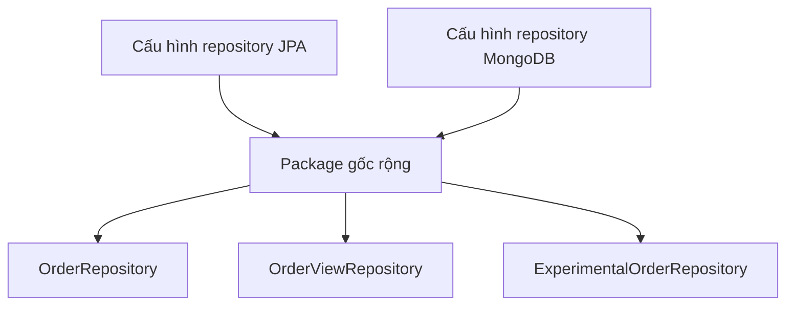
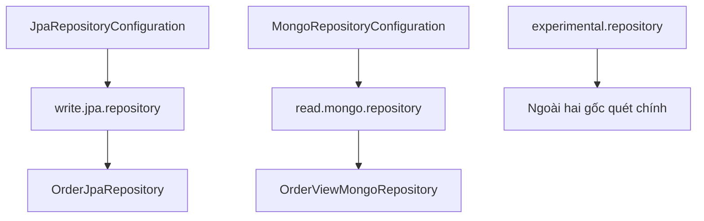

# Tách package để giới hạn quét repository

Khi một ứng dụng chỉ có một module Spring Data, việc đặt tất cả repository dưới package gốc của ứng dụng thường đủ cho ví dụ đầu tiên. Khi thêm store thứ hai, cùng một vùng package rộng có thể bị nhiều cấu hình xét đến. Kết quả có thể là một repository không được nhận diện rõ, bị đăng ký ngoài dự định hoặc gắn với cấu hình persistence không phù hợp.

Trong chương **Nhiều store** của Spring Data Commons (`SPRING_DATA_COMMONS`), bài này tổ chức repository thành các vùng package riêng và giới hạn từng lần quét vào đúng vùng. Ví dụ dùng **Spring Data JPA cho mô hình ghi đơn hàng** và **Spring Data MongoDB cho mô hình đọc đơn hàng**. Đây là cách minh họa ranh giới cấu hình, không phải yêu cầu mọi ứng dụng phải dùng hai database.

Commons cung cấp các abstraction như Repository, CRUD, query method, phân trang, projection và auditing. Tách package giúp xác định nhóm interface nào được một module đưa vào quy trình đăng ký. Nó không làm các store có cùng mapping, cùng khả năng truy vấn hoặc một giao dịch chung.

## 1. Vì sao một package gốc rộng trở thành vấn đề?

Giả sử ban đầu có:

```text
com.example.orders.repository
├── OrderRepository
├── OrderViewRepository
└── ExperimentalOrderRepository
```

Sau đó ứng dụng có cả cấu hình JPA và MongoDB, nhưng cả hai đều quét `com.example.orders`.



Không phải cứ có hai lần quét là chắc chắn mọi interface đều tạo thành hai bean. Hạ tầng còn kiểm tra điều kiện repository và nhận diện module. Tuy nhiên, phạm vi rộng khiến nhiều interface không thuộc trách nhiệm của module vẫn trở thành ứng viên phải được xét.

Khi nhiều module Spring Data cùng hiện diện, việc nhận diện repository có thể chặt hơn, dựa trên những tín hiệu như interface đặc thù hoặc annotation trên kiểu miền. Một repository chỉ kế thừa interface Commons và dùng một kiểu miền không có tín hiệu rõ cho store có thể không được gán cho module như người viết mong đợi.

Tách package làm rõ từ đầu:

```text
Nhóm repository ghi quan hệ -> cấu hình JPA xét
Nhóm repository đọc document -> cấu hình MongoDB xét
Nhóm thử nghiệm -> không nằm trong các gốc quét đang bật
```

Đây là ranh giới ứng viên, chưa phải toàn bộ cấu hình store.

## 2. Thiết kế package theo tính năng và trách nhiệm lưu trữ

Một cấu trúc phù hợp cho ví dụ:

```text
com.example.orders
├── OrdersApplication
├── application
│   └── OrderApplicationService
├── shared
│   └── OrderStatus
├── configuration.persistence
│   ├── JpaRepositoryConfiguration
│   └── MongoRepositoryConfiguration
├── write.jpa
│   ├── model
│   │   └── PurchaseOrderEntity
│   └── repository
│       ├── JpaRepositoryPackage
│       └── OrderJpaRepository
├── read.mongo
│   ├── model
│   │   └── OrderViewDocument
│   └── repository
│       ├── MongoRepositoryPackage
│       └── OrderViewMongoRepository
└── experimental
    └── repository
        └── ExperimentalOrderRepository
```

Các đường dẫn là package và kiểu của ứng dụng minh họa; mỗi kiểu public cần file Java tương ứng khi người học dựng project.

Có thể tổ chức theo tính năng trước rồi theo store, như trên. Một lựa chọn khác là `persistence.jpa` và `persistence.mongo` nếu cấu trúc đó diễn đạt trách nhiệm rõ hơn trong project hiện tại. Điều quan trọng không phải một tên thư mục cố định, mà là **mỗi gốc quét có một ranh giới dễ giải thích**.

| Vùng | Vai trò | Có nên làm gốc quét repository không? |
| --- | --- | --- |
| `configuration.persistence` | Chứa lớp cấu hình kích hoạt. | Không mặc định, vì repository nằm ở nhánh khác. |
| `write.jpa.repository` | Interface cho đường ghi JPA. | Có, cho cấu hình JPA của ví dụ. |
| `read.mongo.repository` | Interface cho mô hình đọc MongoDB. | Có, cho cấu hình MongoDB của ví dụ. |
| `write.jpa.model` | Mapping entity JPA. | Đây là vùng mô hình, không thay cho vùng repository. |
| `shared` | Giá trị hoặc hợp đồng thật sự dùng chung. | Không quét rộng chỉ vì có kiểu dùng chung. |
| `experimental.repository` | Mã thử nghiệm chưa đưa vào cấu hình chạy. | Không thuộc hai gốc chính nếu chưa chủ đích bật. |

Đặt một repository vào package `read` không tự làm nó chỉ đọc. Nếu interface vẫn mở `save` hoặc `delete`, những phương thức ấy vẫn là một phần hợp đồng. Giới hạn quyền thao tác phải được diễn đạt bằng hợp đồng và thiết kế ứng dụng phù hợp, không chỉ bằng tên package.

## 3. Tách cả mô hình persistence khi hai store có vai trò khác nhau

Package repository rõ ràng sẽ hữu ích hơn khi mô hình của mỗi store cũng có trách nhiệm rõ ràng.

### 3.1. Entity cho đường ghi JPA

```java
package com.example.orders.write.jpa.model;

import jakarta.persistence.Entity;
import jakarta.persistence.GeneratedValue;
import jakarta.persistence.GenerationType;
import jakarta.persistence.Id;
import jakarta.persistence.Table;

@Entity
@Table(name = "purchase_orders")
public class PurchaseOrderEntity {

    @Id
    @GeneratedValue(strategy = GenerationType.IDENTITY)
    private Long id;

    private String reference;

    protected PurchaseOrderEntity() {
    }

    public PurchaseOrderEntity(String reference) {
        if (reference == null || reference.isBlank()) {
            throw new IllegalArgumentException("Mã tham chiếu không được rỗng");
        }
        this.reference = reference;
    }

    public Long getId() {
        return id;
    }

    public String getReference() {
        return reference;
    }
}
```

### 3.2. Document cho mô hình đọc MongoDB

```java
package com.example.orders.read.mongo.model;

import org.springframework.data.annotation.Id;
import org.springframework.data.mongodb.core.mapping.Document;

@Document(collection = "order_views")
public class OrderViewDocument {

    @Id
    private String id;

    private Long sourceOrderId;

    private String reference;

    protected OrderViewDocument() {
    }

    public OrderViewDocument(String id, Long sourceOrderId, String reference) {
        this.id = id;
        this.sourceOrderId = sourceOrderId;
        this.reference = reference;
    }

    public String getId() {
        return id;
    }

    public Long getSourceOrderId() {
        return sourceOrderId;
    }

    public String getReference() {
        return reference;
    }
}
```

Hai mô hình có định danh khác nhau:

- `PurchaseOrderEntity.id` là định danh của entity quan hệ trong ví dụ.
- `OrderViewDocument.id` là định danh của document.
- `sourceOrderId` ghi mối liên hệ nghiệp vụ với đơn gốc, không phải một quan hệ được framework tự join xuyên hai store.

Không cần gắn đồng thời `@Entity` và `@Document` lên một lớp chỉ để tiết kiệm vài thuộc tính. Một kiểu miền mang nhiều annotation store có thể cung cấp tín hiệu cho nhiều module và làm ranh giới mapping khó hiểu hơn. Nếu cố ý dùng một kiểu cho nhiều store, phải thiết kế và kiểm tra từng đường mapping, nhận diện module và vòng đời riêng.

Các kiểu giá trị như enum trạng thái hoặc DTO trao đổi có thể dùng chung khi ý nghĩa thật sự thống nhất. Dùng chung giá trị không đồng nghĩa dùng chung mọi annotation và cấu trúc persistence.

## 4. Khai báo repository với tín hiệu module rõ ràng

### 4.1. Repository JPA

```java
package com.example.orders.write.jpa.repository;

import java.util.List;
import com.example.orders.write.jpa.model.PurchaseOrderEntity;
import org.springframework.data.jpa.repository.JpaRepository;

public interface OrderJpaRepository
        extends JpaRepository<PurchaseOrderEntity, Long> {

    List<PurchaseOrderEntity> findByReference(String reference);
}
```

### 4.2. Repository MongoDB

```java
package com.example.orders.read.mongo.repository;

import java.util.List;
import com.example.orders.read.mongo.model.OrderViewDocument;
import org.springframework.data.mongodb.repository.MongoRepository;

public interface OrderViewMongoRepository
        extends MongoRepository<OrderViewDocument, String> {

    List<OrderViewDocument> findBySourceOrderId(Long sourceOrderId);
}
```

Ví dụ dùng interface đặc thù để làm rõ quyền sở hữu module. Các khả năng CRUD và nhiều kiểu truy vấn vẫn liên quan tới abstraction Commons, nhưng phần mở rộng của JPA và MongoDB không trở thành một cam kết chung cho mọi store.

Tên `OrderJpaRepository` hoặc `OrderViewMongoRepository` giúp người đọc và việc đặt tên bean dễ phân biệt. Framework không chọn store chỉ bằng cách đọc hậu tố `Jpa` hoặc `Mongo`; quan hệ kiểu, metadata và cấu hình kích hoạt mới là các yếu tố có ý nghĩa.

Các query method dựa trên thuộc tính của mô hình tương ứng. `sourceOrderId` là thuộc tính trong document, không phải yêu cầu framework truy vấn database JPA trước rồi join kết quả sang MongoDB.

### 4.3. Nếu chỉ muốn kế thừa interface Commons thì sao?

Có thể thiết kế repository dựa trên `CrudRepository`, `Repository` hoặc các hợp đồng Commons khác khi module hỗ trợ. Khi nhiều module cùng hiện diện, vẫn cần tín hiệu nhận diện store phù hợp, chẳng hạn annotation miền được module nhận biết.

Không dùng lập luận “đã tách package nên mọi interface generic với mọi POJO đều sẽ được nhận”. Package thu hẹp vùng xét; tính hợp lệ và khả năng nhận diện module vẫn phải được thỏa mãn.

| Yếu tố | Giúp trả lời câu hỏi nào? |
| --- | --- |
| Package gốc | Interface nào thuộc vùng cần xét của lần quét? |
| Interface đặc thù module | Hợp đồng repository này gắn rõ với module nào? |
| Annotation trên kiểu miền | Mô hình cung cấp tín hiệu mapping/nhận diện store nào? |
| Factory và template/client | Đường thực thi cuối dùng hạ tầng persistence nào? |

## 5. Đặt marker tại đúng ranh giới repository

Marker cho JPA:

```java
package com.example.orders.write.jpa.repository;

public final class JpaRepositoryPackage {
    private JpaRepositoryPackage() {
    }
}
```

Marker cho MongoDB:

```java
package com.example.orders.read.mongo.repository;

public final class MongoRepositoryPackage {
    private MongoRepositoryPackage() {
    }
}
```

Marker là kiểu Java bình thường. Nó không cần `@Repository`, `@Entity`, `@Document` hoặc một bean riêng.

`basePackageClasses` lấy package của marker làm gốc. Nó không chỉ chọn đúng một lớp marker, và không tự tìm ngược lên package cha để quét cả tính năng.

### 5.1. Đúng vị trí quan trọng hơn tên lớp

Nếu chuyển marker JPA vào:

```text
com.example.orders.write.jpa.repository.marker
```

thì các repository ở chính `com.example.orders.write.jpa.repository` nằm phía trên gốc đó và không được bao gồm chỉ vì tên marker vẫn giữ nguyên.

Ngược lại, nếu đặt cả hai marker ở `com.example.orders`, hai cấu hình cùng có một gốc rộng. Hai tên marker khác nhau không tạo ra hai phạm vi khác nhau khi package của chúng giống nhau.

### 5.2. Khi mỗi store có nhiều nhóm repository

Có thể dùng nhiều marker, mỗi marker đặt tại một vùng mà module đó sở hữu:

```java
@EnableJpaRepositories(basePackageClasses = {
    OrdersJpaPackage.class,
    BillingJpaPackage.class
})
```

Đó là tập các gốc cần xét, không phải điều kiện giao nhau. Không thêm một marker ở package cha rộng chỉ để tránh liệt kê những gốc có ranh giới rõ ràng.

## 6. Kích hoạt hai lần quét không chồng phạm vi

### 6.1. Cấu hình JPA

```java
package com.example.orders.configuration.persistence;

import com.example.orders.write.jpa.repository.JpaRepositoryPackage;
import org.springframework.context.annotation.Configuration;
import org.springframework.data.jpa.repository.config.EnableJpaRepositories;

@Configuration(proxyBeanMethods = false)
@EnableJpaRepositories(basePackageClasses = JpaRepositoryPackage.class)
public class JpaRepositoryConfiguration {
}
```

### 6.2. Cấu hình MongoDB

```java
package com.example.orders.configuration.persistence;

import com.example.orders.read.mongo.repository.MongoRepositoryPackage;
import org.springframework.context.annotation.Configuration;
import org.springframework.data.mongodb.repository.config.EnableMongoRepositories;

@Configuration(proxyBeanMethods = false)
@EnableMongoRepositories(basePackageClasses = MongoRepositoryPackage.class)
public class MongoRepositoryConfiguration {
}
```

Hai lớp cần thực sự được nạp vào context, chẳng hạn được quét như configuration dưới package ứng dụng hoặc được import rõ ràng:

```java
@Import({
    JpaRepositoryConfiguration.class,
    MongoRepositoryConfiguration.class
})
```

Các đoạn kích hoạt này giả định hạ tầng JPA và MongoDB tương ứng đã được cấu hình. `@EnableMongoRepositories` không tự cài một MongoDB server; `@EnableJpaRepositories` không tự chọn JDBC URL.

Bản đồ phạm vi lúc này là:



### 6.3. Ma trận kỳ vọng

| Interface | Cấu hình JPA xét? | Cấu hình MongoDB xét? |
| --- | --- | --- |
| `OrderJpaRepository` | Có. | Không nằm trong gốc MongoDB. |
| `OrderViewMongoRepository` | Không nằm trong gốc JPA. | Có. |
| Repository con trong `write.jpa.repository.history` | Có, nếu thỏa điều kiện repository và module. | Không. |
| `ExperimentalOrderRepository` ở nhánh thử nghiệm | Không. | Không. |

Nếu một repository ngoài gốc vẫn có bean, đừng kết luận package marker không hoạt động. Có thể một cấu hình khác hoặc một đường tự cấu hình khác đã đăng ký bean đó.

### 6.4. Dùng `basePackages` nếu phù hợp với project

Có thể diễn đạt cùng ý định bằng chuỗi:

```java
@EnableJpaRepositories(
    basePackages = "com.example.orders.write.jpa.repository"
)
```

```java
@EnableMongoRepositories(
    basePackages = "com.example.orders.read.mongo.repository"
)
```

Tên package không phải đường dẫn `src/main/java` hoặc đường dẫn filesystem. Với chuỗi, compiler không kiểm tra một lỗi chính tả trong package như khi tham chiếu một kiểu Java. Với marker, compiler kiểm tra kiểu tồn tại nhưng vẫn cần xem việc di chuyển marker có làm đổi phạm vi không.

Chọn cách diễn đạt mà project quản lý rõ ràng. Không trộn cả hai với kỳ vọng chúng tạo một phép giao phạm vi nếu chưa xác định cơ chế tổng hợp của annotation.

## 7. Giới hạn quét không thay thế cấu hình persistence

### 7.1. Quét repository khác quét component

Lớp cấu hình phải vào được context bằng component/configuration scanning hoặc import. Nhưng sau khi được nạp, phạm vi repository do annotation kích hoạt tương ứng điều khiển.

Trong Boot, không nên hiểu việc mở rộng `scanBasePackages` trên `@SpringBootApplication` là cách tự động thay đổi mọi vùng entity và repository. Những cơ chế này có quy tắc riêng, dù phạm vi mặc định thường thuận tiện khi các kiểu nằm dưới package ứng dụng.

Một interface được thêm `@Repository` cũng không tự có triển khai Spring Data nếu chưa có cơ chế kích hoạt repository phù hợp.

### 7.2. Quét repository khác mapping kiểu miền

JPA repository đã được chọn vẫn cần `PurchaseOrderEntity` nằm trong persistence unit của factory đang dùng. MongoDB repository cần mapping context có thể xử lý `OrderViewDocument`.

Với Boot và một persistence unit JPA thông thường, entity dưới package gốc phù hợp có thể được phát hiện theo mặc định. Nếu entity ở module hoặc package ngoài vùng mặc định, cấu hình entity scanning hoặc persistence unit cho đúng trường hợp. `basePackageClasses` trên `@EnableJpaRepositories` không tự chuyển thành cấu hình entity scan.

| Tầng cấu hình | Ví dụ vấn đề nếu thiếu hoặc sai |
| --- | --- |
| Nạp configuration | Annotation kích hoạt chưa có hiệu lực. |
| Phạm vi repository | Không tìm thấy interface cần đăng ký hoặc xét thừa interface. |
| Nhận diện module | Không xác định được store phù hợp cho repository. |
| Mapping | Kiểu miền chưa được quản lý hoặc không dựng/lưu được dữ liệu. |
| Kết nối | Driver, client, URL hoặc quyền truy cập không phù hợp. |
| Giao dịch | Đường ghi không dùng transaction manager hoặc ranh giới mong muốn. |

Đặt repository vào đúng package chỉ giải quyết một phần của bảng này.

### 7.3. Mặc định bean và cấu hình có tên riêng

Ở cấu hình thông dụng, JPA repository dùng các hạ tầng theo quy ước như entity manager factory và transaction manager; MongoDB repository dùng `MongoTemplate` tương ứng. Nếu project có nhiều lựa chọn cùng loại, cần chỉ rõ nguồn của từng nhóm.

Ví dụ JPA, khi các bean mang tên dưới đây đã được cấu hình:

```java
@EnableJpaRepositories(
    basePackageClasses = JpaRepositoryPackage.class,
    entityManagerFactoryRef = "ordersEntityManagerFactory",
    transactionManagerRef = "ordersTransactionManager"
)
```

Ví dụ MongoDB, khi có template mang tên tương ứng:

```java
@EnableMongoRepositories(
    basePackageClasses = MongoRepositoryPackage.class,
    mongoTemplateRef = "orderViewsMongoTemplate"
)
```

Đây là các biến thể thay cho cấu hình mặc định, không phải đoạn thêm vào mà không tạo những bean được tham chiếu. Tên bean phải khớp hạ tầng thực tế.

Với hai database đều dùng JPA, vẫn cần tách vùng repository của từng persistence unit và cấu hình factory, entity, datasource cùng transaction manager phù hợp. Với hai database MongoDB, package cũng không tự chọn database; template được gắn vào nhóm repository mới cung cấp đường thực thi tương ứng.

## 8. Đặt hợp đồng repository dùng chung ở đâu?

Một base interface có thể dùng abstraction Commons mà chưa thuộc riêng một store:

```java
package com.example.orders.shared.repository;

import org.springframework.data.repository.CrudRepository;
import org.springframework.data.repository.NoRepositoryBean;

@NoRepositoryBean
public interface BaseRepository<T, ID> extends CrudRepository<T, ID> {
}
```

Interface cơ sở không có domain type cụ thể nên không có mục đích tạo bean repository riêng. `@NoRepositoryBean` thể hiện điều đó cho hạ tầng.

Có thể đặt base ở vùng dùng chung ngoài các gốc cụ thể. Tuy nhiên, không dựa duy nhất vào việc nó hiện nằm ngoài vùng quét để bỏ qua vai trò của annotation khi nó là một repository cơ sở dùng lại.

Những interface cụ thể vẫn cần cung cấp domain type, ID và tín hiệu module phù hợp. Nếu chỉ kế thừa base Commons, mô hình persistence hoặc cơ chế được module hỗ trợ phải làm rõ quyền sở hữu store. Khi cần các khả năng đặc thù, có thể chọn hợp đồng đặc thù của module ở repository cụ thể.

### 8.1. Đừng loại cả họ kiểu để loại một base

Một exclude filter theo `ASSIGNABLE_TYPE` của `BaseRepository` có thể loại luôn tất cả repository con. Đó không tương đương với đánh dấu interface cơ sở không cần bean.

Dùng package để phân vùng sở hữu, `@NoRepositoryBean` cho base interface và filter cho những điều kiện lựa chọn bổ sung thật sự cần thiết.

### 8.2. Chỉ dùng chung những gì có cùng hợp đồng

Không thêm vào base chung một phương thức dùng JPQL rồi kỳ vọng MongoDB thực thi được nó. Không đặt một annotation truy vấn đặc thù store vào hợp đồng dùng chung chỉ vì tên phương thức trông tổng quát.

Các kiểu như `Pageable`, `Sort`, projection interface hoặc `Example` có thể giúp chia sẻ cách diễn đạt ở những module có hỗ trợ. Việc module thực thi được các khả năng ấy vẫn cần được xác minh riêng. Tách package không làm một tính năng chưa được store hỗ trợ trở thành khả dụng.

## 9. Xử lý package chồng lấp và tên bean

### 9.1. Tránh một cấu hình cũ quét toàn bộ root

Sau khi thêm hai cấu hình hẹp, có thể còn một cấu hình cũ như:

```java
@EnableJpaRepositories(basePackages = "com.example.orders")
```

Cấu hình rộng này vẫn có thể đưa những nhóm ngoài ý định vào quá trình xét. Phải đọc toàn bộ các nguồn kích hoạt đang có hiệu lực trong ứng dụng thực tế, không chỉ kiểm tra hai lớp vừa thêm.

Boot auto-configuration có thể lùi lại khi có cấu hình tường minh phù hợp, tùy điều kiện của dòng phiên bản. Vì vậy, không kết luận chỉ nhìn thấy cả Boot và `@Enable...` là chắc chắn đã có quét trùng. Cần xác định đường cấu hình nào thực sự đang đăng ký repository.

Nếu có hai cấu hình tường minh quét cùng một nhóm, làm rõ quyền sở hữu của nhóm đó thay vì dựa vào thứ tự nạp.

### 9.2. Tên package khác chưa bảo đảm tên bean khác

Hai interface cùng tên `OrderRepository` trong hai package khác nhau có thể gây xung đột tên bean theo cơ chế đặt tên đang dùng.

Ví dụ chính chọn `OrderJpaRepository` và `OrderViewMongoRepository` để làm khác biệt rõ ở cả code và cách đặt tên mặc định. Nếu ứng dụng dùng bean name generator hoặc qualifier riêng, phải cấu hình và kiểm tra nhất quán theo khả năng của module.

Không bật bean overriding chỉ để làm biến mất lỗi đăng ký trùng. Khi một bean bị thay thế ngoài dự định, ứng dụng có thể khởi động nhưng sử dụng một cấu hình không như mong muốn.

### 9.3. `@Primary` không quyết định phạm vi quét

`@Primary` và `@Qualifier` giúp giải quyết một số tình huống lựa chọn dependency khi inject bean. Chúng không tự sửa một repository bị module sai xét đến hoặc một nhóm bị cấu hình sai factory.

Trước hết đăng ký đúng tập repository và gắn đúng hạ tầng. Sau đó mới giải quyết việc người dùng bean muốn inject lựa chọn nào khi có nhiều bean hợp lệ.

## 10. Tách thành nhiều module build có đủ không?

Có thể đặt phần JPA và MongoDB vào hai module build khác nhau để quản lý dependency. Điều đó hữu ích, nhưng không tự tạo hai Spring context tách biệt.

Khi ứng dụng đưa cả hai module lên cùng classpath, scanner vẫn làm việc trên các package và resource có thể nhìn thấy trong context đó. Một gốc quét rộng vẫn có thể bao gồm repository từ nhiều JAR.

Vì vậy cần giữ hai ranh giới cùng rõ:

| Ranh giới | Điều nó quản lý |
| --- | --- |
| Module build | Dependency, artifact và cấu trúc biên dịch/đóng gói. |
| Package gốc của repository | Tập interface được một cấu hình persistence xét trong context chạy. |

Không dùng vị trí file trong hai thư mục source khác nhau làm bằng chứng rằng một lần quét runtime không thể nhìn thấy cả hai.

Nếu tách thành hai ứng dụng hoặc hai context thật sự độc lập, cần đánh giá lại phạm vi của mỗi bên. Đó là quyết định kiến trúc khác với chỉ tách package trong cùng một ứng dụng.

## 11. Kiểm tra cả repository được chọn và repository bị để ngoài

### 11.1. Tạo một trường hợp ngoài phạm vi có chủ đích

Trong vùng thử nghiệm của ví dụ có thể có:

```java
package com.example.orders.experimental.repository;

import com.example.orders.write.jpa.model.PurchaseOrderEntity;
import org.springframework.data.jpa.repository.JpaRepository;

public interface ExperimentalOrderRepository
        extends JpaRepository<PurchaseOrderEntity, Long> {
}
```

Interface này hợp lệ về hình dạng JPA, nhưng nằm ngoài hai gốc quét chính. Nó là một trường hợp giúp kiểm tra rằng ứng dụng không vô tình mở rộng scan quá xa.

### 11.2. Kiểm tra tập bean trong context

Đoạn test sau đặt trong ứng dụng đã cấu hình đủ JPA, MongoDB, các package và hai lớp kích hoạt ở trên. Profile `multiple-stores-test` phải có môi trường test phù hợp, không trỏ tới dữ liệu cần giữ.

```java
package com.example.orders;

import static org.assertj.core.api.Assertions.assertThat;

import com.example.orders.experimental.repository.ExperimentalOrderRepository;
import com.example.orders.read.mongo.repository.OrderViewMongoRepository;
import com.example.orders.write.jpa.repository.OrderJpaRepository;
import org.junit.jupiter.api.Test;
import org.springframework.beans.factory.annotation.Autowired;
import org.springframework.boot.test.context.SpringBootTest;
import org.springframework.context.ApplicationContext;
import org.springframework.test.context.ActiveProfiles;

@SpringBootTest(webEnvironment = SpringBootTest.WebEnvironment.NONE)
@ActiveProfiles("multiple-stores-test")
class RepositoryScopeTest {

    @Autowired
    private ApplicationContext context;

    @Test
    void exposesTheTwoExpectedGroupsWithoutTheExperimentalRepository() {
        assertThat(context.getBeansOfType(OrderJpaRepository.class))
            .hasSize(1);
        assertThat(context.getBeansOfType(OrderViewMongoRepository.class))
            .hasSize(1);
        assertThat(context.getBeansOfType(ExperimentalOrderRepository.class))
            .isEmpty();
    }
}
```

Đây là ví dụ kiểm tra phạm vi trong cấu hình ứng dụng, không phải một project test độc lập có sẵn mọi dependency và kết nối.

Assertion phủ định quan trọng: chỉ xác nhận hai repository mong muốn có mặt không phát hiện được một repository ngoài vùng cũng đã bị đăng ký thêm.

Nếu thử nghiệm repository bị bỏ vào một gốc quét rộng, test có thể phát hiện bean ngoài dự định hoặc context thất bại trước assertion do cấu hình sai. Cả hai đều là tín hiệu cần xem lại nguồn đăng ký.

### 11.3. Bean tồn tại chưa chứng minh store hoạt động đúng

Một số thành phần có thể kết nối hoặc kiểm tra muộn. Vì vậy, context khởi động và bean tồn tại chưa đủ để kết luận MongoDB đã truy cập được hoặc mọi query method đều thực thi đúng.

Bổ sung các kiểm tra theo mục tiêu:

| Mục tiêu | Cách quan sát |
| --- | --- |
| Đúng tập repository | Có bean mong muốn, không có bean ngoài phạm vi. |
| JPA thực sự lưu được | Lưu entity và đọc lại ở database test phù hợp. |
| MongoDB thực sự lưu được | Lưu document và đọc lại bằng repository MongoDB trên instance test. |
| Liên kết mô hình đọc với đơn gốc | Kiểm tra `sourceOrderId` được truyền đúng theo luồng ứng dụng. |
| Query method hoặc projection | Tạo fixture có dữ liệu khớp/không khớp và kiểm tra kết quả qua store thật. |
| Auditing | Bật đúng hạ tầng của từng module và kiểm tra metadata thao tác tương ứng. |

Một kiểm tra đi qua cả hai store vẫn cần mô tả giới hạn của nó. Chẳng hạn, tạo entity JPA rồi tự tạo document trong test chứng minh được hai đường persistence cơ bản, nhưng không tự chứng minh cơ chế đồng bộ mô hình đọc của ứng dụng đã được triển khai đúng.

### 11.4. Kiểm tra từng cấu hình riêng khi cần chẩn đoán

Nếu lỗi nằm ở phạm vi, có thể tạo context test chỉ import cấu hình JPA, rồi một context chỉ import cấu hình MongoDB, với hạ tầng test tương ứng.

Trong test cô lập như vậy, phải kiểm soát auto-configuration và các nguồn đăng ký còn lại. Nếu test JPA vẫn để một cơ chế MongoDB tự đăng ký repository, kết quả không còn trả lời đúng câu hỏi về riêng cấu hình đang kiểm tra.

Sau khi từng cấu hình đúng, test toàn ứng dụng giúp phát hiện chồng lấp chỉ xuất hiện khi chúng cùng hiện diện. Hai phạm vi kiểm tra bổ sung cho nhau.

## 12. Tách package không tạo giao dịch chung hoặc join xuyên store

Ví dụ có thể có một luồng:

```text
1. Lưu đơn bằng OrderJpaRepository.
2. Tạo hoặc cập nhật OrderViewDocument bằng OrderViewMongoRepository.
```

Nếu bước đầu đã commit còn bước sau thất bại, việc package được chia đúng không tự hoàn tác dữ liệu JPA. Một annotation giao dịch thông thường cũng không tự biến hai công nghệ thành một giao dịch nguyên tử chung.

Ứng dụng phải chọn cơ chế nhất quán phù hợp, chẳng hạn một luồng đồng bộ có xử lý lỗi rõ ràng hoặc một cơ chế cập nhật mô hình đọc theo sự kiện với khả năng phục hồi. Bài này không triển khai cơ chế ấy; nó chỉ làm rõ nhóm repository nào chịu trách nhiệm cho mỗi đường persistence.

Tương tự, `OrderViewDocument` là một mô hình được lưu riêng. Nó không tự là một projection interface của Commons chỉ vì tên có chữ `View`. Projection mô tả hình dạng kết quả truy vấn; mô hình đọc ở một store khác có thêm vòng đời dữ liệu và trách nhiệm đồng bộ của nó.

Giữ rõ sự khác biệt này giúp tránh một hiểu lầm phổ biến: cấu hình được repository không có nghĩa mọi quan hệ giữa các store đã được framework quản lý tự động.

## 13. Trình tự đưa một project đang quét rộng về phạm vi rõ ràng

Có thể thực hiện theo các bước nhỏ trong dự án thực tế:

1. Liệt kê các nhóm repository theo store và hạ tầng mà chúng dự định sử dụng.
2. Chọn package gốc riêng cho từng nhóm; xem cả các package con sẽ được bao gồm.
3. Chuyển repository và cập nhật import ở những nơi sử dụng theo cấu trúc đã chọn.
4. Đặt marker ngay tại ranh giới cần quét hoặc khai báo các tên package chính xác.
5. Cập nhật từng cấu hình `@Enable...Repositories` và kiểm tra nó được nạp.
6. Đối chiếu domain mapping, factory/template và transaction manager của từng nhóm.
7. Kiểm tra các nguồn quét cũ có phạm vi chồng lấp hoặc quá rộng.
8. Xác nhận tập bean có cả điều kiện phải có và không được có.
9. Kiểm tra đường CRUD/truy vấn thực sự cần trên từng store.

Không cần đổi đồng thời package, ID, schema, chiến lược mapping và loại database để giải quyết một vấn đề phạm vi. Tách những thay đổi đó giúp chẩn đoán kết quả rõ hơn.

Các lỗi thường gặp:

| Dấu hiệu | Hướng kiểm tra |
| --- | --- |
| Thiếu repository sau khi di chuyển package | Marker có cùng di chuyển không, gốc quét còn bao gồm interface không? |
| Repository thử nghiệm vẫn có bean | Có một cấu hình root rộng hoặc đường tự cấu hình khác đang đăng ký không? |
| Không xác định được module | Interface và kiểu miền có tín hiệu store rõ ràng không? |
| JPA báo kiểu miền không managed | Persistence unit của đúng factory có chứa entity không? |
| MongoDB dùng nhầm database | Template được cấu hình cho nhóm có đúng không? |
| Hai store gây xung đột tên bean | Interface có cùng simple name hoặc có nguồn đăng ký trùng không? |
| `@Qualifier` không chữa được khởi động | Lỗi có đang xảy ra ở bước đăng ký/mapping trước bước inject không? |
| Một store chạy, store kia lỗi kết nối | Dependency, cấu hình và môi trường của mỗi store đã được chuẩn bị riêng chưa? |

Log về nhận diện module và số repository tìm thấy có thể hỗ trợ điều tra, nhưng một con số tổng không cho biết mọi interface đã gắn đúng nhóm. Đối chiếu trực tiếp với các repository mà ứng dụng mong muốn sử dụng.

## 14. Bài tập tình huống

### Bài 1: hai marker khác tên nhưng cùng package

`JpaRepositoryPackage` và `MongoRepositoryPackage` đều đặt ở `com.example.orders`. Hai cấu hình dùng marker tương ứng. Phạm vi đã tách chưa?

**Gợi ý:** Chưa. Cả hai marker cùng xác định một package gốc. Cần đặt tại các ranh giới package khác nhau đúng với nhóm muốn quét.

### Bài 2: repository ở module build khác

Nhóm MongoDB được chuyển sang một artifact riêng nhưng vẫn nằm dưới gốc package mà JPA đang quét rộng. Ứng dụng đưa cả hai artifact vào runtime.

**Gợi ý:** Module build không tự cô lập vùng nhìn thấy của scanner trong cùng context. Giới hạn package của cấu hình JPA và MongoDB vẫn cần rõ ràng.

### Bài 3: package đúng nhưng entity sai

`OrderJpaRepository` nằm trong nhánh JPA, nhưng domain type chỉ được mapping thành MongoDB document.

**Gợi ý:** Package không chuyển mapping giữa các store. Repository phải có domain type hợp lệ với module và persistence unit thực thi.

### Bài 4: hai persistence unit đều dùng JPA

Đã chia repository đơn hàng và báo cáo thành hai package, nhưng cả hai vẫn dùng một factory mặc định.

**Gợi ý:** Package chọn interface. Cần cấu hình đúng factory, datasource, entity và transaction manager, rồi gắn từng nhóm vào hạ tầng tương ứng.

### Bài 5: tất cả bean mong muốn đều có mặt

Test xác nhận hai repository chính có bean, nhưng một repository thử nghiệm cũng bị quét. Vì sao test hiện tại chưa phát hiện?

**Gợi ý:** Test mới kiểm tra điều kiện phải có. Thêm điều kiện repository ngoài phạm vi không được đăng ký và xem có nguồn quét rộng nào còn hiệu lực không.

Tách package hiệu quả khi mỗi nhóm repository có quyền sở hữu rõ: **gốc quét nào xét nó, module nào nhận diện nó, và factory hoặc template nào thực thi nó**. Ranh giới này giúp dùng các abstraction Commons trong ứng dụng nhiều store mà vẫn giữ được sự khác biệt về mapping, kết nối, truy vấn và tính nhất quán của từng đường dữ liệu.
