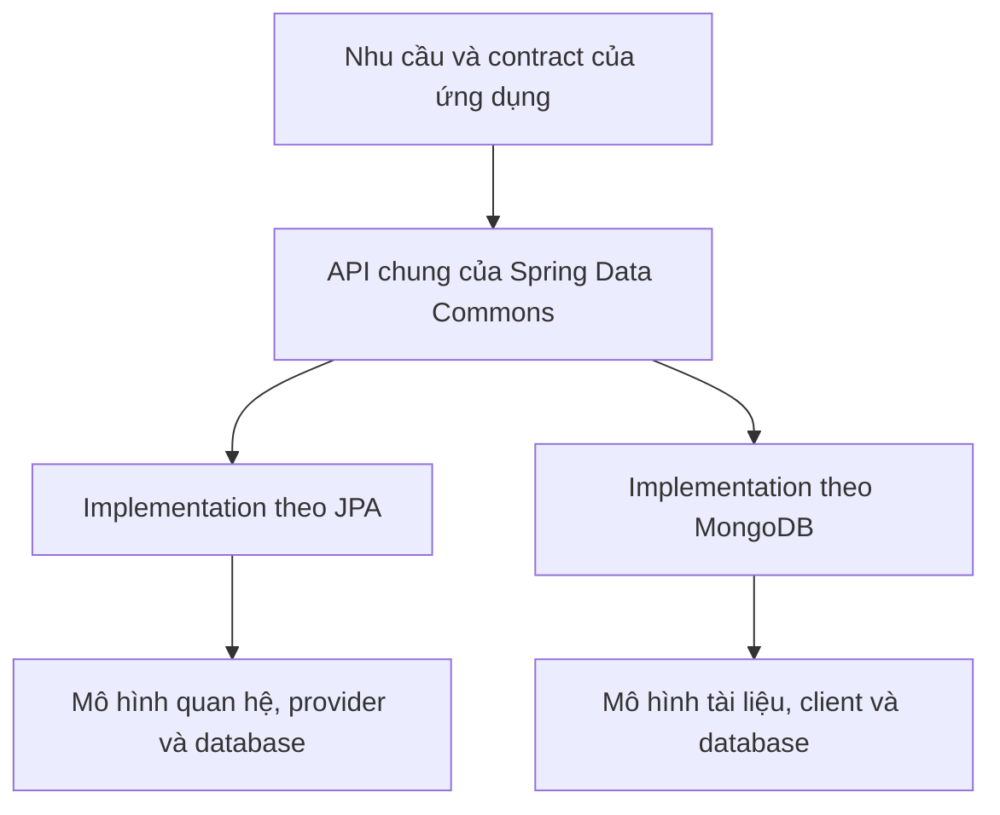

# Đánh giá tính di động của API khi chuyển store

Spring Data Commons giúp nhiều mô-đun dùng chung các contract như `Repository`, CRUD, phân trang, sắp xếp, projection, Query by Example và auditing. Nhờ đó, khi chuyển store, một phần kiến thức và hình dạng API có thể được tái sử dụng.

Tuy nhiên, **giữ được chữ ký phương thức không đồng nghĩa giữ được toàn bộ hành vi**. Hai repository cùng có `save`, cùng trả `Page` hoặc cùng dùng một tên derived query vẫn có thể khác về mapping, kiểm soát đồng thời, giao dịch, chi phí truy vấn và lỗi phát sinh.

Bài học thuộc chương **Nhiều store** của mô-đun **SPRING_DATA_COMMONS**. Mục tiêu là biết đánh giá phần nào có thể mang sang store mới, phần nào cần adapter và phần nào phải thiết kế hoặc kiểm chứng lại.

## 1. Tính di động cần được đánh giá ở nhiều mức

Không nên kết luận một API “di động” chỉ vì đổi dependency mà mã vẫn biên dịch.

| Mức đánh giá | Câu hỏi cần trả lời |
| --- | --- |
| Hình dạng API | Tên phương thức, tham số và kiểu trả về có còn dùng được không? |
| Biểu diễn dữ liệu | ID, số, thời gian, enum, null và cấu trúc liên quan được lưu như thế nào? |
| Ngữ nghĩa | Cùng đầu vào có tạo ra kết quả và thay đổi trạng thái tương đương không? |
| Tính nhất quán | Giao dịch và kiểm soát cập nhật đồng thời có đáp ứng yêu cầu cũ không? |
| Đặc tính vận hành | Truy vấn có chi phí, độ trễ và cách xử lý lỗi chấp nhận được không? |

Một thay đổi có thể giữ API ở mức đầu tiên nhưng làm hỏng yêu cầu ở mức thứ ba hoặc thứ tư.

Ví dụ, ứng dụng vẫn gọi `findById`, nhưng ID được chuyển đổi sang biểu diễn khác; hoặc vẫn gọi `save`, nhưng một chuỗi thao tác không còn được bao phủ bởi giao dịch như trước.

Vì vậy, tính di động phải gắn với **một tập yêu cầu cụ thể**, không phải một thuộc tính tuyệt đối của tên interface.

## 2. Commons thống nhất contract, mô-đun quyết định thực thi

Có thể hình dung:



Các implementation dùng cùng một nền tảng không bị buộc phải có cùng kế hoạch thực thi.

Ví dụ:

- Contract CRUD không bắt mọi store quản lý đối tượng theo persistence context của JPA.
- `Pageable` mô tả yêu cầu trang, không bảo đảm cùng chi phí offset.
- `Sort` mô tả thứ tự mong muốn, không tự thống nhất collation.
- Auditing có abstraction chung, nhưng cần tích hợp với vòng đời lưu trữ tương ứng.

Khi chuyển store, hãy giữ những yêu cầu có ý nghĩa với ứng dụng và đánh giá cách store mới đáp ứng chúng. Không ép store mới giả lập mọi chi tiết nội bộ của store cũ nếu ứng dụng không cần chi tiết đó.

## 3. Lập danh mục API trước khi thay dependency

Trước khi đánh giá, cần biết ứng dụng thực sự đang dùng những khả năng nào.

| Nhóm | Ví dụ cần ghi nhận |
| --- | --- |
| CRUD cơ sở | `save`, `saveAll`, `findById`, `delete`, `deleteById` |
| Truy vấn | Derived query, query khai báo, fragment tùy chỉnh |
| Kết quả | `Optional`, `List`, `Page`, `Slice`, projection |
| Mapping | Kiểu ID, version, quan hệ, đối tượng lồng nhau, converter |
| Giao dịch | Use case nào cần nhiều thay đổi thành công hoặc thất bại cùng nhau? |
| Tích hợp | Auditing, callback, domain event, exception translation |
| Vận hành | Chỉ mục, khối lượng dữ liệu, kích thước trang và độ trễ mục tiêu |

Đặc biệt cần tìm những phụ thuộc bị che trong implementation:

- Một service dựa vào việc sửa entity rồi tự flush mà không gọi lưu rõ ràng.
- Một fragment dùng `EntityManager` hoặc template của một mô-đun.
- Một query có cú pháp của store cụ thể.
- Một mapper làm mất ID hoặc thông tin phiên bản.
- Một bước xử lý lỗi phụ thuộc chính xác vào exception của driver cũ.

Danh mục này xác định phạm vi phải kiểm tra. Không cần đánh giá mọi khả năng Spring Data nếu ứng dụng chỉ dùng một phần nhỏ.

## 4. Đánh giá mức tái sử dụng của từng nhóm abstraction

| API hoặc cơ chế | Phần có thể tái sử dụng | Phần cần đánh giá lại |
| --- | --- | --- |
| `Repository<T, ID>` | Mô hình contract và thông tin kiểu | Store quản lý, mapping của `T`, ý nghĩa của `ID` |
| `CrudRepository` | Tên và contract thao tác chung | Nhận diện đối tượng mới, cập nhật, xóa, phiên bản và giao dịch |
| `ListCrudRepository` | Contract kết quả tập hợp dạng `List` | Thứ tự, giới hạn dữ liệu và chi phí tải |
| Derived query | Quy ước đặt tên và nhiều điều kiện đơn giản | Từ khóa hỗ trợ, đường dẫn thuộc tính và cách thực thi |
| `Pageable`, `Sort` | Kiểu mô tả yêu cầu | Collation, null ordering, chỉ mục và chi phí phân trang |
| `Page`, `Slice` | Dạng contract kết quả | Chi phí đếm, tính nhất quán và cách xác định phần tiếp theo |
| Projection | Một số contract đọc và DTO | Mapping, cách lấy trường, tối ưu và quan hệ lồng nhau |
| QBE | `Example`, `ExampleMatcher` và ý định tìm theo mẫu | Phép so sánh, null, giá trị mặc định và khả năng store |
| Auditing | Ý nghĩa thời gian/chủ thể và abstraction chung | Cấu hình kích hoạt, callback, nguồn danh tính và đường ghi |
| Fragment tùy chỉnh | Interface hành vi nếu ý nghĩa còn phù hợp | Implementation sử dụng công nghệ cụ thể |

“Tái sử dụng được” không có nghĩa “không cần kiểm tra”. Nó chỉ ra nơi có cơ hội giữ contract hoặc cách tổ chức mã.

Ngược lại, implementation dùng JPQL không tự trở thành truy vấn MongoDB vì vẫn nằm sau một interface chung.

## 5. Ví dụ: cùng hình dạng repository, mô hình persistence khác nhau

Giả sử ứng dụng có các thuộc tính sản phẩm:

| Thuộc tính | Ý nghĩa |
| --- | --- |
| `id` | Mã sản phẩm do ứng dụng gán, kiểu String trong ví dụ |
| `name` | Tên hiển thị |
| `category` | Mã danh mục |
| `price` | Giá tiền kiểu BigDecimal |
| `active` | Trạng thái đang bán |

Có thể có hai mô hình persistence riêng:

- `ProductEntity` được mapping cho JPA.
- `ProductDocument` được mapping cho MongoDB.

Repository JPA sử dụng contract Commons:

```java
import java.math.BigDecimal;

import org.springframework.data.domain.Page;
import org.springframework.data.domain.Pageable;
import org.springframework.data.repository.CrudRepository;

public interface JpaProductRepository
        extends CrudRepository<ProductEntity, String> {

    Page<ProductEntity>
        findByActiveTrueAndCategoryAndPriceLessThanEqual(
            String category,
            BigDecimal maxPrice,
            Pageable pageable
        );
}
```

Repository MongoDB có hình dạng tương tự:

```java
import java.math.BigDecimal;

import org.springframework.data.domain.Page;
import org.springframework.data.domain.Pageable;
import org.springframework.data.repository.CrudRepository;

public interface MongoProductRepository
        extends CrudRepository<ProductDocument, String> {

    Page<ProductDocument>
        findByActiveTrueAndCategoryAndPriceLessThanEqual(
            String category,
            BigDecimal maxPrice,
            Pageable pageable
        );
}
```

Các đoạn mã giả định mô hình đã có mapping, các thuộc tính tương ứng và hạ tầng mỗi mô-đun được cấu hình phù hợp. Tên interface giúp con người phân biệt; store thực tế được xác định bằng metadata và cấu hình.

Hai repository giữ được nhiều yếu tố:

- Cùng dùng contract CRUD.
- Cùng diễn đạt điều kiện trạng thái, danh mục và giới hạn giá.
- Cùng nhận yêu cầu phân trang.
- Cùng trả kết quả theo contract `Page`.

Nhưng chúng không hoàn toàn có cùng kiểu Java vì `ProductEntity` và `ProductDocument` khác nhau. Chúng cũng chưa chứng minh dữ liệu được so sánh, cập nhật hoặc kiểm soát đồng thời giống nhau.

### Không cần ép một class mang mọi annotation

Việc tách model persistence giúp mỗi store có mapping rõ ràng. Ứng dụng có thể chia sẻ kiểu nghiệp vụ hoặc DTO, rồi chuyển đổi ở adapter.

Không nên thêm annotation của nhiều store lên cùng class chỉ để giữ nguyên generic `T`, nếu điều đó làm mapping và phân loại repository mơ hồ.

## 6. Mapping có thể làm thay đổi ý nghĩa của một API giống nhau

### 6.1. ID và nhận diện đối tượng mới

Giữ cùng kiểu `String` chưa đủ để chứng minh cùng biểu diễn lưu trữ hoặc cùng quy tắc chuyển đổi ID.

Cần xác định:

- Ai tạo ID: ứng dụng hay kho dữ liệu?
- ID có cần converter không?
- Store có chuyển đổi một số giá trị sang kiểu nội bộ khác không?
- Đối tượng mới được nhận diện bằng ID, version hay cơ chế khác?
- ID cũ có được giữ khi nhập dữ liệu sang store mới không?

Ví dụ, một cơ chế sinh ID số ở database quan hệ không tự xuất hiện ở MongoDB chỉ vì repository vẫn dùng `Long`.

Nếu dùng ID nghiệp vụ ổn định để giảm phụ thuộc, vẫn phải bảo đảm mapping và tính duy nhất của ID đó.

### 6.2. Số tiền và phép so sánh khoảng

Điều kiện `PriceLessThanEqual` chỉ đúng ý định khi `price` được lưu và so sánh theo ngữ nghĩa số phù hợp.

Cần kiểm tra precision, scale và converter. Một giá trị Java `BigDecimal` có thể được biểu diễn khác nhau tùy mapping; không được để phép so sánh chuỗi thay thế phép so sánh số ngoài ý định.

Không chỉ kiểm tra dữ liệu có đọc lại được hay không. Hãy kiểm tra cả lọc khoảng, sắp xếp và các giá trị ở biên.

### 6.3. Thời gian và enum

Cần kiểm tra độ chính xác thời gian, cách biểu diễn múi giờ và quy tắc chuyển đổi. Hai giá trị Java đọc lại “gần giống” có thể vẫn ảnh hưởng thứ tự hoặc điều kiện thời gian.

Với enum, lưu tên hay ordinal là một quyết định mapping. Đổi store cần xem lại dữ liệu đã có và chiến lược tiến hóa giá trị.

### 6.4. Null, field thiếu và giá trị mặc định

Trong mô hình tài liệu, field không tồn tại và field có giá trị null có thể có ý nghĩa truy vấn khác nhau. Một mô hình quan hệ lại có cách biểu diễn khác.

Ngoài ra, kiểu nguyên thủy như `boolean` có giá trị mặc định. Khi tạo probe QBE hoặc map dữ liệu, `false` có thể tham gia điều kiện dù người gọi không chủ ý chọn.

### 6.5. Quan hệ không tự chuyển thành tài liệu lồng nhau

Quan hệ entity, join và cascade trong JPA không tương đương mặc định với document lồng nhau hoặc tham chiếu ở MongoDB.

Một derived query có đường dẫn thuộc tính giống nhau có thể cần cấu trúc dữ liệu khác, có chi phí khác hoặc không được hỗ trợ theo cùng cách.

Đây là thay đổi mô hình dữ liệu, không chỉ thay import.

## 7. CRUD chung vẫn cần kiểm chứng ngữ nghĩa

### save và saveAll

Không coi `save` là một câu insert/update có ngữ nghĩa cố định cho mọi store.

JPA có persistence context và dirty checking. Một store khác không nhất thiết theo dõi thay đổi của đối tượng theo cách đó. Service dựa vào việc sửa entity rồi tự được ghi có thể cần thay đổi khi chuyển store.

Luôn sử dụng kết quả lưu khi cần trạng thái do quá trình lưu cung cấp. Đồng thời, kiểm tra nhận diện đối tượng mới và metadata phiên bản.

`saveAll` cũng không tự cam kết một lệnh batch hoặc khả năng nguyên tử như nhau giữa các store.

### findById và existsById

Cần kiểm tra việc chuyển đổi ID và trường hợp không tìm thấy. `existsById` đúng ở một thời điểm không khóa trạng thái cho hành động tiếp theo.

Chuyển store có thể thay đổi cách đọc nhất quán hoặc lựa chọn đọc. Contract kiểm tra tồn tại không tự giải quyết việc đọc rồi ghi đồng thời.

### delete và các phương thức xóa tập hợp

Cần phân biệt xóa theo entity với xóa theo ID, phiên bản, callback, cascade và ràng buộc tham chiếu.

Một database quan hệ có thể từ chối xóa do ràng buộc mà store mới không tự cung cấp tương đương. Nếu đó là yêu cầu nghiệp vụ, phải giữ yêu cầu bằng một cơ chế phù hợp, không bỏ qua chỉ vì lời gọi xóa chạy được.

Nếu hệ thống có soft delete hoặc lịch sử thay đổi, cần đánh giá implementation riêng của chúng. API CRUD chung không tự chuyển các chính sách đó sang store mới.

## 8. Derived query, projection và QBE: giữ ý định, kiểm tra khả năng

### 8.1. Derived query

Các điều kiện đơn giản có thể dễ tái sử dụng, nhưng không có một tập từ khóa bắt buộc mọi store hỗ trợ giống nhau.

Một từ khóa chuyên biệt như tìm theo biểu thức hoặc không gian địa lý cần được kiểm tra riêng. Tên phương thức biên dịch được không chứng minh query có thể khởi tạo và thực thi.

Khi có nhiều nhánh điều kiện hoặc đường dẫn thuộc tính phức tạp, cần kiểm tra cả ngữ nghĩa và cách store mới xử lý.

### 8.2. Query khai báo và fragment

Những annotation cùng tên ngắn `@Query` có thể thuộc các package và ngôn ngữ truy vấn khác nhau.

Một fragment dùng `EntityManager` hoặc API template của store cũ thường cần implementation mới. Contract fragment có thể được giữ nếu ý nghĩa nghiệp vụ của nó vẫn phù hợp.

Đừng chỉ đổi annotation import rồi coi nội dung truy vấn cũ là hợp lệ ở công nghệ mới.

### 8.3. Projection

DTO hoặc một số interface projection có thể dùng lại. Nhưng cần kiểm tra:

- Tên thuộc tính và cách ánh xạ.
- Dữ liệu lồng nhau.
- Null và kiểu chuyển đổi.
- Tập trường thực sự được lấy.
- Chi phí tải dữ liệu.

Projection không tự bảo đảm hai store đều chỉ đọc đúng một tập trường nhỏ. Cũng không dùng một bản đọc thiếu trường để lưu đè như một aggregate đầy đủ.

### 8.4. Query by Example

Giữ `ExampleMatcher` không có nghĩa mọi so sánh chuỗi, cách xử lý null và giá trị mặc định đều tương đương.

Hãy chuyển yêu cầu tìm kiếm thành các trường hợp cụ thể, rồi kiểm tra từng trường hợp trên store mới. Khi QBE không diễn đạt được yêu cầu, chọn một cơ chế truy vấn khác phù hợp thay vì làm yếu đi yêu cầu một cách ngầm định.

## 9. Phân trang và sắp xếp có cả yêu cầu chức năng lẫn chi phí

Với cùng một `PageRequest`, cần kiểm tra:

| Khía cạnh | Câu hỏi |
| --- | --- |
| Thứ tự | Có sort rõ ràng và khóa phụ xác định thứ tự khi trùng không? |
| Chuỗi | Collation, chữ hoa/thường và dấu được so sánh thế nào? |
| Null | Vị trí giá trị null có đáp ứng contract ứng dụng không? |
| Tổng kết quả | `Page` có tổng đúng theo yêu cầu và ở chi phí chấp nhận được không? |
| Trang sâu | Offset lớn có làm độ trễ tăng quá mức không? |
| Dữ liệu thay đổi | Các lần đọc có thể bị thiếu/lặp phần tử do cập nhật đồng thời không? |

Sort theo `price` rồi `id` giúp làm rõ thứ tự khi nhiều sản phẩm bằng giá. Nó không tự tạo snapshot nhất quán giữa các request.

Nếu giao diện chỉ cần biết còn dữ liệu để tải tiếp, `Slice` có thể phù hợp hơn `Page`. Nhưng đó là thay đổi contract kết quả, cần được ứng dụng chấp nhận.

Nếu store mới phù hợp hơn với cursor hoặc keyset, không nên giả vờ mọi khả năng nhảy đến số trang bất kỳ vẫn có cùng chi phí. Hãy đánh giá lại contract thay vì chỉ bọc một API mới vào tên cũ.

## 10. Giao dịch, phiên bản và auditing cần một đánh giá riêng

### 10.1. Giao dịch

Một annotation `@Transactional` không tự bảo đảm cùng phạm vi nguyên tử sau khi đổi store.

Cần kiểm tra transaction manager, khả năng triển khai của database và phạm vi dữ liệu mà giao dịch bao phủ.

Nếu use case trước đây thay đổi nhiều aggregate trong một giao dịch, phải xác định store mới có đáp ứng được yêu cầu đó không. Khi không đáp ứng, cần một thiết kế nhất quán khác được nghiệp vụ chấp nhận; không coi đây chỉ là lỗi cấu hình.

### 10.2. Optimistic locking

Nếu ứng dụng dựa vào version để phát hiện cập nhật cũ, cần kiểm tra annotation, mapping và đường cập nhật của store mới.

Một mapper không bảo toàn version có thể làm sai hành vi dù interface repository không thay đổi.

Bộ kiểm chứng nên có hai người ghi cùng đọc một phiên bản, sau đó lần lượt lưu thay đổi. Kết quả mong muốn phải được xác định rõ, chẳng hạn thay đổi cũ bị từ chối thay vì âm thầm ghi đè.

### 10.3. Auditing và lifecycle

Các abstraction như ngày tạo/sửa và nguồn auditor có thể dùng chung về ý nghĩa, nhưng cách kích hoạt và callback thuộc tích hợp cụ thể.

Cần kiểm tra cả các đường ghi chuẩn lẫn đường cập nhật tùy chỉnh. Không mặc định một callback sẽ chạy với mọi API bulk.

Auditing không tự là lịch sử đầy đủ, kiểm tra quyền hay cơ chế đồng bộ giữa hai store.

### 10.4. Thay đổi sang reactive là thay đổi contract lớn hơn

Nếu việc chuyển store đi kèm chuyển sang API reactive, kiểu trả về, chuỗi gọi và mô hình giao dịch cũng cần được đánh giá lại.

Không coi việc gọi chặn ở mọi điểm là bằng chứng rằng contract đồng bộ cũ đã được chuyển tương đương.

## 11. Dùng adapter để giữ contract ứng dụng khi có giá trị

Có thể công bố một góc nhìn sản phẩm không gắn với entity/document:

```java
import java.math.BigDecimal;

public record ProductSnapshot(
    String id,
    String name,
    String category,
    BigDecimal price,
    boolean active
) {
}
```

Contract đọc:

```java
import java.math.BigDecimal;
import java.util.Optional;

import org.springframework.data.domain.Page;
import org.springframework.data.domain.Pageable;

public interface ProductCatalog {

    Optional<ProductSnapshot> findById(String id);

    Page<ProductSnapshot> findActiveInCategory(
        String category,
        BigDecimal maxPrice,
        Pageable pageable
    );
}
```

Ví dụ dùng Java record, phù hợp Java 17. Contract này chủ đích giữ các kiểu phân trang của Commons, nhưng tách khỏi hai kiểu persistence.

`ProductCatalog` là interface do ứng dụng sở hữu, không kế thừa marker repository. Các adapter phải tự triển khai nó; tên `findActiveInCategory` không tự được Spring Data biến thành query.

Trong phương thức của adapter JPA, việc chuyển kết quả có thể là:

```java
return jpaProducts
    .findByActiveTrueAndCategoryAndPriceLessThanEqual(
        category,
        maxPrice,
        pageable
    )
    .map(mapper::toSnapshot);
```

Adapter MongoDB thực hiện ý định tương ứng với repository và mapper của nó. Các biến trong đoạn trích là dependency/tham số của adapter, không phải một chương trình độc lập.

Cách này giữ contract đọc của application service ổn định. Nó không làm mất nhu cầu kiểm chứng behavior hoặc tự chuyển đổi giao dịch.

Nếu muốn độc lập cả với Commons, ứng dụng có thể sở hữu luôn kiểu yêu cầu và kết quả trang. Đổi lại, cần duy trì mapping và ngữ nghĩa của chúng. Chỉ thêm mức độc lập khi có lợi ích thực tế.

## 12. Xây bộ dữ liệu đối chiếu trước khi đánh giá

Một fixture có chủ đích:

| ID | Tên | Danh mục | Giá | Active |
| --- | --- | --- | ---: | --- |
| ITEM-A | Bàn phím cơ | ACCESSORY | 1250000.00 | true |
| ITEM-B | Chuột Bluetooth | ACCESSORY | 450000.00 | true |
| ITEM-C | Giá đỡ máy | ACCESSORY | 450000.00 | true |
| ITEM-D | Tai nghe mẫu | ACCESSORY | 400000.00 | false |
| ITEM-E | Màn hình | DISPLAY | 3500000.00 | true |
| ITEM-F | Cáp sạc | CABLE | 150000.00 | true |

Ứng dụng gán các ID trong fixture. Mỗi môi trường cần nạp chúng bằng mapping và cơ chế lưu đúng với store của mình.

Với yêu cầu:

- Danh mục `ACCESSORY`.
- Chỉ sản phẩm active.
- Giá không quá `500000.00`.
- Sort theo `price` tăng rồi `id` tăng.
- Kích thước trang bằng 1.

Contract mong muốn là có hai kết quả, hai trang; trang đầu là `ITEM-B`, trang tiếp theo là `ITEM-C`.

Đây là một yêu cầu kiểm chứng đối với cách so sánh ID và giá trong ví dụ. Nếu cấu hình store cho kết quả khác, cần xác định nguyên nhân và sửa mapping/query hoặc thống nhất lại contract, không âm thầm đổi kỳ vọng cho từng store.

Ngoài fixture cơ sở, nên có các trường hợp biên:

| Nhóm | Trường hợp cần kiểm chứng |
| --- | --- |
| ID | Có, thiếu, nhập lại ID cũ và chuyển đổi biểu diễn |
| Giá | Bằng ngưỡng, thấp/cao hơn ngưỡng và độ chính xác cần hỗ trợ |
| Chuỗi | Chữ hoa/thường, dấu và các giá trị tương đương theo quy tắc ứng dụng |
| Null | Field thiếu, null và giá trị mặc định nếu mô hình cho phép |
| Đồng thời | Hai cập nhật cùng xuất phát từ một phiên bản |
| Lỗi | Ràng buộc nghiệp vụ, lỗi ghi và rollback theo yêu cầu |
| Dữ liệu lớn | Trang sâu, tổng kết quả và độ trễ với chỉ mục thực tế |

## 13. Kiểm chứng cùng contract trên từng adapter

Có thể dùng một lớp test contract chung cho luồng đọc, rồi để từng môi trường cung cấp adapter và fixture.

Ví dụ dùng JUnit 5 cùng AssertJ:

```java
import java.math.BigDecimal;

import org.junit.jupiter.api.BeforeEach;
import org.junit.jupiter.api.Test;

import org.springframework.data.domain.Page;
import org.springframework.data.domain.PageRequest;
import org.springframework.data.domain.Sort;

import static org.assertj.core.api.Assertions.assertThat;

abstract class ProductCatalogContract {

    protected abstract ProductCatalog catalog();

    protected abstract void resetAndSeed();

    @BeforeEach
    void prepareFixture() {
        resetAndSeed();
    }

    @Test
    void keepsTheExpectedFilterAndPageOrder() {
        Page<ProductSnapshot> first = catalog()
            .findActiveInCategory(
                "ACCESSORY",
                new BigDecimal("500000.00"),
                PageRequest.of(
                    0,
                    1,
                    Sort.by("price").ascending()
                        .and(Sort.by("id").ascending())
                )
            );

        assertThat(first.getTotalElements()).isEqualTo(2);
        assertThat(first.getTotalPages()).isEqualTo(2);

        assertThat(first.getContent())
            .extracting(ProductSnapshot::id)
            .containsExactly("ITEM-B");

        Page<ProductSnapshot> second = catalog()
            .findActiveInCategory(
                "ACCESSORY",
                new BigDecimal("500000.00"),
                first.nextPageable()
            );

        assertThat(second.getContent())
            .extracting(ProductSnapshot::id)
            .containsExactly("ITEM-C");

        assertThat(second.hasNext()).isFalse();
    }

    @Test
    void representsAMissingProductAsEmpty() {
        assertThat(
            catalog().findById("ITEM-MISSING")
        ).isEmpty();
    }
}
```

Lớp con cho mỗi môi trường phải cung cấp adapter, dọn/nạp đúng fixture và quản lý kết nối kiểm thử. Đoạn mã là khung kiểm chứng contract, không tự tạo hạ tầng JPA hoặc MongoDB.

Không viết một kỳ vọng riêng cho JPA và một kỳ vọng khác cho MongoDB rồi dùng việc cả hai đều xanh để kết luận tương đương.

Bộ test trên chỉ minh họa một phần luồng đọc. Cần bổ sung kiểm chứng cho các khả năng thật sự được dùng: lưu, xóa, version, giao dịch, lifecycle và lỗi.

Môi trường kiểm thử cũng phải đủ đại diện. Một database nhúng có thể hữu ích để phản hồi nhanh, nhưng không chứng minh mọi hành vi của database quan hệ triển khai thực tế.

Các ví dụ trong bài là mã và kỳ vọng để thực hành, không phải báo cáo rằng những kiểm tra này đã được chạy.

## 14. Ghi lại kết luận theo từng khả năng

Sau đánh giá, nên có kết luận cụ thể thay vì một nhãn “đổi store được”.

| Khả năng | Kết luận minh họa | Việc còn phải làm |
| --- | --- | --- |
| Đọc theo ID | Giữ contract | Bảo toàn quy tắc chuyển đổi và ID cũ |
| Tìm theo danh mục/giá | Giữ ý định, đổi mapping | Xác định biểu diễn số và chỉ mục |
| Projection | Giữ DTO | Viết lại mapping/query tương ứng |
| Truy vấn đặc thù | Giữ contract fragment | Thay implementation theo store |
| Phân trang | Giữ API nếu chi phí phù hợp | Đo count và trang sâu |
| Giao dịch nhiều đối tượng | Chưa kết luận từ API | Kiểm chứng khả năng và ranh giới nguyên tử |
| Auditing | Giữ yêu cầu nghiệp vụ | Cấu hình và kiểm tra đường ghi |

Các kết luận trong bảng là ví dụ cách ghi nhận, không phải kết quả cho mọi dự án.

Một lộ trình có thể gồm:

1. Chốt các yêu cầu mà ứng dụng phải giữ.
2. Lập danh mục API và phụ thuộc theo store.
3. Thiết kế mapping và adapter cần thiết.
4. Chạy cùng bộ kiểm chứng trên các môi trường đại diện.
5. Đánh giá hiệu năng và lỗi ở tải phù hợp.
6. Ghi rõ phần giữ được, phần thay đổi và phần chưa đáp ứng.

Nếu yêu cầu bắt buộc không được store mới hỗ trợ, hãy ghi đó là một khoảng trống thiết kế. Việc source code biên dịch không làm khoảng trống ấy biến mất.

## 15. Điểm cần ghi nhớ

API Commons tạo cơ hội tái sử dụng contract và cách tổ chức truy cập dữ liệu. Tính di động thực tế còn phụ thuộc mapping, ngữ nghĩa truy vấn, phiên bản, giao dịch, lifecycle và đặc tính vận hành của từng store.

Đánh giá bằng yêu cầu và kết quả quan sát được: **cùng đầu vào, đúng kết quả cần giữ, cùng bảo đảm nghiệp vụ và chi phí chấp nhận được**. Khi cần, dùng adapter để giữ contract ứng dụng; không dùng abstraction chung như một lời hứa rằng mọi khác biệt lưu trữ đã được che hết.
