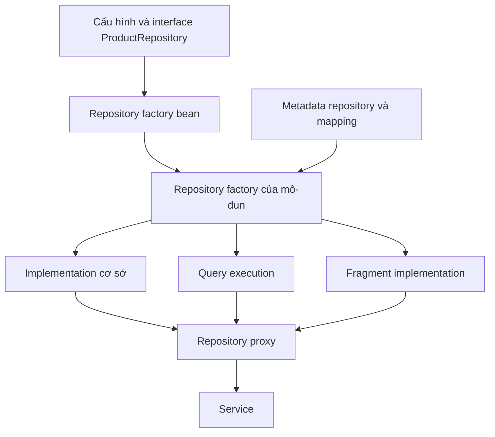

# Repository proxy được tạo như thế nào?

Bạn khai báo một interface repository, inject nó vào service và gọi phương thức mà không tự viết class triển khai. Đối tượng được inject trong môi trường Spring Data thông thường là một **repository proxy** do hạ tầng tạo và cấu hình.

Proxy thực thi contract của repository bằng cách chuyển lời gọi tới những thành phần phù hợp: implementation CRUD cơ sở, cơ chế truy vấn, default method hoặc implementation fragment. Vì vậy, repository không chỉ là một class CRUD có thêm vài phương thức được sinh theo tên.

Bài học thuộc chương **Proxy và thành phần** của mô-đun **SPRING_DATA_COMMONS**. Mục tiêu là hiểu các thành phần tham gia tạo proxy, phân biệt factory với repository và lần theo một lời gọi mà vẫn giữ rõ phần hạ tầng chung với phần tích hợp kho dữ liệu.

## 1. Interface khai báo contract, proxy cung cấp đối tượng thực thi

Ví dụ:

```java
import java.util.List;

import org.springframework.data.repository.CrudRepository;

public interface ProductRepository
        extends CrudRepository<Product, Long> {

    List<Product> findByActiveTrueOrderByNameAscIdAsc();
}
```

Interface công bố hai nhóm khả năng:

- Các phương thức CRUD được kế thừa.
- Một query method do ứng dụng khai báo.

Java không cho bạn tạo một instance trực tiếp bằng `new ProductRepository()`. Abstract method trong interface chưa có phần thân thực thi.

Trong cấu hình Spring Data phù hợp, hạ tầng tạo một đối tượng đáp ứng interface đó và đăng ký để application context có thể cung cấp cho bên sử dụng.

```text
Service nhìn thấy:
    ProductRepository

Đối tượng được cung cấp:
    Repository proxy được cấu hình cho ProductRepository

Các thành phần xử lý phía sau:
    Implementation cơ sở
    Cơ chế truy vấn
    Fragment tùy chỉnh nếu có
    Các advice/interceptor được cấu hình
```

Không cần có một file source `ProductRepositoryImpl.java` do hạ tầng sinh riêng cho mỗi derived query để mô hình repository thông thường hoạt động.

## 2. Điều kiện để có một repository proxy

Chỉ thêm Spring Data Commons và viết interface chưa đủ để có proxy có thể truy cập dữ liệu.

Ứng dụng cần:

1. Mô-đun lưu trữ phù hợp, chẳng hạn Spring Data JPA hoặc Spring Data MongoDB.
2. Cơ chế kích hoạt và phát hiện repository.
3. Metadata hợp lệ về kiểu miền, ID và các phương thức.
4. Mapping phù hợp với công nghệ lưu trữ.
5. Hạ tầng kết nối và những thành phần mà mô-đun cần.
6. Implementation cho các phương thức tùy chỉnh không thuộc đường thực thi tự động.

Commons cung cấp các abstraction và phần hạ tầng dùng chung. Mô-đun cụ thể đưa vào factory, implementation cơ sở và cơ chế thực thi tương ứng.

Trong phần ví dụ, chúng ta chọn JPA với Jakarta Persistence. Những class như `JpaRepositoryFactory` và `SimpleJpaRepository` là thành phần JPA, không phải implementation chung cho mọi store.

## 3. Các thành phần cần phân biệt

| Thành phần | Vai trò |
| --- | --- |
| Interface repository | Contract mà mã ứng dụng sử dụng |
| Cấu hình repository | Chọn phạm vi interface và các tùy chọn tạo repository |
| Repository factory bean | Tích hợp việc tạo repository vào vòng đời và cơ chế bean của Spring |
| Repository factory | Xây dựng các thành phần thực thi và proxy cho một contract |
| Implementation cơ sở | Xử lý những thao tác chuẩn mà mô-đun hỗ trợ |
| Query execution | Xử lý query method theo cơ chế của mô-đun |
| Fragment implementation | Cung cấp hành vi tùy chỉnh được ghép vào repository |
| Repository proxy | Đối tượng mà bên gọi sử dụng, điều phối lời gọi qua các thành phần đã cấu hình |

Trong nền tảng Commons, những tên thường gặp là:

- `RepositoryFactoryBeanSupport`: nền tảng cho factory bean của repository.
- `RepositoryFactorySupport`: nền tảng cho việc xây dựng repository runtime.

Trong môi trường JPA, những thành phần tương ứng có thể gồm:

- `JpaRepositoryFactoryBean`.
- `JpaRepositoryFactory`.
- `SimpleJpaRepository`.

Đừng gộp ba tên phía JPA thành một “repository implementation” duy nhất. Chúng có những trách nhiệm khác nhau trong quá trình tạo và thực thi.

## 4. Bước đầu: từ interface đến bean definition

Khi cấu hình repository được kích hoạt, hạ tầng quét những package tương ứng và nhận diện các interface hợp lệ.

Thông tin có thể được đọc từ:

- Quan hệ kế thừa `Repository<T, ID>` hoặc các interface liên quan.
- Khai báo `@RepositoryDefinition` trong trường hợp phù hợp.
- Kiểu miền và ID đã được phân giải.
- Các annotation và metadata mà mô-đun lưu trữ sử dụng.
- Interface cơ sở cần bỏ qua, chẳng hạn có `@NoRepositoryBean`.

Đối với mỗi repository cụ thể được quản lý, hạ tầng đăng ký bean definition phù hợp để tạo repository. Trong môi trường JPA thông thường, việc đăng ký liên quan tới một factory bean JPA.

Điểm cần hiểu là hạ tầng không đăng ký một instance của chính interface theo nghĩa Java. Nó đăng ký cách cung cấp đối tượng thực thi interface đó.

### Được phát hiện chưa đồng nghĩa đã dùng được

Một interface có thể đã được tìm thấy nhưng chưa thể tạo repository thành công vì:

- Kiểu miền không được mapping.
- Query method sai thuộc tính.
- Fragment cần thiết chưa được nhận diện.
- Cấu hình mô-đun hoặc hạ tầng dữ liệu không phù hợp.

Log tìm thấy một repository là bằng chứng của một phần quá trình, không phải bằng chứng mọi lời gọi đều đã thực thi đúng.

## 5. FactoryBean khác với repository mà ứng dụng nhận

Spring có cơ chế `FactoryBean`: một bean đóng vai trò cung cấp một đối tượng khác. Repository factory bean sử dụng cơ chế này để tích hợp việc tạo repository với application context.

Với tên mặc định `productRepository`, trong cấu hình dùng factory bean:

```text
context.getBean("productRepository")
```

yêu cầu đối tượng repository được factory cung cấp.

Còn:

```text
context.getBean("&productRepository")
```

yêu cầu chính factory bean.

| Thứ được yêu cầu | Bên thường sử dụng |
| --- | --- |
| Repository qua tên thông thường hoặc interface | Service, application component |
| Factory bean qua tiền tố `&` | Công cụ chẩn đoán hoặc tích hợp hạ tầng chuyên biệt |

Bên sử dụng nghiệp vụ thường chỉ cần dependency `ProductRepository`. Nó không cần inject `JpaRepositoryFactoryBean` để gọi `findById`.

Factory bean cũng giúp hạ tầng Spring biết loại đối tượng mà repository cung cấp cho việc giải quyết dependency. Quá trình tạo đối tượng thực tế có thể chịu ảnh hưởng của cách khởi tạo và cấu hình bootstrap.

## 6. Repository factory chuẩn bị những gì?

Repository factory nhận các thông tin và dependency cần thiết để xây repository.

Ở mức trách nhiệm, nó cần:

1. Đọc contract của interface.
2. Xác định kiểu miền và kiểu ID.
3. Xác định implementation cơ sở phù hợp.
4. Chuẩn bị các fragment tùy chỉnh nếu có.
5. Nhận diện và chuẩn bị cách thực thi query method.
6. Tạo proxy và gắn các thành phần xử lý lời gọi.
7. Cung cấp đối tượng đáp ứng interface cho phía factory bean.



Sơ đồ biểu diễn quan hệ trách nhiệm và đối tượng được cung cấp, không ấn định thứ tự mọi lời gọi nội bộ. Các thành phần có thể được chuẩn bị hoặc khởi tạo theo cách khác nhau tùy cấu hình.

### Với JPA

Factory của JPA biết cách dùng metadata entity và `EntityManager` để tạo implementation cơ sở. `SimpleJpaRepository` là implementation cơ sở thường gặp cho các thao tác chuẩn.

Nếu cấu hình chọn một lớp cơ sở tùy chỉnh, factory có thể sử dụng lớp đó theo cơ chế được hỗ trợ. Việc chỉ tạo một class kế thừa `SimpleJpaRepository` không tự làm factory chuyển sang dùng class ấy.

### Với store khác

Factory dùng hạ tầng tương ứng của store đó. Không có yêu cầu mọi mô-đun đều phải tạo `SimpleJpaRepository` hoặc sử dụng `EntityManager`.

Đây là nơi ranh giới giữa abstraction Commons và implementation theo mô-đun trở nên rõ ràng.

## 7. Proxy và chuỗi xử lý lời gọi

Repository proxy được xây dựa trên hạ tầng proxy/AOP của Spring. Với contract repository dạng interface, proxy dựa trên interface là hình thức thường gặp.

Không nên ghi cứng một tên class proxy hoặc coi một kỹ thuật proxy cụ thể là contract nghiệp vụ. Điều bên gọi cần là đối tượng đáp ứng interface được công bố.

Khi gọi một phương thức, proxy có thể đưa lời gọi qua các interceptor hoặc advice phù hợp, chẳng hạn:

- Xử lý default method.
- Thực thi query method.
- Định tuyến tới repository composition và fragment.
- Giao dịch khi được cấu hình.
- Dịch exception hoặc những hành vi tích hợp khác khi có hạ tầng tương ứng.

Không phải mọi mục trên đều được bật chỉ vì có Commons. Chuỗi thực tế còn phụ thuộc mô-đun, cấu hình và các mở rộng của ứng dụng.

### Không hình dung mọi phương thức đều chuyển thẳng tới một target

Một target implementation cơ sở có thể cung cấp `save` hoặc `findById`. Nó không cần có một phương thức Java viết sẵn mang đúng tên mọi derived query của ứng dụng.

Query method được xử lý bởi cơ chế truy vấn riêng. Fragment lại có implementation riêng. Proxy phối hợp các đường xử lý đó để cung cấp một contract thống nhất.

## 8. Ví dụ đầy đủ hơn về contract cần được thực thi

Giả sử `Product` trong môi trường JPA có mapping tối thiểu:

```java
package example.proxy.domain;

import jakarta.persistence.Entity;
import jakarta.persistence.GeneratedValue;
import jakarta.persistence.Id;
import jakarta.persistence.Table;

@Entity
@Table(name = "products")
public class Product {

    @Id
    @GeneratedValue
    private Long id;

    private String name;

    private boolean active;

    protected Product() {
    }

    public Product(String name, boolean active) {
        this.name = name;
        this.active = active;
    }

    public Long getId() {
        return id;
    }

    public String getName() {
        return name;
    }

    public boolean isActive() {
        return active;
    }
}
```

Repository có CRUD, query method và default method:

```java
package example.proxy.data;

import java.util.List;

import example.proxy.domain.Product;

import org.springframework.data.repository.CrudRepository;

public interface ProductRepository
        extends CrudRepository<Product, Long> {

    List<Product> findByActiveTrueOrderByNameAscIdAsc();

    default Product requireById(Long id) {
        return findById(id)
            .orElseThrow(() ->
                new IllegalArgumentException(
                    "Không tìm thấy sản phẩm"
                )
            );
    }
}
```

Các ví dụ tập trung vào cơ chế repository. Ứng dụng vẫn cần một bộ dependency tương thích, cấu hình JPA, kết nối và phạm vi phát hiện entity/repository hợp lệ.

Tên `name`, `active` và `id` trong query method tương ứng thuộc tính mô hình Java. Không thay chúng bằng tên bảng SQL.

## 9. Lần theo ba lời gọi trên cùng một proxy

### 9.1. Gọi findById

```java
Product product = products.findById(productId)
    .orElseThrow();
```

Trong môi trường ví dụ:

1. Bên gọi sử dụng contract `ProductRepository`.
2. Proxy nhận lời gọi phương thức cơ sở.
3. Hạ tầng định tuyến tới implementation phù hợp.
4. Phần JPA sử dụng hạ tầng persistence để tìm theo định danh.
5. Kết quả được trả về theo contract `Optional<Product>`.

Không cần một derived query tên `findById` được tạo lại như một phương thức tùy ý. Đây là phương thức cơ sở được repository hỗ trợ.

### 9.2. Gọi derived query

```java
List<Product> activeProducts =
    products.findByActiveTrueOrderByNameAscIdAsc();
```

Đường xử lý khác:

1. Phương thức được nhận diện là query method.
2. Hạ tầng truy vấn dựa vào tên phương thức và metadata để mô tả điều kiện.
3. Mô-đun JPA xây dựng và thực thi truy vấn phù hợp.
4. Kết quả được trả về theo kiểu khai báo.

Điều kiện là `active = true`; thứ tự là `name` tăng dần rồi `id` tăng dần. Phần phân tích quy ước dùng nền tảng chung, còn việc thực thi trên JPA thuộc mô-đun JPA.

Nếu dùng một khai báo truy vấn tường minh được hỗ trợ, query lookup có thể chọn đường đó thay cho suy diễn tên. Không phải mọi query method đều bắt buộc đi qua cùng một chiến lược tạo truy vấn.

### 9.3. Gọi default method

```java
Product required = products.requireById(productId);
```

`requireById` đã có phần thân trong interface. Proxy hỗ trợ thực thi phần thân đó; lời gọi `findById` bên trong dựa vào khả năng mà repository cung cấp.

Tên `requireById` không cần được diễn giải thành một điều kiện truy vấn mới.

Default method chỉ bổ sung cách kết hợp logic. Nó không tự cấp `EntityManager`, không tự tạo một ranh giới giao dịch theo mọi ý định và không thay thế implementation cho những dependency tùy chỉnh phức tạp.

## 10. Bổ sung fragment: proxy ghép nhiều implementation

Giả sử ứng dụng cần một thao tác đọc các tên sản phẩm đang bán bằng truy vấn tùy chỉnh.

Contract fragment:

```java
package example.proxy.data;

import java.util.List;

public interface ProductNameLookup {

    List<String> loadActiveNames();
}
```

Implementation JPA:

```java
package example.proxy.data;

import java.util.List;

import jakarta.persistence.EntityManager;
import jakarta.persistence.PersistenceContext;

import org.springframework.transaction.annotation.Transactional;

public class ProductNameLookupImpl
        implements ProductNameLookup {

    @PersistenceContext
    private EntityManager entityManager;

    @Override
    @Transactional(readOnly = true)
    public List<String> loadActiveNames() {
        return entityManager.createQuery(
            """
            select p.name
            from Product p
            where p.active = true
            order by p.name asc, p.id asc
            """,
            String.class
        ).getResultList();
    }
}
```

Đoạn mã dùng Java text block, phù hợp với Java 17 trong môi trường Jakarta Persistence đang minh họa.

Repository được bổ sung fragment:

```java
package example.proxy.data;

import java.util.List;

import example.proxy.domain.Product;

import org.springframework.data.repository.CrudRepository;

public interface ProductRepository
        extends CrudRepository<Product, Long>,
                ProductNameLookup {

    List<Product> findByActiveTrueOrderByNameAscIdAsc();

    default Product requireById(Long id) {
        return findById(id)
            .orElseThrow(() ->
                new IllegalArgumentException(
                    "Không tìm thấy sản phẩm"
                )
            );
    }
}
```

Theo quy ước mặc định, `ProductNameLookupImpl` triển khai fragment `ProductNameLookup`. Hạ tầng cần tìm thấy implementation trong phạm vi và cấu hình phù hợp.

Khi gọi `loadActiveNames`, repository composition đưa lời gọi tới implementation fragment. Không cần thêm phương thức đó vào `SimpleJpaRepository`.

| Lời gọi | Nguồn hành vi trong ví dụ |
| --- | --- |
| `save`, `findById` | Implementation repository cơ sở của JPA |
| `findByActiveTrueOrderByNameAscIdAsc` | Cơ chế query method |
| `requireById` | Phần thân default method |
| `loadActiveNames` | `ProductNameLookupImpl` |

Một fragment cũng có thể cung cấp chữ ký trùng với phương thức cơ sở theo cơ chế mở rộng được hỗ trợ. Khi có xung đột, cần hiểu quy tắc composition và thứ tự liên quan; không suy ra lời gọi luôn tới target cơ sở chỉ từ tên phương thức.

## 11. Giao dịch và proxy là hai phần liên quan nhưng không đồng nhất

Repository proxy là nơi lời gọi có thể được các advice xử lý. Điều đó không có nghĩa Commons tự tạo một giao dịch phù hợp cho mọi phương thức trên mọi store.

Ở môi trường JPA, implementation cơ sở và hạ tầng tích hợp có những quy tắc giao dịch riêng. Query method, default method và fragment cũng cần được xét theo cấu hình áp dụng thực tế.

Trong fragment ở phần trước, `@Transactional` là annotation của Spring, không phải annotation Commons. Nó cần transaction manager và cơ chế áp dụng phù hợp. `readOnly` không phải một cơ chế phân quyền tuyệt đối cấm mọi lệnh ghi.

Nếu một use case cần đọc, kiểm tra rồi lưu trong cùng một giao dịch, hãy đặt ranh giới ở thành phần điều phối phù hợp. Việc các lời gọi đều đi qua cùng một repository proxy không tự làm chúng thuộc cùng một giao dịch.

Tương tự, proxy không tự cung cấp giao dịch chung xuyên nhiều store hoặc tự đồng bộ dữ liệu giữa chúng.

## 12. Quan sát proxy trong một ứng dụng đã cấu hình

Có thể thêm một method `@Bean` vào configuration class đã được nạp:

```java
import example.proxy.data.ProductRepository;

import org.springframework.aop.support.AopUtils;
import org.springframework.boot.ApplicationRunner;
import org.springframework.context.ApplicationContext;
import org.springframework.context.annotation.Bean;

@Bean
ApplicationRunner inspectProductRepository(
        ProductRepository products,
        ApplicationContext context) {
    return args -> {
        System.out.println(
            "Là Spring AOP proxy: "
                + AopUtils.isAopProxy(products)
        );

        System.out.println(
            "Lớp runtime: "
                + products.getClass().getName()
        );

        System.out.println(
            "Target class được nhận diện: "
                + AopUtils.getTargetClass(products).getName()
        );

        Object factory = context.getBean("&productRepository");

        System.out.println(
            "Factory bean: " + factory.getClass().getName()
        );
    };
}
```

Đoạn mã dùng `ApplicationRunner` trong Spring Boot và giả định repository có tên mặc định `productRepository`. Nếu ứng dụng đặt tên khác, phải dùng tên thực tế.

Trong cấu hình repository JPA thông thường, bạn có thể quan sát proxy AOP và factory bean tương ứng. Tên class runtime cụ thể không nên được ghi cứng vào logic ứng dụng.

### Đọc đúng kết quả target class

Nếu target class được nhận diện là implementation cơ sở, điều đó không chứng minh mọi phương thức được thực hiện trực tiếp trên class ấy.

Query execution và fragment có thể nằm trong các thành phần xử lý khác của proxy. Kết quả `getTargetClass` không phải bản liệt kê toàn bộ repository composition.

Đây là mã để tự quan sát, không phải báo cáo một lần thực thi đã được tiến hành trong bài viết.

## 13. Những việc không tương đương với tạo repository proxy

### 13.1. Tự new implementation cơ sở

Tạo một instance `SimpleJpaRepository` không tự tạo đầy đủ `ProductRepository` với mọi query method, fragment và các advice mong muốn.

Bạn có thể sử dụng những API cấp thấp trong tích hợp chuyên biệt, nhưng khi đó phải tự hiểu và cung cấp các phần hạ tầng tương ứng. Nó khác với để cấu hình repository của mô-đun quản lý vòng đời.

### 13.2. Gắn @Repository lên một interface bất kỳ

Stereotype `@Repository` không làm component scanning thông thường tự viết phần thân cho abstract method.

Interface Spring Data cần được cơ chế repository phù hợp nhận diện. Annotation stereotype và cơ chế tạo repository có trách nhiệm khác nhau.

### 13.3. Tự viết class có hậu tố Impl

Một class tên `ProductRepositoryImpl` không tự trở thành toàn bộ proxy chỉ vì tên giống repository.

Với cách mở rộng bằng fragment, cần contract fragment, implementation đúng quy ước và quá trình ghép được cấu hình phù hợp. Proxy cuối cùng vẫn là sản phẩm của hạ tầng repository.

### 13.4. Ép proxy thành implementation cơ sở

Không dựa vào việc ép `ProductRepository` thành `SimpleJpaRepository` để gọi một chi tiết nội bộ.

Proxy có thể không có quan hệ kế thừa class mà phép ép kiểu yêu cầu. Ngay cả khi một cấu hình cụ thể cho phép tiếp cận target, việc bỏ qua contract có thể bỏ qua các đường xử lý quan trọng.

Bên sử dụng nên làm việc với interface phù hợp; nhu cầu mở rộng nên được đưa vào contract và implementation theo cơ chế hỗ trợ.

## 14. Thời điểm tạo và thời điểm phát hiện lỗi

Không nên giả định mọi repository đều được tạo hoàn toàn tại đúng một thời điểm startup trong mọi ứng dụng.

Tùy cách khởi tạo và bootstrap:

- Một số lỗi metadata hoặc query có thể xuất hiện khi context được khởi tạo.
- Một số đối tượng hoặc bước xác thực có thể được trì hoãn.
- Lỗi kết nối có thể phát sinh ở hạ tầng persistence hoặc khi thao tác dữ liệu thực sự chạy.

Bảng chẩn đoán:

| Dấu hiệu | Thành phần cần xem xét |
| --- | --- |
| Không có bean repository để inject | Quét package, kích hoạt và đăng ký bean |
| Không phân giải được kiểu miền hoặc ID | Metadata và hệ phân cấp interface |
| Entity không được quản lý | Mapping và phạm vi persistence |
| Query method sai thuộc tính | Phân tích và chuẩn bị query |
| Phương thức tùy chỉnh không có đường thực thi | Fragment, default method hoặc implementation được cấu hình |
| CRUD hoạt động nhưng fragment không hoạt động | Quy ước implementation và composition |
| Không có giao dịch như mong đợi | Transaction manager, annotation và đường gọi |
| Ép kiểu target bị lỗi | Hiểu sai loại proxy và contract được công bố |

Chỉ đổi tên proxy hoặc thêm annotation ngẫu nhiên không giải quyết được các nhóm lỗi khác nhau này.

## 15. Tình huống tự kiểm tra

### Tình huống A: findById hoạt động nhưng phương thức tự đặt tên không khởi tạo được

**Giải thích:** CRUD có implementation cơ sở không có nghĩa mọi abstract method mới đều có phần thân. Cần query method hợp lệ hoặc một đường triển khai tùy chỉnh.

### Tình huống B: getTargetClass cho thấy SimpleJpaRepository nhưng derived query vẫn chạy

**Giải thích:** target cơ sở không phải toàn bộ cơ chế xử lý. Query method có thể được thực thi qua interceptor và query execution của repository.

### Tình huống C: thêm fragment nhưng không nối interface fragment vào repository

**Giải thích:** có một class implementation chưa đủ. Contract và cấu hình composition phải cho hạ tầng biết khả năng nào cần được ghép vào repository.

### Tình huống D: cùng một proxy được inject nhiều nơi nên mọi thao tác chắc chắn cùng giao dịch

**Giải thích:** vòng đời bean và ranh giới giao dịch là hai vấn đề khác nhau. Giao dịch phụ thuộc context thực thi, cấu hình và công nghệ lưu trữ.

### Tình huống E: tìm source code của derived query trong thư mục build nhưng không thấy class triển khai như mong đợi

**Giải thích:** mô hình repository thông thường không yêu cầu một file source implementation riêng chứa từng câu truy vấn. Hạ tầng runtime sử dụng metadata, proxy và các thành phần truy vấn để thực hiện contract.

## 16. Điểm cần ghi nhớ

Repository proxy được tạo thông qua hạ tầng đăng ký repository, factory bean và repository factory của mô-đun. Commons cung cấp nền tảng chung; mô-đun cụ thể cung cấp mapping và thực thi trên kho dữ liệu.

Một proxy có thể kết hợp nhiều nguồn hành vi: implementation cơ sở, query execution, default method và fragment. Khi đọc hoặc chẩn đoán hệ thống, hãy lần theo **contract được gọi, thành phần cung cấp implementation và cấu hình nối chúng**, thay vì coi repository là một class CRUD duy nhất.
