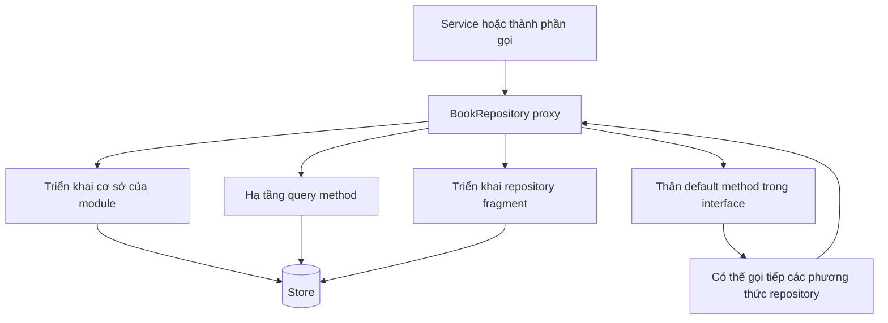

# Phân biệt phương thức cơ sở, query method, default method và fragment

Một interface repository có thể chứa nhiều phương thức nhìn khá giống nhau nhưng được thực thi bằng những cơ chế khác nhau. `findById` thường dùng phần triển khai CRUD cơ sở; `findByStatus` có thể được dựng thành truy vấn; một phương thức `default` có thân Java ngay trong interface; còn một phương thức tùy biến có thể được chuyển tới repository fragment.

Trong chương **Proxy và thành phần** của Spring Data Commons (`SPRING_DATA_COMMONS`), bài này xây dựng bản đồ cho bốn nhóm đó. Phân biệt đúng giúp chọn nơi đặt hành vi, hiểu lỗi khởi tạo repository và biết phần nào thực sự phụ thuộc store khi dùng CRUD, derived query, phân trang, projection hoặc auditing.

Ví dụ xuyên suốt dùng một thư viện sách với Spring Data JPA. Những kiểu thuộc Commons diễn đạt hợp đồng dùng chung; JPA cung cấp phần persistence cụ thể. Mã dùng Jakarta Persistence và giả định dự án đã có dependency, cấu hình repository cùng database phù hợp. Các đoạn mã không tự tạo thành một project chạy độc lập.

## 1. Một proxy có thể phục vụ nhiều nguồn triển khai

Khi inject `BookRepository`, ứng dụng thường nhận một repository proxy do hạ tầng Spring Data tạo ra. Proxy không nhất thiết chuyển mọi lời gọi tới một lớp duy nhất có toàn bộ phần thân phương thức.



Sơ đồ mô tả các đường trách nhiệm, không phải một thứ tự interceptor cố định cho mọi module và phiên bản. Các cơ chế khác như giao dịch hoặc xử lý ngoại lệ có thể tham gia quanh đường thực thi tương ứng.

| Nhóm | Ai cung cấp hành vi chính? | Ví dụ |
| --- | --- | --- |
| Phương thức cơ sở | Phần triển khai chuẩn do module repository cung cấp. | `save`, `findById`, `count`, `deleteById`. |
| Query method | Hạ tầng truy vấn của module từ khai báo repository. | `findByPublishedTrueOrderByTitleAsc`, phương thức có truy vấn khai báo. |
| Default method | Thân Java của phương thức trong interface. | `requireById` bọc `findById` và quy định cách báo thiếu dữ liệu. |
| Fragment method | Một phần hợp đồng tùy biến được ghép với lớp triển khai tương ứng. | `searchTitle` có thuật toán truy vấn do lập trình viên viết. |

Câu hỏi hữu ích nhất là **phần thân hoặc cách thực thi đến từ đâu**, không chỉ “phương thức được khai báo ở file nào”.

## 2. Nhìn cả bốn nhóm trong một repository

Giả sử có hợp đồng fragment:

```java
package com.example.library.book;

import java.util.List;

public interface BookTitleSearch {
    List<Book> searchTitle(String text, int limit);
}
```

Repository chính:

```java
package com.example.library.book;

import java.util.List;
import java.util.NoSuchElementException;
import org.springframework.data.repository.CrudRepository;

public interface BookRepository
        extends CrudRepository<Book, Long>, BookTitleSearch {

    List<Book> findByPublishedTrueOrderByTitleAsc();

    default Book requireById(Long id) {
        return findById(id).orElseThrow(() ->
            new NoSuchElementException("Không tìm thấy sách: " + id)
        );
    }
}
```

Bốn lời gọi có thể được đọc như sau:

```java
Book saved = books.save(input);                         // Cơ sở
List<Book> published = books.findByPublishedTrueOrderByTitleAsc(); // Query
Book required = books.requireById(saved.getId());       // Default
List<Book> matches = books.searchTitle("commons", 10); // Fragment
```

Phương thức `save` được thừa kế từ hợp đồng CRUD. `searchTitle` cũng được thừa kế, nhưng từ interface fragment. Vì vậy, “phương thức thừa kế” không đồng nghĩa “phương thức cơ sở”.

Tương tự, `requireById` gọi một thao tác đọc dữ liệu nhưng không vì thế mà trở thành derived query. Nó có một thân Java tường minh.

## 3. Phương thức cơ sở: hợp đồng có phần triển khai chuẩn

### 3.1. Không cần viết phần thân CRUD cho từng repository

Với `CrudRepository<Book, Long>`, các thao tác như sau đã có hợp đồng và phần triển khai tương ứng từ module:

```java
<S extends Book> S save(S entity);
Optional<Book> findById(Long id);
boolean existsById(Long id);
long count();
void deleteById(Long id);
```

Đây là hình dạng chữ ký sau khi thay kiểu miền và ID, không phải toàn bộ định nghĩa interface.

Trong một ứng dụng JPA thông dụng, có thể gặp phần triển khai cơ sở như `SimpleJpaRepository`. Với MongoDB, phần triển khai chuẩn và cách tương tác persistence khác. Ứng dụng nên làm việc qua hợp đồng phù hợp thay vì phụ thuộc trực tiếp vào tên lớp triển khai nội bộ.

“Cơ sở” không có nghĩa mọi store chạy cùng một câu lệnh hoặc cùng thời điểm ghi. Nhận diện đối tượng mới, cấp ID, mapping, version và giao dịch vẫn phụ thuộc module cùng cấu hình.

### 3.2. Không phân loại bằng tiền tố tên

`findById` trông giống một tên truy vấn được suy ra từ thuộc tính, nhưng chữ ký CRUD chuẩn này là phương thức cơ sở. Trong hợp đồng đó, ID là định danh của kiểu miền; không nên chỉ nhìn tên rồi suy ra nó đang lọc một thuộc tính nghiệp vụ bất kỳ tên `id`.

Một query method riêng như `findByExternalCode` có thể truy vấn thuộc tính nghiệp vụ tương ứng nếu module hỗ trợ và mô hình có thuộc tính đó.

Có thể khai báo lại hoặc chọn lọc một số chữ ký tương thích từ hợp đồng cơ sở trong một interface repository tùy thiết kế. Vị trí khai báo lại không tự biến thao tác thành truy vấn tùy ý. Cần xem chữ ký và cách module nhận diện phương thức cơ sở.

### 3.3. API mở rộng của module cũng có phương thức cơ sở

Ví dụ `JpaRepository` bổ sung những khả năng dành cho JPA. Các phương thức được module cung cấp phần triển khai chuẩn không trở thành query method được suy ra từ tên chỉ vì chúng xuất hiện trên một interface mở rộng.

Tương tự, một executor như `QueryByExampleExecutor` có những hợp đồng truy vấn dùng chung được module hỗ trợ. Đừng gọi mọi thao tác nhận `Example` là một derived query theo tên; cách diễn đạt điều kiện ở đây khác với phân tích tên phương thức.

## 4. Query method: khai báo nhu cầu, module chuẩn bị truy vấn

### 4.1. Derived query là một dạng query method

Trong ví dụ:

```java
List<Book> findByPublishedTrueOrderByTitleAsc();
```

Có thể đọc:

```text
findBy       -> bắt đầu phần điều kiện
PublishedTrue -> thuộc tính published phải là true
OrderByTitleAsc -> sắp xếp theo title tăng dần
```

Spring Data phân tích khai báo; module cụ thể xây dựng cách truy vấn phù hợp. Kiểu `Book` phải có thuộc tính tương ứng, và store phải hỗ trợ những khả năng đang dùng.

Không có một câu SQL dùng chung được Commons tạo ra để chạy giống nhau trên mọi database và document store.

### 4.2. Query method không bắt buộc phải có tên dài

Một phương thức có thể sử dụng truy vấn khai báo theo module. Ví dụ riêng cho JPA:

```java
import org.springframework.data.jpa.repository.Query;

@Query("select b from Book b where b.published = true order by b.title asc")
List<Book> loadPublished();
```

Ở đây, tên `loadPublished` không tự mô tả điều kiện bằng derived query. Annotation cung cấp truy vấn theo ngôn ngữ mà module JPA hỗ trợ trong trường hợp này.

Annotation `@Query` của module khác có package và ngôn ngữ truy vấn riêng. Không chuyển nguyên một chuỗi JPQL sang MongoDB rồi kỳ vọng proxy tự dịch được.

Tùy cấu hình, module còn có thể sử dụng những cơ chế truy vấn khai báo khác như named query hoặc chiến lược tìm truy vấn đã được cấu hình. Vì vậy, không khẳng định mọi abstract method chưa có thân đều luôn được giải quyết bằng cách phân tích tên.

### 4.3. Kiểu trả về là một phần của hợp đồng truy vấn

Một query method có thể trả entity, collection, `Page`, `Slice`, projection hoặc kiểu khác được module hỗ trợ. Kiểu trả về ảnh hưởng cách kết quả được tạo và metadata đi kèm; nó không phải cách tự chọn một lớp triển khai fragment.

Ví dụ, một phương thức trả projection vẫn có thể là query method. Ngược lại, fragment cũng có thể chủ động trả một DTO. Hình dạng dữ liệu chưa đủ để phân loại đường thực thi.

### 4.4. Một tên truy vấn nhìn hợp lý vẫn có thể không chạy

Các nguyên nhân gồm:

- Thuộc tính không tồn tại hoặc đường dẫn thuộc tính không đúng.
- Keyword, tham số đặc biệt hoặc kiểu kết quả không được module hỗ trợ.
- Truy vấn khai báo dùng sai ngôn ngữ hoặc bind tham số không phù hợp.
- Module không tìm được truy vấn theo chiến lược đang áp dụng.

Lỗi có thể xuất hiện khi repository được khởi tạo hoặc muộn hơn tùy chế độ bootstrap và đường sử dụng. Query method không phải lời hứa rằng mọi khai báo Java hợp lệ đều thành một truy vấn hợp lệ.

## 5. Default method: hành vi Java ngay trong hợp đồng

### 5.1. Phần thân không cần được sinh ra từ tên

```java
default Book requireById(Long id) {
    return findById(id).orElseThrow(() ->
        new NoSuchElementException("Không tìm thấy sách: " + id)
    );
}
```

Đây là mã Java do người viết interface cung cấp. Hành vi ở đây gồm:

1. Gọi phương thức repository `findById`.
2. Trả entity nếu tồn tại.
3. Chuyển trường hợp không tồn tại thành một ngoại lệ do hợp đồng đã chọn.

Không cần một thuộc tính `require` hoặc một query parser hiểu tên `requireById`. Phần thân đã xác định hành vi.

Khi default method được gọi trên repository proxy, những lời gọi tới các phương thức repository trong thân có thể tiếp tục đi qua cơ chế định tuyến tương ứng của proxy. Vì vậy, default method có thể bọc một thao tác cơ sở hoặc kết hợp với query method.

### 5.2. Khi nào phù hợp?

Default method phù hợp với hành vi gọn, gần với hợp đồng interface và diễn đạt được từ các phương thức sẵn có, chẳng hạn một cách chuyển kết quả thiếu hoặc một phép biến đổi đơn giản.

Không nên biến default method thành nơi chứa một luồng nghiệp vụ dài, nhiều dependency ngoài repository hoặc mã persistence đặc thù cần inject `EntityManager`/template. Interface không cung cấp một constructor để quản lý các dependency đó như một component thông thường.

Nếu nhiều bước tạo thành một ca sử dụng, service có thể là nơi rõ ràng hơn để điều phối và đặt ranh giới giao dịch. Nếu cần hiện thực một khả năng truy cập dữ liệu tùy biến, fragment thường phù hợp hơn.

### 5.3. Default method không tự tạo giao dịch bao ngoài

Một default method gọi hai phương thức lưu không tự có nghĩa cả hai thao tác nằm trong một giao dịch nghiệp vụ duy nhất. Chính sách giao dịch có thể đến từ service, annotation được hạ tầng hỗ trợ hoặc mặc định cụ thể của module.

Trong JPA, việc một số phương thức CRUD có cấu hình giao dịch mặc định không phải bằng chứng mọi declared query hoặc default method đều có cùng cấu hình. Khi cần tính nguyên tử cho nhiều thao tác, xác định ranh giới giao dịch có chủ đích và kiểm tra nó.

## 6. Fragment: hợp đồng tùy biến cùng một phần triển khai được ghép vào

Một repository fragment thường gồm:

```text
Interface khả năng tùy biến
          +
Lớp triển khai khả năng đó
          +
Repository chính kế thừa interface khả năng
```

Trong ví dụ:

```text
BookTitleSearch
      └── BookTitleSearchImpl

BookRepository extends CrudRepository<Book, Long>, BookTitleSearch
```

Fragment không phải một query method chỉ vì nó trả dữ liệu từ database. Nó có phần triển khai do lập trình viên cung cấp và được ghép vào repository composition.

### 6.1. Mô hình tối thiểu cho ví dụ JPA

```java
package com.example.library.book;

import jakarta.persistence.Entity;
import jakarta.persistence.GeneratedValue;
import jakarta.persistence.GenerationType;
import jakarta.persistence.Id;

@Entity
public class Book {

    @Id
    @GeneratedValue(strategy = GenerationType.IDENTITY)
    private Long id;

    private String title;

    private boolean published;

    protected Book() {
    }

    public Book(String title, boolean published) {
        if (title == null || title.isBlank()) {
            throw new IllegalArgumentException("Tiêu đề không được rỗng");
        }
        this.title = title;
        this.published = published;
    }

    public Long getId() {
        return id;
    }

    public String getTitle() {
        return title;
    }

    public boolean isPublished() {
        return published;
    }
}
```

### 6.2. Phần triển khai fragment

```java
package com.example.library.book;

import java.util.List;
import java.util.Locale;
import jakarta.persistence.EntityManager;
import jakarta.persistence.PersistenceContext;

public class BookTitleSearchImpl implements BookTitleSearch {

    @PersistenceContext
    private EntityManager entityManager;

    @Override
    public List<Book> searchTitle(String text, int limit) {
        if (text == null || text.isBlank()) {
            throw new IllegalArgumentException("Nội dung tìm không được rỗng");
        }
        if (limit < 1 || limit > 100) {
            throw new IllegalArgumentException("Giới hạn phải từ 1 đến 100");
        }

        String needle = text.strip().toLowerCase(Locale.ROOT);

        return entityManager.createQuery(
                "select b from Book b "
                    + "where locate(:needle, lower(b.title)) > 0 "
                    + "order by b.title asc, b.id asc",
                Book.class
            )
            .setParameter("needle", needle)
            .setMaxResults(limit)
            .getResultList();
    }
}
```

Mã kiểm tra đầu vào, bind tham số và giới hạn kết quả ở lớp triển khai. JPQL dùng tên entity `Book` và thuộc tính Java, không phải tên bảng tùy ý.

`locate` trong ví dụ diễn đạt việc tìm chuỗi con theo khả năng JPQL. Quy tắc so sánh chữ, Unicode và collation vẫn cần được đánh giá khi ứng dụng có yêu cầu ngôn ngữ cụ thể; đoạn minh họa không định nghĩa một cơ chế tìm kiếm văn bản đầy đủ.

Interface fragment có thể được dùng lại ở nơi phù hợp, nhưng implementation dùng `EntityManager` không tự trở thành mã thực thi được trên MongoDB. Tính dùng chung của hợp đồng và tính dùng chung của hiện thực là hai việc khác nhau.

## 7. Fragment phải được nhận diện và ghép đúng

### 7.1. Có lớp triển khai chưa đủ

Để `searchTitle` đi tới phần triển khai dự định, cần đối chiếu đủ các mối nối:

| Thành phần | Trong ví dụ |
| --- | --- |
| Hợp đồng fragment | `BookTitleSearch` khai báo `searchTitle`. |
| Repository chính | `BookRepository` kế thừa `BookTitleSearch`. |
| Implementation | `BookTitleSearchImpl` hiện thực đúng interface và chữ ký. |
| Quy ước phát hiện | Tên, postfix và vị trí nằm trong phạm vi mà module tìm implementation. |
| Dependency của implementation | `EntityManager` phù hợp với đường JPA được cung cấp. |

Quy ước fragment thông dụng là tên interface fragment cộng hậu tố `Impl`. Nếu cấu hình đã đổi implementation postfix, tên cần phù hợp với cấu hình đó. Đặt implementation cùng vùng package của repository như ví dụ giúp đường phát hiện rõ ràng hơn.

Một lớp helper tên `BookSearchService` tồn tại trong context không tự trở thành fragment của mọi repository có phương thức tìm sách. Ngược lại, chỉ thêm `@Repository` vào một class cũng không thay thế việc repository chính cần được ghép đúng hợp đồng.

Có những cách đăng ký hoặc cung cấp implementation tường minh theo module, nhưng phải cấu hình đúng cơ chế đó. Đừng suy ra “có bean” đồng nghĩa “bean đã là một phần của repository composition”.

### 7.2. Tránh trộn lẫn với quy ước tùy biến cũ

Có thể gặp project dùng một lớp như `BookRepositoryImpl` để bổ sung hành vi theo mô hình tùy biến lịch sử của repository. Mô hình fragment trong bài chủ đích đặt tên theo **interface khả năng**: `BookTitleSearch` và `BookTitleSearchImpl`.

Khi đọc dự án cũ, xác định cơ chế và postfix thực sự đang áp dụng. Không tạo đồng thời nhiều lớp có tên gần giống rồi chờ framework tự chọn đúng ý định.

### 7.3. Nếu implementation không được tìm thấy

Khi `searchTitle` còn lại như một khai báo chưa có đường thực thi đúng, hạ tầng có thể cố xử lý nó như một query method theo cơ chế đang dùng và báo lỗi thuộc tính hoặc không tạo được truy vấn. Một số lỗi chỉ lộ ra khi phương thức được khởi tạo hoặc gọi.

Điều cần kiểm tra là interface fragment, tên lớp, chữ ký, package và cấu hình phát hiện. Không thêm một thuộc tính `searchTitle` vào entity chỉ để làm biến mất thông báo parser khi ý định thật là dùng fragment.

## 8. Chữ ký phương thức và thứ tự ghép có ý nghĩa

### 8.1. Cùng tên chưa chắc cùng phương thức

Các overload có thể có đường xử lý khác nhau:

```java
List<Book> searchTitle(String text, int limit);
List<Book> searchTitle(String text);
```

Nếu fragment chỉ hiện thực overload hai tham số, không mặc định overload một tham số đã có cùng phần triển khai. Nó cần một thân default, một implementation tương ứng hoặc một cơ chế khai báo hợp lệ khác.

Khi chẩn đoán, đối chiếu tên, danh sách tham số, kiểu generic và hợp đồng trả về tương thích, không chỉ tìm một method cùng tên trong project.

### 8.2. Fragment có thể thay hành vi cơ sở

Trong cơ chế composition của Spring Data, implementation tùy biến có ưu tiên so với implementation cơ sở trong những trường hợp ghi đè được hỗ trợ. Ví dụ một fragment có thể chủ đích cung cấp chữ ký `save` để thay đường lưu chuẩn.

Đó là một thay đổi lớn hơn việc thêm `searchTitle`. Khi thay hành vi `save`, người triển khai phải giữ những phần hợp đồng cần thiết, chẳng hạn:

- Liên kết kiểu `<S extends T>` ở đầu vào và kết quả.
- Cách xử lý entity mới hoặc đã có trạng thái persistence.
- Trạng thái sau lưu và việc sử dụng instance trả về.
- Giao dịch, version, callback hoặc auditing có liên quan trong module.

Không inject chính repository proxy vào implementation ghi đè rồi gọi lại cùng phương thức một cách không kiểm soát; lời gọi có thể quay lại chính đường tùy biến và tạo vòng lặp. Cần chọn cơ chế mở rộng hoặc ủy quyền phù hợp với module và thiết kế cụ thể.

### 8.3. Nhiều fragment có cùng chữ ký

Nếu repository ghép nhiều fragment, thứ tự khai báo và quy tắc composition có thể quyết định implementation được chọn khi chữ ký chồng nhau. Framework không đoán theo tên lớp nào có vẻ “chuyên biệt hơn”.

Nên thiết kế các khả năng có trách nhiệm rõ ràng. Nếu cố ý thay thế hành vi, ghi rõ quyền sở hữu chữ ký và kiểm tra đường thực thi. Không để một lần thêm interface cha vô tình đổi phương thức đang được gọi.

Không gom mọi trường hợp thành một quy tắc đơn giản như “cứ có tên bắt đầu bằng `find` thì đi query” hoặc “class tùy biến luôn thắng mọi annotation”. Default method, khai báo truy vấn tường minh, implementation cơ sở và fragment được xử lý theo những cơ chế cần được đọc đầy đủ khi cố ý tạo chữ ký trùng nhau.

### 8.4. Một cách phân loại thực dụng

| Quan sát | Kết luận cần xem xét |
| --- | --- |
| Phương thức có thân `default` trong interface | Có hành vi Java tường minh; không chỉ phân tích tên như một abstract query. |
| Chữ ký khớp thao tác cơ sở và không có thay thế tùy biến | Dùng đường implementation cơ sở của module. |
| Chữ ký thuộc fragment đã được ghép đúng | Có implementation tùy biến cần kiểm tra. |
| Khai báo truy vấn bằng cơ chế module hỗ trợ | Có thông tin truy vấn cần được module xử lý. |
| Abstract method còn lại chưa có phần triển khai rõ | Cần xác định nó có là query method hợp lệ theo cấu hình hay không. |

Bảng là hướng đọc mã, không thay thế toàn bộ thuật toán định tuyến nội bộ. Khi một method đồng thời có nhiều dấu hiệu, tránh suy luận chỉ từ một annotation hoặc một tiền tố.

## 9. Chọn vị trí đặt hành vi theo nhu cầu

| Nhu cầu | Điểm bắt đầu phù hợp | Lý do |
| --- | --- | --- |
| CRUD thông thường | Phương thức cơ sở. | Đã có hợp đồng và implementation chuẩn của module. |
| Lọc theo vài thuộc tính có cú pháp hỗ trợ | Derived query. | Điều kiện gọn, dễ đọc trực tiếp từ khai báo. |
| Cần diễn đạt truy vấn cụ thể của store | Query method khai báo truy vấn. | Kiểm soát truy vấn mà chưa cần một lớp thuật toán riêng. |
| Bọc kết quả hoặc kết hợp ngắn từ phương thức sẵn có | Default method. | Có thể giữ hành vi nhỏ ngay trong interface. |
| Truy vấn động, thuật toán truy cập hoặc cần inject persistence API | Fragment. | Có lớp triển khai và dependency rõ ràng. |
| Điều phối nhiều repository, nhiều bước nghiệp vụ | Service của ca sử dụng. | Dễ xác định ranh giới nghiệp vụ và giao dịch. |

Không chọn fragment chỉ vì có nhiều hơn một điều kiện; derived query hoặc một truy vấn khai báo có thể đã đủ rõ. Ngược lại, không buộc một thuật toán dài thành một tên query method khó hiểu chỉ để tránh tạo lớp triển khai.

### 9.1. Projection không quyết định nơi đặt thuật toán

Một query method có thể trả một projection interface do module dựng. Fragment cũng có thể trả một DTO được xây dựng bằng truy vấn tùy biến. Cần chọn theo khả năng truy vấn và cách thực thi, không chỉ theo việc “không trả entity”.

Tương tự, `Page` hoặc `Slice` là hợp đồng hình dạng kết quả. Nếu fragment tự trả `Page`, implementation phải cung cấp nội dung và metadata đúng với ý nghĩa đã khai báo; kiểu trả về không tự làm phần đếm hoặc phân trang xuất hiện.

### 9.2. Auditing và callback theo đường persistence thực tế

Một lời gọi CRUD chuẩn có thể tham gia vòng đời mà module dùng cho auditing khi đã cấu hình đúng. Nếu fragment chủ động dùng một phép cập nhật trực tiếp hoặc bulk API, không mặc định mọi callback, version và auditing vẫn giống đường lưu entity chuẩn.

Tên repository proxy không tạo một lời hứa rằng mọi đoạn mã bên dưới đều đi qua cùng vòng đời. Cần kiểm tra thao tác persistence thực sự được gọi.

### 9.3. Giao dịch cần được thiết kế riêng

Một fragment có lớp triển khai không tự chứng minh các phương thức của nó luôn có cùng transaction metadata với CRUD cơ sở. Một default method cũng không tự tạo ranh giới bao phủ mọi lời gọi bên trong.

Với nhiều bước ghi, đặt giao dịch ở nơi diễn đạt được toàn bộ ca sử dụng. Khi chọn annotation ở repository hoặc implementation, kiểm tra cách module và proxy thực sự áp dụng nó. Tránh suy ra giao dịch từ việc method nằm trong cùng một interface.

## 10. Theo dõi bốn lời gọi trong ví dụ

### 10.1. `save(input)`

Nếu không có tùy biến thay thế, proxy đi tới implementation cơ sở mà module cung cấp. Trong JPA, cơ chế persist/merge, mapping và đồng bộ theo giao dịch quyết định việc lưu thực tế.

Người gọi nên dùng đối tượng trả về khi cần trạng thái sau lưu. Hợp đồng generic không buộc kết quả luôn là cùng một instance Java với đầu vào.

### 10.2. `findByPublishedTrueOrderByTitleAsc()`

Hạ tầng query method xử lý điều kiện trên `published`, sắp xếp theo `title` và dựng kết quả `List<Book>` theo khả năng JPA.

Nếu thêm một thuộc tính, đổi tên field hoặc sửa chữ ký, cần kiểm tra khai báo truy vấn vẫn phù hợp mô hình. Không có lớp `BookRepositoryImpl` được viết tay cho derived query này.

### 10.3. `requireById(id)`

Proxy thực thi thân default method. Thân đó gọi `findById`, nhận `Optional<Book>` từ thao tác cơ sở và áp dụng quy tắc báo thiếu đã viết.

Ngoại lệ `NoSuchElementException` trong ví dụ là lựa chọn của default method. Nó không phải bằng chứng rằng mọi `findById` chuẩn đều ném ngoại lệ khi không có dữ liệu; `findById` trả `Optional` rỗng cho tình huống đó.

### 10.4. `searchTitle(text, limit)`

Lời gọi được phục vụ bởi fragment đã ghép với `BookTitleSearchImpl`. Trong lớp đó, mã kiểm tra tham số rồi chạy JPQL bằng `EntityManager`.

Tên method không cần diễn đạt đầy đủ điều kiện bằng derived query vì đã có implementation. Nếu implementation biến mất khỏi quá trình ghép, tên ấy không đương nhiên còn là một truy vấn hợp lệ.

## 11. Kiểm tra bốn đường thực thi bằng một kịch bản tích hợp

Ví dụ test dưới đây giả định application context JPA đã quét đúng repository, entity và fragment; profile test dùng database có thể tạo lại, không có seed ngoài fixture. Có JUnit Jupiter, AssertJ và dependency test phù hợp.

Test dùng giao dịch test để cô lập dữ liệu. Mục tiêu là kiểm tra hành vi repository và fragment, không kiểm chứng ranh giới giao dịch của một service nghiệp vụ.

```java
package com.example.library.book;

import static org.assertj.core.api.Assertions.assertThat;
import static org.assertj.core.api.Assertions.assertThatThrownBy;

import java.util.NoSuchElementException;
import jakarta.persistence.EntityManager;
import jakarta.persistence.PersistenceContext;
import org.junit.jupiter.api.Test;
import org.springframework.beans.factory.annotation.Autowired;
import org.springframework.boot.test.context.SpringBootTest;
import org.springframework.test.context.ActiveProfiles;
import org.springframework.transaction.annotation.Transactional;

@SpringBootTest(webEnvironment = SpringBootTest.WebEnvironment.NONE)
@ActiveProfiles("repository-methods-test")
@Transactional
class BookRepositoryMethodsTest {

    @Autowired
    private BookRepository books;

    @PersistenceContext
    private EntityManager entityManager;

    @Test
    void executesBaseQueryDefaultAndFragmentMethods() {
        Book first = books.save(new Book("01 - Commons", true));
        books.save(new Book("02 - Java", true));
        books.save(new Book("03 - Commons nâng cao", false));
        entityManager.flush();
        entityManager.clear();

        assertThat(books.findById(first.getId())).isPresent();

        assertThat(books.findByPublishedTrueOrderByTitleAsc())
            .extracting(Book::getTitle)
            .containsExactly("01 - Commons", "02 - Java");

        assertThat(books.requireById(first.getId()).getTitle())
            .isEqualTo("01 - Commons");

        assertThat(books.searchTitle("commons", 10))
            .extracting(Book::getTitle)
            .containsExactly("01 - Commons", "03 - Commons nâng cao");
    }

    @Test
    void defaultMethodDefinesTheMissingResultPolicy() {
        Book removed = books.save(new Book("Sách sẽ xóa", false));
        Long id = removed.getId();
        books.deleteById(id);
        entityManager.flush();
        entityManager.clear();

        assertThat(books.findById(id)).isEmpty();
        assertThatThrownBy(() -> books.requireById(id))
            .isInstanceOf(NoSuchElementException.class);
    }
}
```

Test đầu quan sát đủ bốn hành vi với dữ liệu khớp và không khớp. Test sau phân biệt hợp đồng `Optional` của phương thức cơ sở với chính sách ngoại lệ mà default method bổ sung.

`flush` và `clear` trong đoạn JPA giúp giảm việc chỉ quan sát chính instance đã được lưu trong persistence context. Chúng không phải commit và không làm kỹ thuật này trở thành bắt buộc hoặc khả dụng ở mọi store.

Một mock trả dữ liệu đã cài sẵn có thể dùng để kiểm tra một phần logic độc lập, nhưng không chứng minh framework đã ghép `BookTitleSearchImpl`, parse derived query hoặc mapping thành công.

Nếu đổi sang MongoDB hoặc JDBC, cần giữ kỳ vọng nghiệp vụ phù hợp nhưng thay hạ tầng, mapping và implementation fragment. Không mang nguyên test với `EntityManager` sang store khác.

## 12. Chẩn đoán những lỗi dễ phân loại nhầm

| Dấu hiệu | Điều cần kiểm tra |
| --- | --- |
| Lỗi thuộc tính khi gọi một method vốn định dùng fragment | Implementation có được phát hiện, chữ ký có khớp và repository có kế thừa interface fragment không? |
| Có class tùy biến nhưng lời gọi vẫn không đi tới nó | Class đã được ghép vào repository composition chưa, hay chỉ là một bean độc lập? |
| `findById` không được thực thi như mong đợi | Có chữ ký thay thế hoặc fragment ghi đè hành vi cơ sở không? |
| Default method không thay đổi theo một truy vấn khai báo mới | Có đang bỏ qua việc phương thức đã có thân Java không? Tránh gán nhiều nguồn thực thi mâu thuẫn. |
| Một overload chạy, overload khác lỗi parser | Hai chữ ký có thật sự cùng được implementation cung cấp không? |
| Thêm fragment làm thay đổi phương thức cũ | Có chữ ký trùng và quy tắc ưu tiên/thứ tự composition liên quan không? |
| Fragment ghi dữ liệu nhưng auditing không như CRUD | Có đang dùng đường cập nhật trực tiếp bỏ qua vòng đời entity không? |
| Hai lần ghi trong default method không rollback cùng nhau | Có giao dịch bao ngoài phù hợp hay đang là các ranh giới riêng? |
| Query method chạy ở JPA nhưng không chạy ở store khác | Annotation truy vấn, keyword, kiểu kết quả và khả năng module có tương ứng không? |

Một trình tự đọc lỗi có ích:

1. Xác định đúng chữ ký được gọi.
2. Tìm nguồn hành vi dự định: cơ sở, query, default hay fragment.
3. Kiểm tra nguồn đó đã được hạ tầng nhận diện và ghép đúng chưa.
4. Sau đó mới xem truy vấn, mapping, transaction và lỗi store của đường thực thi ấy.

Không sửa một lỗi ghép fragment bằng cách đổi tên tùy tiện tới khi parser chấp nhận. Khi tên method vô tình thành một derived query khác, ứng dụng có thể khởi động nhưng không còn chạy thuật toán dự định.

## 13. Bài tập phân loại

### Bài 1: phương thức thừa kế

`BookRepository` thừa kế `save` từ `CrudRepository` và `searchTitle` từ `BookTitleSearch`. Có thể gọi cả hai là phương thức cơ sở chỉ vì đều được thừa kế không?

**Gợi ý:** Không. Hãy tìm nguồn implementation. Một bên dùng cơ sở của module, bên kia cần phần triển khai fragment tùy biến.

### Bài 2: tên bắt đầu bằng `find`

Một interface có default method `findFeaturedBooks()` với thân gọi hai phương thức khác. Nó có bắt buộc được phân tích như derived query không?

**Gợi ý:** Không. Nó có thân Java. Tên bắt đầu bằng `find` không quyết định riêng đường thực thi.

### Bài 3: query method có tên ngắn

Một method `loadPublished()` không có thân nhưng có annotation truy vấn JPA hợp lệ. Vì sao không cần tên `findByPublishedTrue`?

**Gợi ý:** Query method có thể dùng truy vấn khai báo. Derived query chỉ là một cách xây dựng truy vấn.

### Bài 4: thiếu một mối nối của fragment

Có `BookTitleSearchImpl` implement đúng interface nhưng repository chính không kế thừa `BookTitleSearch`. Có nên mặc định method của fragment tự xuất hiện trên repository không?

**Gợi ý:** Không. Cần hợp đồng được ghép và cấu hình nhận diện đúng; một class hiện diện trong project không tự mở rộng mọi repository.

### Bài 5: thuật toán tìm kiếm động

Yêu cầu cần nhiều điều kiện thay đổi, xử lý tham số và gọi persistence API đặc thù. Nên ưu tiên một default method rất dài hay một fragment?

**Gợi ý:** Fragment cho phép một lớp implementation và dependency rõ ràng. Vẫn xem truy vấn khai báo có đủ diễn đạt nhu cầu trước khi thêm thuật toán tùy biến.

### Bài 6: ca sử dụng ghi qua hai repository

Một nghiệp vụ cập nhật sách và một đối tượng khác trong cùng ranh giới nhất quán. Chỉ đặt hai lời gọi trong default method có đủ chứng minh giao dịch đúng không?

**Gợi ý:** Chưa. Xác định service hoặc ranh giới giao dịch phù hợp, module hỗ trợ và kiểm tra rollback theo đúng phạm vi nghiệp vụ.

Khi đọc một phương thức repository, hãy nối ba điều: **hợp đồng được khai báo ở đâu, ai cung cấp phần thực thi và lời gọi đi qua hạ tầng persistence nào**. Phương thức cơ sở, query method, default method và fragment có thể cùng xuất hiện trên một proxy, nhưng mỗi nhóm mang một nguồn hành vi và trách nhiệm khác nhau.
