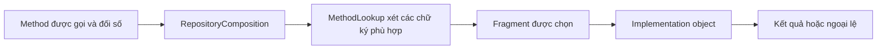
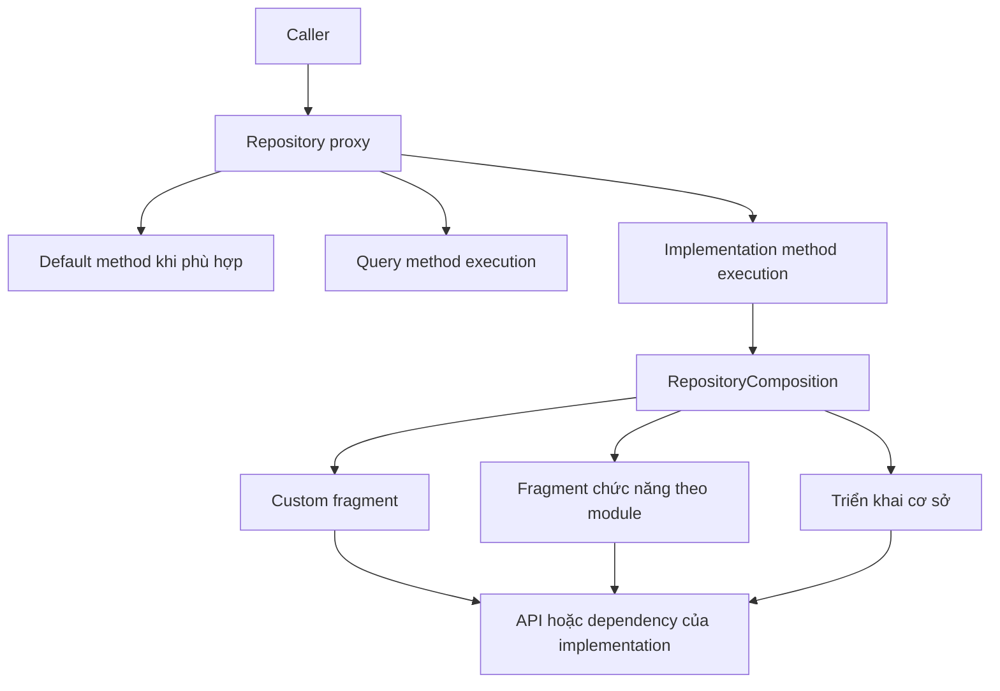

# RepositoryComposition và tập RepositoryFragment

Một repository Spring Data có thể công bố method CRUD, query method và các method do ứng dụng tự triển khai trên cùng một interface. Những method này không nhất thiết có thân thực thi trong cùng một lớp.

`RepositoryFragment` mô tả một phần đóng góp vào repository. `RepositoryComposition.RepositoryFragments` giữ các fragment theo thứ tự. `RepositoryComposition` kết hợp chúng với cơ chế tìm method và định tuyến lời gọi đến phần hiện thực phù hợp.

Trong chương **Proxy và thành phần** của module `SPRING_DATA_COMMONS`, hiểu ba khái niệm này giúp bạn giải thích cách repository mở rộng hành vi, xử lý method trùng nhau và phân biệt composition với các nhánh xử lý khác của repository proxy.

## 1. Ba khái niệm ở ba mức khác nhau

| Thành phần | Vai trò |
| --- | --- |
| `RepositoryFragment<T>` | Một phần đóng góp chữ ký method và có thể có đối tượng implementation |
| `RepositoryComposition.RepositoryFragments` | Một danh sách fragment có thứ tự |
| `RepositoryComposition` | Kết hợp fragment với method lookup, chuyển đổi đối số phù hợp và cơ chế gọi implementation |

Dù thường gọi ngắn là “tập fragment”, `RepositoryFragments` không phải một `Set` không có thứ tự. Thứ tự là một phần thông tin quan trọng của mô hình này.

Có thể hình dung:

```text
RepositoryComposition
├── RepositoryFragments
│   ├── fragment A
│   ├── fragment B
│   └── fragment triển khai cơ sở
├── MethodLookup
└── cơ chế chuyển đổi đối số khi cần
```

Composition là đối tượng hỗ trợ triển khai method. Repository proxy là đối tượng mà ứng dụng thường nhận qua Spring và còn có thể chứa các interceptor khác.

## 2. RepositoryFragment: chữ ký và phần hiện thực

Một fragment có thể đóng góp thông tin về những method mà nó cung cấp. Khi fragment có implementation, thông tin đó được gắn với một đối tượng thực thi cụ thể.

Ví dụ ở mức ứng dụng:

```java
public interface ActiveCustomerLookup {

    java.util.List<Customer> loadActiveCustomers();
}
```

```java
public class ActiveCustomerLookupImpl
        implements ActiveCustomerLookup {

    @Override
    public java.util.List<Customer> loadActiveCustomers() {
        // Thân truy cập dữ liệu cụ thể sẽ có ở phần thực hành.
        throw new UnsupportedOperationException(
                "Chỉ minh họa hình dạng interface và implementation");
    }
}
```

Đoạn implementation trên chỉ minh họa hình dạng, không dùng làm triển khai thực hành. Phần 7 cung cấp thân method truy cập dữ liệu.

Ở mức hạ tầng, một implemented fragment liên hệ hai vai trò:

- **Signature contributor:** nơi cung cấp các chữ ký method.
- **Implementation object:** đối tượng sẽ nhận lời gọi đã được định tuyến.

Signature contributor có thể là một interface tường minh hoặc được xác định từ đối tượng implementation. Vì vậy, fragment không chỉ là một interface Java đứng riêng. [RepositoryFragment API](https://docs.spring.io/spring-data/commons/docs/current/api/org/springframework/data/repository/core/support/RepositoryFragment.html)

### 2.1. Implemented fragment

Có thể tạo một fragment với interface và đối tượng thực thi:

```java
RepositoryFragment<LabelProvider> fragment =
        RepositoryFragment.implemented(
                LabelProvider.class,
                new PrimaryLabelProvider());
```

`LabelProvider` và implementation tương ứng được định nghĩa đầy đủ trong ví dụ độc lập ở phần 6.

Việc truyền interface tường minh giúp nhìn rõ bề mặt chữ ký mà fragment đóng góp.

Một dạng API khác nhận riêng đối tượng:

```java
RepositoryFragment<?> fragment =
        RepositoryFragment.implemented(implementation);
```

Đây là mảnh API với biến `implementation` đã có sẵn. Không cần dùng cả hai dạng cho cùng một đóng góp chỉ để “chắc chắn framework nhận ra”.

### 2.2. Structural fragment

Structural fragment mô tả cấu trúc mà chưa có đối tượng implementation:

```java
RepositoryFragment<LabelProvider> structural =
        RepositoryFragment.structural(LabelProvider.class);

boolean hasImplementation =
        structural.getImplementation().isPresent();
```

Trong ví dụ này, `hasImplementation` là `false`. Structural fragment có ích cho việc khám phá cấu trúc và validation; nó không tự có thân method nghiệp vụ.

Có thể tạo một fragment mới được gắn implementation:

```java
RepositoryFragment<LabelProvider> implemented =
        structural.withImplementation(new PrimaryLabelProvider());
```

Không diễn giải `structural(...)` thành một cơ chế tự sinh thuật toán cho mọi method trong interface.

### 2.3. Fragment là value object, delegate vẫn có vòng đời riêng

Fragment không phải entity mà repository đang lưu. Đối tượng implementation bên trong có thể là một Spring bean hoặc một đối tượng do hạ tầng cung cấp.

Tính bất biến của mô tả fragment không làm một delegate chứa mutable state trở thành thread-safe. Nếu implementation là singleton dùng chung, vẫn phải thiết kế trạng thái và dependency của nó phù hợp.

## 3. RepositoryFragments: danh sách có thứ tự và phép tạo mới

Lớp này là nested type:

```java
import org.springframework.data.repository.core.support
        .RepositoryComposition.RepositoryFragments;
```

Các thao tác thường gặp:

| API | Ý nghĩa |
| --- | --- |
| `RepositoryFragments.empty()` | Tạo danh sách fragment rỗng |
| `RepositoryFragments.of(fragmentA, fragmentB)` | Tạo từ các fragment theo thứ tự truyền vào |
| `RepositoryFragments.from(collection)` | Tạo từ collection fragment |
| `RepositoryFragments.just(implementationA, implementationB)` | Tạo từ các implementation object |
| `fragments.append(fragment)` | Tạo danh sách mới với fragment được nối thêm |
| `fragments.size()` | Số fragment trong danh sách |

`append` trả một đối tượng mới. Danh sách hiện có không tự bị thêm phần tử tại chỗ. [RepositoryComposition.RepositoryFragments API](https://docs.spring.io/spring-data/commons/docs/current/api/org/springframework/data/repository/core/support/RepositoryComposition.RepositoryFragments.html)

Ví dụ:

```java
RepositoryFragments original = RepositoryFragments.of(primary);

RepositoryFragments extended = original.append(secondary);

// Trong ví dụ có một fragment ban đầu:
// original.size() == 1
// extended.size() == 2
```

Nếu chỉ viết:

```java
original.append(secondary);
```

rồi tiếp tục dùng `original`, bạn chưa sử dụng danh sách mở rộng được trả về.

### 3.1. Thứ tự collection đầu vào cần có ý nghĩa

Nếu tạo từ một collection không có thứ tự phù hợp với ý định, không nên mong composition tự suy ra mức ưu tiên nghiệp vụ.

Khi có method trùng nhau và thứ tự đóng góp quan trọng, hãy giữ một danh sách có thứ tự rõ ràng và kiểm tra trường hợp xung đột.

### 3.2. Số interface cha không nhất thiết bằng số delegate

Một repository có thể mở rộng nhiều interface. Không suy ra máy móc rằng mỗi interface cha sẽ tương ứng đúng một implementation object độc lập hoặc một bean riêng.

Hạ tầng module có thể dùng một triển khai cơ sở cho nhiều hợp đồng và đóng góp các fragment chức năng khác theo khả năng được hỗ trợ.

## 4. RepositoryComposition: tìm method và gọi phần hiện thực

Composition giữ các fragment cùng chiến lược tìm method. Khi nhận một method được gọi, nó tìm method phù hợp theo `MethodLookup` và định tuyến đến fragment tương ứng.

API cũng hỗ trợ chuyển đổi đối số giữa chữ ký repository và chữ ký implementation khi cấu hình yêu cầu. [RepositoryComposition API](https://docs.spring.io/spring-data/commons/docs/current/api/org/springframework/data/repository/core/support/RepositoryComposition.html)

Luồng khái quát:



### 4.1. Không chỉ xét tên method

Hai method cùng tên có thể khác tham số hoặc tham gia các hợp đồng generic khác nhau. Metadata của repository và chiến lược lookup giúp hạ tầng đối chiếu đúng chữ ký.

Ví dụ, method `save` của repository generic không nên được hiểu bằng một quy tắc tự viết chỉ so sánh chuỗi `"save"`.

Các factory có thể cấu hình lookup theo repository type. Ví dụ độc lập ở phần 6 dùng chữ ký đơn giản để tập trung vào thứ tự, không mô phỏng toàn bộ matching của repository generic hay reactive.

### 4.2. Chọn phần thực thi không phải chạy tất cả fragment

Khi nhiều fragment có thể cung cấp cùng một chữ ký phù hợp, thứ tự và chiến lược lookup quyết định phần được chọn.

Composition không mặc định gọi fragment A, rồi B, rồi triển khai cơ sở cho cùng một lời gọi. Nó không tự biến mỗi fragment thành một bước “before/after”.

Nếu một custom fragment xử lý `save`, không có bảo đảm rằng triển khai `save` cơ sở sẽ được gọi tiếp sau khi custom method trả về. Delegation bổ sung phải được thiết kế rõ.

### 4.3. Tạo mới khi cấu hình hoặc nối thêm

Các thao tác như `append` hoặc `withArgumentConverter` tạo composition mới với cấu hình tương ứng.

```java
RepositoryComposition original =
        RepositoryComposition.of(primary);

RepositoryComposition extended =
        original.append(secondary);
```

Sử dụng giá trị trả về của các thao tác cấu hình. Không mặc định lời gọi đã thay đổi một composition đang được dùng ở nơi khác.

### 4.4. Chuyển đổi đối số có phạm vi riêng

Argument conversion ở composition giúp thích ứng lời gọi method khi hạ tầng hỗ trợ. Nó không thay thế converter ánh xạ entity/document, không tự dịch Java object thành SQL và không tự bảo đảm mọi kiểu ID có thể đổi qua lại.

Composition cũng không tự lựa chọn datasource hay collection. Phần thực thi cụ thể vẫn thuộc module hoặc custom implementation.

## 5. Thứ tự và xung đột chữ ký

Ở mô hình custom repository chuẩn, các custom implementation được ghép theo thứ tự khai báo liên quan và có độ ưu tiên cao hơn triển khai cơ sở cùng repository aspects.

Điều đó cho phép một custom fragment cung cấp chữ ký trùng với method đã có. Nó cũng khiến thứ tự trở thành thông tin có ảnh hưởng đến hành vi. [Spring Data Commons — Custom Repository Implementations](https://docs.spring.io/spring-data/commons/reference/repositories/custom-implementations.html)

Ví dụ về hai hợp đồng trùng chữ ký:

```java
public interface PrimaryLabel {

    String label();
}
```

```java
public interface FallbackLabel {

    String label();
}
```

Một repository có thể công bố cả hai nếu các chữ ký Java tương thích. Nhưng một lời gọi `label()` cần có cách chọn implementation cụ thể.

### Những điểm cần xét

| Tình huống | Cách đọc |
| --- | --- |
| Hai fragment cung cấp cùng chữ ký phù hợp | Thứ tự và lookup quyết định phần được chọn |
| Custom fragment trùng method cơ sở | Có thể ghi đè hành vi cơ sở theo composition |
| Các method cùng tên nhưng khác tham số | Phải đối chiếu chữ ký, không chỉ tên |
| Có cả generic và chữ ký cụ thể | Metadata và lookup của factory có vai trò |
| Delegate được gắn `@Primary` | Đây là cơ chế lựa chọn bean, không tự thay quy tắc định tuyến method của composition |

Không dùng riêng annotation `@Order` hoặc thứ tự nhìn thấy trong component scan để suy ra mọi mức ưu tiên. Hãy đối chiếu cách factory xây composition trong cấu hình đang dùng.

Với những hành vi không chủ định override, đặt tên method theo trách nhiệm rõ ràng giúp giảm xung đột. Khi override là yêu cầu, cần kiểm tra cả phần được chọn và các hành vi của đường thực thi cơ sở có thể bị thay thế.

## 6. Ví dụ độc lập: quan sát fragment được chọn

Ví dụ dưới chỉ dùng cơ chế composition, chưa tạo Spring repository bean và chưa truy cập database. Các implementation là POJO được tạo trực tiếp; chúng không cần dependency injection.

```java
import java.lang.reflect.Method;

import org.springframework.data.repository.core.support.RepositoryComposition;
import org.springframework.data.repository.core.support.RepositoryComposition.RepositoryFragments;
import org.springframework.data.repository.core.support.RepositoryFragment;

public class CompositionDemo {

    public interface LabelProvider {
        String label();
    }

    public static final class PrimaryLabelProvider
            implements LabelProvider {

        @Override
        public String label() {
            return "primary";
        }
    }

    public static final class SecondaryLabelProvider
            implements LabelProvider {

        @Override
        public String label() {
            return "secondary";
        }
    }

    public static void main(String[] args) throws Throwable {
        RepositoryFragment<LabelProvider> primary =
                RepositoryFragment.implemented(
                        LabelProvider.class,
                        new PrimaryLabelProvider());

        RepositoryFragment<LabelProvider> secondary =
                RepositoryFragment.implemented(
                        LabelProvider.class,
                        new SecondaryLabelProvider());

        RepositoryFragments original =
                RepositoryFragments.of(primary);

        RepositoryFragments extended =
                original.append(secondary);

        RepositoryComposition composition =
                RepositoryComposition.of(extended);

        composition.validateImplementation();

        Method method = LabelProvider.class.getMethod("label");

        System.out.println("original size: " + original.size());
        System.out.println("extended size: " + extended.size());
        System.out.println(
                "selected: " + composition.invoke(method));

        RepositoryComposition reversed =
                RepositoryComposition.of(secondary, primary);

        System.out.println(
                "reversed: " + reversed.invoke(method));
    }
}
```

Đầu ra kỳ vọng cho ví dụ chữ ký trùng nhau này:

```text
original size: 1
extended size: 2
selected: primary
reversed: secondary
```

Đây là kết quả kỳ vọng của mã minh họa, không phải log đã đo từ một lần chạy trong bài.

### 6.1. Điều ví dụ chứng minh về mô hình

- `append` giữ nguyên collection cũ và tạo collection mới.
- Cả hai fragment đóng góp cùng chữ ký đơn giản `label()`.
- Thay đổi thứ tự các fragment phù hợp làm thay đổi implementation được gọi trong ví dụ.
- Không có bước tự động gọi cả hai implementation rồi ghép hai chuỗi kết quả.

### 6.2. Điều ví dụ chưa tạo ra

`RepositoryComposition.of(...)` không tự đăng ký một bean vào Spring, không scan tên hậu tố `Impl` và không tự áp dụng transaction advice.

Nếu tự `new` một implementation có field cần Spring inject, field đó chưa được cấp dependency chỉ vì đối tượng được đặt vào composition. Vì vậy, các delegate ở ví dụ độc lập cố ý không dùng `EntityManager` hay template.

### 6.3. Validation có phạm vi hữu hạn

`validateImplementation()` kiểm tra phần implementation của composition theo cơ chế hạ tầng. Nó không kiểm tra kết nối database, tính đúng nghiệp vụ, transaction hoặc hiệu quả truy vấn.

Structural fragment chưa được gắn đối tượng thực thi cần được hoàn thiện trong mô hình phù hợp trước khi trông đợi method nghiệp vụ chạy được.

## 7. Ví dụ repository ghép hai custom fragment

Phần này chuyển từ cơ chế độc lập sang repository do Spring Data tạo. Ví dụ dùng JPA để có truy cập dữ liệu cụ thể; annotation JPA không phải yêu cầu chung cho mọi store.

Giả định có datasource, `EntityManagerFactory`, transaction manager và repository scanning phù hợp. Các kiểu nằm cùng một package repository/domain hoặc trong phạm vi mà cấu hình có thể phát hiện.

### 7.1. Domain

```java
import jakarta.persistence.Entity;
import jakarta.persistence.GeneratedValue;
import jakarta.persistence.Id;
import jakarta.persistence.Table;

@Entity
@Table(name = "customers")
public class Customer {

    @Id
    @GeneratedValue
    private Long id;

    private String email;
    private boolean active;

    protected Customer() {
    }

    public Customer(String email, boolean active) {
        this.email = email;
        this.active = active;
    }

    public Long getId() {
        return id;
    }

    public String getEmail() {
        return email;
    }

    public boolean isActive() {
        return active;
    }
}
```

### 7.2. Hai hợp đồng fragment

```java
import java.util.List;

public interface ActiveCustomerLookup {

    List<Customer> loadActiveCustomers();
}
```

```java
public interface CustomerStatistics {

    long countActiveCustomers();
}
```

Đây là các interface chức năng thông thường. Chúng không cần mở rộng `Repository` để đóng vai trò fragment được ghép vào repository cụ thể.

### 7.3. Các implementation theo JPA

```java
import java.util.List;

import jakarta.persistence.EntityManager;
import jakarta.persistence.PersistenceContext;

public class ActiveCustomerLookupImpl
        implements ActiveCustomerLookup {

    @PersistenceContext
    private EntityManager entityManager;

    @Override
    public List<Customer> loadActiveCustomers() {
        return entityManager.createQuery(
                "select c from Customer c "
                        + "where c.active = true order by c.id",
                Customer.class
        ).getResultList();
    }
}
```

```java
import jakarta.persistence.EntityManager;
import jakarta.persistence.PersistenceContext;

public class CustomerStatisticsImpl
        implements CustomerStatistics {

    @PersistenceContext
    private EntityManager entityManager;

    @Override
    public long countActiveCustomers() {
        return entityManager.createQuery(
                "select count(c) from Customer c "
                        + "where c.active = true",
                Long.class
        ).getSingleResult();
    }
}
```

Tên implementation đi theo fragment: `ActiveCustomerLookupImpl` và `CustomerStatisticsImpl` với hậu tố mặc định `Impl`. Đặt chúng trong phạm vi phát hiện phù hợp với cấu hình repository.

Các triển khai này cần được hạ tầng Spring tạo/quản lý để xử lý dependency như `@PersistenceContext`. Không tạo chúng bằng `new` trong service rồi kỳ vọng có một `EntityManager` được inject.

### 7.4. Repository tổng hợp hợp đồng

```java
import java.util.List;

import org.springframework.data.repository.CrudRepository;

public interface CustomerRepository
        extends CrudRepository<Customer, Long>,
                ActiveCustomerLookup,
                CustomerStatistics {

    List<Customer> findByEmail(String email);

    default boolean hasActiveCustomers() {
        return countActiveCustomers() > 0;
    }
}
```

Repository công bố nhiều loại method:

| Method | Đường thực thi dự kiến |
| --- | --- |
| `save(customer)` | Triển khai cơ sở của module nếu không bị custom fragment thay thế |
| `findById(id)` | Thao tác cơ sở theo định danh |
| `loadActiveCustomers()` | `ActiveCustomerLookupImpl` |
| `countActiveCustomers()` | `CustomerStatisticsImpl` |
| `findByEmail(email)` | Cơ chế query method của module |
| `hasActiveCustomers()` | Default method, sau đó gọi method thống kê trên repository |

Phần custom ở ví dụ không cần viết lại CRUD. Phần CRUD cũng không cần biết chi tiết JPQL của hai fragment.

### 7.5. Sử dụng từ một service

```java
import java.util.List;

import org.springframework.stereotype.Service;
import org.springframework.transaction.annotation.Transactional;

@Service
@Transactional(readOnly = true)
public class CustomerReportService {

    private final CustomerRepository customers;

    public CustomerReportService(CustomerRepository customers) {
        this.customers = customers;
    }

    public List<Customer> activeCustomers() {
        return customers.loadActiveCustomers();
    }

    public long activeCount() {
        return customers.countActiveCustomers();
    }
}
```

Ví dụ đặt ranh giới giao dịch đọc tại service JPA và giả định lời gọi đi qua bean proxy phù hợp. Composition tự nó không tạo ranh giới này.

Các implementation MongoDB, JDBC hoặc store khác có thể dùng template/API tương ứng cho cùng ý tưởng đóng góp hành vi. Khả năng mapping, giao dịch và câu truy vấn phải được xác nhận theo module.

## 8. Composition nằm ở đâu trong repository proxy?

Không phải mọi method của repository đều được xử lý bằng cách tìm một custom fragment.

Ở một đường tạo proxy của Commons tại mốc 3.5.0, factory ghép target implementation vào composition, tạo proxy và bổ sung các interceptor cho default method, query method và implementation method. [RepositoryFactorySupport 3.5.0](https://github.com/spring-projects/spring-data-commons/blob/3.5.0/src/main/java/org/springframework/data/repository/core/support/RepositoryFactorySupport.java)

Có thể hình dung theo trách nhiệm:



Sơ đồ không biểu diễn chính xác thứ tự tất cả advisor/interceptor của mọi phiên bản.

### 8.1. Derived query không cần một lớp `Impl` cho từng method

`findByEmail` trong ví dụ có thể được nhận diện và thực thi như query method. Nó không đòi hỏi một class `FindByEmailImpl`.

`QueryExecutorMethodInterceptor` có cơ chế xử lý các method đã được phân loại là query. Khi không thuộc nhánh query tương ứng, lời gọi có thể tiếp tục đến các thành phần thực thi khác. [QueryExecutorMethodInterceptor 3.5.0](https://github.com/spring-projects/spring-data-commons/blob/3.5.0/src/main/java/org/springframework/data/repository/core/support/QueryExecutorMethodInterceptor.java)

Không coi `RepositoryComposition` là bộ phân tích tên method để tự dựng mọi JPQL, SQL hoặc query document.

### 8.2. Thiếu fragment có thể làm lỗi xuất hiện ở nhánh khác

Nếu một custom implementation không được phát hiện, method có thể không còn được phân loại theo ý định ban đầu. Hạ tầng có thể thử xử lý nó như query method và báo lỗi thuộc tính hoặc tạo query.

Vì thế, gặp lỗi parser ở một method dự định là custom không có nghĩa chỉ cần đổi tên method. Cần kiểm tra fragment đã được ghép thật chưa.

### 8.3. Default method có đường xử lý riêng

`hasActiveCustomers` có thân Java trên interface. Khi thân đó gọi `countActiveCustomers` qua repository, method thống kê được xử lý theo hợp đồng repository tương ứng.

Không suy ra mọi default method là một fragment implementation độc lập. Cũng không đồng nhất cơ chế gọi default method của repository với một lần gọi nội bộ trên service target trong mọi mô hình AOP.

## 9. Override method cơ sở và nguy cơ gọi vòng lại proxy

Custom fragment có thể cung cấp chữ ký trùng method cơ sở, chẳng hạn:

```java
public interface ValidatedSave<T> {

    <S extends T> S save(S entity);
}
```

Nếu repository kết hợp fragment đó với CRUD và có implementation phù hợp, custom method có thể thay đường lưu cơ sở theo độ ưu tiên composition.

Cần xác định rõ:

- Custom method chỉ kiểm tra hay còn chịu trách nhiệm lưu?
- Đối tượng nào thực hiện thao tác lưu cuối cùng?
- Cách nhận diện entity mới có được giữ đúng không?
- Auditing, callback và optimistic locking còn chạy qua đường nào?
- Giao dịch bao trùm phần nào?

Không inject lại cùng repository rồi gọi chính `save` từ implementation đang override `save` và kỳ vọng “rơi xuống base”. Lời gọi có thể quay lại chính đường custom, gây vòng lặp hoặc tạo vấn đề dependency.

Muốn delegation, dùng một tầng truy cập hoặc cơ chế tùy biến phù hợp đã được thiết kế rõ. Khi mục tiêu là đổi hành vi cơ sở cho nhiều repository, việc tùy biến base repository là một lựa chọn khác cần cân nhắc theo module.

## 10. Bất biến của composition và an toàn khi dùng chung

API mô tả composition là bất biến và thread-safe. Điều đó liên quan đến đối tượng tổ chức lookup và các fragment của nó, không phải một lời bảo đảm tự động cho mọi implementation nghiệp vụ.

Ví dụ một singleton fragment không nên giữ trạng thái kiểu:

```java
// Không dùng mutable field này để ghi nhớ ngữ cảnh mỗi request
// trong một implementation singleton dùng chung:
// private Long currentCustomerId;
```

Hai lời gọi đồng thời có thể cần xử lý customer khác nhau. Trạng thái của từng lời gọi nên được truyền qua tham số hoặc một cơ chế ngữ cảnh được thiết kế phù hợp.

Nếu cùng một fragment được tái sử dụng bởi nhiều repository, không mặc định đối tượng implementation tự biết repository nào vừa gọi nó. Metadata theo lời gọi, nếu cần, phải được hỗ trợ và cấu hình đúng; không tự tạo một field dùng chung để nhớ “repository hiện tại”.

Tương tự, composition thread-safe không làm một dependency lưu trữ tùy ý trở nên an toàn khi chia sẻ. Sử dụng tài nguyên theo cách mà module và framework hỗ trợ.

## 11. Quan sát tập fragment khi chẩn đoán

Khi đang giữ composition trong ví dụ độc lập hoặc trong một điểm mở rộng phù hợp, có thể quan sát các fragment:

```java
for (RepositoryFragment<?> fragment : composition.getFragments()) {
    System.out.println(
            "signature contributor: "
                    + fragment.getSignatureContributor().getName());

    System.out.println(
            "implementation: "
                    + fragment.getImplementation()
                            .map(value -> value.getClass().getName())
                            .orElse("<structural>"));
}
```

Đoạn mã giúp trả lời fragment nào có chữ ký và implementation nào được gắn. Nó chưa tự xác nhận phần nào thắng cho một method cụ thể; cần xét lookup và lời gọi đó.

Không mặc định mọi composition nội bộ đều được đăng ký thành Spring bean để có thể gọi `context.getBean(RepositoryComposition.class)`. Khi cần xem composition thực tế của factory, dùng debugger, log hoặc điểm mở rộng phù hợp với phiên bản/module.

### Các câu hỏi nên đi theo thứ tự

1. Method được gọi có thật trong interface repository không?
2. Nó được phân loại là default, query, base hay custom method?
3. Fragment mong muốn có được phát hiện và ghép vào không?
4. Fragment có implementation object được cấp dependency không?
5. Chữ ký có khớp theo chiến lược lookup không?
6. Có fragment khác hoặc method cơ sở trùng chữ ký không?
7. Đường thực thi đã chọn có tài nguyên và giao dịch cần thiết không?

Không kết luận từ tên lớp proxy hoặc chỉ từ việc bean repository tồn tại.

## 12. Các lỗi dễ gặp

| Biểu hiện | Điểm cần kiểm tra |
| --- | --- |
| Custom method bị báo như query sai thuộc tính | Fragment interface, implementation và quy tắc phát hiện |
| Implementation có field `EntityManager` là `null` | Đối tượng có được Spring quản lý và inject đúng không |
| Method đi vào fragment khác dự kiến | Thứ tự, chữ ký trùng và chiến lược lookup |
| Gọi append nhưng số fragment sử dụng không đổi | Có giữ đối tượng mới trả về không |
| Structural fragment không thực thi được | Chưa có implementation phù hợp cho cấu trúc đó |
| Override save nhưng không có dữ liệu được lưu | Custom method đã thay hành vi và chưa có delegation lưu đúng |
| Override save bị gọi lặp | Có quay lại cùng method trên cùng repository proxy không |
| Composition độc lập chạy được nhưng repository thật lỗi | Cần kiểm tra thêm discovery, metadata, proxy, DI và store |
| Query method bị hiểu là phải có fragment riêng | Phân biệt query execution với implementation composition |
| Fragment dùng chung gặp dữ liệu ngữ cảnh lẫn nhau | Kiểm tra mutable state và vòng đời implementation |

Đối với quy ước tên, mô hình theo fragment dùng tên implementation dựa trên interface fragment. Cách gắn mọi custom method vào một lớp mang tên repository cộng `Impl` là mô hình lịch sử; khi gặp mã kiểu đó, cần đối chiếu cơ chế được dự án và phiên bản hỗ trợ trước khi thay đổi.

## 13. Cách kiểm chứng khi áp dụng vào dự án

### 13.1. Kiểm tra cơ chế thuần Java

Dùng ví dụ `LabelProvider` để xác nhận:

- Danh sách cũ không đổi sau `append`.
- Danh sách mới chứa các fragment theo thứ tự mong muốn.
- Với cùng chữ ký phù hợp, phần thực thi được chọn đúng.
- Không có implementation nào tự được gọi như một bước tiếp theo nếu thiết kế không có delegation.

Đây là kiểm tra cơ chế composition, không phải kiểm tra Spring container hoặc database.

### 13.2. Kiểm tra repository proxy thật

Trong một context đã cấu hình:

- Lấy `CustomerRepository` từ Spring.
- Chuẩn bị fixture có customer active và inactive trong store kiểm tra.
- Gọi `loadActiveCustomers` và xác nhận dữ liệu theo điều kiện của fragment.
- Gọi `countActiveCustomers` và xác nhận kết quả trong fixture có kiểm soát.
- Gọi một method CRUD và một derived query để phân biệt các nhánh.
- Nếu có override, tạo tình huống phân biệt được custom implementation với base implementation.

Không chỉ kiểm tra custom implementation bằng cách gọi trực tiếp rồi coi như đã chứng minh repository proxy ghép nó đúng.

### 13.3. Kiểm tra các hành vi đi kèm riêng

Nếu fragment thực hiện thao tác ghi, thêm kiểm tra giao dịch, callback, auditing và version theo module.

Nếu dựa vào generic hoặc argument conversion, dùng dữ liệu và chữ ký làm lộ sự khác biệt kiểu thay vì chỉ kiểm tra một method không tham số.

Các mục này là hướng thực hành. Bài không tuyên bố các ví dụ đã được chạy trong một application context cụ thể.

## 14. Bài tập củng cố

### Tình huống A: append nhưng composition không có fragment mới

Mã gọi `composition.append(fragment)` rồi tiếp tục dùng biến cũ.

**Giải thích:** phép append trả composition mới. Cần dùng giá trị trả về.

### Tình huống B: hai implementation cùng xử lý một chữ ký

Nhóm phát triển mong cả hai chạy theo thứ tự để kiểm tra rồi lưu.

**Giải thích:** composition chọn phần phù hợp để thực thi; nó không tự biến các fragment thành chuỗi before/after. Cần thiết kế delegation hoặc dùng cơ chế advice phù hợp cho mục tiêu đó.

### Tình huống C: tự tạo fragment JPA bằng `new`

Implementation được đưa vào composition nhưng `EntityManager` chưa được inject.

**Giải thích:** tạo composition không tự chạy vòng đời dependency injection. Cần một implementation đã được cấp dependency theo mô hình quản lý phù hợp.

### Tình huống D: có chữ ký structural nên cho rằng method đã có thân

Một structural fragment được dùng như bằng chứng hành vi nghiệp vụ đã sẵn sàng.

**Giải thích:** cấu trúc và implementation là hai phần khác nhau. Cần hoàn thiện phần thực thi và kiểm tra đường gọi.

### Tình huống E: custom method bị báo lỗi suy diễn tên

Method dự kiến gọi fragment nhưng framework báo không có một thuộc tính tương ứng.

**Hướng xử lý:** kiểm tra discovery và composition trước khi sửa tên query. Implementation có thể chưa được ghép vào repository như mong muốn.

`RepositoryFragment` đóng góp từng phần hợp đồng và implementation; `RepositoryFragments` giữ chúng có thứ tự; `RepositoryComposition` lựa chọn và gọi phần thực thi phù hợp. Giữ rõ ba vai trò này giúp bạn mở rộng repository mà vẫn kiểm soát được thứ tự, phạm vi delegation và hành vi theo từng store.
