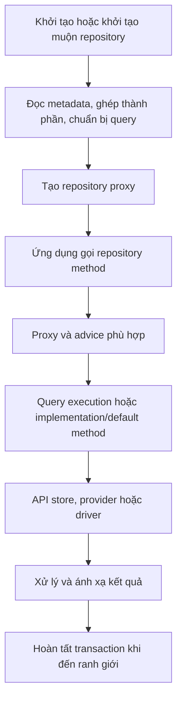

# Đọc stack trace để nhận diện bước đang xử lý lời gọi repository

Một lỗi truy cập dữ liệu có thể đi qua repository proxy, interceptor, cơ chế query, implementation, provider, driver và transaction manager. Vì vậy, một stack trace dài chưa có nghĩa tất cả những tầng xuất hiện đều có lỗi.

Mục tiêu khi đọc trace là xác định **operation nào đang thực hiện, lỗi được phát hiện ở giai đoạn nào và bằng chứng nào chỉ ra nguyên nhân cần kiểm tra**. Tên lớp framework là dấu mốc của đường gọi, không phải kết luận tự động về nơi phải sửa mã.

Trong chương **Proxy và thành phần** của module `SPRING_DATA_COMMONS`, bài này hướng dẫn đọc trace theo các vai trò dùng chung của Spring Data, rồi nối chúng với hành vi của từng store.

## 1. Hai chiều đọc một stack trace

Với một exception Java đồng bộ thông thường, trace ghi lại các frame tại thời điểm throwable được tạo. Các frame phía trên gần nơi exception được ghi nhận hơn; các frame phía dưới thể hiện những lời gọi dẫn tới đó.

Có hai cách đọc bổ sung cho nhau:

| Mục tiêu | Cách đọc |
| --- | --- |
| Xác định exception và nguyên nhân | Đọc thông báo ngoài cùng, rồi lần theo các phần `Caused by` |
| Hiểu đường gọi ứng dụng | Tìm frame ứng dụng rồi đi theo các frame liên quan về phía điểm phát sinh lỗi |

Ví dụ khái quát:

```text
DataAccessException: thao tác truy cập dữ liệu thất bại
    at lớp chuyển đổi exception của Spring
    ...
    at CustomerService.search(...)
Caused by: exception của provider
    at các frame thực thi của provider
    ...
Caused by: exception của driver
    at các frame giao tiếp với store
    ...
```

Đây là sơ đồ minh họa, không phải một log cụ thể.

### 1.1. Hiểu các ký hiệu của Java

| Thành phần | Ý nghĩa khi đọc |
| --- | --- |
| `Caused by` | Một throwable được giữ làm nguyên nhân của throwable khác |
| `Suppressed` | Exception đi kèm bị giữ lại, chẳng hạn trong quá trình đóng tài nguyên |
| `... N more` | Một đoạn đuôi frame chung đã được lược bớt trong cách in trace |
| `Unknown Source` hoặc thiếu số dòng | Không có đầy đủ thông tin nguồn tương ứng để hiển thị |
| Các frame reflection/proxy | Cơ chế gọi gián tiếp, chưa phải bằng chứng lỗi của reflection/proxy |

Throwable có thể có cả cause và suppressed exception. Một suppressed exception không mặc định là nguyên nhân sâu nhất của lỗi chính. [Java SE 17 — Throwable](https://docs.oracle.com/en/java/javase/17/docs/api/java.base/java/lang/Throwable.html)

Trong các ví dụ của bài, dấu `...` đứng riêng là phần được người viết chủ động rút gọn. Nó khác với ý nghĩa chính xác của `... N more` trong output do Java in.

### 1.2. Không chỉ đọc dòng cuối

Cause sâu nhất thường chứa dữ kiện quan trọng, nhưng chưa chắc chứa toàn bộ bối cảnh. Vẫn cần giữ operation, exception ngoài và frame ứng dụng.

Một lỗi trước đó có thể đã bị bắt hoặc chỉ được ghi ở log khác. Chẳng hạn, exception báo rollback-only khi commit có thể là hệ quả của một lỗi xảy ra sớm hơn mà trace hiện tại không chứa đầy đủ.

## 2. Bản đồ các giai đoạn của repository

Phân biệt ít nhất hai luồng: tạo repository và xử lý lời gọi sau khi repository đã được tạo.



Sơ đồ thể hiện trách nhiệm khái quát. Một operation có thể phát sinh lỗi trước khi tới store hoặc khi transaction kết thúc. Một số công việc được thực hiện sớm ở bootstrap, một số được trì hoãn tới lần sử dụng.

### Bảng nhận diện nhanh

| Nhóm frame thường gặp | Giai đoạn cần nghĩ tới |
| --- | --- |
| `RepositoryFactoryBeanSupport`, `RepositoryFactorySupport.getRepository` | Tạo hoặc khởi tạo repository |
| `QueryExecutorMethodInterceptor.lookupQuery` | Chuẩn bị query cho method |
| `PropertyPath`, `PartTree`, `PartTreeJpaQuery.<init>` | Phân tích tên method và thuộc tính cho derived query |
| `JdkDynamicAopProxy`, `ReflectiveMethodInvocation` | Đi qua proxy/advice |
| `QueryExecutorMethodInterceptor.doInvoke` | Định tuyến hoặc thực thi nhánh query |
| `ImplementationMethodExecutionInterceptor`, `RepositoryComposition` | Gọi implementation cơ sở hoặc fragment |
| `SimpleJpaRepository`, `SimpleMongoRepository` | Triển khai repository của module tương ứng |
| `EntityManager`, `MongoTemplate`, driver | Đường truy cập store cụ thể |
| Converter, entity instantiator, projection processing | Chuyển dữ liệu thành dạng kết quả |
| `JpaTransactionManager.doCommit` hoặc manager tương ứng | Hoàn tất giao dịch |

Các tên nội bộ có thể đổi theo phiên bản. Bài sử dụng một số tên trong mã nguồn Spring Data 3.5.0 làm mốc minh họa; khi đọc lỗi thực tế phải đối chiếu phiên bản dependency của dự án.

## 3. Nhận diện proxy mà không quy lỗi cho proxy

Một trace có thể chứa:

```text
at org.springframework.aop.framework.ReflectiveMethodInvocation.proceed(...)
at org.springframework.aop.framework.JdkDynamicAopProxy.invoke(...)
at jdk.proxyN.$ProxyX.findByEmail(...)
at com.example.customer.CustomerService.search(...)
```

`jdk.proxyN.$ProxyX` là tên đại diện trong ví dụ. Tên runtime thực tế không cố định.

Những frame này cho thấy lời gọi đi qua một proxy và chuỗi interceptor. Chúng chưa chỉ ra query sai, kết nối hỏng hoặc factory chọn sai store.

Spring AOP sử dụng proxy để áp dụng advice trước khi chuyển tiếp tới target. Self-invocation trên target có ngữ nghĩa khác với lời gọi đi qua proxy. [Spring Framework — Proxying Mechanisms](https://docs.spring.io/spring-framework/reference/7.0/core/aop/proxying.html)

### 3.1. Một trace có thể chứa nhiều proxy

Service có thể có transaction proxy, repository có proxy riêng, dependency khác lại có advice của nó.

Nhiều lần xuất hiện `proceed` là điều bình thường trong mô hình này. Không coi riêng số lượng frame proxy là bằng chứng có đệ quy.

Muốn nghi ngờ vòng lặp, hãy tìm chuỗi method ứng dụng và repository lặp có cấu trúc, đặc biệt khi một custom method gọi trở lại chính method trên cùng proxy.

### 3.2. Tên proxy không xác nhận store

JPA và MongoDB có thể cùng dùng các cơ chế proxy của Spring. Tên `$Proxy...` chưa phân biệt chúng.

Frame `SimpleJpaRepository` hoặc `MongoTemplate` cho bằng chứng cụ thể hơn về đoạn đường thực thi đang quan sát. Dù vậy, tên lớp module chưa xác định được database, schema hoặc collection thực tế nếu cấu hình có nhiều tài nguyên.

### 3.3. Frame framework là điểm đi qua

Khi lỗi bắt nguồn từ một tham số không hợp lệ, frame đầu tiên có thể nằm trong một lớp kiểm tra của framework. Việc cần sửa có thể nằm ở nơi ứng dụng tạo và truyền tham số đó.

Hãy nối frame kiểm tra với hợp đồng method và frame ứng dụng đã gọi nó.

## 4. Ví dụ 1: lỗi khi chuẩn bị derived query

Giả sử domain `Customer` có ID `Long` và thuộc tính `email` kiểu `String`. Repository có một lỗi gõ tên thuộc tính:

```java
import java.util.List;
import org.springframework.data.repository.CrudRepository;

public interface CustomerRepository
        extends CrudRepository<Customer, Long> {

    List<Customer> findByEamil(String email);
}
```

Java có thể biên dịch tên method này, nhưng metadata domain không có thuộc tính `eamil` để tạo query theo ý định.

Trace minh họa rút gọn:

```text
BeanCreationException: không tạo được customerRepository
    ...
Caused by: QueryCreationException: không tạo được query cho findByEamil
    at QueryExecutorMethodInterceptor.lookupQuery(...)
    at QueryExecutorMethodInterceptor.mapMethodsToQuery(...)
    at QueryExecutorMethodInterceptor.<init>(...)
    at RepositoryFactorySupport.getRepository(...)
    ...
Caused by: PropertyReferenceException: không tìm được eamil trên Customer
    at PropertyPath.<init>(...)
    at PropertyPath.from(...)
    ...
    at PartTree.<init>(...)
    at PartTreeJpaQuery.<init>(...)
    ...
```

Các thông báo đã được diễn đạt lại và tên lớp được rút gọn để tập trung vào cấu trúc.

### Cách đọc

1. Exception ngoài cho biết không tạo được repository bean.
2. `lookupQuery` và `mapMethodsToQuery` chỉ ra quá trình chuẩn bị query.
3. `PropertyPath` cùng `PartTree` chỉ ra việc phân tích thuộc tính từ tên method.
4. Thông tin `eamil` và `Customer` cho biết đối tượng cần đối chiếu.
5. Hành động tiếp theo là kiểm tra tên thuộc tính và ý định của method.

Trong mã nguồn Commons 3.5.0, `QueryExecutorMethodInterceptor` chuẩn bị các query method và gọi query lookup strategy; lỗi lúc này có thể được bao thành `QueryCreationException`. [QueryExecutorMethodInterceptor 3.5.0](https://github.com/spring-projects/spring-data-commons/blob/3.5.0/src/main/java/org/springframework/data/repository/core/support/QueryExecutorMethodInterceptor.java)

`PartTreeJpaQuery` là một dấu mốc theo JPA cho việc tạo truy vấn từ cây phân tích method. [PartTreeJpaQuery 3.5.0](https://github.com/spring-projects/spring-data-jpa/blob/3.5.0/spring-data-jpa/src/main/java/org/springframework/data/jpa/repository/query/PartTreeJpaQuery.java)

### Giới hạn của kết luận

Trace này chưa chứng minh database đã nhận query hoặc kết nối đã thành công. Nó có thể thất bại khi chuẩn bị cấu trúc truy vấn.

Không sửa lỗi này bằng cách tạo index hoặc đổi connection pool trước khi đối chiếu thuộc tính.

Nếu method vốn được định nghĩa là custom fragment, cần kiểm tra implementation đã được ghép chưa. Một fragment không được phát hiện có thể làm method bị xử lý theo nhánh khác với ý định.

### Bootstrap sớm và khởi tạo muộn

Lỗi tương tự có thể xuất hiện lúc ứng dụng khởi động hoặc ở lần sử dụng đầu tiên nếu repository được khởi tạo muộn.

Vì vậy, thời điểm người dùng nhìn thấy exception và giai đoạn nội bộ gây lỗi là hai thông tin cần đối chiếu riêng.

## 5. Ví dụ 2: query đã đi tới đường thực thi JPA

Với repository có method hợp lệ:

```java
List<Customer> findByEmail(String email);
```

ứng dụng có thể gặp lỗi ở lúc chạy query, chẳng hạn schema không đúng với mapping hoặc native query tham chiếu đối tượng không tồn tại.

Trace minh họa:

```text
InvalidDataAccessResourceUsageException: lỗi thực thi query
    at ...lớp dịch exception của JPA/Spring...
    ...
Caused by: SQLGrammarException: store không xử lý được statement
    ...
    at AbstractJpaQuery.execute(...)
    ...
    at QueryExecutorMethodInterceptor.doInvoke(...)
    at QueryExecutorMethodInterceptor.invoke(...)
    ...
    at jdk.proxyN.$ProxyX.findByEmail(...)
    at com.example.customer.CustomerService.search(...)
Caused by: SQLException: đối tượng lưu trữ được tham chiếu không tồn tại
    at ...driver...
    ...
```

Các loại exception cụ thể phụ thuộc provider và driver. Một lỗi có tên liên quan SQL grammar vẫn cần đọc thông báo chi tiết, mã lỗi và dữ kiện từ database.

### Cách đọc

| Dấu mốc | Điều có thể suy ra |
| --- | --- |
| `CustomerService.search` | Điểm ứng dụng gọi operation |
| `QueryExecutorMethodInterceptor.doInvoke` | Lời gọi đi qua cơ chế query method |
| `AbstractJpaQuery.execute` | Đang thực thi một repository query theo JPA |
| Exception provider/driver trong cause chain | Có dữ kiện để kiểm tra hành vi tầng lưu trữ |

`AbstractJpaQuery` thực hiện vai trò query theo JPA và xử lý kết quả trong đường thực thi tương ứng. [AbstractJpaQuery 3.5.0](https://github.com/spring-projects/spring-data-jpa/blob/3.5.0/spring-data-jpa/src/main/java/org/springframework/data/jpa/repository/query/AbstractJpaQuery.java)

### Không yêu cầu mọi query phải qua `SimpleJpaRepository`

Một derived query hoặc declared query có đường thực thi riêng. Không thấy `SimpleJpaRepository.findByEmail` là bình thường, vì triển khai cơ sở không cần có method Java mang đúng tên query của ứng dụng.

Ngược lại, `QueryExecutorMethodInterceptor` cũng có thể xuất hiện trên đường chuyển tiếp một lời gọi không được nó thực thi như query. Cần đọc method và frame tiếp theo, thay vì chỉ thấy tên interceptor rồi kết luận.

### Query nội dung và count query

Một lời gọi trả `Page` có thể phát sinh query lấy nội dung và query đếm. Nếu nội dung đã đọc được nhưng count thất bại, lỗi vẫn xuất phát từ cùng một lời gọi repository của ứng dụng.

Frame liên quan paged execution là manh mối; muốn phân biệt chắc query nào lỗi, cần đối chiếu SQL/query log hoặc thông tin quan sát phù hợp của store.

## 6. Ví dụ 3: method đang đi vào custom fragment

Giả sử repository công bố `countActiveCustomers()` qua một fragment do ứng dụng viết. Implementation gặp lỗi trong logic kiểm tra cấu hình.

Trace minh họa:

```text
IllegalStateException: thiếu cấu hình thống kê
    at com.example.customer.CustomerStatisticsImpl.countActiveCustomers(...)
    ...các frame gọi method...
    at RepositoryComposition$RepositoryFragments.invoke(...)
    at RepositoryComposition.invoke(...)
    at RepositoryFactorySupport$ImplementationMethodExecutionInterceptor.invoke(...)
    ...
    at jdk.proxyN.$ProxyX.countActiveCustomers(...)
    at com.example.customer.CustomerReportService.createReport(...)
```

### Cách đọc

- Có frame implementation của ứng dụng ngay gần điểm phát sinh exception.
- `RepositoryComposition` cho thấy lời gọi được định tuyến qua các phần triển khai.
- `ImplementationMethodExecutionInterceptor` là đường gọi implementation trong proxy.
- Thông báo lỗi hiện tại nói về cấu hình ứng dụng, chưa chỉ ra lỗi query hoặc database.

Trong factory của Commons 3.5.0, interceptor thực thi implementation chuyển lời gọi đến composition; composition chọn fragment phù hợp để gọi. [RepositoryFactorySupport 3.5.0](https://github.com/spring-projects/spring-data-commons/blob/3.5.0/src/main/java/org/springframework/data/repository/core/support/RepositoryFactorySupport.java), [RepositoryComposition 3.5.0](https://github.com/spring-projects/spring-data-commons/blob/3.5.0/src/main/java/org/springframework/data/repository/core/support/RepositoryComposition.java)

### Nếu stack lặp cùng method custom

Một implementation có thể vô tình gọi lại chính repository method mà nó đang xử lý. Khi đó, chuỗi method ứng dụng, proxy và composition có thể lặp nhiều lần.

Cần kiểm tra delegation và dependency của fragment. Không diễn giải mọi frame `RepositoryComposition` lặp trong một trace thành lỗi của composition; lồng nhiều lời gọi hợp lệ cũng có thể tạo các đoạn framework giống nhau.

### Nếu chỉ có frame CRUD cơ sở

Một lời gọi `save` hoặc `findById` có thể đi tới triển khai cơ sở như `SimpleJpaRepository`. Hãy đối chiếu chữ ký được gọi và khả năng có custom fragment ghi đè.

Không mặc định method mang tên CRUD chắc chắn luôn đi qua implementation mặc định nếu ứng dụng đã tùy biến nó.

## 7. Default method và các frame phản chiếu

Repository có thể có thân method Java trên interface:

```java
default boolean hasActiveCustomers() {
    return countActiveCustomers() > 0;
}
```

Một lỗi ở method được gọi tiếp có thể đi qua default method và interceptor tương ứng. Trong Commons, `DefaultMethodInvokingMethodInterceptor` tham gia gọi default method trên các proxy phù hợp. [DefaultMethodInvokingMethodInterceptor 3.5.0](https://github.com/spring-projects/spring-data-commons/blob/3.5.0/src/main/java/org/springframework/data/projection/DefaultMethodInvokingMethodInterceptor.java)

### Phân biệt các lớp liên quan

| Frame | Vai trò cần xem xét |
| --- | --- |
| `DefaultMethodInvokingMethodInterceptor` | Đang hỗ trợ gọi method có thân default |
| `java.lang.reflect.Method.invoke` hoặc frame reflection tương đương | Method được gọi gián tiếp |
| Frame `MethodHandle` | Cơ chế gọi method ở tầng JVM/framework |
| Method ứng dụng hoặc implementation phía trên | Nơi cần tìm hành vi thực tế dẫn tới lỗi |

Reflection frame không thay thế nguyên nhân nằm trong target method. Khi có wrapper như `InvocationTargetException`, đọc cause hoặc target exception theo cấu trúc được giữ lại.

Một số tầng framework tháo wrapper trước khi truyền tiếp. Vì vậy, không bắt buộc mọi lỗi qua reflection đều phải hiện cùng một lớp wrapper trong trace cuối.

## 8. Ánh xạ kết quả có thể thất bại sau khi query đã chạy

Một lỗi đọc dữ liệu không phải lúc nào cũng do statement bị database từ chối. Query có thể đã trả dữ liệu, nhưng bước chuyển thành domain object hoặc projection gặp lỗi.

Những dấu mốc có thể gặp:

| Dấu mốc | Câu hỏi tiếp theo |
| --- | --- |
| `MappingMongoConverter.read` | Document và kiểu Java có phù hợp với mapping không? |
| Entity instantiator hoặc constructor domain | Constructor được chọn có nhận được giá trị hợp lệ không? |
| Projection/result processing | Kiểu kết quả của method có phù hợp với dữ liệu được trả không? |
| Converter hoặc conversion service | Có chuyển được giá trị nguồn sang kiểu đích không? |
| Constructor DTO của ứng dụng | Logic kiểm tra trong constructor có ném exception không? |

Ví dụ, một DTO tự từ chối một trường bắt buộc. Nếu trace chỉ ra constructor DTO ném exception trong quá trình materialize kết quả, cần kiểm tra cả dữ liệu và hợp đồng của DTO.

### Giới hạn cần giữ

- Có frame converter chưa có nghĩa query sai cú pháp.
- Có kết quả từ store chưa có nghĩa query đã trả đúng dữ liệu theo nghiệp vụ.
- JPA thường giao nhiều công việc materialize entity cho provider; các module có mapping riêng có thể thể hiện lớp khác trong trace.
- Không dùng một tên exception duy nhất để suy ra toàn bộ trạng thái dữ liệu.

Muốn xác nhận, đối chiếu kiểu trả về repository, mapping, dữ liệu mẫu và operation cụ thể đang được chuyển đổi.

## 9. Ví dụ 4: lỗi xuất hiện ở flush hoặc commit

Xét service có ranh giới giao dịch:

```java
@Transactional
public Customer createCustomer(String email) {
    return customers.save(new Customer(email));
}
```

Giả định constructor và mapping `Customer` phù hợp với ví dụ, transaction được áp dụng qua proxy và `save` tham gia transaction đó.

Dữ liệu có thể chỉ vi phạm ràng buộc khi provider đồng bộ thay đổi hoặc commit. Lược đồ frame có thể chứa:

```text
...exception cùng cause liên quan lỗi commit...
    at JpaTransactionManager.doCommit(...)
    at AbstractPlatformTransactionManager.processCommit(...)
    at AbstractPlatformTransactionManager.commit(...)
    at TransactionAspectSupport.commitTransactionAfterReturning(...)
    at TransactionAspectSupport.invokeWithinTransaction(...)
    at TransactionInterceptor.invoke(...)
    ...
    at ...proxy của service.createCustomer(...)
    at com.example.customer.ImportRunner.run(...)
Caused by: ...exception của provider hoặc store...
    ...
```

Đây là lược đồ vai trò, không quy định một exception ngoài cố định cho mọi lỗi commit.

### 9.1. Thân service có thể đã kết thúc

Khi transaction advice commit sau khi target method trả về, frame thân `createCustomer` có thể không còn xuất hiện trong phần stack tại thời điểm lỗi commit được ghi nhận.

Điều đó không chứng minh `save` chưa từng được gọi. Cần nối điểm commit với operation và transaction đã tạo các thay đổi đang chờ.

`JpaTransactionManager` quản lý transaction cho một JPA `EntityManagerFactory`, nên các frame của nó là bằng chứng về ranh giới giao dịch JPA đang được xử lý. [JpaTransactionManager API](https://docs.spring.io/spring-framework/docs/current/javadoc-api/org/springframework/orm/jpa/JpaTransactionManager.html)

### 9.2. Flush và commit khác nhau

Flush đồng bộ thay đổi của persistence context xuống database; commit hoàn tất transaction theo hạ tầng tương ứng.

Một lỗi có thể xuất hiện ở flush sớm hoặc ở commit. Ngay cả khi đã flush thành công, transaction chưa nhất thiết kết thúc thành công.

Không bắt buộc trace lỗi ghi luôn chứa `SimpleJpaRepository.save`. Với lỗi bị phát hiện muộn, điểm gọi save có thể đã rời stack đồng bộ hiện tại.

### 9.3. TransactionInterceptor chưa chứng minh mọi điều về giao dịch

Frame này cho thấy lời gọi đi qua transaction advice. Muốn xác nhận manager nào, tài nguyên nào hoặc transaction nào được tham gia, cần thêm cấu hình và thông tin quan sát tương ứng.

Không có một frame như mong đợi cũng chưa đủ kết luận không có giao dịch: trace có thể bị rút gọn, operation có thể tham gia transaction ngoài hoặc dùng một mô hình quản lý khác.

### 9.4. UnexpectedRollbackException cần đọc bối cảnh trước đó

Nếu transaction đã bị đánh dấu rollback-only, caller có thể nhận exception lúc cố commit. Lỗi ban đầu có thể đã được bắt và ghi ở một đoạn log trước, không còn hiện đầy đủ trong cause chain sau cùng.

Hãy tìm các log cùng request/job/transaction context và kiểm tra chỗ bắt exception. Không coi exception ngoài ở commit luôn là nguyên nhân đầu tiên của sự cố.

## 10. Lớp dịch exception giải thích lớp bọc ngoài

Spring có hệ thống `DataAccessException` để diễn tả các nhóm lỗi truy cập dữ liệu theo cách dùng chung. Một lỗi provider có thể được chuyển sang exception của Spring khi tích hợp phù hợp.

`PersistenceExceptionTranslationInterceptor` là một interceptor thực hiện việc dịch runtime exception qua translator khi điều kiện áp dụng được đáp ứng. [PersistenceExceptionTranslationInterceptor API](https://docs.spring.io/spring-framework/docs/current/javadoc-api/org/springframework/dao/support/PersistenceExceptionTranslationInterceptor.html)

### Cách đọc hai lớp thông tin

| Thông tin | Công dụng |
| --- | --- |
| Exception Spring bên ngoài | Nhận diện nhóm lỗi ở hợp đồng ứng dụng |
| Cause provider/driver | Tìm mã lỗi, ràng buộc, query hoặc tình trạng store cụ thể |

Ví dụ `DataIntegrityViolationException` gợi ý vi phạm tính toàn vẹn dữ liệu. Để biết đó là unique, foreign key, nullability hay một trường hợp khác, cần đọc thêm cause và thông tin store.

Một frame translator thường là nơi tạo exception dùng chung. Nó chưa tự là nơi tạo dữ liệu sai.

### Không coi mọi exception đều được dịch

Lỗi kiểm tra nghiệp vụ trong custom fragment, lỗi lập trình hoặc một exception không thuộc cơ chế được cấu hình có thể đi ra theo kiểu khác.

Không thêm code bắt rộng chỉ để chuyển mọi lỗi thành “không tìm thấy dữ liệu”. Kết quả rỗng hợp lệ và một operation thất bại phải còn phân biệt được ở tầng gọi.

## 11. Cần điều chỉnh cách đọc theo store và mô hình thực thi

### 11.1. JPA

Các tên như `SimpleJpaRepository`, `AbstractJpaQuery`, `EntityManager`, lớp provider và JDBC driver giúp khoanh vùng đường JPA.

Cần phân biệt tạo query, chạy query, materialize kết quả, flush và commit. Một lỗi dưới JDBC driver không có nghĩa interface repository phải đổi; một lỗi property parsing cũng chưa cho thấy JDBC đã được dùng.

### 11.2. MongoDB và các module có template/mapping riêng

Các frame như `SimpleMongoRepository`, `MongoTemplate`, mapping converter và MongoDB driver chỉ ra các trách nhiệm tương ứng.

Không tìm `JpaTransactionManager` hoặc SQL exception trong mọi lỗi repository MongoDB. Transaction, mapping và mã lỗi phải được giải thích theo công nghệ đang chạy.

Một exception thuộc hệ thống Spring Data dùng chung vẫn có thể chứa nguyên nhân theo một store cụ thể.

### 11.3. Reactive và bất đồng bộ

Trong luồng reactive, stack tại thời điểm lỗi có thể phản ánh thread đang xử lý tín hiệu thay vì toàn bộ đường Java đã xây pipeline.

Một method repository trả publisher chưa đồng nghĩa operation lưu trữ đã hoàn thành. Cần phân biệt assembly, subscription và thực thi.

Reactor có các cơ chế traceback và checkpoint để bổ sung ngữ cảnh. Có thể đặt một checkpoint có ý nghĩa gần operation cần theo dõi:

```java
return reactiveRepository.findByActiveTrue()
        .checkpoint("customer-find-active");
```

Đây là mảnh pipeline minh họa, giả định repository reactive có method tương ứng. Checkpoint hỗ trợ đọc đường lỗi; nó không tạo giao dịch hoặc sửa query. [Reactor — Debugging Reactor](https://projectreactor.io/docs/core/release/reference/debugging.html)

Khi thấy suppressed assembly information, cần đọc nó theo vai trò traceback của Reactor. Không tự chuyển mọi suppressed exception thành nguyên nhân chính.

## 12. Một quy trình đọc trace có thể lặp lại

### Bước 1: giữ operation và bối cảnh

Ghi nhận repository/method, thời điểm lỗi, request hoặc job liên quan, phiên bản module/provider và profile đang chạy.

Với cùng một method, lỗi tạo query lúc bootstrap và lỗi query runtime có bước xử lý khác nhau.

### Bước 2: đọc exception ngoài cùng

Xác định ứng dụng đang thấy lỗi tạo bean, lỗi truy cập dữ liệu, lỗi transaction hay lỗi nghiệp vụ.

Không dừng ở lớp ngoài, nhưng cũng không bỏ mất thông tin operation mà lớp ngoài cung cấp.

### Bước 3: lần theo cause chain

Đọc thông báo từng cause và nhận diện lớp nào thêm bối cảnh. Chú ý suppressed exception và những frame chung bị lược bỏ.

Giữ nguyên trace đầy đủ khi thu thập dữ liệu ban đầu, rồi mới tạo bản rút gọn cho phân tích.

### Bước 4: tìm frame ứng dụng gần lỗi

Tìm lớp service, custom implementation, converter hoặc DTO của ứng dụng có liên quan.

Một frame ứng dụng gần exception có thể chỉ rõ nơi dữ liệu được kiểm tra hoặc tạo ra. Một frame ứng dụng ở phía caller giúp xác định use case đang kích hoạt đường gọi.

### Bước 5: gắn các frame với giai đoạn

Dùng bản đồ: factory, query creation, proxy, query execution, composition, store, mapping, transaction.

Không cần hiểu mọi frame reflection để biết lỗi đang ở bước phân tích property hay commit.

### Bước 6: nêu giả thuyết cùng bằng chứng

Ví dụ:

```text
Operation: CustomerRepository.findByEamil
Giai đoạn: chuẩn bị derived query
Bằng chứng: QueryCreationException, PropertyReferenceException,
           PropertyPath và PartTreeJpaQuery constructor
Điểm đối chiếu: thuộc tính email của Customer và ý định custom/query
Phạm vi kết luận: chưa xác nhận query đã được gửi đến database
```

Đây là ghi chép chẩn đoán minh họa, không phải kết quả đo từ một application context cụ thể.

### Bước 7: chọn phép kiểm tra nhỏ phù hợp

| Giả thuyết | Kiểm tra tiếp theo |
| --- | --- |
| Sai property trong derived query | Đối chiếu tên method với persistent properties |
| Custom fragment chưa được ghép | Đối chiếu interface, implementation, discovery và composition |
| Query thực thi với schema sai | Đối chiếu query, schema và tài nguyên đang dùng |
| Không chuyển được kết quả | Đối chiếu dữ liệu nguồn, kiểu trả về và converter/constructor |
| Lỗi ràng buộc khi commit | Đối chiếu thay đổi trong transaction và constraint cụ thể |
| Rollback-only do lỗi trước | Tìm log trước cùng bối cảnh và chỗ bắt exception |
| Thiếu dấu mốc trong reactive | Bổ sung ngữ cảnh pipeline/checkpoint phù hợp |

Mỗi phép kiểm tra nên giải quyết một điểm chưa rõ. Tránh thay đồng thời mapping, query, transaction và version dependency khi chưa có bằng chứng nối chúng với lỗi.

## 13. Thu thập trace và dùng debugger đúng chỗ

### 13.1. Giữ throwable khi logging

Chỉ ghi `exception.getMessage()` làm mất phần lớn thông tin frame, cause và suppressed exception.

Tại một biên xử lý phù hợp, truyền cả throwable cho logger theo API đang dùng. Giữ tên operation và thông tin tương quan cần thiết để nối các log trước và sau lỗi.

Tránh để mọi tầng cùng log một exception rồi ném tiếp, tạo ra nhiều bản sao khó phân biệt của cùng sự cố.

### 13.2. Đối chiếu đúng source với binary

Số dòng và method nội bộ phụ thuộc phiên bản. Khi IDE gắn source sai với JAR runtime, vị trí debugger có thể gây hiểu nhầm.

Kiểm tra dependency đã resolve và version provider/driver thực tế. Không so sánh một trace của dự án với một source nhánh khác rồi kết luận framework đi sai đường.

### 13.3. Đặt breakpoint theo giai đoạn đã nghi ngờ

Có thể chọn điểm quan sát trong môi trường thực hành:

| Điểm | Câu hỏi cần giải quyết |
| --- | --- |
| Service trước lời gọi repository | Method và giá trị đầu vào theo kiểu Java là gì? |
| Custom implementation | Lời gọi có đi vào fragment dự kiến không? |
| Query lookup/creation | Method được nhận diện và tạo query như thế nào? |
| Repository query execution | Query nào đang chạy và kiểu kết quả mong muốn là gì? |
| Converter hoặc DTO constructor | Giá trị nào không chuyển được hoặc bị từ chối? |
| Transaction completion | Exception xuất hiện khi flush/commit hay trước đó? |

Không dùng breakpoint ở mọi frame proxy ngay từ đầu. Chọn frame theo câu hỏi cụ thể giúp giữ việc chẩn đoán có mục tiêu.

### 13.4. Kiểm tra transaction bằng hành vi

Với mô hình proxy thông thường, gọi nội bộ một method service qua `this` không tạo lần đi qua transaction proxy như lời gọi từ bean khác.

Nếu nghi advice không áp dụng, xem nguồn gốc đối tượng và đường gọi, rồi kiểm tra transaction/rollback trong tình huống có kiểm soát. Đọc annotation trên source chưa đủ chứng minh hiệu lực runtime. [Spring Framework — Using @Transactional](https://docs.spring.io/spring-framework/reference/data-access/transaction/declarative/annotations.html)

Không suy self-invocation chỉ từ việc thiếu một tên frame trong trace đã bị rút gọn.

## 14. Các kết luận dễ vượt quá bằng chứng

| Nhận định vội | Cách đọc có căn cứ hơn |
| --- | --- |
| “Nhiều frame Spring nên lỗi của Spring” | Xác định cause, operation và frame ứng dụng liên quan |
| “Thấy QueryExecutorMethodInterceptor là query đã tới database” | Kiểm tra đang ở lookup/creation hay runtime execution và các frame tiếp theo |
| “Không có SimpleJpaRepository nên repository không chạy” | Query method hoặc fragment có thể dùng đường thực thi khác |
| “Lỗi xảy ra lúc gọi save nên statement ghi chạy ngay tại đó” | Phân biệt save, flush và commit |
| “Có TransactionInterceptor nên mọi thao tác thuộc cùng một transaction đúng store” | Cần manager, tài nguyên, propagation và ranh giới thực tế |
| “Không thấy TransactionInterceptor nên chắc không có giao dịch” | Kiểm tra trace đầy đủ và mô hình quản lý transaction |
| “Cause sâu nhất luôn đủ giải thích sự cố” | Giữ cả operation, wrapper và log trước đó khi cần |
| “Có converter trong trace nên database bị sai” | Đối chiếu mapping, dữ liệu và kiểu kết quả trước |
| “Tên proxy xác nhận module” | Tìm implementation/module cụ thể và kiểm tra tài nguyên |
| “Trace reactive là lịch sử đầy đủ của method Java” | Xét assembly, subscription, tín hiệu lỗi và traceback bổ sung |

Một stack trace là bằng chứng về đường thực thi tại các thời điểm throwable được ghi nhận. Nó không tự cung cấp toàn bộ lịch sử thay đổi dữ liệu, tài nguyên hoặc các operation đã hoàn tất trước đó.

## 15. Bài tập đọc trace

### Tình huống A: PropertyReferenceException

Trace có `QueryCreationException`, `PropertyPath` và `PartTreeJpaQuery.<init>` cho method `findByEamil`.

**Nhận diện:** giai đoạn chuẩn bị derived query. Kiểm tra tên thuộc tính và việc method có thực sự phải là custom fragment hay không. Chưa có căn cứ kết luận query đã chạy ở database.

### Tình huống B: custom implementation ném lỗi

Trace có `CustomerStatisticsImpl.countActiveCustomers` phía trên `RepositoryComposition.invoke`.

**Nhận diện:** method đã đi đến implementation custom trong đường composition. Bắt đầu từ thông báo và logic của implementation, rồi kiểm tra các dependency mà nó dùng.

### Tình huống C: converter/constructor thất bại

Query có dữ liệu, nhưng trace đi vào converter và constructor DTO ném exception.

**Nhận diện:** bước tạo dạng kết quả đang gặp lỗi. Đối chiếu dữ liệu thực tế, kiểu trả về và điều kiện constructor; không chỉ sửa cú pháp query.

### Tình huống D: exception tại JpaTransactionManager.doCommit

Một log cuối thân service đã in, sau đó caller nhận lỗi ở commit.

**Nhận diện:** transaction completion có thể phát hiện lỗi sau khi target method trả về. Xác định các thay đổi trong transaction và nguyên nhân provider/store được giữ trong trace.

### Tình huống E: rollback-only nhưng thiếu nguyên nhân ban đầu

Trace sau cùng báo không thể commit vì transaction đã bị đánh dấu rollback-only.

**Nhận diện:** cần tìm lỗi trước cùng bối cảnh, nhất là nơi exception đã bị bắt. Trace commit hiện tại có thể chưa chứa đủ nguyên nhân đầu tiên.

### Tình huống F: reactive có nhiều frame operator

Repository trả publisher, lỗi xuất hiện trên thread xử lý tín hiệu và không có đầy đủ frame service đã tạo pipeline.

**Nhận diện:** đọc traceback/checkpoint và phân biệt assembly với execution. Không coi việc thiếu frame service đồng bộ là bằng chứng service chưa tham gia xây luồng.

Khi đọc trace repository, hãy nối exception với operation, vai trò của các frame và khả năng của store đang dùng. Kết luận tốt nêu được giai đoạn đã xác định, bằng chứng hỗ trợ và phép kiểm tra tiếp theo để thu hẹp nguyên nhân.
