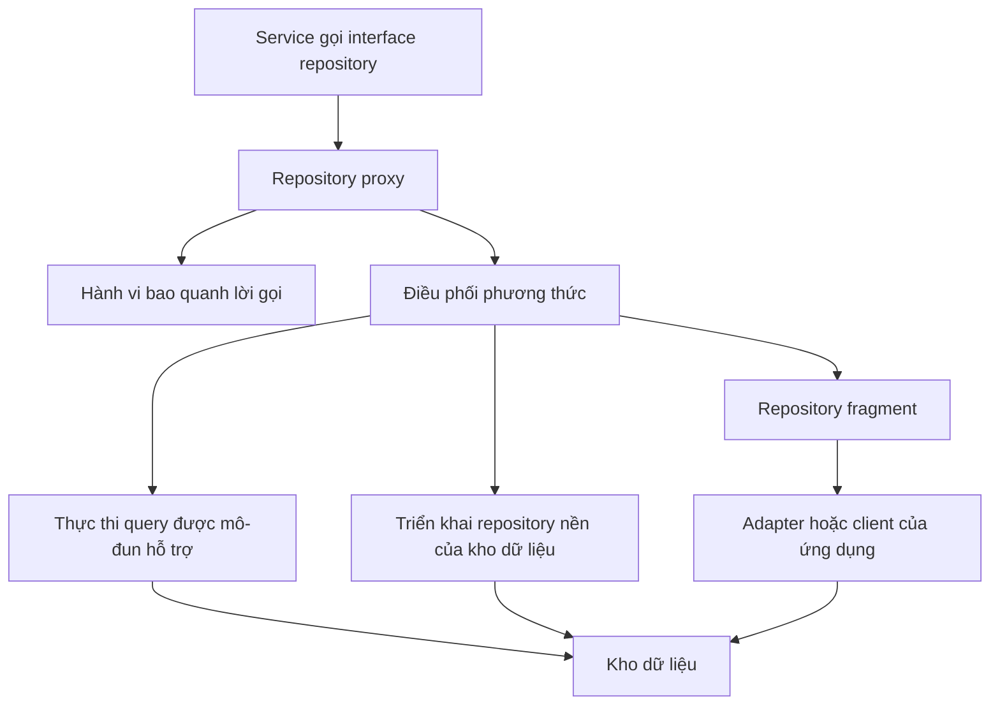

# Ranh giới giữa API mở rộng được hỗ trợ và chi tiết triển khai nội bộ

## 1. Vấn đề cần giải quyết

Repository của Spring Data thường được ứng dụng sử dụng thông qua một interface. Spring Data tạo đối tượng repository, ghép các thành phần cần thiết và đưa lời gọi phương thức đến phần xử lý thích hợp. Cách ghép đó khiến một thay đổi nhỏ trông có vẻ rất dễ thực hiện: thêm advice, thay factory hoặc dùng reflection lấy một đối tượng nằm bên trong proxy.

Tuy nhiên, việc một kỹ thuật chạy được hôm nay chưa chứng minh rằng framework hỗ trợ kỹ thuật ấy như một điểm mở rộng. Nếu mã ứng dụng phụ thuộc vào tên lớp proxy, trường private hoặc cách sắp xếp interceptor, một lần nâng cấp thư viện có thể làm hỏng chức năng dù interface repository của ứng dụng vẫn giữ nguyên.

Trong phạm vi Spring Data Commons, bài này tập trung vào cách chọn điểm mở rộng cho repository và các thành phần liên quan. Các abstraction như Repository, CRUD, truy vấn, phân trang, sắp xếp, projection và auditing có hợp đồng chung, nhưng khả năng thực thi còn phụ thuộc mô-đun kho dữ liệu. Một hook tồn tại trong Commons không tự động làm cho mọi kho dữ liệu có cùng tính năng.

Sau bài học, bạn cần có khả năng:

- Phân biệt API sử dụng, SPI mở rộng và chi tiết triển khai.
- Chọn repository fragment, interface nền, lớp triển khai nền hoặc factory theo đúng nhu cầu.
- Giải thích vì sao `public`, `protected` hoặc việc nhìn thấy một bean chưa đủ để kết luận một thành phần được hỗ trợ cho mục đích tùy biến cụ thể.
- Nhận diện phụ thuộc dễ vỡ vào proxy và thay bằng hợp đồng có thể kiểm chứng.

## 2. Ba khái niệm thường bị đánh đồng

### API dành cho bên sử dụng

API là hợp đồng để ứng dụng gọi vào framework. Với repository, đó có thể là `Repository`, `CrudRepository`, `Pageable`, `Sort`, `Page`, `Slice` hoặc các abstraction projection. Người gọi dựa vào hành vi được công bố của chúng thay vì dựa vào đối tượng triển khai cụ thể.

Ví dụ, một dịch vụ nhận `CustomerRepository` qua constructor và gọi `findById`. Dịch vụ không cần biết đối tượng thực tế được tạo bởi cơ chế proxy nào.

### SPI và điểm mở rộng được hỗ trợ

SPI là hợp đồng dành cho mã được framework gọi lại. Repository fragment, hợp đồng cung cấp auditor và những hook factory được tài liệu xác định cho việc mở rộng là các ví dụ thuộc nhóm này.

Một điểm mở rộng thường quy định đồng thời:

1. Bạn được cung cấp loại thành phần nào.
2. Thành phần được đăng ký bằng cách nào.
3. Framework gọi thành phần trong bối cảnh nào.
4. Những giả định nào người triển khai phải giữ.

Một interface tự khai báo trong ứng dụng chỉ trở thành fragment của repository khi được ghép và phát hiện theo cơ chế repository composition tương ứng. Việc interface đó có các phương thức `public` chưa đủ để hoàn thành bước đăng ký.

### Chi tiết triển khai nội bộ

Chi tiết nội bộ là cách framework hiện thực hóa hợp đồng. Ví dụ gồm danh sách interceptor cụ thể, trường chứa delegate, tên lớp proxy được sinh ra, cache nội bộ và các lớp điều phối không được công bố như điểm tùy biến.

Những chi tiết này hữu ích khi đọc mã nguồn hoặc chẩn đoán lỗi. Chúng không mặc nhiên trở thành nền tảng phù hợp để viết quy tắc nghiệp vụ.

| Khía cạnh | API sử dụng | SPI mở rộng | Chi tiết nội bộ |
| --- | --- | --- | --- |
| Bên gọi chính | Mã ứng dụng | Framework gọi mã mở rộng | Các thành phần framework gọi nhau |
| Cách sử dụng | Gọi theo hợp đồng | Triển khai hoặc đăng ký đúng hook | Quan sát để hiểu hoặc chẩn đoán |
| Cần biết lớp triển khai cụ thể? | Thường không | Có thể cần lớp nền được chỉ định | Thường phụ thuộc sâu vào cấu trúc hiện tại |
| Ví dụ | `CrudRepository`, `Pageable` | Repository fragment, `AuditorAware` | Tên lớp proxy sinh ra, trường private |
| Cơ sở đánh giá tương thích | Hợp đồng API của phiên bản dùng | Hợp đồng hook và mô-đun tích hợp | Không được suy ra từ việc từng chạy thành công |

API và SPI đều có thể thay đổi trong quá trình phát triển framework. “Được hỗ trợ” có nghĩa là bạn có một hợp đồng để đối chiếu, không có nghĩa là mọi lần nâng cấp đều tương thích tuyệt đối.

## 3. Nhìn repository như một hợp đồng có nhiều thành phần

Sơ đồ dưới đây chỉ mô tả ý tưởng điều phối, không khẳng định thứ tự interceptor hay cấu trúc lớp nội bộ:



Một lời gọi có thể liên quan đến transaction, truy vấn khai báo, xử lý kết quả hoặc thành phần khác tùy cấu hình. Không nên đọc sơ đồ thành cam kết rằng mọi repository có cùng chuỗi xử lý.

Từ góc nhìn ứng dụng, ranh giới quan trọng là interface và những điểm ghép được hỗ trợ. Bạn không cần truy cập đối tượng đích của proxy để thêm một thao tác nghiệp vụ nếu repository fragment đã giải quyết được yêu cầu.

Cũng không nên đánh đồng repository proxy với toàn bộ hệ thống proxy của Spring. Các tiện ích AOP tổng quát có thể cung cấp thông tin phục vụ chẩn đoán, nhưng không tự công bố hợp đồng cho cách repository phân phối phương thức đến từng fragment hoặc bộ thực thi query.

## 4. Làm sao xác định một điểm mở rộng có được hỗ trợ?

### 4.1. Bắt đầu từ phiên bản và mô-đun đang sử dụng

Một câu trả lời đúng cần gắn với Spring Data Commons và mô-đun kho dữ liệu thực tế, chẳng hạn JPA hoặc MongoDB. Tài liệu về một mô-đun không thay thế hợp đồng của mô-đun khác.

Khi quyết định dùng một hook, hãy đối chiếu tài liệu tham chiếu và Javadoc của phiên bản dự án đang sử dụng. Tìm những mô tả cụ thể như cách đăng ký custom implementation, cách thay lớp nền repository hoặc hook tùy biến factory. Kiểm tra cả thông báo deprecated và hướng dẫn chuyển đổi nếu có.

Bài học không cố định tên lớp nội bộ hay một cấu hình factory cho mọi phiên bản. Đây là lựa chọn có chủ đích: cấu hình thực tế phải theo hợp đồng của phiên bản và kho dữ liệu mà ứng dụng đã chọn.

### 4.2. Đánh giá theo mục đích sử dụng

Một kiểu có thể là API công khai để đọc metadata nhưng không phải điểm cho phép thay thế quá trình thực thi. Có thể gọi một phương thức không đồng nghĩa với có thể kế thừa lớp chứa nó hoặc thay thế bean do framework quản lý.

Các dấu hiệu có giá trị gồm:

- Tài liệu mô tả trực tiếp tình huống tùy biến mà bạn cần.
- Có interface, lớp nền hoặc hook được chỉ định cho bên mở rộng.
- Có cơ chế đăng ký và phạm vi tác động rõ ràng.
- Javadoc mô tả trách nhiệm, tham số, vòng đời và điều kiện sử dụng.

Các dấu hiệu chưa đủ gồm:

- IDE cho phép import một lớp.
- Constructor hoặc phương thức có visibility `public` hay `protected`.
- Một ví dụ cộng đồng dùng reflection và có kết quả mong muốn.
- Một kiểm thử có thể lấy bean hoặc cast đối tượng thành kiểu đang quan sát được.
- Tên package chứa `support`, `core` hoặc một lớp có tên bắt đầu bằng `Simple`.

Không thể suy ra tính nội bộ chỉ từ tên package hoặc tên lớp. Ngược lại, một lớp `public` vẫn có thể chủ yếu phục vụ phối hợp giữa các thành phần framework.

### 4.3. Phân biệt hợp đồng với sự trùng hợp của triển khai

Giả sử mục tiêu là bảo đảm repository có thể tìm khách hàng theo email trong phạm vi người dùng được phép xem. Hợp đồng cần quan tâm là đầu vào, kết quả và quy tắc phân quyền. Tên interceptor đã xử lý lời gọi không thuộc yêu cầu nghiệp vụ.

Nếu kiểm thử chỉ thành công khi lớp proxy có một tên nhất định, kiểm thử đang bảo vệ một sự trùng hợp của triển khai. Nếu kiểm thử xác minh người dùng không được phép không nhận được dữ liệu, nó đang bảo vệ hành vi cần thiết.

## 5. Chọn điểm mở rộng từ yêu cầu cụ thể

| Nhu cầu | Hướng tiếp cận phù hợp để xem xét | Điều cần kiểm tra |
| --- | --- | --- |
| Thêm một thao tác có tên và hợp đồng riêng | Repository fragment | Cơ chế phát hiện, ghép fragment và adapter thực thi |
| Dùng chung một phương thức tiện ích từ các phương thức repository đã có | Interface nền và default method | Khả năng biểu đạt bằng hợp đồng hiện hữu |
| Thay đổi cách triển khai một nhóm thao tác cơ sở trên nhiều repository | Lớp nền repository được mô-đun hỗ trợ | Constructor, metadata và cấu hình lớp nền của mô-đun |
| Can thiệp quá trình tạo hoặc cấu hình repository | Hook factory được hỗ trợ | Thứ tự khởi tạo, phạm vi tác động và hợp đồng phiên bản |
| Xác định người thực hiện thay đổi để auditing | `AuditorAware` hoặc hợp đồng reactive tương ứng | Auditing đã được mô-đun kích hoạt và kiểu auditor phù hợp |
| Đổi hình dạng dữ liệu trả về | Projection được mô-đun hỗ trợ | Cách ánh xạ và khả năng query của kho dữ liệu |
| Truy vấn đơn giản theo dữ liệu mẫu | Query by Example khi mô-đun hỗ trợ | Giới hạn matcher, kiểu dữ liệu và cách thực thi |
| Ghi log hoặc đo thời gian một thao tác ứng dụng | Service/decorator hoặc AOP được cấu hình qua cơ chế công khai | Phạm vi đo, transaction và đường gọi thực tế |

Bảng là công cụ chọn hướng, không phải khẳng định mọi kho dữ liệu hỗ trợ mọi dòng. Ví dụ, việc Commons có abstraction phân trang không biến một thao tác tùy chỉnh bất kỳ thành truy vấn có tổng số phần tử chính xác.

Ưu tiên điểm mở rộng gần yêu cầu nhất. Một thao tác tìm kiếm mới thường không cần thay factory của toàn bộ repository trong ứng dụng.

## 6. Ví dụ: bổ sung thao tác bằng repository fragment

Giả sử ứng dụng cần phương thức `findVisibleByEmail`. Quy tắc “visible” do tầng truy cập dữ liệu của ứng dụng thực hiện theo ngữ cảnh người dùng. Bạn muốn dịch vụ gọi một hợp đồng rõ ràng mà không biết bên dưới là JPA, MongoDB hay một cơ chế tìm kiếm khác.

Ví dụ dùng mô hình Java tối giản sau. Các kiểu được đặt trong những file riêng thuộc package `com.example.customer`. Đây là mã minh họa hợp đồng; khi tích hợp, mô hình phải có ánh xạ định danh và lưu trữ phù hợp với mô-đun đã chọn.

```java
package com.example.customer;

import java.util.UUID;

public final class Customer {
    private final UUID id;
    private final String email;

    public Customer(UUID id, String email) {
        this.id = id;
        this.email = email;
    }

    public UUID getId() {
        return id;
    }

    public String getEmail() {
        return email;
    }
}
```

Khai báo fragment chỉ diễn đạt thao tác cần thêm:

```java
package com.example.customer;

import java.util.Optional;

public interface CustomerLookup {
    Optional<Customer> findVisibleByEmail(String email);
}
```

Gateway là hợp đồng do ứng dụng sở hữu. Nó chịu trách nhiệm truy vấn theo quyền xem hiện hành; adapter cụ thể sẽ dùng API của kho dữ liệu tương ứng.

```java
package com.example.customer;

import java.util.Optional;

public interface CustomerLookupGateway {
    Optional<Customer> findVisibleByEmail(String email);
}
```

Lớp triển khai fragment phụ thuộc gateway qua constructor:

```java
package com.example.customer;

import java.util.Objects;
import java.util.Optional;

public class CustomerLookupImpl implements CustomerLookup {
    private final CustomerLookupGateway gateway;

    public CustomerLookupImpl(CustomerLookupGateway gateway) {
        this.gateway = Objects.requireNonNull(gateway);
    }

    @Override
    public Optional<Customer> findVisibleByEmail(String email) {
        if (email == null || email.trim().isEmpty()) {
            throw new IllegalArgumentException("Email không được để trống");
        }
        return gateway.findVisibleByEmail(email);
    }
}
```

Repository ghép hợp đồng tìm kiếm vào interface công khai:

```java
package com.example.customer;

import java.util.Optional;
import java.util.UUID;
import org.springframework.data.repository.Repository;

public interface CustomerRepository
        extends Repository<Customer, UUID>, CustomerLookup {

    Optional<Customer> findById(UUID id);
}
```

Trong cấu hình dùng quy ước hậu tố `Impl`, tên `CustomerLookupImpl` gắn với interface fragment `CustomerLookup`. Cần đặt lớp trong phạm vi phát hiện thích hợp hoặc đăng ký theo cơ chế custom implementation được mô-đun hỗ trợ. Nếu thay hậu tố hoặc có nhiều implementation cùng tên, phải cấu hình việc ghép một cách rõ ràng.

Để chạy trong ứng dụng thật, còn cần một bean triển khai `CustomerLookupGateway`, cấu hình repository của mô-đun và ánh xạ `Customer`. Ví dụ không ngụ ý rằng chỉ khai báo gateway là framework tự biết cách viết truy vấn hay áp dụng phân quyền.

Điểm mở rộng được sử dụng ở đây là repository composition. Gateway là lựa chọn thiết kế của ứng dụng, không phải SPI có sẵn của Spring Data. Sự phân biệt này giúp xác định rõ ai chịu trách nhiệm cho từng hợp đồng.

Những điều ví dụ không tự bảo đảm:

- Fragment không tự cấp quyền hay giới hạn tenant; adapter phải thực hiện đúng quy tắc truy cập.
- Phương thức tùy chỉnh không mặc nhiên có mọi thiết lập transaction của các phương thức CRUD được mô-đun cung cấp.
- Cách đặt tên theo quy ước không thay thế cấu hình scan và xử lý trường hợp nhiều bean cùng phù hợp.
- Chuyển kho dữ liệu vẫn cần viết adapter tương ứng và kiểm chứng khả năng biểu đạt truy vấn.

## 7. Interface nền, default method và lớp triển khai nền

Ba lựa chọn này nằm ở các mức khác nhau.

### 7.1. Interface nền bổ sung hợp đồng dùng chung

Nếu cần một thao tác “tìm hoặc báo lỗi” trên mọi repository CRUD, có thể diễn đạt bằng các phương thức đã công khai:

```java
package com.example.shared;

import java.util.NoSuchElementException;
import org.springframework.data.repository.CrudRepository;
import org.springframework.data.repository.NoRepositoryBean;

@NoRepositoryBean
public interface RequiredEntityRepository<T, ID>
        extends CrudRepository<T, ID> {

    default T requireById(ID id) {
        return findById(id).orElseThrow(() ->
                new NoSuchElementException("Không tìm thấy thực thể: " + id));
    }
}
```

`@NoRepositoryBean` thể hiện đây là interface trung gian, không phải một repository cụ thể cần tạo bean trực tiếp. Repository thực tế kế thừa interface này với kiểu thực thể và kiểu định danh cụ thể.

`requireById` dùng hợp đồng của `findById`; nó không cần đọc target của proxy. Ví dụ cố ý kế thừa `CrudRepository`, vì vậy cũng công khai toàn bộ hợp đồng CRUD. Nếu ứng dụng muốn giới hạn thao tác, cần thiết kế interface repository tương ứng với yêu cầu đó.

Default method thích hợp cho logic có thể biểu đạt bằng các phương thức sẵn có. Nó không thay đổi tự động cách lưu, ánh xạ hay tối ưu truy vấn của kho dữ liệu.

### 7.2. Lớp triển khai nền thay đổi hành vi thực thi chung

Nếu cần thay đổi cách thực thi một thao tác cơ sở cho nhiều repository, chỉ thêm một default method có thể không giải quyết được vấn đề. Khi đó cần xem cơ chế custom repository base class của mô-đun.

Lớp nền thường phải nhận metadata thực thể và đối tượng truy cập kho dữ liệu. Các tham số và constructor này là một phần của hợp đồng tích hợp mà bạn phải kiểm tra trước khi kế thừa.

Một tên lớp như `SimpleJpaRepository` không tự chứng minh rằng lớp ấy là chi tiết bị cấm mở rộng. Trong Spring Data JPA, lớp này có vai trò trong cơ chế tùy biến lớp nền được tài liệu của mô-đun mô tả. Nhưng điều đó không khiến nó trở thành lớp nền chung cho repository MongoDB hay các mô-đun khác.

Điểm quyết định là mục đích mở rộng được công bố, không phải tên lớp hoặc việc lớp thuộc một package có chữ `support`.

### 7.3. Khi nào nên giữ logic ở service?

Nếu thao tác phối hợp nhiều repository, gọi dịch vụ ngoài hoặc quyết định một quy trình nghiệp vụ, service thường là ranh giới rõ ràng hơn. Không nên gom mọi logic dùng dữ liệu vào lớp nền repository chỉ vì có thể kế thừa nó.

Ví dụ, quy trình “đổi email, gửi thông báo và ghi nhận yêu cầu xác minh” liên quan nhiều trách nhiệm hơn một thao tác truy cập dữ liệu. Đặt nó trong factory repository sẽ làm phạm vi ảnh hưởng rộng và khó giải thích vòng đời thực thi.

## 8. Factory và hook proxy: được hỗ trợ nhưng cần đúng mức

Spring Data Commons có các thành phần phục vụ việc xây dựng repository, trong đó có `RepositoryFactorySupport` và `RepositoryFactoryBeanSupport`. Các mô-đun kho dữ liệu xây dựng cơ chế tạo repository trên nền tảng này.

Sự hiện diện của chúng không có nghĩa ứng dụng nên tạo một factory chung rồi tự thay thế mọi bước cấu hình của mô-đun. Metadata, chuyển đổi kiểu, query lookup và thành phần thực thi vẫn phải được tích hợp đúng.

| Thành phần hoặc cơ chế | Vai trò cần hiểu | Giới hạn khi mở rộng |
| --- | --- | --- |
| `RepositoryFactorySupport` | Hỗ trợ tạo repository và cấu hình các thành phần liên quan | Chỉ dùng hoặc override những hook phù hợp hợp đồng phiên bản; không bỏ qua yêu cầu của mô-đun |
| `RepositoryFactoryBeanSupport` | Tích hợp quá trình tạo repository với vòng đời bean | Cần giữ đúng khởi tạo, phụ thuộc và các bước cấu hình do mô-đun thực hiện |
| `RepositoryProxyPostProcessor` | Hợp đồng để tùy biến cấu hình proxy trong quá trình tạo repository | Cần được gắn vào factory bằng đường mở rộng được hỗ trợ và kiểm tra phạm vi tác động |
| Interceptor nội bộ quan sát được khi debug | Một cách framework hiện thực hóa điều phối | Không suy ra quyền thay thế, thứ tự ổn định hoặc hợp đồng kế thừa |

`RepositoryProxyPostProcessor` là ví dụ quan trọng: không phải mọi tùy biến liên quan proxy đều là can thiệp nội bộ. Có thể tồn tại hook công khai cho mục đích đó. Ranh giới nằm ở cách hook được sử dụng và những giả định kèm theo.

Nếu thêm advice qua hook được hỗ trợ, vẫn phải xem xét:

- Advice áp dụng cho phương thức nào, kể cả phương thức query và fragment.
- Exception có được giữ nguyên ngữ nghĩa hay bị chuyển thành kiểu khác.
- Thời gian đo có bao gồm transaction, truy cập mạng hoặc việc tiêu thụ kết quả hay không.
- Việc gọi lại repository từ advice có dẫn tới lặp vô hạn hay không.
- Cách advice phối hợp với cấu hình của mô-đun và các cơ chế AOP khác.

Không suy ra thứ tự chạy chỉ từ thứ tự nhìn thấy các interceptor trong một phiên debug. Nếu thứ tự là điều kiện bắt buộc của chức năng, cần dùng cơ chế sắp xếp được công bố trong bối cảnh đó và kiểm chứng đường gọi thực tế. Nếu không có hợp đồng phù hợp, nên thiết kế lại ranh giới chức năng.

## 9. Những phụ thuộc vào nội bộ cần nhận diện

### 9.1. Kiểm tra tên lớp proxy để quyết định nghiệp vụ

Đoạn mã sau là ví dụ về phụ thuộc dễ vỡ:

```java
String runtimeType = repository.getClass().getName();
if (runtimeType.contains("$Proxy")) {
    // Chọn một nhánh nghiệp vụ dựa trên cách sinh proxy.
}
```

Tên lớp sinh ra không mô tả năng lực nghiệp vụ của repository. Cấu hình, môi trường chạy hoặc cơ chế tạo proxy thay đổi có thể làm điều kiện sai mà dữ liệu và hợp đồng repository không đổi.

Nếu cần một năng lực cụ thể, hãy biểu đạt nó bằng interface hoặc một thành phần ứng dụng có hợp đồng rõ ràng. Không dùng tên lớp runtime để suy luận quyền truy cập, loại query hay hỗ trợ transaction.

### 9.2. Reflection vào trường private hoặc lớp điều phối

Một thủ thuật có thể tìm được trường chứa delegate rồi thay nó bằng một đối tượng khác. Cách này phụ thuộc vào tên trường, kiểu trường, cấu trúc lớp và thời điểm khởi tạo. Mỗi yếu tố có thể thay đổi độc lập với API repository.

Ngay cả khi reflection thành công, việc thay delegate có thể bỏ qua advice, conversion hoặc xử lý exception. Kết quả trả về đúng trong một ca kiểm thử đơn giản không chứng minh các đặc tính còn lại được bảo toàn.

Giải pháp cần xuất phát từ mục tiêu: thêm thao tác thì cân nhắc fragment; thay hành vi chung thì cân nhắc lớp nền; tùy biến tạo proxy thì tìm hook factory được hỗ trợ.

### 9.3. Ép kiểu repository proxy thành implementation

Repository được inject là đối tượng thực hiện hợp đồng repository, không có cam kết nó là instance trực tiếp của lớp fragment hoặc lớp nền mà bạn viết.

Nếu service cần gọi `CustomerLookup`, hãy để interface repository kế thừa hợp đồng đó như ví dụ trước. Nếu service cần một thành phần độc lập khác, inject chính thành phần ấy qua interface của nó. Ép kiểu proxy thành `CustomerLookupImpl` thường cho thấy ranh giới sử dụng đang bị nhầm với cấu trúc triển khai.

### 9.4. Gọi thẳng target để tránh một hành vi bao quanh

Lấy target và gọi trực tiếp có thể bỏ qua hành vi được cấu hình trên proxy. Nếu mục tiêu là thay transaction hoặc quyền truy cập, phải cấu hình đúng những cơ chế đó ở ranh giới thích hợp.

Một công cụ quan sát proxy có thể được dùng trong chẩn đoán kỹ thuật. Không nên chuyển thao tác chẩn đoán ấy thành đường gọi nghiệp vụ thường xuyên mà không có hợp đồng rõ ràng.

## 10. Hợp đồng chung không xóa khác biệt giữa kho dữ liệu

Spring Data Commons chia sẻ abstraction; mô-đun kho dữ liệu quyết định cách hiện thực hóa. Có ba câu hỏi cần tách riêng:

1. Commons có kiểu hoặc interface biểu đạt yêu cầu không?
2. Mô-đun hiện tại có hỗ trợ yêu cầu đó không?
3. Cấu hình và truy vấn cụ thể của ứng dụng có đáp ứng hành vi mong muốn không?

Ví dụ:

- `Pageable` biểu đạt yêu cầu phân trang, nhưng custom fragment phải thực sự áp dụng giới hạn, sắp xếp và cách lấy dữ liệu phù hợp.
- `Page` biểu đạt cả thông tin trang và tổng số phần tử. Không được bịa tổng số từ kích thước danh sách vừa đọc nếu chưa có cơ sở tính toán.
- Projection cần được mô-đun ánh xạ đúng; không nên phụ thuộc vào tên lớp proxy projection hoặc dùng reflection để lấy đối tượng nền.
- Query by Example có giới hạn biểu đạt và thực thi theo mô-đun; nó không tương đương một ngôn ngữ truy vấn tùy ý.
- Auditing cần cấu hình hỗ trợ của mô-đun, metadata thực thể và nguồn thông tin auditor phù hợp.

`AuditorAware<T>` là hợp đồng để cung cấp auditor trong bối cảnh phù hợp. Tự thay interceptor nội bộ để điền `createdBy` sẽ trộn trách nhiệm auditing với cấu trúc điều phối repository. Tuy nhiên, chỉ khai báo `AuditorAware` cũng không đủ để auditing tự hoạt động nếu các bước tích hợp còn lại chưa được thực hiện.

Đặc biệt, không thể coi mọi cách ghi dữ liệu đều đi qua cùng đường repository. Native query, bulk operation hoặc client truy cập trực tiếp có thể có hành vi khác về callback và auditing. Khi yêu cầu cần bao phủ các đường này, phải xác định hợp đồng thực tế của từng đường ghi.

## 11. Những đặc tính phải giữ khi thêm một extension

### Transaction và exception

Fragment hoặc advice không tự có mọi thiết lập transaction mong muốn. Cần xác định ranh giới transaction ở service, phương thức tùy chỉnh hoặc cấu hình do mô-đun hỗ trợ. Không nên suy luận từ việc phương thức có tên bắt đầu bằng `save` hay nằm trên interface repository.

Exception cũng là một phần của hợp đồng. Nếu advice bắt mọi lỗi rồi trả `Optional.empty()`, ứng dụng có thể nhầm lỗi hạ tầng với trường hợp không tìm thấy dữ liệu. Việc thay đổi ấy có thể gây hậu quả lớn hơn bản thân cơ chế tùy biến proxy.

### Kiểu trả về và khả năng thực thi

Không thay `Optional`, collection, kiểu phân trang hoặc kiểu bất đồng bộ chỉ để phù hợp với một interceptor tự viết. Hợp đồng phương thức phải được tôn trọng xuyên suốt từ service đến adapter.

Với repository reactive, việc tạo publisher và việc thực thi khi có subscription là hai thời điểm khác nhau. Advice chỉ đo thời gian gọi phương thức có thể đang đo thời gian tạo publisher. Fragment gọi API blocking cũng không trở thành non-blocking chỉ vì bọc kết quả trong một kiểu reactive.

### Phân quyền và tenant

Một fragment có điều kiện tenant không chứng minh rằng mọi phương thức CRUD hoặc query khác đã được giới hạn theo tenant. Nếu chính sách phải áp dụng cho toàn bộ truy cập dữ liệu, cần thiết kế và kiểm chứng phạm vi đầy đủ.

Không dựa vào thứ tự interceptor không được công bố để bảo đảm “kiểm tra quyền luôn xảy ra trước khi query chạy”. Một yêu cầu bảo mật cần được biểu đạt qua cơ chế có hợp đồng tương ứng.

### Khởi tạo, phụ thuộc và vòng đời

Custom factory hoặc base class có thể tạo ra vòng phụ thuộc nếu nó yêu cầu một service mà service đó lại inject chính repository đang được tạo. Hãy giữ phụ thuộc của thành phần hạ tầng đủ rõ và tránh kéo toàn bộ luồng nghiệp vụ vào giai đoạn khởi tạo repository.

Cũng không nên giả định mọi lời gọi lồng nhau đều đi qua cùng chuỗi advice. Cách gọi, loại proxy và ranh giới đối tượng ảnh hưởng đến hành vi; hãy xác minh chính đường gọi ứng dụng sử dụng.

## 12. Kiểm chứng hành vi mà không khóa chặt triển khai

Sau khi triển khai một extension trong dự án thực tế, kiểm chứng nên tập trung vào hợp đồng công khai và cấu hình tích hợp.

| Điều cần bảo vệ | Cách kiểm chứng có ý nghĩa | Cách kiểm chứng dễ vỡ |
| --- | --- | --- |
| Fragment được ghép đúng | Khởi tạo context với cấu hình repository thật, gọi qua interface repository | Chỉ tự `new` lớp fragment rồi kết luận việc ghép đã đúng |
| Kết quả đúng | Kiểm tra dữ liệu trả về cho ca có và không có kết quả | Kiểm tra tên lớp thực thi query |
| Quy tắc quyền xem | Dùng dữ liệu và ngữ cảnh có quyền khác nhau | Chỉ xác minh một advice đã được gọi |
| Transaction cần thiết | Quan sát hành vi commit hoặc rollback thích hợp với mô-đun | Tìm một interceptor có tên quen thuộc |
| Tương thích nâng cấp | Chạy lại ca tích hợp qua API và đối chiếu thay đổi hợp đồng | Assert tên `$Proxy` hoặc vị trí interceptor |
| Auditing | Kiểm tra metadata audit sau đường ghi cần hỗ trợ | Chỉ xác minh bean auditor tồn tại |

Kiểm thử đơn vị cho `CustomerLookupImpl` có thể xác minh việc từ chối email rỗng và chuyển lời gọi đến gateway. Nó không chứng minh Spring Data đã phát hiện fragment. Điều đó cần được kiểm chứng ở mức tích hợp có repository proxy thực tế.

Tương tự, một kiểm thử tích hợp đi qua một phương thức không chứng minh toàn bộ đường đọc và ghi đều tuân thủ chính sách tenant. Phạm vi kiểm chứng phải tương ứng với phạm vi cam kết của tính năng.

## 13. Tình huống thay một tùy biến dễ vỡ

Một đội muốn ghi nhận thời gian tìm kiếm khách hàng. Phiên bản đầu lấy đối tượng proxy, tìm một trường nội bộ chứa bộ thực thi query rồi bọc đối tượng ấy. Sau khi nâng cấp, trường đổi tên và ứng dụng không khởi động.

Có thể xử lý theo các bước sau:

1. Xác định chính xác số đo cần có: thời gian thao tác service, thời gian một phương thức repository hay thời gian hoàn tất truy vấn.
2. Chọn ranh giới công khai phù hợp. Nếu cần thời gian thao tác ứng dụng, decorator hoặc service có thể đủ. Nếu cần hành vi ở mức repository, đánh giá AOP hoặc hook proxy được hỗ trợ cho cấu hình đó.
3. Loại bỏ việc truy cập trường private và tên lớp điều phối.
4. Quy định cách xử lý thành công, exception, kết quả lazy hoặc reactive nếu có.
5. Kiểm chứng lời gọi qua interface được ứng dụng sử dụng và môi trường kho dữ liệu tương ứng.
6. Ghi lại phạm vi đo cùng phụ thuộc framework cần theo dõi khi nâng cấp.

Không thể quyết định đúng hook chỉ từ từ khóa “đo query”. Một lời gọi trả về stream hoặc publisher có thể chưa hoàn tất đọc dữ liệu lúc phương thức repository trả về. Thiết kế số đo phải phù hợp vòng đời kết quả.

## 14. Quy trình quyết định trước khi đưa extension vào dự án

Có thể dùng chuỗi câu hỏi sau khi xem xét một tùy biến:

1. **Hành vi cần thêm là gì?** Viết đầu vào, đầu ra, lỗi và phạm vi áp dụng bằng ngôn ngữ nghiệp vụ hoặc hạ tầng cụ thể.
2. **Có hợp đồng sẵn có giải quyết được không?** Xem fragment, interface nền, query, projection, auditing hoặc lớp service trước khi chọn factory.
3. **Điểm mở rộng thuộc Commons hay thuộc mô-đun kho dữ liệu?** Ghi rõ nơi cung cấp hợp đồng và khả năng thực thi cần có.
4. **Tài liệu phiên bản có mô tả mục đích này không?** Phân biệt quyền gọi một API với quyền override hoặc thay thế thành phần.
5. **Có phụ thuộc vào tên lớp sinh ra, trường private hay thứ tự ngầm định không?** Nếu có, tìm cách loại bỏ giả định đó hoặc thu hẹp tính năng.
6. **Cơ chế đăng ký và vòng đời có rõ không?** Kiểm tra scan, bean cần thiết, factory được sử dụng và các bước khởi tạo.
7. **Hợp đồng phụ có còn được giữ không?** Xem transaction, exception, kiểu trả về, phân quyền và khả năng reactive.
8. **Có thể chứng minh hành vi qua interface công khai không?** Nếu chỉ chứng minh được bằng cách soi cấu trúc nội bộ, thiết kế còn phụ thuộc quá sâu.

Chỉ cần phụ thuộc một hook factory có chủ đích đã đủ tạo ra công việc bảo trì. Nên tập trung phụ thuộc đó trong một thành phần hạ tầng nhỏ, giải thích lý do sử dụng và tránh để các service nghiệp vụ import trực tiếp những kiểu triển khai không cần thiết.

## 15. Bài tập tự đánh giá

### Tình huống A: import được một lớp `public`

Một lập trình viên tìm thấy lớp điều phối trong source dependency và muốn kế thừa để sửa cách xử lý query. IDE không báo lỗi truy cập.

Hãy nêu những bằng chứng còn thiếu để kết luận đây là một điểm mở rộng được hỗ trợ. Xem xét mục đích sử dụng, hợp đồng override, cách đăng ký và tính phù hợp với mô-đun kho dữ liệu.

### Tình huống B: thêm một thao tác tìm kiếm

Ứng dụng cần `findVisibleByEmail` với điều kiện quyền xem riêng. Có hai đề xuất: repository fragment và reflection thay delegate của query executor.

Hãy chọn hướng thiết kế, xác định thành phần chịu trách nhiệm truy vấn và liệt kê điều cần kiểm chứng khi gọi qua repository proxy. Giải thích vì sao fragment không tự bảo đảm mọi phương thức khác cũng có cùng giới hạn quyền xem.

### Tình huống C: dùng lại một lớp nền giữa hai kho dữ liệu

Một dự án đã có lớp nền tùy chỉnh cho repository JPA và muốn dùng nguyên lớp ấy cho MongoDB vì cả hai cùng phụ thuộc Commons.

Hãy tách phần hợp đồng có thể chia sẻ khỏi phần triển khai gắn với kho dữ liệu. Xác định những yếu tố như metadata, đối tượng truy cập dữ liệu và hành vi transaction cần đánh giá lại.

### Tình huống D: nâng cấp làm thay đổi proxy

Sau khi nâng cấp, tên lớp runtime của repository thay đổi. Các ca tích hợp về dữ liệu, transaction và fragment vẫn đúng, nhưng một kiểm thử so sánh tên proxy bị lỗi.

Hãy xác định kiểm thử nào đang bảo vệ hành vi cần thiết, kiểm thử nào đang khóa cấu trúc triển khai và cách điều chỉnh kiểm thử để phản ánh đúng hợp đồng ứng dụng dựa vào.