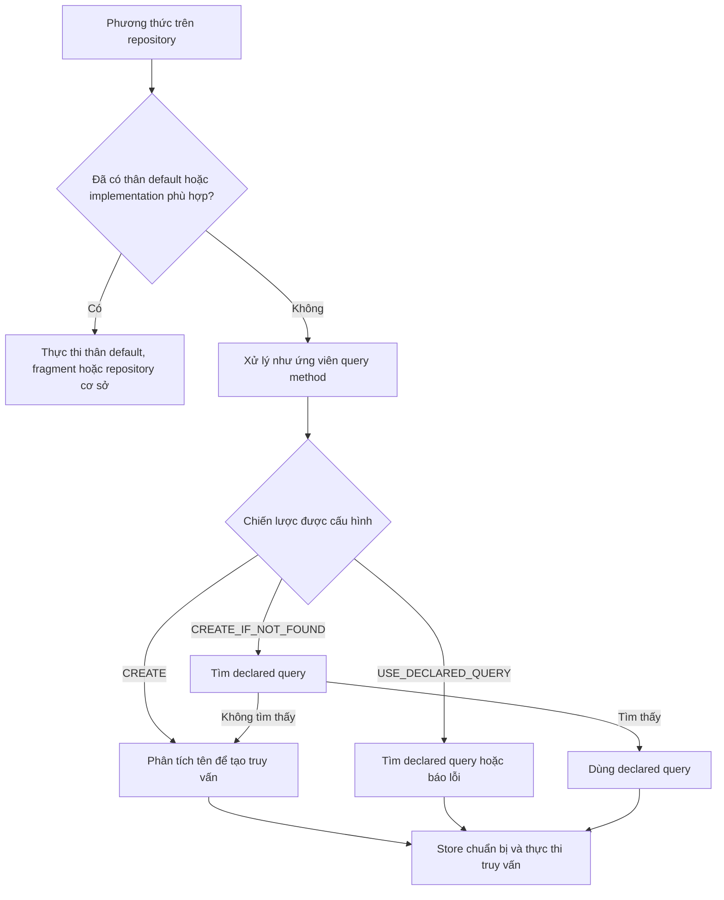

# Query method và cách repository quyết định triển khai

## Mục tiêu bài học

Khi khai báo một phương thức trong repository, bạn chỉ viết chữ ký Java; phần thực thi có thể đến từ lớp repository cơ sở, một fragment tùy biến hoặc một truy vấn do Spring Data chuẩn bị. Hiểu sự khác nhau này giúp bạn dự đoán hành vi, chọn cách truy vấn phù hợp và xác định đúng nguyên nhân khi ứng dụng không khởi tạo được repository.

Sau bài học, bạn có thể:

- Phân biệt phương thức CRUD, phương thức do fragment triển khai, phương thức `default` và query method.
- Giải thích ba chiến lược `CREATE`, `USE_DECLARED_QUERY` và `CREATE_IF_NOT_FOUND`.
- Đọc một tên query method thành điều kiện, tham số, giới hạn và thứ tự kết quả.
- Nhận biết phần nào là abstraction của Spring Data Commons, phần nào phải được module lưu trữ cụ thể hỗ trợ.
- Chọn giữa derived query, declared query và triển khai tùy biến theo yêu cầu thực tế.

## 1. Spring Data Commons đặt ra hợp đồng; module lưu trữ thực thi truy vấn

Spring Data Commons cung cấp các abstraction dùng chung như `Repository`, `CrudRepository`, `Pageable`, `Sort`, metadata của repository và cơ chế tra cứu query method. Nó không tự cung cấp một bộ máy truy vấn chung để mọi cơ sở dữ liệu thực thi cùng một câu lệnh.

Ví dụ, Spring Data JPA chuyển thông tin truy vấn thành thao tác phù hợp với JPA và mô hình entity. Spring Data MongoDB xây dựng thao tác trên collection và document. Các module khác có tập khả năng riêng về điều kiện, phân trang, projection, truy vấn khai báo và thao tác ghi.

Vì vậy, cần tách hai câu hỏi:

1. **Repository sẽ lấy phần triển khai của phương thức từ đâu?** Đây là câu hỏi về phân loại phương thức và chiến lược tra cứu truy vấn.
2. **Kho dữ liệu đích có thực thi được truy vấn đó không?** Đây là câu hỏi về module lưu trữ, mapping, toán tử và khả năng của backend.

Một keyword xuất hiện trong tài liệu chung không có nghĩa mọi store đều hỗ trợ keyword đó. Tương tự, một interface chỉ phụ thuộc Spring Data Commons chưa đủ để kết nối và truy vấn cơ sở dữ liệu.

## 2. Không phải mọi phương thức trong repository đều là query method

Xét mô hình khách hàng có các thuộc tính:

```text
Customer
├── id: Long
├── tenantId: String
├── email: String
├── lastName: String
├── active: boolean
└── createdAt: Instant
```

`tenantId` dùng để phân biệt dữ liệu của các đơn vị sử dụng hệ thống. Đây là mô hình minh họa; annotation và cấu hình mapping cần chọn theo store thực tế.

Repository có thể được khai báo như sau:

```java
import java.util.Optional;

import org.springframework.data.domain.Page;
import org.springframework.data.domain.Pageable;
import org.springframework.data.repository.CrudRepository;

interface CustomerChecks {
    boolean isEmailAvailable(String tenantId, String email);
}

interface CustomerRepository
        extends CrudRepository<Customer, Long>, CustomerChecks {

    Optional<Customer> findByTenantIdAndEmailIgnoreCase(
            String tenantId, String email);

    Page<Customer> findByTenantIdAndActiveTrue(
            String tenantId, Pageable pageable);

    default boolean containsEmail(String tenantId, String email) {
        return findByTenantIdAndEmailIgnoreCase(tenantId, email)
                .isPresent();
    }
}
```

Ví dụ này giả định store hỗ trợ các query method được sử dụng và fragment `CustomerChecks` đã được gắn với một implementation hợp lệ.

| Phương thức | Nguồn triển khai thông thường | Có cần suy diễn truy vấn từ tên không? |
| --- | --- | --- |
| `save(customer)` kế thừa từ `CrudRepository` | Repository cơ sở của module lưu trữ | Không |
| `findById(id)` kế thừa từ `CrudRepository` | Repository cơ sở, theo định danh của aggregate | Không |
| `isEmailAvailable(tenantId, email)` | Implementation của fragment `CustomerChecks` | Không, khi fragment đã được cấu hình đúng |
| `containsEmail(tenantId, email)` | Thân phương thức `default` trong interface | Không; thân phương thức có thể gọi query method khác |
| `findByTenantIdAndEmailIgnoreCase(...)` | Cơ chế query method của store | Có thể dùng tên hoặc truy vấn khai báo, tùy chiến lược |
| `findByTenantIdAndActiveTrue(...)` | Cơ chế query method của store | Có thể dùng tên hoặc truy vấn khai báo, tùy chiến lược |

Khi phương thức `default` gọi một query method, truy vấn vẫn được thực hiện cho lời gọi bên trong. Việc phương thức ngoài có sẵn thân Java không làm cho thao tác đọc dữ liệu bên trong biến mất.

Fragment là một phần của cấu trúc repository, không phải một annotation truy vấn. Nếu chỉ khai báo `CustomerChecks` nhưng không cung cấp implementation để Spring Data nhận diện, bạn chưa tạo ra phần triển khai tùy biến. Phương thức còn thiếu implementation có thể bị xem là ứng viên query method và dẫn tới lỗi phân tích tên hoặc lỗi khởi tạo.

Trong cơ chế composition, fragment tùy biến có thể được dùng để thay đổi hành vi của phương thức cơ sở. Khi có nhiều fragment trùng chữ ký, thứ tự và cách kết hợp fragment có ý nghĩa. Đây là vấn đề tổ chức implementation, không phải chức năng của `queryLookupStrategy`.

## 3. Query method là một hợp đồng gồm nhiều thành phần

Một query method không chỉ có tên. Để chuẩn bị việc thực thi, Spring Data còn xét:

- Domain type và kiểu định danh của repository.
- Chữ ký phương thức, kiểu các tham số và kiểu trả về.
- Annotation truy vấn hoặc metadata liên quan mà store hiểu.
- Các tham số đặc biệt như `Pageable` và `Sort`.
- Projection và khả năng ánh xạ kết quả của store.

Ví dụ:

```java
Page<Customer> findByTenantIdAndActiveTrue(
        String tenantId, Pageable pageable);
```

Hợp đồng trên biểu đạt ba điều khác nhau:

1. Chỉ lấy khách hàng có `tenantId` tương ứng và `active = true`.
2. Dùng `Pageable` để mô tả trang và thứ tự mong muốn.
3. Trả `Page<Customer>` để người gọi có dữ liệu trang cùng metadata về tổng số kết quả.

Chỉ nhìn tiền tố `find` sẽ không đủ để hiểu chi phí hoặc ý nghĩa của phương thức. Kiểu trả về `Page` có thể khiến store phải thực hiện thêm truy vấn đếm; việc đếm có thể được tối ưu hoặc bỏ qua trong những trường hợp đủ thông tin.

## 4. Ba chiến lược tra cứu query method

`QueryLookupStrategy` xác định cách Spring Data tìm hoặc tạo phần truy vấn cho một query method. Ba khóa cấu hình có ý nghĩa như sau:

| Chiến lược | Cách xử lý | Khi không có declared query |
| --- | --- | --- |
| `CREATE` | Xây dựng truy vấn bằng cách phân tích tên phương thức | Thử tạo từ tên; thất bại nếu tên hoặc khả năng của store không phù hợp |
| `USE_DECLARED_QUERY` | Yêu cầu một truy vấn đã được khai báo theo cơ chế của store | Không suy diễn thay thế từ tên; việc chuẩn bị repository/query thất bại |
| `CREATE_IF_NOT_FOUND` | Tìm truy vấn khai báo trước; nếu không có thì xây dựng từ tên | Chuyển sang tạo truy vấn từ tên |

`CREATE_IF_NOT_FOUND` là chiến lược mặc định thường dùng của Spring Data repositories. Cấu hình cụ thể và mức hỗ trợ vẫn cần đối chiếu với module lưu trữ bạn sử dụng.

### 4.1. `CREATE`: tên phương thức là nguồn mô tả truy vấn

Với phương thức:

```java
Optional<Customer> findByTenantIdAndEmailIgnoreCase(
        String tenantId, String email);
```

Store phân tích các phần như `TenantId`, `And`, `Email`, `IgnoreCase`, rồi tạo biểu diễn truy vấn phù hợp với backend.

Chiến lược này phù hợp khi repository chủ yếu sử dụng những điều kiện đơn giản, dễ diễn đạt bằng tên. Nó không biến một tên Java bất kỳ thành truy vấn hợp lệ. Một thuộc tính không tồn tại hoặc một toán tử không được store hỗ trợ vẫn có thể gây lỗi.

### 4.2. `USE_DECLARED_QUERY`: thiếu khai báo là lỗi

Declared query là truy vấn được cung cấp rõ ràng qua cơ chế mà module lưu trữ hỗ trợ, chẳng hạn annotation truy vấn hoặc named query.

Dưới chiến lược này, phương thức có tên suy diễn được vẫn thất bại nếu không tìm thấy declared query. Ví dụ, `findByEmail(...)` có thể là tên hợp lệ để tạo derived query, nhưng điều đó không đáp ứng yêu cầu của `USE_DECLARED_QUERY`.

Chiến lược này hữu ích khi nhóm phát triển muốn mọi query method phải có phần truy vấn được khai báo rõ. Nó không bắt các phương thức CRUD đã có implementation phải khai báo lại truy vấn.

### 4.3. `CREATE_IF_NOT_FOUND`: ưu tiên khai báo rồi mới suy diễn

Trình tự khái niệm là:

```text
Có declared query phù hợp?
├── Có  → dùng declared query
└── Không → thử tạo truy vấn từ tên phương thức
```

Từ khóa quan trọng là **không tìm thấy**. Một declared query đã được tìm thấy nhưng có cú pháp sai hoặc binding tham số sai không nên được hiểu là tín hiệu để âm thầm chuyển sang suy diễn từ tên. Bạn phải sửa truy vấn hoặc cấu hình gây lỗi.

Chiến lược được lựa chọn khi cấu hình repository và được dùng lúc chuẩn bị query method. Nó không thử lần lượt cả ba chiến lược cho mỗi lời gọi để chọn cách chạy nhanh nhất.

## 5. Mô hình quyết định của repository

Có thể dùng sơ đồ sau để hình dung nguồn xử lý một lời gọi:



Đây là mô hình khái niệm, không phải thứ tự chính xác của mọi interceptor trong mọi module. Annotation đặc thù, repository composition và cấu hình của store còn ảnh hưởng cách phương thức được nhận diện.

Repository factory của store tạo proxy và chuẩn bị thông tin cần thiết cho các phương thức. Khi ứng dụng gọi query method, phần thực thi tương ứng nhận tham số, thực hiện truy vấn và chuyển kết quả thành kiểu trả về đã khai báo.

Quá trình này thường phát hiện nhiều lỗi ở lúc khởi tạo repository. Nếu ứng dụng dùng cơ chế khởi tạo trì hoãn, một số lỗi có thể chỉ lộ ra khi repository được khởi tạo muộn hoặc khi phương thức được dùng. Cơ sở dữ liệu, dữ liệu thực và binding cũng có thể tạo ra lỗi ở thời điểm thực thi.

## 6. Đọc derived query theo từng phần

Xét phương thức:

```java
List<Customer> findTop5ByTenantIdAndActiveTrueOrderByCreatedAtDescIdDesc(
        String tenantId);
```

Có thể tách tên thành:

| Thành phần | Ý nghĩa |
| --- | --- |
| `find` | Yêu cầu đọc dữ liệu |
| `Top5` | Giới hạn tối đa năm kết quả, nếu store hỗ trợ |
| `By` | Bắt đầu phần điều kiện |
| `TenantId` | So sánh thuộc tính `tenantId` với tham số tương ứng |
| `AndActiveTrue` | Thêm điều kiện `active = true`, không cần tham số boolean |
| `OrderByCreatedAtDescIdDesc` | Sắp xếp giảm dần theo `createdAt`, sau đó theo `id` |

Thêm `id` làm khóa sắp xếp phụ giúp thứ tự rõ ràng khi nhiều khách hàng có cùng `createdAt`. Điều này có ích khi hiển thị danh sách hoặc phân trang. Nó không bảo đảm nhiều lần đọc có cùng kết quả nếu dữ liệu thay đổi giữa các lần đọc.

Tên thuộc tính dựa trên mô hình domain và mapping mà store nhận diện, không phải cứ viết nguyên tên cột SQL vào phương thức. Ví dụ, thuộc tính Java `createdAt` có thể được ánh xạ sang cột hoặc trường lưu trữ có tên khác.

### 6.1. Một số nhóm keyword thường gặp

| Nhóm | Ví dụ tên phương thức | Ý định |
| --- | --- | --- |
| Đọc dữ liệu | `findByTenantId(...)` | Tìm các đối tượng theo điều kiện |
| Kiểm tra tồn tại | `existsByTenantIdAndEmail(...)` | Kiểm tra có kết quả phù hợp hay không |
| Đếm | `countByTenantIdAndActiveTrue(...)` | Đếm kết quả phù hợp |
| Kết hợp điều kiện | `findByTenantIdAndLastName(...)` | Kết hợp các thuộc tính bằng `And` hoặc `Or` |
| So sánh | `findByCreatedAtAfter(...)` | So sánh với một mốc thời gian |
| Chuỗi | `findByLastNameStartingWith(...)` | Tìm theo tiền tố |
| Không phân biệt hoa thường | `findByEmailIgnoreCase(...)` | Yêu cầu so sánh không phân biệt hoa thường |
| Thứ tự tĩnh | `findByTenantIdOrderByLastNameAsc(...)` | Cố định thứ tự trong tên |
| Giới hạn | `findTop5ByTenantIdOrderByCreatedAtDesc(...)` | Chỉ lấy một số kết quả đầu |

Bảng mô tả ngữ nghĩa thường gặp trong Spring Data; cần kiểm tra khả năng của store trước khi áp dụng. Cách so sánh chuỗi, xử lý `null`, collation và hiệu năng không thể suy ra đầy đủ chỉ từ tên keyword.

### 6.2. Tham số đi theo các phần điều kiện

```java
List<Customer> findByTenantIdAndCreatedAtBetween(
        String tenantId, Instant from, Instant to);
```

`TenantId` nhận một tham số. `Between` cần hai giá trị biên. Bạn phải cung cấp đúng số lượng và kiểu tham số phù hợp với thuộc tính và toán tử.

Các ví dụ dùng `List` và `Instant` cần các import Java tương ứng khi đưa vào mã nguồn. Tính bao hàm của biên thời gian và độ chính xác lưu trữ phải được xác nhận theo store; với khoảng thời gian nghiệp vụ, hãy xác định rõ bạn cần khoảng đóng hay khoảng nửa mở trước khi chọn biểu thức.

### 6.3. Đường dẫn thuộc tính lồng nhau

Nếu `Customer` có `address.zipCode`, một tên như sau có thể biểu đạt đường dẫn lồng nhau:

```java
List<Customer> findByAddress_ZipCode(String zipCode);
```

Dấu `_` phân định điểm đi qua thuộc tính lồng nhau, giúp xử lý tình huống tên ghép có thể được hiểu theo nhiều cách. Ví dụ, một domain vừa có `addressZip` vừa có `address` có thể khiến tên dài thiếu dấu phân tách khó đọc và khó phân giải đúng ý định.

Dấu phân tách chỉ giúp diễn đạt đường dẫn. Việc store có hỗ trợ truy vấn theo đường dẫn đó, cần join hay truy cập nested document ra sao là câu chuyện riêng.

### 6.4. Cẩn thận khi trộn `And` và `Or`

Ví dụ sau dễ tạo sai phạm vi dữ liệu:

```java
List<Customer> findByTenantIdAndEmailOrLastName(
        String tenantId, String email, String lastName);
```

Cấu trúc điều kiện được hiểu theo các nhóm `Or`, trong đó mỗi nhóm chứa các phần `And`, tương ứng với:

```text
(tenantId = ? AND email = ?) OR lastName = ?
```

Nó không có nghĩa:

```text
 tenantId = ? AND (email = ? OR lastName = ?)
```

Với dữ liệu nhiều tenant, nhánh `lastName` ở biểu thức đầu không được giới hạn bởi `tenantId`. Khi cần nhóm ngoặc rõ ràng hoặc các điều kiện động, một truy vấn khai báo hay implementation tùy biến thường dễ kiểm tra hơn. Không nên kéo dài tên phương thức đến mức người đọc phải tự đoán logic.

## 7. Phương thức dành riêng: trường hợp `findById`

Các phương thức như `findById`, `existsById` và `deleteById` của repository cơ sở có ngữ nghĩa dành riêng cho định danh của aggregate. Không nên áp dụng máy móc quy tắc phân tích tên của derived query cho các chữ ký này.

Giả sử một entity có hai thuộc tính:

```text
pk: Long     ← thuộc tính được mapping làm định danh
id: String   ← mã nghiệp vụ thông thường
```

Repository có thể khai báo:

```java
interface AccountRepository extends CrudRepository<Account, Long> {

    Optional<Account> findAccountById(String id);
}
```

Khi đó:

- `findById(Long value)` kế thừa từ `CrudRepository` tìm theo định danh `pk`.
- `findAccountById(String value)` là tên query method có phần mô tả `Account` trước `By`; điều kiện của nó hướng đến thuộc tính thông thường `id`.

Ví dụ giả định store hỗ trợ derived query tương ứng. Mapping nào đánh dấu `pk` là định danh phải được cấu hình đúng theo store.

Trong ví dụ này, `Account` trong tên phương thức là phần mô tả của tên; domain type vẫn do khai báo repository xác định. Việc thêm một từ vào tên không chuyển repository sang truy vấn một aggregate khác.

## 8. Declared query phụ thuộc module lưu trữ

Spring Data Commons không cung cấp một annotation `@Query` duy nhất với cùng cú pháp cho mọi store. Cần nhìn cả package import và ngôn ngữ truy vấn.

### 8.1. Ví dụ riêng cho Spring Data JPA

```java
import java.util.Optional;

import org.springframework.data.jpa.repository.Query;
import org.springframework.data.repository.CrudRepository;
import org.springframework.data.repository.query.Param;

interface JpaCustomerRepository
        extends CrudRepository<Customer, Long> {

    @Query("""
        select c from Customer c
        where c.tenantId = :tenantId
          and lower(c.email) = lower(:email)
        """)
    Optional<Customer> lookupCustomer(
            @Param("tenantId") String tenantId,
            @Param("email") String email);
}
```

Đây là JPQL của JPA. `Customer` trong câu truy vấn là tên entity, còn `tenantId` và `email` là thuộc tính entity. Ví dụ giả định entity có tên `Customer` và các mapping tương ứng đã tồn tại.

Tên `lookupCustomer` không cần biểu đạt đầy đủ điều kiện vì truy vấn đã được khai báo. Phương thức cần một chiến lược sử dụng declared query, chẳng hạn `USE_DECLARED_QUERY` hoặc `CREATE_IF_NOT_FOUND`. Không nên cấu hình `CREATE` rồi kỳ vọng câu `@Query` này sẽ là nguồn thực thi.

`@Param` ở đây thể hiện rõ mối liên hệ giữa tên trong truy vấn và tham số Java. Nó giúp ví dụ không phụ thuộc việc trình biên dịch có giữ lại tên tham số hay không.

### 8.2. Ví dụ riêng cho Spring Data MongoDB

```java
import java.util.List;

import org.springframework.data.mongodb.repository.Query;
import org.springframework.data.repository.CrudRepository;

interface MongoCustomerRepository
        extends CrudRepository<Customer, Long> {

    @Query("{ 'tenantId': ?0, 'active': true }")
    List<Customer> loadActiveCustomers(String tenantId);
}
```

Đây là truy vấn theo cơ chế của MongoDB repository; `?0` tham chiếu tham số đầu tiên của phương thức. Nó không phải JPQL và không được đưa nguyên sang repository JPA.

Hai repository trên là hai phương án minh họa độc lập, không phải cấu hình yêu cầu đăng ký đồng thời cho cùng một domain type. Nếu ứng dụng sử dụng nhiều module Spring Data, việc phân vùng repository và mapping cần được cấu hình rõ.

### 8.3. Named query và thứ tự ưu tiên

Một số module hỗ trợ named query và quy ước tìm named query dựa trên domain type, tên phương thức hoặc cấu hình. Một số module còn có quy tắc riêng khi vừa có named query vừa có annotation trên phương thức.

`QueryLookupStrategy` trả lời câu hỏi có tìm declared query hay không và có fallback sang tên hay không. Thứ tự tra cứu cụ thể giữa các nguồn khai báo do module lưu trữ quyết định; không nên suy ra một thứ tự chung chỉ từ Commons.

## 9. Cấu hình chiến lược tại nơi kích hoạt repository

Ví dụ riêng cho JPA:

```java
import org.springframework.context.annotation.Configuration;
import org.springframework.data.jpa.repository.config.EnableJpaRepositories;
import org.springframework.data.repository.query.QueryLookupStrategy;

@Configuration
@EnableJpaRepositories(
        basePackages = "example.customer",
        queryLookupStrategy =
                QueryLookupStrategy.Key.CREATE_IF_NOT_FOUND
)
class CustomerRepositoryConfiguration {
}
```

`queryLookupStrategy` áp dụng cho nhóm repository được cấu hình tại đây. Các module khác sử dụng annotation hoặc cơ chế cấu hình tương ứng; không dùng `@EnableJpaRepositories` để kích hoạt repository MongoDB.

Ví dụ này chỉ thể hiện lựa chọn chiến lược. Ứng dụng vẫn cần dependency JPA, mapping entity, cấu hình persistence và kết nối phù hợp. Trong ứng dụng đã có cơ chế tự cấu hình repository, cần tích hợp cấu hình có chủ đích để tránh đăng ký chồng lặp.

Một hệ quả cần chú ý của `CREATE_IF_NOT_FOUND`: nếu xóa một declared query nhưng tên phương thức vẫn là derived query hợp lệ, repository có thể tiếp tục khởi tạo bằng truy vấn suy diễn. Ngữ nghĩa có thể thay đổi mà không xuất hiện lỗi thiếu truy vấn. Khi chuyển đổi giữa hai cách khai báo, cần kiểm tra hành vi mong muốn bằng dữ liệu có khả năng phân biệt chúng.

## 10. Kiểu trả về và tham số đặc biệt ảnh hưởng cách thực thi

### 10.1. Chọn kiểu trả về theo hợp đồng dữ liệu

| Khai báo | Hợp đồng người gọi cần hiểu |
| --- | --- |
| `Optional<Customer>` | Mong đợi tối đa một kết quả; không có kết quả được biểu diễn bằng `Optional.empty()` |
| `List<Customer>` | Một tập kết quả; không tự có metadata tổng số trang |
| `Page<Customer>` | Dữ liệu một trang và thông tin tổng số phần tử/trang; thường có chi phí tính tổng |
| `Slice<Customer>` | Một lát dữ liệu với thông tin còn lát tiếp theo hay không; không yêu cầu tổng số như `Page` |
| `boolean` với `existsBy...` | Kiểm tra tồn tại |
| `long` với `countBy...` | Đếm số kết quả |

Tập kiểu trả về được hỗ trợ còn tùy store và mô hình truy cập đồng bộ hay reactive. Không được giả định mọi repository đều dùng được tất cả các kiểu trong bảng.

`Optional` không tự thêm giới hạn một kết quả và không sửa dữ liệu trùng lặp. Với truy vấn yêu cầu một kết quả mà thực tế có nhiều kết quả, repository có thể ném lỗi kích thước kết quả không đúng thay vì chọn tùy ý một bản ghi.

Nếu nghiệp vụ yêu cầu duy nhất email trong một tenant, cần ràng buộc dữ liệu phù hợp ở kho lưu trữ, có xét cả quy tắc chuẩn hóa và so sánh email. Một phương thức `existsBy...` chạy trước `save` không tự ngăn được hai yêu cầu đồng thời cùng ghi dữ liệu trùng.

### 10.2. `Pageable` và `Sort` không phải điều kiện thông thường

```java
Page<Customer> findByTenantId(
        String tenantId, Pageable pageable);

List<Customer> findByTenantIdAndActiveTrue(
        String tenantId, Sort sort);
```

`tenantId` được bind vào điều kiện. `Pageable` và `Sort` là tham số đặc biệt, dùng để điều khiển việc lấy trang và thứ tự; tên phương thức không cần có các thuộc tính giả như `Pageable` hay `Sort` sau `By`.

Ví dụ tạo yêu cầu phân trang:

```java
Pageable pageable = PageRequest.of(
        0,
        20,
        Sort.by(
                Sort.Order.desc("createdAt"),
                Sort.Order.desc("id")
        )
);

Page<Customer> page = repository.findByTenantId("tenant-a", pageable);
```

Ví dụ cần import `PageRequest`, `Pageable`, `Page` và `Sort` từ `org.springframework.data.domain`. Chỉ số trang ở đây bắt đầu từ `0`; giá trị `20` là kích thước trang.

Tên thuộc tính trong `Sort` phải phù hợp với domain và khả năng truy vấn của store. Không cần thêm tham số `Sort` riêng khi đã truyền thứ tự qua `Pageable`.

Phân trang không tự thay thế điều kiện phân quyền hoặc lọc tenant. Trong ví dụ, phạm vi dữ liệu đến từ điều kiện `tenantId`; `Pageable` chỉ mô tả cách lấy một phần kết quả trong phạm vi đó.

### 10.3. Projection thay đổi hình dạng kết quả

```java
interface CustomerSummary {
    String getEmail();
    String getLastName();
}

interface CustomerReadRepository extends Repository<Customer, Long> {

    List<CustomerSummary> findByTenantIdAndActiveTrue(
            String tenantId, Sort sort);
}
```

Ví dụ cần import `Repository`, `Sort` và `List`. Khi store hỗ trợ dạng interface projection này, kiểu trả về mô tả các thuộc tính mà người gọi cần nhận.

Projection không thay đổi ý nghĩa của điều kiện trong tên phương thức. Cũng không nên khẳng định cứ trả projection là backend chắc chắn chỉ đọc đúng hai trường; khả năng tối ưu truy vấn phụ thuộc loại projection và store.

## 11. Chọn cách triển khai cho tình huống thực tế

| Tình huống | Hướng lựa chọn | Lý do |
| --- | --- | --- |
| Tìm theo tenant và email | Derived query | Điều kiện ngắn, dễ đọc trực tiếp trong tên |
| Lấy năm khách hàng mới nhất của tenant | Derived query có giới hạn và thứ tự, nếu store hỗ trợ | Ý định rõ và ít điều kiện |
| Điều kiện cần ngoặc, nhiều nhánh `Or`, join hoặc tổng hợp | Declared query hay API truy vấn của store | Cần biểu diễn logic rõ hơn tên phương thức |
| Có nhiều bộ lọc tùy chọn | Fragment tùy biến hoặc abstraction truy vấn động được store hỗ trợ | Tránh bùng nổ số tên phương thức |
| Cần tích hợp API đặc thù của backend | Fragment tùy biến | Cần chủ động lập trình cách truy cập dữ liệu |
| Chỉ cần kiểm tra tồn tại | `existsBy...` nếu store hỗ trợ | Hợp đồng diễn đạt trực tiếp nhu cầu của người gọi |
| Chỉ cần biết còn dữ liệu tiếp theo | `Slice` nếu phù hợp và được hỗ trợ | Tránh yêu cầu tổng số phần tử không cần thiết |

Query by Example cũng là một lựa chọn ở những store hỗ trợ `QueryByExampleExecutor`, nhất là khi mô tả mẫu đối tượng và các quy tắc so khớp đáp ứng được bài toán. Nó có hợp đồng riêng; không phải một giá trị thứ tư của `QueryLookupStrategy`.

Tương tự, auditing ghi nhận metadata như người tạo hoặc thời điểm tạo. Nó không quyết định repository dùng derived query hay declared query. Nếu truy vấn dựa trên trường audit như `createdAt`, trường đó phải được mapping và được điền dữ liệu đúng trước khi có thể kỳ vọng kết quả chính xác.

## 12. Nhận diện lỗi theo đúng tầng

| Biểu hiện | Tầng cần kiểm tra trước | Câu hỏi chẩn đoán |
| --- | --- | --- |
| Không tìm thấy thuộc tính khi khởi tạo repository | Phân tích derived query | Tên thuộc tính có tồn tại trên domain không? Có nhầm tên cột với tên Java không? |
| Thiếu declared query | Chiến lược tra cứu | Có đang dùng `USE_DECLARED_QUERY` không? Nguồn khai báo có được store nhận diện không? |
| Câu truy vấn có cú pháp sai | Declared query và ngôn ngữ của store | Đây là JPQL, SQL hay truy vấn MongoDB? Import `@Query` có đúng module không? |
| Sai số lượng hoặc kiểu tham số | Chữ ký và binding | Toán tử cần bao nhiêu giá trị? Tham số đặc biệt đã được hiểu đúng chưa? |
| Phương thức fragment bị phân tích như tên truy vấn | Repository composition | Implementation tùy biến có được phát hiện và gắn vào repository không? |
| Nhiều kết quả trong phương thức trả `Optional` | Hợp đồng kết quả và dữ liệu | Điều kiện có thật sự duy nhất? Kho dữ liệu có ràng buộc tương ứng không? |
| Kết quả lẫn tenant | Logic điều kiện | Có nhánh `Or` nào nằm ngoài điều kiện tenant không? |
| Truy vấn đúng nhưng chậm | Backend, index và kế hoạch thực thi | Điều kiện, thứ tự và phép đếm có được index phù hợp hỗ trợ không? |

Tên query method đúng không bảo đảm truy vấn nhanh. Ví dụ, tìm email không phân biệt hoa thường có thể tương tác với collation, biểu thức chuẩn hóa và index theo cách khác nhau giữa các backend. Cần đánh giá bằng công cụ và dữ liệu của store thực tế.

Khi cần xác minh một query method, nên chọn các ca dữ liệu có thể phát hiện sai ngữ nghĩa: hai tenant cùng họ khách hàng, email khác hoa thường, nhiều bản ghi có cùng thời điểm tạo, không có kết quả và có nhiều kết quả. Các ca này hữu ích hơn việc chỉ kiểm tra rằng repository khởi tạo được.

## 13. Bài tập tự kiểm tra

### Bài 1: Dự đoán nguồn triển khai

Một repository kế thừa `CrudRepository<Customer, Long>` và có phương thức `findByTenantId(String tenantId)` không gắn annotation.

- `save(...)` lấy implementation từ đâu?
- `findByTenantId(...)` sẽ hoạt động thế nào dưới từng chiến lược?

**Gợi ý đáp án:** `save(...)` sử dụng repository cơ sở. Với store hỗ trợ, `CREATE` tạo truy vấn từ tên; `CREATE_IF_NOT_FOUND` tìm khai báo trước rồi tạo từ tên nếu không có; `USE_DECLARED_QUERY` thất bại khi không có declared query phù hợp.

### Bài 2: Phân biệt thiếu khai báo và khai báo sai

Repository dùng `CREATE_IF_NOT_FOUND`. Trên một query method có annotation truy vấn nhưng câu truy vấn sai cú pháp. Có nên kỳ vọng repository bỏ qua annotation để thử phân tích tên không?

**Gợi ý đáp án:** Không. Fallback phục vụ trường hợp không tìm thấy declared query, không phải cơ chế che lỗi của truy vấn đã được khai báo. Hãy sửa cú pháp, binding hoặc chọn lại cách triển khai có chủ đích.

### Bài 3: Kiểm tra phạm vi tenant

Yêu cầu là tìm khách hàng thuộc một tenant, trong đó email hoặc họ khớp dữ liệu đầu vào. Tên `findByTenantIdAndEmailOrLastName(...)` có đáp ứng đúng không?

**Gợi ý đáp án:** Không. Tên biểu đạt `(tenantId AND email) OR lastName`, nên nhánh họ có thể trả dữ liệu ngoài tenant. Cần biểu diễn điều kiện `tenantId AND (email OR lastName)` bằng cách đủ rõ ràng và được store hỗ trợ.

### Bài 4: Chọn hợp đồng kết quả

Màn hình chỉ hiển thị tối đa hai mươi khách hàng và nút “Tiếp”, không hiển thị tổng số trang. Bạn có bắt buộc trả `Page<Customer>` không?

**Gợi ý đáp án:** Không. Có thể cân nhắc `Slice<Customer>` với `Pageable` nếu store hỗ trợ và hợp đồng này đáp ứng yêu cầu. Việc đổi kiểu trả về cần đi cùng kiểm tra truy vấn thực tế và cách xử lý trang tiếp theo.

## Kết luận

Để hiểu một phương thức repository, trước hết xác định nó đã có implementation từ repository cơ sở, fragment hay thân `default` chưa. Với query method, tiếp tục xác định chiến lược tra cứu, nguồn truy vấn, cách bind tham số và hợp đồng kết quả. Sau đó đối chiếu tất cả với khả năng của module lưu trữ cụ thể.

Cách đọc này giúp bạn giải thích được vì sao một phương thức chạy mà không cần viết implementation, vì sao một tên hợp lệ vẫn thất bại dưới `USE_DECLARED_QUERY`, và vì sao cùng abstraction Commons vẫn cần lựa chọn khác nhau cho JPA, MongoDB hay một loại kho dữ liệu khác.
