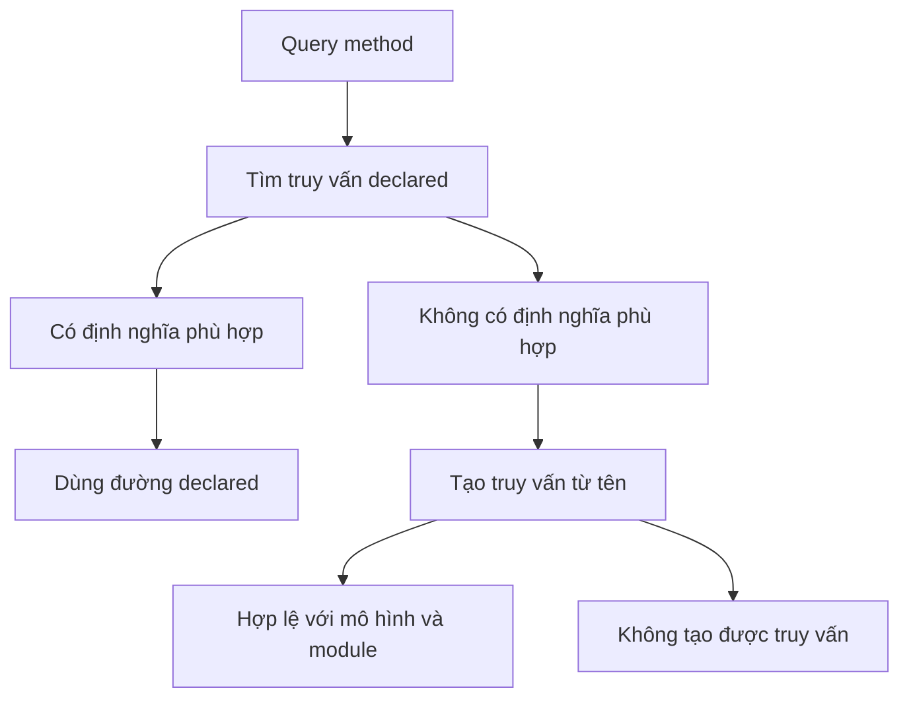

# `CREATE`, `USE_DECLARED_QUERY` và `CREATE_IF_NOT_FOUND`

Một query method trong repository có thể được thực thi từ tên phương thức hoặc từ một định nghĩa truy vấn đã khai báo. Khi cả hai cách cùng có thể áp dụng, framework cần một chính sách để quyết định tìm nguồn nào trước và phải làm gì khi không tìm thấy định nghĩa phù hợp. Chính sách đó là **query lookup strategy**.

Trong chương **Chiến lược truy vấn** của Spring Data Commons (`SPRING_DATA_COMMONS`), bài này phân biệt ba giá trị `CREATE`, `USE_DECLARED_QUERY` và `CREATE_IF_NOT_FOUND`. Mục tiêu là dự đoán được nguồn truy vấn được chọn, tránh hiểu nhầm fallback và biết khi nào một thay đổi cấu hình có thể làm đổi hành vi repository.

Ví dụ cụ thể dùng Spring Data JPA với Jakarta Persistence. Commons cung cấp abstraction về chiến lược; module store quyết định những nguồn truy vấn và khả năng nào được hỗ trợ. Không suy ra rằng mọi module đều hỗ trợ đầy đủ ba strategy hoặc cùng một dạng truy vấn khai báo.

## 1. Strategy chọn định nghĩa truy vấn, không chọn bản ghi

Xét phương thức:

```java
List<Book> findByStatusOrderByTitleAsc(BookStatus status);
```

Có hai nguồn thực thi có thể hình dung:

```text
Nguồn A: phân tích tên phương thức
         -> lọc theo status, sắp xếp title tăng dần

Nguồn B: một định nghĩa truy vấn khai báo
         -> ví dụ JPQL, named query hoặc nguồn được module hỗ trợ
```

Query lookup strategy quyết định cách giải quyết nguồn định nghĩa cho query method. Nó không có nghĩa “chạy truy vấn A, nếu không có bản ghi thì chạy B”.

Cần phân biệt ba tình huống:

| Tình huống | Ý nghĩa |
| --- | --- |
| Không tìm thấy định nghĩa truy vấn khai báo | Chưa có nguồn declared phù hợp để thực thi method. |
| Đã có truy vấn hợp lệ nhưng trả danh sách rỗng | Truy vấn được thực thi và không có dữ liệu khớp. |
| Đã tìm thấy khai báo nhưng khai báo hoặc thao tác truy vấn bị lỗi | Có nguồn cần xử lý lỗi, không đơn thuần là thiếu định nghĩa. |

Từ “lookup” trong bài là việc tìm cách thực thi một query method. Nó không phải một lời hứa về số lần truy cập database trong mỗi lần người dùng gọi method.

## 2. Phạm vi áp dụng: những phương thức cần giải quyết truy vấn

Một repository có nhiều đường thực thi:

```java
public interface BookRepository extends CrudRepository<Book, Long> {

    List<Book> findByStatusOrderByTitleAsc(BookStatus status);

    default Book requireById(Long id) {
        return findById(id).orElseThrow();
    }
}
```

- `save`, `findById`, `count` và những chữ ký CRUD chuẩn có phần triển khai cơ sở của module.
- `requireById` có thân Java của default method.
- `findByStatusOrderByTitleAsc` là một query method cần module cung cấp truy vấn phù hợp.

Strategy không yêu cầu lập trình viên viết `@Query` cho mọi thao tác CRUD khi chọn `USE_DECLARED_QUERY`. Nó cũng không tự phân tích tên của mọi default method hoặc thay thân Java của một fragment đã được ghép đúng.

Một default method hoặc fragment có thể gọi tiếp một query method. Khi đó strategy vẫn ảnh hưởng query method bên trong, còn phần thân của phương thức bao ngoài vẫn là mã đã được cung cấp.

Các thao tác executor như Query by Example, nếu được module hỗ trợ, có cách nhận điều kiện riêng qua `Example` và matcher. Không đồng nhất chúng với việc phân tích tên mọi method dựa trên strategy.

## 3. `CREATE`: tạo truy vấn từ tên phương thức

### 3.1. Cách hoạt động

`CREATE` yêu cầu module dựng truy vấn từ tên query method theo quy tắc được hỗ trợ.

```text
Query method
    -> phân tích tên và tham số
    -> phân giải thuộc tính của mô hình
    -> tạo truy vấn theo module
```

Với ví dụ:

```java
List<Book> findByStatusOrderByTitleAsc(BookStatus status);
```

điều kiện được lấy từ `Status`, còn `OrderByTitleAsc` mô tả thứ tự. `Book` phải có các thuộc tính phù hợp và module phải hỗ trợ cách diễn đạt đó.

`CREATE` không có nghĩa tạo bảng, tạo collection hoặc tạo entity mới. Nó cũng không cùng nghĩa với `save`: strategy đang giải quyết một định nghĩa truy vấn, không chọn insert hay update dữ liệu.

### 3.2. Không chọn truy vấn khai báo làm nguồn thay thế

Trong cơ chế JPA minh họa, `CREATE` dùng đường tạo từ tên, thay vì chọn chuỗi `@Query` làm nguồn truy vấn. Nếu method vừa có một tên derived hợp lệ vừa có `@Query` khác về điều kiện, chọn `CREATE` có thể dẫn tới kết quả khác với người chỉ đọc annotation mong đợi.

Ví dụ một phương án khai báo:

```java
@Query("select b from Book b "
    + "where b.status = :status and b.archived = false "
    + "order by b.title asc")
List<Book> findByStatusOrderByTitleAsc(@Param("status") BookStatus status);
```

Tên method chỉ mô tả `status` và thứ tự `title`. Điều kiện `archived = false` chỉ nằm trong khai báo JPQL. Khi dùng `CREATE` trong ví dụ JPA này, không được giả định điều kiện thêm ấy tự tham gia truy vấn được suy ra từ tên.

Điều đó không có nghĩa mọi annotation hay metadata khác đều bị bỏ qua. Điểm đang nói là nguồn dùng để giải quyết định nghĩa query method.

### 3.3. Khi tên không thể dùng để tạo truy vấn

Một method có tên như sau có thể hợp lệ nhờ truy vấn khai báo:

```java
@Query("select b from Book b where b.status = :status and b.archived = false")
List<Book> loadVisibleBooks(@Param("status") BookStatus status);
```

Nhưng tên `loadVisibleBooks` không diễn đạt điều kiện theo quy tắc derived query được dùng trong ví dụ. Chuyển cả nhóm repository sang `CREATE` không có nghĩa annotation tiếp tục cứu method này. Hạ tầng có thể không tạo được truy vấn từ tên và báo lỗi.

Chọn `CREATE` phù hợp khi nhóm query method được thiết kế để dựa vào tên và những khả năng được module hỗ trợ. Không đổi strategy chỉ vì muốn “ưu tiên nhanh hơn” mà chưa kiểm tra toàn bộ query method trong nhóm.

## 4. `USE_DECLARED_QUERY`: cần truy vấn đã khai báo

### 4.1. Cách hoạt động

`USE_DECLARED_QUERY` tìm một định nghĩa truy vấn khai báo phù hợp. Nếu không tìm thấy, nó không chuyển sang suy ra truy vấn từ tên.

```text
Query method
    -> tìm định nghĩa declared theo module
        -> có: sử dụng định nghĩa đó
        -> không có: báo lỗi giải quyết truy vấn
```

Một tên `findByStatusOrderByTitleAsc` có vẻ hoàn toàn phù hợp cho derived query vẫn không đủ nếu strategy yêu cầu declared mà không tìm thấy nguồn khai báo nào.

### 4.2. Declared không chỉ là `@Query`

Với JPA, những nguồn như annotation truy vấn và named query có thể tham gia theo cơ chế module. Vì vậy:

```text
Không có @Query trên method
    không đồng nghĩa
Không có bất kỳ declared query nào cho method đó
```

Khi dự án dùng named query, phải kiểm tra nguồn named query tương ứng trước khi kết luận method đang chạy theo tên.

Cũng không biến `@Query` thành một annotation Commons dùng chung cho mọi store. JPA và MongoDB có các annotation cùng tên ngắn nhưng package và ngôn ngữ khai báo khác nhau.

### 4.3. Chính sách này bảo đảm điều gì?

Nó giúp yêu cầu những query method thuộc phạm vi áp dụng phải có nguồn khai báo được module tìm thấy. Nó không tự chứng minh:

- Truy vấn khai báo phản ánh đúng ý định nghiệp vụ.
- Mọi ràng buộc lọc cần thiết đều đã được viết.
- Truy vấn có hiệu năng tốt hoặc sử dụng đúng index.
- SQL hoặc ngôn ngữ store đã được kiểm chứng đầy đủ trên môi trường đích.

Đây là chính sách chọn nguồn và xử lý thiếu định nghĩa, không thay thế kiểm thử truy vấn.

## 5. `CREATE_IF_NOT_FOUND`: tìm declared trước, tạo theo tên khi thiếu

### 5.1. Cách hoạt động

`CREATE_IF_NOT_FOUND` kết hợp hai đường:



Đây là mặc định trong cấu hình JPA minh họa khi không thay chiến lược tương ứng. Nó cho phép một repository có cả query method dựa trên tên và query method khai báo trực tiếp.

### 5.2. Không tìm thấy khác với tìm thấy nhưng sai

Nếu đã tìm thấy một khai báo JPQL nhưng khai báo bị sai, `CREATE_IF_NOT_FOUND` không có nghĩa framework sẽ bỏ lỗi rồi tự chạy một truy vấn derived khác.

```text
Không có declared query       -> có thể chuyển sang tạo theo tên.
Có declared query nhưng lỗi   -> xử lý lỗi của đường declared.
Declared query trả về rỗng    -> kết quả rỗng, không thử truy vấn khác.
```

Đây là điểm quan trọng khi chẩn đoán. Xóa một annotation bị lỗi có thể làm method chuyển sang derived query nếu tên hợp lệ. Sau thay đổi, ứng dụng có thể khởi động, nhưng truy vấn được thực thi có thể khác với ý định của annotation vừa xóa.

Không coi việc hết lỗi là đủ; cần kiểm tra kết quả và điều kiện truy vấn thực tế.

### 5.3. Thêm một khai báo cũng có thể đổi hành vi

Nếu method trước đây không có declared query, nó có thể đang được suy ra từ tên. Sau khi thêm `@Query` hoặc một named query được nhận diện, cùng method dưới `CREATE_IF_NOT_FOUND` có thể chuyển sang dùng nguồn khai báo.

Không cần đổi tên method để thay đổi này xảy ra. Vì vậy, khi bổ sung định nghĩa truy vấn, kiểm tra ảnh hưởng đến những method mà nó có thể khớp.

## 6. So sánh ba strategy trên từng tình huống

Bảng dưới mô tả các tình huống **độc lập** trong phạm vi JPA của bài. Không đặt tất cả phương án vào một context rồi kỳ vọng mọi strategy đều khởi tạo được.

| Tình huống của query method | `CREATE` | `USE_DECLARED_QUERY` | `CREATE_IF_NOT_FOUND` |
| --- | --- | --- | --- |
| Tên derived hợp lệ, không có declared query | Tạo từ tên. | Lỗi vì thiếu declared. | Tạo từ tên sau khi không tìm thấy declared. |
| Tên derived hợp lệ, có `@Query` hợp lệ | Tạo từ tên. | Dùng truy vấn khai báo. | Dùng truy vấn khai báo. |
| Tên không diễn đạt được derived query, có `@Query` hợp lệ | Có thể lỗi tạo theo tên. | Dùng truy vấn khai báo. | Dùng truy vấn khai báo. |
| Không có declared, tên cũng không tạo được truy vấn | Lỗi tạo truy vấn. | Lỗi thiếu declared. | Lỗi sau khi chuyển sang tạo theo tên. |

Khi có named query hoặc nguồn declared khác, việc đánh giá cột “có declared” phải bao gồm những nguồn đó theo module. Không chỉ tìm annotation trên interface rồi kết luận.

Những chữ “lỗi” trong bảng chỉ việc không giải quyết/thực thi được theo hợp đồng tương ứng. Thời điểm và kiểu ngoại lệ cụ thể còn phụ thuộc module, bootstrap, provider và loại truy vấn.

## 7. Cấu hình strategy cho một nhóm repository

Với Spring Data JPA, có thể cấu hình qua annotation kích hoạt:

```java
package com.example.catalog.configuration;

import com.example.catalog.repository.CatalogRepositoryPackage;
import org.springframework.context.annotation.Configuration;
import org.springframework.data.jpa.repository.config.EnableJpaRepositories;
import org.springframework.data.repository.query.QueryLookupStrategy;

@Configuration(proxyBeanMethods = false)
@EnableJpaRepositories(
    basePackageClasses = CatalogRepositoryPackage.class,
    queryLookupStrategy = QueryLookupStrategy.Key.CREATE_IF_NOT_FOUND
)
public class CatalogRepositoryConfiguration {
}
```

Marker:

```java
package com.example.catalog.repository;

public final class CatalogRepositoryPackage {
    private CatalogRepositoryPackage() {
    }
}
```

Thay giá trị key để chọn một trong hai chính sách còn lại:

```java
QueryLookupStrategy.Key.CREATE
QueryLookupStrategy.Key.USE_DECLARED_QUERY
```

Chọn một cấu hình có hiệu lực cho nhóm đang xét. Không tạo ba lớp cùng quét một package chỉ để “bật đủ ba strategy”; điều đó có thể dẫn tới đăng ký chồng lấp thay vì một cơ chế chọn theo từng lần gọi.

Cấu hình phải thực sự được nạp, module JPA phải có trên classpath và persistence phải được chuẩn bị đúng. Strategy không tự quét entity, tạo datasource hoặc cung cấp driver.

Nếu ứng dụng có những nhóm repository với chính sách khác nhau, cần các phạm vi cấu hình tách rõ ràng. Không để cùng một interface bị nhiều cấu hình chồng lấp xét với các strategy khác nhau rồi dựa vào thứ tự nạp.

