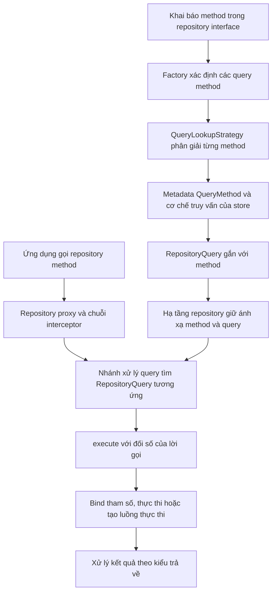

# QueryMethod, RepositoryQuery và vai trò của QueryLookupStrategy

Một khai báo như `Optional<Customer> findByEmail(String email)` không chứa thân phương thức, nhưng repository vẫn có thể thực thi nó. Hạ tầng Spring Data cần hiểu phương thức biểu diễn điều gì, tìm cách tạo truy vấn phù hợp với kho dữ liệu, rồi chuyển lời gọi Java thành một lần thực thi cụ thể.

Trong chương **Chiến lược truy vấn** của module `SPRING_DATA_COMMONS`, ba thành phần giúp giải thích quá trình đó là:

- **`QueryMethod`**: mô tả metadata của một query method.
- **`QueryLookupStrategy`**: phân giải một phương thức thành đối tượng có khả năng thực thi query.
- **`RepositoryQuery`**: hợp đồng thực thi query với các đối số của một lời gọi cụ thể.

Phân biệt ba trách nhiệm này giúp đọc mã nguồn, cấu hình query lookup, chẩn đoán lỗi và hiểu vì sao cùng một repository abstraction có thể được triển khai khác nhau ở JPA, MongoDB hoặc các store khác. Commons cung cấp hợp đồng dùng chung; khả năng truy vấn, cú pháp và cách thực thi cuối cùng phụ thuộc module store.

## 1. Bắt đầu từ một repository cụ thể

Giả sử mô hình miền có `Customer` với các thuộc tính `id`, `email`, `lastName` và `status`. Ví dụ dưới đây giả định store đang dùng hỗ trợ derived query cùng các kiểu trả về tương ứng:

```java
import java.util.List;
import java.util.Optional;

import org.springframework.data.domain.Page;
import org.springframework.data.domain.Pageable;
import org.springframework.data.repository.Repository;

interface CustomerRepository extends Repository<Customer, Long> {

    Optional<Customer> findByEmail(String email);

    Page<Customer> findByLastName(String lastName, Pageable pageable);

    List<Customer> findByStatus(CustomerStatus status);
}
```

Đây là khai báo repository, chưa phải ứng dụng hoàn chỉnh. Cách ánh xạ `Customer` vào bảng, document hoặc cấu trúc lưu trữ phải được cấu hình theo module tương ứng.

Với `findByEmail`, framework cần trả lời những câu hỏi khác nhau:

| Câu hỏi | Thành phần có vai trò chính |
| --- | --- |
| Method thuộc repository nào, domain type nào, tham số và kiểu kết quả là gì? | Repository metadata kết hợp với `QueryMethod` |
| Dùng truy vấn khai báo sẵn hay tạo truy vấn từ tên method? | `QueryLookupStrategy` của module store |
| Dùng giá trị email nào cho lần gọi hiện tại và thực thi thế nào? | `RepositoryQuery` cùng hạ tầng thực thi của store |
| Chuyển kết quả thành dạng mong đợi và trả cho caller ra sao? | Hạ tầng xử lý kết quả của repository và store |

Không có một lớp Commons duy nhất tự làm toàn bộ các việc này cho mọi hệ quản trị dữ liệu.

## 2. Bản đồ từ khai báo đến thực thi

Cần tách **giai đoạn phân giải query** khỏi **giai đoạn gọi query**.



Sơ đồ mô tả trách nhiệm, không ấn định thứ tự mọi lời gọi nội bộ. Một strategy có thể tạo `QueryMethod` hoặc biến thể của nó trong quá trình tạo `RepositoryQuery`; không có yêu cầu tất cả store phải tổ chức constructor giống nhau.

Trong cách triển khai repository thông thường, query được phân giải khi repository được khởi tạo, rồi đối tượng đã phân giải được dùng cho nhiều lời gọi. Khởi tạo muộn hoặc bootstrap mode của từng module có thể làm thời điểm đó bị trì hoãn.

Điều cần ghi nhớ là: **query lookup không đồng nghĩa với thực thi query ở mỗi lần gọi**. Dù `RepositoryQuery` đã được tạo, store vẫn có thể trì hoãn việc tạo truy vấn cuối cùng, bind giá trị hoặc truy cập dữ liệu đến runtime.

## 3. QueryMethod: metadata của query method

`QueryMethod` là một lớp trong Spring Data Commons, không phải annotation đặt lên method và cũng không phải bản thân câu SQL.

Một đối tượng `java.lang.reflect.Method` mô tả chữ ký Java. `QueryMethod` diễn giải chữ ký đó trong ngữ cảnh repository: domain type, kiểu trả về, tham số và những đặc điểm cần cho cơ chế query.

### 3.1. Metadata quan trọng gồm những gì?

| Nhóm thông tin | Ví dụ | Ý nghĩa |
| --- | --- | --- |
| Method Java | `findByEmail` | Liên hệ query với khai báo cụ thể |
| Domain type của repository | `Customer` | Nền để diễn giải thuộc tính và kết quả |
| Kiểu kết quả | `Optional<Customer>`, `Page<Customer>` | Phân biệt wrapper và dạng kết quả cần xử lý |
| Tham số | `String`, `Pageable` | Phân loại tham số bind và tham số điều khiển |
| Metadata projection | Interface DTO hoặc kiểu projection được yêu cầu | Hỗ trợ xác định dạng dữ liệu cần trả |
| Đặc điểm bổ sung của module | Annotation và quy tắc riêng của store | Bổ sung cách diễn giải query method |

Danh sách này mô tả vai trò, không có nghĩa `QueryMethod` tự xác minh mọi quy tắc của mọi store. Việc kiểm tra nhiều tổ hợp tham số hoặc annotation nằm ở lớp metadata chuyên biệt hay cơ chế tạo query của module.

### 3.2. Đọc đúng kiểu kết quả

Xét ba phương thức:

```java
Optional<Customer> findByEmail(String email);

Page<Customer> findByLastName(String lastName, Pageable pageable);

List<CustomerSummary> findByStatus(CustomerStatus status);
```

Chỉ nhìn `Method.getReturnType()` sẽ thấy các lớp wrapper như `Optional`, `Page` hoặc `List`, trong khi cơ chế query còn cần hiểu phần tử bên trong và mối quan hệ với domain type.

`CustomerSummary` có thể là projection:

```java
interface CustomerSummary {
    String getEmail();
    String getLastName();
}
```

Metadata kết quả giúp hạ tầng chọn cách xử lý phù hợp. Tuy nhiên, việc tạo DTO, chọn trường dữ liệu hoặc ánh xạ projection phụ thuộc dạng projection và module store; không thể suy rằng mọi projection đều tự động làm query chỉ đọc đúng hai cột hoặc hai trường.

Commons có cơ chế xử lý metadata kết quả như `ResultProcessor`. Các bước ánh xạ và chuyển đổi khác còn có thể nằm trong store, provider và hạ tầng repository.

### 3.3. Tham số bind khác tham số điều khiển

Với phương thức:

```java
Page<Customer> findByLastName(String lastName, Pageable pageable);
```

hai đối số có vai trò khác nhau:

| Đối số | Vai trò |
| --- | --- |
| `lastName` | Giá trị cho điều kiện truy vấn |
| `pageable` | Thông tin trang, kích thước trang và sắp xếp |

`Pageable` không được xử lý như một giá trị nghiệp vụ đem so sánh với thuộc tính `lastName`. Hạ tầng tham số phân biệt loại điều khiển như `Pageable`, `Sort` với những giá trị cần bind, trong phạm vi store hỗ trợ.

Vì vậy, vị trí đối số trong `Object[]` của lời gọi không nhất thiết trùng với vị trí placeholder trong câu truy vấn của store. Cơ chế bind phải dựa trên metadata, không chỉ lặp qua mảng đối số rồi gán tuần tự.

Dynamic projection là một ví dụ khác:

```java
<T> List<T> findByLastName(String lastName, Class<T> type);
```

Khi đáp ứng quy tắc nhận diện dynamic projection, `Class<T>` cho biết kiểu kết quả cần tạo cho lời gọi. Không phải mọi tham số kiểu `Class` đều tự động là tham số projection.

### 3.4. QueryMethod không giữ giá trị của từng request

`QueryMethod` có thể mô tả rằng tham số thứ nhất là `String`, nhưng email cụ thể của lần gọi hôm nay là dữ liệu runtime.

Phân biệt:

```text
Metadata dùng lại:
  findByEmail nhận String và trả Optional<Customer>

Lời gọi thứ nhất:
  email = "an@example.test"

Lời gọi thứ hai:
  email = "binh@example.test"
```

Một method có thể được phân giải một lần, nhưng nhận nhiều bộ đối số khác nhau. Metadata dùng chung không phải nơi lưu các giá trị thay đổi theo từng caller.

## 4. RepositoryQuery: hợp đồng thực thi

Hình dạng cốt lõi của hợp đồng `RepositoryQuery` có thể minh họa như sau. Đoạn này rút gọn annotation và tài liệu API để tập trung vào vai trò:

```java
public interface RepositoryQuery {

    Object execute(Object[] parameters);

    QueryMethod getQueryMethod();
}
```

### 4.1. execute nhận dữ liệu của một lời gọi cụ thể

Khi ứng dụng gọi:

```java
repository.findByEmail("an@example.test");
```

nhánh xử lý query có thể chuyển đối số hiện tại cho `RepositoryQuery` tương ứng. Implementation của store cùng các thành phần liên quan sẽ thực hiện những công việc như:

1. Đọc giá trị từ đối số theo metadata tham số.
2. Chuẩn bị hoặc lấy query cần thực thi.
3. Áp dụng phân trang, sắp xếp hoặc giới hạn nếu được hỗ trợ.
4. Gọi API của store, template, provider hoặc driver.
5. Xử lý kết quả theo dạng query và kiểu trả về.

Đây là phân chia trách nhiệm khái quát. Không phải implementation nào cũng làm toàn bộ các bước ngay trong một thân method `execute`.

### 4.2. RepositoryQuery không bắt buộc là chuỗi truy vấn

Một implementation có thể sử dụng:

- Query được tạo từ cây biểu thức phân tích tên method.
- Query text khai báo qua annotation.
- Named query do cơ chế của store cung cấp.
- API tiêu chí, template hoặc một cấu trúc truy vấn riêng.

Vì vậy, không nên hình dung mọi `RepositoryQuery` đều chỉ chứa một trường `String sql`. Commons không quy định một ngôn ngữ truy vấn thống nhất cho tất cả store.

### 4.3. getQueryMethod nối thực thi với metadata

`getQueryMethod()` cho phép lấy metadata của query method mà đối tượng thực thi đại diện. Đây là liên kết giữa khai báo Java và cơ chế thực thi đã được tạo.

Ví dụ, hai implementation có thể cùng biểu diễn `findByEmail` nhưng dùng cách xây truy vấn khác nhau. `QueryMethod` mô tả lời hứa ở mức repository; `RepositoryQuery` hiện thực hóa cách thực hiện lời hứa đó trong store cụ thể.

### 4.4. Kiểu Object không làm mất hợp đồng repository

`execute` có kiểu trả về tổng quát vì hợp đồng dùng chung phải bao phủ nhiều dạng kết quả. Repository interface vẫn khai báo kiểu trả về mà caller sử dụng.

Kết quả có thể cần đi qua các bước xử lý khác trước khi caller nhận được `Optional`, collection, projection hoặc wrapper thích hợp. Không nên suy rằng `execute` bắt buộc trả ngay một đối tượng đã có đúng mọi wrapper như chữ ký public của repository.

Với reactive repository, giá trị trả về có thể là một publisher và việc truy cập dữ liệu có thể xảy ra khi subscription thực sự chạy. Có một lời gọi `execute` không tự chứng minh dữ liệu đã được đọc tại thời điểm đó.

## 5. QueryLookupStrategy: biến Method thành RepositoryQuery

`QueryLookupStrategy` là một SPI, tức hợp đồng mở rộng để hạ tầng store cung cấp cách phân giải query method.

Chữ ký cốt lõi của thao tác phân giải có dạng:

```java
public interface QueryLookupStrategy {

    RepositoryQuery resolveQuery(
        Method method,
        RepositoryMetadata metadata,
        ProjectionFactory factory,
        NamedQueries namedQueries
    );
}
```

Đây là trích hình dạng hợp đồng để học, không phải hướng dẫn tạo một lớp trùng tên trong ứng dụng. Khi làm việc với một phiên bản cụ thể, cần dùng API và source tương ứng của dependency đang chạy.

### 5.1. Các đầu vào có vai trò gì?

| Đầu vào | Vai trò |
| --- | --- |
| `Method` | Method cần được phân giải thành query |
| `RepositoryMetadata` | Ngữ cảnh của repository như domain type, id type và interface |
| `ProjectionFactory` | Hỗ trợ cơ chế projection trong quá trình xử lý metadata/kết quả |
| `NamedQueries` | Nguồn named query do hạ tầng repository cung cấp |

`NamedQueries` không có nghĩa mọi named query của mọi store đều đi qua cùng một nguồn này. Chẳng hạn, JPA còn có cơ chế named query của persistence provider. Strategy của module có thể kết hợp các nguồn khai báo theo quy tắc riêng.

Kết quả của `resolveQuery` là một `RepositoryQuery` phù hợp, hoặc việc phân giải thất bại vì không tìm được hay không tạo được truy vấn hợp lệ.

### 5.2. Strategy lựa chọn cách tìm và tạo query

Strategy xử lý câu hỏi: **“Với method này, lấy query ở đâu và tạo đối tượng thực thi nào?”**

Nó không nhận email, mã khách hàng hoặc bộ lọc cụ thể của request hiện tại trong chữ ký trên. Những giá trị đó đến sau qua lời gọi thực thi.

Cần phân biệt hai loại lựa chọn:

| Lựa chọn | Thuộc trách nhiệm nào? |
| --- | --- |
| Dùng derived query hay query được khai báo? | Query lookup |
| Dùng giá trị `"an@example.test"` cho điều kiện email? | Runtime binding và execution |
| Chạy truy vấn qua JPA hay MongoDB? | Factory và module store đang quản lý repository |
| Provider dùng kế hoạch thực thi nào cho truy vấn? | Provider hoặc database |

`QueryLookupStrategy` không phải bộ định tuyến tự động giữa các database chỉ dựa trên tên method và cũng không phải bộ tối ưu execution plan của database.

## 6. Ba khóa chiến lược query lookup

Spring Data Commons định nghĩa các khóa trong `QueryLookupStrategy.Key`: `CREATE`, `USE_DECLARED_QUERY` và `CREATE_IF_NOT_FOUND`.

Bảng dưới mô tả ý nghĩa chuẩn của chúng. Một module store có thể không hỗ trợ mọi khóa hoặc mọi nguồn query khai báo.

| Khóa | Cách phân giải dự kiến | Khi không phân giải được |
| --- | --- | --- |
| `CREATE` | Tạo query từ tên method | Báo lỗi nếu không tạo được query hợp lệ |
| `USE_DECLARED_QUERY` | Tìm query được khai báo theo cơ chế store hỗ trợ | Báo lỗi khi không có query khai báo phù hợp |
| `CREATE_IF_NOT_FOUND` | Ưu tiên query khai báo; nếu không tìm thấy thì tạo từ tên method | Báo lỗi nếu nhánh được chọn không tạo được query hợp lệ |

`CREATE_IF_NOT_FOUND` thường là lựa chọn mặc định của cơ chế repository query lookup trong Spring Data. Khi làm việc thực tế, vẫn cần xem cấu hình và khả năng của module store đang sử dụng.

### 6.1. CREATE

Với method:

```java
List<Customer> findByLastName(String lastName);
```

nhánh tạo query diễn giải tên method dựa trên mô hình miền và các keyword mà store hỗ trợ.

Nếu viết nhầm:

```java
List<Customer> findByLastNmae(String lastName);
```

việc tạo derived query có thể thất bại vì không phân giải được thuộc tính. Tên tham số Java `lastName` không sửa được lỗi trong phần tên method `LastNmae`.

Theo ý nghĩa của khóa `CREATE`, không trông chờ query khai báo sẽ thay thế đường tạo query từ tên method. Nếu ứng dụng muốn ưu tiên khai báo, cần chọn chiến lược phù hợp với ý định đó.

### 6.2. USE_DECLARED_QUERY

Chiến lược này phù hợp khi thiết kế yêu cầu các query method có khai báo truy vấn rõ ràng.

Ví dụ riêng cho **Spring Data JPA**:

```java
import java.util.Optional;

import org.springframework.data.jpa.repository.Query;
import org.springframework.data.repository.Repository;
import org.springframework.data.repository.query.Param;

interface CustomerJpaRepository extends Repository<Customer, Long> {

    @Query("select c from Customer c where c.email = :email")
    Optional<Customer> lookupByEmail(@Param("email") String email);
}
```

Ví dụ giả định `Customer` là JPA entity có entity name `Customer` và thuộc tính `email`. Query trên là JPQL, không phải SQL và không phải cú pháp chung của Commons.

Khi một method thuộc nhánh query nhưng không có query khai báo phù hợp, `USE_DECLARED_QUERY` không tự chuyển sang derived query dù tên method tình cờ có thể phân tích được.

Nguồn khai báo cụ thể, quy tắc đặt tên và thứ tự ưu tiên giữa annotation với named query thuộc module store. Không áp dụng nguyên trạng ví dụ JPA này cho MongoDB hay JDBC.

### 6.3. CREATE_IF_NOT_FOUND

Chiến lược này kết hợp hai cách:

```text
Có query khai báo phù hợp?
  Có    -> dùng query khai báo.
  Không -> thử tạo query từ tên method.
```

Giả sử một repository JPA có `findByEmail` vừa mang tên có thể derive, vừa có `@Query`. Với cách kết hợp này, query khai báo được ưu tiên theo cơ chế lookup của JPA.

Nếu bỏ khai báo mà vẫn giữ tên `findByEmail`, repository có thể chuyển sang derived query. Điều đó có thể làm thay đổi điều kiện, phép join hoặc thứ tự kết quả nếu query khai báo trước đó chứa logic bổ sung.

Nếu tên method là một tên nghiệp vụ như `searchPreferredCustomers`, việc bỏ query khai báo có thể khiến nhánh derive thất bại. Strategy kết hợp không đảm bảo mọi tên method đều derive được.

### 6.4. “Không tìm thấy” khác “tìm thấy nhưng sai”

Đây là ranh giới quan trọng nhất của khóa kết hợp:

| Tình huống | Có nên hiểu là lý do tự chuyển sang derived query? |
| --- | --- |
| Không có query khai báo tương ứng | Có, theo ý nghĩa `CREATE_IF_NOT_FOUND` |
| Query khai báo có cú pháp sai | Không |
| Query khai báo tham chiếu thuộc tính không hợp lệ | Không |
| Giá trị bind runtime sai hoặc store mất kết nối | Không |
| Query đã chạy nhưng không có bản ghi khớp | Không |

Một query trả về collection rỗng vẫn là query đã được chọn và thực thi theo một đường xác định. Strategy không thấy “không có dữ liệu” rồi đổi sang cách truy vấn khác.

Tương tự, strategy kết hợp không phải cơ chế `catch` mọi exception rồi derive lại. Thời điểm phát hiện một query khai báo sai có thể là lúc khởi tạo hoặc lúc thực thi, tùy module và provider; việc bị phát hiện muộn không làm nó trở thành một query “không tồn tại”.

## 7. Lần theo một lời gọi hoàn chỉnh

Xét lại:

```java
Optional<Customer> findByEmail(String email);
```

Giả sử repository dùng `CREATE_IF_NOT_FOUND`, không có query khai báo, và store hỗ trợ derived query này.

### Giai đoạn A: khởi tạo repository và phân giải method

1. Factory có metadata của repository, gồm domain type `Customer` và id type `Long`.
2. Hạ tầng xác định `findByEmail` là một query method cần phân giải.
3. `QueryLookupStrategy` kiểm tra nguồn query khai báo theo module.
4. Vì không tìm thấy khai báo phù hợp, strategy chọn cơ chế tạo từ tên method.
5. Cơ chế tạo query diễn giải `Email` theo thuộc tính của mô hình miền.
6. Một `RepositoryQuery` được tạo và liên kết với method để phục vụ lời gọi sau này.

Ở giai đoạn này chưa có giá trị email cụ thể của request. Một số bước xác minh hoặc chuẩn bị query có thể được thực hiện sớm; các bước khác có thể bị trì hoãn theo implementation.

### Giai đoạn B: ứng dụng gọi method

```java
Optional<Customer> result = repository.findByEmail("an@example.test");
```

1. Lời gọi đi vào repository proxy và các advice áp dụng.
2. Nhánh xử lý query tìm đối tượng thực thi gắn với `findByEmail`.
3. Đối số hiện tại được chuyển vào đường thực thi của `RepositoryQuery`.
4. Store bind giá trị email và thực hiện thao tác truy cập dữ liệu theo cơ chế của nó.
5. Kết quả được ánh xạ, chuyển đổi hoặc bọc lại theo hợp đồng method.

Nếu method yêu cầu kết quả đơn nhưng dữ liệu trả về nhiều hơn số lượng cho phép, có thể phát sinh lỗi kích thước kết quả. Đây là vấn đề của hợp đồng và kết quả runtime, không phải dấu hiệu strategy cần chọn lại query.

### Lời gọi thứ hai

```java
repository.findByEmail("binh@example.test");
```

Thông thường, lời gọi này dùng lại liên kết giữa method và `RepositoryQuery`, với đối số khác. Không cần suy rằng framework lại quyết định giữa query khai báo và derived query cho từng email.

Việc dùng lại đối tượng đã phân giải cũng không đồng nghĩa cache kết quả truy vấn. Hai lời gọi vẫn có thể tạo hai thao tác truy cập dữ liệu riêng biệt.

## 8. Không phải mọi method repository đều qua query lookup

Repository proxy có thể chuyển tiếp method đến nhiều nhánh khác nhau.

| Loại method | Đường xử lý thường gặp |
| --- | --- |
| Derived query như `findByEmail` | Phân giải và thực thi qua cơ chế repository query |
| Query method có query khai báo | Phân giải và thực thi qua cơ chế repository query |
| CRUD kế thừa như `save`, `findById` | Implementation cơ sở của repository |
| Method do custom fragment hiện thực | Implementation của fragment trong repository composition |
| Default method có thân trên interface | Cơ chế gọi default method; bên trong có thể gọi tiếp các method khác |

Bảng mô tả cách phân tuyến phổ biến. Các quy tắc nhận diện method, annotation và tổ hợp implementation cụ thể còn phụ thuộc hạ tầng repository và module.

### 8.1. Tên method chưa đủ để kết luận đường chạy

Một method có thể trông giống derived query nhưng đã được custom fragment cung cấp implementation. Ngược lại, một method mà lập trình viên nghĩ là custom nhưng fragment không được ghép đúng có thể bị hạ tầng coi là query method và cố phân giải tên.

Khi thấy lỗi phân tích tên method, cần kiểm tra cả ý định thiết kế và repository composition, thay vì chỉ sửa tên thuộc tính.

### 8.2. Cấu hình lookup không viết lại mọi thao tác CRUD

Đặt `USE_DECLARED_QUERY` không có nghĩa phải khai báo query cho mọi method CRUD kế thừa đang do implementation cơ sở thực hiện.

Tương tự, thay khóa lookup không phải cách thay đổi thuật toán lưu của `save` hoặc gắn auditing cho entity. Metadata auditing và callback thuộc những cơ chế khác, dù có thể tham gia cùng một operation truy cập dữ liệu.

## 9. Ranh giới giữa Commons và module store

Có thể hình dung Commons đặt câu hỏi chung, còn module store trả lời bằng cơ chế cụ thể:

| Thành phần dùng chung | Phần store phải bổ sung |
| --- | --- |
| Metadata query method | Annotation, quy tắc tham số và validation riêng |
| Hợp đồng `QueryLookupStrategy` | Cách tìm query khai báo và tạo query |
| Hợp đồng `RepositoryQuery` | Cách bind, thực thi và xử lý kết quả |
| `Pageable`, `Sort`, projection metadata | Mức hỗ trợ và cách chuyển thành thao tác store |

Ví dụ, Spring Data JPA có các thành phần như `JpaQueryMethod`, `JpaQueryLookupStrategy`, `PartTreeJpaQuery` và các implementation cho query dạng chuỗi. Những tên này thể hiện phần mở rộng của JPA, không phải yêu cầu rằng module nào cũng phải có cấu trúc lớp y hệt.

`PartTree` là một dấu mốc thường gặp trong đường derived query, nhưng cây phân tích tên method chưa tự biến thành truy vấn thực thi chung cho mọi store. Store cần diễn giải cây đó theo mô hình và khả năng của mình.

Vì vậy, khi chuyển repository từ một module sang module khác, cần kiểm tra lại ít nhất:

- Keyword derived query có được hỗ trợ và có cùng ý nghĩa không.
- Kiểu trả về, phân trang, sắp xếp và projection có được hỗ trợ không.
- Cú pháp và nguồn query khai báo có phù hợp không.
- Các giả định về transaction, truy vấn đếm hoặc streaming có còn đúng không.

## 10. Phân trang, sắp xếp và projection tham gia ở đâu?

Ba abstraction đang học không thay thế các abstraction còn lại của Spring Data. Chúng giúp phối hợp metadata và thực thi.

### 10.1. Page không chỉ là List có thêm tên

Với:

```java
Page<Customer> findByLastName(String lastName, Pageable pageable);
```

hạ tầng phải hiểu yêu cầu về nội dung trang và thông tin tổng số phần tử. Store có thể cần một query đếm bổ sung, hoặc bỏ qua phép đếm trong những trường hợp có thể suy ra tổng một cách hợp lệ.

Không suy rằng mọi lời gọi trả `Page` luôn chạy chính xác hai query. Cũng không suy rằng chỉ đổi kiểu trả về thành `Page` sẽ làm một store bất kỳ hỗ trợ phân trang theo cùng cách.

Nếu chỉ cần biết còn trang tiếp theo hay không, `Slice` có hợp đồng khác với `Page`; mức hỗ trợ cụ thể cần đối chiếu module. Query metadata giúp nhận diện dạng kết quả, còn cách lấy dữ liệu thuộc implementation.

### 10.2. Sort là chỉ dẫn cần được diễn giải

Một tham số `Sort` hoặc phần sắp xếp trong `Pageable` phải được chuyển thành thứ tự phù hợp với store và query đang dùng. Có khai báo `Sort` trong method không đảm bảo mọi biểu thức sắp xếp tùy ý đều hợp lệ.

Với query khai báo, khả năng thêm sắp xếp động hoặc kết hợp phân trang còn phụ thuộc cú pháp, query type và module. Đây là vấn đề phải kiểm tra ở đường query đã chọn, không thể kết luận chỉ từ `QueryLookupStrategy.Key`.

### 10.3. Projection có metadata tĩnh và lựa chọn runtime

Với projection tĩnh, kiểu projection xuất hiện ngay trong chữ ký method. Với dynamic projection, caller có thể chọn kiểu phù hợp cho từng lần gọi:

```java
List<CustomerSummary> summaries = repository.findByLastName(
    "Nguyen", CustomerSummary.class
);
```

Đoạn này giả định repository đã khai báo method generic ở phần trước và store hỗ trợ projection tương ứng.

Method có thể đã được phân giải thành `RepositoryQuery` trước đó, trong khi dạng kết quả cụ thể vẫn được điều chỉnh theo tham số runtime. Điều này không mâu thuẫn với việc query lookup diễn ra khi khởi tạo repository.

## 11. Cấu hình chiến lược một cách có chủ đích

Ví dụ cấu hình riêng cho **Spring Data JPA**:

```java
import org.springframework.context.annotation.Configuration;
import org.springframework.data.jpa.repository.config.EnableJpaRepositories;
import org.springframework.data.repository.query.QueryLookupStrategy;

@Configuration
@EnableJpaRepositories(
    basePackages = "com.example.customer",
    queryLookupStrategy = QueryLookupStrategy.Key.USE_DECLARED_QUERY
)
class CustomerRepositoryConfiguration {
}
```

Đây là phần cấu hình repository scanning, không phải cấu hình hoàn chỉnh cho datasource, entity manager hay transaction manager. Trong ứng dụng đã có cơ chế scanning, cần tích hợp vào cấu hình hiện hữu và tránh khai báo chồng lấn cùng repository package.

Có thể chọn theo ý định thiết kế:

| Ý định | Khóa cần cân nhắc | Điều phải kiểm tra |
| --- | --- | --- |
| Ưu tiên quy ước đặt tên để tạo query | `CREATE` | Tên method và keyword tương thích store |
| Bắt buộc query method có truy vấn khai báo | `USE_DECLARED_QUERY` | Nguồn khai báo, tên và validation query |
| Kết hợp khai báo với derived query | `CREATE_IF_NOT_FOUND` | Hành vi khi thêm hoặc bỏ khai báo |

Đổi strategy có thể làm repository không khởi tạo được hoặc làm thay đổi đường query được chọn. Đây là thay đổi hành vi cần đánh giá theo các query method thực tế, không chỉ là một tùy chọn tối ưu hiệu năng.

## 12. Chẩn đoán lỗi theo đúng giai đoạn

Phân biệt lỗi **phân giải query**, lỗi **thực thi query** và lỗi **xử lý kết quả** giúp thu hẹp phạm vi kiểm tra.

| Dấu hiệu | Giai đoạn cần nghĩ tới | Kiểm tra tiếp theo |
| --- | --- | --- |
| Không tìm được query khai báo dưới `USE_DECLARED_QUERY` | Lookup/creation | Khai báo, quy ước tên và cấu hình strategy |
| Lỗi thuộc tính khi phân tích tên method | Derived query creation | Persistent properties, đường dẫn thuộc tính và keyword |
| Query khai báo sai cú pháp hoặc không hợp lệ | Tạo/kiểm tra query, đôi khi runtime | Ngôn ngữ query và thông báo của store/provider |
| Sai số lượng hoặc kiểu tham số bind | Chuẩn bị/thực thi | Chữ ký method, placeholder, annotation tham số |
| Timeout hoặc mất kết nối | Thực thi ở store | Query đã chọn, tài nguyên và exception gốc |
| Không tạo được DTO hoặc chuyển kiểu kết quả | Mapping/projection | Dữ liệu, constructor, accessor và converter |

### 12.1. Các dấu mốc thường gặp trong stack trace

Ở những phiên bản có các thành phần tương ứng, có thể gặp:

- `QueryExecutorMethodInterceptor` trong đường chuẩn bị hoặc gọi query.
- `resolveQuery` trong implementation của query lookup strategy.
- `QueryCreationException` khi hạ tầng báo thất bại trong việc tạo query.
- `PropertyReferenceException` và `PartTree` khi không phân giải được thuộc tính trong derived query.
- `RepositoryQuery.execute` hoặc các method thực thi của implementation store.

Tên lớp và method nội bộ có thể đổi theo phiên bản. Chỉ thấy một tên lớp trong trace chưa đủ xác định giai đoạn; cần đọc method, cause và các frame lân cận.

Chẳng hạn, interceptor query có thể tham gia lookup khi khởi tạo và cũng tham gia dispatch khi runtime. Không suy rằng thấy interceptor là query đã tới database.

### 12.2. Lỗi bootstrap không có nghĩa là database đã nhận query

Một tên thuộc tính viết sai có thể bị phát hiện ngay khi tạo repository, trước bất kỳ lời gọi nghiệp vụ nào.

Ngược lại, repository khởi tạo thành công không chứng minh mọi query đều chạy đúng với schema, dữ liệu và quyền truy cập hiện tại. Validation ban đầu có giới hạn; nhiều lỗi chỉ xuất hiện khi thực thi.

### 12.3. Query được chọn sai khác với dữ liệu không khớp

Nếu nghi query khai báo không được dùng, hãy xác định nguồn khai báo và strategy thực tế. Nếu query đúng đã chạy nhưng không có dữ liệu, hãy kiểm tra giá trị bind và điều kiện truy vấn.

Hai giả thuyết đòi hỏi bằng chứng khác nhau. Không dùng một collection rỗng để kết luận `CREATE_IF_NOT_FOUND` đã chọn sai nhánh.

## 13. Có nên tự triển khai các SPI này trong ứng dụng?

Thông thường, người viết ứng dụng sử dụng repository interface, query annotation và extension point đã được store cung cấp. Họ không cần tự tạo `QueryMethod` hay `RepositoryQuery` chỉ để thêm một truy vấn nghiệp vụ.

| Nhu cầu | Cách mở rộng thường phù hợp |
| --- | --- |
| Điều kiện đơn giản theo thuộc tính | Derived query được store hỗ trợ |
| Cần câu truy vấn rõ ràng | Query khai báo theo cơ chế của store |
| Cần logic Java và phối hợp nhiều thao tác | Custom repository fragment |
| Cần biểu diễn điều kiện động | API phù hợp của store; ví dụ Query by Example trong phạm vi hỗ trợ |
| Xây dựng một repository module cho store mới | Các SPI factory, query lookup và repository query |

Việc có Query by Example hoặc một API truy vấn động trong repository không có nghĩa mọi lời gọi đó được phân giải lại thành derived query từ tên method. Cần xét implementation của API đó trong module cụ thể.

Tự thay query lookup của factory có thể ảnh hưởng toàn bộ query method mà factory quản lý. Một implementation sai có thể phân loại nhầm method, bỏ qua metadata projection hoặc bind tham số điều khiển như giá trị nghiệp vụ.

Nếu thực sự xây dựng hạ tầng repository mới, cần xử lý hợp đồng query một cách nhất quán với metadata, exception, kiểu kết quả, luồng thực thi và vòng đời đối tượng. Đó là phạm vi khác với việc viết một custom fragment cho một bài toán cụ thể.

## 14. Bài tập suy luận

Các tình huống dưới đây giả định store hỗ trợ các khóa lookup và query type đang nói đến.

### Tình huống A: derived query hợp lệ nhưng strategy bắt buộc khai báo

Repository có `findByEmail`, không có query khai báo, cấu hình `USE_DECLARED_QUERY`.

**Kết luận:** việc tên method derive được không đủ. Nếu method thuộc nhánh query, lookup không tìm được khai báo và phải báo lỗi. Thời điểm lỗi phụ thuộc lúc repository/query được khởi tạo.

### Tình huống B: query khai báo sai nhưng tên method derive được

Repository có `findByEmail` với một query khai báo sai cú pháp, cấu hình `CREATE_IF_NOT_FOUND`.

**Kết luận:** không xem đây là trường hợp thiếu query khai báo để tự động derive. Cần sửa query được khai báo; lỗi có thể bị phát hiện ở giai đoạn chuẩn bị hoặc thực thi tùy store.

### Tình huống C: hai caller truyền hai email

Cùng một method được gọi hai lần với hai email khác nhau.

**Kết luận:** thường dùng lại đối tượng `RepositoryQuery` đã được phân giải, nhưng bind các giá trị khác nhau cho mỗi lần thực thi. Không suy có cache kết quả, cũng không suy phải chạy lại lookup cho từng email.

### Tình huống D: đổi projection ở runtime

Cùng method generic được gọi với `CustomerSummary.class` rồi `Customer.class`.

**Kết luận:** method và cơ chế query có thể đã được phân giải trước đó; metadata và xử lý kết quả runtime phải tính đến dynamic projection nếu được hỗ trợ. Không nên lưu một kiểu projection được chọn bởi caller vào trạng thái dùng chung cho mọi lời gọi.

### Tình huống E: method custom bị báo lỗi property

Nhóm phát triển định dùng `calculateCustomerScore` trong fragment, nhưng khi khởi tạo lại nhận lỗi phân tích tên method.

**Kết luận:** cần kiểm tra fragment có thực sự được ghép vào repository hay không. Có thể method đã rơi vào nhánh query lookup ngoài ý định thiết kế. Không kết luận ngay domain type phải có thuộc tính mang tên method đó.

### Tình huống F: query trả kết quả rỗng

Query khai báo được chọn và chạy thành công nhưng trả `List` rỗng.

**Kết luận:** không kích hoạt nhánh derive dự phòng. Lookup lựa chọn cách biểu diễn query; kết quả rỗng thuộc ngữ nghĩa của lần thực thi đã diễn ra.

## 15. Tự kiểm tra mức độ hiểu

Sau bài này, người học nên giải thích được các điểm sau bằng ví dụ của chính mình:

1. Vì sao `QueryMethod` mô tả query method nhưng không chứa giá trị của mọi lời gọi?
2. `resolveQuery` và `execute` khác nhau ở đầu vào, đầu ra và thời điểm nào?
3. Vì sao query lookup thường không lặp lại cho từng request, nhưng query thực tế vẫn có thể được chuẩn bị ở runtime?
4. Khi nào `CREATE_IF_NOT_FOUND` chuyển sang derive, và vì sao lỗi cú pháp hay kết quả rỗng không phải cùng tình huống đó?
5. Vì sao cấu hình `USE_DECLARED_QUERY` không bắt buộc viết query khai báo cho mọi method CRUD kế thừa?
6. Phần nào thuộc Commons, phần nào cần kiểm tra theo JPA, MongoDB hoặc store khác?

**`QueryMethod` mô tả phương thức; `QueryLookupStrategy` phân giải phương thức thành cơ chế query phù hợp; `RepositoryQuery` phục vụ việc thực thi với đối số hiện tại.** Khả năng cụ thể của kho dữ liệu, đường định tuyến method và các bước xử lý kết quả quyết định cách ba thành phần này phối hợp trong ứng dụng thực tế.
