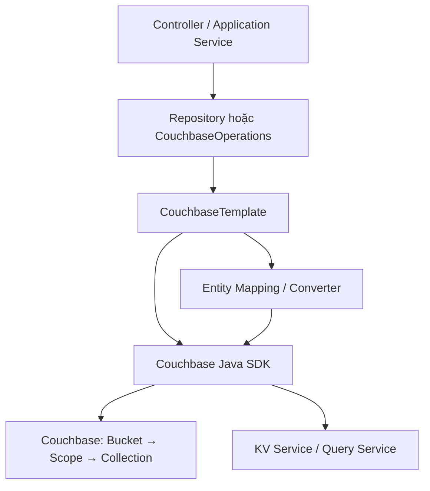

# CouchbaseTemplate và giao diện CouchbaseOperations

## Mục tiêu học tập

Sau bài này, bạn có thể:

1. Giải thích vai trò của `CouchbaseOperations` và `CouchbaseTemplate` trong tầng truy cập dữ liệu Spring Data Couchbase.
2. Chọn thao tác key-value (KV) theo document ID hay truy vấn SQL++ theo điều kiện; phân biệt `insert`, `upsert`, `replace` và `save`.
3. Viết lớp service dùng fluent API để thao tác document và nhận biết cách ánh xạ entity, scope, collection.
4. Quyết định khi nào cần chỉ mục, scan consistency, CAS/`@Version`, TTL, durability và API reactive.

> **Bối cảnh:** Trong module `SPRING_DATA_COUCHBASE`, tầng truy cập dữ liệu cần phối hợp document mapping, repository, `CouchbaseTemplate` và SQL++; đồng thời hiểu thiết kế bucket/scope/collection, chỉ mục, TTL, CAS, giao dịch và mô hình reactive để bảo đảm hiệu năng, tính nhất quán và vận hành. Chương **Template** tập trung vào quyền kiểm soát thao tác dữ liệu ở mức thấp hơn repository.

## 1. Vì sao cần Template khi đã có Repository?

`CouchbaseRepository<OrderDocument, String>` phù hợp khi thao tác CRUD đơn giản hoặc truy vấn có thể biểu diễn rõ bằng tên phương thức. Tuy nhiên, đôi lúc bạn cần chủ động chọn durability, TTL, scope/collection, loại lệnh KV, điều kiện truy vấn động hoặc cập nhật một phần document.

Spring Data Couchbase cung cấp hai thành phần liên quan:

- **`CouchbaseOperations`**: giao diện trừu tượng hóa những thao tác truy cập Couchbase trong ứng dụng đồng bộ (*imperative*). Service nên phụ thuộc vào giao diện này để dễ thay thế hoặc kiểm thử.
- **`CouchbaseTemplate`**: lớp triển khai `CouchbaseOperations`; chuyển đổi giữa Java entity và JSON document, điều phối thao tác với Couchbase SDK, đồng thời làm nền tảng cho repository.
- **`ReactiveCouchbaseOperations` / `ReactiveCouchbaseTemplate`**: biến thể reactive dùng `Mono` và `Flux`, dành cho luồng xử lý bất đồng bộ, không chặn.

`CouchbaseTemplate` không phải một bucket, một collection hoặc một bảng SQL. Nó là một lớp truy cập dữ liệu ở phía ứng dụng và được Spring quản lý như bean.



| Nhu cầu | Công cụ nên cân nhắc | Lý do |
| --- | --- | --- |
| CRUD phổ biến, query cố định, phân trang theo quy ước | `CouchbaseRepository` | Ít mã lặp, thể hiện rõ ngữ nghĩa dữ liệu |
| Đọc/ghi theo ID, tùy chỉnh expiry và durability | `CouchbaseOperations` | Fluent API cho từng thao tác |
| Điều kiện lọc động bằng Spring Query API | `CouchbaseOperations.findByQuery` | Tự tạo `Query`/`QueryCriteria` trong service |
| Truy vấn SQL++ hoặc tính năng SDK đặc thù vượt ngoài Template | Couchbase Java SDK | Điều khiển chi tiết hơn, cần tự quản lý mapping và option tương ứng |
| Luồng I/O không chặn theo Reactor | `ReactiveCouchbaseOperations` | Trả về publisher và phối hợp với WebFlux/reactive pipeline |

## 2. Chuẩn bị kết nối và cấu trúc dữ liệu

Ví dụ xuyên suốt là service xử lý đơn hàng của cửa hàng trực tuyến:

- Bucket: `appdata`.
- Scope: `commerce`.
- Collection: `orders`.
- Document ID: `order::1001`, `order::1002`, ...
- Trường JSON: `customerId`, `status`, `totalVnd`.

Với Spring Boot, ứng dụng cần dependency `spring-boot-starter-data-couchbase` và cấu hình kết nối tương ứng. Ví dụ cấu hình cho một môi trường thử nghiệm:

```yaml
spring:
  couchbase:
    connection-string: couchbase://localhost
    username: app_user
    password: ${COUCHBASE_PASSWORD}
  data:
    couchbase:
      bucket-name: appdata
```

Mật khẩu lấy từ biến môi trường; user `app_user` phải có quyền phù hợp trên bucket/collection. Trước khi chạy ví dụ, tạo sẵn bucket `appdata` và các đối tượng sau qua Couchbase Query Workbench hoặc công cụ quản trị phù hợp:

```sql
CREATE SCOPE `appdata`.`commerce`;
CREATE COLLECTION `appdata`.`commerce`.`orders`;

-- Chỉ mục phục vụ truy vấn theo customerId và status ở phần sau.
CREATE INDEX `idx_orders_customer_status`
ON `appdata`.`commerce`.`orders`(customerId, status);
```

Các câu lệnh tạo scope/collection chỉ chạy một lần khi chuẩn bị môi trường; không đặt chúng vào luồng xử lý yêu cầu HTTP. Nếu đối tượng đã tồn tại, bỏ qua bước tạo tương ứng.

### Ánh xạ entity sang document

```java
import org.springframework.data.annotation.Id;
import org.springframework.data.annotation.Version;
import org.springframework.data.couchbase.core.mapping.Collection;
import org.springframework.data.couchbase.core.mapping.Document;
import org.springframework.data.couchbase.core.mapping.Field;
import org.springframework.data.couchbase.core.mapping.Scope;

@Document
@Scope("commerce")
@Collection("orders")
public class OrderDocument {

    @Id
    private String id;

    @Field
    private String customerId;

    @Field
    private String status;

    @Field
    private long totalVnd;

    @Version
    private Long version;

    public OrderDocument() {
    }

    public OrderDocument(
            String id, String customerId, String status, long totalVnd) {
        this.id = id;
        this.customerId = customerId;
        this.status = status;
        this.totalVnd = totalVnd;
    }

    public String getId() { return id; }
    public void setId(String id) { this.id = id; }

    public String getCustomerId() { return customerId; }
    public void setCustomerId(String customerId) {
        this.customerId = customerId;
    }

    public String getStatus() { return status; }
    public void setStatus(String status) { this.status = status; }

    public long getTotalVnd() { return totalVnd; }
    public void setTotalVnd(long totalVnd) { this.totalVnd = totalVnd; }

    public Long getVersion() { return version; }
    public void setVersion(Long version) { this.version = version; }
}
```

Ý nghĩa các annotation:

- `@Document` đánh dấu lớp có thể ánh xạ thành document JSON.
- `@Scope` và `@Collection` chọn vị trí lưu document trong bucket đang cấu hình.
- `@Id` xác định document key do Couchbase quản lý ở metadata; ID không đơn thuần là cột JSON.
- `@Field` xác định thuộc tính cần ánh xạ; có thể đổi tên trường JSON bằng `@Field("ten_khac")`.
- `@Version` giữ **CAS** (compare-and-swap) của document để hỗ trợ optimistic locking. Giá trị này không phải bộ đếm phiên bản tự tăng do ứng dụng quản lý và không được tự sửa.

> **Chú ý về kiểu dữ liệu:** Dùng kiểu số nguyên nhỏ nhất phù hợp hoặc `BigDecimal`/biểu diễn số tiền đã thống nhất trong hệ thống. Ví dụ `totalVnd` dùng `long` vì đơn vị lưu là VND nguyên và chỉ nhằm minh họa Template.

## 3. Fluent API: chọn kiểu thao tác trước khi thực thi

Khác với cách gọi một phương thức `save` cho mọi tình huống, fluent API thể hiện chuỗi quyết định:

```text
operations
  .<operation>(EntityClass.class)
  .inScope("...")         // nếu muốn ghi đè scope đã cấu hình
  .inCollection("...")    // nếu muốn ghi đè collection đã cấu hình
  .with...(...)           // tùy chọn được hỗ trợ bởi operation đó
  .one(...) / .all()      // thực thi
```

Một số thao tác thường gặp:

| Fluent API | Ngữ nghĩa | Dịch vụ Couchbase |
| --- | --- | --- |
| `findById(T.class).one(id)` | Lấy document theo ID | KV |
| `existsById(T.class).one(id)` | Kiểm tra ID có tồn tại | KV |
| `insertById(T.class).one(entity)` | Chỉ tạo document mới; lỗi nếu ID đã có | KV |
| `upsertById(T.class).one(entity)` | Tạo mới hoặc ghi đè document cùng ID | KV |
| `replaceById(T.class).one(entity)` | Thay document hiện có; lỗi nếu ID không tồn tại | KV |
| `removeById(T.class).one(id)` | Xóa theo ID | KV |
| `findByQuery(T.class).matching(query).all()` | Lọc tập document theo điều kiện | Query Service (SQL++) |
| `mutateInById(T.class)...one(entity)` | Sửa các đường dẫn JSON được chọn | KV / sub-document |

**Hai phân biệt dễ nhầm:**

1. `insert` và `upsert` khác nhau về điều kiện tồn tại: nếu tạo đơn hàng mới mà vô tình trùng ID, `insert` giúp phát hiện lỗi, trong khi `upsert` có thể ghi đè.
2. `save(entity)` là phương thức thuận tiện có hành vi phụ thuộc trạng thái `@Version` và ngữ cảnh giao dịch: với entity có `@Version` chưa có CAS, nó thường thực hiện `insert`; với CAS đã có, nó thực hiện `replace` để kiểm soát cạnh tranh; với entity không có version ngoài giao dịch, thường là `upsert`. Vì vậy, khi cần bảo đảm không ghi đè ID, hãy chọn `insertById` tường minh.

## 4. Xây dựng lớp service với CouchbaseOperations

Sử dụng constructor injection để phụ thuộc vào giao diện. Ví dụ sau dùng entity ở phần 2:

```java
import java.util.List;
import java.util.NoSuchElementException;

import org.springframework.data.couchbase.core.CouchbaseOperations;
import org.springframework.data.couchbase.core.query.Query;
import org.springframework.data.couchbase.core.query.QueryCriteria;
import org.springframework.stereotype.Service;

@Service
public class OrderDocumentService {

    private final CouchbaseOperations operations;

    public OrderDocumentService(CouchbaseOperations operations) {
        this.operations = operations;
    }

    // Insert bảo đảm không âm thầm ghi đè đơn hàng đã tồn tại.
    public OrderDocument create(OrderDocument order) {
        return operations.insertById(OrderDocument.class).one(order);
    }

    // Truy cập KV bằng ID, không đòi hỏi chỉ mục SQL++.
    public OrderDocument findById(String id) {
        return operations.findById(OrderDocument.class).one(id);
    }

    // @Version lấy CAS từ lần đọc; save dùng CAS để ngăn lost update.
    public OrderDocument changeStatus(String id, String newStatus) {
        OrderDocument current =
                operations.findById(OrderDocument.class).one(id);

        if (current == null) {
            throw new NoSuchElementException("Không tìm thấy đơn: " + id);
        }

        current.setStatus(newStatus);
        return operations.save(current);
    }

    // Cần chỉ mục thích hợp vì được thực hiện qua SQL++.
    public List<OrderDocument> findPaidByCustomer(String customerId) {
        Query query = Query.query(
                QueryCriteria.where("customerId").is(customerId)
                        .and("status").is("PAID"))
                .limit(50);

        return operations.findByQuery(OrderDocument.class)
                .matching(query)
                .all();
    }

    public void deleteById(String id) {
        operations.removeById(OrderDocument.class).one(id);
    }
}
```

Ví dụ gọi service:

```java
OrderDocument saved = service.create(
        new OrderDocument("order::1001", "customer::42", "NEW", 350_000L));

OrderDocument loaded = service.findById(saved.getId());
OrderDocument paid = service.changeStatus(saved.getId(), "PAID");
List<OrderDocument> orders = service.findPaidByCustomer("customer::42");
```

Để đọc và xác nhận tình trạng thực tế sau mỗi lệnh, cần có Couchbase Server đang hoạt động, bucket/collection được cấp quyền, và chỉ mục ở phần 2 đã `ONLINE`. Tùy tình huống, `findById` có thể không tìm thấy document: đừng giả định luôn nhận được entity hợp lệ. Với nghiệp vụ yêu cầu tồn tại, chuyển thành `404` hoặc ngoại lệ ứng dụng phù hợp ở ranh giới API.

### Chọn scope và collection theo thao tác

Khi cần truy cập một collection khác với annotation hoặc cấu hình, có thể chỉ rõ bằng fluent API:

```java
OrderDocument archived = operations
        .findById(OrderDocument.class)
        .inScope("archive")
        .inCollection("orders")
        .one("order::1001");
```

Ví dụ này **chỉ có thể chạy** khi scope `archive` và collection `orders` thực sự tồn tại, có quyền đọc và chứa document tương ứng. Trong ứng dụng đa tenant, phải kiểm soát tập scope/collection được phép chọn, tránh để dữ liệu đầu vào HTTP chỉ định tùy ý vị trí lưu.

Thứ tự ưu tiên khai báo vị trí nhìn chung là: tùy chọn `inScope()/inCollection()` trên từng fluent operation, sau đó đến cấu hình/annotation thích hợp ở cấp repository, entity và cấu hình chung. Kiểm tra quy tắc ưu tiên của phiên bản Spring Data đang dùng khi phối hợp nhiều nguồn cấu hình.

## 5. KV và SQL++ khác nhau như thế nào?

Một lệnh `findById` truy cập trực tiếp document bằng key trong đúng collection. Nó thường có độ trễ thấp và **không cần secondary index**. Ngược lại, `findByQuery` truy vấn nhiều document qua Query Service, thường được biên dịch thành SQL++ (trước đây gọi là N1QL), nên phải thiết kế chỉ mục phù hợp với điều kiện lọc và sắp xếp.

Ví dụ SQL++ tương đương về ý tưởng với truy vấn `findPaidByCustomer` (bỏ qua các điều kiện metadata Spring Data có thể tự thêm):

```sql
SELECT o.*
FROM `appdata`.`commerce`.`orders` AS o
WHERE o.customerId = "customer::42"
  AND o.status = "PAID"
LIMIT 50;
```

Những khác biệt cần nhớ:

- Truy vấn `QueryCriteria` hoạt động trên tên thuộc tính theo cơ chế mapping của Spring Data; tránh tự nối giá trị người dùng vào câu SQL++.
- Với truy vấn do Spring Data tạo, điều kiện phân biệt loại entity (ví dụ trường metadata kiểu `_class`) có thể được thêm vào. Phải xem câu query thực tế và dùng `EXPLAIN` để bảo đảm chỉ mục phù hợp.
- Chỉ mục vừa khai báo trên `(customerId, status)` là ví dụ khởi đầu, không bảo đảm tối ưu cho mọi truy vấn. Nếu lọc, sắp xếp và tập document thay đổi, cần đo latency và xem query plan.
- Sự thay đổi document qua KV có thể chưa lập tức xuất hiện trong kết quả SQL++ do cập nhật chỉ mục có độ trễ. Điều này khác với việc đọc trực tiếp chính document theo ID.

### Scan consistency

Nếu nghiệp vụ yêu cầu một truy vấn SQL++ thấy các ghi đã được lập chỉ mục tới thời điểm query bắt đầu, có thể yêu cầu mức nhất quán mạnh hơn cho scan:

```java
import com.couchbase.client.java.query.QueryScanConsistency;

List<OrderDocument> freshView = operations
        .findByQuery(OrderDocument.class)
        .consistentWith(QueryScanConsistency.REQUEST_PLUS)
        .matching(Query.query(
                QueryCriteria.where("customerId").is("customer::42")))
        .all();
```

`REQUEST_PLUS` yêu cầu Query Service đợi index bắt kịp các mutation liên quan trước khi thực thi; có thể tăng latency và không thay thế transaction hay một ảnh chụp nhất quán cho toàn bộ chuỗi thao tác nghiệp vụ. Nếu chỉ cần ID cụ thể, đọc bằng KV thường đơn giản và phù hợp hơn.

## 6. Điều khiển ghi: CAS, durability, TTL

### 6.1. CAS và chống ghi đè mất cập nhật

Giả sử hai tác vụ cùng đọc đơn hàng phiên bản A:

1. Tác vụ 1 đọc document có CAS A.
2. Tác vụ 2 cũng đọc document có CAS A.
3. Tác vụ 1 thay `status` và `save` thành công; CAS chuyển thành B.
4. Tác vụ 2 cố `save` entity giữ CAS A; Couchbase phát hiện CAS cũ và Spring Data có thể ném `OptimisticLockingFailureException`.

`@Version` giúp tránh tình huống cập nhật sau âm thầm xóa thay đổi trước đó trong luồng đọc–sửa–ghi của entity. Cách xử lý xung đột nên là trả thông báo phù hợp hoặc đọc lại dữ liệu mới, tính toán lại nghiệp vụ rồi retry **toàn bộ** chuỗi thao tác với số lần giới hạn. Không nên chỉ retry lệnh ghi với trạng thái cũ.

Lưu ý: một lệnh `upsertById` không tự mang ý nghĩa “chỉ cập nhật nếu CAS không đổi”. Hãy chọn `save`/`replace` và kiểm soát version/CAS đúng với API sử dụng; với sub-document có thể cần tùy chọn CAS rõ ràng.

### 6.2. Durability: chờ độ bền ghi cao hơn khi cần

```java
import com.couchbase.client.core.msg.kv.DurabilityLevel;

OrderDocument durableOrder = operations
        .insertById(OrderDocument.class)
        .withDurability(DurabilityLevel.MAJORITY)
        .one(new OrderDocument(
                "order::1002", "customer::42", "NEW", 199_000L));
```

`MAJORITY` yêu cầu phần lớn node Data Service xác nhận ghi theo mức độ bền của Couchbase. Tăng durability có thể tăng thời gian ghi; lựa chọn này cần bám vào yêu cầu kinh doanh, topology cluster và khả năng chịu lỗi. Có thể đặt giá trị mặc định trên annotation `@Document` hoặc chỉ ghi đè cho thao tác quan trọng.

### 6.3. TTL: thời gian sống của document

TTL phù hợp với session tạm, token, dữ liệu cache có hạn dùng, nhưng thường **không** nên áp dụng tùy tiện cho đơn hàng hoặc chứng từ cần lưu giữ.

Có thể đặt TTL ngay tại entity dành cho dữ liệu tạm:

```java
@Document(expiry = 1800)  // 1.800 giây = 30 phút
public class TemporaryDocument {
    @Id
    private String id;
    // Các trường còn lại...
}
```

Hoặc điều khiển hạn dùng khi ghi bằng fluent API cho loại entity thích hợp:

```java
operations.insertById(TemporaryDocument.class)
        .withExpiry(java.time.Duration.ofMinutes(30))
        .one(temporaryDocument);
```

Trên đây là hai cách thay thế để minh họa: `TemporaryDocument` và biến `temporaryDocument` cần được định nghĩa trong ứng dụng. Khi kết hợp TTL ở annotation, tùy chọn trên fluent operation và cấu hình mặc định bucket, hãy kiểm tra quy tắc ưu tiên thực tế, hành vi refresh expiry và chính sách lưu giữ dữ liệu.

## 7. Sub-document và giao dịch: khi nào cần thêm cơ chế?

Nếu chỉ cập nhật một vài trường của document JSON lớn, `mutateInById` có thể giảm dữ liệu truyền qua mạng và xử lý các thay đổi trong cùng một document một cách nguyên tử:

```java
OrderDocument partial = new OrderDocument();
partial.setId("order::1001");
partial.setStatus("SHIPPED");

operations.mutateInById(OrderDocument.class)
        .withUpsertPaths("status")
        .one(partial);
```

Lệnh trên dùng đúng đường dẫn JSON `status`. Nó không có nghĩa mọi rule nghiệp vụ đều được bảo vệ; khi các tác vụ cùng sửa document, cần đánh giá sử dụng CAS với sub-document hoặc đưa kiểm tra vào quy trình phù hợp. Không nhầm tính nguyên tử của **một lệnh sub-document** với tính nguyên tử của **nhiều document**.

Ví dụ chuyển tiền qua hai ví hoặc cập nhật đơn hàng cùng tồn kho có thể cần Couchbase Transactions. Hai lệnh gọi Template liên tiếp mặc định **không** tạo thành một giao dịch nhiều document. Khi dùng transaction, phải theo API và yêu cầu cấu hình giao dịch của phiên bản Spring Data Couchbase/Couchbase Server đã triển khai, đồng thời xử lý retry và kết quả commit không chắc chắn theo khuyến nghị của SDK.

## 8. ReactiveCouchbaseTemplate: cùng ý tưởng, khác mô hình thực thi

Ở ứng dụng Reactor/WebFlux, `ReactiveCouchbaseOperations` cho phép ghép các thao tác không chặn:

```java
import org.springframework.data.couchbase.core.ReactiveCouchbaseOperations;
import reactor.core.publisher.Mono;

public class ReactiveOrderReader {
    private final ReactiveCouchbaseOperations operations;

    public ReactiveOrderReader(ReactiveCouchbaseOperations operations) {
        this.operations = operations;
    }

    public Mono<OrderDocument> find(String id) {
        return operations.findById(OrderDocument.class).one(id);
    }
}
```

Với reactive API, việc gọi phương thức trả về `Mono` chỉ xây dựng pipeline; thao tác xảy ra khi có subscriber. Tránh gọi `block()` trong luồng xử lý non-blocking. Đồng thời, không tự giả định hai lần subscribe sẽ dùng lại một kết quả I/O nếu pipeline chưa có cơ chế chia sẻ hoặc cache phù hợp.

Không nên chọn reactive chỉ vì kỳ vọng mọi truy vấn nhanh hơn. Lợi ích chủ yếu là khả năng xử lý nhiều tác vụ I/O đồng thời với ít thread bị chặn; cần cân nhắc toàn bộ kiến trúc ứng dụng, tài nguyên và công cụ quan sát vận hành.

## 9. Lỗi phổ biến và cách chẩn đoán

| Hiện tượng | Nguyên nhân cần kiểm tra | Cách xử lý |
| --- | --- | --- |
| `findById` không tìm thấy nhưng JSON có trong Couchbase | Sai ID, bucket, scope, collection hoặc quyền | In ra context được chọn, kiểm tra key đúng byte và quyền truy cập |
| `findByQuery` báo thiếu index hoặc chậm | Thiếu secondary index, index chưa `ONLINE`, query plan quét rộng | Tạo/điều chỉnh index theo WHERE/ORDER BY; chạy `EXPLAIN` |
| Vừa ghi KV nhưng SQL++ chưa thấy dữ liệu | Index cập nhật bất đồng bộ | Chọn `REQUEST_PLUS` cho truy vấn yêu cầu; cân nhắc KV khi biết ID |
| Ghi bị `OptimisticLockingFailureException` | CAS đã đổi vì thao tác song song | Đọc lại, áp dụng lại thay đổi hợp lệ, retry có giới hạn |
| Tạo ID trùng làm mất dữ liệu | Dùng `upsert` khi yêu cầu tạo mới | Dùng `insertById` và xử lý lỗi ID đã tồn tại |
| Document tự biến mất | TTL ở entity, operation hoặc bucket | Kiểm tra expiry policy và thời điểm mutation |
| Ghi tăng độ trễ | Durability cao, mạng, cluster hoặc index/workload quá tải | Đo p95/p99, xác định mức durability cần thiết, theo dõi node |
| Service sử dụng `CouchbaseTemplate` khó thay bằng mock | Phụ thuộc trực tiếp vào lớp triển khai | Inject `CouchbaseOperations`, thử qua test tích hợp khi cần hành vi thực tế |

**Checklist vận hành:** Theo dõi độ trễ KV và SQL++ riêng; số lỗi CAS/retry; thời gian chờ index; timeout và durability; các lệnh `EXPLAIN` của query quan trọng. Khi xử lý lỗi, ưu tiên sử dụng hệ phân cấp `DataAccessException` của Spring để phân loại lỗi nghiệp vụ so với lỗi kết nối tạm thời. Tránh log mật khẩu hoặc toàn bộ payload chứa dữ liệu nhạy cảm.

## 10. Bài thực hành đề xuất

Trong một dự án Spring Boot đã kết nối Couchbase, hãy thực hiện lần lượt:

1. Tạo `appdata.commerce.orders` và index trên `customerId`, `status`. Xác nhận index `ONLINE`.
2. Dùng `insertById` tạo `order::1001`, sau đó thử tạo lại cùng ID. Ghi nhận khác biệt với `upsertById`.
3. Dùng `findById` lấy đơn, cập nhật trạng thái bằng `save`, rồi lọc đơn `PAID` bằng `findByQuery`.
4. Chạy hai tác vụ đọc cùng document trước khi cùng ghi; ghi nhận việc `@Version` ngăn lost update bằng lỗi xung đột CAS.
5. So sánh query scan consistency mặc định và `REQUEST_PLUS` trong bài kiểm thử vừa ghi KV xong thì tìm bằng SQL++, đồng thời đo độ trễ và quan sát query plan.
6. Tạo loại document tạm có TTL ngắn để quan sát expiry. Chỉ dùng dữ liệu thử nghiệm.

**Tiêu chí tự kiểm tra:** Giải thích được vì sao đọc theo ID không cần index, khi nào `insert` an toàn hơn `upsert`, tại sao `@Version` không phải version counter tự tăng, và vì sao hai lệnh Template liên tiếp không tự trở thành transaction.

## Tài liệu chính thức để tra cứu thêm

- [Spring Data Couchbase — Template & direct operations](https://docs.spring.io/spring-data/couchbase/reference/couchbase/template.html).
- [Spring Data Couchbase — Collection Support](https://docs.spring.io/spring-data/couchbase/reference/couchbase/collections.html).
- [Spring Data Couchbase — Modeling Entities](https://docs.spring.io/spring-data/couchbase/reference/couchbase/entity.html).
- [Javadoc — CouchbaseOperations](https://docs.spring.io/spring-data/couchbase/reference/api/java/org/springframework/data/couchbase/core/CouchbaseOperations.html).
- [Javadoc — QueryCriteria](https://docs.spring.io/spring-data/couchbase/reference/api/java/org/springframework/data/couchbase/core/query/QueryCriteria.html).

> Các đoạn mã sử dụng phong cách fluent API của Spring Data Couchbase hiện đại. Khi tích hợp vào dự án, đối chiếu Javadoc đúng phiên bản dependency đang khóa, tên bucket/scope/collection và quyền Couchbase thực tế.
