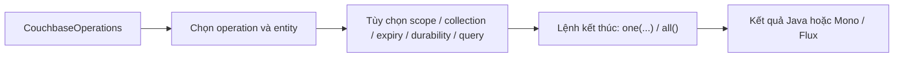

# API fluent: chọn thao tác, entity, tùy chọn và cách lấy kết quả

## Mục tiêu học tập

Sau bài này, bạn có thể:

1. Đọc và tự xây dựng chuỗi gọi **fluent API** của `CouchbaseOperations`: chọn thao tác → chọn loại entity → cấu hình tùy chọn → thực thi và lấy kết quả.
2. Chọn đúng giữa thao tác key-value (KV) và truy vấn SQL++, giữa `insert`, `upsert`, `replace`, `save`, `find` và `remove` theo ngữ nghĩa nghiệp vụ.
3. Xác định document ID, bucket/scope/collection, các tùy chọn TTL, durability và scan consistency mà không nhầm chúng với dữ liệu trong entity.
4. Hiểu sự khác nhau giữa `one(…)`, `all()` và kiểu kết quả imperative/reactive; xử lý trường hợp không tìm thấy, nhiều kết quả, xung đột ghi.
5. Tổ chức code service dễ đọc, biết điểm đặt logging, index và kiểm thử để tránh lỗi hiệu năng hay nhất quán.

**Ngữ cảnh module.** Trong `SPRING_DATA_COUCHBASE`, Spring Data đảm nhiệm document mapping, repository, `CouchbaseTemplate` và SQL++. Bài thuộc chương **Template** đi sâu vào cách sử dụng các thao tác fluently khi thiết kế tầng truy cập Couchbase với bucket/scope/collection, chỉ mục, TTL, CAS, giao dịch và lựa chọn API reactive. Nội dung giả định bạn đã có ứng dụng Spring Boot kết nối được Couchbase và hiểu khái niệm document ID.

## 1. Fluent API là gì và giải quyết vấn đề gì?

*Fluent API* là kiểu thiết kế cho phép gọi các bước cấu hình liên tiếp thành một biểu thức, thay vì truyền mọi tham số vào một phương thức dài. Với Spring Data Couchbase, một chuỗi gọi thường có hình dạng:

```java
CartDocument cart = operations
        .findById(CartDocument.class)  // 1. Chọn thao tác và entity
        .inScope("commerce")           // 2. Chọn scope nếu cần ghi đè
        .inCollection("carts")         // 3. Chọn collection nếu cần ghi đè
        .one("cart::1001");            // 4. Thực thi bằng ID, nhận kết quả
```

Trong ví dụ này:

- `operations` là bean có kiểu `CouchbaseOperations`; `CouchbaseTemplate` là triển khai thường được Spring cung cấp.
- `findById(CartDocument.class)` chỉ định **đọc document theo key**, đồng thời cho Spring biết cần map JSON về kiểu `CartDocument` nào.
- `inScope("commerce")` và `inCollection("carts")` là **tùy chọn cho thao tác hiện tại**; chỉ có ý nghĩa khi bộ phận quản trị dữ liệu đã tạo đúng scope/collection.
- `one("cart::1001")` là **terminal operation**: lệnh truy cập dữ liệu được thực hiện và kết quả trả về. Nếu không tồn tại document, thao tác tìm theo ID có thể trả `null` ở imperative API.

Đọc một chuỗi fluent bằng cách trả lời bốn câu hỏi: **Làm gì?** → **Với loại document nào?** → **Ở đâu và theo chính sách nào?** → **Lấy một hay nhiều kết quả?**



> **Nguyên tắc:** Chuỗi fluent không phải một DSL tự do. Mỗi loại thao tác chỉ hỗ trợ tập tùy chọn và terminal phù hợp với nó. Ví dụ, `withExpiry` dành cho những thao tác ghi có hỗ trợ expiry; `matching(Query)` dành cho truy vấn; không thể tùy ý ghép mọi method trong bảng API.

## 2. Bước 1 — chọn thao tác theo yêu cầu nghiệp vụ

Cùng là “ghi document”, nhưng ngữ nghĩa khác nhau quan trọng hơn số dòng code:

| Mục tiêu | Lệnh fluent phổ biến | Ý nghĩa chính | Cần secondary index? |
| --- | --- | --- | --- |
| Đọc theo ID | `findById(T.class).one(id)` | Lấy đúng document key | Không |
| Kiểm tra tồn tại theo ID | `existsById(T.class).one(id)` | Biết có key trong collection | Không |
| Tạo mới và phát hiện ID trùng | `insertById(T.class).one(entity)` | Lỗi nếu ID đã tồn tại | Không |
| Ghi với ngữ nghĩa tạo mới **hoặc** thay thế | `upsertById(T.class).one(entity)` | Có thể ghi đè document cùng ID | Không |
| Chỉ thay thế document đang tồn tại | `replaceById(T.class).one(entity)` | Lỗi nếu document không tồn tại | Không |
| Xóa theo ID | `removeById(T.class).one(id)` | Xóa key được chỉ định | Không |
| Tìm theo các thuộc tính | `findByQuery(T.class).matching(query).all()` | Query Service chạy SQL++ | Thường cần |
| Lưu entity theo trạng thái mapping | `save(entity)` | Convenience method, hành vi phụ thuộc version và ngữ cảnh | Không với thao tác theo ID |

Chẳng hạn, dịch vụ tạo giỏ hàng mới nên dùng `insert` để từ chối ID trùng. Dịch vụ đồng bộ dữ liệu được phép ghi đè có thể dùng `upsert`. Khi cần sửa một document mà không muốn vô tình tạo mới, cân nhắc `replace` và cơ chế kiểm soát CAS.

### Khác biệt quan trọng giữa KV và SQL++

Couchbase có nhiều dịch vụ truy cập dữ liệu. Với key chính xác, thao tác KV đến trực tiếp document trong collection. Với bộ lọc như “mọi giỏ hàng đang mở của khách A”, cần một truy vấn SQL++:

```java
Query query = Query.query(
        QueryCriteria.where("customerId").is("customer::42")
                .and("state").is("OPEN"));

List<CartDocument> carts = operations
        .findByQuery(CartDocument.class)
        .matching(query)
        .all();
```

Đường truy vấn SQL++ có chi phí lập kế hoạch, thực thi và index khác KV. Không biến bài toán “đã biết ID” thành truy vấn để lấy một document nếu không cần điều kiện bổ sung.

## 3. Bước 2 — chọn entity và hiểu đối tượng nào được ánh xạ

Các lời gọi dạng `findById(CartDocument.class)` và `findByQuery(CartDocument.class)` yêu cầu một `Class<T>`, giúp Spring Data biết:

- JSON được ánh xạ vào những thuộc tính Java nào.
- Document ID ở trường nào.
- Scope/collection mặc định của entity là gì, nếu có khai báo.
- Có dùng `@Version` để theo dõi CAS và optimistic locking hay không.
- Kết quả mà caller mong đợi có kiểu dữ liệu nào.

Ví dụ entity minh họa:

```java
import org.springframework.data.annotation.Id;
import org.springframework.data.annotation.Version;
import org.springframework.data.couchbase.core.mapping.Collection;
import org.springframework.data.couchbase.core.mapping.Document;
import org.springframework.data.couchbase.core.mapping.Field;
import org.springframework.data.couchbase.core.mapping.Scope;

@Document
@Scope("commerce")
@Collection("carts")
public class CartDocument {

    @Id
    private String id;

    @Field
    private String customerId;

    @Field
    private String state;

    @Field
    private long totalVnd;

    @Version
    private Long version;

    public CartDocument() {}

    public CartDocument(
            String id, String customerId, String state, long totalVnd) {
        this.id = id;
        this.customerId = customerId;
        this.state = state;
        this.totalVnd = totalVnd;
    }

    public String getId() { return id; }
    public void setId(String id) { this.id = id; }

    public String getCustomerId() { return customerId; }
    public void setCustomerId(String customerId) {
        this.customerId = customerId;
    }

    public String getState() { return state; }
    public void setState(String state) { this.state = state; }

    public long getTotalVnd() { return totalVnd; }
    public void setTotalVnd(long totalVnd) { this.totalVnd = totalVnd; }

    public Long getVersion() { return version; }
    public void setVersion(Long version) { this.version = version; }
}
```

Giả sử ứng dụng cấu hình bucket `appdata`, entity này mặc định trỏ đến `appdata.commerce.carts`. `@Id` ánh xạ document key; `@Field` ánh xạ thuộc tính JSON; `@Version` nắm giá trị **CAS** của Couchbase để phát hiện ghi đồng thời. CAS không phải số đếm phiên bản tăng dần do lập trình viên tự chỉnh.

**Phân biệt type với instance:**

```java
// Đọc: chọn type khi khởi tạo thao tác, cung cấp ID lúc thực thi.
CartDocument loaded = operations
        .findById(CartDocument.class)
        .one("cart::1001");

// Tạo: chọn type, cung cấp toàn bộ entity khi thực thi.
CartDocument created = operations
        .insertById(CartDocument.class)
        .one(new CartDocument(
                "cart::1002", "customer::42", "OPEN", 250_000L));
```

Không truyền `CartDocument.class` vào `one(…)`, vì `one(…)` ở các thao tác trên lần lượt cần **document ID** hoặc **entity instance**. Tùy nhánh fluent, Java compiler giúp phát hiện gọi sai kiểu; nhưng compiler không thể biết ID đã tồn tại trong Couchbase.

### Nếu đặt `@Field("...")` hoặc chọn collection khác

Tên property trong Java có thể khác tên trường JSON. Với truy vấn thủ công, phải chú ý cách Spring Data xử lý ánh xạ tên trường và kiểm tra câu SQL++ thực tế, nhất là khi có nested field hoặc alias. Bucket, scope, collection là không gian chứa document; chúng không phải thuộc tính JSON thông thường.

Bạn có thể ghi đè vị trí collection ở **một** thao tác bằng `inScope` và `inCollection`. Không nên để client tự truyền chuỗi tên scope/collection chưa được kiểm soát: đó là quyết định phân vùng dữ liệu và quyền truy cập.

## 4. Bước 3 — ghép các tùy chọn theo từng operation

Fluent API giữ rõ thao tác chính, rồi mới bổ sung cấu hình nếu nghiệp vụ thực sự cần. Các tùy chọn được thể hiện trên nhánh builder cụ thể, không phải tham số toàn cục áp dụng cho tất cả truy vấn.

### 4.1. Chọn scope và collection

```java
CartDocument cart = operations
        .findById(CartDocument.class)
        .inScope("commerce")
        .inCollection("carts")
        .one("cart::1001");
```

Giá trị ghi đè này chỉ áp dụng với lệnh đang chạy. Khi entity đã có `@Scope("commerce")`, `@Collection("carts")` như ví dụ, thông thường có thể bỏ hai lời gọi để code gọn hơn. Các scope/collection phải tồn tại và account phải được cấp quyền phù hợp.

### 4.2. TTL: document tồn tại trong bao lâu?

Với giỏ hàng tạm, có thể yêu cầu expiry khi tạo:

```java
import java.time.Duration;

CartDocument shortLivedCart = operations
        .insertById(CartDocument.class)
        .withExpiry(Duration.ofHours(2))
        .one(new CartDocument(
                "cart::temp-19", "customer::42", "OPEN", 250_000L));
```

TTL là chính sách hết hạn của document, không phải field `expiresAt` do ví dụ tự ghi trong JSON. Nếu có thiết lập expiry trên `@Document` hoặc bucket, cần xác định quy tắc ưu tiên và cách expiry được xử lý khi update. Không áp dụng TTL cho hồ sơ cần lưu trữ lâu dài mà chưa có yêu cầu vòng đời dữ liệu rõ ràng.

### 4.3. Durability: mức xác nhận của thao tác ghi

```java
import com.couchbase.client.core.msg.kv.DurabilityLevel;

CartDocument durable = operations
        .insertById(CartDocument.class)
        .withDurability(DurabilityLevel.MAJORITY)
        .one(new CartDocument(
                "cart::1003", "customer::99", "OPEN", 149_000L));
```

`MAJORITY` có ý nghĩa về mức xác nhận durability của Couchbase cluster. Đây là chính sách ghi, không làm tăng độ chính xác của bộ lọc query. Durability cao hơn có thể tăng độ trễ; chỉ chọn mức phù hợp với yêu cầu nghiệp vụ và topology thực tế.

### 4.4. Điều kiện truy vấn, giới hạn và thứ tự

Để lấy nhiều document theo thuộc tính, tạo `Query` trước rồi đưa vào `matching(…)`:

```java
import org.springframework.data.couchbase.core.query.Query;
import org.springframework.data.couchbase.core.query.QueryCriteria;

Query query = Query.query(
        QueryCriteria.where("customerId").is("customer::42")
                .and("state").is("OPEN"))
        .limit(20);

List<CartDocument> result = operations
        .findByQuery(CartDocument.class)
        .matching(query)
        .all();
```

`limit(20)` giới hạn số document trả về, nhưng **không bảo đảm thứ tự**. Nếu cần phân trang ổn định, hãy thiết kế sort có tiêu chí phân biệt rõ các document, xem xét chiến lược phân trang và chỉ mục tương ứng. Không ghép trực tiếp chuỗi từ người dùng thành SQL++ để tránh lỗi cú pháp và injection.

Ví dụ chỉ mục thứ cấp cho truy vấn trên:

```sql
CREATE INDEX `idx_carts_customer_state`
ON `appdata`.`commerce`.`carts`(customerId, state);
```

Cần tạo bucket `appdata`, scope `commerce` và collection `carts` trước khi chạy. Đây là chỉ mục minh họa; hiệu quả phải được kiểm chứng bằng `EXPLAIN`/query plan, trạng thái index và dữ liệu thực. Một số truy vấn do Spring Data sinh còn chứa điều kiện metadata loại entity, nên cần quan sát SQL++ thực tế.

### 4.5. Query scan consistency: nhìn thấy dữ liệu mới ghi

Đọc KV bằng ID và đọc bằng SQL++ theo chỉ mục có đặc tính nhất quán khác nhau. Sau khi ghi KV thành công, SQL++ dùng secondary index có thể tạm thời chưa thấy thay đổi do index cập nhật bất đồng bộ. Khi nghiệp vụ cần Query Service chờ index bắt kịp mutation liên quan trước khi chạy, cân nhắc scan consistency như `REQUEST_PLUS` trên API truy vấn được phiên bản Spring Data hỗ trợ.

Mức `REQUEST_PLUS` thường làm tăng độ trễ và **không tự biến nhiều thao tác độc lập thành một giao dịch**. Trường hợp chỉ cần đúng một ID, nên đánh giá trước liệu một lệnh KV `findById` đã đáp ứng yêu cầu hay chưa.

## 5. Bước 4 — terminal operation và kiểu kết quả

Trong chuỗi fluent, lệnh cuối cùng chuyển từ **mô tả thao tác** sang **thực thi**. Đây là phần thường gây nhầm lẫn nhất vì cùng tên `one` nhưng đối số khác nhau.

| Chuỗi | Đầu vào ở terminal | Kết quả imperative kỳ vọng |
| --- | --- | --- |
| `findById(CartDocument.class).one(id)` | ID, ví dụ `"cart::1001"` | `CartDocument` hoặc `null` nếu không tìm thấy |
| `existsById(CartDocument.class).one(id)` | ID | Boolean tồn tại/không tồn tại |
| `insertById(CartDocument.class).one(cart)` | Entity có ID | Entity sau ghi hoặc exception |
| `upsertById(CartDocument.class).one(cart)` | Entity có ID | Entity sau ghi hoặc exception |
| `replaceById(CartDocument.class).one(cart)` | Entity có ID | Entity sau thay thế hoặc exception |
| `removeById(CartDocument.class).one(id)` | ID | Thực hiện xóa; xác nhận contract trả về theo phiên bản API |
| `findByQuery(CartDocument.class).matching(query).all()` | Query đã truyền ở `matching` | `List<CartDocument>`; có thể rỗng |

**Lưu ý:** Không phải nhánh nào cũng có `all()`. Một số nhánh truy vấn có những terminal khác như đếm hoặc lấy một bản ghi tùy phiên bản/thao tác. Hãy kiểm tra **kiểu trả về ở giao diện của operation** thay vì suy luận từ tên terminal. Đặc biệt, đừng cho rằng `one()` của truy vấn có cùng logic và đối số với `one(id)` của KV.

### Empty result khác exception

- Không tìm thấy một ID khi đọc: caller phải xử lý `null` ở imperative API hoặc `Mono.empty()` ở reactive API.
- Tìm nhiều document bằng query mà không có match: trả về danh sách rỗng (hoặc `Flux` không phát item), đó có thể là kết quả hợp lệ.
- `insert` với ID đã có, `replace` với ID không tồn tại, timeout, mất kết nối, thiếu quyền hay CAS không còn hợp lệ: đây là các tình huống lỗi cần xử lý riêng, không nên ép về “không có dữ liệu”.
- Khi một terminal yêu cầu duy nhất một kết quả truy vấn, phải xác định hành vi nếu thực tế có nhiều bản ghi; không dùng nó thay cho thiết kế điều kiện unique.

Hạn chế bắt `Exception` rộng rồi trả `null`, vì làm mất thông tin cần phân biệt lỗi nghiệp vụ với lỗi hạ tầng.

## 6. Ví dụ service hoàn chỉnh: mỗi method nói rõ một ngữ nghĩa

Mẫu sau đặt fluent call trong tầng truy cập dữ liệu. Entity `CartDocument` đã được khai báo ở phần 3; service nhận `CouchbaseOperations` qua constructor injection.

```java
import java.util.List;
import java.util.NoSuchElementException;
import java.util.Optional;

import org.springframework.data.couchbase.core.CouchbaseOperations;
import org.springframework.data.couchbase.core.query.Query;
import org.springframework.data.couchbase.core.query.QueryCriteria;
import org.springframework.stereotype.Service;

@Service
public class CartStore {

    private final CouchbaseOperations operations;

    public CartStore(CouchbaseOperations operations) {
        this.operations = operations;
    }

    // Tạo mới: ID trùng phải là lỗi, không âm thầm thay giỏ cũ.
    public CartDocument create(CartDocument cart) {
        return operations.insertById(CartDocument.class).one(cart);
    }

    // Đọc bằng KV theo ID, không chạy SQL++.
    public Optional<CartDocument> find(String id) {
        return Optional.ofNullable(
                operations.findById(CartDocument.class).one(id));
    }

    // Sử dụng @Version (CAS) để phát hiện update đồng thời.
    public CartDocument changeState(String id, String newState) {
        CartDocument cart = find(id)
                .orElseThrow(() -> new NoSuchElementException(
                        "Không tìm thấy giỏ hàng: " + id));

        cart.setState(newState);
        return operations.save(cart);
    }

    // Truy vấn theo thuộc tính, cần chỉ mục tương ứng.
    public List<CartDocument> findOpenByCustomer(String customerId) {
        Query query = Query.query(
                QueryCriteria.where("customerId").is(customerId)
                        .and("state").is("OPEN"))
                .limit(20);

        return operations.findByQuery(CartDocument.class)
                .matching(query)
                .all();
    }

    public boolean exists(String id) {
        return operations.existsById(CartDocument.class).one(id);
    }

    public void delete(String id) {
        operations.removeById(CartDocument.class).one(id);
    }
}
```

Luồng ứng dụng minh họa:

```java
CartDocument newCart = new CartDocument(
        "cart::1001", "customer::42", "OPEN", 500_000L);

CartDocument saved = cartStore.create(newCart);

Optional<CartDocument> found = cartStore.find(saved.getId());

CartDocument checkedOut = cartStore.changeState(
        saved.getId(), "CHECKED_OUT");

List<CartDocument> openCarts =
        cartStore.findOpenByCustomer("customer::42");
```

Trong đoạn trên, nếu truy cập `findOpenByCustomer` ngay sau khi thay trạng thái, query dựa trên index có thể chưa phản ánh mutation mới nhất. Nếu cần hợp đồng đọc-sau-ghi mạnh hơn, lựa chọn KV hoặc scan consistency nên được quyết định theo yêu cầu thực tế.

### Những điều service phải quyết định ngoài cú pháp fluent

- **ID:** chuẩn hóa quy tắc tạo key như `cart::1001`; tránh đặt những field dùng trong truy vấn quan trọng chỉ trong key nếu cần index JSON.
- **Tính hợp lệ:** kiểm tra trạng thái chuyển đổi nghiệp vụ trước khi ghi; bản thân `save` không biết `OPEN → CHECKED_OUT` có được cho phép hay không.
- **Cạnh tranh:** `@Version` lưu CAS từ lần đọc. Nếu dữ liệu đổi trước khi `save`, có thể xảy ra `OptimisticLockingFailureException`. Chỉ retry sau khi đọc lại và tính lại thay đổi.
- **Xóa:** xác định chính sách idempotency và cách báo “đã không tồn tại” theo hợp đồng ứng dụng.
- **Số lượng kết quả:** giữ `limit` hợp lý và dựa trên thiết kế index, đặc biệt khi phục vụ API public.

## 7. So sánh imperative và reactive ngay tại terminal

Spring Data Couchbase có hai họ API. Ý tưởng chọn operation và entity tương tự nhau, nhưng **cách nhận kết quả khác**.

| Imperative `CouchbaseOperations` | Reactive `ReactiveCouchbaseOperations` |
| --- | --- |
| `findById(T.class).one(id)` → entity hoặc `null` | `findById(T.class).one(id)` → `Mono<T>` |
| `findByQuery(T.class).matching(query).all()` → `List<T>` | `findByQuery(T.class).matching(query).all()` → `Flux<T>` |
| Method hoàn tất rồi trả giá trị / ném lỗi | Publisher phát item, tín hiệu hoàn tất hoặc lỗi khi được subscribe |
| Thích hợp xử lý synchronous thông thường | Thích hợp pipeline I/O không chặn, WebFlux và Reactor |

Ví dụ:

```java
import org.springframework.data.couchbase.core.ReactiveCouchbaseOperations;
import reactor.core.publisher.Flux;
import reactor.core.publisher.Mono;

public class ReactiveCartReader {

    private final ReactiveCouchbaseOperations operations;

    public ReactiveCartReader(ReactiveCouchbaseOperations operations) {
        this.operations = operations;
    }

    public Mono<CartDocument> find(String id) {
        return operations.findById(CartDocument.class).one(id);
    }

    public Flux<CartDocument> findOpenByCustomer(String customerId) {
        Query query = Query.query(
                QueryCriteria.where("customerId").is(customerId)
                        .and("state").is("OPEN"))
                .limit(20);

        return operations.findByQuery(CartDocument.class)
                .matching(query)
                .all();
    }
}
```

Trong reactive API, biểu thức trả về `Mono`/`Flux` thường chỉ mô tả pipeline; truy cập dữ liệu diễn ra khi có subscription. Không gọi `block()` trên luồng xử lý WebFlux để ép về kiểu imperative. Nếu cần kết hợp nhiều thao tác, dùng các toán tử như `flatMap`/`then` và lập kế hoạch lỗi, backpressure và retry; ghép nhiều publisher không tự bảo đảm transaction nhiều document.

## 8. Ngộ nhận phổ biến khi viết fluent chain

### “Gọi `one` tức là chắc chắn trả về đúng một document”

Không đúng. `one(id)` của `findById` có thể không tìm thấy. `one(entity)` của insert hoặc replace có thể thất bại do ID, CAS, permission hoặc timeout. Cần đọc hợp đồng của từng operation.

### “`findById` và `findByQuery` đều chỉ là hai cách viết CRUD”

Chúng đi qua hai đường truy cập khác nhau. KV theo ID không cần secondary index; SQL++ theo điều kiện phụ thuộc chỉ mục và có đặc tính độ trễ/scan consistency khác.

### “Đã có `@Scope`/`@Collection` thì bắt buộc gọi `inScope`/`inCollection`”

Không. Annotation là cách xác định vị trí mặc định. Fluent override hữu ích khi thao tác thực sự cần một collection khác; ghi đè tùy tiện dễ tạo lỗi truy cập sai tập dữ liệu.

### “`upsert` là lựa chọn an toàn nhất cho mọi thao tác ghi”

`upsert` có thể ghi đè document cùng ID. Tạo dữ liệu yêu cầu uniqueness nên dùng `insert`. Sửa dữ liệu có concurrency cần cân nhắc `@Version`/CAS với `save` hoặc cơ chế thích hợp theo API.

### “`limit(20)` đồng nghĩa với trang đầu tiên có thứ tự ổn định”

Không. Truy vấn không chỉ định thứ tự sẽ không cam kết danh sách ổn định giữa các lần chạy. Thiết kế pagination cần điều kiện sort, index và chiến lược phân trang thống nhất.

### “Có durability cao thì query lập tức nhìn thấy thay đổi”

Durability xử lý chính sách xác nhận ghi; scan consistency giải quyết nhu cầu chờ index cập nhật cho SQL++. Hai điều này độc lập.

### “Nối hai fluent call sẽ thành transaction”

Không. Hai lần `operations.insertById(...).one(...)` là hai thao tác riêng. Nếu nghiệp vụ cần tính nguyên tử qua nhiều document, phải sử dụng cơ chế giao dịch Couchbase tương ứng, với cấu hình và xử lý retry phù hợp.

## 9. Lỗi vận hành: đọc fluent chain để tìm đúng tầng gây lỗi

| Triệu chứng | Chỗ nên kiểm tra trong chain | Hành động chẩn đoán |
| --- | --- | --- |
| Không tìm thấy document theo ID | `findById`, `inScope`, `inCollection`, giá trị `id` | Kiểm tra key nguyên dạng và vị trí collection |
| Ghi mới báo trùng ID | `insertById`, quy tắc sinh key | Phân biệt xung đột ID hợp lệ với lỗi cố gắng ghi đè |
| Replace hoặc save thất bại | `replaceById`/`save`, `@Version`/CAS | Đọc lại entity; xem có mutation đồng thời không |
| Query báo không có index hoặc quá chậm | `findByQuery`, `matching(query)` | Kiểm tra query text thực tế, index ONLINE, `EXPLAIN` |
| Vừa ghi mà query chưa thấy | SQL++ scan consistency | Đánh giá `REQUEST_PLUS` hoặc đọc KV theo ID |
| Document biến mất sau một thời gian | `withExpiry`, `@Document`, bucket expiry | Kiểm tra TTL thực tế và chính sách thay đổi expiry khi ghi |
| Ghi chậm hơn mong đợi | `withDurability`, cluster/SDK | Đo p95/p99, timeout, topology, durability và tải node |
| Reactive không chạy hoặc chạy lặp | Publisher chưa subscribe hoặc subscribe nhiều lần | Kiểm tra pipeline và vị trí subscription, tránh `block()` |

Đối với hệ thống vận hành thực tế, nên theo dõi riêng latency của KV và Query Service, số lần xung đột CAS, timeout, số lượng kết quả, thời gian chờ index và mức retry. Không ghi log toàn bộ document nếu có dữ liệu nhạy cảm.

## 10. Bài thực hành có lời dẫn

Giả sử Couchbase đã có bucket `appdata`, scope `commerce`, collection `carts` cùng quyền truy cập, hãy thực hiện:

1. Tạo ba giỏ hàng có ID khác nhau bằng `insertById`. Thử tạo lại một ID để thấy lỗi khác với `upsertById`.
2. Dùng `findById` và `existsById` trên một ID có thật và một ID không tồn tại. Ghi lại chính xác kiểu kết quả.
3. Dùng `withExpiry(Duration.ofMinutes(5))` khi tạo một giỏ thử nghiệm. Quan sát thời gian hết hạn và xác nhận giỏ khác không bị ảnh hưởng.
4. Tạo secondary index cho `customerId, state`, rồi chạy `findByQuery(...).matching(...).all()` với `limit(20)`. Kiểm tra `EXPLAIN`.
5. Dùng `@Version` để cho hai luồng đọc cùng document, sau đó cùng đổi `state`. Xác định thao tác nào bị xung đột CAS, thử thiết kế retry đúng.
6. Chuyển method đọc theo ID sang `ReactiveCouchbaseOperations`; kiểm tra `Mono.empty()` khi thiếu key và cách controller subscribe publisher.
7. Viết một hàm chọn thao tác hợp lý cho ba nghiệp vụ: **tạo giỏ mới**, **đồng bộ được phép ghi đè**, **lọc giỏ theo khách hàng**. Giải thích mỗi lựa chọn bằng điều kiện tồn tại, yêu cầu về index và kiểu terminal.

**Câu hỏi tự kiểm tra:**

- Khi nhìn `operations.findByQuery(CartDocument.class).matching(query).all()`, đâu là thao tác, entity, tùy chọn và terminal?
- Vì sao không thể thay `findById(...).one(id)` bằng `findByQuery(...).matching(query).all()` mà bỏ qua chi phí/query consistency?
- Với dữ liệu có rủi ro tranh chấp, vì sao cần quan tâm CAS trước khi quyết định `replace` hoặc `save`?
- Tại sao `Mono<CartDocument>` không thể được dùng như `CartDocument` trong code imperative?

## Tài liệu tham khảo

- [Spring Data Couchbase — Template & direct operations](https://docs.spring.io/spring-data/couchbase/reference/couchbase/template.html)
- [Spring Data Couchbase — Entity Mapping](https://docs.spring.io/spring-data/couchbase/reference/couchbase/entity.html)
- [Spring Data Couchbase — Collection Support](https://docs.spring.io/spring-data/couchbase/reference/couchbase/collections.html)
- [Spring Data Couchbase — API `CouchbaseOperations`](https://docs.spring.io/spring-data/couchbase/reference/api/java/org/springframework/data/couchbase/core/CouchbaseOperations.html)
- [Couchbase Server — Indexes và SQL++](https://docs.couchbase.com/server/current/learn/services-and-indexes/indexes/indexes.html)

> **Về phiên bản:** Tên method và các option cụ thể có thể thay đổi giữa các nhánh Spring Data Couchbase. Khi triển khai thực tế, đối chiếu đúng phiên bản dependency, đặc biệt các builder option về durability, expiry, scope/collection và scan consistency. Bài này giải thích ngữ nghĩa và cung cấp các mẫu fluent phổ biến, không thay thế kiểm thử tích hợp với cụm Couchbase đang dùng.
