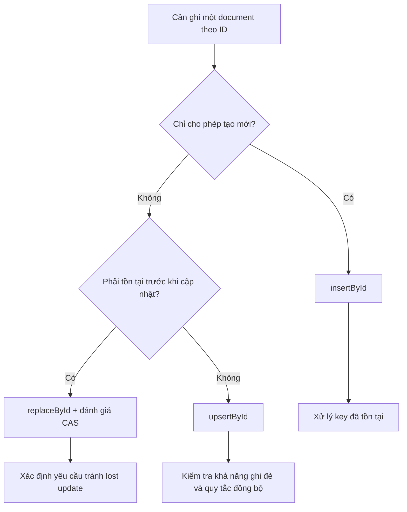

# insertById, upsertById và replaceById theo mục đích ghi

## Mục tiêu học tập

Hoàn thành bài học, bạn có thể:

1. Phân biệt chính xác ba cách ghi document bằng fluent API của Spring Data Couchbase: `insertById`, `upsertById` và `replaceById`.
2. Chọn thao tác theo quy tắc nghiệp vụ **chỉ tạo mới**, **tạo hoặc ghi đè**, hoặc **chỉ cập nhật khi document đang tồn tại**.
3. Viết service truy cập Couchbase dựa trên `CouchbaseOperations`, dùng document ID, entity mapping, bucket/scope/collection và tùy chọn TTL/durability đúng mục đích.
4. Nhận biết rủi ro ghi đè mất dữ liệu, phân biệt điều kiện *document tồn tại* với điều kiện *CAS còn hợp lệ*; xử lý xung đột và retry có kiểm soát.
5. Giải thích vì sao ghi theo key không cần secondary index và vì sao thực hiện nhiều lệnh ghi liên tiếp không tự động tạo thành giao dịch.

**Phạm vi module:** `SPRING_DATA_COUCHBASE` xây dựng tầng truy cập Couchbase bằng Spring Data qua document mapping, repository, `CouchbaseTemplate` và SQL++. Chương **Template** cung cấp những lệnh truy cập cụ thể để kiểm soát dữ liệu theo bucket/scope/collection, chỉ mục, TTL, CAS và durability; các phần liên quan đến giao dịch và reactive API được giới thiệu khi ảnh hưởng trực tiếp đến quyết định ghi.

## 1. Ba lệnh ghi trông giống nhau nhưng khác hợp đồng nghiệp vụ

Trong Couchbase, một document được xác định bởi **document ID** trong một **collection** của một **scope** và **bucket**. Ba lệnh dưới đây đều ghi toàn bộ entity đã được Spring Data map sang JSON bằng dịch vụ key-value (KV):

```java
// Chỉ tạo document mới, không cho phép trùng key.
operations.insertById(OrderDocument.class).one(order);

// Có key thì thay thế, chưa có thì tạo mới.
operations.upsertById(OrderDocument.class).one(order);

// Chỉ thay thế một document đã tồn tại.
operations.replaceById(OrderDocument.class).one(order);
```

Kết quả của thao tác không chỉ phụ thuộc vào nội dung `order` mà còn phụ thuộc vào việc document **đã có tại đúng vị trí bucket/scope/collection hay chưa**. Vì thế, chọn nhầm loại ghi có thể làm mất dữ liệu dù mã Java vẫn chạy thành công.

### Bảng so sánh hành vi theo trạng thái của key

| Khi lệnh chạy | `insertById` | `upsertById` | `replaceById` |
| --- | --- | --- | --- |
| ID **chưa tồn tại** trong collection | Tạo document mới | Tạo document mới | Thất bại vì không có document để thay |
| ID **đã tồn tại** trong collection | Thất bại vì key trùng | Ghi đè nội dung document theo ID | Thay thế nội dung document hiện có |
| Có ràng buộc “chỉ tạo một lần” | **Đúng mục đích** | Sai: có thể ghi đè | Sai: không tạo mới |
| Có ràng buộc “dữ liệu phải tồn tại trước khi sửa” | Sai: không sửa | Sai: có thể tạo nhầm | **Đúng mục đích** |
| Dữ liệu nguồn là một snapshot đầy đủ, được phép tạo hoặc ghi đè | Không phù hợp khi key đã tồn tại | **Đúng mục đích** | Không phù hợp nếu key chưa tồn tại |
| Tự ngăn *lost update* do hai luồng cùng ghi? | Ngăn trùng ID khi tạo | Không, nếu thiếu kiểm soát đồng thời bổ sung | **Không chỉ bằng điều kiện tồn tại**; cần CAS hoặc cơ chế phù hợp |

Bảng cuối là điểm then chốt: **replace chỉ kiểm tra document tồn tại; điều đó không đồng nghĩa replace tự bảo vệ mọi xung đột cập nhật**. Khi nghiệp vụ cần kiểm tra phiên bản mà caller đã đọc trước đó, phải dùng CAS/`@Version` theo hợp đồng API, hoặc cơ chế giao dịch thích hợp.

### Quy tắc chọn nhanh



## 2. Chuẩn bị ví dụ nhất quán: một collection đơn hàng

Giả sử ứng dụng thương mại điện tử dùng:

- **Bucket:** `appdata`.
- **Scope:** `commerce`.
- **Collection:** `orders`.
- **ID:** `order::1001`, `order::1002`, ...
- **Document JSON:** gồm `customerId`, `status`, `totalVnd`; metadata document ID và CAS được Couchbase quản lý.

Document mẫu:

```json
{
  "_class": "com.example.orders.OrderDocument",
  "customerId": "customer::42",
  "status": "NEW",
  "totalVnd": 350000
}
```

Trường `_class` là ví dụ metadata ánh xạ kiểu mà Spring Data có thể thêm; giá trị thật phụ thuộc package và cấu hình converter. Document ID `order::1001` là **key metadata**, không nhất thiết tồn tại thành trường `id` trong JSON. CAS cũng là metadata chứ không phải thuộc tính JSON thông thường.

### Entity Spring Data

```java
package com.example.orders;

import org.springframework.data.annotation.Id;
import org.springframework.data.annotation.Version;
import org.springframework.data.couchbase.core.mapping.Collection;
import org.springframework.data.couchbase.core.mapping.Document;
import org.springframework.data.couchbase.core.mapping.Field;
import org.springframework.data.couchbase.core.mapping.Scope;

@Document
@Scope("commerce")
@Collection("orders")
public class OrderDocument {

    @Id
    private String id;

    @Field
    private String customerId;

    @Field
    private String status;

    @Field
    private long totalVnd;

    @Version
    private Long version;

    public OrderDocument() {}

    public OrderDocument(
            String id,
            String customerId,
            String status,
            long totalVnd) {
        this.id = id;
        this.customerId = customerId;
        this.status = status;
        this.totalVnd = totalVnd;
    }

    public String getId() { return id; }
    public void setId(String id) { this.id = id; }

    public String getCustomerId() { return customerId; }
    public void setCustomerId(String customerId) {
        this.customerId = customerId;
    }

    public String getStatus() { return status; }
    public void setStatus(String status) {
        this.status = status;
    }

    public long getTotalVnd() { return totalVnd; }
    public void setTotalVnd(long totalVnd) {
        this.totalVnd = totalVnd;
    }

    public Long getVersion() { return version; }
    public void setVersion(Long version) {
        this.version = version;
    }
}
```

- `@Document` đánh dấu entity được ánh xạ sang Couchbase document.
- `@Scope` và `@Collection` chọn vị trí mặc định; cần có bucket `appdata` trong cấu hình kết nối, scope và collection phải được tạo trước.
- `@Id` là định danh document để thực hiện KV.
- `@Version` giữ **CAS** giúp cơ chế optimistic locking của Spring Data phát hiện xung đột khi thao tác ghi sử dụng version. Không tự gán, tăng hoặc sửa `version`.

**Lưu ý:** Entity này là ví dụ giản lược. Trong ứng dụng thực, kiểm tra ID không rỗng, giá trị trạng thái hợp lệ, tính toàn vẹn của tổng tiền và quy tắc quyền truy cập trước khi ghi. Dùng số nguyên VND trong minh họa; hệ thống tiền tệ thực cần thống nhất đơn vị và quy tắc làm tròn.

### Inject giao diện thay vì phụ thuộc chặt vào Template

```java
import org.springframework.data.couchbase.core.CouchbaseOperations;
import org.springframework.stereotype.Service;

@Service
public class OrderWriter {

    private final CouchbaseOperations operations;

    public OrderWriter(CouchbaseOperations operations) {
        this.operations = operations;
    }

    // Các phương thức ghi ở những phần tiếp theo.
}
```

`CouchbaseTemplate` thường là bean triển khai `CouchbaseOperations`, chịu trách nhiệm mapping entity và gọi Couchbase Java SDK. Điều này cho phép service biểu diễn thao tác truy cập dữ liệu qua giao diện, nhất quán với tầng repository của Spring Data.

## 3. insertById: tạo mới và bảo vệ tính duy nhất của key

### Hợp đồng

> **Chỉ tạo nếu ID chưa tồn tại.** Nếu ID đã có trong collection thì thao tác thất bại.

Ví dụ nghiệp vụ: một đơn hàng mới được cấp ID duy nhất. Khi người dùng gửi lại yêu cầu do bấm nút hai lần hoặc mạng chậm, hệ thống cần phát hiện key đã được sử dụng thay vì âm thầm thay thế đơn hàng cũ.

```java
public OrderDocument createOrder(OrderDocument order) {
    // Kiểm tra dữ liệu nghiệp vụ trước khi gọi lệnh ghi.
    return operations
            .insertById(OrderDocument.class)
            .one(order);
}
```

Sử dụng:

```java
OrderDocument order = new OrderDocument(
        "order::1001", "customer::42", "NEW", 350_000L);

OrderDocument created = writer.createOrder(order);
```

Nếu chạy lại với cùng ID và document vẫn tồn tại, Couchbase từ chối `insert`. Exception cụ thể phía Java phụ thuộc mức translation của Spring Data và Couchbase SDK; trong tầng ứng dụng cần phân biệt **document đã tồn tại** với timeout, mất kết nối và lỗi quyền.

### Tại sao không kiểm tra exists trước rồi upsert?

Một lỗi thường gặp:

```java
// KHÔNG dùng mẫu này để đảm bảo "chỉ tạo mới".
if (!operations.existsById(OrderDocument.class).one(order.getId())) {
    operations.upsertById(OrderDocument.class).one(order);
}
```

Hai luồng có thể cùng thấy ID “chưa tồn tại”, sau đó cùng `upsert`. Luồng sau có thể ghi đè luồng trước. Kiểm tra trước còn tạo thêm một vòng mạng.

Thay vào đó, **một lệnh `insertById`** để Couchbase quyết định tồn tại ở thời điểm ghi là cách biểu đạt đúng nhất ràng buộc này. Nếu cần chống tạo trùng về mặt nghiệp vụ ngoài document ID, phải thiết kế idempotency key, unique mapping hoặc transaction thích hợp; insert chỉ bảo vệ *một key trong đúng collection*.

### “Tạo một lần” không đồng nghĩa “chỉ xử lý yêu cầu một lần”

Giả sử client timeout sau khi gửi `insert`. Server có thể đã tạo document thành công nhưng client chưa nhận được phản hồi. Retry cùng ID nhận lỗi “đã tồn tại”, song điều đó **không chứng minh** lần đầu hay một tác vụ khác đã tạo document.

Với API cần idempotency, lưu định danh yêu cầu ổn định và xác minh dữ liệu/nguồn gốc trước khi trả kết quả “đã thành công”. Tránh tự động đổi ID khi retry vì có thể tạo hai đơn hàng cho một yêu cầu.

### Lô insert

Fluent API của thao tác insert cũng hỗ trợ terminal nhận một tập entity:

```java
java.util.List<OrderDocument> batch = java.util.List.of(
        new OrderDocument("order::1002", "customer::42", "NEW", 100_000L),
        new OrderDocument("order::1003", "customer::43", "NEW", 200_000L));

java.util.Collection<? extends OrderDocument> saved =
        operations.insertById(OrderDocument.class).all(batch);
```

**Không** suy ra đây là một giao dịch nguyên tử cho cả danh sách. Nếu một số key đã tồn tại hoặc mạng lỗi giữa chừng, phải kiểm tra hành vi lỗi/partial success của phiên bản API và thiết kế bước đối soát. Khi nghiệp vụ cần tính nguyên tử giữa nhiều document, dùng cơ chế transaction của Couchbase thay vì dựa vào `all(batch)`.

## 4. upsertById: nhận snapshot đầy đủ và cho phép ghi đè

### Hợp đồng

> **Có document thì thay thế, chưa có thì tạo mới.**

`upsert` phù hợp khi nguồn ghi có thẩm quyền đối với **toàn bộ nội dung** document; ví dụ một tiến trình đồng bộ bản chụp trạng thái sản phẩm từ hệ thống chính, hoặc cache do ứng dụng chủ động làm mới.

```java
public OrderDocument synchronizeOrderSnapshot(OrderDocument snapshot) {
    // Chỉ dùng khi snapshot được phép thay thế toàn bộ document theo ID.
    return operations
            .upsertById(OrderDocument.class)
            .one(snapshot);
}
```

Chạy lần đầu có thể tạo `order::1001`; chạy lần sau với cùng ID có thể thay tất cả các field JSON đã map từ entity. Do đó **upsert không phải thao tác merge chỉ cập nhật những trường được truyền vào**.

### Rủi ro ghi đè từ entity thiếu dữ liệu

Giả sử document hiện tại là:

```json
{
  "customerId": "customer::42",
  "status": "PAID",
  "totalVnd": 350000
}
```

Một consumer nhận sự kiện chỉ chứa `status: "SHIPPED"`, tạo entity mới có `customerId == null` và `totalVnd == 0`, rồi `upsertById`. Lệnh này có thể ghi đè nội dung document bằng bản rút gọn; dữ liệu khách hàng/tổng tiền bị mất hoặc thay đổi ngoài ý muốn, tùy quy tắc serializer.

**Cách chọn khác:** Nếu chỉ cập nhật vài đường dẫn JSON, cân nhắc `mutateInById` (sub-document operation) với đường dẫn phù hợp. Nếu cần kiểm tra nghiệp vụ dựa trên toàn bộ trạng thái, đọc entity đầy đủ, xác thực chuyển trạng thái và ghi lại với CAS.

### Upsert có tự động an toàn khi retry?

Với cùng một ID, cùng payload và không có ghi đồng thời, việc lặp lại `upsert` thường đưa document về cùng trạng thái JSON đích. Nhưng đó là **tính lặp lại của kết quả snapshot**, không phải bảo đảm xử lý nghiệp vụ chính xác một lần:

- Nếu có tác vụ khác vừa cập nhật document, lần upsert muộn có thể ghi đè dữ liệu mới.
- Nếu lần ghi có TTL hoặc metadata thay đổi, lặp lại có thể làm thay đổi thời điểm hết hạn hoặc CAS.
- Nếu có side effect ngoài Couchbase (gửi email, gọi thanh toán), lặp upsert không làm side effect đó tự động idempotent.
- Khi timeout, trạng thái kết quả của lệnh ghi có thể chưa chắc chắn.

Không xem `upsertById` mặc định là “update với kiểm tra CAS”. Nếu yêu cầu “chỉ ghi khi phiên bản cũ còn đúng”, cần cơ chế optimistic concurrency tường minh.

## 5. replaceById: cập nhật document đang tồn tại

### Hợp đồng

> **Chỉ thay thế nội dung khi document đã tồn tại tại key đích.** Không tạo document mới.

Ví dụ: chỉ được chuyển trạng thái của một đơn hàng hiện có. Nếu ID sai hoặc đơn đã xóa, tạo một đơn mới từ payload cập nhật là hành vi không mong muốn.

```java
import java.util.NoSuchElementException;

public OrderDocument changeStatus(
        String orderId, String desiredStatus) {

    OrderDocument current = operations
            .findById(OrderDocument.class)
            .one(orderId);

    if (current == null) {
        throw new NoSuchElementException(
                "Không tìm thấy đơn hàng: " + orderId);
    }

    // Kiểm tra transition theo quy tắc nghiệp vụ trước khi ghi.
    current.setStatus(desiredStatus);

    return operations
            .replaceById(OrderDocument.class)
            .one(current);
}
```

Ưu điểm:

1. `findById` đọc document thật, kèm các field và `@Version` được map.
2. Service có chỗ áp dụng ràng buộc nghiệp vụ như `PAID → SHIPPED`, không cho `CANCELLED → SHIPPED`.
3. `replaceById` sẽ không âm thầm tạo document khi key không tồn tại tại thời điểm ghi.

**Điểm quan trọng:** Mẫu *đọc–kiểm tra–replace* vẫn gồm nhiều thao tác. Một luồng khác có thể sửa document sau bước đọc. Khi cần ngăn lost update, phải xác thực hành vi CAS của nhánh replace và `@Version` trên phiên bản Spring Data sử dụng. Nếu dự án dùng mapping optimistic locking theo cơ chế `save`, việc đọc entity có `@Version` rồi `operations.save(current)` là con đường được tài liệu Spring Data mô tả rõ để nhận lỗi optimistic locking khi CAS đổi. Không kết luận chỉ từ tên `replaceById` rằng mọi trường hợp đều có compare-and-swap.

### Hai loại điều kiện thường bị nhầm

- **Điều kiện tồn tại:** “Document ID này phải có” — bản chất của `replaceById`.
- **Điều kiện phiên bản:** “Document ID này vẫn có **CAS tôi đã đọc**” — cần kiểm soát CAS/`@Version` đúng hợp đồng thao tác.

Ví dụ hai worker A và B cùng đọc đơn hàng có CAS X. A ghi `status=PAID`, làm CAS thành Y. B cố ghi `status=CANCELLED` từ phiên bản X.

Nếu thao tác của B thực hiện ghi không có kiểm tra CAS, thay đổi của A có thể bị mất dù document vẫn tồn tại. Nếu thao tác yêu cầu CAS X, Couchbase từ chối khi CAS hiện hành là Y; Spring Data có thể chuyển xung đột thành `OptimisticLockingFailureException`.

### Mẫu cập nhật có optimistic locking thông qua save

Khi muốn một ví dụ theo cơ chế `@Version` được mô tả rõ trong tài liệu tham chiếu Spring Data, có thể viết:

```java
public OrderDocument changeStatusWithCas(
        String orderId, String desiredStatus) {

    OrderDocument current = operations
            .findById(OrderDocument.class)
            .one(orderId);

    if (current == null) {
        throw new NoSuchElementException(
                "Không tìm thấy đơn hàng: " + orderId);
    }

    // Giả sử đã kiểm tra trạng thái chuyển đổi hợp lệ.
    current.setStatus(desiredStatus);

    // Với @Version có CAS khác 0: save dùng nhánh replace có CAS.
    return operations.save(current);
}
```

Với entity có `@Version`, `save` thông thường chọn `insert` khi version chưa có/zero, hoặc `replace` khi version khác zero. **Do đó không dùng `save` trên một entity mới với version rỗng để bảo đảm “chỉ thay khi đã tồn tại”.** Trong mẫu trên, điều kiện đã được bảo vệ bằng việc đọc entity đang tồn tại, và nhánh ghi dùng CAS khi version hợp lệ. Nếu document bị xóa và tạo lại giữa hai bước, CAS cũ không còn hợp lệ.

Ở nghiệp vụ có tranh chấp cao, khi bắt `OptimisticLockingFailureException`, hãy đọc lại, kiểm tra lại trạng thái và áp dụng lại logic. **Không retry vô hạn với chính entity cũ**.

## 6. Một lớp service kết hợp ba mục đích ghi

Tập hợp ba cách ghi vào interface service rõ nghĩa, tránh phương thức chung `write(order)` có hành vi mơ hồ:

```java
package com.example.orders;

import java.util.NoSuchElementException;
import org.springframework.data.couchbase.core.CouchbaseOperations;
import org.springframework.stereotype.Service;

@Service
public class OrderWriteService {

    private final CouchbaseOperations operations;

    public OrderWriteService(CouchbaseOperations operations) {
        this.operations = operations;
    }

    // Use case A: lệnh tạo đơn mới từ API.
    public OrderDocument create(OrderDocument newOrder) {
        return operations
                .insertById(OrderDocument.class)
                .one(newOrder);
    }

    // Use case B: nhập snapshot đầy đủ từ nguồn được phép ghi đè.
    public OrderDocument overwriteFromTrustedSource(
            OrderDocument snapshot) {
        return operations
                .upsertById(OrderDocument.class)
                .one(snapshot);
    }

    // Use case C: chỉ sửa một đơn đã tồn tại.
    public OrderDocument replaceExistingStatus(
            String id, String newStatus) {

        OrderDocument existing = operations
                .findById(OrderDocument.class)
                .one(id);

        if (existing == null) {
            throw new NoSuchElementException(
                    "Đơn hàng không tồn tại: " + id);
        }

        existing.setStatus(newStatus);

        return operations
                .replaceById(OrderDocument.class)
                .one(existing);
    }
}
```

Đây là mã minh họa lệnh ghi, chưa chứa toàn bộ validation/authorization của nghiệp vụ. Với `replaceExistingStatus`, nếu yêu cầu xung đột cập nhật phải bị từ chối, tích hợp kiểm soát CAS phù hợp như phần 5 và kiểm thử cạnh tranh trên phiên bản dependency đang dùng.

### Diễn giải ba yêu cầu thực tế

| Yêu cầu | Chọn | Vì sao |
| --- | --- | --- |
| `POST /orders` tạo đơn hàng mới; nếu ID đã có phải trả lỗi xung đột | `insertById` | Couchbase kiểm tra trùng key ngay ở lệnh ghi |
| Job tái xây dựng snapshot giỏ hàng từ nguồn chính, có thể tạo hoặc thay thế bản hiện tại | `upsertById` | Có quyền ghi toàn bộ trạng thái bất kể key đã tồn tại |
| `PATCH /orders/{id}/status` chỉ tác động đơn hàng đã có, không được tạo đơn mới | `replaceById` sau khi đọc và validate | Thất bại nếu key không tồn tại; cần CAS khi có ghi đồng thời |
| Hai người sửa cùng đơn và yêu cầu không ai âm thầm mất thay đổi | Đọc + optimistic locking với `@Version`; ghi bằng nhánh bảo đảm CAS | Điều kiện tồn tại không đủ để bảo vệ phiên bản |
| Chỉ đổi một trường JSON lớn | Cân nhắc `mutateInById` | Tránh thay toàn bộ body; cần kiểm tra CAS nếu có tranh chấp |

Lưu ý `PATCH` trong REST **không bắt buộc** phải dùng sub-document; đó là hợp đồng API HTTP. Implementation có thể là đọc–sửa–replace để thực thi validation; lựa chọn dựa trên kích thước document, quy tắc nghiệp vụ và concurrency.

## 7. Scope, collection và ID: tránh ghi đúng lệnh nhưng sai nơi

Fluent API cho phép điều khiển vị trí thao tác:

```java
OrderDocument created = operations
        .insertById(OrderDocument.class)
        .inScope("commerce")
        .inCollection("orders")
        .one(new OrderDocument(
                "order::1004", "customer::10", "NEW", 410_000L));
```

Khi entity đã được cấu hình `@Scope("commerce")` và `@Collection("orders")`, bạn thường không cần gọi override mỗi lần. Nếu dùng các tên khác, lệnh tác động đến **collection khác**, nơi key `order::1004` có thể tồn tại hoặc không tồn tại độc lập.

**Không** nhầm các điều kiện:

- `order::1004` có trong `commerce.orders`.
- `order::1004` có trong `archive.orders`.

Hai document có cùng chuỗi key nhưng thuộc hai collection khác nhau là hai bản ghi độc lập. Lệnh insert vào collection thứ hai không được bảo vệ bởi tính tồn tại của key ở collection thứ nhất.

Trong môi trường nhiều tenant, tên scope/collection là thông tin phân vùng dữ liệu nhạy cảm. Không tin chuỗi scope/collection do client cung cấp mà thiếu xác thực và ánh xạ tenant sang danh sách được phép.

## 8. TTL và durability ở cả ba loại ghi

Fluent API hỗ trợ thêm chính sách phù hợp trên các nhánh ghi. Các tùy chọn này **không thay đổi ý nghĩa cơ bản** của insert/upsert/replace về điều kiện tồn tại.

### 8.1. Ghi document tạm với TTL

```java
import java.time.Duration;

OrderDocument temporary = operations
        .insertById(OrderDocument.class)
        .withExpiry(Duration.ofMinutes(30))
        .one(new OrderDocument(
                "order::demo-01", "customer::demo", "NEW", 0L));
```

Sau khi hết hạn, document có thể không còn tồn tại. Một `replaceById` thực hiện sau đó sẽ thất bại; một `upsertById` có thể tạo lại. Đây là khác biệt nghiệp vụ đáng kể với dữ liệu có TTL.

Các nhánh `upsertById` và `replaceById` cũng có `withExpiry(Duration)`. TTL được biểu diễn qua metadata expiry, không phải field JSON thông thường. Khi sửa document có hạn dùng:

- Xác định có phải giữ nguyên expiry cũ hay đặt expiry mới.
- Đối chiếu quy tắc mặc định và cách áp dụng `@Document(expiry = …)`, expiry của bucket, tùy chọn operation và SDK.
- Không giả định replace/upsert luôn giữ nguyên TTL của document đã có. Nếu muốn *preserve expiry*, cần đánh giá option hỗ trợ của phiên bản Couchbase Java SDK và Spring Data được sử dụng.

Đơn hàng thật thường cần chính sách lưu giữ riêng; TTL 30 phút ở ví dụ là dữ liệu thử nghiệm.

### 8.2. Durability khi ghi dữ liệu quan trọng

```java
import com.couchbase.client.core.msg.kv.DurabilityLevel;

OrderDocument created = operations
        .insertById(OrderDocument.class)
        .withDurability(DurabilityLevel.MAJORITY)
        .one(new OrderDocument(
                "order::1005", "customer::43", "NEW", 850_000L));
```

Tương tự, có thể cấu hình `withDurability` trên nhánh upsert/replace. Mức `MAJORITY` khiến thao tác đợi xác nhận durability tương ứng từ cluster. Độ trễ ghi có thể tăng; lựa chọn phụ thuộc topology, yêu cầu dữ liệu và SLA.

**Durability không giải quyết:**

- Key trùng ở `insert`.
- Lost update khi `upsert` ghi đè trạng thái mới.
- Query SQL++ vừa ghi xong mà index chưa cập nhật.
- Tính nguyên tử của nhiều lần ghi document.

Đó là những vấn đề riêng về điều kiện ghi, CAS, scan consistency hoặc transaction.

## 9. Cạnh tranh và retry: hai kịch bản bắt buộc hiểu

### Kịch bản A — trùng ID khi tạo

```text
T1: insert("order::700", payload A) ───────► thành công
T2: insert("order::700", payload B) ───────► lỗi key đã tồn tại
```

Điều này giúp bảo vệ key khỏi bị ghi đè lúc tạo. Không cần `existsById` để lấy kết quả quyết định cuối cùng.

### Kịch bản B — lost update khi ghi snapshot

```text
Ban đầu: order::700 = {status: "NEW"}

T1 đọc: status = "NEW", CAS = X
T2 đọc: status = "NEW", CAS = X

T1 upsert: status = "PAID"     -> thành công, CAS = Y
T2 upsert: status = "CANCELLED"-> có thể thành công, CAS = Z

Kết quả: thay đổi của T1 không còn trong document.
```

Việc T1 và T2 đều thao tác trên một document hợp lệ không bảo vệ giá trị do T1 vừa ghi. Trong tình huống cần đồng bộ:

1. Đọc document cùng CAS mới nhất.
2. Kiểm tra quy tắc chuyển trạng thái trong dữ liệu vừa đọc.
3. Ghi bằng thao tác sử dụng CAS tương ứng.
4. Nếu có optimistic-lock conflict, đọc lại và tính lại nghiệp vụ; retry có giới hạn hoặc trả HTTP 409 tùy hợp đồng.

Dùng `@Version` để Spring Data map CAS. Không gán CAS giả, không coi CAS là một bộ đếm tuần tự, không retry blind với payload cũ.

### Khi lỗi timeout: đừng đồng nhất timeout với “không ghi”

Timeout hoặc mất kết nối có thể xảy ra **sau** khi server đã ghi thành công. Vì vậy:

- `insert` retry gặp “key đã tồn tại” chưa đủ để kết luận yêu cầu ban đầu thất bại.
- `upsert` retry có thể làm mới trạng thái/TTL, hoặc ghi đè một cập nhật mới vừa đến.
- `replace` retry với CAS cũ có thể bị từ chối vì lần trước đã ghi, hoặc vì người khác sửa document.

Tầng API cần định danh yêu cầu, kiểm tra trạng thái khi có kết quả mơ hồ và chọn chính sách retry dựa trên lỗi có thể phục hồi. Không retry vô hạn hoặc mọi exception như nhau.

## 10. Quan hệ với index, query SQL++ và transaction

Ba lệnh trong bài là **KV operation theo document ID**:

- Không cần secondary index để định vị document. Điều này khác với `findByQuery` dùng SQL++.
- Thao tác ghi thành công không bảo đảm một query SQL++ theo secondary index thấy mutation tức thì vì index có thể cập nhật bất đồng bộ.
- Nếu cần query đọc-sau-ghi mạnh hơn, cân nhắc scan consistency như `REQUEST_PLUS` theo API truy vấn và đo độ trễ. Nếu biết ID, `findById` thường phù hợp hơn.
- Mỗi lệnh ghi một document có ranh giới nguyên tử riêng theo ngữ nghĩa Couchbase KV. **Hai lệnh ghi hai document liên tiếp không tự trở thành một transaction**.
- Khi phải cập nhật nhiều document đồng thời hoặc kiểm tra nhiều điều kiện xuyên document, cần nghiên cứu Couchbase Transactions, yêu cầu retry và xử lý commit không chắc chắn. Chỉ dùng `insertById`/`replaceById` riêng lẻ không đáp ứng tính nguyên tử nhiều document.

Với ứng dụng WebFlux, các phương thức tương ứng trên `ReactiveCouchbaseOperations` có thể trả về `Mono<OrderDocument>` và cần subscription để thực thi:

```java
import org.springframework.data.couchbase.core.ReactiveCouchbaseOperations;
import reactor.core.publisher.Mono;

public class ReactiveOrderWriter {
    private final ReactiveCouchbaseOperations operations;

    public ReactiveOrderWriter(ReactiveCouchbaseOperations operations) {
        this.operations = operations;
    }

    public Mono<OrderDocument> create(OrderDocument order) {
        return operations.insertById(OrderDocument.class).one(order);
    }

    public Mono<OrderDocument> synchronize(OrderDocument snapshot) {
        return operations.upsertById(OrderDocument.class).one(snapshot);
    }

    public Mono<OrderDocument> replaceExisting(OrderDocument order) {
        return operations.replaceById(OrderDocument.class).one(order);
    }
}
```

Reactive làm thay đổi mô hình thực thi và cách truyền lỗi, **không làm thay đổi** điều kiện tồn tại của ba loại ghi. Đừng gọi `block()` trong event loop của WebFlux chỉ để lấy entity đồng bộ.

## 11. Xử lý lỗi tại tầng ứng dụng

| Tình huống | Kỳ vọng ở tầng dữ liệu | Gợi ý hợp đồng API |
| --- | --- | --- |
| Tạo ID đã tồn tại bằng `insertById` | Lỗi duplicate/document exists | HTTP 409 Conflict nếu đó là xung đột nghiệp vụ |
| `replaceById` với ID chưa tồn tại | Lỗi document not found | HTTP 404 nếu tài nguyên đích không có |
| CAS đã đổi trong quá trình cập nhật | Lỗi optimistic locking hoặc CAS mismatch | HTTP 409, yêu cầu tải lại hoặc retry có kiểm soát |
| `upsertById` từ nguồn không được phép ghi đè | Lệnh có thể thành công dù sai nghiệp vụ | Chặn ở validation/authorization trước lệnh |
| Timeout, thiếu quyền, cluster lỗi | Ngoại lệ hạ tầng hoặc lỗi kết quả không chắc chắn | Log có ngữ cảnh, retry theo chính sách, không đánh đồng 404/409 |
| TTL đã làm document hết hạn | `replace` không tìm thấy; `insert/upsert` có thể tạo | Kiểm tra chính sách retention và thời điểm thao tác |

Tên exception cụ thể có thể khác theo phiên bản Spring Data và cơ chế chuyển đổi lỗi Couchbase SDK. Ở tầng service/controller, dựa trên kiểu lỗi được thư viện đang sử dụng hỗ trợ, không bắt mọi `Exception` rồi trả `null`. Chỉ chuyển sang HTTP response sau khi đã phân loại lỗi nghiệp vụ và lỗi hạ tầng.

**Logging hợp lý:** ghi loại thao tác, ID, scope/collection, latency, số lần retry và loại exception; không log mật khẩu, thông tin định danh nhạy cảm hoặc toàn bộ payload thanh toán.

## 12. Bài thực hành: tự chứng minh ba hợp đồng ghi

Chuẩn bị Couchbase Server và bucket `appdata` cùng scope `commerce`, collection `orders`; dùng dữ liệu thử nghiệm. Dựng service từ entity `OrderDocument` và `CouchbaseOperations` đã giới thiệu.

| Bước | Thao tác | Điều cần quan sát |
| --- | --- | --- |
| 1 | `insertById` với ID `order::lab-1` chưa tồn tại | Tạo thành công |
| 2 | `insertById` lần nữa với đúng ID | Lỗi tồn tại, document cũ không bị ghi đè |
| 3 | `upsertById` với ID `order::lab-1` và payload mới | Document được thay thế theo payload |
| 4 | `upsertById` với ID `order::lab-2` chưa tồn tại | Document mới được tạo |
| 5 | `replaceById` với ID `order::lab-missing` | Thất bại vì không có document |
| 6 | Đọc `order::lab-1`, sửa trạng thái, `replaceById` | Nội dung được thay thế vì document đang tồn tại |
| 7 | Hai tác vụ cùng đọc một entity `@Version`, rồi ghi song song với CAS | Ghi nhận xung đột và cách xử lý |
| 8 | Dùng `withExpiry(Duration.ofSeconds(30))` khi tạo document thử | Xác nhận khác biệt giữa replace và upsert sau khi key hết hạn |
| 9 | Dùng `withDurability(DurabilityLevel.MAJORITY)` | Quan sát latency và cơ chế xác nhận ghi |

**Tiêu chí đạt:**

1. Có thể dự đoán kết quả của từng thao tác theo hai điều kiện “key đã tồn tại / chưa tồn tại”.
2. Giải thích được vì sao `insertById` phù hợp tạo tài nguyên duy nhất, còn `upsertById` phù hợp đồng bộ snapshot được phép ghi đè.
3. Phân biệt được ***document tồn tại*** và ***CAS đúng***; không coi `replaceById` là biện pháp chống mọi lost update.
4. Biết kiểm tra TTL, timeout và quyền trước khi thiết kế retry.
5. Nêu rõ vì sao ba thao tác KV không cần secondary index và không thay thế transaction nhiều document.

## Tài liệu tham khảo chính thức

- [Spring Data Couchbase — Template & direct operations](https://docs.spring.io/spring-data/couchbase/reference/couchbase/template.html).
- [Spring Data Couchbase — Modeling Entities và optimistic locking](https://docs.spring.io/spring-data/couchbase/reference/couchbase/entity.html).
- [Spring Data Couchbase Javadoc — CouchbaseOperations](https://docs.spring.io/spring-data/couchbase/reference/api/java/org/springframework/data/couchbase/core/CouchbaseOperations.html).
- [Spring Data Couchbase Javadoc — ExecutableInsertByIdOperation](https://docs.spring.io/spring-data/couchbase/reference/api/java/org/springframework/data/couchbase/core/ExecutableInsertByIdOperation.html).
- [Spring Data Couchbase Javadoc — ExecutableUpsertByIdOperation](https://docs.spring.io/spring-data/couchbase/reference/api/java/org/springframework/data/couchbase/core/ExecutableUpsertByIdOperation.html).
- [Spring Data Couchbase Javadoc — ExecutableReplaceByIdOperation](https://docs.spring.io/spring-data/couchbase/reference/api/java/org/springframework/data/couchbase/core/ExecutableReplaceByIdOperation.html).

> **Giới hạn phiên bản:** Bài dùng phong cách fluent API phổ biến của Spring Data Couchbase hiện đại. Hãy đối chiếu Javadoc đúng phiên bản thư viện đang khóa trước khi áp dụng option hoặc kết luận cụ thể về CAS, expiry và exception. Các ví dụ được viết để học ngữ nghĩa, không thay thế kiểm thử tích hợp trên cluster thực tế.
