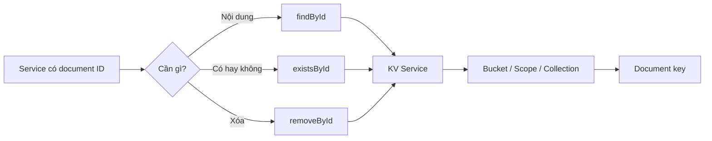

# findById, existsById và removeById

## Mục tiêu học tập

Kết thúc bài học, bạn có thể:

1. Sử dụng `CouchbaseOperations` (được triển khai bởi `CouchbaseTemplate`) để **đọc**, **kiểm tra tồn tại** và **xóa** document theo ID.
2. Hiểu khi nào nên dùng `findById` thay cho `existsById`, cũng như cách xử lý kết quả không tìm thấy và lỗi truy cập dữ liệu.
3. Xác định đúng bucket, scope và collection trong thao tác key-value (KV); phân biệt đọc theo ID với truy vấn SQL++ theo điều kiện.
4. Nhận biết race condition giữa `existsById`, `findById` và `removeById`; chọn CAS, transaction hoặc chính sách idempotency khi phù hợp.
5. Viết service imperative và reactive, vận dụng TTL, durability, phân quyền và quan sát vận hành.

**Bối cảnh module:** `SPRING_DATA_COUCHBASE` giúp xây dựng tầng truy cập Couchbase bằng Spring Data với document mapping, repository, `CouchbaseTemplate` và SQL++. Bài thuộc chương **Template**, tập trung vào ba thao tác theo ID và mối liên hệ của chúng với thiết kế bucket/scope/collection, chỉ mục, TTL, CAS, giao dịch, reactive API và tính nhất quán.

## 1. Tổng quan ba thao tác theo document ID

Couchbase lưu các document JSON trong collection; mỗi document có **key duy nhất trong collection đó**. Khi caller đã biết key, Spring Data Couchbase cho phép gọi trực tiếp KV:

```java
// Chọn thao tác -> loại entity -> thực thi với ID.
OrderDocument order = operations
        .findById(OrderDocument.class)
        .one("order::1001");

boolean exists = operations
        .existsById(OrderDocument.class)
        .one("order::1001");

operations
        .removeById(OrderDocument.class)
        .one("order::1001");
```

Trong đó `operations` có kiểu `CouchbaseOperations` được inject vào service; `CouchbaseTemplate` là một triển khai thường được Spring Data cấu hình. Đây là các fluent operation: chọn loại việc cần làm, chọn entity type, thêm tùy chọn hợp lệ rồi gọi terminal `one(id)`.

| Thao tác | Câu hỏi / tác dụng | Giá trị phía imperative | Dữ liệu cần lấy |
| --- | --- | --- | --- |
| `findById(T.class).one(id)` | Lấy document này để làm gì tiếp? | Entity hoặc `null` khi không có | Nội dung JSON để ánh xạ entity |
| `existsById(T.class).one(id)` | Key này đang tồn tại không? | `boolean` | Không cần trả toàn bộ entity |
| `removeById(T.class).one(id)` | Xóa document này | Gửi lệnh xóa; xử lý kết quả/lỗi theo phiên bản API | Không cần đọc entity trước |

**Quy tắc:** Nếu cần nội dung document, dùng `findById` ngay. Nếu chỉ cần câu trả lời có/không, `existsById` phù hợp. Nếu nghiệp vụ cho phép xóa theo key, dùng `removeById`, đồng thời phải xác định chính sách khi key không còn tồn tại.

Ba lệnh KV **không cần secondary index**; điều này khác truy vấn SQL++ tìm nhiều document theo thuộc tính. Tuy nhiên, chúng vẫn phát sinh I/O mạng, có thể bị timeout hoặc lỗi quyền.



## 2. Chuẩn bị entity, bucket, scope và collection

Giả sử ứng dụng bán hàng có vị trí lưu:

- Bucket: `appdata`
- Scope: `commerce`
- Collection: `orders`
- Document ID: `order::1001`, `order::1002`, ...
- Các thuộc tính JSON: `customerId`, `status`, `totalVnd`

Ví dụ cấu hình Spring Boot tối giản:

```yaml
spring:
  couchbase:
    connection-string: couchbase://localhost
    username: app_user
    password: ${COUCHBASE_PASSWORD}
  data:
    couchbase:
      bucket-name: appdata
```

Cần tạo bucket/scope/collection trước khi chạy ví dụ, cấp quyền đúng cho `app_user`. Mật khẩu đọc từ biến môi trường; môi trường thực tế còn cần cấu hình TLS, timeout và secret management.

### Entity ánh xạ document

```java
package com.example.orders;

import org.springframework.data.annotation.Id;
import org.springframework.data.annotation.Version;
import org.springframework.data.couchbase.core.mapping.Collection;
import org.springframework.data.couchbase.core.mapping.Document;
import org.springframework.data.couchbase.core.mapping.Field;
import org.springframework.data.couchbase.core.mapping.Scope;

@Document
@Scope("commerce")
@Collection("orders")
public class OrderDocument {
    @Id
    private String id;

    @Field
    private String customerId;

    @Field
    private String status;

    @Field
    private long totalVnd;

    @Version
    private Long version;

    public OrderDocument() {}

    public OrderDocument(
            String id, String customerId, String status, long totalVnd) {
        this.id = id;
        this.customerId = customerId;
        this.status = status;
        this.totalVnd = totalVnd;
    }

    public String getId() { return id; }
    public void setId(String id) { this.id = id; }

    public String getCustomerId() { return customerId; }
    public void setCustomerId(String customerId) {
        this.customerId = customerId;
    }

    public String getStatus() { return status; }
    public void setStatus(String status) { this.status = status; }

    public long getTotalVnd() { return totalVnd; }
    public void setTotalVnd(long totalVnd) { this.totalVnd = totalVnd; }

    public Long getVersion() { return version; }
    public void setVersion(Long version) { this.version = version; }
}
```

Vai trò của annotation:

- `@Id` là document key do Couchbase quản lý trong metadata, không bắt buộc là trường JSON.
- `@Scope` và `@Collection` xác định nơi truy cập mặc định của entity trong bucket đã cấu hình.
- `@Field` ánh xạ thuộc tính Java sang thuộc tính JSON.
- `@Version` lưu CAS (*compare-and-swap*) của document khi đọc, hỗ trợ optimistic locking cho những thao tác ghi áp dụng version; giá trị này **không phải** số phiên bản tăng liên tục do ứng dụng quản lý.

Tạo document mẫu để thử nghiệm:

```java
OrderDocument created = operations
        .insertById(OrderDocument.class)
        .one(new OrderDocument(
                "order::lab-1", "customer::42", "NEW", 350_000L));
```

`insertById` từ chối ID trùng, nên chỉ chạy với key chưa tồn tại. Trong dự án thực tế, ID và quyền tạo/xóa cần được kiểm tra ở tầng nghiệp vụ.

## 3. findById: đọc trực tiếp document theo key

### Cú pháp và cách xử lý khi không tìm thấy

```java
OrderDocument order = operations
        .findById(OrderDocument.class)
        .one("order::lab-1");

if (order == null) {
    System.out.println("Không có document với key này");
} else {
    System.out.println(order.getStatus());
}
```

Với API imperative, kết quả có thể là entity hoặc `null` nếu key không tồn tại. Điều đó khác với lỗi timeout, kết nối, quyền truy cập hoặc lỗi ánh xạ; đừng bắt tất cả exception rồi trả `null` vì sẽ che mất lỗi hạ tầng.

Một service thường chuyển `null` thành `Optional.empty()` để diễn đạt rõ khả năng không tìm thấy:

```java
import java.util.Optional;
import org.springframework.data.couchbase.core.CouchbaseOperations;

public class OrderReader {
    private final CouchbaseOperations operations;

    public OrderReader(CouchbaseOperations operations) {
        this.operations = operations;
    }

    public Optional<OrderDocument> find(String id) {
        OrderDocument result = operations
                .findById(OrderDocument.class)
                .one(id);

        return Optional.ofNullable(result);
    }
}
```

Đối với HTTP GET, tầng controller có thể chuyển `Optional.empty()` thành 404. Mã 404 là hợp đồng của API ứng dụng, không phải giá trị Java mặc định của `findById`.

### Vì sao không dùng existsById trước findById?

Cách viết sau thường dư thừa:

```java
if (operations.existsById(OrderDocument.class).one(id)) {
    return operations.findById(OrderDocument.class).one(id);
}
return null;
```

Nó tạo **hai lượt I/O KV**. Ngoài ra, sau khi `existsById` trả true, document vẫn có thể bị xóa hoặc hết TTL trước khi `findById` chạy. Kết quả cuối cùng vẫn phải xử lý không tìm thấy. Hãy gọi `findById` một lần khi thực sự cần entity.

### So sánh với findByQuery

```java
// Biết key -> KV; không cần secondary index.
OrderDocument direct = operations
        .findById(OrderDocument.class)
        .one("order::lab-1");

// Biết điều kiện trong JSON -> SQL++, cần index phù hợp.
Query query = Query.query(
        QueryCriteria.where("customerId").is("customer::42")
                .and("status").is("NEW"));

java.util.List<OrderDocument> matching = operations
        .findByQuery(OrderDocument.class)
        .matching(query)
        .all();
```

Import phục vụ ví dụ SQL++:

```java
import org.springframework.data.couchbase.core.query.Query;
import org.springframework.data.couchbase.core.query.QueryCriteria;
```

Couchbase Query Service thường dùng secondary index để lọc document theo thuộc tính. Vì index cập nhật bất đồng bộ, kết quả SQL++ ngay sau mutation có thể khác kết quả KV theo key ở cùng thời điểm. Nếu chỉ cần một ID xác định, KV là con đường truy cập hợp lý.

## 4. existsById: chỉ kiểm tra key còn tồn tại hay không

```java
boolean exists = operations
        .existsById(OrderDocument.class)
        .one("order::lab-1");
```

Trả lời boolean hữu ích cho màn hình quản trị hoặc logic chỉ cần biết key tồn tại. Không có entity được map trả về nên tránh truyền nội dung document khi không cần.

**Điều không được suy ra từ kết quả true:** document sẽ tiếp tục tồn tại, nội dung chưa đổi, hoặc caller có quyền thực hiện các hành động khác. Thao tác này không khóa document và không bảo đảm một snapshot xuyên nhiều request.

### Race condition khi kiểm tra rồi tạo

```java
// Không dùng để bảo đảm ID chưa tồn tại ở thời điểm ghi.
if (!operations.existsById(OrderDocument.class).one(order.getId())) {
    operations.upsertById(OrderDocument.class).one(order);
}
```

Nếu hai request cùng thấy `false`, cả hai có thể `upsert` và request sau ghi đè request trước. Để **chỉ tạo mới**, dùng một lệnh `insertById(OrderDocument.class).one(order)`, vì điều kiện tồn tại được Couchbase đánh giá lúc ghi.

### Race condition khi kiểm tra rồi xóa

```text
T1: existsById("order::lab-1") → true
T2: removeById("order::lab-1") → xóa thành công
T1: removeById("order::lab-1") → key đã không còn
```

Không thể dùng `existsById` như một thao tác “đặt chỗ” cho lệnh xóa sau đó. Nếu nghiệp vụ cần xóa đúng phiên bản tài liệu đã quan sát, cần CAS hoặc transaction theo yêu cầu, không chỉ cần boolean tồn tại.

## 5. removeById: xóa trực tiếp một document

### Cú pháp cơ bản

```java
operations
        .removeById(OrderDocument.class)
        .one("order::lab-1");
```

Ý nghĩa là xóa document có key cụ thể trong đúng collection. Nó không tự:

- Xóa tất cả document có `customerId` giống nhau.
- Xóa document liên quan ở collection khác hoặc gọi các dịch vụ bên ngoài.
- Kiểm tra `status == "CANCELLED"` trước khi xóa.
- Tạo ra một giao dịch nguyên tử xuyên nhiều document.

Cần xác định cách trả lỗi cho key không tồn tại theo phiên bản Spring Data và SDK đang sử dụng. Một lần xóa có thể thất bại do key không có, quyền không đủ, CAS khi có ràng buộc, timeout hoặc sự cố cluster. Đừng suy rằng gọi xóa lần thứ hai chắc chắn thành công khi chưa kiểm chứng hành vi thực tế.

### Idempotency trong API DELETE

Giả sử endpoint `DELETE /orders/{id}` yêu cầu tài nguyên không còn sau khi request thành công. Một kịch bản thường gặp:

```text
Lần 1: Client gửi DELETE order::lab-1
        Couchbase đã xóa nhưng response HTTP bị mất.

Lần 2: Client retry cùng ID
        Document không còn tồn tại.
```

HTTP DELETE có ngữ nghĩa idempotent đối với trạng thái tài nguyên sau thao tác, nhưng không bắt buộc mọi lần gọi phải có cùng mã HTTP. Tùy hợp đồng API, có thể trả 204 cho trạng thái không còn document, hoặc báo 404 khi lần này key không có.

Trong service, chỉ nên quy đổi lỗi **đúng loại not-found** thành kết quả được phép; đừng bắt tất cả exception, vì timeout và lỗi quyền không phải là “đã xóa”.

### Xóa cứng, xóa mềm và TTL

Đối với đơn hàng, chứng từ, dữ liệu tài chính hoặc lịch sử audit, xóa vật lý thường cần đánh giá yêu cầu lưu trữ. Có thể thay bằng *soft delete* (đặt `deletedAt`, `archived` hoặc trạng thái ẩn), rồi thực hiện retention theo chính sách.

TTL cũng làm document không còn tồn tại sau hạn sống; tuy nhiên hết TTL là chính sách quản lý vòng đời, không phải lệnh người dùng chủ động xóa. Cần phân biệt theo nguồn sự kiện nếu hệ thống yêu cầu audit.

## 6. Ghi đè vị trí bằng inScope và inCollection

Các fluent operation có thể ghi đè scope/collection mặc định của entity:

```java
OrderDocument current = operations
        .findById(OrderDocument.class)
        .inScope("commerce")
        .inCollection("orders")
        .one("order::1001");

boolean inArchive = operations
        .existsById(OrderDocument.class)
        .inScope("archive")
        .inCollection("orders")
        .one("order::1001");

operations
        .removeById(OrderDocument.class)
        .inScope("commerce")
        .inCollection("orders")
        .one("order::demo-to-delete");
```

Scope `archive` và collection `orders` ở ví dụ thứ hai phải có thật, đồng thời tài khoản có quyền phù hợp. Hai document có cùng key ở `commerce.orders` và `archive.orders` là **hai document khác nhau**.

Khi `@Scope`/`@Collection` đã cấu hình đúng, không cần lặp lại override mỗi lần. Nếu ứng dụng phục vụ nhiều tenant, ánh xạ tenant sang vị trí lưu phải được kiểm soát ở tầng tin cậy. Không cho phép client tự quyết định tùy ý collection sẽ bị xóa.

**Lưu ý lỗi không tìm thấy:** trước khi kết luận key đã mất, kiểm tra document ID đầy đủ, bucket trong cấu hình, scope, collection và thời điểm expiry. Việc đọc nhầm `_default._default` thay vì `commerce.orders` có thể trông giống lỗi not-found.

## 7. Đọc rồi xóa: kiểm soát CAS để tránh xóa nhầm bản mới

Một service có thể muốn “chỉ xóa đơn hàng nếu trạng thái hiện là CANCELLED”:

```java
OrderDocument current = operations
        .findById(OrderDocument.class)
        .one(id);

if (current != null && "CANCELLED".equals(current.getStatus())) {
    operations.removeById(OrderDocument.class).one(id);
}
```

Đây là hai thao tác riêng, nên có thể xảy ra:

```text
T1 đọc order::1001, status=CANCELLED, CAS=A
T2 cập nhật order::1001, status=PAID, CAS=B
T1 xóa theo ID, không kèm CAS
Kết quả: bản vừa cập nhật của T2 có thể bị xóa.
```

**CAS** dùng để xác định document có thay đổi kể từ lần đọc hay chưa. Nếu yêu cầu xóa phụ thuộc vào trạng thái đã quan sát, cần thao tác xóa **có điều kiện CAS**, hoặc giao dịch phù hợp. Giá trị `@Version` trên entity đã đọc không tự được truyền vào lệnh `removeById(...).one(id)` vì terminal này nhận key, không nhận entity.

Ví dụ sử dụng Couchbase Java SDK để thể hiện rõ điều kiện CAS:

```java
import com.couchbase.client.java.Collection;
import com.couchbase.client.java.kv.GetResult;
import com.couchbase.client.java.kv.RemoveOptions;

// collection là SDK Collection đã trỏ đúng bucket/scope/collection.
GetResult observed = collection.get("order::1001");

if ("CANCELLED".equals(
        observed.contentAsObject().getString("status"))) {

    collection.remove(
            "order::1001",
            RemoveOptions.removeOptions().cas(observed.cas()));
}
```

Nếu T2 sửa document giữa lệnh get và remove, CAS cũ không còn hợp lệ và remove có điều kiện sẽ thất bại. Đây là minh họa **SDK trực tiếp**, không phải lời gọi thông qua `CouchbaseOperations`. Khi kết hợp trong một dự án Spring Data, cần xử lý exception theo SDK, chọn đúng collection và đánh giá transaction nếu quy tắc nghiệp vụ gồm nhiều document.

Một document có thể bị xóa rồi tạo lại **cùng ID**; CAS thay đổi theo mutation. Xóa chỉ dựa trên ID có nguy cơ xóa bản mới. Đối với đơn hàng, đừng cho phép “xóa nhầm” chỉ vì key trùng chuỗi.

### Không dùng CAS thay giao dịch nhiều document

CAS bảo vệ điều kiện phiên bản cho một mutation. Nó không làm các lần sửa/xóa nhiều key thành một giao dịch. Nếu cần cập nhật một đơn hàng và một document tồn kho theo tính nguyên tử, hãy dùng Couchbase Transactions và thiết kế xử lý retry/commit phù hợp.

## 8. TTL, durability và consistency của các lệnh theo ID

### TTL tác động đến cả ba thao tác

Sau khi TTL kết thúc, một document có thể được xem là không còn tồn tại: `findById` không tìm thấy, `existsById` trả `false`, `removeById` gặp trạng thái key không có. Dù `existsById` vừa trả `true`, không thể suy ra document còn tồn tại sau một khoảng thời gian nếu TTL sắp hết.

Không đặt `withExpiry` cho lệnh tìm hoặc xóa: TTL là cấu hình lúc ghi hoặc qua tính năng Couchbase tương ứng. Nếu muốn giữ dữ liệu sau một thời điểm, cần chính sách retention rõ ràng.

### Durability dành cho mutation

Couchbase hỗ trợ mức durability khi ghi/xóa; trên nhánh fluent có hỗ trợ ở phiên bản sử dụng, có thể đặt:

```java
import com.couchbase.client.core.msg.kv.DurabilityLevel;

operations
        .removeById(OrderDocument.class)
        .withDurability(DurabilityLevel.MAJORITY)
        .one("order::demo-to-delete");
```

`MAJORITY` khiến mutation chờ mức xác nhận tương ứng của cluster; độ trễ có thể tăng. Durability **không** thay thế CAS khi cần xóa theo phiên bản và không tạo transaction cho nhiều lệnh độc lập.

### SQL++ có thể trễ hơn KV sau xóa

Khi mutation KV hoàn thành, secondary index dùng bởi SQL++ có thể đang cập nhật bất đồng bộ. Nếu truy vấn theo thuộc tính phải thấy index mới nhất ở thời điểm request, đánh giá scan consistency `REQUEST_PLUS` và chi phí chờ. Nếu đã biết key, đọc/kiểm tra trực tiếp bằng KV phù hợp hơn.

| Cơ chế | Giải quyết điều gì? | Không giải quyết |
| --- | --- | --- |
| KV by ID | Truy cập document trực tiếp bằng key | Điều kiện lọc trên nhiều document |
| CAS | Ghi/xóa có điều kiện dựa trên phiên bản | Tính nguyên tử giữa nhiều key |
| Durability | Mức xác nhận của mutation | Truy vấn SQL++ thấy index ngay |
| Scan consistency | Query Service chờ mức cập nhật index | Điều kiện CAS hay giao dịch |
| Transaction | Phối hợp nhiều thao tác có tính nguyên tử theo hợp đồng | Thay thế mọi nhu cầu index/thiết kế query |

## 9. Ví dụ service hoàn chỉnh

Ví dụ sử dụng entity ở phần 2, inject `CouchbaseOperations` thay vì phụ thuộc trực tiếp lớp triển khai. Bắt đầu với các phương thức có hợp đồng rõ ràng và chưa tự diễn dịch lỗi không tìm thấy của thao tác xóa.

```java
package com.example.orders;

import java.util.Optional;

import org.springframework.data.couchbase.core.CouchbaseOperations;
import org.springframework.stereotype.Service;

@Service
public class OrderDocumentStore {

    private final CouchbaseOperations operations;

    public OrderDocumentStore(CouchbaseOperations operations) {
        this.operations = operations;
    }

    public Optional<OrderDocument> find(String id) {
        validateId(id);
        OrderDocument result = operations
                .findById(OrderDocument.class)
                .one(id);
        return Optional.ofNullable(result);
    }

    public boolean exists(String id) {
        validateId(id);
        return operations
                .existsById(OrderDocument.class)
                .one(id);
    }

    public void delete(String id) {
        validateId(id);
        operations
                .removeById(OrderDocument.class)
                .one(id);
    }

    private void validateId(String id) {
        if (id == null || id.isBlank()) {
            throw new IllegalArgumentException(
                    "Document ID không được rỗng");
        }
    }
}
```

`validateId` chỉ loại bỏ key vô nghĩa. Nó **không** thay thế authorization: một người dùng không được phép xóa đơn hàng của tenant khác dù biết ID. Kiểm tra quyền phải gắn với người thực hiện, document/tenant và operation tương ứng.

Ở tầng controller, có thể chọn hợp đồng:

- GET theo key: entity → 200; không thấy → 404; lỗi hạ tầng → lỗi tương ứng thay vì giả 404.
- HEAD hoặc endpoint kiểm tra tồn tại: trả boolean hoặc 200/404 theo thiết kế API.
- DELETE theo key: thành công có thể trả 204; trường hợp key đã mất tùy chính sách 204/404; phân biệt lỗi timeout và không có key.

Nếu muốn xóa idempotent, chỉ xử lý chính xác loại exception not-found thành trạng thái chấp nhận được. Không “nuốt” tất cả `RuntimeException` để giả thành công.

## 10. ReactiveCouchbaseOperations

Trong ứng dụng Reactor/WebFlux, thao tác tương đương trả về publisher:

```java
import org.springframework.data.couchbase.core.ReactiveCouchbaseOperations;
import reactor.core.publisher.Mono;

public class ReactiveOrderStore {
    private final ReactiveCouchbaseOperations operations;

    public ReactiveOrderStore(
            ReactiveCouchbaseOperations operations) {
        this.operations = operations;
    }

    public Mono<OrderDocument> find(String id) {
        return operations.findById(OrderDocument.class).one(id);
    }

    public Mono<Boolean> exists(String id) {
        return operations.existsById(OrderDocument.class).one(id);
    }

    public Mono<Void> delete(String id) {
        return operations
                .removeById(OrderDocument.class)
                .one(id)
                .then();
    }
}
```

Với `find`, không có document thì publisher hoàn thành rỗng, không phát giá trị `null`; có thể dùng `switchIfEmpty(...)` để biến thành tín hiệu lỗi nghiệp vụ. Với `exists`, publisher phát boolean. Với `delete`, ví dụ dùng `then()` để trả `Mono<Void>` khi tầng gọi chỉ cần biết hoàn thành hoặc lỗi.

Reactive pipeline thường thực thi khi có subscriber. Không gọi `block()` trên event loop WebFlux. Nếu subscriber chạy nhiều lần, thao tác KV có thể chạy nhiều lần; đối với xóa phải quyết định idempotency và xử lý not-found tương ứng.

## 11. Lỗi phổ biến và cách chẩn đoán

| Triệu chứng | Nguyên nhân cần kiểm tra | Hướng xử lý |
| --- | --- | --- |
| `findById` trả `null` dù nghĩ document tồn tại | Sai ID, bucket/scope/collection hoặc TTL | So sánh đúng key và vị trí, kiểm tra expiry |
| `existsById` true, sau đó `findById` không có | Race với xóa/cập nhật hoặc hết hạn | Không dùng exists như khóa, xử lý null |
| `removeById` báo không tìm thấy | Key đã xóa/hết TTL hoặc truy cập sai vị trí | Phân loại not-found theo hợp đồng API |
| Vừa xóa KV nhưng SQL++ vẫn thấy bản ghi | Index cập nhật bất đồng bộ | Xem scan consistency, cân nhắc `REQUEST_PLUS` |
| Xóa nhầm bản vừa được cập nhật | Xóa chỉ theo ID, bỏ qua CAS | Dùng xóa có CAS hoặc transaction khi cần |
| Xóa không đủ quyền | RBAC hoặc kiểm tra nghiệp vụ không đạt | Kiểm tra quyền bucket/scope/collection và authorization |
| Có timeout khi xóa | Kết quả server có thể đã thành công nhưng response không về | Xác minh trạng thái trước retry, giới hạn số lần thử |
| Service không chạy reactive query | Chưa subscribe publisher | Kiểm tra framework subscription, không gọi `block()` |

Khi vận hành, theo dõi độ trễ get/exists/remove, lỗi not-found, CAS conflicts, timeout, retry và quyền truy cập. Không log toàn bộ document nhạy cảm; chỉ log các định danh đã được bảo vệ theo yêu cầu hệ thống.

## 12. Bài thực hành

Dùng Couchbase thử nghiệm với `appdata.commerce.orders`, tránh thao tác xóa trên dữ liệu sản xuất.

1. Tạo `order::lab-a` và `order::lab-b`; để `order::lab-missing` chưa tồn tại.
2. Dùng `findById` đọc cả ba ID, so sánh entity trả về và trường hợp không có.
3. Dùng `existsById` với ba ID, ghi lại boolean. Giải thích lúc nào nên dùng exists thay cho find.
4. Dùng `removeById` xóa `order::lab-b`, kiểm tra lại bằng `findById` và `existsById`.
5. Thử xóa lần hai cùng key; xác nhận chính xác hành vi/exception trên phiên bản Spring Data đang dùng. Thiết kế chính sách HTTP DELETE phù hợp.
6. Tạo race giữa một luồng `existsById` và luồng khác xóa cùng key. Quan sát vì sao kết quả tồn tại không bảo vệ thao tác sau.
7. Trong môi trường thử nghiệm, đọc CAS của document bằng SDK, sửa document ở tác vụ khác, rồi thử xóa có CAS cũ để nhận xung đột.
8. Tạo một document có TTL ngắn, ghi nhận lúc `findById`/`existsById` chuyển sang không có document.
9. Với WebFlux, viết phiên bản `Mono<OrderDocument>` cho tìm theo ID và kiểm tra cách xử lý `Mono.empty()`.

**Câu hỏi tự đánh giá:**

- `findById(OrderDocument.class).one(id)` sử dụng type và key để quyết định điều gì?
- Vì sao gọi `existsById` trước `findById` thường chỉ tăng I/O?
- Tại sao `existsById` không đủ bảo đảm xóa đúng phiên bản document đã đọc?
- Khi nào HTTP DELETE có thể hợp lệ dù document đã không còn?
- Vì sao ba thao tác này không cần secondary index nhưng `findByQuery` thường cần?
- Sự khác biệt giữa CAS, durability và scan consistency trong tình huống xóa document?

## Tài liệu tham khảo

- [Spring Data Couchbase — Template & Direct Operations](https://docs.spring.io/spring-data/couchbase/reference/couchbase/template.html)
- [Spring Data Couchbase — Entity Mapping](https://docs.spring.io/spring-data/couchbase/reference/couchbase/entity.html)
- [Spring Data Couchbase — Collection Support](https://docs.spring.io/spring-data/couchbase/reference/couchbase/collections.html)
- [Spring Data Couchbase — CouchbaseOperations Javadoc](https://docs.spring.io/spring-data/couchbase/reference/api/java/org/springframework/data/couchbase/core/CouchbaseOperations.html)
- [Couchbase Java SDK — Key-Value Operations](https://docs.couchbase.com/java-sdk/current/howtos/kv-operations.html)

> Các method fluent, option và cách ánh xạ lỗi có thể khác giữa phiên bản Spring Data Couchbase và Java SDK. Khi tích hợp vào dự án, đối chiếu Javadoc đúng phiên bản dependency và kiểm thử với Couchbase Server thực tế; bài này là nội dung học tập của STEP 4, chưa thay thế Content QA chuyên môn ở bước sau.
