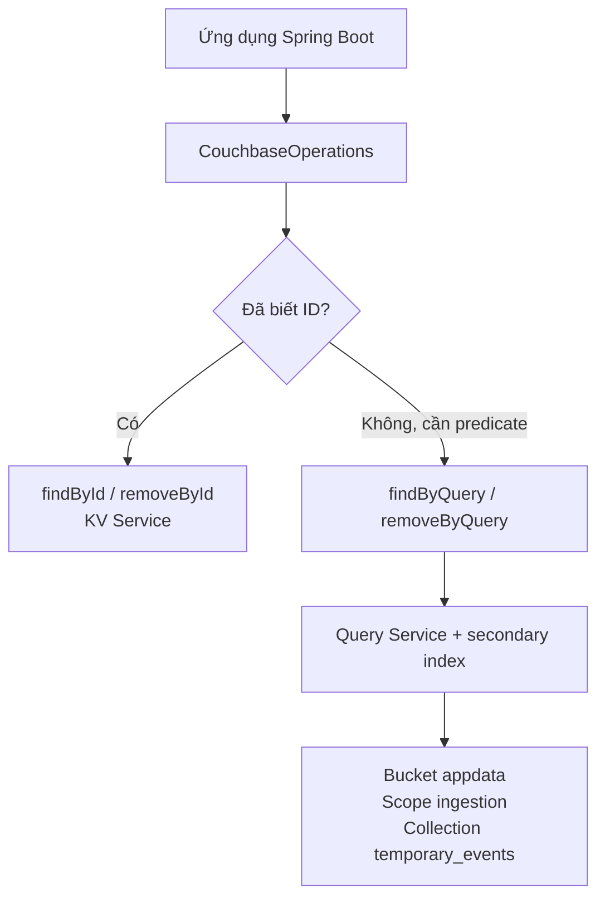
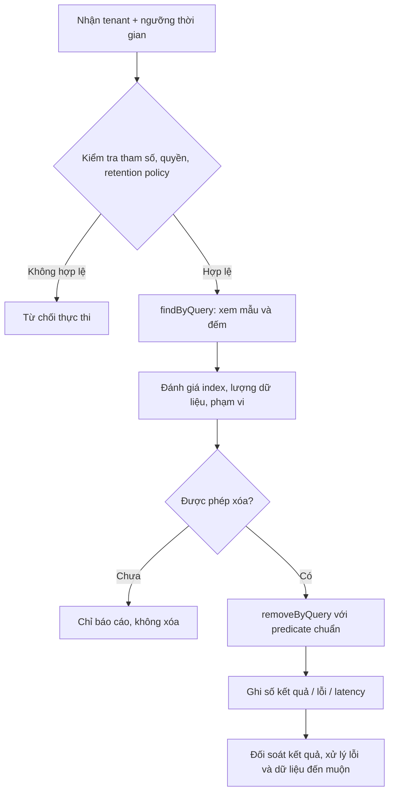

# Truy vấn và xóa theo điều kiện với findByQuery và removeByQuery

## Mục tiêu học tập

Sau bài học, bạn có thể:

1. Hiểu vì sao `findByQuery` và `removeByQuery` thuộc nhóm thao tác theo **điều kiện truy vấn**, khác thao tác key-value theo document ID.
2. Viết `Query` bằng `QueryCriteria`, truyền vào fluent API `CouchbaseOperations` và chọn đúng terminal operation.
3. Phân biệt kết quả của `findByQuery(...).all()` và `removeByQuery(...).all()`; biết cách dùng `count()`, `exists()`, `first()` và `one()` khi cần.
4. Thiết kế chỉ mục SQL++, xác định bucket/scope/collection và chọn scan consistency phù hợp với dữ liệu mới ghi.
5. Thực hiện xóa dữ liệu tạm theo điều kiện với phạm vi an toàn, đánh giá nguy cơ xóa nhầm, lỗi một phần, cạnh tranh và ảnh hưởng vận hành.
6. Nhận biết tương ứng giữa API imperative và reactive, vai trò của CAS, TTL, transaction và các lựa chọn thay thế cho xóa hàng loạt.

**Ngữ cảnh:** Module `SPRING_DATA_COUCHBASE` xây dựng tầng truy cập Couchbase bằng Spring Data: document mapping, repository, `CouchbaseTemplate`, truy vấn SQL++, thiết kế bucket/scope/collection, index, TTL, CAS, giao dịch và reactive API. Bài thuộc chương **Template**, tập trung vào các thao tác đọc/xóa một tập document theo *predicate* thay vì biết trước từng document ID.

> **Điểm cần phân biệt ngay:** `findByQuery` chỉ đọc; `removeByQuery` thay đổi dữ liệu và có thể tác động nhiều document. Cả hai cần đánh giá điều kiện lọc, chỉ mục và nhất quán của Query Service. Một thao tác xóa theo điều kiện không mặc nhiên là giao dịch nguyên tử trên toàn bộ tập kết quả.

## 1. Bài toán thực tế: dữ liệu tạm cần tìm và dọn theo điều kiện

Giả sử hệ thống nhận dữ liệu tạm từ các đợt import của nhiều khách hàng. Mỗi sự kiện được lưu vào Couchbase và có các trường:

| Trường | Ví dụ | Vai trò |
| --- | --- | --- |
| Document ID | `tmp-event::b17` | Khóa KV duy nhất trong collection |
| `tenantId` | `tenant-42` | Ranh giới khách hàng phải giữ khi truy vấn |
| `state` | `PROCESSED`, `PENDING` | Trạng thái xử lý |
| `createdAtEpoch` | `1760000000` | Thời điểm tạo (giây Unix) |
| `sourceId` | `batch-7` | Dấu vết nguồn nhập |

Dữ liệu nằm trong bucket `appdata`, scope `ingestion`, collection `temporary_events`. Bài toán gồm hai bước nghiệp vụ:

- Tìm tối đa 50 bản ghi thuộc `tenant-42`, trạng thái `PROCESSED`, tạo trước một mốc thời gian để nhân viên kiểm tra.
- Chỉ sau khi được phê duyệt, thực hiện dọn bản ghi đúng **cùng nhóm điều kiện**.

Nếu biết chính xác `tmp-event::b17`, dùng `findById` hoặc `removeById` theo KV thường đơn giản và không cần secondary index. Khi điều kiện là `tenantId + state + createdAtEpoch`, ta cần Query Service và chỉ mục tương ứng.



## 2. Entity, collection và cấu hình tối thiểu

### 2.1. Ánh xạ document

Ví dụ sử dụng entity có constructor rỗng để Spring Data chuyển đổi dữ liệu:

```java
package com.example.ingestion;

import org.springframework.data.annotation.Id;
import org.springframework.data.couchbase.core.mapping.Collection;
import org.springframework.data.couchbase.core.mapping.Document;
import org.springframework.data.couchbase.core.mapping.Field;
import org.springframework.data.couchbase.core.mapping.Scope;

@Document
@Scope("ingestion")
@Collection("temporary_events")
public class TemporaryEventDocument {

    @Id
    private String id;

    @Field
    private String tenantId;

    @Field
    private String state;

    @Field
    private long createdAtEpoch;

    @Field
    private String sourceId;

    public TemporaryEventDocument() {}

    public TemporaryEventDocument(
            String id,
            String tenantId,
            String state,
            long createdAtEpoch,
            String sourceId) {
        this.id = id;
        this.tenantId = tenantId;
        this.state = state;
        this.createdAtEpoch = createdAtEpoch;
        this.sourceId = sourceId;
    }

    public String getId() { return id; }
    public void setId(String id) { this.id = id; }

    public String getTenantId() { return tenantId; }
    public void setTenantId(String tenantId) {
        this.tenantId = tenantId;
    }

    public String getState() { return state; }
    public void setState(String state) { this.state = state; }

    public long getCreatedAtEpoch() { return createdAtEpoch; }
    public void setCreatedAtEpoch(long createdAtEpoch) {
        this.createdAtEpoch = createdAtEpoch;
    }

    public String getSourceId() { return sourceId; }
    public void setSourceId(String sourceId) {
        this.sourceId = sourceId;
    }
}
```

Với cấu hình bucket `appdata`, các annotation xác định mặc định `appdata.ingestion.temporary_events`. `@Id` là document key do Couchbase quản lý ở metadata. Những thuộc tính có `@Field` được ánh xạ vào JSON. Giá trị `createdAtEpoch` dùng **giây Unix**, không trộn mili giây và giây trong cùng collection.

Một ví dụ cấu hình Spring Boot với mật khẩu lấy từ biến môi trường:

```yaml
spring:
  couchbase:
    connection-string: couchbase://localhost
    username: app_user
    password: ${COUCHBASE_PASSWORD}
  data:
    couchbase:
      bucket-name: appdata
```

Tạo sẵn bucket, scope, collection và cấp quyền đúng môi trường. Nếu scope/collection đã tồn tại, không thực thi lại các câu lệnh tạo tương ứng:

```sql
CREATE SCOPE `appdata`.`ingestion`;
CREATE COLLECTION `appdata`.`ingestion`.`temporary_events`;

CREATE INDEX `idx_temp_event_cleanup`
ON `appdata`.`ingestion`.`temporary_events`
    (tenantId, state, createdAtEpoch);
```

Index bên trên ưu tiên các điều kiện bằng `tenantId` và `state`, sau đó đến phạm vi thời gian `createdAtEpoch`. Đây là điểm xuất phát để học; chỉ mục thực tế cần được đánh giá bằng query plan, cardinality và workload. Môi trường production nên quản lý DDL qua quy trình migration và giám sát trạng thái index.

### 2.2. Inject CouchbaseOperations

```java
import org.springframework.data.couchbase.core.CouchbaseOperations;
import org.springframework.stereotype.Service;

@Service
public class TemporaryEventReader {

    private final CouchbaseOperations operations;

    public TemporaryEventReader(CouchbaseOperations operations) {
        this.operations = operations;
    }
}
```

`CouchbaseTemplate` là một triển khai thông dụng của `CouchbaseOperations`, do Spring Data sử dụng để truy cập dữ liệu và mapping entity. Service phụ thuộc vào giao diện sẽ dễ diễn đạt hợp đồng hơn và dùng được các fluent operation rõ mục đích.

## 3. findByQuery: mô tả predicate rồi đọc kết quả

### 3.1. QueryCriteria và Query

Dùng `QueryCriteria` để tạo điều kiện theo tên thuộc tính và giá trị, sau đó chuyển thành `Query`:

```java
import java.util.List;
import org.springframework.data.couchbase.core.query.Query;
import org.springframework.data.couchbase.core.query.QueryCriteria;

public List<TemporaryEventDocument> previewProcessed(
        String tenantId,
        long olderThanEpoch) {

    QueryCriteria criteria = QueryCriteria
            .where("tenantId").is(tenantId)
            .and("state").is("PROCESSED")
            .and("createdAtEpoch").lt(olderThanEpoch);

    Query query = Query.query(criteria).limit(50);

    return operations
            .findByQuery(TemporaryEventDocument.class)
            .matching(query)
            .all();
}
```

Đọc chuỗi fluent theo thứ tự:

1. `findByQuery(TemporaryEventDocument.class)` chọn **truy vấn SQL++ theo entity type**.
2. `matching(query)` truyền điều kiện lọc và tùy chọn truy vấn đã biểu diễn bởi `Query`.
3. `all()` thực thi, nhận `List<TemporaryEventDocument>`; không có bản ghi phù hợp thì danh sách rỗng.

Không cần tự nối chuỗi SQL++ cho từng giá trị người dùng khi đã có `QueryCriteria`. Dù vậy, cần xác nhận cách chuyển tên property thành tên trường JSON khi sử dụng `@Field("ten_khac")` hoặc nested mapping, nhất là với truy vấn phức tạp.

### 3.2. Cú pháp SQL++ tương đương về ý tưởng

Để hình dung database đang tìm gì, điều kiện trên tương tự:

```sql
SELECT META(e).id AS documentId,
       e.tenantId, e.state, e.createdAtEpoch, e.sourceId
FROM `appdata`.`ingestion`.`temporary_events` AS e
WHERE e.tenantId = $tenantId
  AND e.state = "PROCESSED"
  AND e.createdAtEpoch < $cutoffEpoch
LIMIT 50;
```

`$tenantId` và `$cutoffEpoch` ở ví dụ SQL++ là **query parameters**, không phải ký tự thực hiện phép nội suy Java. Khi thực thi SQL++ trực tiếp qua SDK, truyền giá trị bằng tham số, không nối raw input vào chuỗi query.

Câu SQL++ mà Spring Data tạo ra có thể khác ví dụ vì cần lấy document ID/CAS, ánh xạ trường, thêm thông tin metadata loại entity như `_class` hoặc tối ưu projection. Muốn biết kế hoạch thực thi thật, hãy quan sát câu query từ ứng dụng và dùng `EXPLAIN` với chính câu query đó.

### 3.3. Các terminal khi tìm bằng query

Không phải lúc nào cũng cần tải toàn bộ entity:

| Terminal | Kiểu kết quả imperative | Khi nên dùng |
| --- | --- | --- |
| `all()` | `List<T>` | Lấy toàn bộ các match trong giới hạn `Query` |
| `count()` | `long` | Đếm số match, phục vụ báo cáo hoặc ước lượng |
| `exists()` | `boolean` | Chỉ cần biết có bản ghi phù hợp |
| `first()` | `Optional<T>` | Lấy kết quả đầu tiên nếu có; không khẳng định duy nhất |
| `one()` | `Optional<T>` | Yêu cầu **không quá một** kết quả; nhiều kết quả sẽ gây lỗi kích thước |
| `stream()` | `Stream<T>` | Duyệt kết quả theo API stream, cần quản lý tài nguyên phù hợp |

Ví dụ tìm xem có dữ liệu tạm đã xử lý trước ngưỡng thời gian hay chưa:

```java
boolean hasOldProcessed = operations
        .findByQuery(TemporaryEventDocument.class)
        .matching(Query.query(
                QueryCriteria.where("tenantId").is("tenant-42")
                        .and("state").is("PROCESSED")
                        .and("createdAtEpoch").lt(cutoffEpoch)))
        .exists();
```

Trong ví dụ này `cutoffEpoch` được giả định là biến `long` đã xác định ở caller. Nếu không có match, `exists()` trả `false`. Dùng `one()` chỉ khi dữ liệu có ràng buộc duy nhất ở nghiệp vụ; `limit(1)` có thể che đi vấn đề dữ liệu trùng và không thay thế hợp đồng uniqueness.

### 3.4. Limit, sort và phân trang

`limit(50)` chỉ giới hạn **tối đa 50** bản ghi ở kết quả. Nếu truy vấn không có `ORDER BY` tương ứng, không được giả định “50 bản ghi đầu tiên” ổn định giữa các lần chạy.

Khi phân trang sản xuất, dùng thứ tự ổn định có tie-breaker duy nhất, lên index phù hợp và đánh giá offset pagination so với keyset pagination. Nếu vừa đọc vừa có dữ liệu chèn/xóa, kết quả giữa các trang có thể trùng hoặc thiếu; cần chọn chiến lược phù hợp với độ nhất quán nghiệp vụ.

## 4. removeByQuery: xóa các document thỏa điều kiện

### 4.1. Cách viết fluent và kiểu kết quả thực

Với **cùng predicate**, ta có thể thực thi xóa theo điều kiện:

```java
import java.util.List;
import com.couchbase.client.java.kv.RemoveResult;
import org.springframework.data.couchbase.core.query.Query;
import org.springframework.data.couchbase.core.query.QueryCriteria;

public List<RemoveResult> removeOldProcessed(
        String tenantId,
        long olderThanEpoch) {

    QueryCriteria criteria = QueryCriteria
            .where("tenantId").is(tenantId)
            .and("state").is("PROCESSED")
            .and("createdAtEpoch").lt(olderThanEpoch);

    return operations
            .removeByQuery(TemporaryEventDocument.class)
            .matching(Query.query(criteria))
            .all();
}
```

**Khác biệt dễ viết sai:**

- `findByQuery(...).matching(query).all()` trả về `List<TemporaryEventDocument>`.
- `removeByQuery(...).matching(query).all()` trả về **`List<RemoveResult>`**, gồm kết quả của từng document bị xóa theo API. Đây không phải `List<TemporaryEventDocument>`, không phải `long` và cũng không phải `void`.
- `removeByQuery` có terminal `all()` để xóa các match. Nó không có `one(id)` tương đương `removeById`; nếu biết key, hãy dùng `removeById(TemporaryEventDocument.class).one(id)`.
- `RemoveResult` phản ánh kết quả xóa của Couchbase SDK (ví dụ metadata mutation). Không mặc định suy ra nó chứa toàn bộ JSON document hoặc ID ban đầu. Nếu cần audit theo ID, phải có cơ chế ghi nhận danh sách ID riêng.

Kiểu trả về trên được Javadoc của Spring Data Couchbase mô tả trong `ExecutableRemoveByQueryOperation.TerminatingRemoveByQuery`. Các API và exception có thể thay đổi theo nhánh thư viện, nên luôn đối chiếu dependency đang dùng.

### 4.2. Truy vấn xóa khác xóa theo một key

| Tiêu chí | `removeById` | `removeByQuery` |
| --- | --- | --- |
| Chọn document | Document ID đã biết | Predicate có thể khớp nhiều document |
| Đường truy cập | KV | Dùng Query Service để xác định đối tượng theo điều kiện |
| Index thứ cấp | Không cần | Thường cần index thích hợp |
| Kiểu đầu ra phổ biến | `RemoveResult` cho một ID | `List<RemoveResult>` cho tập match |
| Quy mô thay đổi | Một key | Có thể rất nhiều key |
| Nguy cơ vận hành | Sai key | Sai predicate, bỏ thiếu ràng buộc tenant, tập xóa quá lớn |

Không giả định `removeByQuery` chỉ phát một câu SQL++ `DELETE` đơn giản, cũng không dùng một câu SQL++ `DELETE` tự viết để mô tả chính xác implementation của mọi phiên bản Spring Data. Hợp đồng công khai cần quan tâm là chọn theo query, thực thi xóa và nhận danh sách `RemoveResult`.

### 4.3. Điều kiện xóa phải hẹp và có thể kiểm tra

Một predicate tốt cho việc xóa dữ liệu tạm gồm đủ cả ba trục:

- **Phạm vi:** `tenantId = ...`, tránh tác động dữ liệu tenant khác.
- **Trạng thái:** `state = PROCESSED`; không xóa bản ghi còn chờ xử lý.
- **Thời gian:** `createdAtEpoch < cutoff`, bảo vệ dữ liệu mới.

Chỉ định entity type và collection đúng là cần thiết, nhưng chưa đủ. Nếu câu query có bug hoặc dữ liệu nhập sai trạng thái, một thao tác xóa vẫn có thể tác động tập dữ liệu lớn. Không có cách “undo” đơn giản cho xóa dữ liệu đã chạy nếu thiếu sao lưu hoặc cơ chế khôi phục.

## 5. Quy trình xóa an toàn: preview → kiểm tra → thực thi → đối soát

Một chương trình dọn dữ liệu cần quy trình nghiệp vụ rõ ràng hơn một lệnh `all()`.



### 5.1. Không bao giờ mặc định điều kiện xóa rỗng

Đoạn mã sau **không có bộ lọc** và nguy hiểm nếu chạy:

```java
// Ví dụ phản diện: KHÔNG thực thi!
operations.removeByQuery(TemporaryEventDocument.class).all();
```

Một truy vấn không có predicate có thể nhắm tới toàn bộ các document phù hợp entity type trong collection. Đừng xây logic “không có tenant thì bỏ điều kiện tenant” trong tác vụ xóa.

### 5.2. Kiểm tra trước không khóa tập bản ghi

Đếm hoặc xem mẫu trước khi xóa hữu ích để phát hiện điều kiện nhầm:

```java
QueryCriteria criteria = QueryCriteria
        .where("tenantId").is("tenant-42")
        .and("state").is("PROCESSED")
        .and("createdAtEpoch").lt(cutoffEpoch);

long estimatedMatches = operations
        .findByQuery(TemporaryEventDocument.class)
        .matching(Query.query(criteria))
        .count();

List<TemporaryEventDocument> sample = operations
        .findByQuery(TemporaryEventDocument.class)
        .matching(Query.query(criteria).limit(20))
        .all();
```

Nhưng **preview và xóa là những thao tác riêng**, giữa chúng có thể có ghi mới, thay đổi trạng thái, thay đổi TTL hoặc xóa từ worker khác. Số lượng đếm trước không phải cam kết số lượng xóa cuối cùng. Nếu phải bảo đảm “xóa tối đa N document” hoặc “chỉ xóa những CAS đã được duyệt”, phải dùng chiến lược có khóa tập ID/CAS và thao tác theo từng key/batch thích hợp; không coi `count() < N` là hard limit.

### 5.3. LIMIT trên preview không biến xóa thành batch an toàn

Một sai lầm thường thấy là viết `findByQuery` có `limit(100)` để xem trước, rồi gọi `removeByQuery` bằng predicate không giới hạn và nghĩ chỉ 100 bản ghi sẽ bị xóa. Thực tế hai thao tác dùng **hai query khác nhau**: một để xem, một để xóa toàn bộ tập match.

Với khối lượng lớn, thiết kế từng lô: chọn lượng ID giới hạn và có thứ tự, đối soát, sau đó xóa bằng key cùng điều kiện CAS nếu cần. Giới hạn batch và retry phải được thiết kế nhất quán; không giả định `Query.limit` trên nhánh remove được hỗ trợ như một công cụ bảo đảm số lượng xóa cứng trong mọi phiên bản.

### 5.4. Không giả định toàn bộ tập xóa là một transaction

Hợp đồng public `removeByQuery(...).all()` cho biết một danh sách `RemoveResult`; nó không hứa giao dịch nguyên tử cho mọi document. Giữa quá trình tìm match và thay đổi dữ liệu, worker khác có thể cập nhật hoặc xóa cùng document. Khi lỗi một phần hoặc timeout, cần đối soát bản ghi đã bị xóa và bản ghi còn lại.

**Nếu cần bất biến nhiều document**, nghiên cứu Couchbase Transactions hoặc thiết kế trạng thái đóng băng/mốc thời gian có kiểm soát. Với quy trình tuân thủ hoặc tài chính, cân nhắc soft-delete và thời gian khôi phục trước khi xóa vật lý.

## 6. Service thực hành: kiểm soát tenant và retention

Ví dụ sau cô lập predicate vào một hàm để giảm nguy cơ preview và thao tác xóa dùng hai bộ lọc khác nhau. Nó còn kiểm tra `tenantId` và chính sách chỉ xóa dữ liệu đã đủ 30 ngày tuổi.

```java
package com.example.ingestion;

import java.time.Instant;
import java.time.temporal.ChronoUnit;
import java.util.List;

import com.couchbase.client.java.kv.RemoveResult;
import com.couchbase.client.java.query.QueryScanConsistency;
import org.springframework.data.couchbase.core.CouchbaseOperations;
import org.springframework.data.couchbase.core.query.Query;
import org.springframework.data.couchbase.core.query.QueryCriteria;
import org.springframework.stereotype.Service;

@Service
public class TemporaryEventCleanupService {

    private final CouchbaseOperations operations;

    public TemporaryEventCleanupService(CouchbaseOperations operations) {
        this.operations = operations;
    }

    // Xem trước tối đa 50 bản ghi, không thay đổi dữ liệu.
    public List<TemporaryEventDocument> preview(
            String tenantId, long cutoffEpoch) {

        QueryCriteria criteria = cleanupCriteria(
                tenantId, cutoffEpoch);

        return operations
                .findByQuery(TemporaryEventDocument.class)
                .withConsistency(QueryScanConsistency.REQUEST_PLUS)
                .matching(Query.query(criteria).limit(50))
                .all();
    }

    // Đếm candidate; đây không phải khóa hay giới hạn xóa.
    public long countCandidates(
            String tenantId, long cutoffEpoch) {

        return operations
                .findByQuery(TemporaryEventDocument.class)
                .matching(Query.query(
                        cleanupCriteria(tenantId, cutoffEpoch)))
                .count();
    }

    // Chỉ gọi qua quy trình đã xác thực quyền và phê duyệt xóa.
    public List<RemoveResult> purgeApproved(
            String tenantId,
            long cutoffEpoch,
            boolean approved) {

        if (!approved) {
            throw new IllegalStateException(
                    "Tác vụ xóa chưa được phê duyệt");
        }

        QueryCriteria criteria = cleanupCriteria(
                tenantId, cutoffEpoch);

        return operations
                .removeByQuery(TemporaryEventDocument.class)
                .withConsistency(QueryScanConsistency.REQUEST_PLUS)
                .matching(Query.query(criteria))
                .all();
    }

    private QueryCriteria cleanupCriteria(
            String tenantId, long cutoffEpoch) {

        if (tenantId == null || tenantId.isBlank()) {
            throw new IllegalArgumentException(
                    "tenantId phải có giá trị");
        }

        long oldestAllowed = Instant.now()
                .minus(30, ChronoUnit.DAYS)
                .getEpochSecond();

        if (cutoffEpoch <= 0 || cutoffEpoch > oldestAllowed) {
            throw new IllegalArgumentException(
                    "Chỉ được dọn bản ghi đã đủ 30 ngày tuổi");
        }

        return QueryCriteria.where("tenantId").is(tenantId)
                .and("state").is("PROCESSED")
                .and("createdAtEpoch").lt(cutoffEpoch);
    }
}
```

**Đọc kỹ ý nghĩa giới hạn:**

- Tham số `approved` ở đây chỉ mô phỏng bước phê duyệt để minh họa; hệ thống thật phải **kiểm tra quyền server-side** và ghi dấu ai duyệt, không tin Boolean do client tự gửi.
- `cutoffEpoch` được so với thời gian máy chủ, giúp chặn xóa dữ liệu mới dưới 30 ngày, nhưng việc xác định ngày bắt đầu lưu giữ còn phụ thuộc chính sách pháp lý và nghiệp vụ.
- `REQUEST_PLUS` chờ index bắt kịp các mutation liên quan trước khi query. Nó có thể tăng latency, không bảo đảm preview và xóa thấy cùng một tập document và không thay thế CAS/transaction.
- `countCandidates` phù hợp quan sát, không ngăn số lượng xóa thực tế tăng sau đó. Nếu yêu cầu quota cứng, phải sửa thuật toán và kiểm tra từng key theo batch.
- Ứng dụng có lượng dữ liệu lớn nên chia lô, giới hạn tài nguyên, đặt timeout và giám sát thay vì giữ kết quả của một thao tác xóa hàng triệu document trong bộ nhớ.

### Tại sao không truyền `limit(50)` vào câu xóa trong ví dụ?

Bởi mục tiêu method `purgeApproved` là **dọn mọi document phù hợp retention policy**, còn `preview` chỉ có nhiệm vụ lấy mẫu. Kết quả count và sample có thể khác tập xóa cuối cùng theo thời điểm thực thi. Khi phải giới hạn số document bị xóa, chọn batch ID xác định rồi thực hiện xóa theo key với cơ chế đồng thời phù hợp; không dựa vào sample.

## 7. Scan consistency, CAS và chỉ mục

### 7.1. Tại sao query có thể không thấy document vừa được ghi?

KV ghi document trực tiếp trong Data Service. SQL++ dùng Query Service và secondary index, trong khi chỉ mục có thể cập nhật bất đồng bộ. Vì vậy, một `findById` theo key có thể đọc được document mới, nhưng `findByQuery` theo `tenantId/state` ngay lập tức chưa thấy nó.

Fluent API có tùy chọn scan consistency:

```java
import com.couchbase.client.java.query.QueryScanConsistency;

List<TemporaryEventDocument> currentView = operations
        .findByQuery(TemporaryEventDocument.class)
        .withConsistency(QueryScanConsistency.REQUEST_PLUS)
        .matching(Query.query(
                QueryCriteria.where("tenantId").is("tenant-42")))
        .all();
```

`REQUEST_PLUS` cho Query Service chờ các thay đổi liên quan được lập chỉ mục đến mức yêu cầu trước khi thực thi truy vấn. Nó có thể làm chậm query, nhất là khi index backlog lớn. Đối với thao tác xóa dựa trên query, dữ liệu mà bộ lọc quan sát được cũng chịu ảnh hưởng scan consistency; trên API hiện đại có `withConsistency` ở cả hai nhánh.

Trong một số ví dụ/tài liệu cũ bạn sẽ gặp `consistentWith(QueryScanConsistency.REQUEST_PLUS)`. Ở các phiên bản mới, API này đã được đánh dấu deprecated; nên kiểm tra và ưu tiên `withConsistency` khi được hỗ trợ.

### 7.2. CAS bảo vệ điều gì và điều gì còn thiếu?

CAS (*compare-and-swap*) cho biết phiên bản mutation của **một** document. Entity có `@Version` có thể map CAS để phát hiện cập nhật đồng thời, chẳng hạn đọc entity rồi sửa và `save` theo hợp đồng optimistic locking của Spring Data.

`removeByQuery` nhận **predicate**, không yêu cầu bạn truyền CAS cụ thể của từng document trong phần gọi thông thường. Do đó không được suy luận rằng việc vừa đọc danh sách bằng `findByQuery` đã khóa các document đó cho lần xóa tiếp theo.

Nếu nghiệp vụ đòi hỏi “chỉ xóa document chưa thay đổi kể từ khi người quản trị xác nhận”, hãy cân nhắc:

1. Truy vấn và lưu **ID + CAS** của candidate theo một snapshot có định nghĩa rõ.
2. Kiểm tra hoặc yêu cầu CAS khi xóa bằng API KV phù hợp.
3. Xử lý conflict bằng bỏ qua/đối soát hoặc đưa trở lại hàng chờ xét duyệt.
4. Khi cần giao dịch qua nhiều document, áp dụng Couchbase Transactions theo phiên bản SDK/Spring Data đang dùng.

Không dùng `REQUEST_PLUS` để thay thế CAS. Scan consistency xử lý tầm nhìn của query đối với chỉ mục; CAS xử lý điều kiện phiên bản của một document.

### 7.3. Index quyết định chi phí truy vấn

Ví dụ SQL++ để kiểm tra query plan:

```sql
EXPLAIN
SELECT META(e).id, e.state, e.createdAtEpoch
FROM `appdata`.`ingestion`.`temporary_events` AS e
WHERE e.tenantId = "tenant-42"
  AND e.state = "PROCESSED"
  AND e.createdAtEpoch < 1760000000;
```

Kiểm tra chỉ mục được chọn, số document quét, điều kiện filter và thời gian thực tế. Composite index `(tenantId, state, createdAtEpoch)` giúp thu hẹp các điều kiện bằng trước, sau đó là điều kiện phạm vi, nhưng workload có thể đòi index khác hoặc thêm type metadata. Cần so sánh query plan thực tế với dữ liệu và phân bố trường.

Lưu ý: chỉ mục cho query xóa không có nghĩa thời gian xóa sẽ chỉ bằng thời gian đọc. Xóa hàng loạt còn tốn tài nguyên mutation, replication/durability và công tác cập nhật index.

## 8. Kết quả và lỗi: thiết kế hợp đồng rõ cho người gọi

| Trường hợp | `findByQuery` | `removeByQuery` |
| --- | --- | --- |
| Không có match | `all()` trả danh sách rỗng | `all()` có thể trả danh sách kết quả rỗng |
| Có nhiều match | `all()` trả nhiều entity | `all()` có thể xóa nhiều document, trả danh sách kết quả từng document |
| Thiếu/chưa online index | Query Service có thể lỗi hoặc query không khả thi | Không thể giả định xóa sẽ hoàn thành; cần đánh giá lỗi và trạng thái |
| Timeout | Truy vấn có thể chưa trả đủ kết quả | Trạng thái xóa có thể chưa chắc chắn, cần đối soát |
| Có mutation đồng thời | Tập match có thể thay đổi theo scan consistency | Document có thể đổi/xóa giữa lúc chọn và xử lý |
| Sai phạm vi tenant hoặc predicate | Có thể lộ dữ liệu của tenant khác | Có nguy cơ xóa dữ liệu tenant khác; cần chặn từ validation và authorization |

Không gộp mọi lỗi thành `Collections.emptyList()`; như vậy caller không phân biệt “không tìm thấy” với “không truy vấn được” hoặc “xóa thất bại”. Với bulk deletion, phải xử lý trạng thái không chắc chắn: truy vấn lại, phân loại loại lỗi và xác định chiến lược retry idempotent theo từng key khi cần.

Nếu hệ thống phải audit danh sách xóa, lưu các định danh document được nhắm tới cùng tenant, mốc thời gian, người/tác vụ phê duyệt, query version, số lượng và thời gian thực thi. Danh sách `RemoveResult` đơn thuần không thay thế nhật ký nghiệp vụ.

## 9. Reactive API: cùng query, khác cách nhận kết quả

Trong ứng dụng WebFlux hoặc pipeline Reactor, dùng `ReactiveCouchbaseOperations`. Các terminal không trả danh sách Java trực tiếp:

- `findByQuery(...).matching(query).all()` → `Flux<TemporaryEventDocument>`.
- `removeByQuery(...).matching(query).all()` → `Flux<RemoveResult>`.
- `findByQuery(...).matching(query).count()` → `Mono<Long>` (xem API phiên bản sử dụng).

Ví dụ:

```java
import com.couchbase.client.java.kv.RemoveResult;
import org.springframework.data.couchbase.core.ReactiveCouchbaseOperations;
import org.springframework.data.couchbase.core.query.Query;
import org.springframework.data.couchbase.core.query.QueryCriteria;
import reactor.core.publisher.Flux;

public class ReactiveTemporaryEventCleaner {

    private final ReactiveCouchbaseOperations operations;

    public ReactiveTemporaryEventCleaner(
            ReactiveCouchbaseOperations operations) {
        this.operations = operations;
    }

    public Flux<TemporaryEventDocument> preview(
            String tenantId, long cutoffEpoch) {

        Query query = Query.query(
                QueryCriteria.where("tenantId").is(tenantId)
                        .and("state").is("PROCESSED")
                        .and("createdAtEpoch").lt(cutoffEpoch))
                .limit(50);

        return operations.findByQuery(TemporaryEventDocument.class)
                .matching(query)
                .all();
    }

    public Flux<RemoveResult> purgeApproved(
            String tenantId, long cutoffEpoch) {

        // Caller bắt buộc phải hoàn thành xác thực/phê duyệt.
        Query query = Query.query(
                QueryCriteria.where("tenantId").is(tenantId)
                        .and("state").is("PROCESSED")
                        .and("createdAtEpoch").lt(cutoffEpoch));

        return operations.removeByQuery(TemporaryEventDocument.class)
                .matching(query)
                .all();
    }
}
```

Ví dụ reactive chỉ minh họa kiểu trả về và cú pháp; để dùng thực tế, áp dụng toàn bộ validation/authorization và retention policy như service imperative. Publisher được thực thi khi có subscriber; nếu subscribe lặp, câu xóa có thể được thực hiện lặp. Không gọi `block()` trên event-loop WebFlux, và không giả định có `Flux` là mặc nhiên có transaction nhiều document.

## 10. Quan hệ với TTL, repository và lựa chọn API phù hợp

### TTL có thể thay thế tác vụ xóa định kỳ không?

Nếu yêu cầu chỉ là “mỗi bản ghi tạm hết hạn sau X giờ”, **TTL tại lúc ghi** hoặc cấu hình expiry phù hợp thường đơn giản hơn truy vấn rồi xóa. TTL được Couchbase quản lý theo document; không phải một predicate SQL++ tùy ý.

Nếu điều kiện phức tạp hơn như “đã `PROCESSED`, thuộc tenant A, quá 30 ngày, đã hoàn tất đối soát” thì TTL riêng có thể không diễn đạt đủ. Khi đó query + cleanup job hoặc mô hình chuyển trạng thái là lựa chọn đáng cân nhắc.

| Nhu cầu | API phù hợp | Vì sao |
| --- | --- | --- |
| Đã biết document ID | `findById`/`removeById` | KV nhanh, không cần index |
| Đọc nhiều theo bộ lọc | `findByQuery` | Chủ động criteria, limit, consistency |
| Xóa các document phù hợp predicate | `removeByQuery` | Diễn đạt thao tác xóa theo điều kiện |
| Hết hạn tự động sau một khoảng thời gian | TTL/expiry khi ghi | Không cần job quét query đơn giản |
| Xóa theo danh sách ID được duyệt và CAS | API KV kèm điều kiện CAS phù hợp | Kiểm soát danh sách cụ thể và version |
| Nghiệp vụ cần tính nguyên tử nhiều document | Couchbase Transactions | Bảo vệ bất biến xuyên document |
| CRUD và query cố định theo mô hình repository | `CouchbaseRepository` | Giao diện nghiệp vụ gọn, Spring Data quản lý implementation |

**Repository và Template** có thể cùng tồn tại trong một ứng dụng. Template phù hợp khi cần xây query động hoặc tùy chọn cụ thể; không nhất thiết thay toàn bộ repository. Với API truy vấn SQL++ phức tạp hoặc tính năng SDK chưa được Template bao phủ, có thể dùng Couchbase Java SDK trực tiếp sau khi đánh giá chi phí mapping và quản lý connection.

## 11. Những lỗi thiết kế thường gặp

**Lỗi 1 — Nhầm `removeByQuery` với `removeById`.** Nếu biết ID, không cần query; xóa theo predicate có scope rộng hơn nhiều.

**Lỗi 2 — Quên tenant filter.** Điều kiện chỉ có `state = PROCESSED` có thể xóa dữ liệu của mọi khách hàng trong collection. Áp dụng tenant từ context đã xác thực.

**Lỗi 3 — Gọi `removeByQuery(...).all()` mà không truyền `matching`.** Có nguy cơ nhắm tới toàn bộ dữ liệu phù hợp với entity. Thiết kế API service bắt buộc truyền điều kiện không rỗng.

**Lỗi 4 — Nghĩ `List<RemoveResult>` là danh sách entity đã xóa.** Kết quả thuộc SDK mutation, không phải entity payload hay nhật ký ID đầy đủ.

**Lỗi 5 — Dùng `limit(50)` trên preview rồi kết luận chỉ 50 bản ghi sẽ bị xóa.** Preview không khóa hoặc giới hạn tác vụ xóa tiếp theo.

**Lỗi 6 — Dùng `REQUEST_PLUS` như một transaction.** Consistency chờ index, không bảo vệ xung đột CAS hoặc tính nguyên tử nhiều document.

**Lỗi 7 — Không index hoặc index sai thứ tự trường.** Query có thể chậm hoặc lỗi. Đo với dữ liệu thật, kiểm tra `EXPLAIN` và trạng thái index.

**Lỗi 8 — Retry vô hạn sau timeout.** Xóa có thể đã thực hiện một phần; retry cần idempotency và đối soát.

**Lỗi 9 — Đọc toàn bộ candidate vào RAM trước khi xóa.** Một tập lớn có thể làm cạn bộ nhớ, gây timeout. Chia lô theo ID và đặt giới hạn vận hành phù hợp.

**Lỗi 10 — Không phân biệt soft-delete và hard-delete.** Nếu cần phục hồi, audit hoặc duyệt thủ công, cập nhật trạng thái/timestamp trước khi xóa vật lý thường thích hợp hơn.

## 12. Bài thực hành

Chuẩn bị bucket `appdata`, scope `ingestion`, collection `temporary_events` và secondary index `idx_temp_event_cleanup`. Chỉ sử dụng dữ liệu thử nghiệm.

1. **Seed dữ liệu:** Tạo ít nhất 8 document với hai `tenantId`, hai `state`, ba thời điểm `createdAtEpoch`. Đặt document ID phân biệt được từng bản ghi.
2. **Query theo điều kiện:** Viết `findByQuery` tìm các document `PROCESSED` của tenant A trước một mốc thời gian; dùng `limit(3)` để xem mẫu. Xác nhận collection và số match.
3. **Terminal:** So sánh `all()`, `count()`, `exists()` và `first()`. Thử `one()` khi thực tế có hai match để xem lỗi kích thước kết quả.
4. **Index:** Chạy `EXPLAIN` và quan sát Query Service sử dụng index nào. Thử bổ sung điều kiện thời gian và so sánh query plan.
5. **Dọn an toàn:** Gọi `removeByQuery` chỉ cho tenant A, `PROCESSED` và đủ tuổi. Đếm số `RemoveResult`; kiểm tra lại dữ liệu tenant B và trạng thái `PENDING` không bị thay đổi.
6. **Consistency:** Viết document mới bằng KV rồi tìm ngay bằng SQL++; so sánh mức scan consistency mặc định với `REQUEST_PLUS`, ghi nhận latency.
7. **Tranh chấp:** Trong một luồng, đổi `state` từ `PROCESSED` sang `PENDING`; trong luồng còn lại, thực thi cleanup. Quan sát rằng preview trước đó không bảo vệ khỏi race. Đề xuất giải pháp nếu nghiệp vụ yêu cầu chỉ xóa bản ghi chưa đổi.
8. **Reactive:** Trả `Flux<TemporaryEventDocument>` cho preview và `Flux<RemoveResult>` cho cleanup trong môi trường thử nghiệm; kiểm tra thời điểm subscription thực sự thực thi tác vụ.

### Câu hỏi tự kiểm tra

1. Vì sao `findByQuery(...).all()` và `removeByQuery(...).all()` có kiểu kết quả khác nhau?
2. Điều kiện nào trong predicate giúp không xóa tài liệu `PENDING` và không xóa tenant khác?
3. Vì sao `count()` trước khi xóa không phải bảo đảm số document cuối cùng bị xóa?
4. Khi document ID đã biết, vì sao nên chọn KV thay vì query?
5. `REQUEST_PLUS` giải quyết vấn đề gì và không giải quyết được điều gì?
6. Khi yêu cầu khôi phục hoặc rà soát trước khi dọn, nên ưu tiên soft-delete, TTL hay xóa bằng query?

## Tài liệu tham khảo

- [Spring Data Couchbase — Template & direct operations](https://docs.spring.io/spring-data/couchbase/reference/couchbase/template.html).
- [Javadoc — CouchbaseOperations](https://docs.spring.io/spring-data/couchbase/docs/current/api/org/springframework/data/couchbase/core/CouchbaseOperations.html).
- [Javadoc — ExecutableFindByQueryOperation](https://docs.spring.io/spring-data/couchbase/docs/current/api/org/springframework/data/couchbase/core/ExecutableFindByQueryOperation.html).
- [Javadoc — TerminatingFindByQuery (kiểu kết quả)](https://docs.spring.io/spring-data/couchbase/docs/current/api/org/springframework/data/couchbase/core/ExecutableFindByQueryOperation.TerminatingFindByQuery.html).
- [Javadoc — ExecutableRemoveByQueryOperation](https://docs.spring.io/spring-data/couchbase/docs/current/api/org/springframework/data/couchbase/core/ExecutableRemoveByQueryOperation.html).
- [Javadoc — TerminatingRemoveByQuery (List<RemoveResult>)](https://docs.spring.io/spring-data/couchbase/docs/current/api/org/springframework/data/couchbase/core/ExecutableRemoveByQueryOperation.TerminatingRemoveByQuery.html).
- [Javadoc — ReactiveRemoveByQueryOperation](https://docs.spring.io/spring-data/couchbase/docs/current/api/org/springframework/data/couchbase/core/ReactiveRemoveByQueryOperation.html).
- [Couchbase Server — Indexes](https://docs.couchbase.com/server/current/learn/services-and-indexes/indexes/indexes.html).

> **Lưu ý về phiên bản và vận hành:** Các ví dụ phản ánh kiểu fluent API Spring Data Couchbase hiện đại, nhưng cần đối chiếu phiên bản dependency thực tế trước khi áp dụng. Bài này là tài liệu học kỹ thuật; trước khi đưa xóa hàng loạt vào production, phải có kiểm thử tích hợp, xác thực quyền, retention policy, phương án đối soát/khôi phục và giới hạn vận hành phù hợp.
