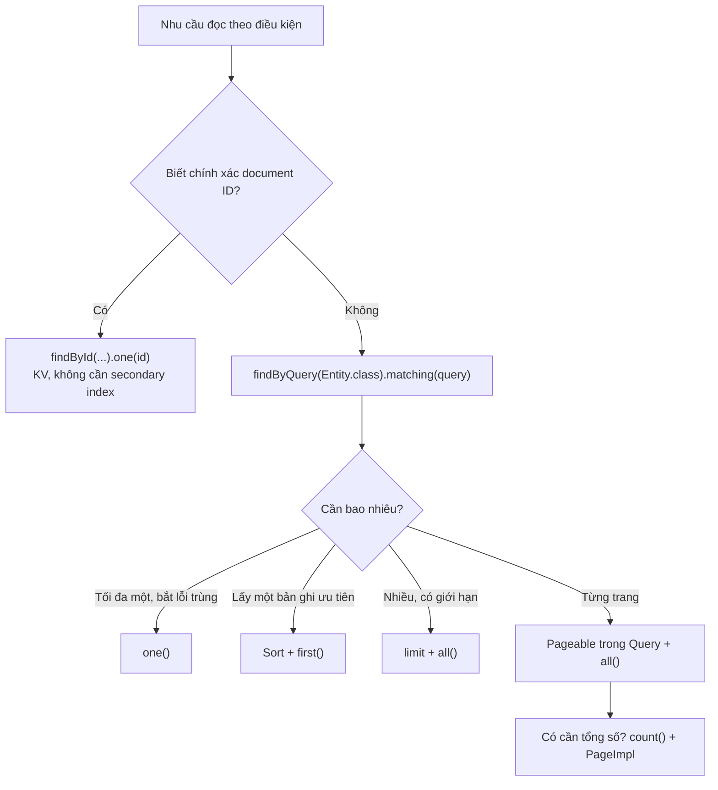

# Chọn một kết quả, tất cả kết quả hoặc kết quả có phân trang

## Mục tiêu học tập

Sau bài này, bạn có thể:

1. Chọn đúng terminal operation của `CouchbaseOperations.findByQuery`: `one()`, `first()`, `all()`, `count()`, `exists()` hoặc `stream()`.
2. Phân biệt rõ **truy vấn phải có tối đa một kết quả** với **chỉ muốn lấy kết quả đầu tiên**; xử lý kết quả rỗng và bản ghi trùng.
3. Áp dụng `Sort`, `Pageable`, `Query.with(pageable)`, `limit()` và `skip()` để đọc một phần tập dữ liệu mà không tải toàn bộ vào bộ nhớ.
4. Tự tạo `Page<T>` hoặc `Slice<T>` ở tầng service khi dùng Template; chọn repository khi cần khả năng phân trang tích hợp.
5. Hiểu ảnh hưởng của thứ tự sắp xếp, index SQL++, query consistency, thay đổi dữ liệu đồng thời và offset lớn đến kết quả giữa các trang.
6. Nhận biết sự khác nhau giữa kiểu trả về đồng bộ và reactive; xác định khi nào truy vấn theo document ID hiệu quả hơn.

**Ngữ cảnh module:** `SPRING_DATA_COUCHBASE` xây dựng tầng truy cập dữ liệu Couchbase bằng document mapping, repository, `CouchbaseTemplate` và SQL++. Chương **Template** tập trung vào điều khiển thao tác thông qua `CouchbaseOperations`, từ lựa chọn bucket/scope/collection, chỉ mục, TTL và CAS đến vấn đề nhất quán, giao dịch và API reactive. Bài học này tập trung vào **số lượng kết quả cần lấy** của truy vấn, không phải các kỹ thuật ghi/xóa document.

## 1. Từ một nhu cầu tìm kiếm đến ba kiểu lấy dữ liệu

Hãy hình dung một dịch vụ ghi nhận sự kiện nghiệp vụ: người vận hành có thể cần tìm duy nhất một sự kiện theo `externalRef`, xem sự kiện đầu tiên theo thời gian, lấy danh sách để xuất báo cáo hoặc hiển thị bảng sự kiện 20 dòng mỗi trang.

Cùng một tập document, cách yêu cầu kết quả quyết định contract của service:

| Nhu cầu | Cách lấy kết quả | Điều kiện cần suy nghĩ |
| --- | --- | --- |
| Có tối đa một sự kiện khớp `externalRef` trong một tenant | `one()` | Nếu có nhiều hơn một match, phải phát hiện lỗi dữ liệu |
| Lấy sự kiện cũ nhất để xử lý tiếp | `first()` **với sort xác định** | “Đầu tiên” không có ý nghĩa ổn định nếu không sắp xếp |
| Lấy tối đa 100 sự kiện để xuất một phần dữ liệu | `all()` với `limit(100)` | Giới hạn số item tải vào bộ nhớ |
| Xem trang thứ 3, mỗi trang 20 sự kiện | `Query.with(Pageable)` + `all()` | Cần sort ổn định và tính toán offset |
| Cần tổng số kết quả và tổng số trang | Truy vấn page + `count()` → `PageImpl` | Count tốn tài nguyên, không nhất thiết cùng snapshot với dữ liệu page |
| Chỉ cần biết có bản ghi phù hợp | `exists()` | Tránh đọc toàn bộ document không cần thiết |
| Chỉ cần biết số bản ghi phù hợp | `count()` | Tránh truyền mọi entity về ứng dụng |



**Phân biệt trước khi viết code:** `findById(...).one(id)` dùng key để đọc **một document cụ thể** qua KV; `findByQuery(...).one()` truy vấn **theo điều kiện** qua Query Service, rồi kiểm tra cardinality của tập match. Cả hai có chữ `one` nhưng ngữ nghĩa và kiểu đầu vào khác nhau.

## 2. Dữ liệu mẫu và thiết kế index

Ví dụ dùng bucket `appdata`, scope `analytics` và collection `activity_events`. Mỗi document lưu:

- `id`: document key, ví dụ `activity::event-001`.
- `tenantId`: tenant sở hữu bản ghi.
- `externalRef`: định danh tham chiếu của hệ thống nguồn.
- `state`: `READY` hoặc `ARCHIVED`.
- `createdAtEpoch`: thời điểm sự kiện, tính bằng giây Unix.
- `eventKey`: trường JSON chứa một khóa sắp xếp duy nhất, bất biến, chẳng hạn bằng chuỗi document ID.

Tại sao cần `eventKey` nếu đã có document ID? ID nằm trong metadata Couchbase, trong khi một trường JSON riêng giúp ví dụ về `Sort.by("eventKey")` dễ hiểu, dễ kiểm soát index và có điều kiện tie-breaker rõ ràng. Hệ thống thật có thể thiết kế sort bằng `META().id` qua SQL++ nếu đáp ứng nhu cầu và kiểm chứng query plan.

### Entity Spring Data

```java
package com.example.analytics;

import org.springframework.data.annotation.Id;
import org.springframework.data.couchbase.core.mapping.Collection;
import org.springframework.data.couchbase.core.mapping.Document;
import org.springframework.data.couchbase.core.mapping.Field;
import org.springframework.data.couchbase.core.mapping.Scope;

@Document
@Scope("analytics")
@Collection("activity_events")
public class ActivityEvent {

    @Id
    private String id;

    @Field
    private String tenantId;

    @Field
    private String externalRef;

    @Field
    private String state;

    @Field
    private long createdAtEpoch;

    @Field
    private String eventKey;

    public ActivityEvent() {
    }

    public ActivityEvent(
            String id,
            String tenantId,
            String externalRef,
            String state,
            long createdAtEpoch) {
        this.id = id;
        this.tenantId = tenantId;
        this.externalRef = externalRef;
        this.state = state;
        this.createdAtEpoch = createdAtEpoch;
        this.eventKey = id;
    }

    public String getId() { return id; }
    public void setId(String id) { this.id = id; }

    public String getTenantId() { return tenantId; }
    public void setTenantId(String tenantId) {
        this.tenantId = tenantId;
    }

    public String getExternalRef() { return externalRef; }
    public void setExternalRef(String externalRef) {
        this.externalRef = externalRef;
    }

    public String getState() { return state; }
    public void setState(String state) { this.state = state; }

    public long getCreatedAtEpoch() { return createdAtEpoch; }
    public void setCreatedAtEpoch(long createdAtEpoch) {
        this.createdAtEpoch = createdAtEpoch;
    }

    public String getEventKey() { return eventKey; }
    public void setEventKey(String eventKey) {
        this.eventKey = eventKey;
    }
}
```

Trong ứng dụng thật, phải bảo đảm `eventKey` duy nhất và không thay đổi nếu dùng làm khóa sắp xếp/pagination. Ví dụ constructor gán `eventKey = id`, nhưng setter công khai chỉ phục vụ minh họa mapping và không thay thế validation nghiệp vụ.

### Tạo chỉ mục cho từng kiểu truy vấn

Nếu đã có bucket/scope/collection, chỉ cần tạo index; nếu chưa, tạo đối tượng chứa trước bằng công cụ quản trị Couchbase.

```sql
-- Truy vấn danh sách theo tenant, trạng thái, thứ tự thời gian.
CREATE INDEX `idx_activity_feed`
ON `appdata`.`analytics`.`activity_events`
   (tenantId, state, createdAtEpoch, eventKey);

-- Truy vấn tham chiếu nguồn theo tenant.
CREATE INDEX `idx_activity_external_ref`
ON `appdata`.`analytics`.`activity_events`
   (tenantId, externalRef);
```

Các index này là gợi ý thiết kế cho ví dụ, không bảo đảm tối ưu trong mọi hệ thống. Spring Data có thể thêm điều kiện metadata loại entity (như `_class`); kiểm tra câu SQL++ thực tế và chạy `EXPLAIN` trên đúng query. Tác vụ `findById` theo ID không đòi secondary index, nhưng các câu tìm theo thuộc tính thường cần.

## 3. one(): yêu cầu tối đa một kết quả

`one()` của **findByQuery** trả `Optional<T>` trong imperative API. Hợp đồng của nó là:

- **0 match** → `Optional.empty()`.
- **1 match** → `Optional.of(entity)`.
- **Từ 2 match trở lên** → `IncorrectResultSizeDataAccessException`.

Ví dụ tìm sự kiện theo khóa nghiệp vụ `externalRef` bên trong tenant:

```java
import java.util.Optional;
import org.springframework.data.couchbase.core.CouchbaseOperations;
import org.springframework.data.couchbase.core.query.Query;
import org.springframework.data.couchbase.core.query.QueryCriteria;

public Optional<ActivityEvent> findUniqueExternalRef(
        String tenantId,
        String externalRef) {

    QueryCriteria criteria = QueryCriteria.where("tenantId")
            .is(tenantId)
            .and("externalRef").is(externalRef);

    return operations
            .findByQuery(ActivityEvent.class)
            .matching(Query.query(criteria))
            .one();
}
```

Nếu xuất hiện hai document cùng `tenantId + externalRef`, truy vấn không đơn giản chọn một bản ghi tùy ý; nó báo lỗi về kích thước kết quả. Điều này hữu ích khi muốn phát hiện dữ liệu không thỏa giả định duy nhất.

**Nhưng `one()` không tự tạo ràng buộc unique trong Couchbase.** Secondary index trong ví dụ là index hỗ trợ truy vấn, không phải unique constraint. Nếu nghiệp vụ cần chống trùng khi ghi, phải thiết kế ID, mapping định danh hoặc chiến lược ghi phù hợp ngay từ đầu. Không chờ đến lúc đọc mới xử lý sự kiện trùng.

### oneValue(): biến thể nullable

Một số phiên bản Spring Data Couchbase có `oneValue()`:

```java
ActivityEvent event = operations
        .findByQuery(ActivityEvent.class)
        .matching(Query.query(criteria))
        .oneValue(); // null nếu không tìm thấy, lỗi nếu có nhiều match
```

Dùng `one()` khi muốn thể hiện vắng mặt rõ ràng bằng `Optional`; dùng `oneValue()` khi code ở ranh giới cần giá trị có thể null và đã có chính sách xử lý. Không chuyển trường hợp nhiều match thành `null` vì như vậy làm mất tín hiệu sai lệch dữ liệu.

### Tránh một lỗi phổ biến với limit

```java
// Sai nếu bạn đang muốn phát hiện có nhiều hơn một match.
Optional<ActivityEvent> result = operations
        .findByQuery(ActivityEvent.class)
        .matching(Query.query(criteria).limit(1))
        .one();
```

`limit(1)` thu hẹp kết quả mà Query Service có thể trả về. Lúc này `one()` không còn cơ hội phát hiện nhiều kết quả ngoài giới hạn đó. Nếu mục tiêu là kiểm tra tính duy nhất, **không đặt `limit(1)` trước `one()`**.

## 4. first(): lấy một kết quả ưu tiên, không đòi duy nhất

`first()` trả `Optional<T>`: không có match thì rỗng, có nhiều match thì chọn kết quả đầu tiên theo thứ tự query. Nó **không** coi nhiều match là lỗi.

Ví dụ lấy sự kiện `READY` sớm nhất của một tenant:

```java
import java.util.Optional;
import org.springframework.data.domain.Sort;
import org.springframework.data.couchbase.core.query.Query;
import org.springframework.data.couchbase.core.query.QueryCriteria;

public Optional<ActivityEvent> findOldestReady(String tenantId) {

    Query query = Query.query(
            QueryCriteria.where("tenantId").is(tenantId)
                    .and("state").is("READY"))
            .with(Sort.by(
                    Sort.Order.asc("createdAtEpoch"),
                    Sort.Order.asc("eventKey")));

    return operations
            .findByQuery(ActivityEvent.class)
            .matching(query)
            .first();
}
```

Hai tiêu chí sort có ý nghĩa:

1. `createdAtEpoch ASC` đưa sự kiện cũ nhất lên trước.
2. `eventKey ASC` phá hòa khi nhiều sự kiện có cùng timestamp, giúp thứ tự xác định.

Nếu bỏ `Sort`, khái niệm “đầu tiên” chỉ là bản ghi xuất hiện trước trong kết quả query; Couchbase không cam kết đó là bản ghi cũ nhất hoặc một ID ổn định qua các lần chạy.

**So sánh trực tiếp:**

| Tập match | `one()` | `first()` |
| --- | --- | --- |
| Rỗng | `Optional.empty()` | `Optional.empty()` |
| Một bản ghi A | `Optional.of(A)` | `Optional.of(A)` |
| Hai bản ghi A, B | Báo lỗi nhiều kết quả | Chọn A nếu A đứng đầu theo sort |
| Không khai báo sort | Vẫn kiểm tra cardinality | Không bảo đảm bản ghi nào “đầu tiên” |

`firstValue()` là biến thể trả entity hoặc `null`, tương ứng với `first()` nhưng không dùng `Optional`. Kiểm tra API phiên bản đang khóa nếu cần dùng biến thể này.

### first() không phải cơ chế khóa công việc

Nếu hai worker đồng thời gọi `first()` để tìm sự kiện tiếp theo rồi cùng xử lý, cả hai có thể nhìn thấy cùng document. Muốn “claim một job duy nhất” cần cơ chế cập nhật trạng thái có CAS, transaction hoặc một hàng đợi phân phối phù hợp. Việc chọn bản ghi đầu tiên chỉ là phép đọc SQL++.

## 5. all(): lấy danh sách, kèm điều kiện và giới hạn hợp lý

`all()` trả `List<T>`, **không trả `Page<T>`** và không tự kèm tổng số bản ghi. Khi không có match, nó trả danh sách rỗng thay vì `null`.

```java
import java.util.List;
import org.springframework.data.domain.Sort;

public List<ActivityEvent> findRecentReady(
        String tenantId, int maxResults) {

    if (maxResults < 1 || maxResults > 100) {
        throw new IllegalArgumentException(
                "maxResults phải từ 1 đến 100");
    }

    Query query = Query.query(
            QueryCriteria.where("tenantId").is(tenantId)
                    .and("state").is("READY"))
            .with(Sort.by(
                    Sort.Order.desc("createdAtEpoch"),
                    Sort.Order.asc("eventKey")))
            .limit(maxResults);

    return operations
            .findByQuery(ActivityEvent.class)
            .matching(query)
            .all();
}
```

Truy vấn trả tối đa `maxResults` sự kiện, bắt đầu từ sự kiện mới nhất và có tie-breaker khi trùng timestamp. Cần lưu ý:

- `all()` không có nghĩa tự động chỉ trả một page hoặc áp dụng giới hạn an toàn. Không đặt `limit` có thể tải danh sách lớn vào bộ nhớ.
- `Query.limit(n)` giới hạn **số lượng trả về**, nhưng không cho biết tổng số document khớp.
- Nếu chỉ cần biết có match, dùng `exists()`; nếu chỉ cần số match, dùng `count()`.
- Nếu bộ lọc có thể trả hàng triệu dòng, cân nhắc chia trang, streaming có kiểm soát hoặc pipeline xuất dữ liệu thay vì một danh sách khổng lồ.

### count() và exists(): đừng đọc entity khi không cần

```java
QueryCriteria filter = QueryCriteria.where("tenantId")
        .is("tenant-42")
        .and("state").is("READY");

long totalReady = operations
        .findByQuery(ActivityEvent.class)
        .matching(Query.query(filter))
        .count();

boolean anyReady = operations
        .findByQuery(ActivityEvent.class)
        .matching(Query.query(filter))
        .exists();
```

`count()` trả `long`; `exists()` trả `boolean`. Đếm toàn bộ tập có thể tốn tài nguyên hơn kiểm tra có ít nhất một match. Hãy dùng terminal diễn đạt đúng câu hỏi nghiệp vụ.

### stream(): không đồng nghĩa phân trang miễn phí

`findByQuery(...).stream()` trả Java `Stream<T>`. Nó có thể hữu ích khi xử lý từng item qua API Stream; tuy vậy cần đóng stream khi hoàn tất và vẫn phải đánh giá hành vi truy vấn, bộ nhớ, tài nguyên và tốc độ phía client.

```java
try (java.util.stream.Stream<ActivityEvent> events = operations
        .findByQuery(ActivityEvent.class)
        .matching(Query.query(filter).limit(100))
        .stream()) {

    long processed = events
            .filter(e -> e.getCreatedAtEpoch() > 0)
            .count();
}
```

Stream trong Java không tự biến truy vấn SQL++ thành cơ chế phân trang vô hạn hoặc làm biến mất chi phí kết quả quá lớn. Giới hạn truy vấn vẫn quan trọng.

## 6. Phân trang tại Template bằng Query.with(Pageable)

### 6.1. Hiểu PageRequest, skip và limit

`Pageable` là một mô tả gồm số trang, kích thước trang và sắp xếp. Spring Data sử dụng quy ước **page number bắt đầu từ 0**:

- `PageRequest.of(0, 20)` lấy trang thứ nhất, offset 0.
- `PageRequest.of(1, 20)` lấy trang thứ hai, offset 20.
- `PageRequest.of(2, 20)` lấy trang thứ ba, offset 40.

Trong API `Query` của Spring Data Couchbase, `with(Pageable)` thiết lập `skip`, `limit` và `Sort`:

```java
import org.springframework.data.domain.PageRequest;
import org.springframework.data.domain.Pageable;
import org.springframework.data.domain.Sort;
import java.util.List;

Pageable pageable = PageRequest.of(
        2, 20,
        Sort.by(
                Sort.Order.asc("createdAtEpoch"),
                Sort.Order.asc("eventKey")));

Query query = Query.query(
        QueryCriteria.where("tenantId").is("tenant-42")
                .and("state").is("READY"))
        .with(pageable);

List<ActivityEvent> thirdPageItems = operations
        .findByQuery(ActivityEvent.class)
        .matching(query)
        .all();
```

Với dữ liệu giữ nguyên và sort xác định, truy vấn này tương đương về ý tưởng với `OFFSET 40 LIMIT 20`. Vì terminal vẫn là `all()` nên giá trị nhận được là `List<ActivityEvent>`, chưa có `totalElements`, `totalPages` hay `hasNext`.

```sql
SELECT e.*
FROM `appdata`.`analytics`.`activity_events` AS e
WHERE e.tenantId = "tenant-42"
  AND e.state = "READY"
ORDER BY e.createdAtEpoch ASC, e.eventKey ASC
LIMIT 20 OFFSET 40;
```

Câu SQL++ trên minh họa điều kiện và thứ tự. Spring Data có thể tự thêm metadata, khóa document, CAS và điều kiện entity type khi tạo truy vấn thực tế. Dùng `EXPLAIN` đối với query do ứng dụng thực sự gửi khi tối ưu index.

### 6.2. Sai lầm: chỉ offset + limit mà không sort

Giả sử có 30 document và trang 1, trang 2 đều lấy 10 document. Nếu không có `ORDER BY`, Query Service không cam kết thứ tự kết quả. Hai lần gọi có thể thấy cùng document ở hai trang hoặc bỏ sót document, ngay cả khi chưa có mutation nghiệp vụ đáng chú ý.

Giải pháp tối thiểu là một thứ tự **toàn phần và ổn định**: trường thời gian + tie-breaker duy nhất; bảo đảm dữ liệu sort key không bị sửa tùy tiện. Với dữ liệu tăng/giảm liên tục, sort ổn định vẫn không mang lại snapshot xuyên nhiều lần gọi; cần chọn chiến lược cursor/keyset hoặc snapshot khi tính nhất quán cao là yêu cầu.

## 7. Trả về Page<T>: dữ liệu trang và tổng số

Một API quản trị thường muốn response dạng:

```json
{
  "page": 2,
  "size": 20,
  "totalElements": 133,
  "totalPages": 7,
  "hasNext": true,
  "content": ["... tối đa 20 sự kiện ..."]
}
```

Đây là **mẫu response minh họa**, không phải JSON serialization mặc định của `PageImpl` trong mọi phiên bản Spring MVC.

Terminal `findByQuery(...).all()` chỉ trả danh sách. Để trả `Page<ActivityEvent>` ở tầng service, thực hiện **query lấy một trang** và **query đếm tổng match** rồi ghép kết quả bằng `PageImpl`.

```java
package com.example.analytics;

import java.util.List;

import org.springframework.data.couchbase.core.CouchbaseOperations;
import org.springframework.data.couchbase.core.query.Query;
import org.springframework.data.couchbase.core.query.QueryCriteria;
import org.springframework.data.domain.Page;
import org.springframework.data.domain.PageImpl;
import org.springframework.data.domain.PageRequest;
import org.springframework.data.domain.Pageable;
import org.springframework.data.domain.Sort;
import org.springframework.stereotype.Service;

@Service
public class ActivityEventSearchService {

    private final CouchbaseOperations operations;

    public ActivityEventSearchService(CouchbaseOperations operations) {
        this.operations = operations;
    }

    public Page<ActivityEvent> findReadyPage(
            String tenantId, int page, int size) {

        validateRequest(tenantId, page, size);

        Pageable pageable = PageRequest.of(
                page, size,
                Sort.by(
                        Sort.Order.asc("createdAtEpoch"),
                        Sort.Order.asc("eventKey")));

        Query contentQuery = Query.query(readyCriteria(tenantId))
                .with(pageable);

        List<ActivityEvent> content = operations
                .findByQuery(ActivityEvent.class)
                .matching(contentQuery)
                .all();

        // Dùng query KHÔNG phân trang để đếm toàn bộ tập match.
        long total = operations
                .findByQuery(ActivityEvent.class)
                .matching(Query.query(readyCriteria(tenantId)))
                .count();

        return new PageImpl<>(content, pageable, total);
    }

    private QueryCriteria readyCriteria(String tenantId) {
        return QueryCriteria.where("tenantId").is(tenantId)
                .and("state").is("READY");
    }

    private void validateRequest(
            String tenantId, int page, int size) {

        if (tenantId == null || tenantId.isBlank()) {
            throw new IllegalArgumentException("tenantId rỗng");
        }
        if (page < 0 || page > 1000) {
            throw new IllegalArgumentException(
                    "Số trang ngoài giới hạn hỗ trợ");
        }
        if (size < 1 || size > 100) {
            throw new IllegalArgumentException(
                    "Kích thước trang phải từ 1 đến 100");
        }
    }
}
```

Code trên minh họa rõ chức năng của các thành phần:

1. `PageRequest` chứa page number, page size và sort.
2. `Query.with(pageable)` lấy đúng **một phần** của tập match.
3. `all()` đưa dữ liệu trang về `List<ActivityEvent>`.
4. `count()` trên **query mới không có skip/limit** đưa về tổng match.
5. `PageImpl` ghép content và metadata, tính toán tổng số trang/hành vi phân trang theo Spring Data Commons.

**Quan trọng về tính nhất quán:** Truy vấn content và count là hai lần truy cập Query Service. Nếu document được thêm, xóa, đổi state hoặc index cập nhật giữa hai lần, tổng số có thể không khớp chính xác với content cùng một thời điểm. `PageImpl` không biến hai query thành một snapshot hay transaction.

### Chi phí của count()

Trả `Page` thường đòi query đếm tổng; với tập dữ liệu rất lớn hoặc filter phức tạp, `count()` có thể làm tăng tải Query Service. Nếu giao diện chỉ cần “còn trang kế tiếp không?”, cân nhắc `Slice` để tránh count tổng.

## 8. Trả về Slice<T>: lấy N + 1 để biết có trang sau

`Slice<T>` chứa `content`, `pageable` và `hasNext`; nó không đòi `totalElements` hoặc `totalPages`.

Ý tưởng: nếu UI yêu cầu 20 item, đọc **21 item** ở offset của trang. Nếu đọc được 21, trả 20 item đầu và `hasNext=true`. Nếu đọc không quá 20, không còn trang sau theo tập quan sát lúc query chạy.

```java
import java.util.List;

import org.springframework.data.couchbase.core.query.Query;
import org.springframework.data.domain.PageRequest;
import org.springframework.data.domain.Pageable;
import org.springframework.data.domain.Slice;
import org.springframework.data.domain.SliceImpl;
import org.springframework.data.domain.Sort;

public Slice<ActivityEvent> findReadySlice(
        String tenantId, int page, int size) {

    validateRequest(tenantId, page, size);

    Sort order = Sort.by(
            Sort.Order.asc("createdAtEpoch"),
            Sort.Order.asc("eventKey"));

    Pageable pageable = PageRequest.of(page, size, order);

    Query query = Query.query(readyCriteria(tenantId))
            .with(order)
            .skip(pageable.getOffset())
            .limit(size + 1);

    List<ActivityEvent> rows = operations
            .findByQuery(ActivityEvent.class)
            .matching(query)
            .all();

    boolean hasNext = rows.size() > size;

    List<ActivityEvent> content =
            List.copyOf(rows.subList(0, Math.min(size, rows.size())));

    return new SliceImpl<>(content, pageable, hasNext);
}
```

> **Lưu ý về vị trí mã:** Method trên là phương thức thứ hai của `ActivityEventSearchService` ở phần 7, vì nó tái sử dụng `operations`, `validateRequest` và `readyCriteria`.

**Vì sao dùng `skip(pageable.getOffset())` thay vì `with(PageRequest.of(page, size+1, sort))`?** Vì PageRequest kích thước `size+1` sẽ tính offset thành `page × (size+1)`, làm lệch điểm bắt đầu từ trang thứ hai. Cách trên giữ offset `page × size`, nhưng đọc thêm một item đúng vị trí.

Cách lấy N+1 vẫn có chi phí OFFSET cao khi page tăng. Hơn nữa, với các document được thêm/xóa trong lúc phân trang, `hasNext` phản ánh **kết quả query hiện tại**, không phải cam kết tất cả trang sau sẽ giữ nguyên.

### Page hay Slice?

| Câu hỏi từ UI | Nên dùng | Chi phí/cam kết |
| --- | --- | --- |
| “Trang 3/7, tổng 133 bản ghi” | `Page<T>` | Cần tổng count; metadata có thể thay đổi giữa query |
| “Xem 20 bản ghi, tải tiếp nếu còn” | `Slice<T>` | Đọc N+1, không phải chạy count riêng |
| “Tôi chỉ cần đúng 20 bản ghi, không quan tâm trang tiếp theo” | `List<T>` | Một query có limit và sort |
| “Đọc theo khóa biết trước” | `findById` | Tránh index/query phân trang không cần thiết |
| “Cuộn sâu hàng trăm nghìn item” | Cursor/keyset thích hợp | Tránh OFFSET rất lớn, cần cursor và sort key ổn định |

## 9. Phân trang sâu: OFFSET và keyset/cursor

OFFSET tiện cho UI có nút chuyển đến trang số cụ thể. Tuy nhiên, khi `OFFSET = 200000`, Query Service thường phải tìm/duyệt phần dữ liệu đứng trước trang để biết mục cần bỏ qua; chi phí có thể tăng đáng kể dù trang cuối chỉ có 20 item. Đồng thời, việc chèn hoặc xóa bản ghi phía trước vị trí OFFSET giữa hai lượt gọi có thể làm trùng hoặc bỏ sót item.

**Keyset pagination** thay số trang bằng mốc khóa của item cuối cùng của trang trước. Ví dụ sort tăng dần theo `(createdAtEpoch, eventKey)`:

```sql
-- Lần đầu không có điều kiện cursor, lấy 20 bản ghi đầu.
SELECT e.*
FROM `appdata`.`analytics`.`activity_events` AS e
WHERE e.tenantId = $tenantId
  AND e.state = "READY"
ORDER BY e.createdAtEpoch ASC, e.eventKey ASC
LIMIT 20;

-- Lần sau truyền lastEpoch và lastKey của item cuối trang trước.
SELECT e.*
FROM `appdata`.`analytics`.`activity_events` AS e
WHERE e.tenantId = $tenantId
  AND e.state = "READY"
  AND (
       e.createdAtEpoch > $lastEpoch
       OR (
            e.createdAtEpoch = $lastEpoch
            AND e.eventKey > $lastKey
       )
  )
ORDER BY e.createdAtEpoch ASC, e.eventKey ASC
LIMIT 20;
```

Các biến `$tenantId`, `$lastEpoch` và `$lastKey` là **named query parameters** của Couchbase SQL++, không nên nội suy raw user input vào chuỗi SQL++. Với dữ liệu thật, cần index tương ứng, quyền truy cập và kiểm tra `EXPLAIN`.

Cursor giúp tránh quét bỏ toàn bộ số hàng phía trước và thường phù hợp cho feed hoặc xử lý tuần tự dài. Đổi lại, nó không hỗ trợ trực tiếp “nhảy tới trang 147”, và không bảo đảm một snapshot bất biến nếu những document còn lại thay đổi trong quá trình đọc. Điều kiện sắp xếp phải có tie-breaker đủ duy nhất và không bị sửa giữa các lần lấy trang.

## 10. Khi nào dùng repository để có Page/Slice sẵn?

Spring Data Couchbase repository hỗ trợ truy vấn với `Pageable` và kiểu trả về `Page<T>` hoặc `Slice<T>` trong những trường hợp phù hợp. Ví dụ interface:

```java
import org.springframework.data.couchbase.repository.CouchbaseRepository;
import org.springframework.data.domain.Page;
import org.springframework.data.domain.Pageable;
import org.springframework.data.domain.Slice;

public interface ActivityEventRepository
        extends CouchbaseRepository<ActivityEvent, String> {

    Page<ActivityEvent> findByTenantIdAndState(
            String tenantId, String state, Pageable pageable);

    Slice<ActivityEvent> findByTenantIdAndStateOrderByCreatedAtEpochAsc(
            String tenantId, String state, Pageable pageable);
}
```

Dùng **một** phương thức phù hợp trong repository thực, thay vì khai báo hai method cạnh tranh có thể làm API rối. Hai chữ ký trên chỉ minh họa những loại return khác nhau. `Pageable` không được null, sort phải được xác định nhất quán; trong hệ thống cần tie-breaker `eventKey` để phân trang ổn định.

**Chọn repository khi** query tương đối cố định và cần Page/Slice có sẵn với ít mã. **Chọn Template khi** predicate được lắp ghép linh hoạt, cần điều chỉnh consistency, projection, collection hoặc xây kiểm soát paging đặc thù. Cả hai cùng sử dụng các năng lực mapping của Spring Data và có thể tồn tại trong một ứng dụng.

Lưu ý khi dùng `@Query` SQL++ thủ công trong repository: tránh tự đặt `ORDER BY`, `LIMIT`, `OFFSET` trùng lặp nếu query method đã nhận `Pageable` và hạ tầng sẽ thêm điều khoản phân trang. Hãy kiểm tra cú pháp do phiên bản Spring Data đang dùng hỗ trợ.

## 11. Reactive: one(), first() và all() trả Mono/Flux

Với `ReactiveCouchbaseOperations`, ý nghĩa cardinality được giữ nhưng kiểu trả về khác:

| Terminal reactive | Kiểu kết quả | Không có match | Khi nhiều match |
| --- | --- | --- | --- |
| `one()` | `Mono<T>` | `Mono.empty()` | Tín hiệu lỗi kích thước kết quả |
| `first()` | `Mono<T>` | `Mono.empty()` | Phát item đầu theo query |
| `all()` | `Flux<T>` | Flux hoàn tất không phát item | Phát nhiều item |
| `count()` | `Mono<Long>` | Phát `0L` | Phát số match |
| `exists()` | `Mono<Boolean>` | Phát `false` | Phát `true` |

```java
import org.springframework.data.couchbase.core.ReactiveCouchbaseOperations;
import org.springframework.data.couchbase.core.query.Query;
import org.springframework.data.couchbase.core.query.QueryCriteria;
import org.springframework.data.domain.PageRequest;
import org.springframework.data.domain.Sort;
import reactor.core.publisher.Flux;
import reactor.core.publisher.Mono;

public class ReactiveActivitySearch {

    private final ReactiveCouchbaseOperations operations;

    public ReactiveActivitySearch(ReactiveCouchbaseOperations operations) {
        this.operations = operations;
    }

    public Mono<ActivityEvent> findByExternalRef(
            String tenantId, String ref) {
        return operations.findByQuery(ActivityEvent.class)
                .matching(Query.query(
                        QueryCriteria.where("tenantId").is(tenantId)
                                .and("externalRef").is(ref)))
                .one();
    }

    public Flux<ActivityEvent> findPage(
            String tenantId, int page, int size) {

        if (page < 0 || size < 1 || size > 100) {
            return Flux.error(new IllegalArgumentException(
                    "Thông số phân trang không hợp lệ"));
        }

        Query query = Query.query(
                QueryCriteria.where("tenantId").is(tenantId)
                        .and("state").is("READY"))
                .with(PageRequest.of(
                        page, size,
                        Sort.by(
                                Sort.Order.asc("createdAtEpoch"),
                                Sort.Order.asc("eventKey"))));

        return operations.findByQuery(ActivityEvent.class)
                .matching(query)
                .all();
    }
}
```

Một `Flux<T>` trả từ `all()` vẫn là publisher của **truy vấn có phân trang** do `Query.with(PageRequest)` điều khiển. Muốn trả `Mono<Page<T>>`, ứng dụng phải ghép dữ liệu và count theo mô hình reactive thích hợp, hoặc dùng repository reactive hỗ trợ contract tương ứng; không gọi `block()` trong event loop WebFlux.

Khi publisher có nhiều subscription, thao tác truy cập dữ liệu có thể được thực hiện nhiều lần. Lỗi kích thước kết quả của `one()` được báo qua tín hiệu lỗi của publisher, không phải qua `Optional.empty()`.

## 12. Nhất quán và hiệu năng khi phân trang Couchbase

### 12.1. Query Service, index và REQUEST_PLUS

`findByQuery` được thực thi bằng SQL++ trên Query Service, khác lệnh KV theo ID. Index thường cập nhật bất đồng bộ: document vừa ghi có thể chưa xuất hiện ngay trong truy vấn theo thuộc tính, ngay cả khi đã đọc được bằng `findById`.

Khi cần Query Service chờ index bắt kịp mutation trước khi chạy, xem xét scan consistency:

```java
import com.couchbase.client.java.query.QueryScanConsistency;

List<ActivityEvent> freshPage = operations
        .findByQuery(ActivityEvent.class)
        .withConsistency(QueryScanConsistency.REQUEST_PLUS)
        .matching(Query.query(
                QueryCriteria.where("tenantId").is("tenant-42"))
                .with(PageRequest.of(
                        0, 20,
                        Sort.by("createdAtEpoch", "eventKey"))))
        .all();
```

`REQUEST_PLUS` có thể tăng thời gian chờ nếu index còn backlog. Nó **không tạo snapshot nhất quán xuyên nhiều lần gọi**, không khiến page và count trở thành một query nguyên tử và không thay thế transaction. Kiểm tra tên method `withConsistency`/các biến thể tương ứng trong phiên bản dependency.

### 12.2. Cạnh tranh, CAS và trạng thái dữ liệu

Nếu một document đổi `state` từ `READY` sang `ARCHIVED` giữa lúc lấy trang 1 và trang 2, nó có thể bị loại khỏi tập match và làm dời vị trí của các document sau. Nếu document mới được chèn với timestamp nhỏ hơn item cuối trang, OFFSET và cursor có thể quan sát tập dữ liệu khác nhau.

`@Version`/CAS giúp bảo vệ điều kiện cập nhật của **một document** khi ghi đúng cơ chế optimistic locking; nó không khóa toàn bộ tập SQL++ theo predicate. Với export cần snapshot logic của một thời điểm, cần thiết kế phiên bản dữ liệu, mốc cutoff hoặc cơ chế phù hợp ngoài việc tăng scan consistency.

### 12.3. Chọn chỉ mục và đo chi phí

Kiểm tra plan cho query pagination tương đương:

```sql
EXPLAIN
SELECT e.*
FROM `appdata`.`analytics`.`activity_events` AS e
WHERE e.tenantId = "tenant-42"
  AND e.state = "READY"
ORDER BY e.createdAtEpoch ASC, e.eventKey ASC
LIMIT 20 OFFSET 1000;
```

Quan sát index scan, sort, số document quét, latency p95/p99 và tải Query Service. Một index nhiều cột không mặc nhiên đạt tối ưu với mọi filter/sort. Nếu dữ liệu phân vùng tenant lớn, cần đánh giá thứ tự khóa index, partition và mẫu truy cập thật.

Với API public, giới hạn `size` và `page`, xác thực tenant từ security context, tránh cho phép sort vào các trường không có index hoặc làm query quá nặng. Không log dữ liệu nhạy cảm trong phần content của trang.

## 13. Các lỗi dễ gặp và cách sửa

| Lỗi | Hậu quả | Cách sửa |
| --- | --- | --- |
| Dùng `first()` khi thực sự yêu cầu duy nhất | Che mất bản ghi trùng về nghiệp vụ | Dùng `one()` và xử lý lỗi cardinality |
| Dùng `one()` sau `limit(1)` | Không còn khả năng phát hiện nhiều match | Không giới hạn một item khi kiểm tra tính duy nhất |
| Gọi `all()` trên tập dữ liệu không giới hạn | Tốn RAM, băng thông, timeout | Dùng `limit`, paging hoặc cơ chế export theo lô |
| Không có sort khi phân trang | Trang có thể trùng/thiếu item | Dùng thứ tự đầy đủ có tie-breaker duy nhất |
| Chỉ sort theo timestamp có thể trùng | Kết quả có thứ tự không xác định giữa các item cùng thời gian | Thêm `eventKey` bất biến vào ORDER BY |
| Nghĩ `.with(pageable).all()` trả `Page<T>` | Sai kiểu trả về và thiếu metadata | Tạo `PageImpl` với count riêng hoặc dùng repository |
| Dùng `count()` trên query đã skip/limit rồi coi đó là tổng | Tổng dễ sai hoặc phụ thuộc cách triển khai | Dùng query mới không paging để đếm toàn bộ predicate |
| Tạo Slice bằng `PageRequest(page, size+1)` | Offset từ trang 2 bị lệch | Giữ `offset = page × size`, chỉ tăng limit lên `size+1` |
| Dùng OFFSET quá lớn | Query chậm, dễ trùng/bỏ sót do mutation | Dùng keyset/cursor khi thích hợp |
| Nghĩ `REQUEST_PLUS` bảo đảm snapshot nhiều trang | Vẫn có thay đổi đồng thời giữa các query | Thiết kế cutoff/snapshot/transaction nếu nghiệp vụ yêu cầu |
| Quên filter tenant | Có thể lộ dữ liệu khác tenant | Lấy tenant từ context đã xác thực |
| Truy vấn theo thuộc tính nhưng không có index phù hợp | Lỗi thiếu index hoặc quét rộng | Tạo index, kiểm tra `EXPLAIN` và thông số tải |

## 14. Bài thực hành

Chuẩn bị bucket `appdata`, scope `analytics`, collection `activity_events` và các index từ phần 2. Chỉ dùng dữ liệu thử nghiệm. Tạo 35 document `READY` cho `tenant-42`, thêm ít nhất 5 document `ARCHIVED` và 5 document cho tenant khác. Trong 35 bản ghi `READY`, cố tình tạo nhiều sự kiện cùng `createdAtEpoch` nhưng có `eventKey` khác nhau.

1. **Cardinality:** Chạy `one()` trên một `externalRef` không có match, có đúng một match và có hai match. Kiểm tra `Optional.empty()`, entity và `IncorrectResultSizeDataAccessException`.
2. **First:** Dùng `first()` để lấy sự kiện `READY` cũ nhất. Bỏ sort và quan sát rằng thứ tự không được cam kết; thêm `createdAtEpoch + eventKey` để xác định kết quả.
3. **All:** Dùng `all()` với `limit(10)` và so sánh `count()` trên cùng predicate không giới hạn. Xác nhận danh sách 10 item không đại diện toàn bộ tập.
4. **Page:** Lấy các trang `0, 1, 2` với size 10. Kiểm tra offset tương ứng `0, 10, 20`, `totalElements=35` và `totalPages=4` nếu dữ liệu không thay đổi.
5. **Slice:** Đọc các slice size 10 bằng kỹ thuật N+1. Xác nhận `hasNext` trên trang 0, 1, 2 là `true` và trang 3 là `false` với bộ dữ liệu 35 item.
6. **Sort:** Tạo thêm hai document cùng timestamp với `eventKey` khác nhau. Kiểm tra dữ liệu hai trang kế tiếp không nhảy thứ tự nếu không có mutation giữa các lần đọc.
7. **Index:** Dùng `EXPLAIN` để xác định index thực sự được chọn; so sánh độ trễ khi tăng OFFSET.
8. **Concurrency:** Giữa hai lượt lấy trang, đổi trạng thái một document hoặc tạo document mới có timestamp nằm ở trang đầu. Quan sát tại sao paging không cung cấp snapshot toàn tập.
9. **Reactive:** Chuyển một query sang `ReactiveCouchbaseOperations`. So sánh `Mono.empty()`, `Mono<T>` và `Flux<T>`; kiểm tra lúc subscription bắt đầu truy vấn.
10. **Chọn API:** Với ba use case *chi tiết theo ID*, *bảng có tổng số trang*, *feed cuộn vô hạn*, quyết định dùng KV, Page, Slice hay cursor và giải thích trade-off.

### Câu hỏi tự kiểm tra

- `one()` khác `first()` như thế nào khi có hai match?
- Khi nào nên gọi `findById(...).one(id)` thay vì `findByQuery(...).one()`?
- Vì sao `Pageable` phải có sort ổn định, và vì sao một timestamp duy nhất đôi khi chưa đủ?
- Vì sao `.matching(query.with(pageable)).all()` trả `List<T>` chứ không trả `Page<T>`?
- `Page<T>` cần thông tin gì mà `Slice<T>` không nhất thiết cần?
- Vì sao `REQUEST_PLUS` không bảo đảm các trang và count có cùng snapshot dữ liệu?

## Tài liệu tham khảo chính thức

- [Spring Data Couchbase — Template & direct operations](https://docs.spring.io/spring-data/couchbase/reference/couchbase/template.html).
- [Javadoc — ExecutableFindByQueryOperation.TerminatingFindByQuery: one, first, all, count, exists](https://docs.spring.io/spring-data/couchbase/reference/api/java/org/springframework/data/couchbase/core/ExecutableFindByQueryOperation.TerminatingFindByQuery.html).
- [Javadoc — Query.with(Pageable), skip, limit và Sort](https://docs.spring.io/spring-data/couchbase/reference/api/java/org/springframework/data/couchbase/core/query/Query.html).
- [Spring Data Couchbase — Repository paging và sorting](https://docs.spring.io/spring-data/couchbase/reference/couchbase/repository.html).
- [Spring Data Commons — Paging, Slice, Page và giới hạn](https://docs.spring.io/spring-data/couchbase/reference/repositories/query-methods-details.html).
- [Javadoc — ReactiveFindByQueryOperation.TerminatingFindByQuery](https://docs.spring.io/spring-data/couchbase/reference/api/java/org/springframework/data/couchbase/core/ReactiveFindByQueryOperation.TerminatingFindByQuery.html).

> **Giới hạn ví dụ:** Các đoạn Java minh họa API Spring Data Couchbase hiện đại và giả định đã có kết nối, quyền đọc dữ liệu, scope/collection và index phù hợp. Khi tích hợp, hãy kiểm tra Javadoc đúng phiên bản dependency, xác minh query plan và kiểm thử phân trang với dữ liệu có thay đổi đồng thời.
