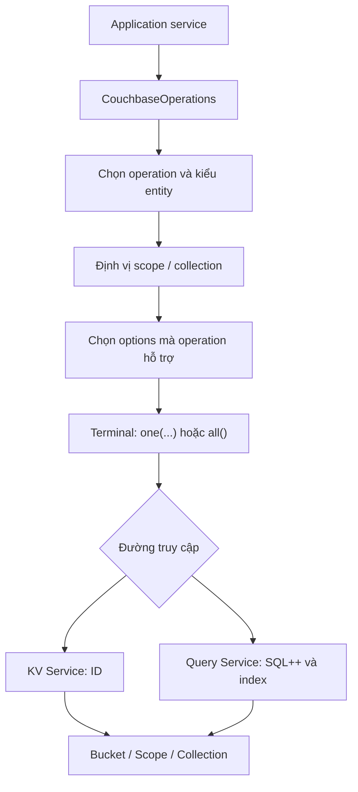

# Chỉ định scope, collection, thời gian chờ và tùy chọn thao tác

## Mục tiêu học tập

Sau bài học, bạn có thể:

1. Giải thích quan hệ **bucket → scope → collection → document ID** của Couchbase và cách Spring Data chọn nơi truy cập dữ liệu.
2. Phân biệt cấu hình mặc định của entity với tùy chọn chỉ định `inScope(…)`, `inCollection(…)` trên một fluent operation của `CouchbaseOperations`.
3. Thiết lập timeout ở cấp ứng dụng và chọn timeout riêng cho những thao tác đặc biệt bằng API Couchbase SDK tương ứng, đồng thời nhận biết giới hạn của từng fluent builder.
4. Chọn những option phù hợp với loại thao tác: expiry/TTL, durability, query consistency và kiểm soát CAS.
5. Xử lý đúng timeout, lỗi collection không tồn tại, sai quyền, stale index và xung đột ghi khi xây dựng tầng truy cập dữ liệu.
6. Đưa ra quyết định hiệu năng và nhất quán phù hợp giữa KV, SQL++, repository, Template và reactive API.

**Bối cảnh:** Module `SPRING_DATA_COUCHBASE` hướng đến tầng truy cập Couchbase bằng Spring Data với document mapping, repository, `CouchbaseTemplate` và truy vấn SQL++. Khi học chương **Template**, cần hiểu rõ cách chỉ định bucket/scope/collection, chỉ mục, TTL, CAS, giao dịch và reactive API để điều chỉnh đúng từng lần truy cập và vận hành hệ thống an toàn.

## 1. Một thao tác Couchbase cần biết những gì?

Giả sử ứng dụng quản lý đơn hàng trong bucket `appdata`, scope `commerce` và collection `orders`. Khi service đọc một document, nó không chỉ truyền ID mà còn cần biết **ID đó nằm ở đâu**:

```text
Cluster
└── Bucket: appdata
    ├── Scope: commerce
    │   ├── Collection: orders
    │   │   ├── order::1001
    │   │   └── order::1002
    │   └── Collection: carts
    │       └── cart::44
    └── Scope: archive
        └── Collection: orders
            └── order::1001
```

Có thể tồn tại hai document mang cùng ID `order::1001` trong `commerce.orders` và `archive.orders`; đó là **hai document ở hai collection khác nhau**.

Một lời gọi fluent thường trả lời bốn nhóm câu hỏi:

| Nhóm quyết định | Câu hỏi | Ví dụ |
| --- | --- | --- |
| **Thao tác + entity** | Đọc, ghi, xóa hay truy vấn entity nào? | `findById(OrderDocument.class)` |
| **Vị trí** | Scope và collection nào? | `inScope("commerce").inCollection("orders")` |
| **Chính sách thao tác** | Có cần TTL, durability, scan consistency hay timeout đặc biệt? | `withExpiry(…)` hoặc `withDurability(…)` |
| **Thực thi** | Lấy theo key hay trả tập kết quả? | `one("order::1001")` hoặc `matching(query).all()` |



Một số tùy chọn thuộc cấu hình **kết nối và SDK**, một số thuộc **thao tác ghi**, một số thuộc **SQL++**. Không thể giả định mọi builder đều có cùng những method. Ví dụ `withExpiry` áp dụng cho các thao tác ghi hỗ trợ expiry; `withConsistency` dành cho truy vấn theo index; scan consistency không phải option của `findById` theo KV.

## 2. Chọn bucket, scope và collection theo đúng cấp

### 2.1. Bucket được cấu hình ở tầng kết nối

Trong ứng dụng Spring Boot đơn giản, bucket thường được chọn bằng cấu hình:

```yaml
spring:
  couchbase:
    connection-string: couchbase://localhost
    username: app_user
    password: ${COUCHBASE_PASSWORD}
  data:
    couchbase:
      bucket-name: appdata
```

Những giá trị trên là ví dụ cho môi trường phát triển. Không ghi mật khẩu thật vào repository; cấp quyền truy cập tối thiểu cho user ứng dụng. Cấu hình bucket nằm ở cấp Spring Boot/Couchbase client factory; **không** diễn đạt bằng cách thêm `.inBucket("…")` vào bất kỳ fluent operation nào rồi giả định method đó tồn tại.

Nếu hệ thống có nhiều bucket, cần thiết kế bean/template/client factory hoặc cơ chế định tuyến phù hợp và kiểm tra khả năng hỗ trợ của phiên bản Spring Data đang dùng. Đừng trộn lựa chọn bucket với việc đổi scope/collection trong một service mà chưa xác định ranh giới dữ liệu.

### 2.2. Scope và collection biểu diễn phân nhóm dữ liệu

Scope là không gian tên trong một bucket; collection chứa các document cụ thể. Spring Data có thể lấy scope/collection mặc định từ annotation của entity:

```java
package com.example.orders;

import org.springframework.data.annotation.Id;
import org.springframework.data.annotation.Version;
import org.springframework.data.couchbase.core.mapping.Collection;
import org.springframework.data.couchbase.core.mapping.Document;
import org.springframework.data.couchbase.core.mapping.Field;
import org.springframework.data.couchbase.core.mapping.Scope;

@Document
@Scope("commerce")
@Collection("orders")
public class OrderDocument {

    @Id
    private String id;

    @Field
    private String customerId;

    @Field
    private String status;

    @Field
    private long totalVnd;

    @Version
    private Long version;

    public OrderDocument() {
    }

    public OrderDocument(
            String id, String customerId, String status, long totalVnd) {
        this.id = id;
        this.customerId = customerId;
        this.status = status;
        this.totalVnd = totalVnd;
    }

    public String getId() { return id; }
    public void setId(String id) { this.id = id; }

    public String getCustomerId() { return customerId; }
    public void setCustomerId(String customerId) {
        this.customerId = customerId;
    }

    public String getStatus() { return status; }
    public void setStatus(String status) {
        this.status = status;
    }

    public long getTotalVnd() { return totalVnd; }
    public void setTotalVnd(long totalVnd) {
        this.totalVnd = totalVnd;
    }

    public Long getVersion() { return version; }
    public void setVersion(Long version) {
        this.version = version;
    }
}
```

Ở đây:

- `@Document` đánh dấu một entity được mapping sang document JSON.
- `@Scope("commerce")` và `@Collection("orders")` chỉ vị trí mặc định.
- `@Id` là **document key**, không nhất thiết nằm trong JSON như một trường thường.
- `@Version` ánh xạ **CAS** của Couchbase để hỗ trợ optimistic locking ở những thao tác kiểm tra CAS. CAS không phải bộ đếm version do ứng dụng tự tăng.

Nếu không khai báo scope/collection trên entity, Spring Data sử dụng cấu hình mặc định hoặc lựa chọn ở tầng repository/template theo phiên bản hiện hành; Couchbase Server có `_default` scope và `_default` collection. Không suy ra rằng mọi collection có tên `orders` đều thuộc `_default` nếu chưa xác minh mapping.

## 3. inScope() và inCollection(): ghi đè vị trí cho một lời gọi

Với entity trên, đọc theo vị trí mặc định:

```java
import org.springframework.data.couchbase.core.CouchbaseOperations;

OrderDocument order = operations
        .findById(OrderDocument.class)
        .one("order::1001");
```

Khi cần đọc một bản lưu trữ ở scope khác:

```java
OrderDocument archived = operations
        .findById(OrderDocument.class)
        .inScope("archive")
        .inCollection("orders")
        .one("order::1001");
```

Phân tích chuỗi:

1. `findById(OrderDocument.class)` chọn thao tác KV và cách mapping kết quả.
2. `inScope("archive")` thay scope mặc định trong **lần đọc này**.
3. `inCollection("orders")` chọn collection ở scope đã chọn.
4. `one("order::1001")` thực thi đọc theo document ID.

Các option trên không sửa annotation, không đổi bean Template và không làm các lời gọi sau mặc nhiên chuyển sang `archive`. Nếu `archive.orders` không tồn tại hoặc account không có quyền, thao tác sẽ lỗi; việc có document cùng ID ở `commerce.orders` không giúp truy cập `archive.orders`.

### 3.1. Khi nào nên dùng override?

| Tình huống | Gợi ý | Lý do |
| --- | --- | --- |
| Mọi đơn hàng nằm trong `commerce.orders` | Dùng `@Scope`/`@Collection` mặc định | Dễ đọc, tránh lặp lại chuỗi tên |
| Một chức năng quản trị đọc đơn đã chuyển sang `archive.orders` | Dùng `inScope`/`inCollection` tại callsite rõ ràng | Ý định vượt mặc định nhìn thấy được |
| Nhiều tenant có collection riêng | Dùng mapping tenant → collection đã xác thực | Chặn truy cập nhầm hoặc vượt quyền tenant |
| Module luôn làm việc với cùng một collection chuyên biệt | Cấu hình ở entity hoặc tầng data access nhất quán | Giảm nguy cơ mỗi service chỉ định khác nhau |
| Phải chuyển sang bucket khác | Thiết kế client factory/template riêng theo kiến trúc | Scope/collection override không đổi bucket |

### 3.2. Ví dụ ghi vào collection khác

Nếu lưu đơn hàng lưu trữ dưới dạng cùng kiểu entity và schema tương thích:

```java
OrderDocument archivedSnapshot = new OrderDocument(
        "order::1001", "customer::42", "ARCHIVED", 350_000L);

OrderDocument stored = operations
        .upsertById(OrderDocument.class)
        .inScope("archive")
        .inCollection("orders")
        .one(archivedSnapshot);
```

**Lưu ý:** `upsertById` có thể ghi đè document trùng key ở collection đích. Lưu bản archive và xóa bản active là **hai thao tác khác nhau**, không tự hình thành một giao dịch xuyên collection. Nếu chuyển dữ liệu cần nguyên tử, thiết kế Couchbase Transactions và bước đối soát/khôi phục phù hợp.

### 3.3. Không nhận tên collection bất kỳ từ client

Ví dụ rủi ro:

```java
// Không dùng trực tiếp tên collection do HTTP client đưa vào.
operations.findById(OrderDocument.class)
        .inScope(scopeFromRequest)
        .inCollection(collectionFromRequest)
        .one(orderId);
```

Kẻ gọi có thể chỉ định nơi chứa dữ liệu khác với tenant của họ. Kể cả Couchbase có quyền RBAC, ứng dụng vẫn phải ánh xạ tenant từ security context sang scope/collection được phép. Nên có allowlist hoặc resolver mà tầng dữ liệu kiểm soát, thay vì tin raw input.

## 4. Thời gian chờ: hiểu đúng timeout trước khi đặt giá trị

**Timeout** là giới hạn thời gian phía client dành cho một thao tác, ví dụ đọc KV hoặc chạy SQL++. Không có một timeout duy nhất cho mọi đường truy cập và mọi tầng kiến trúc.

```text
HTTP request (deadline của API / reverse proxy)
  └── Application service
      ├── Spring Data Couchbase operations
      │   └── Couchbase Java SDK
      │       ├── KV timeout: get / insert / upsert / replace / remove
      │       └── Query timeout: SQL++ qua Query Service
      └── Retry / validation / business processing
```

Cần phân biệt:

- **KV timeout:** giới hạn kỳ vọng cho thao tác theo ID trên Data Service.
- **Query timeout:** giới hạn kỳ vọng cho truy vấn SQL++ có thể gồm plan, index scan, sort và truyền kết quả.
- **Deadline của HTTP/API:** toàn bộ request có thể gồm nhiều lệnh Couchbase, xử lý nghiệp vụ và gọi dịch vụ ngoài.
- **Timeout của server hoặc hạ tầng:** có thể giới hạn thời gian độc lập với client. Việc tăng timeout ở một tầng không tự động tăng timeout ở tầng khác.

Ví dụ service gọi một truy vấn SQL++ và một lệnh KV liên tiếp: nếu mỗi lệnh có timeout ba giây, tổng latency không mặc nhiên được giới hạn còn ba giây. Ngược lại, HTTP timeout hai giây có thể hết trước khi Query Service hoàn tất.

### 4.1. Thiết lập mặc định ở Spring Boot

Cấu hình minh họa cho một môi trường cần KV nhanh nhưng cho phép SQL++ xử lý lâu hơn:

```yaml
spring:
  couchbase:
    connection-string: couchbase://localhost
    username: app_user
    password: ${COUCHBASE_PASSWORD}
    env:
      timeouts:
        kv: 1500ms
        query: 8s
  data:
    couchbase:
      bucket-name: appdata
```

Với nhánh Spring Boot có những property này, `spring.couchbase.env.timeouts.kv` và `spring.couchbase.env.timeouts.query` cấu hình timeout mặc định của Couchbase Java SDK. Kiểm tra metadata cấu hình của **đúng phiên bản Spring Boot** khi triển khai; các tên property hoặc lựa chọn cấu hình có thể khác giữa phiên bản.

Những giá trị trong ví dụ chỉ để minh họa, **không phải đề xuất SLA phổ quát**. Chúng cần xuất phát từ độ trễ đo được, phân vị p95/p99, đặc tính cụm Couchbase, khả năng chịu tải và latency budget của request.

### 4.2. Timeout cho từng thao tác: kiểm tra contract của builder

Một số phiên bản và loại fluent operation của Spring Data Couchbase có những option riêng để điều chỉnh request; các option SDK cấp thấp cũng có thể xuất hiện thông qua cơ chế truyền options. **Không giả định có thể gọi `withTimeout(Duration)` trên mọi nhánh** chỉ vì một builder khác hỗ trợ. Hãy nhìn Javadoc của chính operation ở phiên bản thư viện dự án đã khóa.

Khi thao tác đòi timeout riêng mà đường Template sử dụng không cung cấp cách biểu diễn rõ ràng, có thể gọi **Couchbase Java SDK** cho trường hợp đó. Ví dụ đọc raw document với timeout 750 ms:

```java
import java.time.Duration;

import com.couchbase.client.java.Cluster;
import com.couchbase.client.java.kv.GetOptions;
import com.couchbase.client.java.kv.GetResult;
import com.couchbase.client.java.json.JsonObject;

public class RawOrderLookup {

    private final Cluster cluster;

    public RawOrderLookup(Cluster cluster) {
        this.cluster = cluster;
    }

    public JsonObject loadRawDocument(String id) {
        GetResult result = cluster
                .bucket("appdata")
                .scope("commerce")
                .collection("orders")
                .get(id, GetOptions.getOptions()
                        .timeout(Duration.ofMillis(750)));

        return result.contentAsObject();
    }
}
```

Ví dụ này cố ý nhận `JsonObject` từ SDK. Nó **không** tự áp dụng Spring Data entity converter, `@Document`, `@Version` hoặc custom mapping mà `CouchbaseTemplate` quản lý. Nếu cần trả `OrderDocument`, phải ánh xạ dữ liệu đúng quy tắc, hoặc dùng Template với cấu hình timeout thích hợp.

### 4.3. Truy vấn SQL++ với timeout riêng ở SDK

```java
import java.time.Duration;

import com.couchbase.client.java.Cluster;
import com.couchbase.client.java.json.JsonObject;
import com.couchbase.client.java.query.QueryOptions;
import com.couchbase.client.java.query.QueryResult;

public class DirectOrderQuery {

    private final Cluster cluster;

    public DirectOrderQuery(Cluster cluster) {
        this.cluster = cluster;
    }

    public QueryResult findOrdersForCustomer(String customerId) {
        String statement = """
            SELECT META(o).id AS documentId,
                   o.customerId, o.status, o.totalVnd
            FROM `appdata`.`commerce`.`orders` AS o
            WHERE o.customerId = $customerId
            """;

        return cluster.query(
                statement,
                QueryOptions.queryOptions()
                        .parameters(JsonObject.create()
                                .put("customerId", customerId))
                        .timeout(Duration.ofSeconds(3)));
    }
}
```

Trong ví dụ Java, tên bucket, scope và collection được bọc trong cặp dấu backtick theo cú pháp SQL++. Đoạn FROM tương ứng là:

```sql
FROM `appdata`.`commerce`.`orders` AS o
```

Ở đây `$customerId` là tham số SQL++, **không** nối giá trị người dùng trực tiếp vào statement. Đường SDK giúp kiểm soát `QueryOptions.timeout` nhưng đòi xử lý JSON, mapping và lỗi ở tầng ứng dụng. Khi dùng Spring Data, ưu tiên API Template nếu nó đáp ứng yêu cầu và chỉ xuống SDK khi thực sự cần điều khiển cấp thấp.

### 4.4. Chọn timeout bằng latency budget

Giả sử SLA mong muốn của API tra cứu là 400 ms ở p95. Một ví dụ phân bổ ngân sách:

| Thành phần | Ngân sách mục tiêu minh họa |
| --- | --- |
| Validation, serialization, xử lý nghiệp vụ | 40 ms |
| Một lần đọc KV | 150 ms |
| Mạng, queue, sai lệch tải và dự phòng | 110 ms |
| Biên an toàn còn lại | 100 ms |
| **Tổng** | **400 ms** |

Đây là bảng lập kế hoạch chứ không phải số liệu thực đo hoặc bảo đảm độ trễ. Không đặt timeout 10 giây cho một thao tác rồi kỳ vọng API luôn đáp ứng trong 400 ms. Mặt khác, timeout quá thấp khiến request hợp lệ bị cắt khi cluster có tải tăng nhẹ.

Với công việc nền truy vấn khối lượng lớn, deadline có thể khác đáng kể API tương tác. Đừng tùy tiện tăng mọi timeout để che giấu index thiếu, query plan xấu hoặc cluster quá tải.

## 5. Tùy chọn riêng cho ghi: expiry và durability

### 5.1. TTL/expiry

Giả sử dữ liệu giỏ hàng chỉ tồn tại 30 phút:

```java
import java.time.Duration;

CartDocument saved = operations
        .insertById(CartDocument.class)
        .inScope("commerce")
        .inCollection("carts")
        .withExpiry(Duration.ofMinutes(30))
        .one(cart);
```

Trong ví dụ này `CartDocument` và biến `cart` là entity/instance của phần ứng dụng quản lý giỏ hàng; cần định nghĩa đúng mapping `@Document` và ID khi sử dụng. `withExpiry` thiết lập thời gian hết hạn ở metadata document. Nó không lưu một trường `expiresAt` tự sinh trong JSON.

Bạn cũng có thể khai báo TTL mặc định ở entity phù hợp:

```java
@Document(expiry = 1800)
@Scope("commerce")
@Collection("temporary_carts")
public class TemporaryCartDocument {
    @Id
    private String id;
    // Các thuộc tính tạm khác...
}
```

TTL trên annotation là cách diễn đạt mặc định ở cấp kiểu entity, còn `withExpiry` là chính sách cho lần ghi khi operation hỗ trợ. Trong ứng dụng thực phải kiểm tra tương tác giữa expiry ở annotation, giá trị operation, maxTTL của bucket/collection và cơ chế giữ/đặt lại TTL khi update.

**Tình huống thực tế:** Nếu document hết hạn giữa lúc service đọc và `replace`, lệnh replace có thể báo không tồn tại. Nếu retry bằng `upsert`, ứng dụng có thể tạo mới bản ghi đã được retention policy cho hết hạn; vì vậy không tự chuyển replace sang upsert khi gặp lỗi.

### 5.2. Durability

Với đơn hàng quan trọng, khi tạo mới có thể yêu cầu cluster xác nhận mức durability cao hơn:

```java
import com.couchbase.client.core.msg.kv.DurabilityLevel;

OrderDocument created = operations
        .insertById(OrderDocument.class)
        .inScope("commerce")
        .inCollection("orders")
        .withDurability(DurabilityLevel.MAJORITY)
        .one(new OrderDocument(
                "order::1001", "customer::42", "NEW", 350_000L));
```

`MAJORITY` yêu cầu mức xác nhận của phần lớn bản sao hoạt động theo cơ chế durability của Couchbase. Mức này làm thay đổi điều kiện xác nhận thao tác ghi, **không** biến một lệnh đơn thành giao dịch qua nhiều document, không ngăn ghi đè mất cập nhật và không buộc secondary index lập tức theo kịp mutation mới.

Durability có chi phí: khi tải cao hoặc node gặp sự cố, thời gian xác nhận có thể tăng. Chọn theo yêu cầu tính bền vững dữ liệu và SLA đo được thay vì mặc định chọn cao nhất cho mọi document cache.

### 5.3. Các tùy chọn chỉ có ý nghĩa với thao tác phù hợp

| Nhóm option | Ví dụ | Có ý nghĩa với |
| --- | --- | --- |
| Vị trí | `inScope`, `inCollection` | Nhiều thao tác KV và query |
| Thời gian tồn tại | `withExpiry(Duration)` | Thao tác ghi hỗ trợ expiry |
| Xác nhận durability | `withDurability(DurabilityLevel)` | Thao tác mutation hỗ trợ durability |
| Nhất quán truy vấn | `withConsistency(QueryScanConsistency.REQUEST_PLUS)` | Query Service/SQL++, không phải KV read bằng key |
| Truy vấn theo điều kiện | `matching(Query)` | `findByQuery`, `removeByQuery` và nhánh phù hợp |
| Timeout SDK | `GetOptions.timeout(…)`, `QueryOptions.timeout(…)` | Operation SDK tương ứng; tùy operation có option object riêng |
| CAS/version | `@Version`, hoặc CAS option SDK tương ứng | Ghi cần kiểm tra phiên bản đã đọc |
| Projection | Các tùy chọn projection theo API | Đọc chỉ một phần trường nếu được hỗ trợ |

Không sao chép cùng một chuỗi fluent option sang tất cả thao tác. Mỗi interface builder có contract cụ thể, được Java compiler và Javadoc mô tả.

## 6. Nhất quán truy vấn: REQUEST_PLUS chỉ dành cho Query Service

Một lỗi chẩn đoán phổ biến là đọc document bằng ID đã thấy giá trị mới, nhưng `findByQuery` theo `status` hoặc `customerId` chưa thấy. Nguyên nhân có thể là index SQL++ cập nhật bất đồng bộ.

Ví dụ lọc đơn hàng đã thanh toán:

```java
import java.util.List;

import com.couchbase.client.java.query.QueryScanConsistency;
import org.springframework.data.couchbase.core.query.Query;
import org.springframework.data.couchbase.core.query.QueryCriteria;

Query query = Query.query(
        QueryCriteria.where("customerId").is("customer::42")
                .and("status").is("PAID"))
        .limit(50);

List<OrderDocument> paidOrders = operations
        .findByQuery(OrderDocument.class)
        .inScope("commerce")
        .inCollection("orders")
        .withConsistency(QueryScanConsistency.REQUEST_PLUS)
        .matching(query)
        .all();
```

`REQUEST_PLUS` yêu cầu Query Service chờ index đạt mức nhất quán scan tương ứng trước khi chạy câu SQL++. Điều này **có thể làm tăng latency** và dẫn đến timeout nếu index đang backlog; nó không bảo đảm ảnh chụp nhất quán xuyên nhiều câu query độc lập.

Không cần ghép `withConsistency` vào `findById`: đọc theo document ID dùng KV, không có bước scan secondary index. Nếu chỉ muốn đọc một key đã biết, ưu tiên `findById(OrderDocument.class).one(id)`.

### Chỉ mục quyết định hiệu năng

Cho query ở trên, một index minh họa:

```sql
CREATE INDEX `idx_orders_customer_status`
ON `appdata`.`commerce`.`orders`(customerId, status);
```

Chỉ mục phải được tạo trên đúng collection mà query truy cập. Tạo index trên `archive.orders` không làm query của `commerce.orders` tự có index. Xem `EXPLAIN`, trạng thái index và SQL++ thực tế do Spring Data sinh ra. Spring Data có thể thêm điều kiện metadata loại entity như `_class` nên việc tối ưu index cần đo trên truy vấn thật.

## 7. CAS và optimistic locking không phải timeout hay durability

`CAS` (*compare-and-swap*) là giá trị metadata của một document, thay đổi khi document bị mutation. Nó giúp trả lời: **“Document này còn đúng phiên bản mà tôi đã đọc không?”**

Ví dụ mẫu cập nhật sau khi đọc:

```java
import java.util.NoSuchElementException;

public OrderDocument markPaid(String id) {
    OrderDocument current = operations
            .findById(OrderDocument.class)
            .one(id);

    if (current == null) {
        throw new NoSuchElementException(
                "Không tìm thấy đơn hàng: " + id);
    }

    current.setStatus("PAID");

    // @Version map CAS: save dùng optimistic locking khi có version.
    return operations.save(current);
}
```

Entity `OrderDocument` có `@Version` như phần 2. Khi một luồng khác sửa document giữa lần đọc và lần ghi, thao tác kiểm tra CAS có thể lỗi optimistic locking. Service phải quyết định đọc lại, đánh giá nghiệp vụ mới và retry có giới hạn.

Phân biệt các cơ chế:

- **CAS:** điều kiện phiên bản của **một** document.
- **Durability:** mức xác nhận ghi của cluster.
- **Scan consistency:** mức theo kịp của index khi chạy SQL++.
- **Timeout:** giới hạn thời gian client chờ/thực thi request.
- **Transaction:** ranh giới nguyên tử của những thao tác cần phối hợp, theo khả năng và cấu hình giao dịch đang dùng.

Không cơ chế nào trong bốn cơ chế đầu tự thay thế transaction nhiều document. Chọn đúng mục đích để tránh đánh đổi độ trễ nhưng không đạt tính nhất quán cần thiết.

## 8. Service hoàn chỉnh: ranh giới truy cập được biểu diễn rõ ràng

Service sau minh họa một số quyết định thường gặp khi thao tác trên cùng entity:

```java
package com.example.orders;

import java.util.List;
import java.util.NoSuchElementException;

import com.couchbase.client.core.msg.kv.DurabilityLevel;
import com.couchbase.client.java.query.QueryScanConsistency;
import org.springframework.data.couchbase.core.CouchbaseOperations;
import org.springframework.data.couchbase.core.query.Query;
import org.springframework.data.couchbase.core.query.QueryCriteria;
import org.springframework.stereotype.Service;

@Service
public class OrderAccessService {

    private final CouchbaseOperations operations;

    public OrderAccessService(CouchbaseOperations operations) {
        this.operations = operations;
    }

    // Tạo đơn mới; chọn scope/collection và durability rõ ràng.
    public OrderDocument createOrder(OrderDocument order) {
        return operations.insertById(OrderDocument.class)
                .inScope("commerce")
                .inCollection("orders")
                .withDurability(DurabilityLevel.MAJORITY)
                .one(order);
    }

    // Theo ID: đường KV, không cần secondary index.
    public OrderDocument loadActive(String id) {
        return operations.findById(OrderDocument.class)
                .inScope("commerce")
                .inCollection("orders")
                .one(id);
    }

    // Cùng ID nhưng scope khác: đọc một bản lưu trữ riêng.
    public OrderDocument loadArchived(String id) {
        return operations.findById(OrderDocument.class)
                .inScope("archive")
                .inCollection("orders")
                .one(id);
    }

    // Truy vấn SQL++: yêu cầu index mới nhất ở mức REQUEST_PLUS.
    public List<OrderDocument> paidOrders(String customerId) {
        Query query = Query.query(
                QueryCriteria.where("customerId").is(customerId)
                        .and("status").is("PAID"))
                .limit(50);

        return operations.findByQuery(OrderDocument.class)
                .inScope("commerce")
                .inCollection("orders")
                .withConsistency(QueryScanConsistency.REQUEST_PLUS)
                .matching(query)
                .all();
    }

    // @Version mang CAS để phát hiện cập nhật đồng thời.
    public OrderDocument changeStatus(String id, String newStatus) {
        OrderDocument current = loadActive(id);

        if (current == null) {
            throw new NoSuchElementException(
                    "Không tồn tại đơn: " + id);
        }

        current.setStatus(newStatus);
        return operations.save(current);
    }
}
```

Mã trên minh họa cách tách các phương thức có hợp đồng rõ nghĩa. Chưa bao gồm xác thực quyền và state transition, quản lý retry, idempotency hay kiểm thử cụm Couchbase thực tế.

**Lưu ý kỹ thuật về override và `save`:** `operations.save(current)` sẽ dựa vào mapping entity/Template mặc định; nếu đã đọc từ **collection khác** rồi `save` mà không quản lý vị trí, có nguy cơ ghi về vị trí mặc định. Trong ví dụ `changeStatus` chỉ làm việc với collection mặc định `commerce.orders`. Với luồng cập nhật archive/dynamic collection, cần giữ quyết định vị trí nhất quán trên cả read và write, đồng thời bảo đảm CAS và mapping đúng contract.

## 9. Khi nào chọn SDK thay vì Template?

Spring Data mang lại entity converter, repository và cách gọi nhất quán. Nhưng tùy chọn cấp thấp của SDK có thể cần thiết khi:

- Một thao tác duy nhất có timeout khác biệt rõ so với mặc định, mà fluent builder hiện tại không expose cơ chế tương đương.
- Cần API KV/sub-document hoặc tuning option chuyên biệt chưa được Template biểu đạt đầy đủ.
- Cần gọi SQL++ raw có tham số, timeout riêng, profiling hoặc chỉ định những option query ngoài khả năng API cấp cao.
- Cần kết hợp thao tác SDK trong quy trình riêng đã được thiết kế rõ ranh giới mapping, transaction và error handling.

Sử dụng SDK trực tiếp không có nghĩa bỏ luôn Spring Data. Có thể giữ các tác vụ CRUD thông thường ở `CouchbaseOperations` và cô lập lệnh SDK đặc biệt trong adapter riêng. Tuy nhiên, phải xác định rõ JSON mapping, timeout, CAS, collection, retry và observability; không mặc định raw SDK trả cùng kiểu exception hoặc entity với Template.

## 10. Timeout và retry trong vận hành thực tế

### 10.1. Timeout không luôn chứng minh thao tác thất bại

Với **đọc**, timeout thường cho biết client chưa nhận được kết quả trong giới hạn đã đặt. Với **ghi**, client có thể timeout **sau khi server đã chấp nhận hoặc hoàn tất mutation**. Vì vậy kết quả ghi có thể **không chắc chắn**, đặc biệt trong điều kiện mạng lỗi hoặc request bị retry.

Ví dụ:

```text
Client                Couchbase Data Service
  |  INSERT order::1001           |
  |------------------------------>|
  |                   ghi thành công
  |                 x               |
  |  phản hồi bị mất, client timeout |
  |                                 |
  |  retry INSERT order::1001       |
  |------------------------------>|
  |       key đã tồn tại            |
```

Lỗi “key đã tồn tại” ở retry không thể tự phân biệt liệu lần đầu của **chính request** đã thành công hay có tiến trình khác ghi key đó. Thiết kế idempotency key và cách đối soát trạng thái theo nghiệp vụ trước khi kết luận cuối cùng.

Couchbase Java SDK có thể phân biệt một số nhóm timeout như ambiguous và unambiguous, nhưng exception mà tầng Spring Data quan sát được còn phụ thuộc cách thư viện chuyển đổi lỗi. Không bắt tất cả timeout rồi tự động retry mọi loại mutation.

### 10.2. Retry làm tiêu hao thời gian chờ

Nếu một HTTP request có deadline ngắn, ba lần retry query sau timeout có thể khiến API vượt SLA và tăng tải cluster. Chỉ retry khi:

1. Lỗi có khả năng phục hồi.
2. Thao tác là idempotent hoặc có cơ chế kiểm tra trạng thái.
3. Còn đủ deadline và có giới hạn số lần.
4. Có backoff/jitter phù hợp, tránh nhiều client cùng retry đồng loạt.

Với conflict CAS, phải đọc dữ liệu mới và tính lại thay đổi nghiệp vụ. Với query thiếu index hoặc sai quyền, retry liên tục không giải quyết được nguyên nhân.

### 10.3. Chẩn đoán lỗi theo tầng

| Triệu chứng | Cần kiểm tra | Hướng xử lý |
| --- | --- | --- |
| KV `findById` không tìm thấy dù biết có document | Bucket/scope/collection, key chính xác, TTL | Kiểm tra mapping, context tenant, expiry |
| Lỗi collection/scope không tồn tại | Tên đối tượng, trạng thái tạo, môi trường | Tạo đúng đối tượng, kiểm tra deployment/migration |
| `PermissionDenied` hoặc lỗi quyền tương đương | RBAC, role user, bucket/scope/collection | Cấp quyền tối thiểu đúng phạm vi, không mở quyền toàn cluster |
| Query SQL++ chậm, còn KV nhanh | Secondary index, query plan, sort, `REQUEST_PLUS` | Chạy `EXPLAIN`, xem index backlog và latency |
| Query timeout nhưng số kết quả nhỏ | Index scan rộng, bộ lọc thiếu, contention | Đo tổng quét và CPU thay vì chỉ tăng timeout |
| Ghi lâu khi bật `MAJORITY` | Durability, topology, node Data Service | Đo p95/p99, đối chiếu SLA và yêu cầu dữ liệu |
| Cập nhật lỗi optimistic locking | CAS đã đổi | Đọc lại, kiểm tra rule, retry có giới hạn |
| Document biến mất sau ghi | TTL từ entity/operation/bucket | Kiểm tra expiry policy và thời điểm mutation |
| API chậm dù Couchbase trả nhanh | Phần xử lý khác, thread pool, HTTP deadline | Phân rã trace từng bước thay vì đổ lỗi cho DB |

Theo dõi thời gian truy cập KV và Query Service **riêng**, tỉ lệ timeout, retry, CAS conflict, query plan, tài nguyên index, throughput và lỗi theo collection. Đừng log mật khẩu hoặc body chứa dữ liệu nhạy cảm.

## 11. Reactive API và chính sách timeout

`ReactiveCouchbaseOperations` cung cấp fluent API tương tự cho pipeline Reactor, nhưng terminal trả về publisher thay cho entity trực tiếp:

```java
import org.springframework.data.couchbase.core.ReactiveCouchbaseOperations;
import reactor.core.publisher.Mono;

public class ReactiveOrderReader {

    private final ReactiveCouchbaseOperations operations;

    public ReactiveOrderReader(ReactiveCouchbaseOperations operations) {
        this.operations = operations;
    }

    public Mono<OrderDocument> loadArchived(String id) {
        return operations
                .findById(OrderDocument.class)
                .inScope("archive")
                .inCollection("orders")
                .one(id);
    }
}
```

Publisher được thực thi khi có subscription. Trong Reactor có thể đặt giới hạn thời gian cho một pipeline:

```java
Mono<OrderDocument> result = reactiveReader.loadArchived("order::1001")
        .timeout(java.time.Duration.ofSeconds(2));
```

**Cần phân biệt:** Reactor `timeout(…)` giới hạn thời gian chờ tín hiệu của publisher; nó không nhất thiết thiết lập đúng option timeout nội bộ của Couchbase SDK hoặc bảo đảm mutation phía server bị hủy. Nếu yêu cầu timeout riêng cho operation Couchbase, cấu hình SDK/Template tương ứng vẫn là nguồn quyết định. Tránh gọi `block()` trong event loop WebFlux để chuyển publisher thành kiểu đồng bộ.

Khi một request reactive ghép nhiều truy vấn liên tiếp, cần quản lý **deadline tổng** và chính sách retry của toàn pipeline. Timeout ở publisher bọc ngoài không làm các lệnh mutation đã thành công tự đảo ngược.

## 12. Kiểm thử tích hợp và tình huống cần xác minh

Không cần viết test chỉ để kiểm tra builder trả đúng tên phương thức; hãy kiểm thử những hành vi có rủi ro kinh doanh hoặc phụ thuộc Couchbase Server:

| Kịch bản | Bước thực hiện | Kết quả cần xác nhận |
| --- | --- | --- |
| Cùng ID ở hai scope | Insert `order::X` vào `commerce.orders` và `archive.orders` | Mỗi scope cho nội dung độc lập |
| Override không lan sang lệnh sau | Đọc archive rồi đọc mặc định | Lệnh sau vẫn dùng mapping mặc định |
| Sai collection hoặc thiếu quyền | Truy cập collection không tồn tại/không được cấp quyền | Lỗi được phân loại, không chuyển thành kết quả rỗng |
| KV timeout thấp | Đặt timeout riêng trong môi trường mô phỏng độ trễ | Caller nhận tín hiệu timeout phù hợp; không hiểu nhầm lỗi nghiệp vụ |
| Query index chậm | Chạy SQL++ với/không có index phù hợp | Quan sát latency, EXPLAIN và ảnh hưởng timeout |
| REQUEST_PLUS sau mutation | Ghi KV rồi query lọc theo field mới | Đo thời gian index catch-up và tính đúng mong muốn |
| TTL rất ngắn | Insert document tạm với expiry | Sau hạn dùng, KV không tìm thấy |
| Durability cao | Ghi với `MAJORITY` | Ghi thành công khi cluster đáp ứng mức durability hoặc nhận lỗi có thể chẩn đoán |
| CAS conflict | Hai worker đọc cùng document rồi cùng sửa | Ghi cũ bị từ chối khi kiểm soát optimistic locking có hiệu lực |
| Timeout ghi không chắc chắn | Mô phỏng mất phản hồi sau mutation | Idempotency và đối soát không tạo bản ghi trùng |

Không cần tạo scope, collection hoặc index lại mỗi lần chạy bài thực hành nếu đối tượng đã tồn tại. Chỉ sử dụng dữ liệu thử nghiệm, không phá dữ liệu production.

## 13. Bài thực hành tổng hợp

Chuẩn bị bucket `appdata`, scope `commerce` và `archive`, collection `orders` ở mỗi scope; cấp quyền đọc/ghi phù hợp. Thực hiện:

1. **Mapping mặc định:** Tạo một `OrderDocument` ở `commerce.orders` và đọc bằng `findById(OrderDocument.class).one(id)`.
2. **Override:** Tạo document khác nhưng **cùng ID** ở `archive.orders`, đọc với `inScope("archive").inCollection("orders")`. Chứng minh hai giá trị độc lập.
3. **Cấu hình timeout:** Đặt mặc định KV/query trong Spring Boot; đo latency hai loại thao tác và giải thích vì sao timeout khác nhau.
4. **Per-operation SDK:** Đọc một raw document với `GetOptions.timeout(Duration.ofMillis(750))`; so sánh khác biệt kiểu trả về `JsonObject` so với entity mapping Template.
5. **Expiry:** Tạo document giỏ hàng tạm với `withExpiry(Duration.ofMinutes(1))`, xác minh nó hết hạn; không áp dụng expiry cho đơn hàng cần lưu giữ.
6. **Durability:** Thử `insertById` với `MAJORITY` và đo độ trễ so với chính sách mặc định trong môi trường thử nghiệm.
7. **Consistency:** Ghi bằng KV rồi lọc SQL++ với `NOT_BOUNDED` và `REQUEST_PLUS` khi cấu hình phù hợp; quan sát index catch-up.
8. **CAS:** Đọc cùng document từ hai tác vụ, cập nhật trạng thái bằng đường có optimistic locking, quan sát conflict và đề xuất retry đúng.
9. **Reactive:** Đọc archive với `ReactiveCouchbaseOperations`, đặt Reactor `timeout` rồi giải thích tại sao nó không thay thế timeout SDK cho mutation.
10. **Vận hành:** Viết bảng timeout budget của một API sử dụng hai thao tác Couchbase, có giới hạn deadline và cách xử lý retry khi ghi không rõ kết quả.

### Câu hỏi tự kiểm tra

- Tại sao cùng document ID nhưng khác collection có thể chứa hai document độc lập?
- Khi entity có `@Scope`/`@Collection`, khi nào cần và khi nào không cần `inScope`/`inCollection`?
- Tại sao timeout query thường khác timeout KV? Tăng query timeout có sửa được index sai không?
- Tại sao `withExpiry`, `withDurability` và `withConsistency` không thể dùng hoán đổi mục đích?
- Tại sao một lệnh ghi bị timeout không nhất thiết đồng nghĩa server chưa ghi?
- `@Version`/CAS bảo vệ điều gì mà `REQUEST_PLUS` không bảo vệ?
- Khi nào chọn API Couchbase SDK trực tiếp dù ứng dụng đã dùng `CouchbaseTemplate`?
- Reactor `Mono.timeout()` khác gì timeout của Couchbase SDK?

## Tài liệu tham khảo để đối chiếu theo phiên bản

- [Spring Data Couchbase — Template & direct operations](https://docs.spring.io/spring-data/couchbase/reference/couchbase/template.html).
- [Spring Data Couchbase — Collection Support](https://docs.spring.io/spring-data/couchbase/reference/couchbase/collections.html).
- [Spring Data Couchbase — Entity Mapping](https://docs.spring.io/spring-data/couchbase/reference/couchbase/entity.html).
- [Javadoc — CouchbaseOperations](https://docs.spring.io/spring-data/couchbase/reference/api/java/org/springframework/data/couchbase/core/CouchbaseOperations.html).
- [Spring Boot — Couchbase auto-configuration](https://docs.spring.io/spring-boot/reference/data/nosql.html#data.nosql.couchbase).
- [Couchbase Java SDK — Timeouts](https://docs.couchbase.com/java-sdk/current/howtos/error-handling.html).
- [Couchbase Java SDK — KV operations](https://docs.couchbase.com/java-sdk/current/howtos/kv-operations.html).
- [Couchbase Java SDK — SQL++ Query](https://docs.couchbase.com/java-sdk/current/howtos/n1ql-queries-with-sdk.html).

> **Ranh giới kỹ thuật:** Ví dụ trình bày các API phổ biến của Spring Data Couchbase và Couchbase Java SDK hiện đại. Trước khi đưa vào dự án, đối chiếu tên builder method, cấu hình Spring Boot, ngữ nghĩa expiry/durability, timeout và query consistency theo đúng phiên bản dependency đã khóa. Kết quả STEP 4 là tài liệu học tập; kiểm chứng học thuật và kiểm thử tích hợp sẽ thuộc bước QA tiếp theo.
